# 读懂 A64：Arm 64 位指令集架构指南（中文精读版）

> 原文：*Learn the architecture - A64 Instruction Set Architecture Guide*
>
> 版本：Version 1.4　|　文档 ID：102374_0104_01_en　|　Issue 01（2026-10-06）
>
> 版权 © 2022–2026 Arm Limited（或其关联公司）。保留所有权利。非保密。
>
> 说明：本文在原中文翻译的基础上重新组织了叙述逻辑与表达方式，技术内容、代码示例与图表均保持原意；个别明显笔误已按 Arm 架构规范订正。

---

## 导读：这份文档想帮你建立什么认知

如果你平时写 C/C++，可能很少直接碰汇编。但只要涉及启动代码、内核底层、性能调优或者崩溃现场分析，A64 汇编就会突然变得重要。本指南的目标不是把指令手册抄一遍，而是帮你搭起一张“地图”：

- 指令长什么样，主要分成哪几类；
- 寄存器怎么用，W 和 X 到底差在哪；
- 编译器把一段 C 代码翻译成汇编时，大致按什么套路走；
- 以及，如何亲手写一个能被 C 调用的汇编函数。

读完之后，你应当能拿到一份“C 源码 + 编译器输出”，并大致说清楚每条汇编在对应哪句 C。具体到某一条指令的编码、伪代码和限制，仍应查阅《Arm Architecture Reference Manual》。

## 1. 先把概念理清：ISA 是什么

指令集架构（Instruction Set Architecture，ISA）是计算机抽象模型的一部分，它规定了“软件通过什么方式去控制处理器”。

对 Arm 来说，这件事的意义在于：只要你写的软件或固件符合 Arm 的规格说明，那么任何一颗基于 Arm 的处理器都应该以相同的方式执行它。软件与硬件之间因此有了一份共同的契约。

本指南讨论的是 A64 指令集。它服务于 64 位的 Armv8-A 架构，这个执行状态也被称为 AArch64。

需要提前说明的是：本指南不会逐条讲解所有指令——那是架构参考手册的工作。我们关注的是三件事：指令的通用格式、指令的主要类别，以及汇编代码与编译器生成代码之间如何相互配合。

## 2. 为什么开发者要关心 ISA

日常开发中，你未必需要手写汇编。但仍有一些场景绕不开它，比如第一阶段启动软件（first stage boot software），或者某些低层的内核操作。

即使不写汇编，理解指令集能做什么、编译器又是如何利用这些指令的，也能带来实际收益：你能写出更贴合硬件的代码，也能看懂编译器的输出——调试时这一点尤其有用。

## 3. Armv8-A 的三套指令集

Armv8-A 同时支持三套指令集：A32、T32 和 A64。

- **A64**：在 AArch64 执行状态下使用，是一种定长 32 位指令集。名字里的“64”指的是它由 AArch64 执行状态使用，而不是指指令在内存中占 64 位。
- **A32 / T32**：也分别被称为 Arm 和 Thumb，在 AArch32 执行状态下使用。

本指南只讨论 A64。A32 与 T32 的细节可以查阅文末的“延伸资料”。

## 4. 查指令的正确姿势：架构参考手册

每一个版本的 Arm 架构都对应一本《Arm Architecture Reference Manual》，可以在 Arm Developer 网站上找到。每条指令的完整说明通常包含四部分：

- **编码（Encoding）**：指令在内存中如何表示。
- **参数（Arguments）**：指令接受哪些输入。
- **伪代码（Pseudocode）**：用 Arm 伪代码语言描述指令到底做了什么。
- **限制（Restrictions）**：什么情况下不能用，或者可能触发什么异常。

A64 的指令说明还提供 XML 和 HTML 两种形式，适合经常查阅的人。XML 以压缩包形式下载，便于本地处理；HTML 可以直接在浏览器里查看和搜索。两者与手册同源，只是呈现格式略有差别。

## 5. 处理器如何执行指令：简单顺序执行模型

Arm 架构用“简单顺序执行”（Simple Sequential Execution，SSE）模型来描述指令行为。通俗地说，就是假设处理器一次只取一条、译一条、执行一条，并且严格按指令在内存中的顺序来。

真实的现代处理器当然不是这样：它们有流水线，能同时处理多条指令，甚至可能乱序执行。下图是一个 Arm Cortex 处理器的流水线示意：

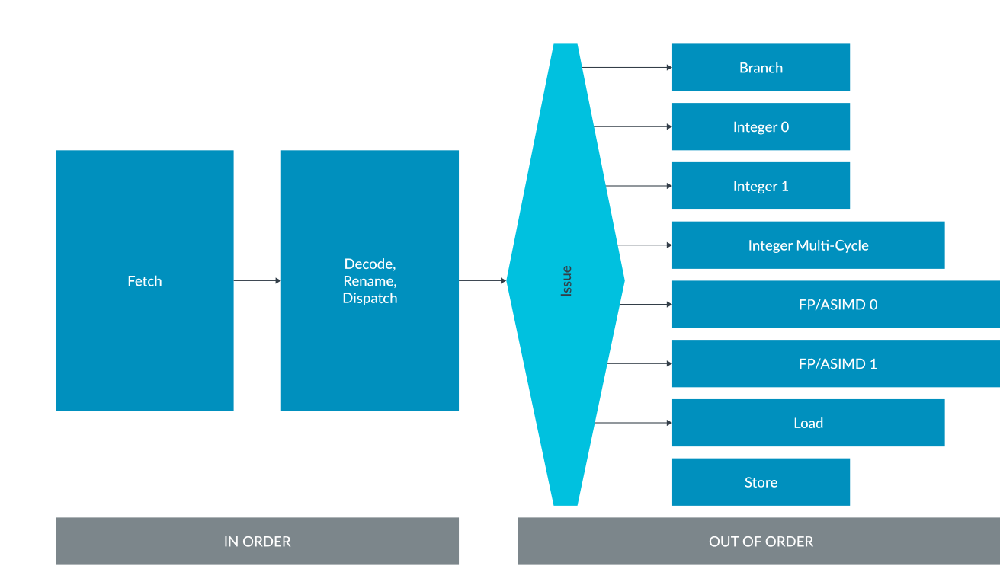

*图 5-1：Cortex 流水线示例*

这里要抓住一个关键点：架构只是功能层面的描述，并不规定处理器内部如何实现。无论内部怎么重排指令，处理器对外表现出的行为都必须与简单顺序执行模型一致。

## 6. 通用寄存器：X 与 W 的两种视图

大多数 A64 指令都围绕寄存器工作。架构提供了 31 个通用寄存器，编号 0 到 30。每个寄存器都有两种“看法”：

- 作为 64 位的 **X 寄存器**：X0..X30；
- 作为 32 位的 **W 寄存器**：W0..W30。

这两种名字指向的是同一个物理寄存器，只是访问宽度不同。下图里，W0 就是 X0 的低 32 位，W1 就是 X1 的低 32 位：


*图 6-1：寄存器图*

对数据处理指令而言，选 X 还是选 W，直接决定了运算宽度：用 X 就是 64 位运算，用 W 就是 32 位运算。

下面这条做 32 位整数加法：

```asm
ADD W0, W1, W2
```

下面这条则做 64 位整数加法：

```asm
ADD X0, X1, X2
```

还有一个必须记住的副作用：**写 W 寄存器会清零对应 X 寄存器的高 32 位**。

此外还有一组独立的 32 个寄存器，专门用于浮点和向量操作。它们是 128 位宽，同样可以用多种方式访问：Bx 是 8 位，Hx 是 16 位，Sx 是 32 位，Dx 是 64 位，Qx 是 128 位。

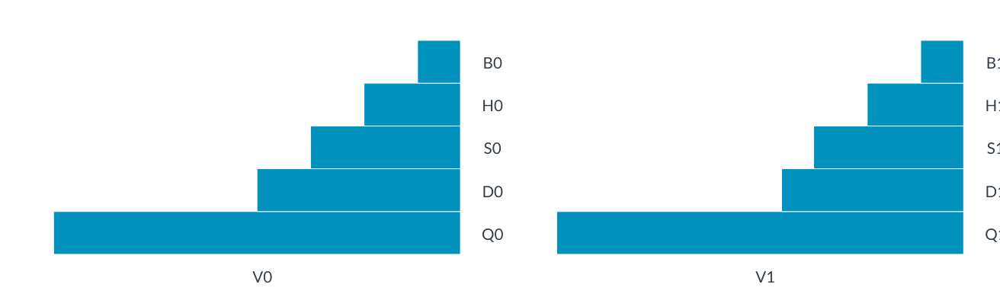

*图 6-2：寄存器图*

用哪个名字，就决定了这次计算的宽度。例如 32 位浮点加法：

```asm
FADD S0, S1, S2
```

64 位浮点加法：

```asm
FADD D0, D1, D2
```

这些寄存器也可以写成 V 形式。一旦使用 V，寄存器就被视为一个向量——里面装着多个相互独立的值，而不是一个标量。例如向量浮点加法：

```asm
FADD V0.2D, V1.2D, V2.2D
```

以及向量整数加法：

```asm
ADD  V0.2D, V1.2D, V2.2D
```

向量指令会在后文展开。

## 7. 零寄存器、栈指针、链接寄存器与程序计数器

除了通用寄存器，还有几个特殊角色需要认识：

- **零寄存器 XZR / WZR**：读出来永远是 0，写入则被忽略。
- **栈指针（SP）**：可以作为加载、存储的基址使用；也能参与一部分数据处理指令，但它不是普通通用寄存器。Armv8-A 中存在多个栈指针，分别与不同的异常级别绑定。指令里写 SP 时，用的是当前栈指针。具体选择规则见异常模型指南。
- **X30**：链接寄存器（Link Register，LR），保存函数返回地址。另外还有独立的 ELR_ELx 用于异常返回，这部分同样在异常模型指南中讨论。
- **程序计数器（PC）**：在 A64 中它不是通用寄存器，不能直接参与数据处理指令。想读取当前地址，可以这样做：

```asm
ADR Xd, .
```

ADR 会根据当前位置计算一个标签的地址。这里的点号（`.`）表示“此处”，所以这条指令拿到的是它自身的地址，效果等同于读取 PC。此外，一些分支指令以及部分加载/存储操作会隐式使用 PC 的值。

> 注意：在 A32 和 T32 中，PC 和 SP 都是通用寄存器；到了 A64，情况不再如此。

## 8. 系统寄存器与 MRS/MSR

除了通用寄存器，架构还定义了一组系统寄存器，用来配置处理器、管理 MMU、控制异常处理等系统级功能。

系统寄存器不能直接参与数据处理或加载/存储指令。典型做法是：先把它读进一个 X 寄存器，在通用寄存器里处理完，再写回去。完成这件事只需要两条专用指令：

```asm
MRS        Xd, <system register>
```

把系统寄存器读入 Xd。

```asm
MSR        <system register>, Xn
```

把 Xn 写入系统寄存器。

系统寄存器按名字指定，例如 SCTLR_EL1：

```asm
MRS        X0, SCTLR_EL1
```

这条指令把 SCTLR_EL1 读入 X0。

寄存器名字末尾的 `_ELx` 表示访问它所需的最低特权级。例如：

- `SCTLR_EL1`：需要 EL1 或更高特权；
- `SCTLR_EL2`：需要 EL2 或更高特权；
- `SCTLR_EL3`：需要 EL3 特权。

特权不足却强行访问，会触发异常。

另外你偶尔会看到 `_EL12`、`_EL01` 这类后缀，它们与虚拟化有关，详见虚拟化指南。

## 9. 数据处理（一）：算术与逻辑指令的通用格式

逻辑运算和整数算术指令的基本结构如下图所示：

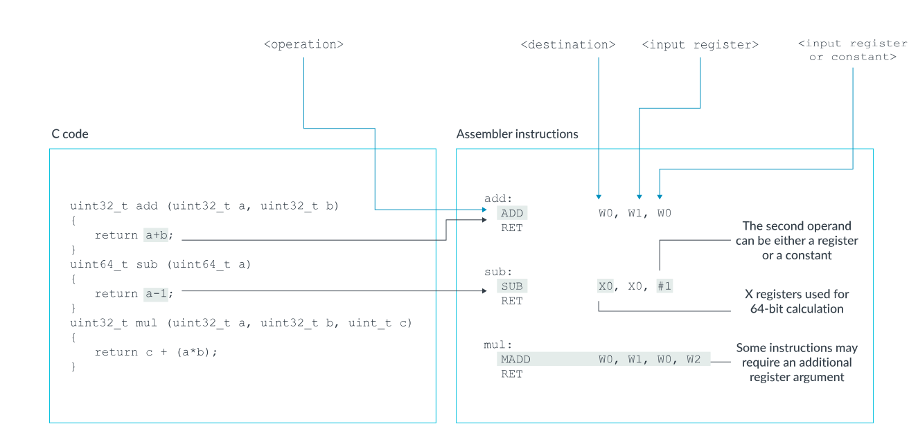

*图 9-1：逻辑和整数算术指令格式*

拆开来看，一条指令由几部分组成：

- **操作（Operation）**：决定这条指令做什么。比如 ADD 表示加法，AND 表示按位与。在操作名后加 S 可以顺带更新标志位，例如 ADD 变成 ADDS。这个 S 的作用，是让处理器根据运算结果更新 ALU 标志，后文“条件码从哪来”会详细讲。
- **目标（Destination）**：结果放在哪里，总是一个寄存器。大多数指令只有一个目标寄存器，少数有两个。如果目标是 W 寄存器，对应的 X 寄存器高 32 位会被置 0。
- **操作数 1（Operand 1）**：一定是寄存器，作为第一个输入。
- **操作数 2（Operand 2）**：可以是寄存器，也可以是常量，作为第二个输入。若为寄存器，还可以附带一个可选的移位操作；若为常量，则该常量直接编码在指令里，因此可用的常量范围有限。

有两个特殊情况值得留意：MOV 和 MVN。MOV 把常量或另一个寄存器的内容搬到目标寄存器；MVN 则是按位取反后再搬。

这两条指令只需要一个输入操作数（寄存器或常量）：

```asm
MOV       X0, #1
```

效果：X0 = 1。

```asm
MVN       W0, W1
```

效果：W0 = ~W1。

## 10. 数据处理（二）：浮点与小数据格式

浮点指令沿用与整数数据处理指令相同的格式，只是改用浮点寄存器。和整数一样，操作宽度决定使用哪个寄存器名。浮点指令的操作名通常以 F 开头。

例如，下面这条以半精度计算 H0 = H1 / H2：

```asm
FDIV       H0, H1, H2
```

这条以单精度计算 S0 = S1 + S2：

```asm
FADD       S0, S1, S2
```

这条以双精度计算 D0 = D1 - D2：

```asm
FSUB       D0, D1, D2
```

### 10.1 8 位与 16 位浮点的支持

Arm 架构包含对 16 位和 8 位浮点格式的支持。

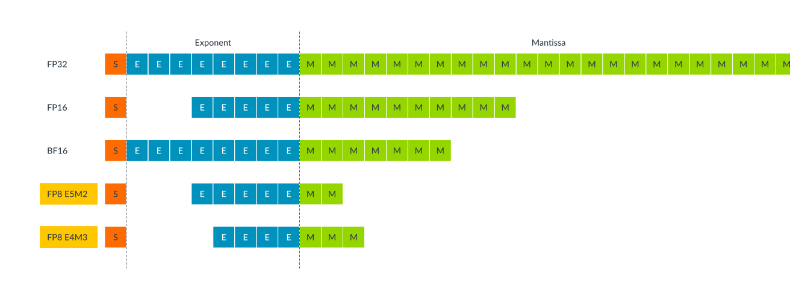

*图 10-1：数据格式之间的差异*

**FP16**：Armv8.2-A 引入了 16 位浮点支持（FEAT_FP16）。从 Armv8.2-A 起它是可选的；如果实现了 SVE 或 SVE2，就变为强制要求。因此在 Armv9-A 中，它实际上已经是必备能力。

**BF16**：BFloat16（常缩写为 BF16）是另一种 16 位浮点存储格式，从 Armv8.2-A 起可选（FEAT_BF16），到 Armv8.6-A 和 Armv9.1-A 变为强制。它是为神经网络（NN）高性能处理量身定做的新格式。

FP16 与 BF16 的差别，本质在于指数位和尾数位如何分配（见上图）。BF16 的指数范围与 FP32 相同，但尾数更短。这带来一个实际好处：BF16 与 FP32 之间的转换更简单，因为 BF16 可以看作 FP32 的“低精度版本”。

关于 BF16 的更多背景，可参考 Arm 博客《AWS Graviton3 featuring Arm Neoverse V1 is up to 1.8x faster than x86 for deep learning inference workloads》。

**FP8**：2022 年，Arm、Intel 和 Nvidia 宣布合作制定 FP8——一种交换格式，目的是让软件生态更容易共享神经网络模型，并持续推动 AI 算力进步。该格式后来成为 OCP8 标准，并在 Armv9.2-A 中以 FEAT_FP8、FEAT_FP8xxx 的形式进入架构。

FP8 包含一对格式：E5M2 和 E4M3。两者在精度与表示范围之间做了不同的取舍。

具体用哪一种，由 FPMR 寄存器中的字段选择。不同输入可以选用不同格式，从而更高效地处理混合格式的数据集。

**更小的格式与查找表**：为了支持其他小尺寸数据格式，Armv9.6-A 和 Armv9.7-A 引入了查找表（LUT）指令（FEAT_LUT、SVE2.3 和 SME2.3）。借助这些指令，软件可以高效地把 2 位、4 位或 6 位格式转换成便于处理的其他格式。

### 10.2 浮点支持是可选的么

不是。在 Armv8-A 中，浮点支持是强制的。架构规定，只要运行像 Linux 这样的富操作系统，就必须具备浮点能力。

严格来说，如果你运行的是完全专有的软件栈，理论上可以省掉浮点支持。但包括 GCC 和 Arm Compiler 6 在内的大多数工具链，都会默认硬件具备浮点能力。

## 11. 数据处理（三）：位操作

还有一组专门在寄存器内部“摆弄位”的指令。下面是一些例子：

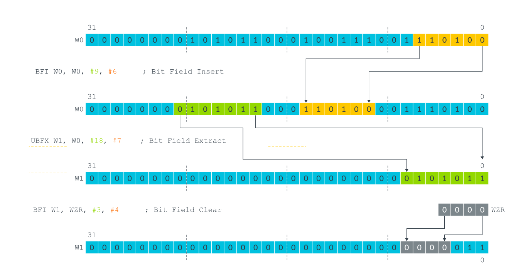

*图 11-1：在寄存器内操作位的示例指令集*

- **BFI**：把一段位域插入寄存器。上图中，BFI 从源寄存器 W0 取出一个 6 位字段，插入目标寄存器的第 9 位开始的位置。
- **UBFX**：提取一段位域。上图中，UBFX 从源寄存器的第 18 位开始取出 7 位，放入目标寄存器。

另外一些指令可以反转字节或位的顺序：

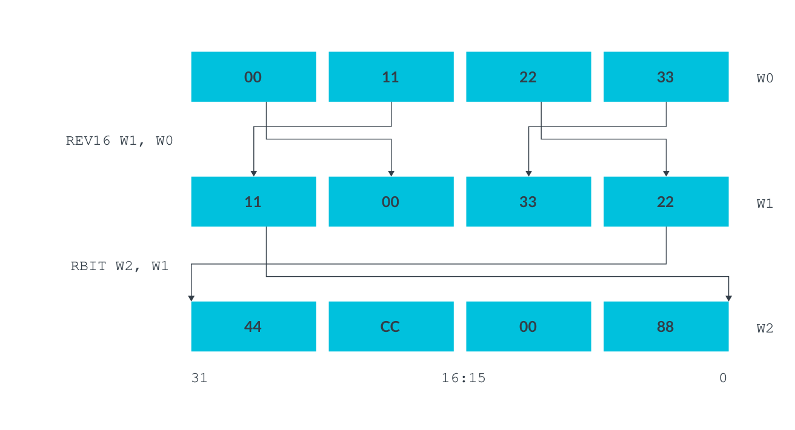

*图 11-2：反转字节或位顺序的指令*

**REV16** 和 **RBIT** 在处理不同字节序（endianness）的数据时特别有用。

## 12. 数据处理（四）：扩展、饱和与窄整数运算

有时需要把数据从一种宽度转换成另一种宽度。这时可以用 **SXTx**（符号扩展）和 **UXTx**（无符号扩展）指令。名字里的 x 表示被扩展数据的宽度：

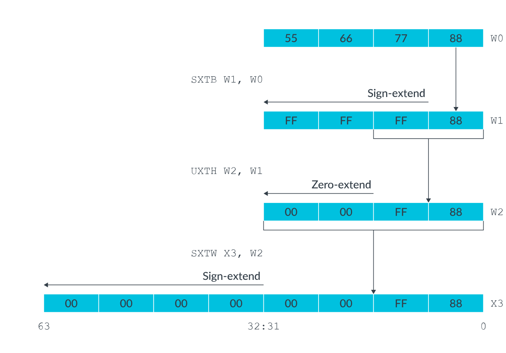

*图 12-1：数据大小转换示例*

- **SXTB**：B 表示字节（byte）。它取出 W0 的低字节，符号扩展到 32 位。
- **UXTH**：H 表示半字（halfword）。它取出 W1 的低 16 位，零扩展到 32 位。

前两个例子的目标都是 W 寄存器，因此扩展到 32 位；第三个例子以 X 寄存器为目标，所以符号扩展到 64 位。

### 12.1 自测

写一条指令：把 W5 中的一个字节做符号扩展后放入 X7，扩展到 64 位。

```asm
SXTB X7, W5
```

### 12.2 子寄存器宽度的整数处理

有些指令执行**饱和算术（saturating arithmetic）**：如果结果超出目标能表示的范围，就把结果钳制到该整数范围的最大值或最小值，而不是回绕。

数据处理指令本身擅长处理 32 位和 64 位数据。实践中，饱和指令常出现在子寄存器计算中——也就是 16 位或 8 位的运算。下面用几段 C 代码和对应汇编来说明。

**示例 1**

C 代码：

```c
uint32_t add32(uint32_t a, uint32_t b) {
    return a+b;
}
```

生成的汇编：

```asm
add32:
  ADD  W0, W1, W0
  RET
```

**示例 2**

C 代码：

```c
uint16_t uadd16(uint16_t a, uint16_t b) {
  return a+b;
}
```

生成的汇编：

```asm
uadd16:
  AND  W8, W1, #0xffff
  ADD  W0, W8, W0, UXTH
  RET
```

**示例 3**

C 代码：

```c
int16_t sadd16(int16_t a, int16_t b) {
  return a+b;
}
```

生成的汇编：

```asm
sadd16:
  SXTH  W8, W1
  ADD   W0, W8, W0, SXTH
  RET
```

第一个例子是 32 位加法，正好落在 W 寄存器上，所以一条 ADD 就够了。

16 位无符号的例子需要多做一步：先用 AND 把高 16 位清掉，再用 `UXTH` 把第二个操作数按无符号方式扩展到 32 位后相加。

第三个例子处理有符号 16 位：先把一个输入扩展到 32 位——

```asm
SXTH  W8, W1
```

再执行加法，并在第二个操作数上附带 `SXTH` 扩展：

```asm
ADD   W0, W8, W0, SXTH
```

这里 `ADD` 末尾的 `, SXTH` 表示“先把该操作数符号扩展到 32 位，再参与运算”。由于函数返回类型是 `int16_t`，最终只有低 16 位会被调用方使用。

## 13. 数据处理（五）：格式转换

前面已经见过 MOV 和 MVN，它们负责在寄存器之间复制值。类似地，**FMOV** 可以在浮点寄存器和通用寄存器之间复制。

但要注意：FMOV 复制的是**字面上的位模式**，并不做数值解释。如果你想做“数值等价”的转换，就需要另一类指令：

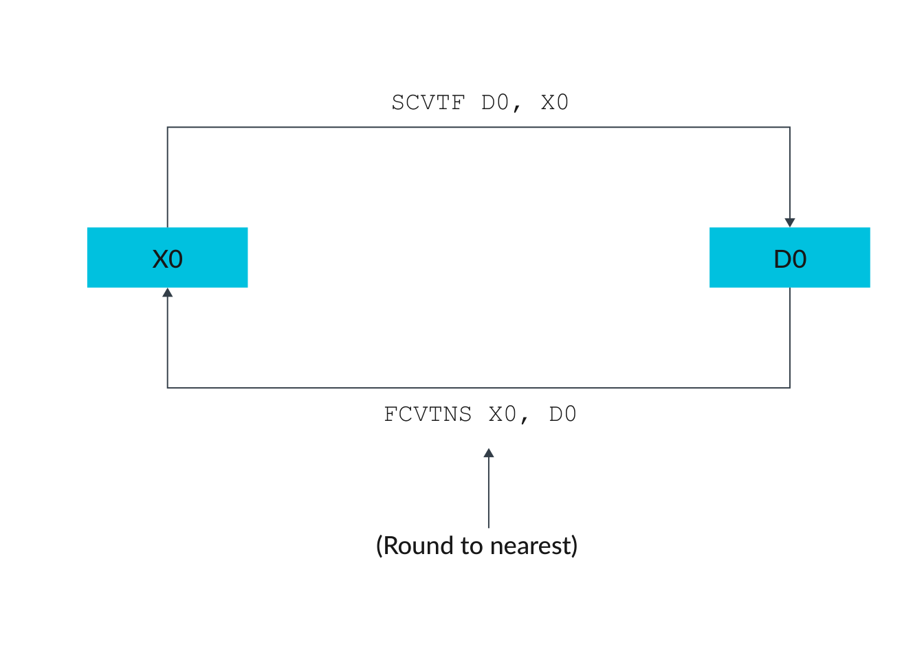

*图 13-1：FMOV/SCVTF 示例（原图题注为 "EMOV example"）*

假设 X0 中存放整数 2：

```text
X0 = 0x0000_0000_0000_0002
```

执行下面两条指令：

```asm
FMOV D0, X0
SCVTF D1, X0
```

两条指令都把 X0“复制”进一个 D 寄存器，但结果完全不同：

```text
D0 = 0x0000_0000_0000_0002 = 9.88131e-324
D1 = 0x4000_0000_0000_0002 = 2.0
```

原因很清楚：FMOV 原样搬运位模式，把它当浮点数解释时自然是一个完全不同的值；SCVTF 则把 X0 中的整数转换成最接近的浮点表示。

反方向也一样。**FCVTxx** 可以把浮点值转换成最接近的整数表示，其中 xx 的不同取值决定采用哪种舍入模式。

## 14. 向量与矩阵：SIMD、SVE 与 SME

A64 还支持向量数据处理，主要有两类：

- **高级 SIMD（Advanced SIMD）**，也就是常说的 NEON；
- **可扩展向量扩展（Scalable Vector Extension，SVE 与 SVE2）**：SVE 在 Armv8-A 中引入，面向 HPC 工作负载优化；Armv9-A 引入 SVE2，在 SVE 基础上扩展了更多使用场景。

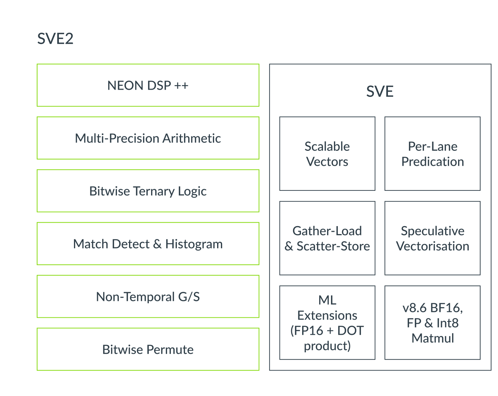

*图 14-1：SVE 和 SVE2*

这两类向量处理会在后续的向量编程指南中展开。

> “Advanced SIMD”这个名称有其历史渊源：Armv6 中就有对普通 32 位通用寄存器做 SIMD 操作的指令；到 Armv7，“Advanced SIMD”开始指代能操作 128 位向量的指令。Armv6 风格的指令在 A64 中已经不存在，但命名习惯保留了下来。

Armv9-A 还引入了可选的**可扩展矩阵扩展（SME 与 SME2）**。SME 构建在 SVE2 之上，新增了高效处理矩阵的能力，关键特性包括：

- 矩阵瓦片（tile）存储；
- 瓦片向量的加载、存储、插入与提取，包括即时转置；
- SVE 向量的外积；
- 流式 SVE 模式。

SME 通过外积指令加速矩阵运算。SME2 则进一步扩展，加入多向量操作、多向量谓词、范围预取以及 2b/4b 权重压缩等能力。

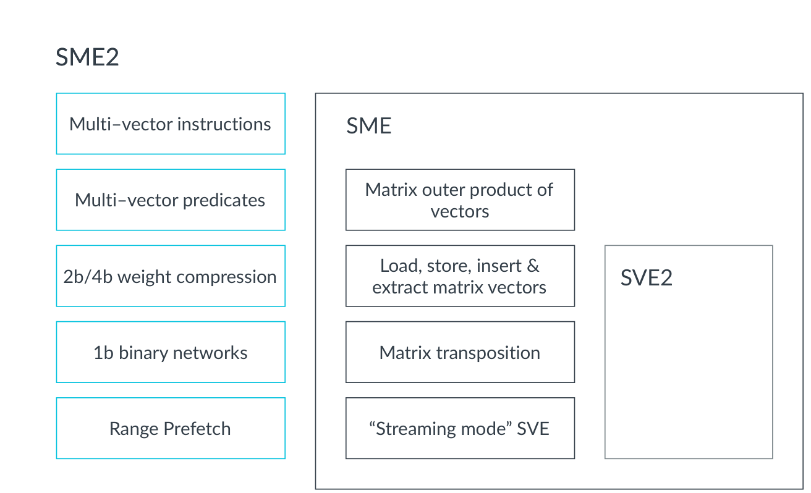

*图 14-2：SME 和 SME2*

这些新指令让 SME2 能比最初的 SME 加速更多工作负载，包括 GEMV、非线性求解器、小型稀疏矩阵，以及特征提取或跟踪等场景。

## 15. 加载与存储（一）：基本形式与访问宽度

最基本的加载和存储指令是 **LDR**（加载）和 **STR**（存储）。它们在内存与通用寄存器之间搬运单个值。语法形式如下：

```text
LDR<Sign><Size>   <Destination>, [<address>]
STR<Size>         <Source>, [<address>]
```

访问宽度由寄存器类型（X 或 W）和 Size 字段共同决定：X 表示 64 位，W 表示 32 位。

例如，下面这条从地址加载 32 位到 W0：

```asm
LDR        W0, [<address>]
```

这条从地址加载 64 位到 X0：

```asm
LDR        X0, [<address>]
```

Size 字段还允许你只访问寄存器的一部分。例如，下面这条把 W0 的低字节（B）存入地址：

```asm
STRB       W0, [<address>]
```

下面这条把 W0 的低半字（H）存入地址：

```asm
STRH       W0, [<address>]
```

最后，这条把 X0 的低字（W）存入地址：

```asm
STR        W0, [<address>]
```

## 16. 加载与存储（二）：零扩展与符号扩展

默认情况下，加载小于寄存器宽度的数据时，寄存器其余部分会被清零：

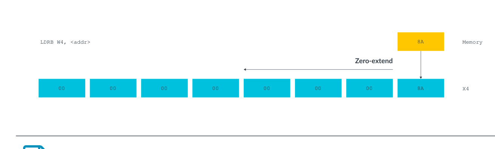

*图 17-1：寄存器清零示例*

> 再强调一次：只要写入 W 寄存器，对应 X 寄存器的高半部分就会被清零。

如果在操作名后加一个 S，行为就变成**符号扩展**。扩展到多宽，取决于目标是 W 还是 X 寄存器：

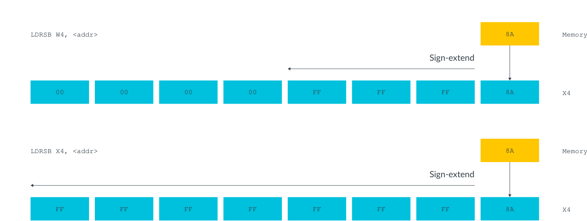

*图 17-2：大小扩展示例*

### 16.1 小练习

如果地址 0x8000 处的字节内容是 0x1F，那么 `LDRSB X4` 的结果是什么？

LDRSB 执行的是“加载一个字节并符号扩展到 64 位”。做法是把被加载值的最高有效位复制出去，填满 64 位寄存器。这里 0x1F 的最高位是 0，所以 X4 的值为：

```text
0x0000_0000_0000_001F
```

## 17. 加载与存储（三）：寻址方式

加载和存储指令的地址写在方括号里，例如：

```asm
LDR  W0,  [X1]
```

地址如何形成，有几种寻址模式。

**基址寄存器（Base register）**

最简单的形式就是单个寄存器。基址寄存器是一个 X 寄存器，里面是所访问数据的完整（绝对）虚拟地址：

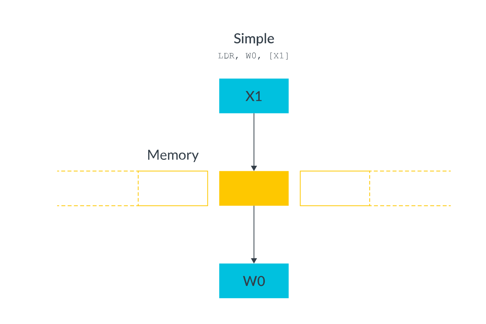

*图 18-1：基址寄存器示例*

**偏移寻址（Offset addressing）**

可以给基址再叠加一个偏移：

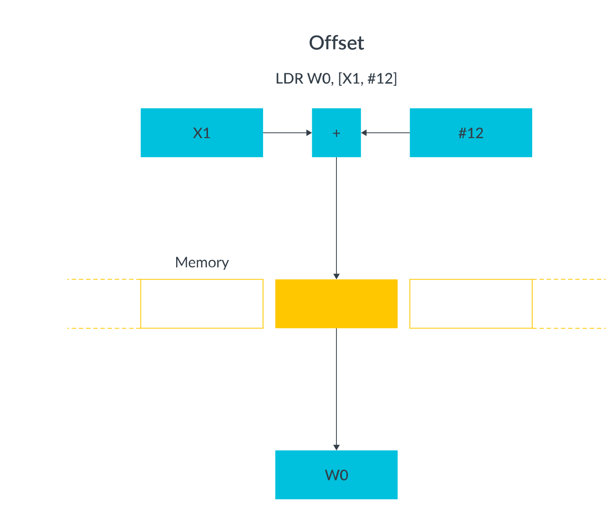

*图 18-2：偏移示例*

上图中，X1 是基址，#12 是相对于该地址的字节偏移，因此实际访问 X1+12。偏移可以是常量，也可以是另一个寄存器。

这种模式很适合访问结构体（struct）：编译器维护一个指向结构体基址的指针，再用偏移选择不同成员。

**前索引寻址（Pre-index addressing）**

指令语法上，前索引通过在方括号后加感叹号 `!` 表示：

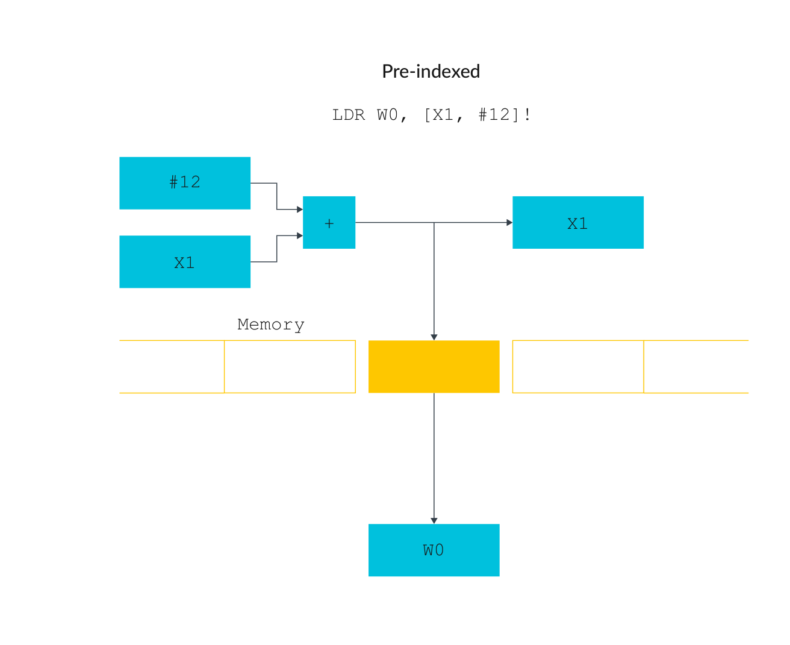

*图 18-3：前索引示例*

它和偏移寻址很像，区别在于：基址指针会作为指令的结果被更新。上图中，指令执行完后，X1 的值会变成 X1+12。

**后索引寻址（Post-index addressing）**

后索引则是“先按基址指针访问，再更新指针”：

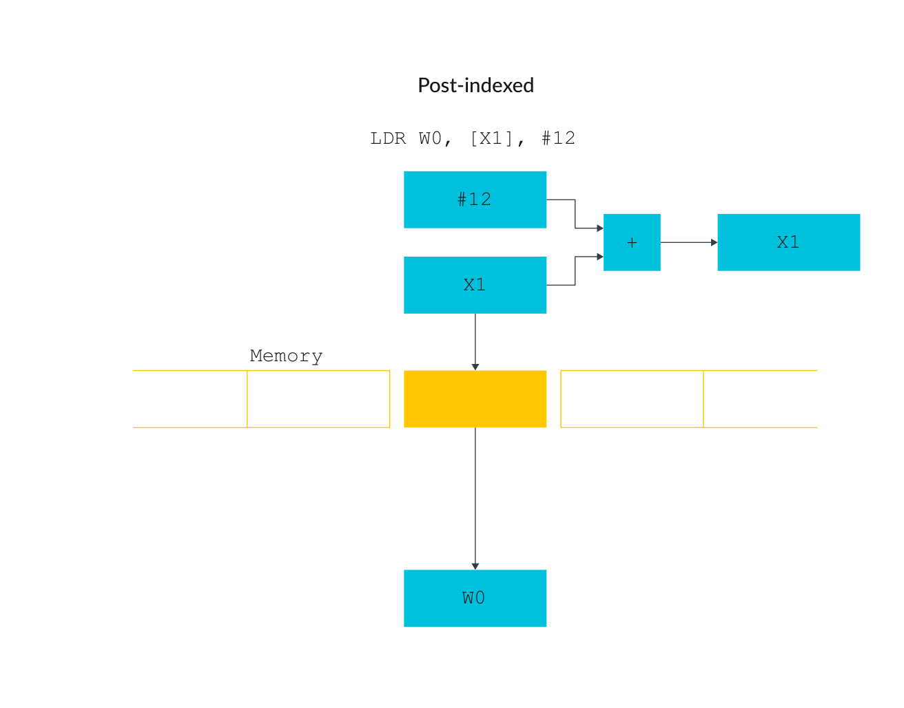

*图 18-4：后索引示例*

这种模式在从栈中弹出数据时很好用：先从栈指针所指位置加载值，再把栈指针移到栈中的下一个完整位置。

## 18. 加载与存储（四）：成对访问 LDP 与 STP

前面讨论的都是单个寄存器。A64 还提供了加载对（**LDP**）和存储对（**STP**）指令。

它们在一次操作中搬运两个寄存器与内存之间的数据。寄存器按操作数从左到右的顺序处理：第一个寄存器对应第一个地址，第二个寄存器对应紧接着的下一个地址。

看两个例子。

下面这条把 `[X0]` 加载到 W3，把 `[X0 + 4]` 加载到 W7：

```asm
LDP        W3, W7, [X0]
```

下面这条把 D0 存到 `[X4]`，把 D1 存到 `[X4 + 8]`：

```asm
STP        D0, D1, [X4]
```

成对指令常用于压栈和出栈。下面这条把 X0、X1 压入栈：

```asm
STP        X0, X1, [SP, #-16]!
```

下面这条把 X0、X1 从栈中弹出：

```asm
LDP        X0, X1, [SP], #16
```

需要牢记：AArch64 中栈指针必须 128 位对齐。

**排序、对齐与原子性**

LDP/STP 在架构上被视为两次独立的访问，架构并不保证这两次访问的先后顺序。如果顺序很重要，就不该使用成对指令。

对齐要求取决于单次访问的大小，而不是总大小。例如：

```asm
LDP W3, W7, [X0]
```

它被视为两次 32 位访问，因此地址只需 4 字节对齐——尽管总共搬运 8 字节。

如果目标地址是对齐的，那么 LDP/STP 的每一次访问都是单副本原子（single-copy atomic）的。

如果实现了 FEAT_LSE2，那么在某些情况下整个操作也可以是单副本原子的。

**在 MMIO 上使用 LDP/STP 的风险**

LDP/STP 通常不适合访问 MMIO 寄存器。系统软件程序员在操作 MMIO 时，不应主动使用成对指令，也不要让编译器生成它们。

MMIO 设备寄存器往往只支持有限的访问宽度。一个常见要求是：访问必须与寄存器同宽、对齐，并且是单副本原子的。例如，大多数通用中断控制器第 3 版（GICv3）的 MMIO 寄存器是 32 位的，只接受 32 位对齐访问。

此外，访问内存映射设备寄存器时，顺序通常也很重要。

对 MMIO 使用成对指令可能带来意外后果。例如，用 LDP 访问两个相邻寄存器，实际访问顺序可能与预期不同；又如，用带 W 寄存器的 LDP 去访问单个 64 位寄存器，可能被设备看成两次访问，而设备未必支持。

另一个考虑是故障行为：当 LDP/STP 触发故障时，提供的综合（syndrome）信息可能不足以可靠判断到底是两个部分中的哪一次访问出了问题。

## 19. 加载与存储（五）：使用浮点与向量寄存器

加载和存储也可以作用于浮点寄存器。

下面这条把 64 位从 `[X0]` 加载到 D1：

```asm
LDR        D1, [X0]
```

这条把 128 位从 Q0 存到 `[X0 + X1]`：

```asm
STR        Q0, [X0, X1]
```

最后这条从 X5 加载一对 128 位值，然后把 X5 增加 256：

```asm
LDP        Q1, Q3, [X5], #256
```

这里有几点限制：

- 访问宽度只由寄存器类型决定；
- 加载没有符号扩展选项；
- 地址仍然必须来自 X 寄存器。

用浮点寄存器做加载/存储，可能会出现在你意想不到的地方——`memcpy()` 这类例程就很常见。原因很直接：寄存器越宽，需要的迭代次数越少。所以，即使你的代码里没有浮点值，也不代表不会用到浮点寄存器。

## 20. 加载与存储（六）：专用指令

A64 还有一些面向专门场景的加载/存储指令。

### 20.1 Load-Acquire 与 Release

这类指令自带隐式内存屏障，用于处理并发场景下的内存序问题。

### 20.2 64 字节原子加载与存储

企业系统里有一个趋势：引入可以通过 64 字节原子加载或存储访问的加速器。这类操作常用于向队列添加条目，某些情况下还能返回入队成功或失败。

为支持这类加速器，Armv8.7-A 和 Armv9.2-A 在架构中加入了 64 字节原子加载指令 **LD64B**，以及三条存储指令 **ST64Bx**。

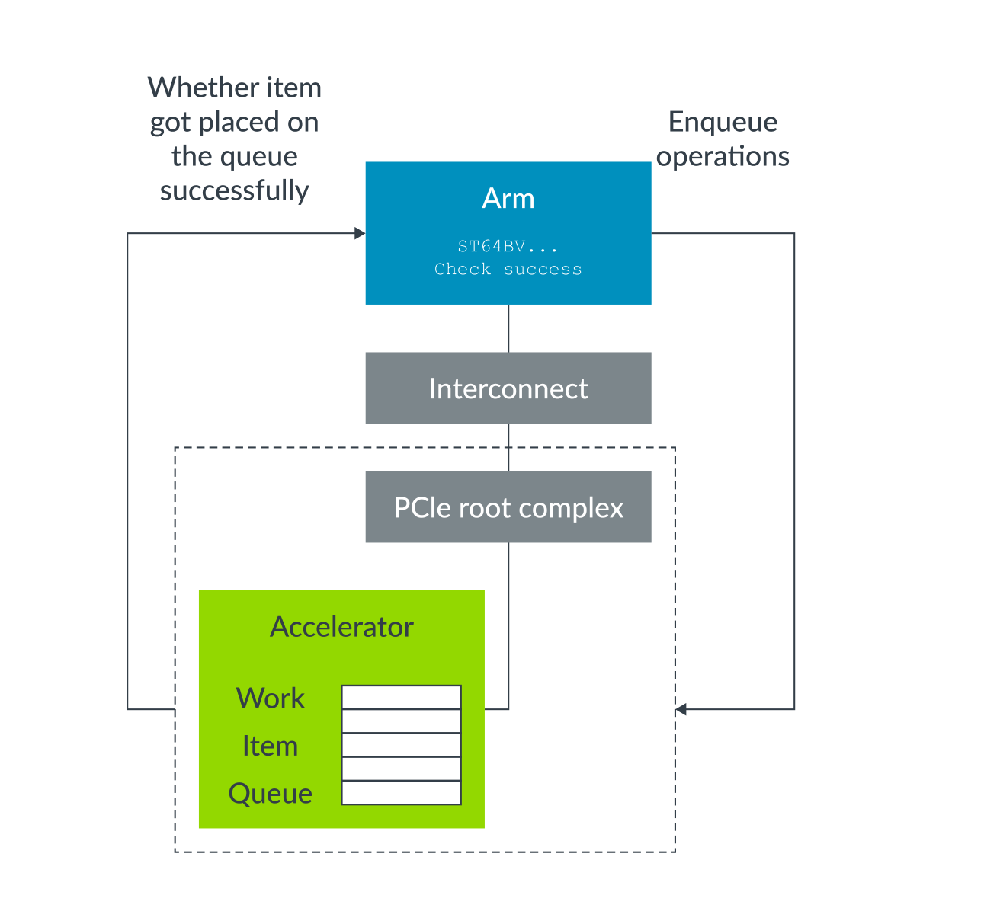

*图 21-1：架构图*

### 20.3 优化 memcpy() 风格的加载与存储

`memcpy()`/`memset()` 系列函数在很多工作负载中都被大量使用，因此尽可能高效地执行它们很重要。为了让这些函数能在不同处理器实现上都获得高效且标准化的优化，A64 提供了 **CPYx** 和 **SETx** 指令。

## 21. 程序流（一）：分支、循环与判断

通常，处理器按程序顺序执行指令，也就是按照指令在内存中出现的顺序依次执行。改变这种顺序的手段之一就是分支指令。分支指令会改变程序流，循环、判断和函数调用都依赖它。

A64 也提供了条件分支指令：它们是否“生效”，取决于此前指令的结果。

> Armv8.3-A 和 Armv8.5-A 还引入了用于防护面向返回编程（return-oriented programming）和面向跳转编程（jump-oriented programming）的指令。

本节先看循环与判断。分支指令分两类：无条件分支和有条件分支。

### 21.1 无条件分支

无条件分支有两种：**B**（Branch）和 **BR**（Branch with Register）。

`B <label>` 执行到 `<label>` 的直接、PC 相对分支。从当前 PC 到目标的偏移编码在指令内，因此范围受编码空间限制，为 ±128MB。

`BR <Xn>` 则执行到 Xn 所指定地址的间接（绝对）分支。

### 21.2 条件分支

`B.<cond> <label>` 是 B 的条件版本：只有条件 `<cond>` 为真时才跳转。范围限制为 ±1MB。

条件是通过 PSTATE 中的 ALU 标志来测试的，而这些标志需要由之前的指令（例如比较指令 CMP）产生。

`CBZ <Xn> <label>` 与 `CBNZ <Xn> <label>`

- CBZ：Xn 为 0 时跳到 `<label>`；
- CBNZ：Xn 不为 0 时跳到 `<label>`。

`TBZ <Xn>, #<imm>, <label>` 与 `TBNZ <Xn>, #<imm>, <label>`

TBZ/TBNZ 与 CBZ/CBNZ 类似，但测试的是由 `<imm>` 指定的单个位，而不是整个寄存器值。

> 直接（PC 相对）分支把目标偏移存在指令里。条件分支范围更小，是因为一部分位要用来存条件本身，留给偏移的位自然就少了。

把这些概念对应到 C 代码，就很容易理解分支如何实现循环和判断。

先看这段 C：

```c
if (a == 5)
  b = 5;
```

编译器典型的输出可能是：

```asm
   CMP W0, #5
   B.NE skip
   MOV W8, #5
skip:
```

再看这段 C：

```c
while (a != 0)
{
  b = b + c;
  a = a - 1;
}
```

编译器典型的输出可能是：

```asm
loop:
  CBZ W8, skip
  ADD W9, W9, W10
  SUB W8, W8, #1
  B loop
skip:
```

> 示例中的标签并非编译器生成，这里加上只是为了便于阅读。

### 21.3 自测

A64 没有条件间接分支指令。如果 X5 包含 0，如何构造一段指令序列，实现跳转到 X1 中所存地址的绝对分支？

答案不唯一，下面这种写法可以接受：

```asm
  CMP      X5, XZR     // 将 X5 与零比较
  B.NE skip            // 如果 X5!=0 则跳过 BR
  BR    X1
skip:
...
```

## 22. 程序流（二）：条件码从哪里来

前面说到，`<cond>` 是依据 PSTATE 中的 ALU 标志来测试的。那么这些标志从哪里来？答案是数据处理指令的“副作用”。

操作名末尾的 S 会让 ALU 标志被更新。下面这条不更新标志：

```asm
ADD        X0, X1, X2
```

下面这条则会更新：

```asm
ADDS       X0, X1, X2
```

这种设计把“何时更新标志”的控制权交给了软件。标志随后可以被条件指令使用。例如：

```asm
SUBS       X0, X5, #1
AND     X1, X7, X9
B.EQ    label
```

SUBS 做减法并更新标志；AND 做逻辑与但不碰标志；最后 B.EQ 依据 SUBS 留下的标志决定是否跳转。

四个标志分别是：

- **N**：负（Negative）
- **C**：进位（Carry）
- **V**：溢出（Overflow）
- **Z**：零（Zero）

以 Z 为例：如果运算结果为零，Z 就被置 1。下面这段里，如果 X5 等于 1，Z 会被置位，否则被清除：

```asm
SUBS       X0, X5, #1
```

条件码建立在这些标志之上，并且成对出现。以 EQ（相等）和 NE（不相等）为例：EQ 检查 Z==1，NE 检查 Z==0。

看一段代码：

```asm
SUBS       W0, W7, W9            // W0 = W7 - W9
B.EQ    label
```

第一行是减法，因为带了 S 后缀，结果为零时会置起 Z。第二行在 Z==1 时跳转。于是，只要 W7 与 W9 相等，减法结果为零，Z 被置位，就会跳到 label。

除了常规数据处理指令，还有两条“只更新标志”的指令：

- **CMP**：比较（Compare）
- **TST**：测试（Test）

它们其实是其他指令的别名：

```asm
CMP X0, X7     // 是 SUBS XZR, X0, X7 的别名
TST W5, #1     // 是 ANDS WZR, W5, #1 的别名
```

把零寄存器当作目标，就等于丢弃运算结果，只留下 ALU 标志的更新。

### 22.1 自测

前面的例子只用了 EQ 和 NE。请写一段序列：如果 (X5 - X6) 的结果为负，就把 X0 设为 5。完整的条件码列表需要查《Arm Architecture Reference Manual》。

写法不止一种，下面是一个例子：

```asm
SUBS       XZR, X5, X6
B.PL    1a        // 结果为正或零则分支
MOV     X0, #5    // 仅在结果为负时执行
1:
...
```

当然，这种场景用条件选择指令可能更合适——下一节就讲。

## 23. 程序流（三）：条件选择指令

到目前为止，判断逻辑都是靠分支实现的。A64 还提供了条件选择指令，在很多情况下可以替代分支。

变体不少，最基本的形式是：

```asm
CSEL       Xd, Xn, Xm, cond
```

含义是：

```text
if cond then
  Xd = Xn
else
  Xd = Xm
```

看一个例子：

```asm
CMP        W1, #0
CSEL    W5, W6, W7, EQ
```

它的效果等同于：

```text
if (W1==0) then
  W5 = W6
else
  W5 = W7
```

有些变体会把另一种运算与条件选择结合起来。比如 CSINC 在“选择”之外还做加一：

```asm
CSINC      Xd, Xn, Xm, cond
```

含义：

```text
if cond then
  Xd = Xn
else
  Xd = Xm + 1
```

如果只想“按条件自增”，可以写成：

```asm
CSINC        X0, X0, X0, cond
```

等价于：

```text
if cond then
  X0 = X0
else
  X0 = X0 + 1
```

架构为这种用法提供了别名 **CINC**。但要注意，CINC 的语义与 CSINC 相反：

- `CSINC X0, X0, X0, cond`：cond 为真时 X0 不变，为假时 X0 加一；
- `CINC X0, X0, cond`：cond 为真时 X0 加一，为假时 X0 不变。

编译器会选择最高效的实现方式。对于只做简单操作的小型 `if ... else`，通常倾向于条件选择，因为往往比分支更高效。

下面比较几个 `if ... else` 用分支实现与用条件选择实现的差别：

| C 代码 | 使用分支 | 使用条件选择 |
| --- | --- | --- |
| `if (a != 0) b = b + 1;` | `CMP W0, #0` `B.EQ else` `ADD W1, W1, #1` `else: ...` | `CMP W0, #0` `CINC W1, W1, NE` |
| `if (a == 0) y = y + 1; else y = y - 1;` | `CMP W0, #0` `B.NE else` `ADD W1, W1, #1` `B end` `else: SUB W1, W1, #1` `end: ...` | `CMP W0, #0` `SUB W2, W1, #1` `CSINC W1, W2, W1, NE` |

条件选择的优势很明显：序列更短，而且无论走哪条路径，指令数都一样。

更关键的是，它消除了分支。在现代处理器上，这类分支对分支预测逻辑并不友好，一旦预测失败就会拖累性能。能去掉分支，通常就应该去掉。

## 24. 程序流（四）：条件故障指令

很多编程语言会在运行时做一致性检查，例如边界检查。这类检查经常被编译成“条件跳转到断点异常（BRK）”或“测试后跳转到 BRK”的序列。

跳转到 BRK 的分支实际上很少被采取，但分支指令仍然增加了代码体积，还可能给分支预测器带来压力。为了降低这部分开销，Armv9.8-A 引入了可选的条件故障指令扩展（FEAT_CFLT）。它提供的条件指令不再“跳转”，而是直接产生异常。异常依据条件标志状态或比较结果触发，并且是同步送入的。

没有条件故障指令时，一个典型检查长这样：

```asm
    cmp     x1, x10
    b.hs    .Lerror
    ldr     w0, [x9, x1, lsl #2]
    ret
.Lerror:
    brk     #0x1
```

上面这段用了一条比较指令加一条条件分支，跳到故障处理。

有了条件故障指令后，同样的检查可以写成：

```asm
    cflths  #0, x1, x10
    ldr     w0, [x9, x1, lsl #2]
    ret
```

这条指令只在比较条件成立时，才让处理器进入异常状态。

FEAT_CFLT 定义了几组指令：

- **FLT.cond**：依据当前条件标志触发异常，最接近“B.cond 跳到 BRK”的写法。它有一个 16 位的 reason 字段，行为类似于条件化的超级用户调用：
  - 在 EL0 执行时，如果 EL0 异常由 EL1 处理，异常送入 EL1；如果由 EL2 处理，异常送入 EL2。
  - 在 EL1、EL2、EL3 执行时，异常在当前异常级别送入。
- **CFLT\<cc\>**：比较两个操作数，比较成立时触发异常。有两种形式。
  - 寄存器形式：比较两个寄存器。

```asm
    cfltge  #reason, x0, x1     // 有符号比较，如果 x0 >= x1 则故障
```

  - 立即数形式：比较寄存器与一个小立即数。

```asm
    cfltge  #reason, x0, #10   // 有符号比较，如果 x0 >= #10 则故障
```

- **CFLTZ 与 CFLTNZ**：与零/非零比较。

```asm
    cfltz   #reason, x0     // 如果 x0 == 0 则故障
    cfltnz  #reason, x0     // 如果 x0 != 0 则故障
```

- **TFLTZ 与 TFLTNZ**：测试寄存器中的某一位，并根据其取值触发故障。

```asm
    tfltz   #reason, x0, #5     // 如果 x0 的第 5 位为 0 则故障
    tfltnz  #reason, x0, #5     // 如果 x0 的第 5 位为 1 则故障
```

每条指令都有一个 reason 字段。条件故障异常发生时，reason 会被复制到 `ESR_ELx.ISS`。异常处理器可以借助它区分少量故障原因。如果软件需要更多故障原因，可以先通过普通比较或测试设置标志，再用 FLT.cond 触发故障。

## 25. 函数调用与返回

调用函数或子例程时，必须有一种办法能回到调用者。做法很直接：在 B 或 BR 指令后加一个 L，就得到带链接的分支（branch with link）。作为分支的一部分，返回地址会被写入 LR（X30）。

> LR 和 X30 是可互换的名字，GNU GAS、armclang 等汇编器都接受。

函数返回则有一条专门指令 **RET**：它执行到链接寄存器中所存地址的间接分支。总结起来就是：

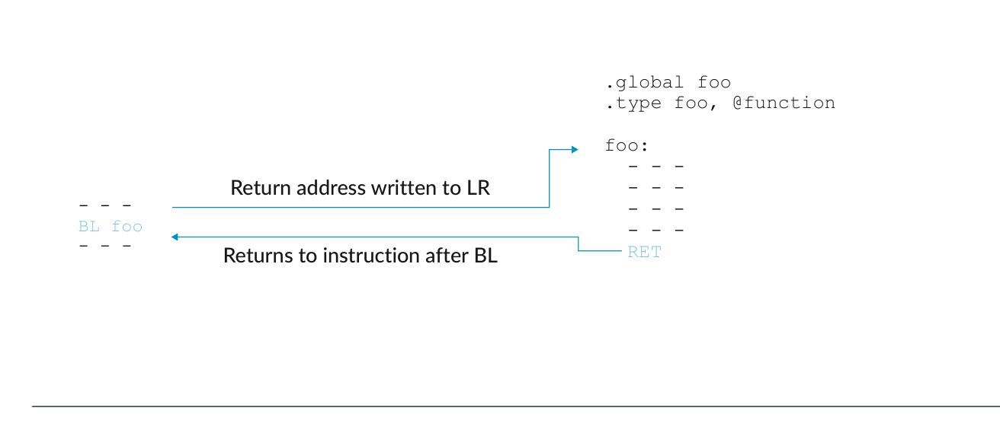

*图 27-1：RET*

上图展示了一个用 GAS 语法编写的函数 foo()。其中 `.global` 用于导出符号，`.type` 声明导出的符号是一个函数。

那么，为什么需要专门的返回指令？从功能上看，`BR LR` 和 RET 做的事完全一样。区别在于语义：RET 明确告诉处理器“这是一次函数返回”。大多数现代处理器以及所有 Cortex-A 处理器都支持分支预测，知道这是一次函数返回，可以帮助处理器更准确地预测分支方向。

分支预测器会猜测程序流在分支处会往哪走。这个猜测决定了往流水线里装什么指令。如果猜对了，流水线里就是正确的指令，处理器不必停下来等内存取指。

## 26. 过程调用标准（PCS）

Arm 架构对通用寄存器的使用限制很少。但如果你希望自己的代码能和别人写的代码、或编译器生成的代码协同工作，就必须约定一套寄存器使用规则。对 Arm 架构而言，这套规则叫作**过程调用标准（Procedure Call Standard，PCS）**。

PCS 规定了几件事：

- 哪些寄存器用来向函数传参；
- 哪些寄存器用来把返回值交给调用者（caller）；
- 被调用者（callee）可以随意破坏哪些寄存器；
- 被调用者必须保护哪些寄存器。

考虑一个从 `main()` 调用的函数 `foo()`：

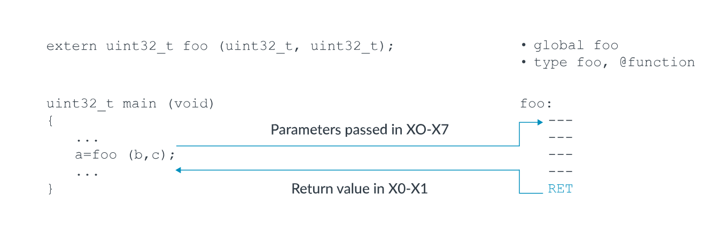

*图 28-1：PCS 示例*

PCS 规定：第一个参数放 X0，第二个放 X1，依此类推，直到 X7；更多参数通过栈传递。假设 `foo()` 接收两个参数 b 和 c，那么 b 在 W0 中，c 在 W1 中。

为什么用 W 而不是 X？因为参数是 32 位类型，只需要 W 寄存器就够了。

> 在 C++ 中，X0 还用于传递指向被调用函数的隐式 `this` 指针。

接下来是“谁能破坏谁”的规则。如果某个寄存器允许被破坏，被调用函数就可以直接覆盖它，无需恢复：

| 寄存器 | 用途 |
| --- | --- |
| X0–X7 | 参数与结果寄存器 |
| X8 | XR，间接结果寄存器 |
| X9–X15 | 调用者保存寄存器（可破坏） |
| X16 | IP0，过程内调用可破坏寄存器 |
| X17 | IP1，过程内调用可破坏寄存器 |
| X18 | PR，平台寄存器 |
| X19–X28 | 被调用者保存寄存器 |
| X29 | FP，帧指针 |
| X30 | LR，链接寄存器 |

举例来说，函数 `foo()` 可以直接使用 X0 到 X15，不必保存；但如果想用 X19 到 X28，就必须先把它们存到栈上，返回前再恢复。

有几个寄存器在 PCS 中有特殊含义：

- **XR**：间接结果寄存器。如果 `foo()` 返回一个结构体，结构体的内存由调用者（前面例子中的 `main()`）分配，XR 就是指向这块返回内存的指针。
- **IP0 与 IP1**：过程内调用可破坏寄存器（intra-procedure-call corruptible）。在“函数被调用”到“执行到函数第一条指令”之间，它们可能被破坏。链接器用它们插入 veneer。Veneer 是一小段代码，最常见的用途是扩展分支范围：A64 分支指令范围有限，目标超出范围时，链接器就生成 veneer 来搭桥。
- **FP**：帧指针（Frame pointer）。
- **LR**：X30，函数调用的链接寄存器。

> 前面提到的 ALU 标志用于条件分支和条件选择。PCS 规定，ALU 标志不需要在函数调用之间保存。

浮点寄存器也有一套对应规则：

| 寄存器 | 用途 |
| --- | --- |
| D0–D7 | 参数与结果寄存器 |
| D8–D15 | 被调用者保存寄存器 |
| D16–D31 | 调用者保存寄存器（可破坏） |

## 27. 系统调用

有时软件需要请求更有特权的实体提供功能，例如应用程序请操作系统打开文件。

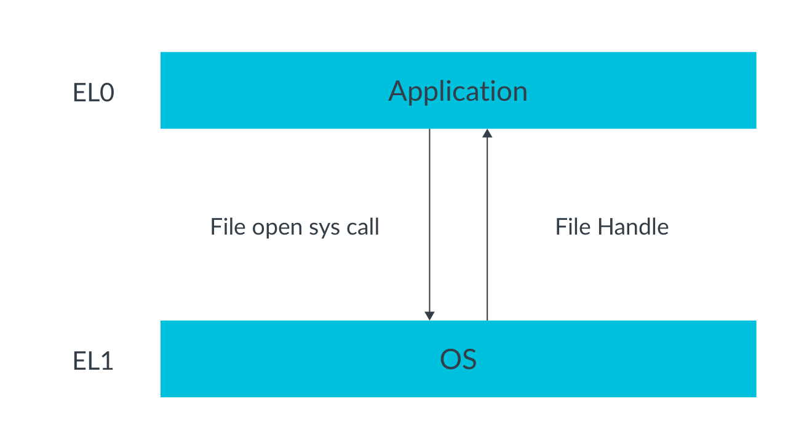

*图 29-1：应用程序请求示例*

A64 提供了专门的系统调用指令。这些指令会触发异常，从而以受控方式切换到更高特权的异常级别：

- **SVC**：超级用户调用（Supervisor call），产生面向 EL1 的异常，应用程序用它调用操作系统。
- **HVC**：虚拟机监控器调用（Hypervisor call），产生面向 EL2 的异常，操作系统用它调用虚拟机监控器；在 EL0 不可用。
- **SMC**：安全监控器调用（Secure monitor call），产生面向 EL3 的异常，操作系统或虚拟机监控器用它调用 EL3 固件；在 EL0 不可用。

如果异常指令是在高于目标异常级别的级别上执行，那么异常会被送入当前异常级别。也就是说，在 EL2 执行 SVC 会进入 EL2，在 EL3 执行 HVC 会进入 EL3。这与“异常永远不会让处理器降低特权”的规则是一致的。

## 28. 知识自测

试着回答下面的问题，检验一下掌握程度。

**问题 1：按照 PCS，对于函数 `uint32_t foo(uint64_t a, uint64_t b)`，a 和 b 用哪些寄存器传入？结果又从哪个寄存器返回？**

a 通过 X0 传入，b 通过 X1 传入；结果通过 W0 返回。

**问题 2：哪条指令完成 D0 与 D1 的 64 位浮点加法，并把结果放入 D5？**

```asm
FADD D5, D0, D1
```

**问题 3：`LDRSH W0, [X1, #8]` 做了什么？**

从地址 X1+8 加载 16 位，符号扩展到 32 位，结果放入 W0。

**问题 4：函数返回最常用哪条指令？**

RET。

**问题 5：调用函数时，返回地址存在哪个寄存器？**

X30，也就是 LR。

**问题 6：在应用程序中执行 SVC 会发生什么？**

触发异常，从而进入操作系统。

**问题 7：执行 `SUB W5, W8, W4` 后，X5 的高 32 位是什么？**

0。只要写入 W 寄存器，对应 X 寄存器的高 32 位就会被清零。

## 29. 延伸资料

与本指南内容相关的资源：

- Vectors: Neon guide
- Vectors: SVE guide
- SVE examples: SVE Programming Examples
- Building an embedded image guide
- Arm architecture and reference manuals（Armv8.3-A、Armv8.5-A 指令集扩展、向量数据处理指令、Advanced SIMD 与 SVE 相关信息）
- Arm community
- ARM Assembly Language
- Building an ELF Image for an Armv8-A Fixed Virtual Platform
- Changing Exception Level and Security State with an Armv8-A Fixed Virtual Platform
- Cortex-A Programmer's Guide
- Retargeting and Enabling Exceptions with an ELF Image

按主题划分：

**指令集资源**

- Arm A64 instruction descriptions

**过程调用标准**

- Procedure Call Standard (PCS) for the ARM 64-bit Architecture (AArch64)

**培训链接**

- Introduction to Armv8-A
- Overview - ISA
- Architecture profiles
- What does architecture consist of?

## 30. 小结与下一步

回到开头那句话：只要软件或固件符合 Arm 规格说明，基于 Arm 的处理器就会以相同方式执行它。本指南围绕 Armv8-A AArch64 所使用的 A64 指令集，梳理了指令格式、指令类别，以及汇编代码与编译器输出之间的关系；也解释了 W/X 寄存器的选择如何影响指令行为，以及主要指令类别的用法。

掌握这些内容之后，面对一份 C 程序和它的编译器输出，你应该能解释生成的汇编大致对应哪些 C 语句，也能动手写一个可被 C 调用的汇编函数。同时，你应该知道去哪里查某条指令的完整说明，并对寄存器、数据处理、程序流、加载与存储这些核心概念形成整体认识。

想继续深入 Armv8-A 架构，可以阅读本系列的其他指南。

想检验 A64 汇编水平，可以尝试 ISA 实验练习（即将推出）。这些练习需要 Arm DS-5 Ultimate Edition；官方提供 30 天评估版，足以完成练习。
