# 读懂 AArch64 虚拟化（中文精读版）

> 原文：*Learn the architecture - AArch64 virtualization Guide*
>
> 版本：Version 1.0　|　文档 ID：102142_0100_06_en　|　Issue 06（2025-07-24）
>
> 版权 © 2019, 2022, 2024–2025 Arm Limited（或其关联公司）。保留所有权利。非保密。
>
> 说明：本文在原中文翻译的基础上重新组织了叙述逻辑与表达方式，技术内容、表格与图表保持原意；个别明显笔误已按 Arm 架构规范订正。

---

## 导读：这篇文章讲什么

本指南介绍 Armv8-A AArch64 提供的虚拟化支持，覆盖三个核心机制：

- 第二阶段（stage 2）地址翻译；
- 虚拟异常（vIRQ、vFIQ、vSError）；
- 捕获（trapping）与模拟。

文章会先铺垫一些基础虚拟化理论，再展示 hypervisor 如何实际运用这些机制。它不讲解某个具体 hypervisor 的实现细节，也不教你从零写一个 hypervisor——这两个话题都超出了本文范围。

读完你应当能做到：区分两类 hypervisor 并对应到 Arm 异常级别；解释陷阱如何工作、如何用于模拟操作；列出 hypervisor 能生成的虚拟异常，并说清实现机制。

**开始之前**，假设你已经了解虚拟机（VM）和 hypervisor 的基本概念，也熟悉“异常模型”与“内存管理”中的地址翻译。

## 1. 虚拟化为什么重要

先约定术语：本指南中的 **hypervisor**，指负责创建、管理和调度虚拟机（VM）的软件。

虚拟化是现代云计算和企业基础设施的基石。开发者用它在一台机器上运行多个操作系统，也能在不破坏主计算环境的前提下测试软件。

在服务器领域，虚拟化几乎是标配，对虚拟化的支持也成了大多数服务器级处理器的基本要求。原因在于它给数据中心带来了几个非常理想的能力：

- **隔离（Isolation）**：让同一个物理系统上的多个 VM 相互隔离。彼此不信任的计算环境可以共享一台机器——比如两家竞争公司能共用数据中心里的同一台物理机，却碰不到对方的数据。
- **高可用性（High Availability）**：工作负载可以在物理机之间无缝、透明地迁移。常用于把负载从可能需要维护或更换的故障硬件上迁走。
- **工作负载均衡（Workload balancing）**：通过迁移 VM、或在同一台物理机上合理共置负载，把每台硬件都尽可能跑满。这样数据中心获得最优的功耗预算，租户获得最优性能。
- **沙箱（Sandboxing）**：把可能干扰整机的应用（如遗留程序或开发中的软件）关进 VM，防止其中的缺陷或恶意行为影响物理机上的其他应用和数据。

## 2. 两类 hypervisor：Type 1 与 Type 2

Hypervisor 分成两大类：**独立式（standalone，Type 1）**和**托管式（hosted，Type 2）**。

**托管式（Type 2）**：宿主操作系统（Host OS）完全控制硬件平台及其所有资源，包括 CPU 和物理内存。Hypervisor 作为 Host OS 里的一个程序运行，借它的能力管理硬件，再在之上托管若干 VM；VM 里运行的是客户操作系统（Guest OS）。

如果你用过 VirtualBox 或 VMware Workstation，跑的就是这类 hypervisor。

**独立式（Type 1）**：没有 Host OS，hypervisor 直接跑在硬件上，自己完全控制平台资源：

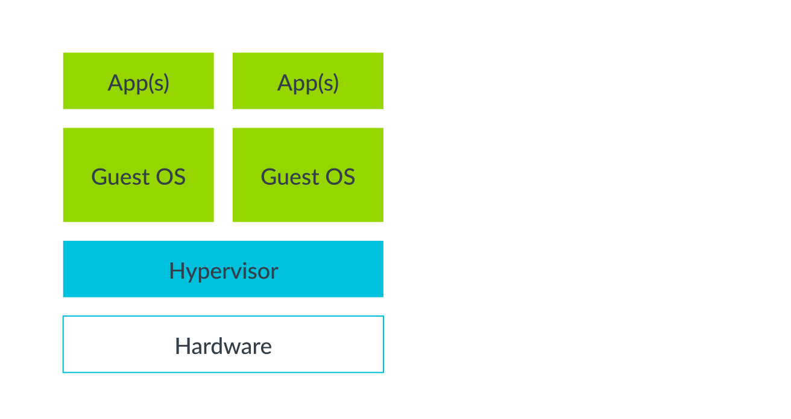

*图 2-1：独立式或 Type 1 hypervisor*

它同样可以托管 VM，每个 VM 运行一个或多个完整的 Guest OS。

Arm 平台上最常用的两个开源 hypervisor 是 **Xen**（独立式，Type 1）和 **KVM**（托管式，Type 2）。下文会借它们举例。当然，可用选择还有很多，开源、专有都有。

## 3. 全虚拟化与半虚拟化

VM 的经典定义是：一个独立的、隔离的计算环境，与真实物理机无法区分。

在 Arm 系统上完整模拟真实机器虽然可行，但通常效率不高。例如模拟一块真实以太网卡会非常慢：Guest OS 每次访问模拟寄存器，都要由 hypervisor 在软件里逐次处理，成本远高于访问真实设备寄存器。

更高效的做法是“点醒（enlighten）”Guest OS——让它知道自己运行在 VM 里，并提供专为在 hypervisor 中高效模拟而设计的虚拟设备。这样即便 I/O 也能获得不错性能。

术语上，**全系统虚拟化**严格指模拟一台真实物理机；而 Xen 普及了**半虚拟化（paravirtualization）**：把 Guest OS 的核心部分改写成跑在虚拟硬件平台上，以换取性能。

今天，在大多数支持硬件虚拟化的架构（包括 Arm）上，Guest OS 基本**未经修改**地运行。它以为自己跑在真实硬件上，只有块存储、网络等 I/O 外设的驱动使用半虚拟化设备，典型例子是 Virtio 和 Xen PV Bus。

## 4. VM 与 vCPU 的区别

一个 VM 包含一个或多个 vCPU：

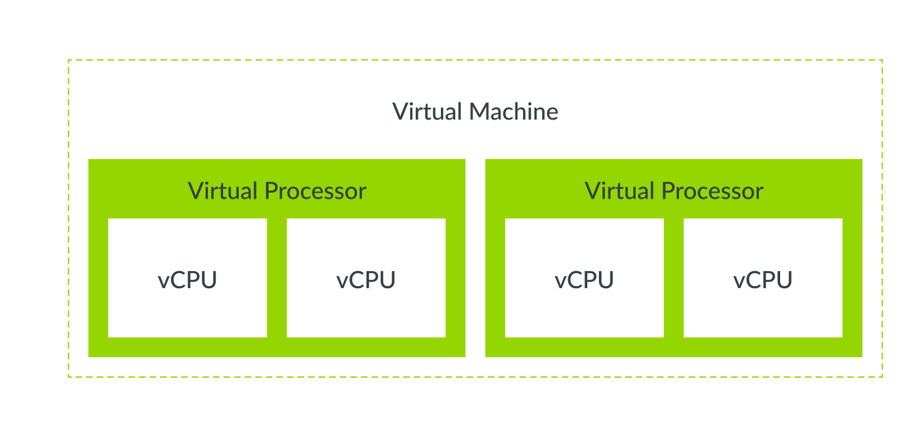

*图 2-2：虚拟机与虚拟 CPU*

这个区分在后文很重要。比如一页内存可以分配给一个 VM，于是该 VM 的所有 vCPU 都能访问；而虚拟中断是面向**特定 vCPU** 的，只能送达那一个 vCPU。

> 严格来说应称为“虚拟处理单元（vPE）”，因为 PE 是实现 Arm 架构的机器的通用术语。本指南沿用更通俗的 vCPU；架构规格说明中则使用 vPE。

## 5. AArch64 里的虚拟化抓手

运行在 EL2 或更高层的软件，可以拿到三类虚拟化控制：

- 第二阶段（stage 2）翻译；
- 对 EL1/0 指令和寄存器访问的捕获；
- 虚拟异常生成。

异常级别在非安全与安全状态下的分布如下：

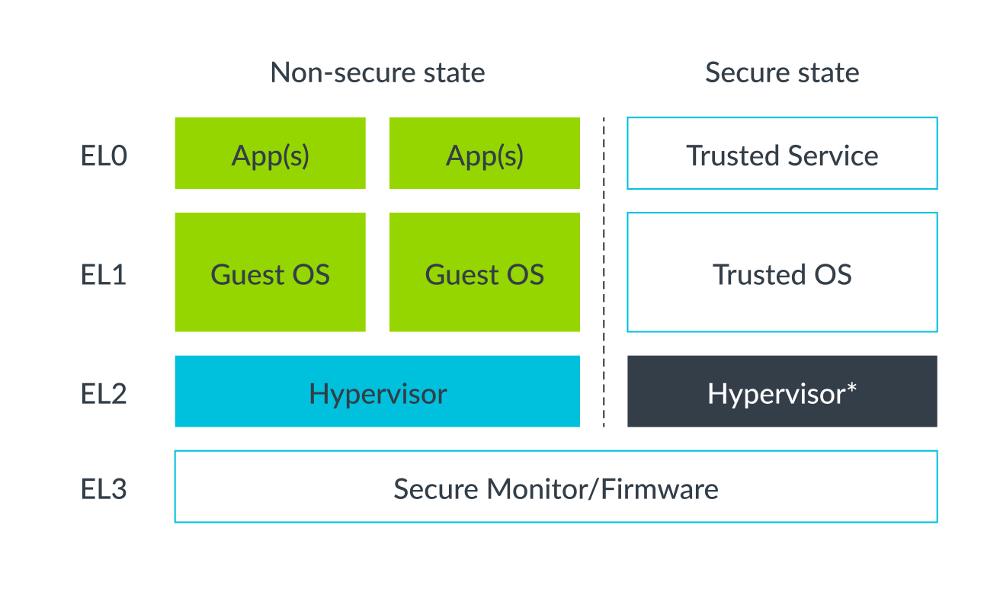

*图 3-1：AArch64 中的虚拟化*

图中安全 EL2 显示为灰色，因为安全状态下的 EL2 支持并非总是可用，详见“安全虚拟化”一节。后续各节分别展开：安全虚拟化、托管式 hypervisor（VHE）、嵌套虚拟化。

## 6. 第二阶段翻译

本章介绍 stage 2 翻译，以及它如何控制内存访问。

### 6.1 什么是 stage 2 翻译

Stage 2 翻译让 hypervisor 控制 VM 看到的内存视图：VM 能访问哪些内存映射资源，以及这些资源出现在 VM 地址空间的什么位置。

这种控制是隔离与沙箱的基础——它能确保 VM 只能看到分配给它的资源，而看不到其他 VM 或 hypervisor 的资源。

地址翻译分两阶段，也就需要第二套翻译表（Stage 2 表）：

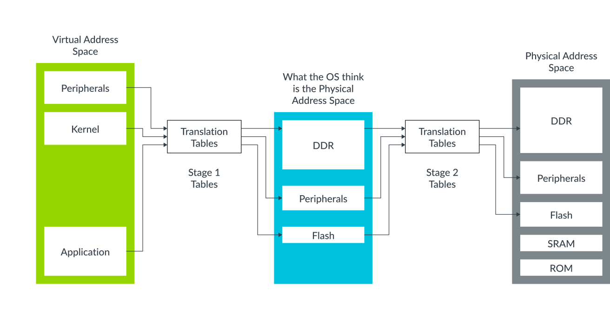

*图 4-1：VA 到 IPA 到 PA 的地址翻译*

操作系统控制一套翻译表，把虚拟地址空间映射到它“以为的”物理地址空间；之后还要经过第二次翻译，才落到真正的物理地址空间。第二次翻译由 hypervisor 控制。第一段叫 **stage 1 翻译**（OS 控制），第二段叫 **stage 2 翻译**（hypervisor 控制）。OS 眼里那片“物理内存”，其实是一个叫**中间物理地址（Intermediate Physical Address，IPA）**的空间。

> 地址翻译的基础介绍见“内存管理”指南。

Stage 2 用的翻译表格式与 stage 1 非常相似，但有两处差异：某些属性的处理方式不同；内存类型（Normal 或 Device）直接编码在表项里，而不是通过 MAIR_ELx 寄存器配置。

### 6.2 VMID

每个 VM 分配一个虚拟机标识符（**VMID**）。VMID 用来给 TLB 表项打标签，标识它属于哪个 VM。有了标签，多个 VM 的翻译就能同时存在于 TLB 里。

VMID 存放在 `VTTBR_EL2` 中，宽度可以是 8 位或 16 位，由 `VTCR_EL2.VS` 控制。16 位 VMID 是可选特性，随 Armv8.1-A 引入。

> EL2 和 EL3 自身的翻译机制不需要 VMID 标记，因为它们不经过 stage 2。

### 6.3 VMID 与 ASID 的交互

TLB 表项还可以用地址空间标识符（**ASID**）打标签。OS 给每个应用程序分配一个 ASID，该应用的所有 TLB 表项都带这个标签。于是不同应用的翻译能共存于 TLB，且不会误用彼此的表项。

每个 VM 拥有独立的 ASID 命名空间：两个 VM 可能都用 ASID 5，但含义完全不同。真正决定归属的是 **ASID 与 VMID 的组合**。

### 6.4 属性组合与覆盖

Stage 1 和 stage 2 的映射都带有属性（如类型、访问权限）。MMU 会把两阶段的属性组合成一个最终有效值，规则是“取更严格的那个”：

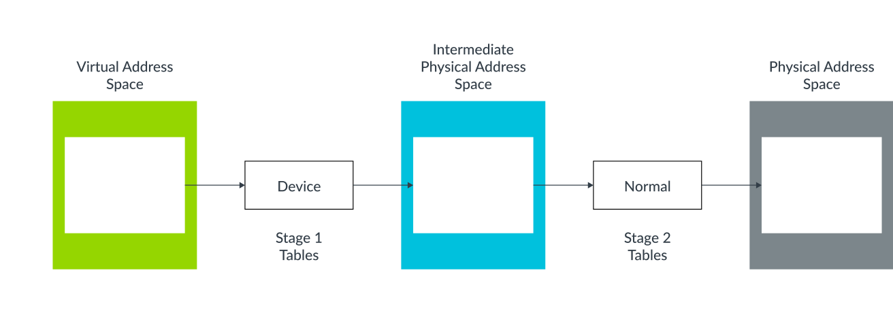

*图 4-2：组合 stage 1 和 stage 2 属性*

本例中 Device 类型比 Normal 更严格，所以结果是 Device。即使反过来（stage 1 = Normal、stage 2 = Device），结果也相同。

这种“取严格”的规则覆盖大多数场景，但有时 hypervisor 想覆盖它，例如 VM 早期启动阶段。此时可用以下控制位：

- `HCR_EL2.CD`：让所有 stage 1 属性变为非缓存（Non-cacheable）；
- `HCR_EL2.DC`：强制 stage 1 属性为 Normal、写回缓存（Write-Back Cacheable）；
- `HCR_EL2.FWB`：允许 stage 2 直接覆盖 stage 1 属性，而非常规组合。

> `HCR_EL2.FWB` 于 Armv8.4-A 引入。

### 6.5 模拟 MMIO

和物理机的物理地址空间一样，VM 的 IPA 空间里也有访问内存和外设的区域：

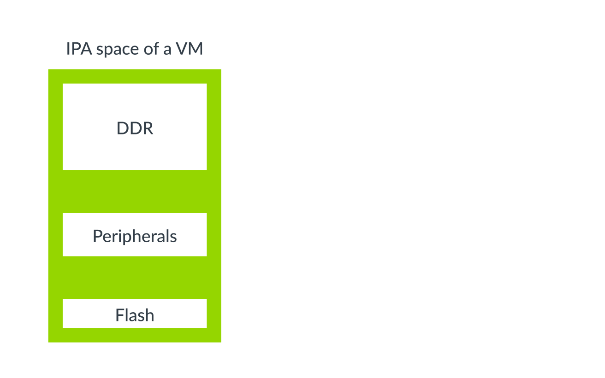

*图 4-3：VM 的 IPA 空间框图*

VM 可以通过外设区域访问两类设备：真实物理外设（通常叫**直接分配的外设**）和**虚拟外设**。

虚拟外设完全由 hypervisor 在软件里模拟：

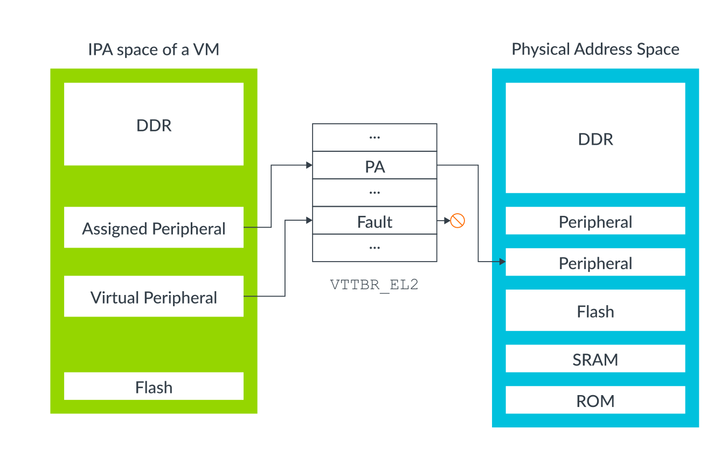

*图 4-4：虚拟外设和分配外设的 stage 2 映射*

- **分配的外设（assigned peripheral）**：真实物理设备，被分配给某个 VM 并映射到其 IPA 空间，VM 内软件可以直接与之交互。
- **虚拟外设（virtual peripheral）**：hypervisor 在软件里模拟的设备。对应 stage 2 表项被标记为故障（fault）。VM 内软件以为在直接通信，实际每次访问都触发 stage 2 故障，由 hypervisor 在异常处理器里模拟。

要模拟一次访问，hypervisor 需要知道的不只是“访问了哪个外设”，还包括：哪个寄存器、读还是写、访问宽度、数据经哪个寄存器传输。

“异常模型”指南介绍过 `FAR_ELx`。处理 stage 1 故障时它报告虚拟地址——但对 hypervisor 没用，因为 hypervisor 通常不知道 Guest OS 怎么配置它的虚拟地址空间。Stage 2 故障有专门的寄存器 `HPFAR_EL2`，报告的是中止地址的 **IPA**。IPA 空间由 hypervisor 控制，所以它能据此定位要模拟的寄存器。

对于单通用寄存器的加载/存储触发的 stage 2 故障，还会附带额外的综合（syndrome）信息，包括访问宽度和源/目标寄存器，hypervisor 由此判断访问类型。

下图是捕获并模拟一次访问的完整过程：

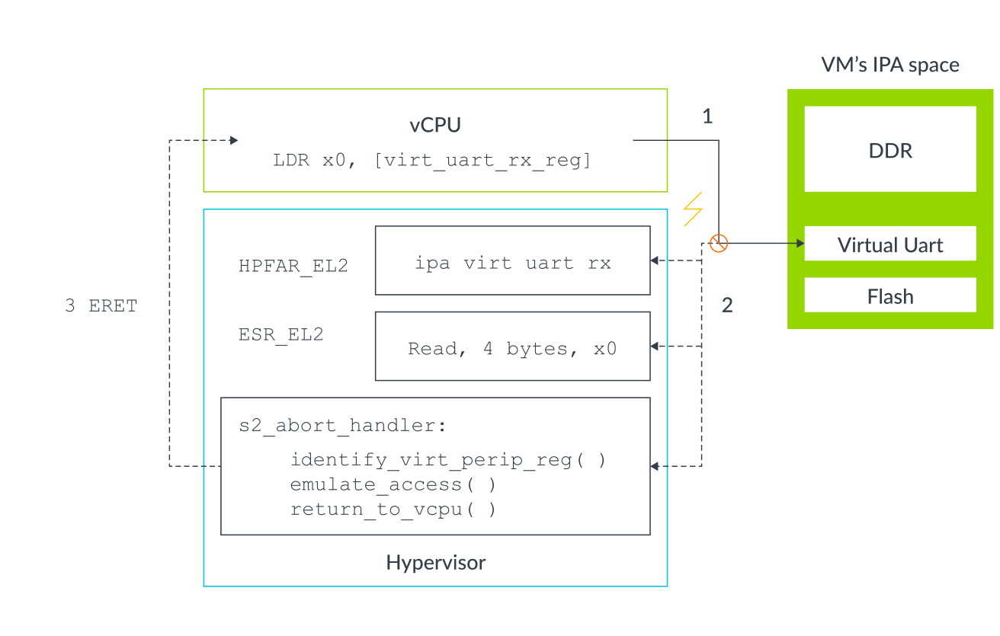

*图 4-5：模拟 MMIO 访问的示例*

步骤拆解：

1. VM 内软件尝试访问虚拟外设，本例中是虚拟 UART 的接收 FIFO。
2. 访问在 stage 2 翻译处被阻止，产生一个路由到 EL2 的中止（abort）。
   - 中止把信息写进 `ESR_EL2`：访问字节数、目标寄存器、是加载还是存储；
   - 同时把被访问地址的 IPA 写进 `HPFAR_EL2`。
3. Hypervisor 根据 `ESR_EL2` 和 `HPFAR_EL2` 识别被访问的虚拟外设寄存器，模拟该操作，再通过 ERET 返回 vCPU。
   - 执行从 LDR 之后的指令继续。

### 6.6 系统内存管理单元（SMMU）

前面讨论的都是“处理器”发起的访问。但系统里还有其他主机（master），比如 DMA 控制器，可能被分配给 VM 使用。我们需要把 stage 2 保护延伸到这些主机。

先看一个不使用虚拟化的 DMA 控制器：

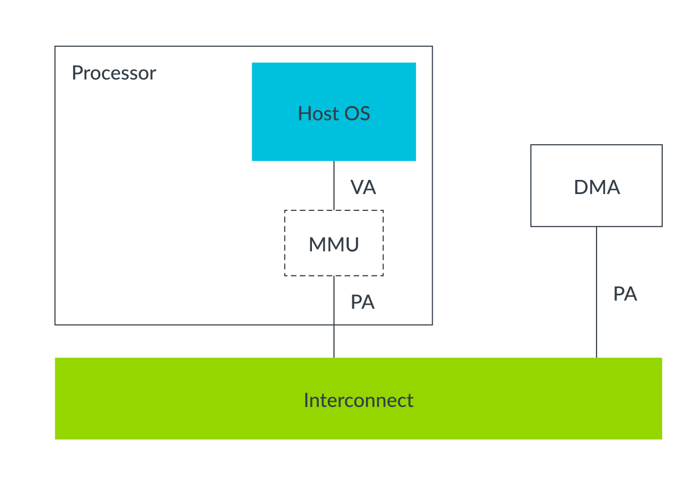

*图 4-6：不使用虚拟化的 DMA 控制器*

DMA 由驱动程序编程，驱动程序通常在内核空间，能保证 OS 级内存保护不被破坏——即应用不能借 DMA 访问本不该看到的内存。

再看 OS 跑在 VM 里的情形：

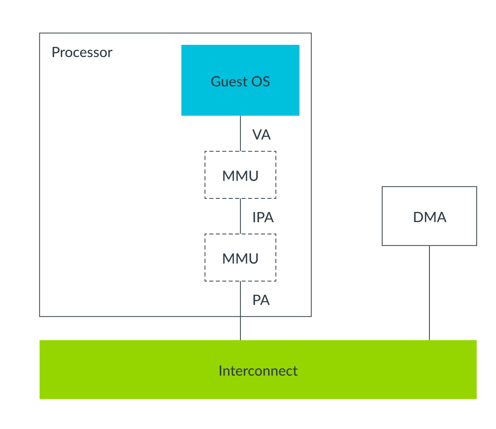

*图 4-7：OS 在 VM 内运行的框图*

此时 hypervisor 用 stage 2 提供 VM 间隔离，软件看内存的权限受 hypervisor 控制的 stage 2 表约束。

如果让 VM 内驱动直接和 DMA 控制器交互，会带来两个问题：

- **隔离**：DMA 不经过 stage 2 表，可能被用来破坏 VM 的沙箱。
- **地址空间**：两阶段翻译下，内核以为的 PA 其实是 IPA，而 DMA 看到的仍是 PA，两者视图不一致。要让它们一致，hypervisor 得捕获 VM 与 DMA 之间的每次交互并代为翻译；内存碎片化时，这种做法又慢又麻烦。

更好的替代方案是：把 stage 2 机制也扩展到其他主机（如 DMA），给这些主机也配一个 MMU，这就是**系统内存管理单元（SMMU，也叫 IOMMU）**：

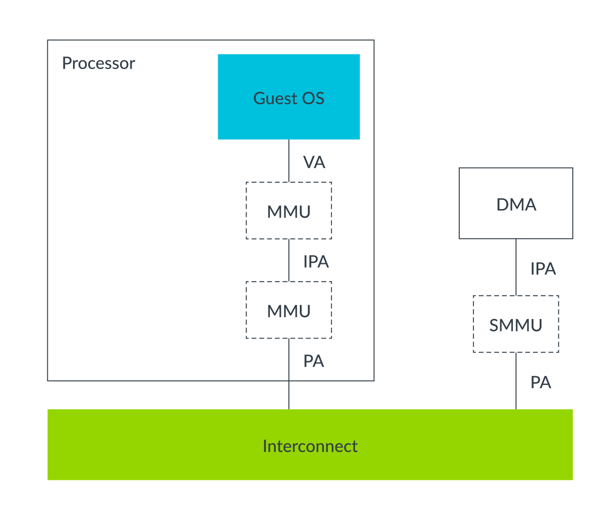

*图 4-8：系统内存管理单元*

Hypervisor 负责编程 SMMU，使上游主机（本例是 DMA）看到与分配给它的 VM 相同的内存视图。

这同时解决了上面两个问题：SMMU 能强制 VM 间隔离，防止外部主机破坏沙箱；也为 VM 内软件和分配给 VM 的外部主机提供一致的内存视图。

虚拟化并非 SMMU 的唯一用途，其他用途不在本指南范围内。

## 7. 指令的捕获与模拟

有时 hypervisor 需要模拟 VM 内的操作。例如 VM 内软件可能试图配置电源管理、缓存一致性之类的低层处理器控制；通常不该让它直接碰这些控制，否则可能破坏隔离或影响其他 VM。

**陷阱（trap）**会在某个动作（如读取寄存器）发生时触发异常。借助陷阱，hypervisor 能把 VM 里的这类操作“拦截”下来，在不影响其他 VM 的前提下模拟它们。

架构内置了陷阱控制。一旦陷阱被设置，执行某个原本合法的动作就会导致异常、进入更高 EL。Hypervisor 用它来模拟 VM 内的操作。

以 WFI（Wait For Interrupt，等待中断）为例：正常情况下它让 CPU 进入低功耗状态。若断言 `HCR_EL2.TWI=1`，则在 EL0 或 EL1 执行 WFI 就会改为产生进入 EL2 的异常。

> 陷阱不只用于虚拟化，EL3 和 EL1 也有自己的陷阱控制。但陷阱对虚拟化软件特别有用，本指南只讨论与虚拟化相关的陷阱。

回到 WFI：OS 常在空闲循环里执行 WFI。对 VM 内的 Guest OS，hypervisor 可以捕获它并转而调度另一个 vCPU：

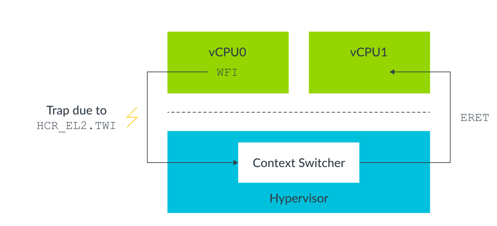

*图 5-1：从 EL1 到 EL2 捕获 WFI 的示例*

### 7.1 呈现寄存器的虚拟值

陷阱的另一个典型用途是给 Guest OS 呈现一个“虚拟值”。例如 `ID_AA64MMFR0_EL1` 报告内存系统相关特性的支持情况，OS 常在启动时读取它来决定启用哪些内核特性。Hypervisor 可能想让它读到一个不同的、所谓的**虚拟值**。

做法是：启用覆盖该寄存器读取的陷阱；异常进入时，hypervisor 判断触发的是哪个陷阱，再模拟操作——用 `ID_AA64MMFR0_EL1` 的虚拟值填充目标寄存器：

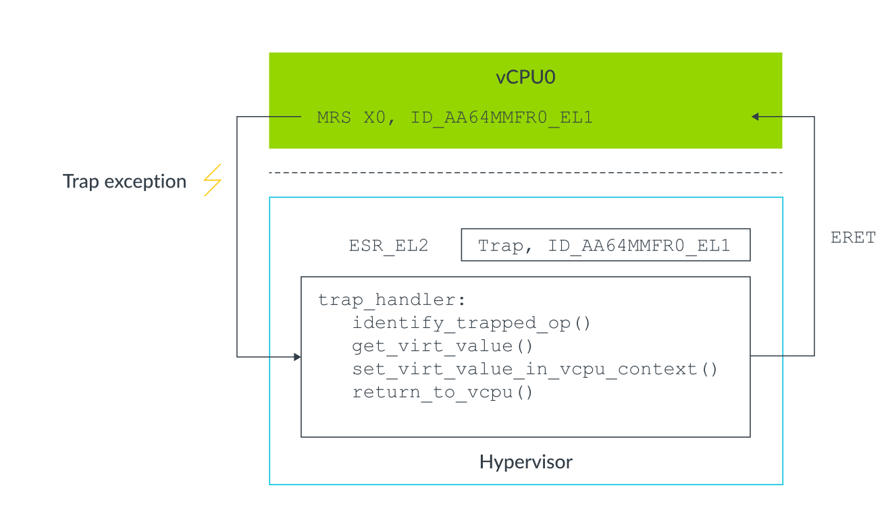

*图 5-2：捕获并模拟操作的示例*

陷阱还能用于惰性上下文切换。OS 一般在启动时初始化 MMU 配置寄存器（`TTBR<n>_EL1`、`TCR_EL1`、`MAIR_EL1`），之后不再改动。Hypervisor 可以利用这一点优化上下文切换：只在切换时恢复这些寄存器，而无需保存。

但若 OS 偶尔在启动后又重新编程这些寄存器，就可能出问题。为避免麻烦，hypervisor 可以设置 `HCR_EL2.TVM`：任何对 MMU 相关寄存器的写都会生成进入 EL2 的陷阱，hypervisor 由此决定是否需要更新它的已保存副本。

> 架构里“捕获（trapping）”和“路由（routing）”是两个相关但不同的概念：陷阱是在动作发生时引起异常；路由决定异常产生后送入哪个异常级别。

### 7.2 MIDR 与 MPIDR

用陷阱虚拟化一个操作，计算开销不小：异常进入 EL2、hypervisor 判断意图、模拟、再返回客户机。像 `ID_AA64MMFR0_EL1` 这类特性寄存器，OS 不常访问，逐次捕获尚可接受。

但有些寄存器访问频繁、或在性能关键路径上，就要避免这种开销。典型例子：

- `MIDR_EL1`：处理器类型，如 Cortex-A53；
- `MPIDR_EL1`：亲和性，如处理器 2 的内核 1。

Hypervisor 希望 Guest OS 读到虚拟值，却又不想捕获每次访问。对此，架构提供了替代方案：

- `VPIDR_EL2`：EL1 读 `MIDR_EL1` 时返回的值；
- `VMPIDR_EL2`：EL1 读 `MPIDR_EL1` 时返回的值。

Hypervisor 在进入 VM 前设置好这些寄存器即可。之后 VM 内软件读 `MIDR_EL1` 或 `MPIDR_EL1`，硬件自动返回虚拟值，无需陷阱。

> `VMPIDR_EL2` 和 `VPIDR_EL2` 没有定义的复位值，必须在首次进入 EL1 前由启动代码初始化；这在裸机环境中尤其重要。

## 8. 异常虚拟化

中断是硬件向软件发信号的方式，比如 GPU 用中断表示“一帧渲染完了”。

引入虚拟化后，情况变复杂：有些中断该 hypervisor 自己处理；有些来自分配给 VM 的设备，需要由该 VM 内软件处理；而中断面向的 VM 在收到时可能根本没在运行。

因此需要两套机制：在 EL2 由 hypervisor 处理部分中断，以及把其他中断转发给特定 VM 或其中某个 vCPU。

为此架构支持**虚拟中断**：vIRQ、vFIQ、vSError。它们行为与对应的物理中断（IRQ、FIQ、SError）类似，但只能在 EL0 和 EL1 执行时发信号——在 EL2、EL3 执行时不可能收到虚拟中断。

> 安全状态下的虚拟化支持在 Armv8.4-A 引入。要在安全 EL0/1 发虚拟中断信号，需要支持并启用安全 EL2；否则虚拟中断不会在安全状态下发信号。

### 8.1 启用虚拟中断

要向 EL0/1 发虚拟中断信号，hypervisor 必须设置 `HCR_EL2` 中相应的路由位。例如启用 vIRQ 要设 `HCR_EL2.IMO`：它既把物理 IRQ 路由到 EL2，又允许向 EL1 发虚拟异常信号。

虚拟中断按中断类型分别控制。理论上 VM 可以同时收物理 FIQ 和虚拟 IRQ，但实际很少见——VM 通常只接收虚拟中断。

### 8.2 生成虚拟中断

有两种机制：

1. 由内核用 `HCR_EL2` 中的控制位在内部生成；
2. 借助 GICv2 或更高版本的中断控制器。

先看机制 1。`HCR_EL2` 里有三个位控制虚拟中断的生成：

- **VI**：置位即注册一个 vIRQ；
- **VF**：置位即注册一个 vFIQ；
- **VSE**：置位即注册一个 vSError。

设置其中一位，效果相当于中断控制器向 vCPU 断言一个中断信号。生成的虚拟中断和普通中断一样受 PSTATE 屏蔽影响。

这种机制简单，但只提供了“生成中断”本身。hypervisor 仍需在 VM 内模拟中断控制器的行为——软件里捕获和模拟有开销，对中断这类高频操作应尽量避免。

第二种选择是用 Arm 通用中断控制器（GIC）生成虚拟中断。从 GICv2 起，GIC 同时提供物理 CPU 接口和虚拟 CPU 接口：

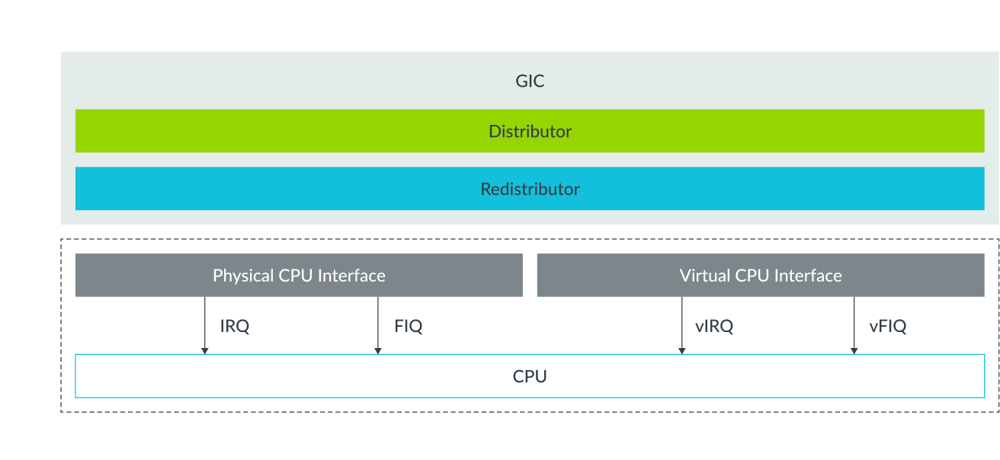

*图 6-1：GIC 的虚拟和物理 CPU 接口*

两个接口相同，只是一个发物理中断、一个发虚拟中断。Hypervisor 可以把虚拟 CPU 接口映射进 VM，让 VM 内软件直接与 GIC 通信。好处是 hypervisor 只需设置虚拟接口，不必模拟它，从而减少捕获到 EL2 的次数，降低虚拟化中断的开销。

> Armv8-A 设计虽可用 GICv2，但更常见的是 GICv3 或 GICv4。

### 8.3 转发中断到 vCPU 的示例

以分配给 VM 的物理外设为例，看虚拟中断如何被转发：

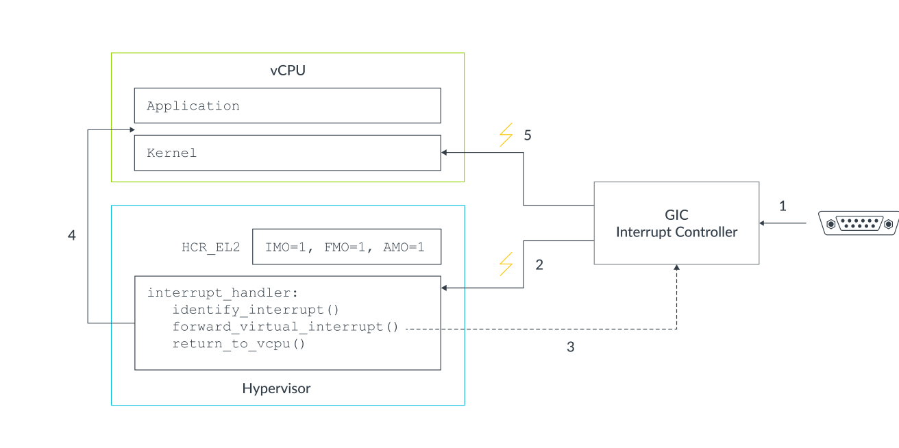

*图 6-2：转发虚拟中断的示例序列*

步骤：

1. 物理外设向 GIC 断言中断信号。
2. GIC 生成物理中断异常（IRQ 或 FIQ），经 `HCR_EL2.IMO/FMO` 配置路由到 EL2。Hypervisor 识别外设，确认它已分配给某 VM，并判断应转发给哪个 vCPU。
3. Hypervisor 配置 GIC，把物理中断作为虚拟中断转发给 vCPU。GIC 随后断言 vIRQ 或 vFIQ 信号，但处理器在 EL2 执行时会忽略它。
4. Hypervisor 把控制交还 vCPU。
5. 处理器回到 vCPU（EL0 或 EL1），此时来自 GIC 的虚拟中断可以被送入，且受 PSTATE 异常屏蔽影响。

这是“物理中断转发为虚拟中断”的场景，对应“第二阶段翻译”里的分配外设模型。对虚拟外设，hypervisor 可以直接创建虚拟中断，无需关联物理中断。

### 8.4 中断屏蔽与虚拟中断

“AArch64 异常模型”介绍过 PSTATE 的中断屏蔽位：`PSTATE.I`（IRQ）、`PSTATE.F`（FIQ）、`PSTATE.A`（SError）。虚拟化环境下，它们的含义略有变化。

以 IRQ 为例，设置 `HCR_EL2.IMO` 会同时做两件事：

- 把物理 IRQ 路由到 EL2；
- 允许在 EL0/EL1 发 vIRQ 信号。

这一设置也改变了 `PSTATE.I` 的作用对象：在 EL0/EL1 中，若 `HCR_EL2.IMO==1`，`PSTATE.I` 屏蔽的是 vIRQ，而不是 pIRQ。

## 9. 通用定时器虚拟化

Arm 架构内置通用定时器（Generic Timer）——每个处理器都有一套标准定时器。它由一组比较器构成，与一个公共的系统计数（system count）比较；当比较器值小于等于系统计数时，就生成中断。下图中橙色部分即通用定时器及其比较器与计数器模块：

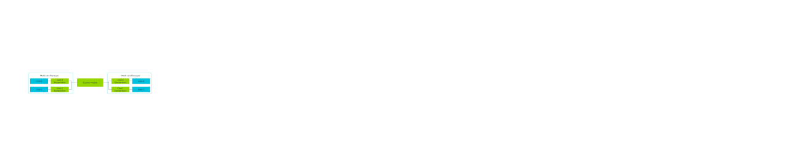

*图 7-1：系统计数器模块和每个核的比较器*

再看一个 hypervisor 托管两个 vCPU 的例子：

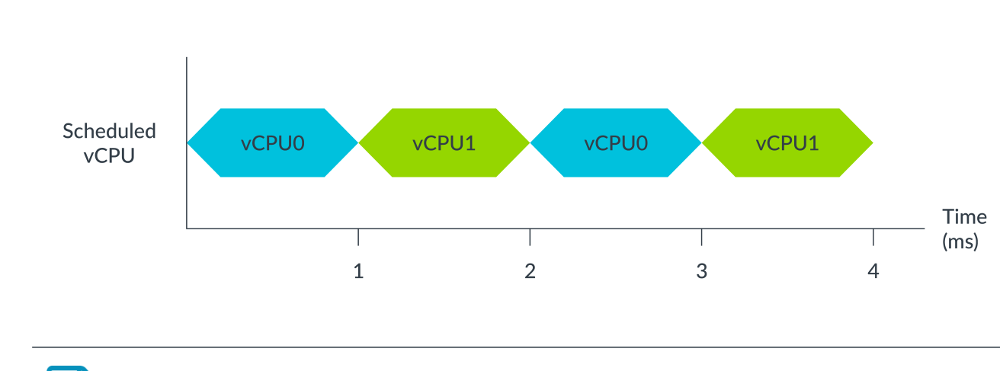

*图 7-2：托管两个 vCPU 的 hypervisor 系统*

> 本例忽略 hypervisor 在 vCPU 之间做上下文切换的开销。

经过 4ms 的物理时间（墙上时钟），每个 vCPU 各跑了 2ms。如果 vCPU0 在 T=0 设置比较器、3ms 后生成中断，你期望中断触发了没有？这里的关键问题是：这个“3ms”到底该指 2ms 虚拟时间（vCPU 实际经历的时间）之后，还是 2ms 墙上时钟之后？

Arm 架构两种都能做到，取决于虚拟化的用途。看看它是怎么实现的。

vCPU 上运行的软件能访问两个定时器：

- **EL1 物理定时器（EL1 Physical Timer）**；
- **EL1 虚拟定时器（EL1 Virtual Timer）**。

EL1 物理定时器与系统计数比较，得到的是墙上时钟时间。

EL1 虚拟定时器与**虚拟计数（virtual count）**比较——虚拟计数 = 物理计数减去一个偏移。Hypervisor 在寄存器里为当前调度的 vCPU 指定偏移，从而把“vCPU 未被调度的那段时间”隐藏掉：

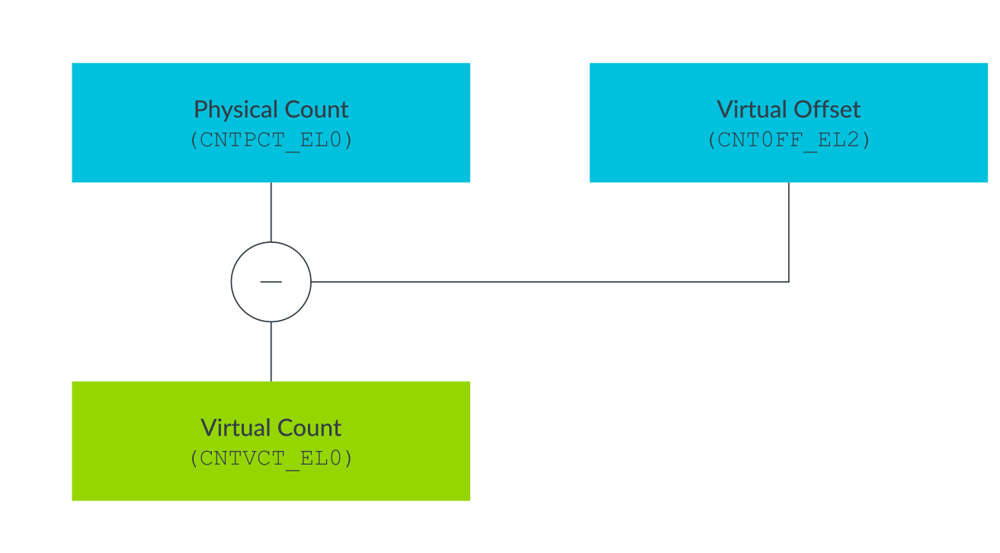

*图 7-3：虚拟计数器是如何生成的*

继续扩展前面的例子：

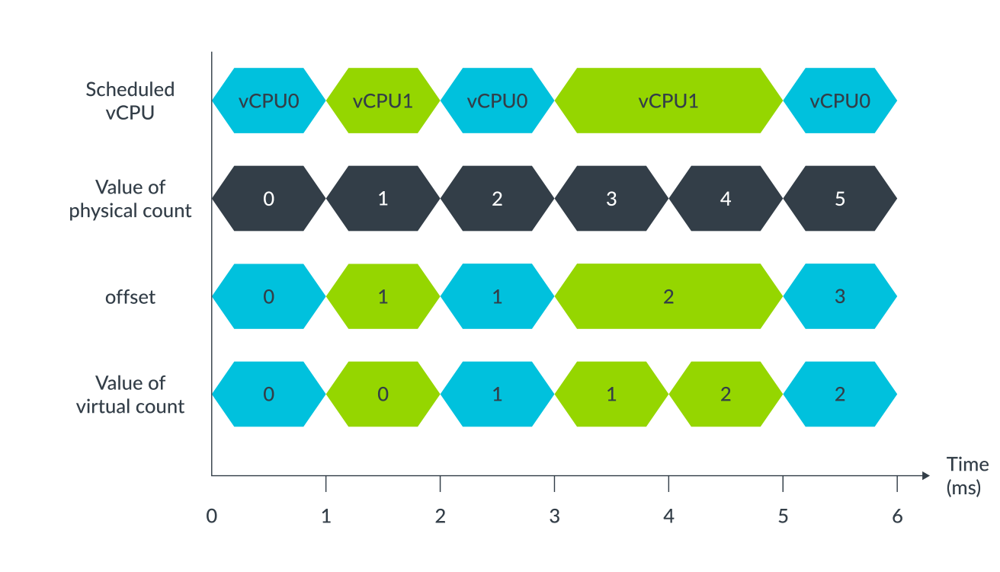

*图 7-4：使用虚拟定时器的示例*

在 6ms 内，每个 vCPU 各运行 3ms。Hypervisor 可以用偏移寄存器呈现一个“只显示 vCPU 运行时间”的虚拟计数；也可以把偏移保持为 0，让虚拟时间等于物理时间。

> 示例把系统计数频率画成 1ms，实际几乎不可能这么低；建议把系统计数设为 1MHz 到 50MHz 之间。

## 10. 虚拟化宿主扩展（VHE）

先看之前的软件栈与异常级别的简化图：

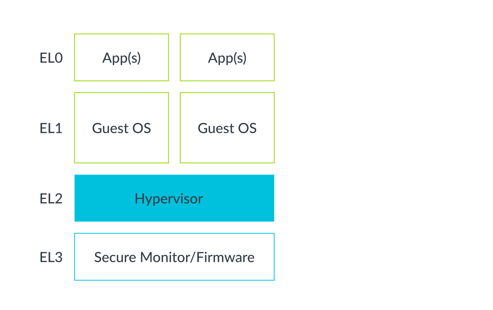

*图 8-1：使用 Armv8-A 异常级别的独立式 hypervisor*

独立式 hypervisor 与异常级别的对应很自然：hypervisor 在 EL2，VM 在 EL0/1。但对托管式 hypervisor，这种对应就麻烦了：

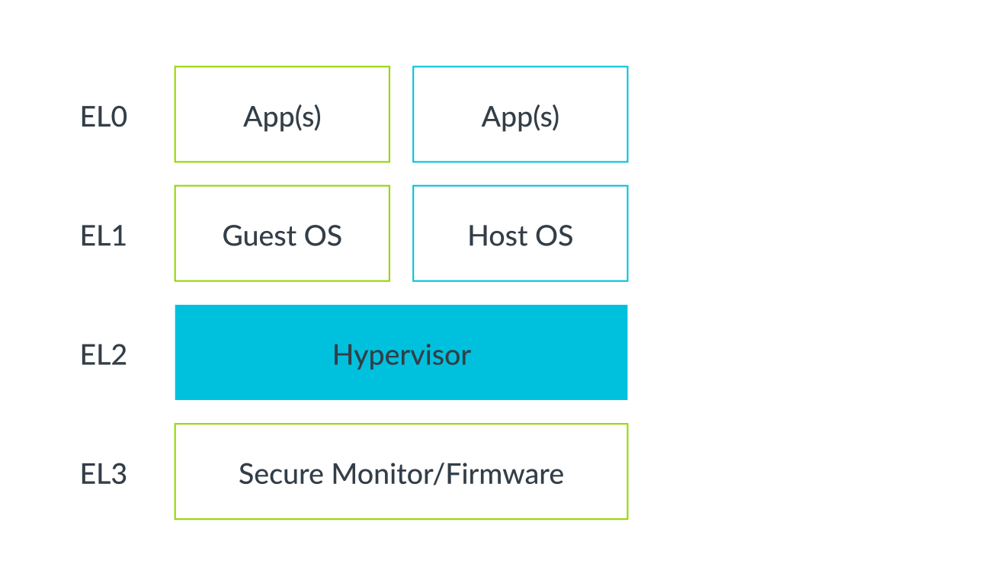

*图 8-2：VHE 之前的托管式 hypervisor*

传统上内核在 EL1，但虚拟化控制在 EL2。于是 Host OS 的大部分待在 EL1，只有少量运行在 EL2 的桩代码（stub code）用于访问虚拟化控制。这种安排可能因额外的上下文切换而低效。

内核需要处理 EL1 与 EL2 运行环境的差异，好在这些差异只集中在少数子系统，例如早期启动。

> DynamIQ 处理器（Cortex-A55、Cortex-A75、Cortex-A76）支持虚拟化宿主扩展（Virtualization Host Extensions，VHE）。

### 10.1 在 EL2 运行 Host OS

VHE 由 `HCR_EL2` 的两个位控制：

- **E2H**：控制是否启用 VHE；
- **TGE**：启用 VHE 后，控制 EL0 属于 Guest 还是 Host。

典型设置如下：

| 执行位置 | E2H | TGE |
| --- | --- | --- |
| Guest 内核（EL1） | 1 | 0 |
| Guest 应用程序（EL0） | 1 | 0 |
| Host 内核（EL2） | 1 | 1* |
| Host 应用程序（EL0） | 1 | 1 |

> \* 在从 VM 退出到 hypervisor 的异常上，TGE 最初为 0；软件必须在运行 Host 内核主体之前设置该位。

这些典型设置如下图所示：

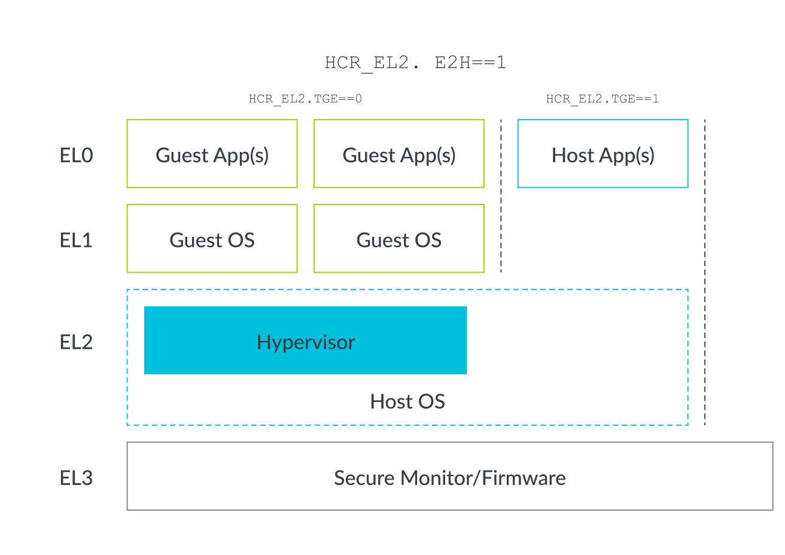

*图 8-3：E2H 和 TGE 的组合*

### 10.2 虚拟地址空间

VHE 引入前，EL0/1 和 EL2 的虚拟地址空间长这样：

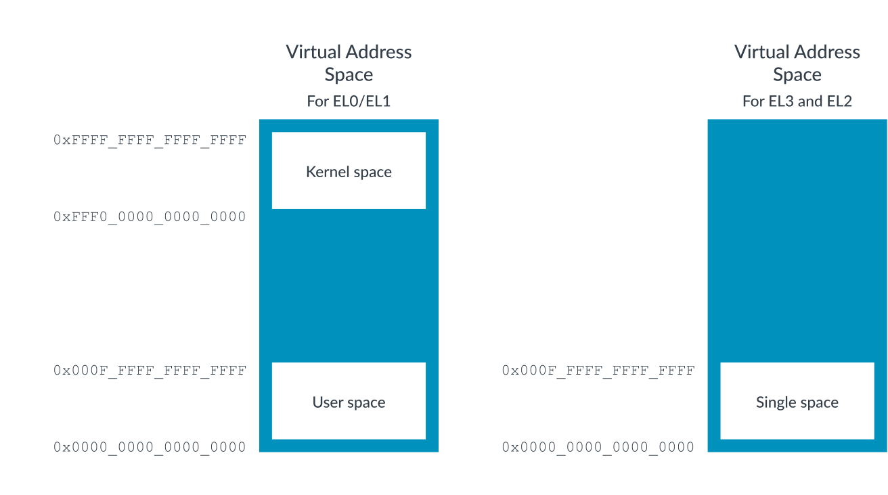

*图 8-4：VHE 之前的 EL0/1 和 EL2 虚拟地址空间*

如“内存管理”所述，EL0/1 有两个区域：按惯例，上部是内核空间、下部是用户空间。而 EL2 在地址范围底部只有一个区域——因为传统上 hypervisor 不托管应用程序，不需要内核/用户空间的划分。

> 内核空间在上、用户空间在下只是惯例，并非架构强制。

EL0/1 地址空间还支持 ASID，EL2 不支持，同样是“hypervisor 通常不托管应用”的缘故。

要让 Host OS 在 EL2 高效执行，就得补上第二个区域和 ASID 支持。设置 `HCR_EL2.E2H` 正好解决：

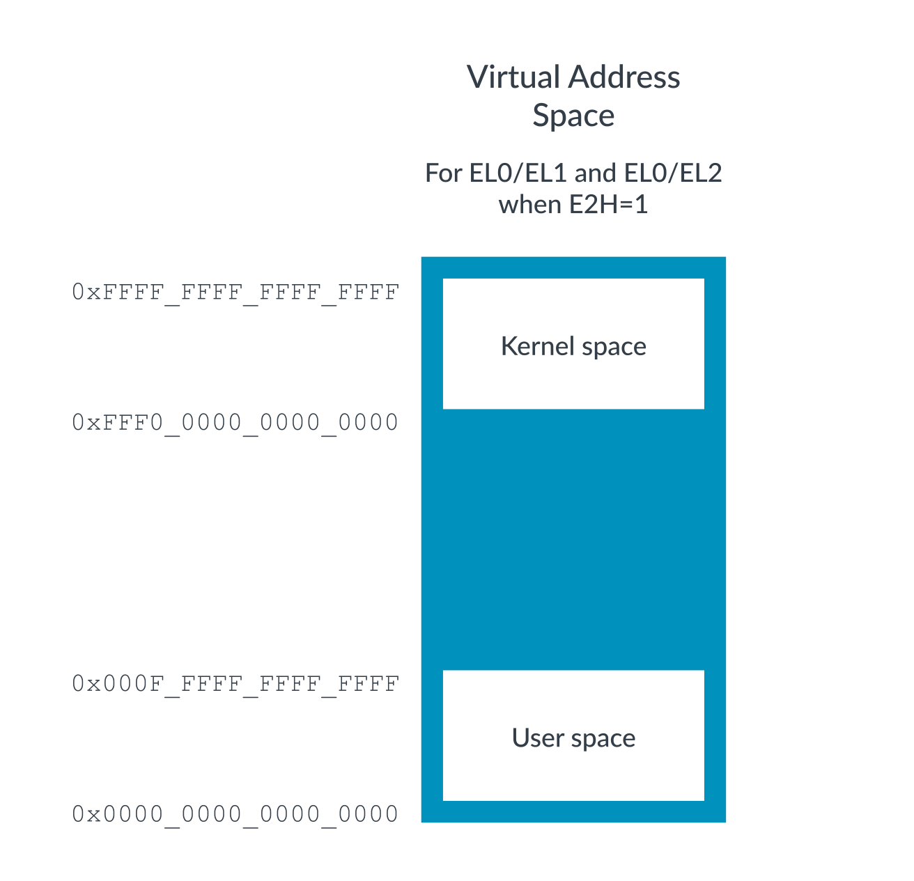

*图 8-5：E2H==1 时的 EL0/2 虚拟地址空间*

在 EL0 中，`HCR_EL2.TGE` 决定用哪套地址空间：`TGE==1` 表示应用跑在 Host OS 下（用 EL2 空间），`TGE==0` 表示跑在 Guest OS 下（用 EL1 空间）。

### 10.3 重定向寄存器访问

启用 VHE 改变了 EL2 地址空间布局，但 MMU 配置仍有个问题：内核会去访问 `_EL1` 寄存器（如 `TTBR0_EL1`），而不是 `_EL2` 的等价寄存器。

要在 EL2 运行同一份二进制，就需要把对 EL1 寄存器的访问重定向到 EL2 等价寄存器。设置 E2H 正是为此：

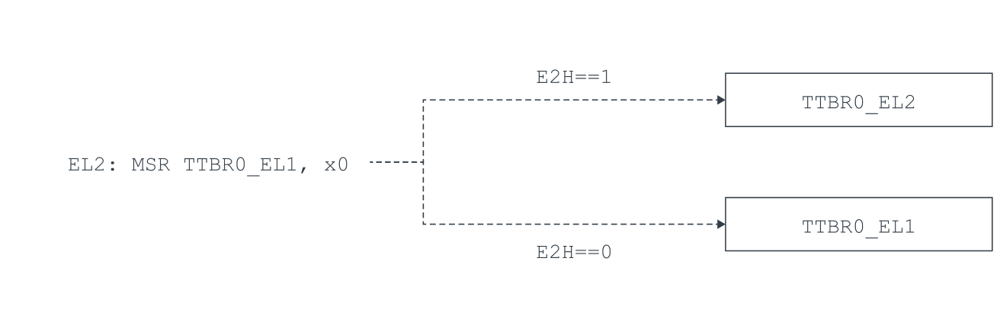

*图 8-6：E2H 对 EL2 系统寄存器访问的影响*

但重定向带来新问题：hypervisor 实现任务切换时，仍要访问真正的 `_EL1` 寄存器。为此引入了一组带 `_EL12` 或 `_EL02` 后缀的寄存器别名。在 EL2 且 `E2H==1` 时，这些别名用于访问 EL1 寄存器、完成上下文切换：

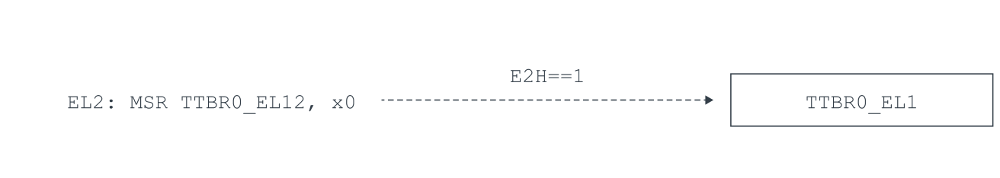

*图 8-7：E2H==1 时从 EL2 访问 EL1 寄存器*

### 10.4 异常

通常 `HCR_EL2.IMO/FMO/AMO` 控制物理异常路由到 EL1 还是 EL2。但当 EL0 以 `TGE==1` 执行时，所有物理异常一律路由到 EL2（除非被 `SCR_EL3` 路由到 EL3），与这些路由位的实际取值无关。原因在于：此时应用是 Host OS 的子进程而非 Guest OS，任何异常都应交给 EL2 的 Host OS。

## 11. 嵌套虚拟化

理论上，hypervisor 可以跑在 VM 里面，这就是**嵌套虚拟化**：

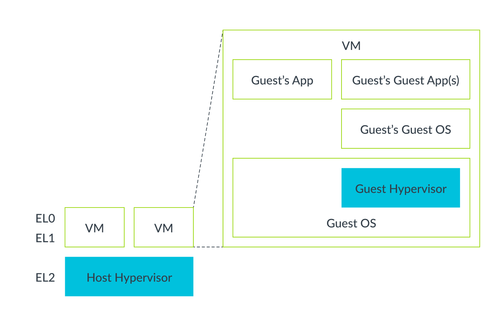

*图 9-1：嵌套虚拟化框图*

称第一层为宿主 Hypervisor（Host Hypervisor），VM 内那层为客户 Hypervisor（Guest Hypervisor）。

Armv8.3-A 之前，Guest Hypervisor 只能在 EL0 里运行，需要大量软件模拟，既复杂又慢。Armv8.3-A 加入的特性让 Guest Hypervisor 可以跑在 EL1；Armv8.4-A 又让这一过程更高效，尽管仍需要 Host Hypervisor 额外的配合。

### 11.1 Guest Hypervisor 对虚拟化控制的访问

不能让 Guest Hypervisor 直接访问虚拟化控制，否则它可能破坏自己的沙箱，或窥探宿主平台信息——这与前面捕获与模拟的动机一致。

Guest Hypervisor 跑在 EL1，`HCR_EL2` 中的新控制位让 Host Hypervisor 能捕获它对虚拟化控制的访问：

- `HCR_EL2.NV`：启用嵌套虚拟化的硬件支持；
- `HCR_EL2.NV1`：启用一组额外的陷阱；
- `HCR_EL2.NV2`：启用内存重定向；
- `VNCR_EL2`：当 NV2==1 时，指向内存中的一个结构。

Armv8.3-A 增加了 NV 和 NV1。正常情况下，从 EL1 访问 `_EL2` 寄存器是未定义的，会导致进入 EL1 的异常；NV/NV1 位让这类访问改为捕获到 EL2。于是 Guest Hypervisor 在 EL1 运行，由 EL2 的 Host Hypervisor 模拟它的一部分操作。NV 还会捕获来自 EL1 的 ERET。

下图是 Guest Hypervisor 设置并进入 VM 的过程：

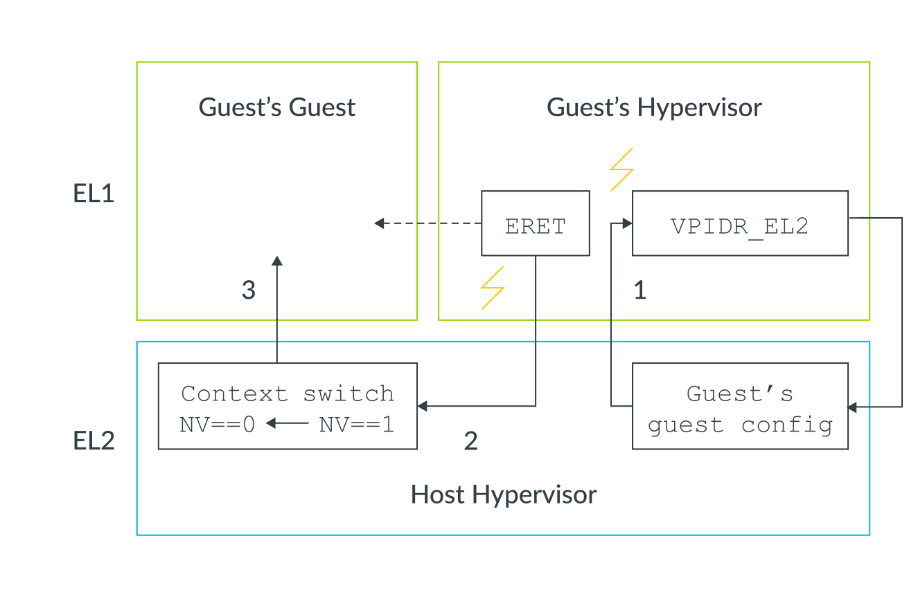

*图 9-2：Guest hypervisor 设置并进入 VM*

1. Guest Hypervisor 对 `_EL2` 寄存器的访问被捕获到 EL2，Host Hypervisor 记录它正在设置的配置。
2. Guest Hypervisor 试图进入它的 Guest VM（Guest 的 Guest），ERET 被捕获到 EL2。
3. Host Hypervisor 取出 Guest 的 Guest 的配置，加载到相应寄存器，清除 NV 位并进入 Guest 的 Guest。

问题在于：Guest Hypervisor 每次访问 EL2 寄存器都要被捕获，而任务切换会访问大量寄存器，产生海量陷阱，每个陷阱都有异常进入和返回的开销。

更好的做法是：只在 ERET 时捕获到 Host Hypervisor，其余时间把 EL2 寄存器的配置重定向到内存。这需要 Armv8.4-A：设置 NV2 后，EL1 对 `_EL2` 寄存器的访问被重定向到内存结构。Guest Hypervisor 可以随意读写寄存器而不触发陷阱；只有 ERET 仍捕获到 EL2，Host Hypervisor 此时再从内存取回配置。

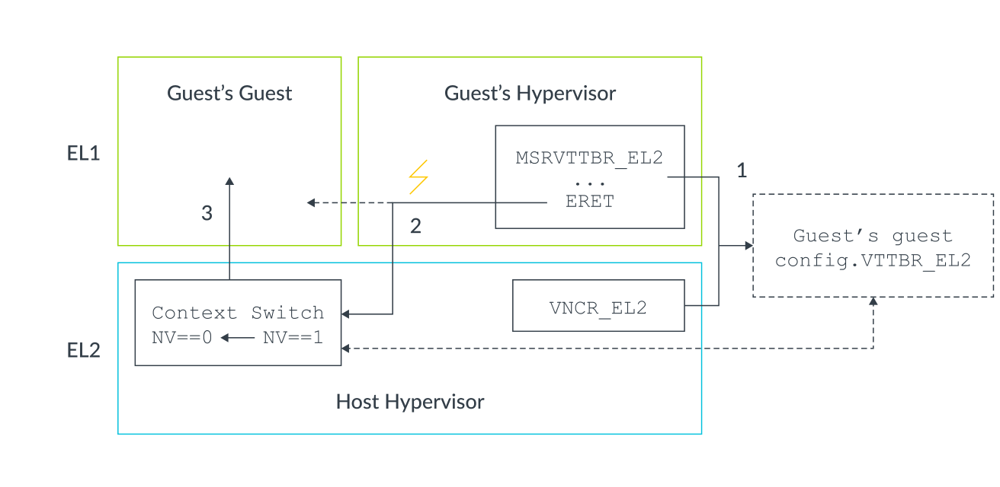

*图 9-3：ERET 仍然捕获到 EL2*

1. EL1 的 Guest Hypervisor 对 `_EL2` 寄存器的访问被重定向到内存结构，结构位置由 Host Hypervisor 用 `VNCR_EL2` 指定。
2. Guest Hypervisor 试图进入它的 Guest VM，ERET 被捕获到 EL2。
3. Host Hypervisor 取出 Guest 的 Guest 的配置，加载到相应寄存器，清除 NV 位并进入 Guest 的 Guest。

这种方案的陷阱更少，进入 Host Hypervisor 的次数也更少。

## 12. 安全虚拟化

虚拟化在 Armv7-A 引入，当时 Hyp 模式（AArch32 里的 EL2 等价物）只在非安全状态可用。Armv8.4-A 把安全状态下的 EL2 支持作为可选特性加入。

处理器支持安全 EL2 时，需从 EL3 用 `SCR_EL3.EEL2` 位启用。设置此位即可进入 EL2，并启用安全状态下的虚拟化特性。

安全虚拟化出现之前，EL3 通常同时承载安全状态切换软件和平台固件。理想做法是尽量减少 EL3 里的软件，以便加固安全。安全虚拟化让我们能把平台固件下移到 EL1，为平台固件和受信任内核提供各自独立的安全分区：

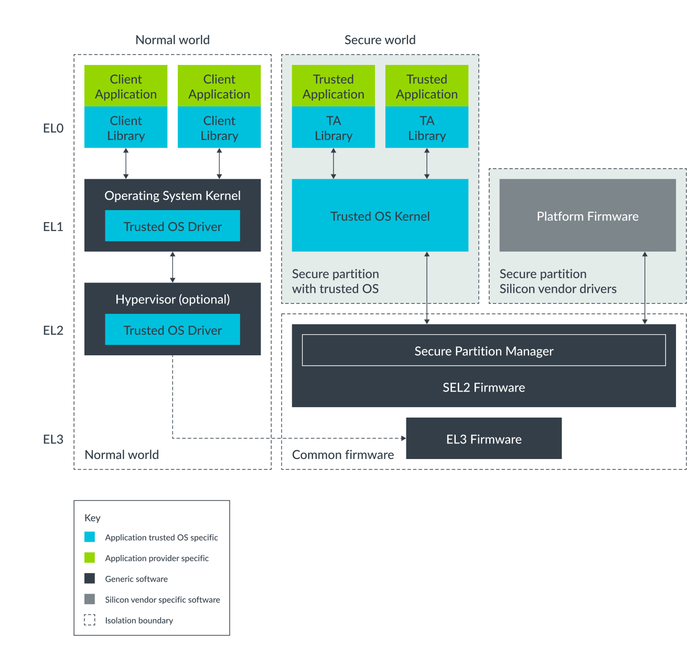

*图 10-1：安全虚拟化框图*

### 12.1 安全 EL2 与两个 IPA 空间

Arm 架构定义了安全和非安全两个物理地址空间。非安全状态下，VM 的 stage 1 翻译输出总是非安全的，所以 stage 2 只需处理一个 IPA 空间。

安全状态下，VM 的 stage 1 翻译可以输出安全或非安全地址，由翻译表描述符的 NS 位控制。因此 stage 2 面临两个 IPA 空间——安全与非安全：

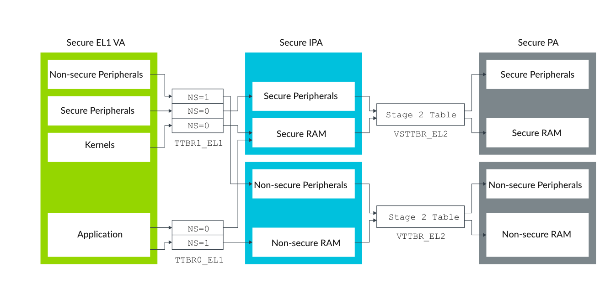

*图 10-2：安全状态下的 IPA 空间*

与 stage 1 表不同，stage 2 表项里没有 NS 位。对某个具体 IPA 空间，所有翻译结果要么全映射到安全物理地址，要么全映射到非安全物理地址，由一个寄存器位控制。通常非安全 IPA 翻译到非安全 PA，安全 IPA 翻译到安全 PA。

## 13. 虚拟化的代价

虚拟化的代价，取决于 hypervisor 服务 VM 时在 VM 与 hypervisor 之间切换所花的时间。在 Arm 系统上，这个代价的下限是保存与恢复：

- 31 个 64 位通用寄存器（X0..X30）；
- 32 个 128 位浮点/SIMD 寄存器（V0..V31）；
- 两个栈指针（SP_EL0、SP_EL1）。

用 LDP/STP 指令，hypervisor 需要 33 条指令来完成保存或恢复。

当然，具体项目的虚拟化代价还取决于平台与 hypervisor 的设计。

## 14. 知识自测

**Type 1 与 Type 2 hypervisor 的区别？**

Type 2 运行在宿主操作系统之上；Type 1 没有宿主操作系统，直接跑在硬件上。

**安全状态和非安全状态各有多少个 IPA 空间？**

安全状态有两个（安全与非安全）；非安全状态有一个。

**虚拟中断能在哪些异常级别被送入？**

只能在 EL0 或 EL1 执行时被送入，并且要先通过设置 `HCR_EL2` 中相应的路由位来启用。

**什么是 SMMU？虚拟化中如何使用？**

SMMU 即系统 MMU，为非处理器主机提供地址翻译。虚拟化中可让它（例如 DMA 控制器）看到与分配给它的 VM 相同的内存视图。

**`HCR_EL2.E2H` 如何影响 EL2 处 `MSR TTBR0_EL1, x0` 的执行？**

`E2H==0` 时写入 `TTBR0_EL1`；`E2H==1` 时被重定向到 `TTBR0_EL2`。

**什么是 VMID，它做什么用？**

VMID 是虚拟机标识符，用于给 VM 的 TLB 表项打标签，使多个 VM 的表项能同时共存于 TLB。

**什么是陷阱？如何用于虚拟化？**

陷阱让原本合法的操作触发异常，从而把该操作交给更高特权软件处理。虚拟化中，陷阱让 hypervisor 能察觉某些操作何时被执行，并模拟它们。

## 15. 延伸资料

与本指南内容相关的资源：

- Memory Management（内存管理）
- Exception Model（异常模型）
- Arm Virtualization: Performance and Architectural Implications（Arm 系统虚拟化代价的背景阅读）
- Arm community（提问，查找 Arm 专家专题文章与博客）

按主题划分：

- **虚拟化简介**
  - The Xen project
  - General information on KVM hypervisors
- **异常虚拟化**
  - GICv3/v4 Software Overview（GIC 如何虚拟化中断）
  - https://www.linux-kvm.org/page/Virtio（VirtIO 背景阅读）
- **培训链接**
  - Introduction to Armv8-A
  - Memory model overview
  - AArch64 privilege and security model

## 16. 下一步

本指南介绍了 Armv8-A AArch64 提供的虚拟化支持，这对任何准备在系统中实现虚拟化的人都很有用。

学完之后，可以尝试一个简单的裸机示例：它在单独的虚拟环境中运行两个 EL1 镜像，并用中断在它们之间做上下文切换。示例虽不是完整的 hypervisor，但能让你亲手试验处理器特性。

另外，《Spawn a Linux virtual machine on Arm using QEMU (KVM)》会带你在 Arm Foundation 模型上搭建开源 Xen 和 KVM hypervisor。

想深入了解安全，可继续阅读《Security Features》。
