# 读懂 ARM Cortex-A 系列与 ARMv8-A 架构（中文精读版）

> 原文：*ARM Cortex-A Series Programmer's Guide for ARMv8-A*
>
> 版本：Version 1.0　|　文档 ID：ARM DEN0024A (ID050815)　|　Issue A（2015-03-24 首次发布）
>
> 版权 © 2015 ARM. All rights reserved. 非保密。
>
> 说明：本文在《Cortex-A 系列程序员指南（ARMv8-A）》中文翻译的基础上，重新组织了叙述逻辑与表达方式，技术内容、表格与图表保持原意；个别明显笔误已按 ARM 架构规范订正。

---

## 导读：这本书讲什么

ARM 在 2013 年发布了 64 位的 ARMv8-A 架构——这是自 2007 年 ARMv7 之后第一次重大架构变更，也是 ARM 架构创立以来最根本的一次演进。这本书面向的读者，是把系统带到"应用开发者能跑应用"这一步的程序员：做 ASIC 验证、写启动代码和驱动的人。

ARMv8-A 的核心是一句话：在保留 32 位（AArch32，几乎就是 ARMv7）的同时，新增了 64 位执行状态 AArch64 和一套全新的 A64 指令集。64 位带来的收益有三方面——更大的寄存器池（最多 8 个参数走寄存器、不用压栈）、更宽的整数寄存器（64 位运算一次完成）、更大的虚拟地址空间（不再受 4GB 限制）。代价也要心里有数：64 位指针更占内存，缓存命中率可能因此下降。

全书可以分成四段来读：

- **第 2~4 章打地基**：先看 ARMv8-A 架构与处理器（第 2 章），再掌握两个核心概念——异常级别（Exception level）与执行状态（Execution state）（第 3 章），最后把寄存器这一层吃透（第 4 章）。
- **第 5~9 章讲指令**：ARMv8 指令集概览（第 5 章）、A64 指令集详解（第 6 章）、浮点与 NEON（第 7 章），再到从旧架构移植到 A64（第 8 章）和决定 64 位代码形态的 ABI（第 9 章）。
- **第 10~14 章讲运行时机制**：异常处理（第 10 章）、缓存（第 11 章）、内存管理单元 MMU（第 12 章）、弱排序内存模型与屏障（第 13 章）、多核处理器（第 14 章）。
- **第 15~19 章讲工程实践**：电源管理（第 15 章）、big.LITTLE 大小核技术（第 16 章）、安全与 TrustZone（第 17 章）、调试与跟踪（第 18 章），以及做软件早期开发的 ARMv8 模型与虚拟平台（第 19 章）。

读这本书不需要你懂底层硬件的一切，但需要你有一点 C 语言和微处理器基础。书里大量出现缓存、MMU 这类硬件概念，但都只在"对写程序的人有用"的范围内展开。文末附有术语表可供查阅。

---
## 第1章 从 32 位到 64 位：认识 ARMv8-A

**ARMv8-A** 是 ARM 架构面向应用处理器档案（Applications Profile）的最新版本。本书用"ARMv8"指代整个架构——它现在同时包含 32 位与 64 位两种执行状态。ARMv8 引入了使用 64 位宽寄存器执行程序的能力，同时保留了向后兼容机制，让已有的 ARMv7 软件仍能继续运行。

64 位执行状态称为 **AArch64**，32 位执行状态称为 **AArch32**，后者与 ARMv7 几乎完全相同。GNU 和 Linux 文档（Redhat 和 Fedora 发行版除外）有时也把 AArch64 写成 ARM64。

ARMv8-A 与 ARMv7-A 共享大量概念，本书不再逐条重复这些细节。需要了解 ARMv7-A 概况的读者，可先读《ARM® Cortex®-A 系列程序员指南》，它也有助于熟悉本书讨论的某些概念。ARMv8-A 架构档案与历代 ARM 架构一样向后兼容，因此 ARMv8 与此前架构在运作方式上存在一定程度的重叠——ARMv7 的一般原理只在解释 ARMv8 与早期 ARMv7 的差异时才被提及。

Cortex-A 系列处理器现在同时包含 ARMv8-A 与 ARMv7-A 两种实现：

- Cortex-A5、Cortex-A7、Cortex-A8、Cortex-A9、Cortex-A15 和 Cortex-A17 处理器实现的是 ARMv7-A 架构。
- Cortex-A53 和 Cortex-A57 处理器实现的是 ARMv8-A 架构。

ARMv8 处理器仍能运行绝大多数为 ARMv7-A 处理器编写的软件（有少数例外）。举例来说，为 ARMv7 Cortex-A 系列处理器编写的 32 位代码，同样能在 Cortex-A57 之类的 ARMv8 处理器上运行——但前提是处理器处于 AArch32 执行状态。反过来，A64（64 位）指令集无法在 ARMv7 处理器上运行，只能在 ARMv8 处理器上运行。

本书假定读者具备一定的 C 编程语言和微处理器知识，书中也给出进一步阅读的指引，指向能提供更深背景的书籍和网站。

### 从 32 位到 64 位的转变

转向 64 位处理器能带来若干性能收益：

- **更大的寄存器池**。A64 指令集提供显著的性能优势，其中包括扩大后的寄存器池。额外的寄存器配合 ARM 架构过程调用标准（AAPCS），能在函数调用需要传递超过四个参数时带来性能提升：ARMv7 此时必须借助栈，而 AArch64 最多可用寄存器直接传递八个参数。
- **更宽的整数寄存器**。操作 64 位数据的代码因此更高效。32 位处理器对 64 位数据做算术运算，可能需要多次操作才能完成；64 位处理器往往一次即可，而且通常与执行 32 位操作一样快。因此，大量进行 64 位运算的代码会显著变快。
- **更大的虚拟地址空间**。64 位操作让应用程序能够使用更大的虚拟地址空间。虽然大物理地址扩展（LPAE）把 32 位处理器的物理地址空间扩展到了 40 位，但它并不扩展虚拟地址空间——即便启用 LPAE，单个应用程序仍被限制在 32 位（4GB）的地址空间内，因为其中一部分要保留给操作系统。
- **免去数据映射进出的开销**。运行在 32 位架构上的软件，执行时可能要把某些数据映射进或映射出内存；更大的地址空间配合 64 位指针，可以避免这个问题。

不过，使用 64 位指针确实有代价：同一段代码用 64 位指针运行时，通常比用 32 位指针占用更多内存——每个指针在内存中要存 8 个字节而非 4 个字节。单独看微不足道，累积起来却相当可观。而且转向 64 位带来的内存占用量上升，会降低命中缓存的访问次数，反过来拖累性能。

更大的虚拟地址空间还支持对更大的文件做内存映射，也就是把文件内容映射进线程的内存映射。即使物理 RAM 不足以容纳整个文件，这种映射也照样成立。

### 1.1 本书的使用方法

本书面向希望使用实现 ARMv8 架构的 Cortex-A 系列处理器的程序员，是一份汇总自多种来源的单一指南，对 ARM 汇编语言程序员和 C 程序员都有用。它的定位是补充而非取代 ARMv8 处理器可用的其他 ARM 文档。要获取特定信息，可查阅的其他文档包括：处理器本身的 ARM 技术参考手册（TRM）、针对具体设备或开发板的文档，以及最重要的《ARM 架构参考手册 - ARMv8，用于 ARMv8-A 架构档案》（即 ARM ARM）。

本书并非面向入门。它假定读者具备一定的 C 编程语言和微处理器知识；书中会涉及缓存、内存管理单元（MMU）等硬件概念，但只讲到对应用程序编写者有价值的程度。全书关注操作系统如何利用 ARMv8 特性，以及如何最大程度发挥 ARMv8 处理器的能力。部分章节附有进一步阅读的指引，也引用了能提供更深背景的书籍和网站，不过通常重点仍放在 ARM 特有的细节上。本书不假定读者使用任何特定工具链，全书同时提到 GNU 和 ARM 两种工具。

接下来的章节这样组织：

刚接触 ARMv8 架构的读者，第 2 章"ARMv8-A 架构与处理器"先回顾此前的 32 位 ARM 架构，再介绍 ARMv8 及其处理器的某些特性；随后第 3 章"ARMv8 基础"以异常级别和执行状态的形式讲述架构的构建块；第 4 章"ARMv8 寄存器"接着描述 ARMv8 架构中可用的寄存器。

ARMv8 架构最重大的变化之一，是新增了 64 位指令集作为现有 32 位架构的补充。第 5 章"ARMv8 指令集简介"对比 ARMv7 指令集架构（ISA，即 A32）与 A64 指令集之间的差异；第 6 章"A64 指令集"更详细地考察该指令集及其用法。除通用操作的新指令集外，ARMv8 还变更了 NEON 和浮点指令集：第 7 章"AArch64 浮点与 NEON"介绍 ARMv8 中 ARM Advanced SIMD（NEON）与浮点指令的变化。关于 NEON 及其在 ARMv7 中能力的更详细指南，请参考《ARM® NEON™ 程序员指南》。

第 8 章"移植到 A64"涵盖从其他架构或早期 ARM 架构把代码移植到 ARMv8 时可能遇到的问题。第 9 章"ARM 64 位架构的 ABI"描述 ARM 架构规范中的应用程序二进制接口（ABI）——ABI 是对 ARM 目标全部编程行为的规范，它决定了 64 位代码的形式。第 10 章"AArch64 异常处理"描述 ARMv8 在 AArch64 状态下的异常处理行为。

此后重点转入处理器的内部架构。第 11 章"缓存"讲述缓存设计以及缓存使用如何提升性能。

ARMv8 以及转向 64 位架构的一个重要驱动因素，是它潜在地支持访问比单一 32 位更大的地址空间。第 12 章"内存管理单元"描述 MMU 如何把虚拟内存地址转换为物理地址。

第 13 章"内存排序"介绍 ARMv8 架构的弱排序内存模型：一般而言，内存访问的顺序不必与加载/存储操作的程序顺序一致。只有部分程序员必须关心内存排序问题——如果你的代码直接与硬件或与其他核上执行的代码交互、直接加载或写入即将执行的指令，或者修改页表，就要考虑排序与屏障；如果你在实现自己的同步函数或无锁算法，同样如此。

第 14 章"多核处理器"描述 ARMv8-A 架构如何支持具有多个核的系统——使用 ARMv8 处理器的系统几乎都是这样实现的。第 15 章"电源管理"讲述 ARM 核如何利用能降低功耗的硬件；电源管理作用于多核与多簇系统的部分，放在第 16 章"big.LITTLE 技术"介绍，该章描述 ARM 的 big.LITTLE 技术如何把一个高能效的 LITTLE 核与一个高性能的 big 核耦合在一起，造出高性能与高能效兼备的系统。

第 17 章"安全"描述 ARMv8 处理器如何构建安全、可信的系统，以保护密码或信用卡信息等资产免遭未经授权的复制或破坏。本书主体最后以第 18 章"调试"作结，该章介绍 Cortex-A53 和 Cortex-A57 处理器中可用的标准调试与跟踪特性。
## 第2章 ARMv8-A 架构与处理器

ARM 架构诞生于 1985 年，但从未停步。从早期内核一路演进至今，每一代都在持续增加新功能。理解这条演进脉络，才能看清 ARMv8-A 引入的 64 位执行、大物理地址和新的异常模型到底解决了什么问题。

- **ARMv4 及更早版本**：这些早期处理器只有 ARM 32 位指令集。
- **ARMv4T**：在 ARM 32 位指令集之外引入了 Thumb 16 位指令集，是第一个被大规模授权的架构，由 ARM7TDMI® 和 ARM9TDMI® 处理器实现。
- **ARMv5TE**：针对 DSP 类运算、饱和算术以及 ARM 与 Thumb 混编做了改进，ARM926EJ-S® 实现了该架构。
- **ARMv6**：做了多项增强，包括非对齐内存访问、内存架构的重大调整、对多处理器的支持，以及在 32 位寄存器内按字节或半字进行的有限 SIMD 运算，由 ARM1136JF-S® 实现。ARMv6 还提供了若干可选扩展，特别是 Thumb-2 与安全扩展（TrustZone®）。Thumb-2 把 Thumb 扩展为 16 位与 32 位混合长度的指令集。
- **ARMv7-A**：把 Thumb-2 扩展设为强制要求，并加入高级 SIMD 扩展（NEON）。在 ARMv7 之前，所有内核实质上遵循同一套架构或功能集。为了应对日益多样化的应用，ARM 引入了一组架构配置（profile）：
  - ARMv7-A 提供运行 Linux 等平台操作系统所需的全部能力。
  - ARMv7-R 面向可预测的实时高性能。
  - ARMv7-M 面向深度嵌入式微控制器。
  - ARMv6 后也补充了 M 配置，把这些能力下沉到较老的架构上；ARMv6M 配置用于低成本、低功耗的微处理器。

### 2.1 ARMv8-A

ARMv8-A 是面向应用配置（Applications Profile）的最新一代 ARM 架构。ARMv8 这个名字指代整体架构，如今同时包含 32 位与 64 位两种执行；它引入了 64 位宽寄存器的执行能力，同时对既有 ARMv7 软件保持向后兼容。

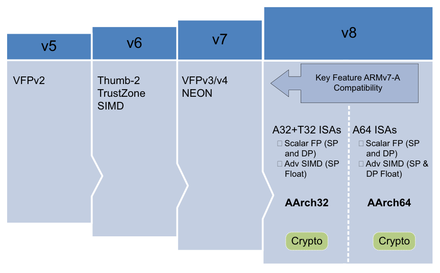


*图 2-1：ARMv8 架构的发展*

ARMv8-A 引入的变化，令设计出性能显著更高的处理器实现成为可能，具体包括：

- **大物理地址**：让处理器能访问超过 4GB 的物理内存。
- **64 位虚拟寻址**：使虚拟内存突破 4GB 的限制，这对使用内存映射文件 I/O 或稀疏寻址的现代桌面与服务器软件十分重要。
- **自动事件信号**：实现高能效、高性能的自旋锁。
- **更大的寄存器文件**：31 个 64 位通用寄存器既能提升性能，也能减少栈的使用。
- **高效的 64 位立即数生成**：减少对文字池（literal pool）的需求。
- **更大的 PC 相对寻址范围**：±4GB 的寻址范围，便于在共享库和位置无关可执行文件中高效地寻址数据。
- **额外的 16KB 与 64KB 转换粒度**：降低转换旁路缓存（TLB）的缺失率，并减小表遍历的深度。
- **新的异常模型**：降低操作系统与虚拟机管理程序（hypervisor）软件的复杂度。
- **高效的缓存管理**：用户空间的缓存操作能提升动态代码生成效率；使用 Data Cache Zero 指令可快速清零数据缓存。
- **硬件加速的密码运算**：带来 3 倍至 10 倍的软件加密性能提升，尤其适合粒度太小、无法高效卸载到硬件加速器的小粒度加解密（例如 HTTPS）。
- **Load-Acquire、Store-Release 指令**：面向 C++11、C11、Java 内存模型而设计，通过消除显式的内存屏障指令来提高线程安全代码的性能。
- **NEON 双精度浮点高级 SIMD**：使 SIMD 向量化能应用到更广泛的算法上，例如科学计算、高性能计算（HPC）和超级计算机。

### 2.2 ARMv8-A 处理器的特性

表 2-1 比较了 ARM 提供的、支持 ARMv8-A 架构的各款处理器实现的特性。

*表 2-1：ARMv8-A 处理器比较*

| 处理器 | Cortex-A53 | Cortex-A57 |
| --- | --- | --- |
| 发布日期 | 2014 年 7 月 | 2015 年 1 月 |
| 典型时钟频率 | 28nm 工艺下 2GHz | 20nm 工艺下 1.5 至 2.5 GHz |
| 执行顺序 | 顺序 | 乱序、推测发射、超标量 |
| 内核数 | 1 至 4 | 1 至 4 |
| 整数峰值吞吐率 | 2.3MIPS/MHz | 4.1 至 4.76MIPS/MHz^a^ |
| 浮点单元 | 是 | 是 |
| 半精度 | 是 | 是 |
| 硬件除法 | 是 | 是 |
| 融合乘加 | 是 | 是 |
| 流水线级数 | 8 | 15+ |
| 返回栈条目数 | 4 | 8 |
| 通用中断控制器（GIC） | 外部 | 外部 |
| AMBA 接口 | 64 位 I/F AMBA 4（支持 AMBA 4 和 AMBA 5） | 128 位 I/F AMBA 4（支持 AMBA 4 和 AMBA 5） |
| L1 缓存大小（指令） | 8KB 至 64KB | 48KB |
| L1 缓存结构（指令） | 2 路组相联 | 3 路组相联 |
| L1 缓存大小（数据） | 8KB 至 64KB | 32KB |
| L1 缓存结构（数据） | 4 路组相联 | 2 路组相联 |
| L2 缓存 | 可选 | 集成 |
| L2 缓存大小 | 128KB 至 2MB | 512KB 至 2MB |
| L2 缓存结构 | 16 路组相联 | 16 路组相联 |
| 主 TLB 条目数 | 512 | 1024 |
| uTLB 条目数 | 10 | 48（指令侧）／32（数据侧） |

a. IMPLEMENTATION DEFINED（实现定义）

#### 2.2.1 ARMv8 处理器

本节逐个介绍实现 ARMv8-A 架构的各款处理器，仅作一般性描述；各处理器的更具体规格，参见上文的表 2-1。

**Cortex-A53 处理器**

Cortex-A53 是一款中端、低功耗处理器，单个簇内包含 1 至 4 个内核，每个内核都带 L1 缓存子系统、可选的内置 GICv3/4 接口以及可选的 L2 缓存控制器。

它是一款极为高能效的处理器，同时支持 32 位与 64 位代码，性能显著高于大获成功的 Cortex-A7。Cortex-A53 既可以作为独立的应用处理器部署，也可以与 Cortex-A57 配对，以 big.LITTLE 配置实现最优的性能、可扩展性与能效。

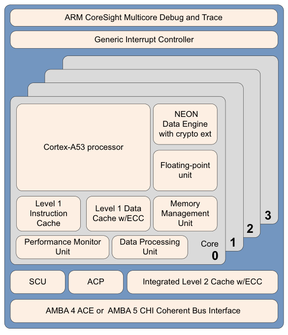


*图 2-2：Cortex-A53 处理器*

Cortex-A53 处理器具有以下特性：

- 顺序执行、8 级流水线。
- 通过分层时钟门控、电源域以及先进的保持（retention）模式来降低功耗。
- 通过复制执行资源和双指令译码器增强双发射能力。
- 面向功耗优化的 L2 缓存设计带来更低延迟，兼顾了性能与效率。

**Cortex-A57 处理器**

Cortex-A57 面向移动与企业计算应用，包括高端计算机、平板电脑及服务器这类计算密集型 64 位应用。它可以与 Cortex-A53 搭配，构成 big.LITTLE 配置，实现可扩展的性能和更高效的能耗。

Cortex-A57 支持与其他处理器进行缓存一致的互操作，其中包括用于 GPU 计算的 ARM Mali™ 图形处理单元（GPU）系列，并为高性能企业应用提供了可选的可靠性与可扩展性特性。它在提供远高于 ARMv7 Cortex-A15 性能的同时，能效也更高；引入的密码扩展使密码算法的性能较上一代处理器提升了 10 倍。

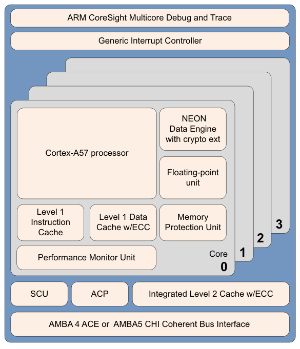


*图 2-3：Cortex-A57 处理器内核*

Cortex-A57 完整实现了 ARMv8-A 架构。它支持多核运行，可在单个簇内进行 1 至 4 核的多处理；通过 AMBA5 CHI 或 AMBA 4 ACE 技术，可组成多个一致的 SMP 簇；调试与跟踪（trace）通过 CoreSight 技术获得。

Cortex-A57 处理器具有以下特性：

- 乱序执行、15+ 级流水线。
- 省电特性包括路预测（way-prediction）、标签缩减（tag-reduction）以及缓存查找抑制。
- 通过复制执行资源提高峰值指令吞吐率。
- 面向功耗优化的指令译码，采用本地化译码，译码带宽为 3 路（3-wide）。
- 面向性能优化的 L2 缓存设计，使簇内多个内核能够同时访问 L2。
## 第3章 异常级别与执行状态

在 ARMv8 中，程序总是在**四个异常级别**之一中执行。异常级别是 ARMv8 划分软件特权的一把"等级标尺"：在 AArch64 中，异常级别直接决定特权级别，这一机制与 ARMv7 定义特权级别的方式一脉相承——在 ELn 中执行，就对应于特权级别 PLn。n 越大，异常级别越高；n 越小，异常级别越低。

异常级别把软件执行特权做了**逻辑分隔**，适用于 ARMv8 架构的所有运行状态。它对应计算机科学中常见的"分层保护域"（hierarchical protection domain）概念，也就是环形保护模型。

每个异常级别上通常运行着不同层次的软件：

- **EL0**　普通用户应用程序。
- **EL1**　操作系统内核，通常被描述为特权级。
- **EL2**　虚拟机管理程序（hypervisor）。
- **EL3**　底层固件，包括安全监控器。

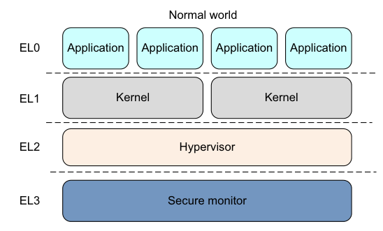


*图 3-1：异常级别*

一般来说，一段软件（应用程序、操作系统内核或虚拟机管理程序）只占据**单个**异常级别。这条规则有一个例外：内核内的虚拟机管理程序（如 KVM）会横跨 EL2 和 EL1 两个级别运行。

ARMv8-A 提供**两种安全状态**：安全状态与非安全状态。非安全状态又叫**普通世界**（Normal World）。这种划分让操作系统（OS）能够与受信任的操作系统在同一块硬件上并行运行，并对某些软件攻击与硬件攻击提供防护。ARM TrustZone 技术正是用来把系统划分成普通世界与安全世界的；和 ARMv7-A 一样，**安全监控器**充当在两个世界之间切换的网关。


*图 3-2：普通世界与安全世界中的 ARMv8 异常级别*

ARMv8-A 还提供了对虚拟化的支持，但**仅限于普通世界**。也就是说，虚拟机管理程序（hypervisor）或虚拟机管理器（VMM）代码可以运行在系统上，并承载多个客户操作系统（guest OS）。每个客户操作系统本质上跑在一台虚拟机上，因此每个操作系统都不知道自己正与其他客户操作系统共享系统时间。

普通世界（非安全状态）有两个特权组件：

- **客户操作系统内核**——包括运行在非安全 EL1 中的 Linux 或 Windows。在虚拟机管理程序之下运行时，富操作系统内核既可充当客户机，也可充当宿主机，取决于虚拟机管理程序的模型。
- **虚拟机管理程序（hypervisor）**——运行在 EL2 上，而 EL2 始终是非安全的。当虚拟机管理程序存在并启用时，它向富操作系统内核提供虚拟化服务。

安全世界有两个特权组件：

- **安全固件**——在应用处理器上，它必须是引导时最先运行的部分。它提供多项服务：平台初始化、受信任操作系统的安装，以及安全监控器调用的路由。
- **受信任操作系统**——向普通世界提供安全服务，并为执行安全（受信任）的应用程序提供运行时环境。

ARMv8 架构中的**安全监控器**处于比其他所有级别更高的异常级别，特权也更高，由此构成了软件特权的逻辑模型。

从图 3-2 可以看出：**不存在安全版本的 EL2**。

### 3.1 执行状态

ARMv8 架构定义了两种**执行状态**：AArch64 与 AArch32，分别用于描述"使用 64 位宽通用寄存器"与"使用 32 位宽通用寄存器"的执行。两者对特权的界定方式不同：ARMv8 的 AArch32 沿用了 ARMv7 对特权的定义，而 AArch64 中的特权级别由异常级别决定——在 ELn 中执行即对应于特权 PLn。

执行状态还决定了指令集：处于 AArch64 状态时，处理器执行 **A64** 指令集；处于 AArch32 状态时，处理器可以执行 **A32**（架构早期版本中称为 ARM）或 **T32**（Thumb）指令集。

下面两图分别展示 AArch64 与 AArch32 中异常级别的组织方式。

在 AArch64 中：

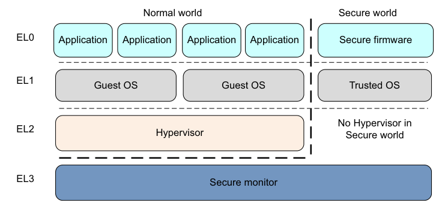


*图 3-3：AArch64 中的异常级别*

在 AArch32 中：

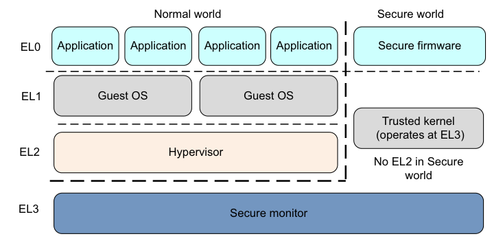


*图 3-4：AArch32 中的异常级别*

一个值得注意的差异：在 AArch32 状态中，受信任操作系统软件在**安全 EL3** 中执行；而在 AArch64 状态中，它主要在**安全 EL1** 中执行。

### 3.2 更改异常级别

先回顾 ARMv7 的行为：处理器模式可以在特权软件的控制下改变，也可能在发生异常时自动改变。当异常发生时，核心保存当前执行状态和返回地址，进入所需模式，并可能禁用硬件中断。

下表对此做了总结。应用程序运行在最低特权级别 PL0（即此前的非特权模式）；操作系统运行在 PL1；在具有虚拟化扩展的系统中，虚拟机管理程序运行在 PL2。充当安全状态与非安全（普通）世界切换网关的安全监控器同样运行在 PL1。

**表 3-1：ARMv7 处理器模式**

| 模式 | 功能 | 安全状态 | 特权级别 |
|---|---|---|---|
| User（USR） | 大多数应用程序运行的非特权模式 | 两者 | PL0 |
| FIQ | 发生 FIQ 中断异常时进入 | 两者 | PL1 |
| IRQ | 发生 IRQ 中断异常时进入 | 两者 | PL1 |
| Supervisor（SVC） | 复位时或执行监管调用指令（SVC）时进入 | 两者 | PL1 |
| Monitor（MON） | 执行 SMC 指令（安全监控器调用）时，或处理器发生配置为安全处理的异常时进入。用于支持在安全与非安全状态之间切换 | 仅安全 | PL1 |
| Abort（ABT） | 发生内存访问异常时进入 | 两者 | PL1 |
| Undef（UND） | 执行未定义指令时进入 | 两者 | PL1 |
| System（SYS） | 特权模式，与用户模式共享寄存器视图 | 两者 | PL1 |
| Hyp（HYP） | 由虚拟机管理程序调用和 Hyp 陷阱异常进入 | 仅非安全 | PL2 |

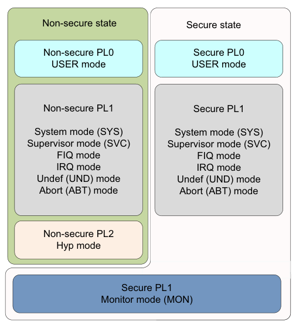


*图 3-5：ARMv7 特权级别*

在 AArch64 中，处理器模式按图 3-6 所示映射到异常级别。与 ARMv7（AArch32）一样，发生异常时处理器会切换到**能够处理该异常**的那个异常级别（模式）。

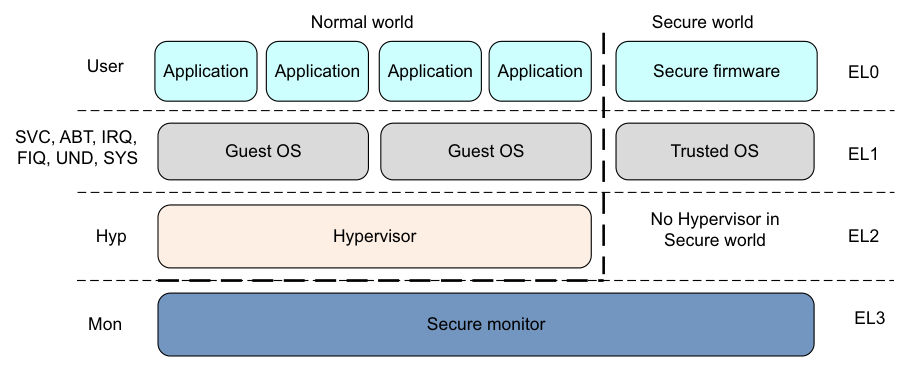


*图 3-6：AArch32 处理器模式*

异常级别之间的切换遵循以下规则：

- 切换到**更高**的异常级别（例如从 EL0 到 EL1），表示软件执行特权**提升**。
- 异常**不能**切换到更低的异常级别。
- EL0 级别**不处理异常**，异常必须在更高的异常级别处理。
- 异常会改变程序流程。异常处理程序从与所发生异常相关的定义向量开始执行，在高于 EL0 的异常级别运行。异常包括：
  - 中断，例如 IRQ 和 FIQ。
  - 内存系统中止。
  - 未定义指令。
  - 系统调用，允许非特权软件向操作系统发起系统调用。
  - 安全监控器或虚拟机管理程序陷阱。
- 结束异常处理并返回先前的异常级别，靠执行 **ERET** 指令完成。
- 从异常返回时，可以**停留在同一异常级别**，也可以进入**更低**的异常级别，但**不能**切换到更高的异常级别。
- 安全状态不随异常级别的改变而改变，唯一的例外是从 EL3 返回到非安全状态。参见第 17-8 页的"在安全状态与非安全状态之间切换"。

### 3.3 更改执行状态

有时必须更改系统的执行状态。例如，运行 64 位操作系统时，若希望在 EL0 上运行 32 位应用程序，系统就必须切换到 AArch32。

当应用程序完成、或执行返回到操作系统时，系统可以切换回 AArch64。但反过来不行：**AArch32 操作系统无法承载 64 位应用程序**（见图 3-7）。

要在**同一异常级别**更改执行状态，必须先切换到更高的异常级别，再返回到原来的异常级别。举一个 64 位操作系统下同时跑 32 位与 64 位应用程序的例子：32 位应用程序可以执行监管调用（SVC）指令，或接收中断，从而切换到 EL1 和 AArch64（参见第 6-21 页的"异常处理指令"）；之后操作系统进行任务切换，并以 AArch64 返回到 EL0。这实际上意味着无法拥有"混合"的 32 位和 64 位应用程序——两者之间没有直接的调用方式。

执行状态的更改只能靠更改异常级别来实现：发生异常可能从 AArch32 切换到 AArch64，而从异常返回可能从 AArch64 切换到 AArch32。

EL3 中的代码无法通过异常切换到更高的异常级别，因此除了复位之外，EL3 无法更改执行状态。

下面总结 AArch64 与 AArch32 执行状态切换的要点：

- 两种执行状态都具有大致相似的异常级别，但在安全与非安全运行之间存在一些差异。异常生成时处理器所处的执行状态，可能限制另一执行状态可用的异常级别。
- 切换到 AArch32 需要从**更高**异常级别到**更低**异常级别，这是通过执行 ERET 指令退出异常处理程序实现的。参见第 6-21 页的"异常处理指令"。
- 切换到 AArch64 需要从**更低**异常级别到**更高**异常级别；触发它的异常可以是执行指令的结果，也可以是外部信号的结果。
- 如果发生异常或从异常返回时异常级别保持不变，则执行状态**无法**更改。
- 当 ARMv8 处理器在特定异常级别以 AArch32 执行状态运行时，对于发生在该异常级别的异常，它使用与 ARMv7 相同的异常模型；在 AArch64 执行状态中，则使用第 10 章"AArch64 异常处理"所述的异常处理模型。

由此可以得出两种状态互通的层级：互通发生在**安全监控器、虚拟机管理程序或操作系统**这一级别。以 AArch64 状态执行的虚拟机管理程序或操作系统，可以支持更低特权级别的 AArch32 运行——运行在 AArch64 中的操作系统可以同时承载 AArch32 和 AArch64 应用程序；同理，AArch64 虚拟机管理程序可以同时承载 AArch32 和 AArch64 客户操作系统。反过来，32 位操作系统无法承载 64 位应用程序，32 位虚拟机管理程序也无法承载 64 位客户操作系统。

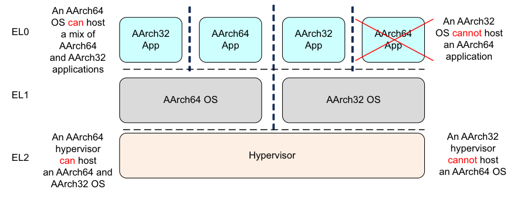


*图 3-7：在 AArch32 与 AArch64 之间切换*

最后是最高异常级别的一个硬约束：对于最高已实现的异常级别（Cortex-A53 和 Cortex-A57 处理器上的 EL3），发生异常时每个异常级别使用哪种执行状态是**固定**的，只能通过复位处理器来更改。而对于 EL2 和 EL1，执行状态由第 4-7 页所述的系统寄存器控制。
## 第4章 ARMv8 寄存器

AArch64 执行状态提供 31 个 64 位通用寄存器，它们在任何时刻、任何异常级别下都可访问。每个寄存器都是 64 位宽，通常统称为 X0–X30。

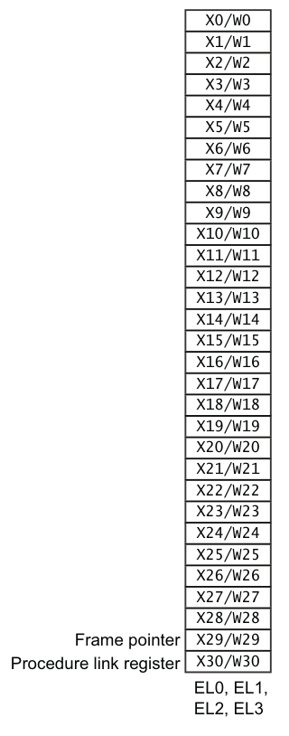


*图 4-1：AArch64 通用寄存器*

```text
X0/W0    X1/W1    X2/W2    X3/W3    X4/W4    X5/W5    X6/W6    X7/W7
X8/W8    X9/W9    X10/W10  X11/W11  X12/W12  X13/W13  X14/W14  X15/W15
X16/W16  X17/W17  X18/W18  X19/W19  X20/W20  X21/W21  X22/W22  X23/W23
X24/W24  X25/W25  X26/W26  X27/W27  X28/W28  X29/W29  X30/W30
```

其中 X29 是帧指针（Frame pointer），X30 是过程链接寄存器（Procedure link register）。这些寄存器在 EL0、EL1、EL2、EL3 四个级别都可访问。

每个 AArch64 64 位通用寄存器（X0–X30）都有一个对应的 32 位形式（W0–W30）。

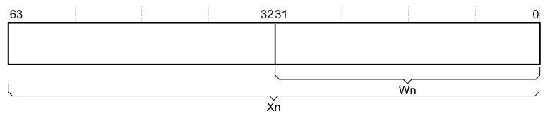


*图 4-2：具有 W 与 X 访问方式的 64 位寄存器*

32 位的 W 寄存器就是对应 64 位 X 寄存器的低半部分：W0 映射到 X0 的低字，W1 映射到 X1 的低字，以此类推。

读写规则只有一条，但方向相反：

- **读 W 寄存器**时，忽略对应 X 寄存器的高 32 位，且不改变它们；
- **写 W 寄存器**时，把 X 寄存器的高 32 位清零。

因此，把 `0xFFFFFFFF` 写入 W0，结果是 X0 变成 `0x00000000FFFFFFFF`。

### 4.1 AArch64 特殊寄存器

除了 31 个核心寄存器，AArch64 还有若干特殊寄存器。

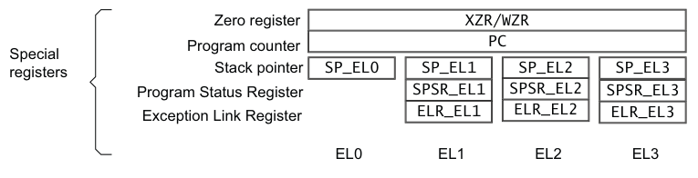


*图 4-3：AArch64 特殊寄存器*

```text
特殊寄存器（Special registers）
栈指针（Stack pointer）
零寄存器（Zero register）
程序计数器（Program counter）
程序状态寄存器（Program Status Register）
异常链接寄存器（Exception Link Register）
XZR/WZR   SP_EL0   PC
SP_EL1    SPSR_EL1 ELR_EL1
SP_EL2    SPSR_EL2 ELR_EL2
SP_EL3    SPSR_EL3 ELR_EL3
```

> **注意**
>
> 不存在名为 X31 或 W31 的寄存器。很多指令的编码把数字 31 当作零寄存器 ZR（WZR/XZR）使用。另有一组受限的指令，其中一个或多个参数用数字 31 编码来表示栈指针（SP）。
>
> 访问零寄存器时，所有写入都被忽略，所有读取都返回 0。注意 SP 寄存器的 64 位形式不使用 X 前缀。

在 ARMv8 架构中，以 AArch64 执行时，异常返回状态保存在每个异常级别对应的专用寄存器里：

- 异常链接寄存器（ELR）。
- 已保存程序状态寄存器（SPSR）。

每个异常级别都有自己的专用 SP，但它不用于保存返回状态。

**表 4-1 AArch64 中的特殊寄存器**

| 名称 | 大小 | 描述 |
| --- | --- | --- |
| WZR | 32 位 | 零寄存器 |
| XZR | 64 位 | 零寄存器 |
| WSP | 32 位 | 当前栈指针 |
| SP | 64 位 | 当前栈指针 |
| PC | 64 位 | 程序计数器 |

**表 4-2 按异常级别划分的特殊寄存器**

| 寄存器 | EL0 | EL1 | EL2 | EL3 |
| --- | --- | --- | --- | --- |
| 栈指针（SP） | SP_EL0 | SP_EL1 | SP_EL2 | SP_EL3 |
| 异常链接寄存器（ELR） | | ELR_EL1 | ELR_EL2 | ELR_EL3 |
| 已保存程序状态寄存器（SPSR） | | SPSR_EL1 | SPSR_EL2 | SPSR_EL3 |

#### 4.1.1 零寄存器

零寄存器作为源寄存器使用时读出 0，作为目的寄存器使用时直接丢弃结果。你可以在大多数（但不是全部）指令中使用零寄存器。

#### 4.1.2 栈指针

ARMv8 中，栈指针的选择与异常级别在一定程度上是解耦的。默认情况下，发生异常时选择目标异常级别自己的栈指针 SP_ELn，例如异常进入 EL1 时选择 SP_EL1。每个异常级别各有一个栈指针：SP_EL0、SP_EL1、SP_EL2 和 SP_EL3。

当在 EL0 之外的某个异常级别处于 AArch64 状态时，处理器可以二选一：

- 使用与该异常级别关联的专用 64 位栈指针（SP_ELn）；
- 使用与 EL0 关联的栈指针（SP_EL0）。

EL0 只能访问 SP_EL0。

后缀 `t` 表示选中了 SP_EL0，后缀 `h` 表示选中了 SP_ELn。

大多数指令都无法引用 SP。不过某些形式的算术指令（例如 ADD 指令）可以读写当前栈指针，以便在函数内调整栈指针。例如：

```text
ADD SP, SP, #0x10  // 调整 SP，使其位于当前值之前 0x10 字节处
```

#### 4.1.3 程序计数器

原始 ARMv7 指令集的一个特点是，把 R15（程序计数器 PC）当作通用寄存器使用。PC 虽然能支持一些巧妙的编程技巧，却给编译器和复杂流水线的设计带来了麻烦。ARMv8 移除了对 PC 的直接访问，使返回预测更简单，也简化了 ABI 规范。

PC 永远无法作为具名寄存器访问，它的使用隐含在某些指令中，例如 PC 相对加载和地址生成。PC 不能作为数据处理指令或加载指令的目的操作数。

#### 4.1.4 异常链接寄存器（ELR）

异常链接寄存器保存异常返回地址。

**表 4-3 AArch64 栈指针选项**

| 异常级别 | 选项 |
| --- | --- |
| EL0 | EL0t |
| EL1 | EL1t、EL1h |
| EL2 | EL2t、EL2h |
| EL3 | EL3t、EL3h |

#### 4.1.5 已保存进程状态寄存器

发生异常时，处理器状态会保存到相应的已保存程序状态寄存器（SPSR）中，方式与 ARMv7 的 CPSR 类似。SPSR 保存发生异常前的 PSTATE 值，用于在执行异常返回时恢复 PSTATE。

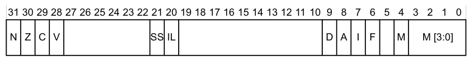


*图 4-4：SPSR*

```text
N  Z  C  V  SS  IL  D  A  I  F  M[4]  M[3:0]
```

各比特位在 AArch64 中的含义如下：

- **N** 负结果（N 标志）。
- **Z** 零结果（Z 标志）。
- **C** 进位（C 标志）。
- **V** 溢出（V 标志）。
- **SS** 软件单步，指示发生异常时是否启用了软件单步。
- **IL** 非法执行状态位，显示发生异常前一刻 PSTATE.IL 的值。
- **D** 进程状态调试屏蔽，指示对发生异常的异常级别而言，来自观察点、断点和软件单步调试事件的调试异常是否被屏蔽。
- **A** SError（系统错误）屏蔽位。
- **I** IRQ 屏蔽位。
- **F** FIQ 屏蔽位。
- **M[4]** 发生异常时所处的执行状态，值 0 表示 AArch64。
- **M[3:0]** 发生异常时所处的模式或异常级别。

ARMv8 中，写哪个 SPSR 取决于异常级别：异常发生在 EL1 就用 SPSR_EL1，发生在 EL2 就用 SPSR_EL2，发生在 EL3 就用 SPSR_EL3。SPSR 由核心在发生异常时自动填充。

> **注意**
>
> 与某个异常级别关联的寄存器对 ELR_ELn 和 SPSR_ELn，在较低异常级别执行期间保持其状态。

### 4.2 处理器状态

AArch64 没有与 ARMv7 当前程序状态寄存器（CPSR）直接对应的寄存器。在 AArch64 中，传统 CPSR 的各个组成部分改成了可独立访问的字段，统称为处理器状态（PSTATE）。

PSTATE 的字段定义如下：

**表 4-4 PSTATE 字段定义**

| 名称 | 描述 |
| --- | --- |
| N | 负条件标志。 |
| Z | 零条件标志。 |
| C | 进位条件标志。 |
| V | 溢出条件标志。 |
| D | 调试屏蔽位。 |
| A | SError 屏蔽位。 |
| I | IRQ 屏蔽位。 |
| F | FIQ 屏蔽位。 |
| SS | 软件单步位。 |
| IL | 非法执行状态位。 |
| EL (2) | 异常级别。 |
| nRW | 执行状态：0 = 64 位；1 = 32 位 |
| SP | 栈指针选择器。0 = SP_EL0；1 = SP_ELn |

PSTATE.{N, Z, C, V} 字段可在 EL0 访问；其余字段只能在 EL1 或更高级别执行，在 EL0 处未定义（UNDEFINED）。

从异常返回时，执行 ERET 指令会把 SPSR_ELn 复制回 PSTATE，从而恢复 ALU 标志、执行状态和异常级别，并让处理器跳转，随后从 ELR_ELn 中的地址继续执行。

### 4.3 系统寄存器

在 AArch64 中，系统配置通过系统寄存器控制，并使用 MSR 和 MRS 指令访问。这与 ARMv7-A 形成对比——后者通常通过协处理器 15（CP15）操作访问这类寄存器。寄存器名称会告诉你它可以从哪个最低异常级别访问。

例如：

- TTBR0_EL1 可从 EL1、EL2 和 EL3 访问。
- TTBR0_EL2 可从 EL2 和 EL3 访问。

后缀为 `_ELn` 的寄存器在部分或全部级别中拥有独立副本，但通常不包括 EL0。很少有系统寄存器能从 EL0 访问，缓存类型寄存器（CTR_EL0）是可访问的一个例子。

访问系统寄存器的代码形式如下：

```text
MRS  x0, TTBR0_EL1  // 将 TTBR0_EL1 移入 x0
MSR  TTBR0_EL1, x0  // 将 x0 移入 TTBR0_EL1
```

早期版本的 ARM 架构用协处理器做系统配置，但 AArch64 不支持协处理器。表 4-5 只列出本书提到的系统寄存器；完整列表见《ARM Architecture Reference Manual - ARMv8》（ARMv8-A 架构版本）的附录 J。

该表还显示每个寄存器拥有独立副本的异常级别。例如，独立的辅助控制寄存器（ACTLR）以 ACTLR_EL1、ACTLR_EL2 和 ACTLR_EL3 的形式存在。

**表 4-5 系统寄存器**

| 名称 | 寄存器 | 描述 | n 的允许值 |
| --- | --- | --- | --- |
| ACTLR_ELn | 辅助控制寄存器 | 控制处理器特有功能。 | 1、2、3 |
| CCSIDR_ELn | 当前缓存大小 ID 寄存器 | 提供当前所选缓存的架构信息。参见第 11-18 页“缓存发现”。 | 1 |
| CLIDR_ELn | 缓存级别 ID 寄存器 | 各级实现的缓存类型，以及缓存层级的一致性点和统一点。参见第 11-13 页“缓存维护”。 | 1、2、3 |
| CNTFRQ_ELn | 计数器-定时器频率寄存器 | 报告系统定时器的频率。参见第 14-5 页“定时器”。 | 0 |
| CNTPCT_ELn | 计数器-定时器物理计数寄存器 | 保存 64 位当前计数值。参见第 14-5 页“定时器”。 | 0 |
| CNTKCTL_ELn | 计数器-定时器内核控制寄存器 | 控制从虚拟计数器生成事件流。还控制从 EL0 访问物理计数器、虚拟计数器、EL1 物理定时器和虚拟定时器。参见第 14-5 页“定时器”。 | 1 |
| CNTP_CVAL_ELn | 计数器-定时器物理定时器比较值寄存器 | 保存 EL1 物理定时器的比较值。参见第 14-5 页“定时器”。 | 0 |
| CPACR_ELn | 协处理器访问控制寄存器 | 控制对 Trace、浮点和 NEON 功能的访问。参见第 13-9 页“ISB 详解”。 | 1 |
| CSSELR_ELn | 缓存大小选择寄存器 | 通过指定所需的缓存级别和缓存类型（指令缓存或数据缓存）来选择当前缓存大小 ID 寄存器 CCSIDR_EL1。参见第 11-18 页“缓存发现”。 | 1 |
| CNTP_CTL_ELn | 计数器-定时器物理控制寄存器 | EL1 物理定时器的控制寄存器。参见第 14-5 页“定时器”。 | 0 |
| CTR_ELn | 缓存类型寄存器 | 集成缓存的架构信息。参见第 11-18 页“缓存发现”。 | 0 |
| DCZID_ELn | 数据缓存清零 ID 寄存器 | 指示“按虚拟地址数据缓存清零（DCZVA）”系统指令以 0 字节值写入的块大小。参见第 11-18 页“缓存发现”。 | 0 |
| ELR_ELn | 异常链接寄存器 | 保存引发异常的指令地址。 | 1、2、3 |
| ESR_ELn | 异常综合寄存器 | 包含异常原因信息。参见第 10-9 页“异常综合寄存器”。 | 1、2、3 |
| FAR_ELn | 故障地址寄存器 | 保存虚拟故障地址。参见第 10-7 页“处理同步异常”。 | 1、2、3 |
| FPCR | 浮点控制寄存器 | 控制浮点扩展行为。该寄存器的字段映射到 AArch32 FPSCR 中的等价字段。参见第 7-2 页“AArch64 中 NEON 与浮点的新特性”。 | - |
| FPSR | 浮点状态寄存器 | 提供浮点系统状态信息。该寄存器的字段映射到 AArch32 FPSCR 中的等价字段。参见第 7-2 页“AArch64 中 NEON 与浮点的新特性”。 | - |
| HCR_ELn | 虚拟机管理程序配置寄存器 | 控制虚拟化设置以及异常对 EL2 的陷入。参见第 18-8 页“异常处理”。 | 2 |
| MAIR_ELn | 内存属性间接寄存器 | 提供与长描述符格式转换表条目中 ELn 第一阶段转换可能取值相对应的内存属性编码。参见第 13-3 页“内存类型”。 | 1、2、3 |
| MIDR_ELn | 主 ID 寄存器 | 代码所运行的处理器类型（部件编号和修订版本）。 | 1 |
| MPIDR_ELn | 多处理器亲和性寄存器 | 多核或簇系统中的处理器和簇 ID。参见第 14-3 页“确定代码运行在哪个核心”。 | 1 |
| SCR_ELn | 安全配置寄存器 | 控制安全状态以及异常对 EL3 的陷入。参见第 10-7 页“处理同步异常”。 | 3 |
| SCTLR_ELn | 系统控制寄存器 | 控制架构特性，例如 MMU、缓存和对齐检查。 | 0、1、2、3 |
| SPSR_ELn | 已保存程序状态寄存器 | 异常进入此模式或异常级别时保存的处理器状态。 | abt、fiq、irq、und、1、2、3 |
| TCR_ELn | 转换控制寄存器 | 确定由哪些转换表基址寄存器定义 ELn 内存访问第一阶段转换所需的转换表遍历的基址。还控制转换表格式并保存可缓存性和可共享性信息。参见第 12-7 页“内核与应用虚拟地址空间的分离”。 | 1、2、3 |
| TPIDR_ELn | 用户读/写线程 ID 寄存器 | 提供 ELn 上运行的软件为操作系统管理用途存储线程标识信息的位置。参见第 12-27 页“上下文切换”。 | 0、1、2、3 |
| TPIDRRO_ELn | 用户只读线程 ID 寄存器 | 提供 EL1 或更高级别上运行的软件存储线程标识信息的位置。此信息对 EL0 上运行的软件可见，用于操作系统管理用途。参见第 12-27 页“上下文切换”。 | 0 |
| TTBR0_ELn | 转换表基址寄存器 0 | 保存转换表 0 的基址及其所占用内存的信息。这是 ELn 内存访问第一阶段转换所使用的转换表之一。参见第 12-7 页“内核与应用虚拟地址空间的分离”。 | 1、2、3 |
| TTBR1_ELn | 转换表基址寄存器 1 | 保存转换表 1 的基址及其所占用内存的信息。这是 EL0 和 EL1 内存访问第一阶段转换所使用的转换表之一。参见第 12-7 页“内核与应用虚拟地址空间的分离”。 | 1 |
| VBAR_ELn | 向量基址寄存器 | 保存任何进入 ELn 的异常的异常基址。参见第 10-12 页“AArch64 异常表”。 | 1、2、3 |
| VTCR_ELn | 虚拟化转换控制寄存器 | 控制非安全 EL0 和 EL1 内存访问第二阶段转换所需的转换表遍历。还保存这些访问的可缓存性和可共享性信息。参见第 12-20 页“EL2 和 EL3 处的转换”。 | 2 |
| VTTBR_ELn | 虚拟化转换表基址寄存器 | 保存非安全 EL0 和 EL1 内存访问第二阶段转换的转换表基址。参见第 18-3 页“内存转换”。 | 2 |

#### 4.3.1 系统控制寄存器

系统控制寄存器（SCTLR）控制标准内存、系统设施，并提供核心中已实现功能的状态信息。

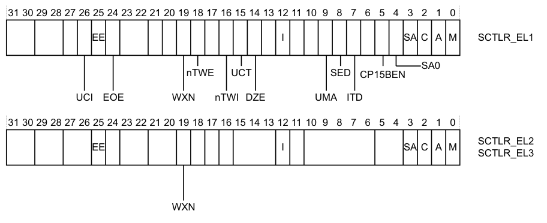


*图 4-5：SCTLR 位分配*

并非所有位在 EL1 以上级别都可用。各比特位含义如下：

- **UCI** 置位时，允许在 AArch64 中从 EL0 访问 DC CVAU、DC CIVAC、DC CVAC 和 IC IVAU 指令。参见第 11-13 页“缓存维护”。
- **EE** 异常端序。参见第 4-12 页“端序”。
  - 0 小端。
  - 1 大端。
- **EOE** EL0 处显式数据访问的端序。此位的可能取值为：
  - 0 EL0 处的显式数据访问为小端。
  - 1 EL0 处的显式数据访问为大端。
- **WXN** 写权限隐含 XN（禁止执行）。参见第 12-23 页“访问权限”。
  - 0 具有写权限的区域不被强制为 XN。
  - 1 具有写权限的区域被强制为 XN。
- **nTWE** 不陷入 WFE。值 1 表示 WFE 指令正常执行。
- **nTWI** 不陷入 WFI。值 1 表示 WFI 指令正常执行。
- **UCT** 置位时，允许在 AArch64 中从 EL0 访问 CTR_EL0 寄存器。
- **DZE** 在 EL0 处访问 DC ZVA 指令。参见第 11-13 页“缓存维护”。
  - 0 禁止执行。
  - 1 允许执行。
- **I** 指令缓存使能。这是 EL0 和 EL1 处指令缓存的使能位。对可缓存普通内存的指令访问会被缓存。
- **UMA** 用户屏蔽访问。当 EL0 使用 AArch64 时，控制从 EL0 访问中断屏蔽。
- **SED** SETEND 禁用。在使用 AArch32 时禁用 EL0 处的 SETEND 指令。
  - 0 启用 SETEND 指令。
  - 1 禁用 SETEND 指令。
- **ITD** IT 禁用。此位的可能取值为：
  - 0 IT 指令可用。
  - 1 IT 指令被当作 16 位指令处理。只能后接另一个 16 位指令或 32 位指令的前半部分。这取决于具体实现。
- **CP15BEN** CP15 屏障使能。若实现，则是 AArch32 CP15 DMB、DSB 和 ISB 屏障操作的使能位。
- **SA0** EL0 的栈对齐检查使能。
- **SA** 栈对齐检查使能。
- **C** 数据缓存使能。这是 EL0 和 EL1 处数据缓存的使能位。对可缓存普通内存的数据访问会被缓存。
- **A** 对齐检查使能位。
- **M** 使能 MMU。

**访问 SCTLR**

要访问 SCTLR_ELn，使用：

```text
MRS <Xt>, SCTLR_ELn  // 将 SCTLR_ELn 读入 Xt
MSR SCTLR_ELn, <Xt>  // 将 Xt 写入 SCTLR_ELn
```

例如：

**示例 4-1 设置 SCTLR 中的位**

```text
MRS X0, SCTLR_EL1         // 读取系统控制寄存器配置数据
ORR X0, X0, #(1 << 2)     // 置位 [C] 位并启用数据缓存
ORR X0, X0, #(1 << 12)    // 置位 [I] 位并启用指令缓存
MSR SCTLR_EL1, X0         // 写入系统控制寄存器配置数据
```

> **注意**
>
> 在任何异常级别中启用数据和指令缓存之前，必须先使处理器中的缓存无效。

### 4.4 端序

在内存中查看字节有两种基本方式：小端（LE）或大端（BE）。在大端机器上，内存中对象的最高有效字节存在最低地址，也就是最接近零的地址；在小端机器上，最低有效字节存在最低地址。“字节序”一词也可替代“端序”使用。

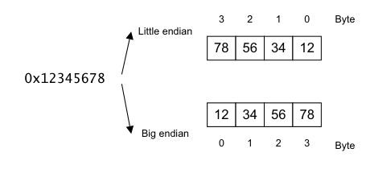

*图 4-6*

```text
小端（Little endian）：78 56 34 12
大端（Big endian）：   12 34 56 78
字节（Byte）：         0  1  2  3
数值：0x12345678
```

数据端序对每个执行级别独立控制。对 EL3、EL2 和 EL1，由相应的 SCTLR_ELn.EE 位设置端序；EL1 处的附加位 SCTLR_EL1.E0E 控制 EL0 的数据端序。在 AArch64 执行状态下，数据访问可以是小端或大端，而指令取指始终是小端。

处理器是否同时支持大端和小端取决于具体实现。若只支持小端，EE 和 E0E 位始终为 0；若只支持大端，EE 和 E0E 位为静态值 1。

使用 AArch32 时，让 CPSR.E 位与 EL1、EL2 或 EL3 中等价系统控制寄存器的 EE 位取值不同，现已弃用；ARMv7 SETEND 指令的使用也已弃用。通过设置 SCTLR.SED 位，可以在执行 SETEND 指令时引发未定义（Undef）异常。

### 4.5 再次改变执行状态

第 3-8 页的「改变执行状态」从异常级别角度描述了 AArch64 与 AArch32 之间的切换，这里换从寄存器角度再看一遍这种切换。

从一个使用 AArch32 的异常级别进入一个使用 AArch64 的异常级别时：

- 对任何使用 AArch32 执行的更低异常级别可访问的那些寄存器，其高 32 位的值为 UNKNOWN（未知）。
- 那些在 AArch32 执行期间不可访问的寄存器，保留它们在 AArch32 执行之前的状态。
- 进入 EL3 的异常入口处，当 EL2 一直在使用 AArch32 时，ELR_EL2 的高 32 位值为 UNKNOWN（未知）。
- 与某个在 AArch32 执行期间不可访问的异常级别关联的 AArch64 栈指针（SP）和异常链接寄存器（ELR），在该异常级别保留它们在 AArch32 执行之前的状态。这适用于以下寄存器：
  - SP_EL0。
  - SP_EL1。
  - SP_EL2。
  - ELR_EL1。

一般来说，应用程序开发人员要么为 AArch32 编写应用，要么为 AArch64 编写应用；只有操作系统才必须同时考虑这两种执行状态以及它们之间的切换。

#### 4.5.1 AArch32 下的寄存器

AArch32 与 ARMv7 几乎完全相同——它必须匹配 ARMv7 的特权级别，也只能处理 ARMv7 的 32 位通用寄存器。因此，ARMv8 架构与它通过 AArch32 执行状态提供的视图之间，必然存在某种对应关系。

回忆一下 ARMv7 架构：软件可用十六个 32 位通用寄存器（R0–R15），其中十五个（R0–R14）用于通用数据存储，剩下的 R15 是程序计数器（PC），其值随内核执行指令而改变。软件还能访问 CPSR，以及先前执行模式所保存的 CPSR 副本，即 SPSR。发生异常时，CPSR 被复制到异常所进入模式的 SPSR 中。

访问这些寄存器中的哪一个、在哪里访问，取决于软件正在执行的处理器模式以及寄存器本身，这称为分体（banking）。图 4-7（第 4-14 页）中带阴影的寄存器就是分体的，它们使用物理上独立的存储，通常只有在进程以该特定模式执行时才可访问。

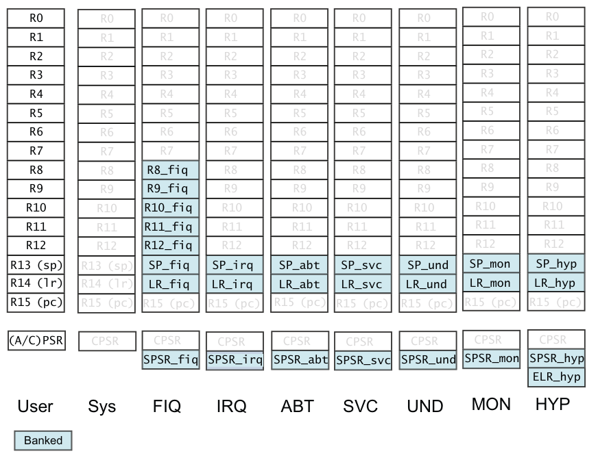


*图 4-7：显示分体寄存器的 ARMv7 寄存器组*

ARMv7 用分体来降低异常延迟，但代价是：在数量可观的可用寄存器中，任意时刻能使用的不足一半。相比之下，AArch64 执行状态在任何时刻、任何异常级别都有 31 个 64 位通用寄存器可访问。在 AArch64 与 AArch32 之间切换执行状态，意味着 AArch64 寄存器必然要映射到 AArch32（ARMv7）的寄存器组上，这种映射如图 4-8（第 4-15 页）所示。

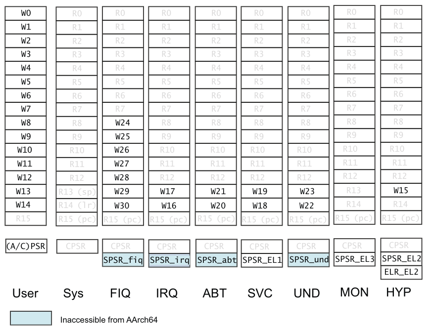


*图 4-8：AArch64 到 AArch32 的寄存器映射*

在 AArch32 中执行时，AArch64 寄存器的高 32 位不可访问。若处理器运行在 AArch32 状态，它使用 32 位的 W 寄存器，这些寄存器等同于 32 位的 ARMv7 寄存器。AArch32 把分体寄存器映射到那些否则无法访问的 AArch64 寄存器上。

AArch32 下的 SPSR 和 ELR_Hyp 寄存器是仅能通过系统指令访问的额外寄存器，它们没有映射到 AArch64 的通用寄存器空间。其中有一部分在 AArch32 与 AArch64 之间进行映射：

- SPSR_svc 映射到 SPSR_EL1。
- SPSR_hyp 映射到 SPSR_EL2。
- ELR_hyp 映射到 ELR_EL2。

以下寄存器仅在 AArch32 执行期间使用。不过，由于在 EL1 使用 AArch64 执行，尽管它们在该异常级别的 AArch64 执行期间不可访问，仍会保留其状态：

- SPSR_abt。
- SPSR_und。
- SPSR_irq。
- SPSR_fiq。

SPSR 寄存器仅在更高级别的异常级别使用 AArch64 执行期间、为了上下文切换才可访问。

同样，如果从一个使用 AArch32 的异常级别进入一个使用 AArch64 的异常级别而触发异常，AArch64 的 ELR_ELn 高 32 位全为零。

#### 4.5.2 AArch32 下的 PSTATE

在 AArch64 中，传统 CPSR 的各组成部分以处理器状态（PSTATE）字段的形式呈现，可以独立访问。在 AArch32 下，还有与 ARMv7 CPSR 位对应的额外字段。

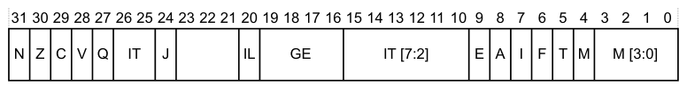


*图 4-9：AArch32 下的 CPSR 位分配*

额外的 PSTATE 位仅在 AArch32 下可访问：

表 4-6：PSTATE 位定义

| 名称 | 描述 |
| --- | --- |
| Q | 累加饱和（粘性 sticky）标志。 |
| GE (4) | 大于或等于标志。 |
| IT (8) | If-Then 执行位。 |
| J | J 位。 |
| T | T32 位。 |
| E | 端序位。 |
| M | 模式字段。 |

### 4.6 NEON 和浮点寄存器

除了通用寄存器，ARMv8 还有 32 个 128 位浮点寄存器，标记为 V0–V31。这 32 个寄存器用于保存标量浮点指令的浮点操作数，以及 NEON 操作的标量和向量操作数。NEON 和浮点寄存器也将在第 7 章「AArch64 浮点与 NEON」中介绍。

#### 4.6.1 AArch64 下浮点寄存器的组织

在操作标量数据的 NEON 和浮点指令中，浮点和 NEON 寄存器的行为类似主要的通用整数寄存器：只有低位被访问，未使用的高位在读取时被忽略、在写入时被置零。

标量浮点和 NEON 的限定名称表示有效位数，如下所示，其中 n 是 0–31 的寄存器编号。

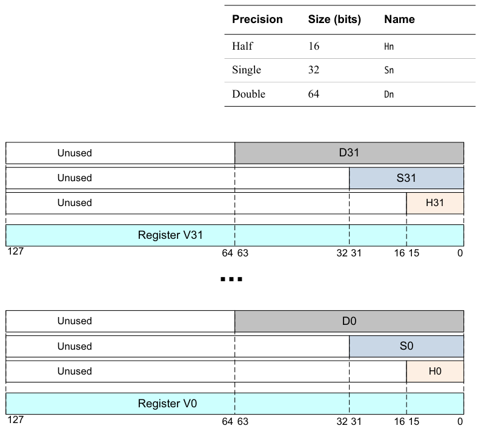


*图 4-10：浮点值的排列方式*

> **注意**
>
> 支持 16 位浮点，但仅作为转换来源或转换目标的格式，数据处理操作不支持 16 位浮点。

F 前缀以及浮点大小由浮点 ADD 指令指定：

```
FADD Sd, Sn, Sm  // 单精度
FADD Dd, Dn, Dm  // 双精度
```

表 4-7：不同大小浮点的操作数名称

| 精度 | 大小（位） | 名称 |
| --- | --- | --- |
| 半精度 Half | 16 | Hn |
| 单精度 Single | 32 | Sn |
| 双精度 Double | 64 | Dn |

半精度浮点指令用于在不同大小之间转换：

```
FCVT Sd, Hn  // 半精度转单精度
FCVT Dd, Hn  // 半精度转双精度
FCVT Hd, Sn  // 单精度转半精度
FCVT Hd, Dn  // 双精度转半精度
```

#### 4.6.2 标量寄存器大小

在 AArch64 中，整数标量的映射已由 ARMv7-A 所用的映射改为图 4-11 所示的映射：

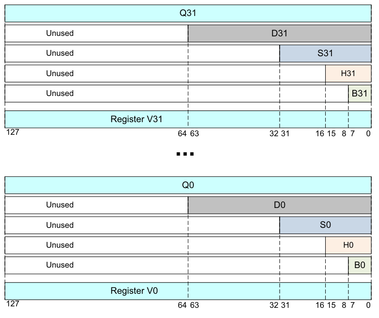


*图 4-11：保存标量值时 ARMv8 寄存器的排列方式*

在图 4-11 中，S0 是 D0 的低半部分，D0 又是 Q0 的低半部分；S1 是 D1 的低半部分，D1 又是 Q1 的低半部分，依此类推。这种设计消除了编译器对高级代码做自动向量化时的许多问题。

- 每个 Q 寄存器的低 64 位可以看作 D0–D31，即 32 个 64 位宽的寄存器，用于浮点和 NEON。
- 每个 Q 寄存器的低 32 位可以看作 S0–S31，即 32 个 32 位宽的寄存器，用于浮点和 NEON。
- 每个 S 寄存器的低 16 位可以看作 H0–H31，即 32 个 16 位宽的寄存器，用于浮点和 NEON。
- 每个 H 寄存器的低 8 位可以看作 B0–B31，即 32 个 8 位宽的寄存器，用于 NEON。

> **注意**
>
> 每种情况下都只用每个寄存器组的低位，寄存器空间的其余部分在读取时被忽略、在写入时被填零。

这种映射带来一个后果：如果运行在 AArch64 中的程序要解释来自 AArch32 执行的 D 或 S 寄存器，那么在使用这些寄存器之前，必须先把它从 V 寄存器中解包出来。

对于标量 ADD 指令：

```
ADD Vd, Vn, Vm
```

如果大小例如为 32 位，则指令为：

```
ADD Sd, Sn, Sm
```

#### 4.6.3 向量寄存器大小

向量可以是带一个或多个元素的 64 位宽，也可以是带两个或更多元素的 128 位宽，如图 4-12 所示：

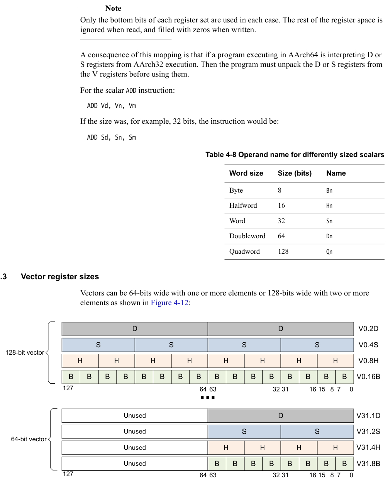


*图 4-12：向量大小*

对于向量 ADD 指令：

```
ADD Vd.T, Vn.T, Vm.T
```

表 4-8：不同大小标量的操作数名称

| 字大小 | 大小（位） | 名称 |
| --- | --- | --- |
| 字节 Byte | 8 | Bn |
| 半字 Halfword | 16 | Hn |
| 字 Word | 32 | Sn |
| 双字 Doubleword | 64 | Dn |
| 四字 Quadword | 128 | Qn |

这次对于 32 位向量，带 4 个通道，指令变为：

```
ADD Vd.4S, Vn.4S, Vm.4S
```

当这些寄存器用于特定指令形式时，其名称必须进一步限定以指示数据形状——更具体地说，就是数据元素大小，以及其中包含的元素或通道数量。

#### 4.6.4 AArch32 执行状态下的 NEON

在 AArch32 中，较小的寄存器被装入较大的寄存器（例如 D0 和 D1 合并形成 Q1）。这会引入一些棘手的循环携带依赖，从而可能降低编译器对循环结构做向量化的能力。

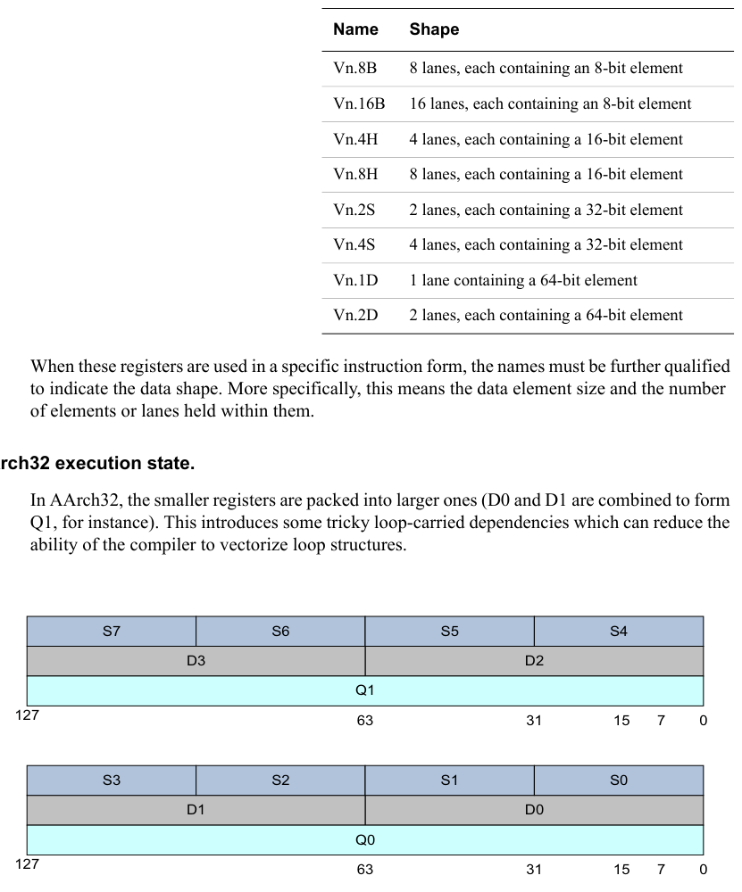


*图 4-13：ARMv7 SIMD 寄存器的排列方式*

AArch32 下的浮点和高级 SIMD 寄存器映射到 AArch64 的 FP 和 SIMD 寄存器中。这样做的目的，是让某个应用或虚拟机的浮点和 NEON 寄存器能被更高级别的系统软件（如操作系统或虚拟机管理程序）解释，并在必要时加以修改。

AArch64 的 V16–V31 FP 和 NEON 寄存器无法从 AArch32 访问。与通用寄存器一样，在某个使用 AArch32 的异常级别执行期间，这些寄存器会保留它们先前使用 AArch64 执行时的状态。

表 4-9：不同大小向量的操作数名称

| 名称 | 形状 |
| --- | --- |
| Vn.8B | 8 个通道，每个包含一个 8 位元素 |
| Vn.16B | 16 个通道，每个包含一个 8 位元素 |
| Vn.4H | 4 个通道，每个包含一个 16 位元素 |
| Vn.8H | 8 个通道，每个包含一个 16 位元素 |
| Vn.2S | 2 个通道，每个包含一个 32 位元素 |
| Vn.4S | 4 个通道，每个包含一个 32 位元素 |
| Vn.1D | 1 个通道，包含一个 64 位元素 |
| Vn.2D | 2 个通道，每个包含一个 64 位元素 |

## 第5章 ARMv8 指令集概览

ARMv8 架构带来的最大变化，是**新引入了一套 64 位指令集**，它是原有 32 位指令集架构的补充。有了这套指令集，处理器就能访问 64 位宽的整数寄存器和数据，也能用 64 位的指针来寻址内存。这套新指令叫 **A64**，运行在 **AArch64** 执行状态下。ARMv8 同时也保留了原有的 ARM 指令集（如今叫 **A32**）和 Thumb 指令集（也叫 **T32**）。A32 和 T32 都运行在 AArch32 状态下，提供对 ARMv7 的向后兼容。

不过需要分清一点：虽然 ARMv8-A 向后兼容 32 位 ARM 架构，但 A64 是一套独立于旧 ISA、编码方式也完全不同的指令集。A64 增加了一批新能力，同时去掉了另一些会拖慢高性能实现速度、或者浪费功耗的特性。ARMv8 架构也对 A32、T32 这两套 32 位指令集做了一些增强，但用到这些增强特性的代码，就没法再在老旧的 ARMv7 实现上跑了。

另外要注意，A64 指令的操作码长度仍然是 **32 位**，而不是 64 位。想深入了解 A64 汇编语言的读者，可以参考《ARM® Compiler armasm Reference Guide v6.01》。

### 5.1 ARMv8 指令集

新的 A64 指令集和已有的 A32 很像：指令都是 32 位宽，语法也相近。

ARMv8 架构对这些指令集采用了统一的命名约定，于是原来的 32 位指令集状态就被重新命名为下面两个；还新增了对应 64 位操作的一套：

**A32**

在 AArch32 状态下，A32 与 ARMv7 在很大程度上兼容，但仍存在一些差异，详见 *ARMv8-A Architecture Reference Manual*。此外，为了和 A64 引入的某些特性保持一致，A32 也新增了部分指令。

**T32**

Thumb 指令集最早出现在 ARM7TDMI 处理器里，最初只有 16 位指令。16 位指令以牺牲部分性能为代价，换来了更小的程序体积。ARMv7 处理器（包括 Cortex-A 系列）支持 Thumb-2 技术，它在 Thumb 基础上混合了 16 位与 32 位指令，使性能与 ARM 指令相当，同时保留了体积小的优势。正因为体积和性能两全，如今 32 位代码越来越多地被编译/汇编成 Thumb-2。

**A64**

内核切到 AArch64 状态后，就用这套按命名约定体现 64 位操作的新指令集。A64 提供了与 AArch32（或 ARMv7）的 A32、T32 相似的功能，但设计上带来了以下改进：

- **编码方案更一致**：A32 后期追加的一些指令，让编码方案出现了些不一致。比如 LDR 和 STR 对半字的支持，与主流的字节、字传输指令在编码上就略有不同，导致它们的寻址模式也略有差异。A64 规避了这类问题。
- **常量更丰富**：A64 为常量提供了极其丰富的选项，而且每种都针对特定指令类型的需求做了定制。
  - 算术指令通常接受 12 位立即数；
  - 逻辑指令通常接受 32 位或 64 位常量，编码上有一些约束；
  - MOV 指令接受 16 位立即数，可移位到任意 16 位边界；
  - 地址生成指令面向按 4KB 页大小对齐的地址。

  位操作指令的常量规则要稍复杂一些。不过，位域操作指令可以寻址源操作数或目标操作数中任意一段连续的比特序列。

  总而言之，A64 提供了灵活的常量，但要对这些常量进行编码——甚至只是判断某个常量在特定上下文中能不能被合法编码——都不太容易。

- **数据类型更简单**：A64 天然处理 64 位有符号和无符号数据类型，用更简洁高效的方式操作 64 位整数。对所有提供 64 位整数的语言（比如 C 或 Java）来说，这都很有利。
- **偏移量更长**：A64 指令通常提供更长的偏移量，无论是 PC 相对分支，还是偏移寻址。
  - 更大的分支范围让跨节跳转更好管理。动态生成的代码通常放在堆上，实际位置可以任意，运行时系统借助更大的分支范围和更少的修正（fix-up）需求，管理这些代码更省事。
  - 字面量池（嵌入在代码流中的字面量数据块）一直是 ARM 指令集的一个特性，A64 里仍然存在。但更大的 PC 相对加载偏移量极大地方便了字面量池的管理，让每个编译单元只用一个字面量池成为可能，不再需要在长代码序列里为多个池费心思安排位置。
- **指针**：AArch64 里指针是 64 位，可寻址的虚拟内存更大，地址映射的自由度也更高。但用 64 位指针是有代价的：同一段代码用 64 位指针跑，通常比用 32 位指针占用更多内存——每个指针在内存里占 8 字节而不是 4 字节。单个看微不足道，累积起来却是一笔不小的开销。而且迁移到 64 位带来的内存占用上升，可能导致缓存命中次数下降，进而拖低性能。
  - 一些语言（比如 Java）可以用压缩指针来规避这个性能问题。
- **用条件构造替代 IT 块**：IT 块是 T32 的一个有用特性，能作出高效序列，避免在未执行的指令周围使用短向前分支。但它有时很难被硬件高效处理。A64 去掉了 IT 块，改用条件指令，比如 CSEL（条件选择）、CINC（条件递增）。这些条件构造更直接，无需特殊处理就能轻松应付。
- **移位和循环移位行为更直观**：A32 或 T32 的移位、循环移位行为，并不总能轻松对应高级语言期望的行为。
  - ARMv7 提供了一个可直接用在数据处理指令里的桶形移位器，但指定移位类型和移位量会占用不少操作码位，而这些位本可以派上别的用场。
  - 所以 A64 去掉了那些很少用到的选项，改为新增显式的指令来执行更复杂的移位操作。
- **代码生成更规整**：无论是静态还是动态地生成常见算术函数的代码，A32 和 T32 往往需要不同的指令或指令序列，以应对不同的数据类型。A64 的这些操作更一致，因此为不同大小的数据类型生成通用序列要容易得多。
  - 例如在 T32 里，同一条指令可能因为所作用的寄存器是低位还是高位而编码不同。
  - A64 的编码则更规整、合理，所以 A64 汇编器通常比 T32 汇编器写出的代码行更少。
- **定长指令**：所有 A64 指令长度相同，这与变长的 T32 不同。这让管理和追踪生成的代码序列更容易，尤其利好动态代码生成器。
- **三操作数映射更好**：A32 的数据处理操作通常保留真正的三操作数结构；而 T32 里有大量双操作数格式，生成代码时灵活性稍差。A64 坚持一致的三操作数语法，进一步提升了指令集的规整性和同质性，编译器因此受益。

#### 5.1.1 区分 32 位和 64 位 A64 指令

A64 的大多数整数指令都有两种形式，分别在 64 位通用寄存器组上操作 32 位或 64 位的值。

区分方法很简单，看寄存器的名字：

- 以 **X** 开头的是 64 位值；
- 以 **W** 开头的是 32 位值。

当选了 32 位指令形式时，有以下几点成立：

- 右移和循环移位在**第 31 位**注入，而不是第 63 位；
- 条件标志（若由指令设置）依据低 32 位来计算；
- 写入 W 寄存器会把 X 寄存器的高 32 位（位 [63:32]）清零。

哪怕 32 位指令形式的结果，与等价 64 位指令形式算出的低 32 位无法区分，这一区别依然适用。例如，32 位的按位 ORR 其实可以用 64 位 ORR 来执行、再忽略结果的高 32 位就行，但 A64 还是提供了独立的 32 位和 64 位 ORR 两种指令形式。

C 和 C++ 的 LP64、LLP64 数据模型预计是 AArch64 上最常用的模型，它们都把常用的 int、short、char 定义为 32 位或更小。由于指令集里保留了这一语义信息，实现就能加以利用——比如省去计算、转发和存储这些数据类型用不到的高 32 位所消耗的能量和周期。至于具体怎么利用这种自由来省电，实现可以自行选择。

为此，新的 A64 指令集提供了独立的符号扩展和零扩展指令；它还允许在 ADD、SUB、CMN、CMP 指令的最后一个源寄存器上，以及加载/存储指令的索引寄存器上做扩展和移位。这给"64 位数组指针 + 32 位数组索引"的数组索引计算带来了高效实现。

#### 5.1.2 寻址

当处理器能用单个寄存器存放 64 位值时，在程序内访问大量内存就简单多了。32 位内核上的单线程最多只能访问 4GB 地址空间，而且其中大部分还被操作系统内核、库代码、外设等占去。空间不足意味着程序执行过程中可能需要把某些数据映射进/映射出内存。而更大的地址空间和 64 位指针直接避开了这个问题，还让内存映射文件等技术更有吸引力、也更好用——文件内容被映射到线程的内存映射里，即便物理 RAM 装不下整个文件也没关系。

寻址方面的其他改进还有：

- **独占访问**：可以对字节、半字、字、双字做独占加载/存储。对**双字对**的独占访问还支持对指针对做原子更新，比如循环链表的插入。所有独占访问都必须自然对齐；独占"对"访问必须对齐到数据大小的两倍，即一对 64 位值要对齐到 128 位。
- **增大的 PC 相对偏移寻址**：
  - PC 相对字面量加载有 ±1MB 的偏移范围。相比 A32 的 PC 相对加载，这减少了字面量池的数量，也增进了函数之间字面量数据的共享；反过来，这又减少了 I-cache 和 TLB 污染。
  - 大多数条件分支的跳转范围是 ±1MB，预计足以覆盖单个函数内绝大多数的条件分支。
  - 无条件分支（包括带链接分支）的跳转范围达 ±128MB，预计足以跨越大多数可执行加载模块和共享对象的静态代码段，无需链接器插入 veneer。

  **注意**

  veneer 是链接器在检测到分支目标超出范围时自动插入的一小段代码。它成为原分支的中间跳板：原分支先跳到 veneer，veneer 再分支到真正的目标地址。

  链接器可以为后续对同一函数的其他调用复用已生成的 veneer，只要这些调用点到那个 veneer 各自都在可达范围内。不过，这种 veneer 偶尔也会成为性能因素。

  如果你的循环里通过 veneer 调用了多个函数，就会遭遇大量的流水线冲刷，导致性能欠佳。把相关代码放在内存里彼此靠近的位置即可避免这一点。

  此外，PC 相对加载、存储以及地址生成的 ±4GB 范围，用两条指令就能内联完成，无需再从字面量池加载偏移量。

- **非对齐地址支持**：除了独占访问和有序访问，所有加载/存储都支持在访问普通内存时使用非对齐地址。这大大简化了把代码移植到 A64 的过程。
- **批量传输**：A64 里没有 LDM、STM、PUSH、POP 指令。批量传输可以用 LDP 和 STP 指令构造——这两条指令从连续内存位置加载/存储一对相互独立的寄存器。
  - LDNP 和 STNP 提供流式（streaming）或非时态（non-temporal）提示，表示数据无需保留在缓存里。
  - PRFM（预取内存）指令支持把预取定向到某一级缓存。
- **加载/存储**：
  - 所有加载/存储指令现在都支持一致的寻址模式。于是，从内存加载/存储 char、short、int、long long 等各种量时，可以用统一的方式处理。
  - 浮点和 NEON 寄存器现在也支持与核心寄存器相同的寻址模式，两个寄存器组互换使用更容易了。
- **对齐检查**：
  - 在 AArch64 下执行时，会对指令取指、以及使用栈指针的加载/存储做额外的对齐检查，从而检测出 PC 或当前 SP 的未对齐。
  - 这种做法比"强制 PC 或 SP 正确对齐"更好，因为 PC 或 SP 未对齐通常意味着软件出错了——例如软件里的地址遭到破坏。
  - 对齐检查分几种：
    - **程序计数器对齐检查**：在 AArch64 下，每当试图从一条未对齐的 PC 取指并执行指令时，都会产生一个与指令取指相关的异常。

      未对齐 PC 指 PC 的位 [1:0] 不为 00 的情况。PC 未对齐会在与目标异常级别关联的异常综合寄存器中被标记。

      当异常在 AArch64 下处理时，关联的异常链接寄存器会以未对齐形式保存完整的 PC，捕获该异常的异常级别下的故障地址寄存器（FAR_ELn）也同样保存。

      PC 对齐检查只在 AArch64 下执行；在 AArch32 下，它是作为数据中止（Data Abort）异常处理的一部分执行的。

    - **栈指针（SP）对齐检查**：在 AArch64 下，每当试图用栈指针作基址进行加载或存储时，都会产生一个与数据内存访问相关的异常。未对齐栈指针，指用作地址计算基址的栈指针的位 [3:0] 不为 0000 的情况——即栈指针作基址时必须 16 字节对齐。

      栈指针对齐检查只在 AArch64 下执行，而且可以按异常级别独立启用：
      - EL0 和 EL1 由 SCTLR_EL1 里的两个独立位控制；
      - EL2 由 SCTLR_EL2 里的一个位控制；
      - EL3 由 SCTLR_EL3 里的一个位控制。

#### 5.1.3 寄存器

A64 的 64 位寄存器组有助于缓解大多数应用中的寄存器压力。

A64 过程调用标准（PCS）最多用寄存器（X0–X7）传递 8 个参数；相比之下，A32 和 T32 只有 4 个参数用寄存器传递，多余部分放到栈上。

PCS 还定义了一个专门的**帧指针（FP）**，通过可靠地回溯（unwind）栈，让调试和调用图分析更容易。更多信息见第 9 章《ARM 64 位架构的 ABI》。

采用 64 位宽整数寄存器带来一个后果：各种编程语言所用的变量宽度各不相同。目前市面上有多种标准模型，主要区别就是为整数、长整型和指针定义的大小。

64 位 Linux 实现使用 LP64，A64 过程调用标准也支持这一点。此外还定义了其他 PCS 变体，供其他操作系统使用。

**表 5-1 可变宽度**

| Type | ILP32 | LP64 | LLP64 |
| --- | --- | --- | --- |
| char | 8 | 8 | 8 |
| short | 16 | 16 | 16 |
| int | 32 | 32 | 32 |
| long | 32 | 64 | 32 |
| long long | 64 | 64 | 64 |
| size_t | 32 | 64 | 64 |
| pointer | 32 | 64 | 64 |

- **零寄存器**：零寄存器（WZR/XZR）可用于一些编码技巧。例如，并没有单独的乘法编码，只有乘加；指令 `MUL W0, W1, W2` 其实等价于用零寄存器的 `MADD W0, W1, W2, WZR`。但并非所有指令都能用 XZR/WZR。第 4 章提过，零寄存器和栈指针共享同一编码，因此在极少数指令的某些参数位置，WZR/XZR 不可用，要改用 WSP/SP。

**示例 5-1 使用零寄存器把零写入内存**

在 A32 中：

```asm
mov  r0, #0
str  r0, [...]
```

在 A64 中，用零寄存器：

```asm
str  wzr, [...]
```

无需备用寄存器。或者，也可以用以下方式写入 16 字节的零：

```asm
stp xzr, xzr, [...] etc
```

零寄存器带来一个便利的副作用：存在大量带大立即数字段的 NOP 指令。例如，一条 `ADR XZR, #<imm>` 就在一条指令里给你提供了 21 位数据，且没有其他副作用。这对 JIT 编译器非常有用，因为代码可以在运行时被就地打补丁。

- **栈指针**：大多数指令不能引用栈指针（SP）。算术指令的某些形式可以读或写当前栈指针，这大概是为了在函数序言（prologue）或尾声（epilogue）里调整栈指针。例如：

```asm
ADD SP, SP, #256  // SP = SP + 256
```

- **程序计数器**：当前程序计数器（PC）不能像通用寄存器组的一部分那样用编号引用，因此既不能作算术指令的源或目标，也不能作加载/存储指令的基址、索引或传输寄存器。
  - 能读 PC 的指令，只有用来计算 PC 相对地址的那几条（ADR、ADRP、字面量加载、直接分支），以及把返回地址存入链接寄存器的带链接分支（BL、BLR）。修改 PC 的唯一途径是分支指令、异常产生指令和异常返回指令。
  - 当指令读取 PC 来计算 PC 相对地址时，PC 的值就是这条指令的地址；与 A32、T32 不同，这里**没有**隐含的 4 或 8 字节偏移。
- **FP 和 NEON 寄存器**：NEON 寄存器最重要的更新是，现在有 32 个 16 字节寄存器，而不是以前的 16 个。浮点和 NEON 寄存器组中，不同寄存器大小之间有了更简单的映射方案，这些寄存器用起来更容易，也便于编译器和优化器建模、分析。
- **寄存器索引寻址**：相比 A32，A64 提供了额外的寻址模式，允许把 64 位索引寄存器加到 64 位基址寄存器上，还能按访问大小对索引做可选缩放；此外还支持对索引寄存器里的 32 位值做符号或零扩展，同样带可选缩放。

### 5.2 C/C++ 内联汇编

本节简要介绍如何在 C 或 C++ 语言模块里嵌入汇编代码。

`asm` 关键字可以把内联的 GCC 语法汇编代码合并进函数。例如：

```c
#include <stdio.h>
int add(int i, int j)
{
int res = 0;
asm (
 "ADD %w[result], %w[input_i], %w[input_j]" // 使用 %w[name] 作用于 W 寄存器
// （如本例所示）。
// 你也可以对 X 寄存器使用 %x[name]，
// 但这是默认情况。
: [result] "=r" (res)
: [input_i] "r" (i), [input_j] "r" (j)
);
return res;
}
int main(void)
{
int a = 1;
int b = 2;
int c = 0;
c = add(a,b)
printf(“Result of %d + %d = %d\n, a, b, c);
}
```

`asm` 内联汇编语句的一般形式是：

```c
asm(code [: output_operand_list [: input_operand_list [: clobber_list]]]);
```

其中：

- `code` 是汇编代码。在上面的例子里，就是 `"ADD %[result], %[input_i], %[input_j]"`。
- `output_operand_list` 是可有可无的输出操作数列表，用逗号分隔；每个操作数由方括号里的符号名、约束字符串和括号里的 C 表达式组成。例子里只有一个输出操作数：`[result] "=r" (res)`。
- `input_operand_list` 是可有可无的输入操作数列表，同样是逗号分隔，语法与输出操作数一致。例子里有两个输入操作数：`[input_i] "r" (i)` 和 `[input_j] "r" (j)`。
- `clobber_list` 是可有可无的被破坏（clobbered）寄存器或其他值的列表，例子里省略了此项。

在 C/C++ 与汇编代码之间调用函数时，必须遵循 AAPCS64 规则。

更多信息参见：

https://gcc.gnu.org/onlinedocs/gcc/Using-Assembly-Language-with-C.html#Using-Assembly-Language-with-C

### 5.3 指令集之间的切换

单个应用程序里不可能同时使用两种执行状态的代码。在 ARMv8 里，A64 与 A32/T32 之间不互通（interworking），这不同于 A32 与 T32 之间的互操作。为 ARMv8 处理器写的 A64 代码无法在 ARMv7 Cortex-A 系列处理器上运行；反过来，为 ARMv7-A 处理器写的代码，可以在 AArch32 执行状态下运行于 ARMv8 处理器上。图 5-1 对此做了总结。

```text
T32                     A32                    A64
混合 16 位和 32 位指令   32 位指令              32 位指令
32 位通用寄存器          32 位通用寄存器         32 位和 64 位通用寄存器

异常进入或返回
BX
 BLX
    MOV PC
    LDR PC
异常进入
异常返回
```

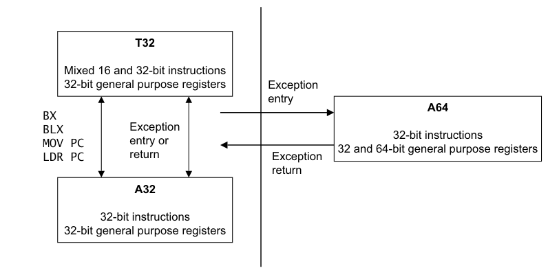


*图 5-1：指令集之间的切换*
## 第6章 A64 指令集

大多数编写应用级代码的程序员，其实并不需要直接写汇编。汇编真正派得上用场，主要在这样几类场景：需要把性能压到极致的代码优化（比如编译器后端）；要用到 C 语言表达不了的底层特性；编写启动代码、设备驱动程序；以及操作系统开发。退一步说，哪怕你只写 C，调试时能读懂汇编——尤其是看出每条汇编指令与 C 语句之间的对应关系——也大有帮助。

### 6.1 指令助记符

A64 汇编语言对同一套**助记符**做了重载：靠操作数寄存器的名字来区分指令的不同形态。下面这几条 ADD 指令的机器编码各不相同，但你只需要记住一个助记符，汇编器就会根据操作数自动挑出正确的编码。

```
ADD W0, W1, W2          // 32 位寄存器相加
ADD X0, X1, X2          // 64 位寄存器相加
ADD X0, X1, W2, SXTW    // 将符号扩展的 32 位寄存器加到 64 位扩展寄存器
ADD X0, X1, #42         // 立即数与 64 位寄存器相加
ADD V0.8H, V1.8H, V2.8H // NEON 16 位相加，在 8 个通道中分别进行
```

### 6.2 数据处理指令

数据处理指令覆盖处理器最基础的一类工作：对通用寄存器里的值做算术与逻辑运算，参与方可以是寄存器，也可以是立即数。本章后面 6.2.2 节要介绍的乘法和除法指令，可以看成这一类指令的特例。

这类指令大多采用"一个目标寄存器 + 两个源操作数"的形式，通用格式如下：

```
Instruction Rd, Rn, Operand2
```

第二个操作数（Operand2）可以是寄存器、经过修改的寄存器，或者立即数。下文用 R 表示该位置既可以是 X 寄存器，也可以是 W 寄存器。

数据处理操作包括：

- 算术和逻辑运算。
- 移动和移位运算。
- 符号扩展和零扩展指令。
- 位与位域操作。
- 条件比较与数据处理。

#### 6.2.1 算术和逻辑运算

表 6-1 列出了一些常用的算术和逻辑运算。

部分指令带有 S 后缀，表示执行后要**设置标志位**。表 6-1 里带 S 后缀的有 ADDS、SUBS、ADCS、SBCS、ANDS、BICS。另外还有几条专门用来设置标志位的指令——CMP、CMN、TST——但它们本身不带 S 后缀。

ADC 和 SBC 在做加减法的同时，还会把**进位条件标志**（C）当作一个输入参与运算：

```
ADC{S}: Rd = Rn + Rm + C
SBC{S}: Rd = Rn - Rm - 1 + C
```

例 6-1 算术指令

```
ADD W0, W1, W2, LSL #3  // W0 = W1 + (W2 << 3)
SUBS X0, X4, X3, ASR #2 // X0 = X4 - (X3 >> 2)，设置标志
MOV X0, X1              // 将 X1 复制到 X0
CMP W3, W4              // 根据 W3 - W4 设置标志
ADD W0, W5, #27         // W0 = W5 + 27
```

表 6-1 算术和逻辑运算

| 类型 | 指令 |
|---|---|
| 算术 | ADD、SUB、ADC、SBC、NEG |
| 逻辑 | AND、BIC、ORR、ORN、EOR、EON |
| 比较 | CMP、CMN、TST |
| 移动 | MOV、MVN |

逻辑运算本质上就是对应的布尔运算，逐位作用在寄存器的各个位上。

BIC（按位清零，Bitwise bit Clear）是把第一个寄存器与第二个操作数的反码做 AND 运算。举例来说，要清零寄存器 X0 的位 [11]，可以这样写：

```
MOV X1, #0x800
BIC X0, X0, X1
```

ORN 和 EON 则分别对第二个操作数取反后再做 OR 或 EOR。

比较指令只改标志位，不产生其他副作用。这类指令的立即数范围是 12 位，而且这个值还可以选择左移 12 位。

#### 6.2.2 乘法和除法指令

乘法指令与 ARMv7-A 大体一致，多出来的一项能力是：可以在单条指令里完成 64 位乘法。

有一类乘法指令直接作用于 32 位或 64 位操作数，返回与操作数同尺寸的结果。例如两个 64 位寄存器用 MUL 相乘，得到 64 位结果。

表 6-2 汇编语言中的乘法运算

| 操作码 | 描述 |
|---|---|
| 乘法指令 | |
| MADD | 乘加 |
| MNEG | 乘后取负 |
| MSUB | 乘减 |
| MUL | 乘法 |
| SMADDL | 有符号长乘加 |
| SMNEGL | 有符号长乘后取负 |
| SMSUBL | 有符号长乘减 |
| SMULH | 有符号乘法，返回高半部分 |
| SMULL | 有符号长乘法 |
| UMADDL | 无符号长乘加 |
| UMNEGL | 无符号长乘后取负 |
| UMSUBL | 无符号长乘减 |
| UMULH | 无符号乘法，返回高半部分 |
| UMULL | 无符号长乘法 |
| 除法指令 | |
| SDIV | 有符号除法 |
| UDIV | 无符号除法 |

```
MUL X0, X1, X2  // X0 = X1 * X2
```

还可以用 MADD 或 MSUB，在乘积的基础上加减第三个源寄存器里的累加值。

MNEG 用来对乘积取负：

```
MNEG X0, X1, X2  // X0 = -(X1 * X2)
```

此外还有一组产生"长结果"的乘法：两个 32 位数相乘得到 64 位结果。这些长乘法分有符号（SMULL）和无符号（UMULL）两种，还可以选择再累加一个寄存器值（UMADDL、SMADDL）或取负（UMNEGL、SMNEGL）。

普通（可选累加的）32 位/64 位乘法的结果尺寸与操作数一致：

- 32 ± (32 × 32) 产生 32 位结果。
- 64 ± (64 × 64) 产生 64 位结果。

带累加的加宽乘法（有符号和无符号）则统一产生单个 64 位结果：

- 64 ± (32 × 32) 产生 64 位结果。

而 64 × 64 到 128 位的乘法，需要两条指令配合，生成一对 64 位结果寄存器：

- (64 × 64) 产生结果的低 64 位 [63:0]。
- (64 × 64) 产生结果的高 64 位 [127:64]。

> **注：** 列表中不包含 32 × 64 的选项。你不能直接将 32 位 W 寄存器与 64 位 X 寄存器相乘。

ARMv8-A 架构同时支持 32 位和 64 位的有符号、无符号除法：

```
UDIV W0, W1, W2 // W0 = W1 / W2（无符号 32 位除法）
SDIV X0, X1, X2 // X0 = X1 / X2（有符号 64 位除法）
```

溢出和除零都不会触发异常：

- 任何整数除以零都返回零。
- 只有 SDIV 可能溢出：
  - INT_MIN / -1 返回 INT_MIN，其中 INT_MIN 是能编码进该运算所用寄存器的最小负数。结果始终向零舍入，与大多数 C/C++ 方言一致。

#### 6.2.3 移位运算

以下指令专门用来做移位：

- 逻辑左移（LSL）。LSL 指令执行乘以 2 的幂的运算。
- 逻辑右移（LSR）。LSR 指令执行除以 2 的幂的运算。
- 算术右移（ASR）。ASR 指令执行除以 2 的幂的运算，同时保留符号位。
- 循环右移（ROR）。ROR 指令执行按位循环，将从 LSB 移出的位循环到 MSB。

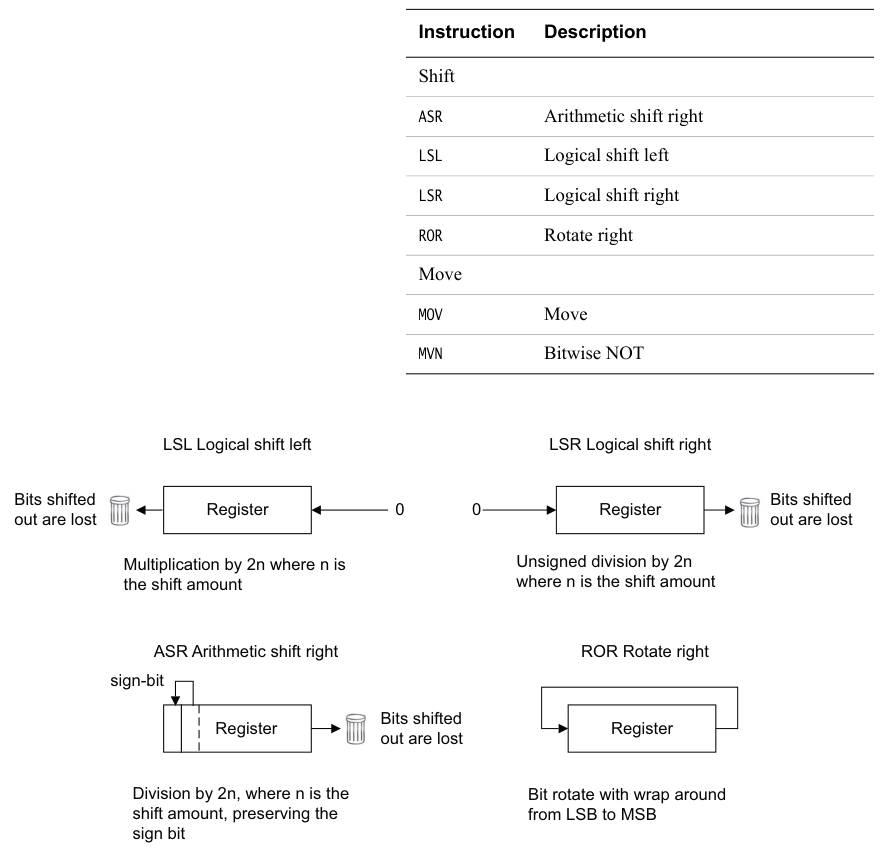


*图 6-1：移位操作*

指定移位的寄存器可以是 32 位或 64 位。移位量既可以用立即数指定（最多为寄存器大小减一），也可以用寄存器指定——此时只取该寄存器值的低 5 位（模 32）或低 6 位（模 64）。

表 6-3 移位与移动运算

| 指令 | 描述 |
|---|---|
| 移位 | |
| ASR | 算术右移：除以 2^n（n 为移位量），保留符号位 |
| LSL | 逻辑左移：乘以 2^n（n 为移位量） |
| LSR | 逻辑右移：无符号除以 2^n（n 为移位量） |
| ROR | 循环右移：位从 LSB 到 MSB 循环 |
| 移动 | |
| MOV | 移动 |
| MVN | 按位取反 |

#### 6.2.4 位域与字节操作指令

有一组指令把字节、半字或字扩展到寄存器尺寸，目标可以是 X 或 W 寄存器。这些指令分为有符号（SXTB、SXTH、SXTW）和无符号（UXTB、UXTH）两种，它们是相应位域操作指令的别名。

无论有符号还是无符号变体，都是把字节、半字或字（只有 SXTW 作用于字）扩展到寄存器尺寸。源寄存器始终是 W 寄存器；目标可以是 X 或 W，但 SXTW 的目标必须是 X 寄存器。

例如：

```
SXTB X0, W1 // 将寄存器 W1 的最低有效字节符号扩展，
            // 通过重复该字节最左边的位从 8 位扩展到 64 位。
```

位域指令与 ARMv7 已有的那些相似，包括位域插入（BFI），以及有符号/无符号位域提取（(S/U)BFX）。此外还新增了几条：BFXIL（位域提取并插入低位）、UBFIZ（无符号位域零插入）、SBFIZ（有符号位域零插入）。

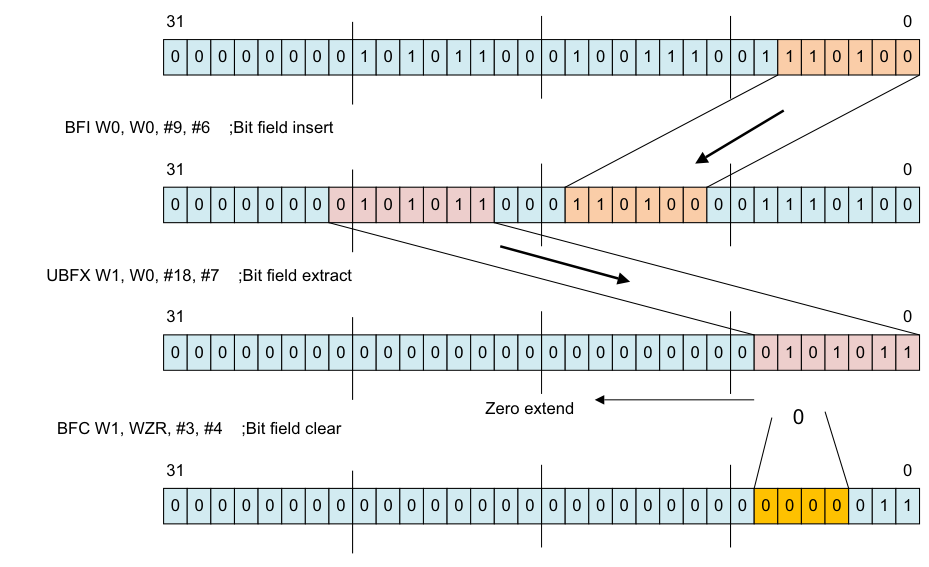


*图 6-2：位操作指令*

```
BFI W0, W0, #9, #6    ; 位域插入
UBFX W1, W0, #18, #7  ; 位域提取
BFC W1, WZR, #3, #4   ; 位域清零
```

> **注：** 还有 BFM、UBFM 和 SBFM 指令。这些是位域移动指令，是 ARMv8 新增的。不过，这些指令无需显式使用，因为所有情况都提供了别名。这些别名就是前面已经描述的位域操作：[SU]XT[BHWX]、ASR/LSL/LSR 立即数、BFI、BFXIL、SBFIZ、SBFX、UBFIZ 和 UBFX。

如果你熟悉 ARMv7 架构，你可能会认出另一个位操作指令：

- CLZ 计算寄存器中前导零位的个数。

类似地，还有以下字节操作指令：

- RBIT 反转所有位。
- REV 反转寄存器的字节序。
- REV16 反转寄存器中每个半字的字节序。

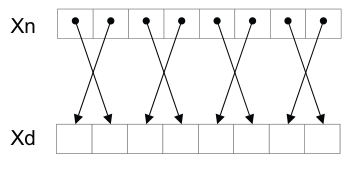


*图 6-3：REV16 指令*

- REV32 反转寄存器中每个字的字节序。

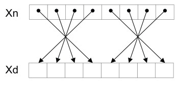


*图 6-4：REV32 指令*

这些操作可以作用于字（32 位）或双字（64 位）大小的寄存器，但 REV32 例外，它只适用于 64 位寄存器。

#### 6.2.5 条件指令

A64 指令集不支持对每条指令进行条件执行。对指令做谓词执行带来的好处，不足以证明大量占用操作码空间是合理的。

第 4-6 页的处理器状态描述了四个状态标志：零（Z）、负（N）、进位（C）和溢出（V）。表 6-4 给出了设置标志的运算中这些位的值。

如果无符号运算的结果溢出结果寄存器，则设置 C 标志。

V 标志的作用与 C 标志相同，但用于有符号运算。

表 6-4 条件标志

| 标志 | 名称 | 描述 |
|---|---|---|
| N | 负（Negative） | 设置为结果的位 [31] 的值。对于 32 位有符号整数，位 [31] 被设置表示该值为负。 |
| Z | 零（Zero） | 若结果为零则设置为 1，否则设置为 0。 |
| C | 进位（Carry） | 设置为结果的进位输出值，或移位运算中最后移出的位的值。 |
| V | 溢出（Overflow） | 若发生有符号溢出或下溢则设置为 1，否则设置为 0。 |

> **注：** 条件标志（NZCV）和条件码与 A32 和 T32 相同。不过，A64 增加了 NV（0b1111），尽管其行为与互补的 AL（0b1110）相同。这与 A32 不同，A32 没有为 0b1111 赋予任何含义。

有一小部分条件数据处理指令。这些指令无条件执行，但将条件标志作为指令的额外输入。提供这一组指令，是为了替代 ARM 代码中常见的条件执行用法。

读取条件标志的指令类型包括：

- **带进位加/减**：传统的 ARM 指令，例如用于多精度算术和校验和的指令。

表 6-5 条件码

| 代码 | 编码 | 含义（由 CMP 设置时） | 含义（由 FCMP 设置时） | 条件标志 |
|---|---|---|---|---|
| EQ | 0b0000 | 相等。 | 相等。 | Z = 1 |
| NE | 0b0001 | 不相等。 | 无序，或不相等。 | Z = 0 |
| CS | 0b0010 | 进位置位（等同于 HS）。 | 大于、等于或无序（等同于 HS）。 | C = 1 |
| HS | 0b0010 | 大于或等于（无符号）（等同于 CS）。 | 大于、等于或无序（等同于 CS）。 | C = 1 |
| CC | 0b0011 | 进位清除（等同于 LO）。 | 小于（等同于 LO）。 | C = 0 |
| LO | 0b0011 | 无符号小于（等同于 CC）。 | 小于（等同于 CC）。 | C = 0 |
| MI | 0b0100 | 负号（Minus）、负数。 | 小于。 | N = 1 |
| PL | 0b0101 | 正数或零。 | 大于、等于或无序。 | N = 0 |
| VS | 0b0110 | 有符号溢出。 | 无序（至少有一个参数为 NaN）。 | V = 1 |
| VC | 0b0111 | 无有符号溢出。 | 非无序（没有参数为 NaN）。 | V = 0 |
| HI | 0b1000 | 大于（无符号）。 | 大于或无序。 | (C = 1) && (Z = 0) |
| LS | 0b1001 | 小于或等于（无符号）。 | 小于或等于。 | (C = 0) \|\| (Z = 1) |
| GE | 0b1010 | 大于或等于（有符号）。 | 大于或等于。 | N == V |
| LT | 0b1011 | 小于（有符号）。 | 小于或无序。 | N != V |
| GT | 0b1100 | 大于（有符号）。 | 大于。 | (Z == 0) && (N == V) |
| LE | 0b1101 | 小于或等于（有符号）。 | 小于、等于或无序。 | (Z == 1) \|\| (N != V) |
| AL | 0b1110 | 始终执行（默认）。 | 始终执行。 | 任意 |
| NV | 0b1111 | 始终执行。 | 始终执行。 | 任意 |

- **条件选择（可选加一、取负或取反）**：在一个源寄存器与第二个（加一、取负、取反或未修改的）源寄存器之间进行条件选择。这些是 A32 和 T32 中最常见的单条条件指令的用法。典型用途包括条件计数或计算有符号量的绝对值。

**条件运算**

A64 指令集只允许对程序流控制的分支指令进行条件执行。这与 A32 和 T32 相反，在 A32 和 T32 中大多数指令都可以用条件码进行谓词化。这些可以总结如下：

**条件选择（移动）**

- CSEL 根据条件在两个寄存器之间进行选择。无条件指令后跟条件选择可以替代简短的条件序列。
- CSINC 根据条件在两个寄存器之间进行选择。返回第一个源寄存器或加一后的第二个源寄存器。
- CSINV 根据条件在两个寄存器之间进行选择。返回第一个源寄存器或取反后的第二个源寄存器。
- CSNEG 根据条件在两个寄存器之间进行选择。返回第一个源寄存器或取负后的第二个源寄存器。

**条件设置**

在 0 和 1（CSET）或 0 和 -1（CSETM）之间进行条件选择。例如，用于将条件标志设置为通用寄存器中的布尔值或掩码。

**条件比较**

（CMP 和 CMN）如果原始条件为真，则将条件标志设置为比较结果。如果为假，则将条件标志设置为指定的条件标志状态。条件比较指令对于表达嵌套或复合比较非常有用。

> **注：** 条件选择和条件比较也可用于浮点寄存器，使用 FCSEL 和 FCCMP 指令。

例如：

```
CSINC X0, X1, X0, NE // 如果零标志清除，则将返回寄存器 X0 设置为 X1，
                     // 否则 X0 加一
```

为示例指令提供了一些别名，其中要么使用零寄存器，要么将同一寄存器同时用作指令的目标寄存器和两个源寄存器。

例如：

```
CINC X0, X0, LS  // 如果小于或相同（LS）则 X0 = X0 + 1
CSET W0, EQ      // 如果上一次比较相等（Z=1）则 W0 = 1，否则 W0 = 0
CSETM X0, NE     // 如果不相等则 X0 = -1，否则 X0 = 0
```

这类指令为避免使用分支或条件执行指令提供了一种强大的方式。编译器或汇编程序员可以采用一种技术：对 if-then-else 语句的两个分支都执行相应运算，最后再选择正确的结果。

例如，考虑以下简单的 C 代码：

```
if (i == 0)  r = r + 2;  else  r = r - 1;
```

这可能会产生类似如下的代码：

```
CMP w0, #0         // if (i == 0)
SUB w2, w1, #1     // r = r - 1
ADD w1, w1, #2     // r = r + 2
CSEL w1, w1, w2, EQ // 在两个结果之间进行选择
```

### 6.3 内存访问指令

ARMv8-A 和历代 ARM 处理器一样，是**加载/存储（Load/Store）架构**：任何数据处理指令都不能直接操作内存，数据必须先加载进寄存器、改完再存回内存。因此每条访存指令都要给出三样东西——地址、待传输数据的大小、以及源或目标寄存器。

在这个基本框架之上，还有一批额外的加载/存储变体，提供更丰富的选项，例如非临时加载/存储（non-temporal Load/Store）、独占加载/存储（Load/Store exclusives）以及获取/释放（Acquire/Release）。

访存指令对**普通内存（Normal memory）**可以非对齐访问（参见第 13 章 内存排序）。不过独占访问、加载获取（load acquire）、存储释放（store release）这三种变体不支持非对齐访问。如果不希望出现非对齐访问，也可以配置成一旦发生就触发错误。

#### 6.3.1 加载指令格式

加载指令的一般形式：

```asm
LDR Rt, <addr>
```

加载到整数寄存器时，可以选择要加载的大小。要加载比寄存器更小的尺寸，就在 LDR 后面加后缀：

- LDRB（8 位，零扩展）。
- LDRSB（8 位，符号扩展）。
- LDRH（16 位，零扩展）。
- LDRSH（16 位，符号扩展）。
- LDRSW（32 位，符号扩展）。

此外还有无缩放偏移形式，如 LDUR<type>（参见 6.3.4 的"指定加载或存储指令的地址"）。程序员通常不需要显式写 LDUR，因为大多数汇编器能根据偏移量自动挑出正确的形式。

加载到 X 寄存器时不需要"零扩展"这种说法——写入 W 寄存器本身就等于把值零扩展到整个 64 位宽度。

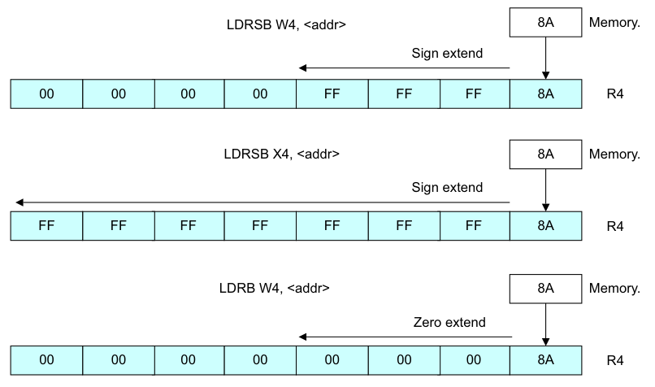


*图 6-5：加载指令*

#### 6.3.2 存储指令格式

存储指令的一般形式类似：

```asm
STR Rn, <addr>
```

同样有无缩放偏移形式 STUR<type>（参见 6.3.4），大多数汇编器能自动选择，程序员一般不用显式写。

要存储的尺寸可能小于寄存器。在 STR 后面加 B 或 H 后缀即可，此时存的始终是寄存器的**最低有效部分**。

#### 6.3.3 浮点与 NEON 标量加载和存储

加载/存储指令也能访问浮点/NEON 寄存器。这时传输大小完全由被加载或存储的寄存器决定，可以是 B、H、S、D、Q 中的任意一种。汇总见表 6-6 和表 6-7。

| Load | Xt | Wt | Qt | Dt | St | Ht | Bt |
|------|----|----|----|----|----|----|----|
| LDR | 64 | 32 | 128 | 64 | 32 | 16 | 8 |
| LDP | 128 | 64 | 256 | 128 | 64 | - | - |
| LDRB | - | 8 | - | - | - | - | - |
| LDRH | - | 16 | - | - | - | - | - |
| LDRSB | 8 | 8 | - | - | - | - | - |
| LDRSH | 16 | 16 | - | - | - | - | - |
| LDRSW | 32 | - | - | - | - | - | - |
| LDPSW | - | - | - | - | - | - | - |

表 6-6 加载指令写入的内存位数

| Store | Xt | Wt | Qt | Dt | St | Ht | Bt |
|-------|----|----|----|----|----|----|----|
| STR | 64 | 32 | 128 | 64 | 32 | 16 | 8 |
| STP | 128 | 64 | 256 | 128 | 64 | - | - |
| STRB | - | 8 | - | - | - | - | - |
| STRH | - | 16 | - | - | - | - | - |

表 6-7 存储指令读取的内存位数

> 注：
> 浮点和标量 NEON 加载与存储，和整数加载与存储使用相同的寻址模式。

加载到 FP/SIMD 寄存器时没有符号扩展选项，而且这类加载的地址仍然用通用寄存器来指定。

例如：

```asm
LDR D0, [X0, X1]
```

把地址 X0 + X1 处的双字（doubleword）加载到寄存器 D0。

#### 6.3.4 指定加载或存储指令的地址

A64 的寻址模式与 A32、T32 大体相似。虽然多了一些额外限制和几个新特性，但对熟悉 A32/T32 的人来说并不陌生。

在 A64 里，地址操作数的**基址寄存器必须始终是 X 寄存器**。不过若干指令支持零扩展或符号扩展，因此可以用 W 寄存器来提供 32 位偏移量。

**偏移模式**

偏移寻址把"一个立即数或一个可选择修改的寄存器值"与 64 位基址寄存器相加，生成地址。

指定移位或扩展时，移位量取 0（默认值）或访问大小（字节）的 log2 值，所以 Rn << <shift> 相当于把 Rn 乘以访问大小——这正好支持常见的数组索引操作。

```asm
// 一个 C 语言示例，展示了编译器可能生成的访问。
void example_dup(int32_t a[], int32_t length) {
  int32_t first = a[0];              // LDR W3, [X0]
  for (int32_t i = 1; i < length; i++) {
    a[i] = first;                    // STR W3, [X0, W2, SXTW, #2]
  }
}
```

| 示例指令 | 说明 |
|----------|------|
| LDR X0, [X1] | 从 X1 中的地址加载 |
| LDR X0, [X1, #8] | 从地址 X1 + 8 加载 |
| LDR X0, [X1, X2] | 从地址 X1 + X2 加载 |
| LDR X0, [X1, X2, LSL, #3] | 从地址 X1 + (X2 << 3) 加载 |
| LDR X0, [X1, W2, SXTW] | 从地址 X1 + 符号扩展(W2) 加载 |
| LDR X0, [X1, W2, SXTW, #3] | 从地址 X1 + (符号扩展(W2) << 3) 加载 |

表 6-8 偏移寻址模式

**索引模式**

索引模式与偏移模式类似，差别在于它还会**更新基址寄存器**。语法与 A32、T32 相同，但允许的操作集合更受限——索引模式通常只能提供立即数偏移。

索引模式有两种变体：

- **前索引（pre-index）**：先在访问内存之前应用偏移量。
- **后索引（post-index）**：先访问内存，访问完再应用偏移量。

这两个选项能干净地映射到一些常见的 C 操作：

```asm
// 一个 C 语言示例，展示了编译器可能生成的访问。
void example_strcpy(char * dst, const char * src)
{
  char c;
  do {
    c = *(src++);   // LDRB W2, [X1], #1
    *(dst++) = c;   // STRB W2, [X0], #1
  } while (c != '\0');
}
```

| 示例指令 | 说明 |
|----------|------|
| LDR X0, [X1, #8]! | 前索引：先将 X1 更新为 X1 + #8，再从新地址加载 |
| LDR X0, [X1], #8 | 后索引：先从 X1 中未修改的地址加载，再将 X1 更新为 X1 + #8 |
| STP X0, X1, [SP, #-16]! | 将 X0 和 X1 压入栈。 |
| LDP X0, X1, [SP], #16 | 将 X0 和 X1 弹出栈。 |

表 6-9 索引寻址模式

**PC 相对模式（加载字面量）**

A64 新增了一种专门访问**字面量池（literal pool）**的寻址模式。字面量池是编码在指令流里的数据块，不会被当作指令执行，但周围的代码可以通过 PC 相对地址访问其中的数据。字面量池常用于存放那些无法放进简单 MOV 立即数指令的常量。

在 A32 和 T32 里，PC 可以像通用寄存器一样被读取，所以只要把 PC 指定为基址寄存器，就能访问字面量池。

A64 里 PC 通常不可访问，取而代之的是一种专门访问 PC 相对地址的寻址模式（仅限加载指令）。这种专用模式的范围远比 A32/T32 的 PC 相对加载大，因此字面量池可以放置得更稀疏。

> 注：
> 对于所有变体，<label> 必须按 4 字节对齐。

| 示例指令 | 说明 |
|----------|------|
| LDR W0, <label> | 从 <label> 加载 4 字节到 W0 |
| LDR X0, <label> | 从 <label> 加载 8 字节到 X0 |
| LDRSW X0, <label> | 从 <label> 加载 4 字节并符号扩展到 X0 |
| LDR S0, <label> | 从 <label> 加载 4 字节到 S0 |
| LDR D0, <label> | 从 <label> 加载 8 字节到 D0 |
| LDR Q0, <label> | 从 <label> 加载 16 字节到 Q0 |

表 6-10 PC 相对（字面量）加载

#### 6.3.5 访问多个内存位置

A64 去掉了 A32/T32 里的多加载（LDM）和多存储（STM）指令。

替代方案是加载对（LDP）和存储对（STP）。与 A32 的 LDRD、STRD 不同，LDP/STP 可以对**任意两个整数寄存器**读写；数据从相邻内存位置读入或写入相邻内存位置。这两条指令的寻址选项比其它访存指令更受限——只能用"一个基址寄存器 + 一个经过缩放的 7 位有符号立即数"，外加可选的前增或后增。另外，与 32 位的 LDRD、STRD 不同，LDP/STP 可以做非对齐访问。

![图 6-6：LDP W3, W7, [X0]](../../asset/figure6-6-ldp-w3-w7-x0.png)


*图 6-6：LDP W3, W7, [X0]*

![图 6-7：LDP X8, X2, [X0 + #0x10]!](../../asset/figure6-7-ldp-x8-x2-x0-0x10.png)


*图 6-7：LDP X8, X2, [X0 + #0x10]!*

| 加载和存储对 | 说明 |
|--------------|------|
| LDP W3, W7, [X0] | 将地址 X0 处的字加载到 W3，并将地址 X0 + 4 处的字加载到 W7。参见图 6-6。 |
| LDP X8, X2, [X0, #0x10]! | 将地址 X0 + 0x10 处的双字加载到 X8，将地址 X0 + 0x10 + 8 处的双字加载到 X2，并将 X0 增加 0x10。参见图 6-7。 |
| LDPSW X3, X4, [X0] | 将地址 X0 处的字加载到 X3，将地址 X0 + 4 处的字加载到 X4，并将两者都符号扩展到双字大小。 |
| LDP D8, D2, [X11], #0x10 | 将地址 X11 处的双字加载到 D8，将地址 X11 + 8 处的双字加载到 D2，并将 X11 增加 0x10。 |
| STP X9, X8, [X4] | 将 X9 中的双字存储到地址 X4，并将 X8 中的双字存储到地址 X4 + 8。 |

表 6-11 寄存器加载/存储对

#### 6.3.6 非特权访问

LDTR 和 STTR 执行非特权加载/存储（参见《ARMv8-A Architecture Reference Manual》中的 LDTR 和 STTR）：

- 在 EL0、EL2 或 EL3 执行时，行为与普通加载/存储相同。
- 在 EL1 执行时，行为就像在 EL0 特权级别下执行一样。

这两条指令等同于 A32 的 LDRT 和 STRT。

#### 6.3.7 预取内存

内存预取指令 PRFM 向内存系统提供一个提示：程序很快会用到某个地址的数据。这个提示的效果是实现定义（IMPLEMENTATION DEFINED）的，但通常会促使数据或指令被装入某个缓存。

语法：

```asm
PRFM <prfop>, <addr> | label
```

其中 prfop 由下面三部分拼接而成：

- 类型：PLD 或 PST（为加载或存储预取）。
- 目标：L1、L2 或 L3（针对哪个缓存）。
- 策略：KEEP 或 STRM（保留在缓存中，或作为流式数据）。

例如 PLDL1KEEP。

这些指令类似于 A32 的 PLD 和 PLI。

#### 6.3.8 非临时加载和存储对

非临时加载/存储是 ARMv8 的一个新概念，对应指令是 LDNP 和 STNP：对一对寄存器值执行读或写，同时向内存系统提示——这份数据用缓存没多大意义。

这个提示并不禁止内存系统的正常活动，比如对地址缓存、预加载或合并。它只是表明缓存不太可能带来性能提升。典型用例是流式数据，但要注意，要用好这些指令需要针对具体微架构来调。

非临时加载/存储还**放宽了内存排序要求**。在下面这种情形里，LDNP 可能比它前面的 LDR 更早被观察到，从而导致从一个尚未确定的 X0 地址去读数据：

```asm
LDR X0, [X3]
LDNP X2, X1, [X0]   // 当这条指令执行时，X0 可能尚未被加载！
```

要修正上述问题，需要一个显式的加载屏障：

```asm
LDR X0, [X3]
DMB nshld
LDNP X2, X1, [X0]
```

#### 6.3.9 内存访问的原子性

- 用单个通用寄存器、且地址对齐的内存访问，保证是原子的。
- 在**对齐地址**上对一对通用寄存器执行的 LDP/STP，保证表现为两次独立的原子访问。
- 非对齐访问不是原子的，因为它们通常要拆成两次单独的访问。
- 浮点和 SIMD 内存访问不保证原子。

#### 6.3.10 内存屏障与栅栏指令

ARMv7 和 ARMv8 都支持多种屏障操作，详见第 13 章 内存排序：

- **数据内存屏障（DMB）**：强制所有按程序顺序在前的内存访问，在任何后续访问之前变为全局可见。
- **数据同步屏障（DSB）**：所有待处理的加载和存储、缓存维护指令以及所有 TLB 维护指令，都在程序继续执行前完成。DSB 行为类似 DMB，但多了这些额外特性。
- **指令同步屏障（ISB）**：刷新 CPU 流水线和预取缓冲，使 ISB 之后的指令从缓存或内存中被取指（或重新取指）。

ARMv8 还引入了**单向栅栏**，与释放一致性（Release Consistency）模型相关联，即加载获取（LDAR）和存储释放（STLR），这是基于地址的同步原语（参见第 13-8 页的单向屏障）。这两个操作可以配对，形成一个完整的栅栏。这两条指令仅支持基址寄存器寻址，不提供偏移量或其它索引寻址。

#### 6.3.11 同步原语

ARMv7-A 和 ARMv8-A 都支持独占内存访问。在 A64 里就是加载/存储独占（LDXR/STXR）对。

LDXR 从一个内存地址加载值，并尝试隐式地声明对该地址的**独占锁**。随后，只有成功取得并持有该锁时，存储独占（Store-Exclusive）指令才会向该位置写入新值。LDXR/STXR 配对用于构建自旋锁这类标准同步原语。此外还有配对的 LDXRP 和 STXRP，让代码能原子地更新一个跨越两个寄存器的位置。字节、半字、字、双字选项都可用。和加载获取/存储释放一样，这里仅支持不带任何偏移量的基址寄存器寻址。

CLREX 指令清除监视器（monitor），但与 ARMv7 不同，**异常进入或返回也会清除监视器**。监视器还可能被伪随机地清除，例如因为缓存逐出或其它与应用程序无直接关系的原因。软件必须避免在配对的 LDXR 与 STXR 之间做任何显式内存访问、系统控制寄存器更新或缓存维护指令。

另外还有一组带获取/释放语义的独占指令对，即 LDAXR 和 STLXR，参见第 14-6 页的同步。

### 6.4 流程控制

A64 提供了多种分支指令（参见表 6-12）。

- 简单的相对分支用 **B** 指令，即分支到当前地址的某个偏移量处。无条件简单相对分支可以从当前位置向前或向后最多跳 128MB；条件形式（B 后面附加条件码）范围较小，为 ±1MB。
- 需要把返回地址存到链接寄存器（X30）的子程序调用用 **BL**。BL 没有条件版本，行为类似 B，但额外把返回地址（BL 之后那条指令的地址）存进 X30。
- 除了这些 PC 相对指令，还有两个**绝对分支**指令：**BR Xn** 绝对分支到 Xn 中的地址；**BLR Xn** 效果相同，但同时把返回地址存进 X30（链接寄存器）。
- **RET** 行为类似 BR Xn，但向分支预测逻辑提示这是一次函数返回。RET 默认分支到 X30 中的地址，也可以指定其它寄存器。

| 分支指令 | 说明 |
|----------|------|
| B (offset) | 程序相对分支，向前或向后 128MB。条件版本（例如 B.EQ）的范围为 1MB。 |
| BL (offset) | 与 B 相同，但将返回地址存储在 X30 中，并向分支预测逻辑提示这是一次函数调用。 |
| BR Xn | 到 Xn 中地址的绝对分支。 |
| BLR Xn | 与 BR 相同，但将返回地址存储在 X30 中，并向分支预测逻辑提示这是一次函数调用。 |
| RET{Xn} | 与 BR 相同，但向分支预测逻辑提示这是一次函数返回。默认返回到 X30 中的地址，但可以指定不同的寄存器。 |

表 6-12 分支指令

A64 还提供了一类特殊的条件分支指令，在不少情况下无需显式比较，能提升代码密度：

```asm
CBZ Rt, label   // 比较并在为零时分支
CBNZ Rt, label  // 比较并在非零时分支
```

这两条指令把源寄存器（32 位或 64 位）与零比较，然后有条件分支，偏移范围 ±1MB，且不读取也不写入条件码标志（NZCV）。

还有两条类似的"测试并分支"指令：

```asm
TBZ Rt, bit, label   // 测试并在 Rt<bit> 为零时分支
TBNZ Rt, bit, label  // 测试并在 Rt<bit> 不为零时分支
```

这两条指令测试源寄存器中由立即数指定的那个位，根据该位是被置位还是清零有条件分支，偏移范围 ±32kB。和 CBZ/CBNZ 一样，它们不读取也不写入条件码标志（NZCV）。

| 指令 | 说明 |
|------|------|
| CBZ Rt, label | 比较并在为零时分支。如果 Rt 为零，向前或向后分支最多 1MB。 |
| CBNZ Rt, label | 比较并在非零时分支。如果 Rt 不为零，向前或向后分支最多 1MB。 |
| TBZ Rt, bit, label | 测试位并在为零时分支。向前或向后分支最多 32kB。 |
| TBNZ Rt, bit, label | 测试位并在非零时分支。向前或向后分支最多 32kB。 |

### 6.5 系统控制及其他指令

A64 指令集还包含与下列方面相关的指令：

- 异常处理。
- 系统寄存器访问。
- 调试。
- 提示指令（hint），在很多系统里用于电源管理。

#### 6.5.1 异常处理指令

有三条异常处理指令，作用是引发异常被受理，用来调用运行在更高异常级别下的代码——操作系统（EL1）、虚拟机管理程序（EL2）或安全监控器（EL3）：

```asm
SVC #imm16  // 监管调用，允许应用程序调用内核（EL1）。
HVC #imm16  // 虚拟机管理程序调用，允许操作系统代码调用虚拟机管理程序（EL2）。
SMC #imm16  // 安全监控器调用，允许操作系统或虚拟机管理程序调用安全监控器（EL3）。
```

立即数值通过异常综合征寄存器（Exception Syndrome Register）提供给处理程序。这与 ARMv7 不同——ARMv7 里必须读取调用指令的操作码才能确定立即数值。更多信息参见第 10 章 AArch64 异常处理。

从异常返回用 ERET 指令：把 SPSR_ELn 复制到 PSTATE 恢复处理器状态，并分支到 ELR_ELn 中保存的返回地址。

#### 6.5.2 系统寄存器访问

有两条系统寄存器访问指令：

```asm
MRS Xt, <system register>  // 将系统寄存器复制到通用寄存器
```

例如：

```asm
MRS X4, ELR_EL1    // 将 ELR_EL1 复制到 X4
```

```asm
MSR <system register>, Xt  // 将通用寄存器复制到系统寄存器
```

例如：

```asm
MSR SPSR_EL1, X0   // 将 X0 复制到 SPSR_EL1
```

PSTATE 的各个字段也能通过 MSR/MRS 访问。例如，选择与 EL0 关联的栈指针，还是当前异常级别的栈指针：

```asm
MSR SPSel, #imm  // 该寄存器中的 0 或 1 值用于在 EL0 栈指针
// 和当前异常级别栈指针之间进行选择
```

这些指令还有特殊形式，用于清除或置位各个异常屏蔽位（参见第 4-5 页的已保存程序状态寄存器）：

```asm
MSR DAIFClr, #imm4
MSR DAIFSet, #imm4
```

参见第 4-7 页的系统寄存器。

#### 6.5.3 调试指令

有两条与调试相关的指令：

```asm
BRK #imm16  // 进入监控模式调试，其中存在片上调试监控代码
HLT #imm16  // 进入停机模式调试，其中连接了外部调试硬件
```

调试相关内容参见第 18 章 调试。

#### 6.5.4 提示指令

HINT 指令在法律上可以被当作 NOP 处理，但它们可以产生特定于实现的效果：

```asm
NOP   // 空操作——不保证会花时间执行
YIELD // 提示当前线程正在执行一项可以被换出的任务
WFE   // 等待事件
WFI   // 等待中断
SEV   // 发送事件
SEVL  // 本地发送事件
```

这些概念也会在第 14 章 多核处理器和第 15 章 电源管理中讨论。

#### 6.5.5 NEON 指令

NEON 指令集也有一些增强，其中一些相当显著，第 7 章 AArch64 浮点与 NEON 会详细描述。

A64 中 NEON 的变化包括：

- 支持双精度浮点，使使用双精度浮点的 C 代码能够被向量化。
- 新增对存储在 NEON 寄存器中的标量数据进行操作的指令。
- 新增插入和提取向量元素的指令。
- 新增类型转换和饱和整数算术的指令。
- 新增浮点值归一化的指令。
- 新增用于向量归约、求和以及取最小值或最大值的跨通道指令。
- 执行比较、加法、求绝对值、取负等操作的指令已扩展为能够对 64 位整数元素进行操作。

#### 6.5.6 浮点指令

A64 提供了一组与 ARMv7-A 的 VFPv4 扩展类似的浮点指令，对标量浮点值提供单精度和双精度数学运算。与 ARMv7 相比有许多变化和新特性：

- 浮点比较直接设置条件标志（NZCV）。在 A64 里无需再显式地把比较结果从浮点标志搬到整数标志。
- 新增与 IEEE754-2008 标准相关的指令，例如计算一对数的最小值和最大值。
- 从整数格式转换到浮点格式时，现在可以显式指定舍入模式。仅需以特定舍入模式做简单转换时，不用再设置全局 FPCR 标志。其中部分选项在 ARMv8 的 A32、T32 里也能用。
- 新增支持 64 位整数与浮点格式之间转换的指令。
- 在 A64 里，涉及整数类型的浮点运算直接作用在整数寄存器上。做转换时，无需再手动在浮点寄存器和整数寄存器之间搬运整数值。

#### 6.5.7 加密指令

ARMv8 的一个可选扩展新增了加密指令，能显著提升 AES 加密以及 SHA1、SHA256 哈希等任务的性能。

## 第7章 AArch64 浮点与 NEON

ARM 高级 SIMD 架构连同它的实现和支持软件，通称 **NEON** 技术。NEON 指令同时存在于 AArch32（与 ARMv7 的 NEON 指令等价）和 AArch64 两个执行状态下，都能大幅加速对大数据集的重复操作，这在媒体编解码一类应用中尤其有用。

AArch64 的 NEON 架构拥有 32 个 128 位寄存器，数量是 ARMv7 的两倍，而且它们与浮点指令共用同一组寄存器。所有编译后的代码和子程序都遵循 EABI，后者明确规定了某一子程序内哪些寄存器可以被破坏、哪些必须保留。编译器可以在代码的任意位置自由使用任何 NEON/VFP 寄存器来存放浮点值或 NEON 数据。

所有标准的 ARMv8 实现都必须支持浮点和 NEON。不过，面向特定市场的实现允许只支持以下三种组合之一：

- 既不支持 NEON 也不支持浮点。
- 完整的浮点和 SIMD 支持，带异常捕获。
- 完整的浮点和 SIMD 支持，不带异常捕获。

### 7.1 AArch64 中 NEON 与浮点的新特性

相比 AArch32，AArch64 的 NEON 有以下改动：

- 寄存器从 ARMv7 的 16 个 128 位寄存器增加到 32 个。
- 较小的寄存器不再被打包进较大的寄存器，而是一一映射到 128 位寄存器的低位。单精度浮点值使用低 32 位，双精度值使用 128 位寄存器的低 64 位（见 7-4 页"NEON 与浮点架构"）。
- 去掉了 ARMv7-A NEON 指令里的 V 前缀。
- 向向量寄存器写入 64 位或更少的数据时，高位会被清零。
- AArch64 不再有对通用寄存器操作的 SIMD 或饱和算术指令，此类操作一律使用 NEON 寄存器。
- 新增了通道插入和提取指令，以配合新的寄存器组织方式。
- 补充了生成或消费 128 位向量寄存器高 64 位的指令。原来会产生多个结果寄存器（把结果拓宽成 256 位向量）、或消耗两个源（把结果收窄成 128 位向量）的数据处理指令，都被拆成了独立指令。
- 新增一组向量归约操作，提供跨通道的求和、求最小值与最大值。
- 一些既有指令扩展到支持 64 位整数，例如比较、加法、绝对值和取负，包括它们的饱和版本。
- 饱和指令扩充出"无符号累加进有符号""有符号累加进无符号"两种形式。
- AArch64 NEON 支持双精度浮点以及完整的 IEEE754 操作，覆盖舍入模式、非规格化数和 NaN 处理。

AArch64 对浮点做了以下增强：

- ARMv7-A 浮点指令的 V 前缀被替换为 F。
- 支持 IEEE 754 定义的 32 位单精度和 64 位双精度浮点向量数据类型及算术，遵循 FPCR 的舍入模式字段、默认 NaN 控制、清零至零（Flush-to-Zero）控制，以及（实现支持时）异常捕获使能位。
- 浮点/NEON 寄存器的加载/存储寻址模式与整数加载/存储一致，也包括一次加载或存储一对浮点寄存器的能力。
- 新增浮点 FCSEL 以及选择与比较指令，作用相当于整数的 CSEL 和 CCMP。
- 浮点 FCMP、FCMPE、FCCMP、FCCMPE 根据比较结果设置 PSTATE.{N, Z, C, V} 标志，且不再像 ARMv7 那样去修改浮点状态寄存器（FPSR）里的条件标志。
- 所有浮点乘加和乘减指令都是融合的（fused）。

融合乘在 VFPv4 中引入，它意味着乘法的结果在送入加法之前不再舍入。而在更早的 ARM 浮点架构里，乘累加（Multiply Accumulate）操作会对中间结果和最终结果各舍入一次，可能造成微小的精度损失。

- 补充了额外转换操作，例如 64 位整数与浮点之间、半精度与双精度之间的转换。
- 浮点转整数指令（FCVTxU、FCVTxS）编码了一种定向舍入模式，共五种：
  - 向零舍入。
  - 向正无穷（+∞）舍入。
  - 向负无穷（–∞）舍入。
  - 最近舍入，平分时取偶数。
  - 最近舍入，平分时远离零。
- 新增把浮点数按浮点格式舍入到最近整数的指令（FRINTx），使用相同的五种定向舍入模式，也可按环境舍入模式舍入。
- 新增双精度转单精度的向下转换指令 FCVTXN，采用非精确的"舍入到奇数"（inexact rounding to odd），以便在继续向下转换到半精度时得到正确舍入。
- 新增 FMINNM 和 FMAXNM，实现 IEEE754-2008 的 minNum() 与 maxNum() 操作：当其中一个操作数为安静 NaN 时，它们返回数值。
- 新增加速浮点向量归一化的指令（FRECPX、FMULX）。

### 7.2 NEON 与浮点架构

NEON 寄存器里的内容是一组同类型元素组成的向量。一个向量被划分为若干通道，每个通道装着一个叫"元素"的数据值。向量中的通道数由向量大小和元素类型共同决定。

通常一条 NEON 指令会执行 n 个并行的操作，n 就是输入向量被划分成的通道数。通道之间不能产生进位或溢出。向量里的元素从最低有效位开始排列，所以元素 0 落在寄存器的最低有效位。

NEON 和浮点指令支持以下几种元素类型：

- 32 位单精度和 64 位双精度浮点。

> 注意
>
> 16 位浮点也支持，但只作为一种需要转换的格式，不参与数据处理操作。

- 8 位、16 位、32 位或 64 位的无符号与有符号整数。
- 8 位和 16 位多项式。

多项式类型用于纠错这类代码，它们基于二次幂有限域（GF(2^n)）或 {0,1} 上的简单多项式。普通的 ARM 整数代码通常用查找表做有限域算术，而 AArch64 NEON 提供了使用大型查找表的指令。多项式运算很难用其他运算拼合出来，因此有一条基础的乘法指令作为"积木"很有价值，其他更大的运算都能从它合成。

NEON 单元把寄存器文件看作：

- 32 个 128 位四字寄存器 V0–V31，划分方式见图 7-1：

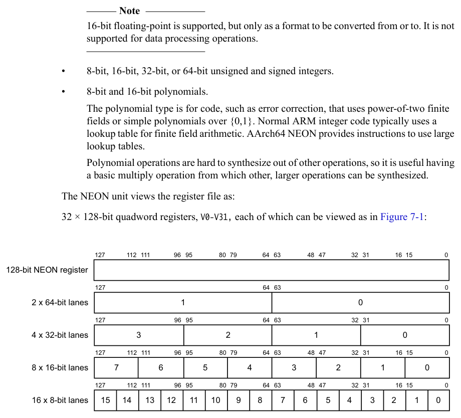


*图 7-1：V 寄存器划分*

- 32 个 64 位 U 寄存器（双字寄存器）D0–D31，划分方式见图 7-2：

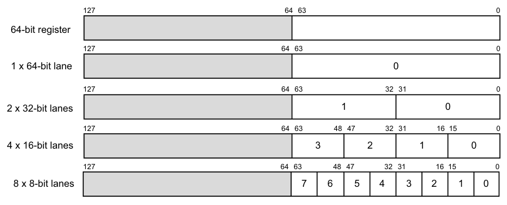


*图 7-2：D 寄存器划分*

所有这些寄存器随时都能访问，软件无需在它们之间显式切换——具体用什么视图，由所用指令决定。

#### 7.2.1 浮点

在 AArch64 中，浮点单元把 NEON 寄存器文件看作：

- 32 个 64 位 D 寄存器 D0–D31。D 寄存器是双精度寄存器，装双精度浮点值。
- 32 个 32 位 S 寄存器 S0–S31。S 寄存器是单精度寄存器，装单精度浮点值。
- 32 个 16 位 H 寄存器 H0–H31。H 寄存器是半精度寄存器，装半精度浮点值。
- 上述视图的寄存器组合。

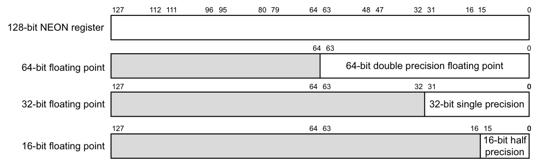


*图 7-3：浮点寄存器划分*

#### 7.2.2 标量数据与 NEON

标量指单个值，而不是多个值组成的向量。一些 NEON 指令用标量做操作数，寄存器里的标量靠对值向量的索引来访问。

访问向量里单个元素的通用数组表示法是：

```
<Instruction> Vd.Ts[index1], Vn.Ts[index2]
```

其中：

- Vd 是目标寄存器。
- Vn 是第一个源寄存器。
- Ts 是元素的大小说明符。
- index 是元素索引。

例如：

```
INS V0.S[1], V1.S[0]
```

![图 7-4：将元素插入向量（INS V0.S[1], V1.S[0]）](../../asset/figure7-4-inserting-an-element-into-a-vector-ins-v0-s-1-v1-s-0.png)


*图 7-4：将元素插入向量（INS V0.S[1], V1.S[0]）*

在 `MOV V0.B[3], W0` 这条指令里，W0 的最低有效字节被复制到 V0 的第四个字节。

![图 7-5：将标量移动到通道（MOV V0.B[3], W0）](../../asset/figure7-5-moving-a-scalar-to-a-lane-mov-v0-b-3-w0.png)


*图 7-5：将标量移动到通道（MOV V0.B[3], W0）*

NEON 标量可以是 8 位、16 位、32 位或 64 位。除了乘法指令外，访问标量的指令可以访问寄存器文件里的任何元素。

乘法指令只允许 16 位或 32 位标量，而且只能访问寄存器文件里的前 128 个标量：

- 16 位标量限于寄存器 Vn.H[x]，其中 0 ≤ n ≤ 15。
- 32 位标量限于寄存器 Vn.S[x]。

#### 7.2.3 浮点参数

浮点值用浮点寄存器传入（和返回）函数，整数（通用）寄存器和浮点寄存器可以同时使用。也就是说，浮点参数走 H、S、D 寄存器，其他参数走 X 或 W 寄存器。AArch64 过程调用标准规定：凡是需要浮点算术的地方都必须使用硬件浮点，因此 AArch64 状态下没有软件浮点链接。

ARMv8-A 架构参考手册给出了完整指令列表，这里只列主要的浮点数据处理操作，以展示能完成的工作：

表 7-1

| 指令 | 描述 |
| --- | --- |
| FABS Sd, Sn | 计算绝对值。 |
| FNEG Sd, Sn | 取负值。 |
| FSQRT Sd, Sn | 计算平方根。 |
| FADD Sd, Sn, Sm | 相加。 |
| FSUB Sd, Sn, Sm | 相减。 |
| FDIV Sd, Sn, Sm | 用一个值除以另一个值。 |
| FMUL Sd, Sn, Sm | 将两个值相乘。 |
| FNMUL Sd, Sn, Sm | 相乘并取负。 |
| FMADD Sd, Sn, Sm, Sa | 乘加（融合）。 |
| FMSUB Sd, Sn, Sm, Sa | 相乘、取负并相减（融合）。 |
| FNMADD Sd, Sn, Sm, Sa | 相乘、取负并相加（融合）。 |
| FNMSUB Sd, Sn, Sm, Sa | 相乘、取负并相减（融合）。 |
| FPINTy Sd, Sn | 以浮点格式舍入为整数（其中 y 是若干舍入模式选项之一）。 |
| FCMP Sn, Sm | 执行浮点比较。 |
| FCCMP Sn, Sm, #uimm4, cond | 执行浮点条件比较。 |
| FCSEL Sd, Sn, Sm, cond | 浮点条件选择：若 (cond) 则 Sd = Sn，否则 Sd = Sm。 |
| FCVTSty Rn, Sm | 将浮点值转换为整数值（ty 指定舍入类型）。 |
| SCVTF Sm, Ro | 将整数值转换为浮点值。 |

表 7-1（续）

### 7.3 AArch64 NEON 指令格式

NEON 和浮点指令的语法做了一些调整，以便与 AArch64 的核心整数指令和标量浮点指令语法保持一致。指令助记符仍然和 ARMv7 NEON 紧密相关。

- 去掉了 ARMv7 NEON 指令的 V 前缀。

  有些助记符因为去掉 V 前缀后与 ARM 核心指令助记符冲突，被重新命名。

  这带来一个结果：现在会出现名称相同、功能也相同的指令，究竟属于 ARM 核心指令、NEON 指令还是浮点指令，靠指令语法来区分。例如：

  ```
  ADD W0, W1, W2{, shift #amount}
  ```

  和

  ```
  ADD X0, X1, X2{, shift #amount}
  ```

  是 A64 基础指令，而

  ```
  ADD D0, D1, D2
  ```

  是标量浮点指令，

  ```
  ADD V0.4H, V1.4H, V2.4H
  ```

  则是 NEON 向量指令。

- 新增 S、U、F、P 前缀，分别表示有符号（Signed）、无符号（Unsigned）、浮点（Floating-point）、多项式（Polynomial）数据类型（一次只取其一），助记符由此指示操作的数据类型。例如：

  ```
  PMULL V0.8B, V1.8B, V2.8B
  ```

- 向量的组织方式（元素大小和通道数）由寄存器限定符描述。例如：

  ```
  ADD Vd.T, Vn.T, Vm.T
  ```

  其中 Vd、Vn、Vm 是寄存器名，T 是待用的寄存器细分。这里的 T 是排列说明符，取值 8B、16B、4H、8H、2S、4S、2D 之一。具体用哪个，取决于数据是 64、32、16 还是 8 位，以及使用的是寄存器的 64 位还是 128 位。要相加 2 × 64 位通道，就用：

  ```
  ADD V0.2D, V1.2D, V2.2D
  ```

- 和 ARMv7 一样，部分 NEON 数据处理指令提供普通（Normal）、长（Long）、宽（Wide）、窄（Narrow）和饱和（Saturating）变体。长、宽、窄变体用后缀表示：

  - 普通指令可以操作任何向量类型，产生与操作数向量大小相同（通常类型也相同）的结果向量。
  - 长（Long/Lengthening）指令操作双字向量操作数，产生四字向量结果，结果元素宽度是操作数的两倍。长指令在指令末尾追加 L。例如：

    ```
    SADDL V0.4S, V1.4H, V2.4H
    ```

    图 7-6 展示了这一点：输入操作数在运算前被提升。

  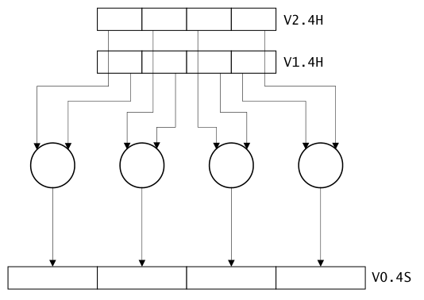

  *图 7-6：NEON 长指令*

  - 宽（Wide/Widening）指令操作一个双字向量操作数和一个四字向量操作数，产生四字向量结果。结果元素和第一个操作数的宽度是第二个操作数元素的两倍。宽指令在末尾追加 W。例如：

    ```
    SADDW V0.4S, V1.4H, V2.4S
    ```

    图 7-7 展示了这一点：输入双字操作数在运算前被提升。

  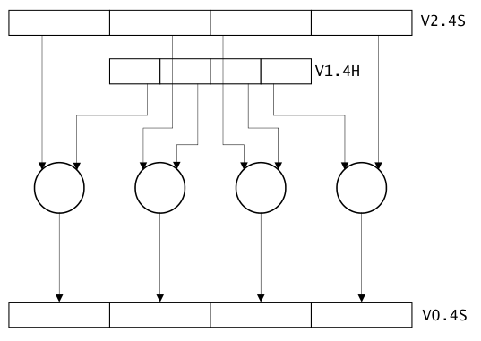

  *图 7-7：NEON 宽指令*

  - 窄（Narrow/Narrowing）指令操作四字向量操作数，产生双字向量结果，结果元素宽度通常是操作数的一半。窄指令在末尾追加 N。例如：

    ```
    SUBHN V0.4H, V1.4S, V2.4S
    ```

    图 7-8 展示了这一点：输入操作数在运算前被降级。

  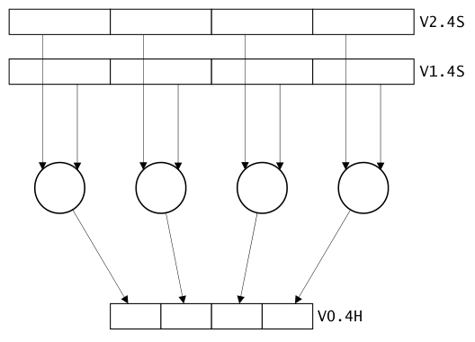

  *图 7-8：NEON 窄指令*

- 有符号和无符号饱和变体用 SQ 或 UQ 前缀标识，可用于若干指令，比如 SQADD 和 UQADD。如果结果会超出数据类型允许的最大值或最小值，饱和指令就返回那个最大值或最小值；饱和界限取决于指令的数据类型。

表 7-2 饱和范围

| 数据类型 | x 的饱和范围 |
| --- | --- |
| 有符号字节（S8） | -2^7 ≤ x < 2^7 |
| 有符号半字（S16） | -2^15 ≤ x < 2^15 |
| 有符号字（S32） | -2^31 ≤ x < 2^31 |
| 有符号双字（S64） | -2^63 ≤ x < 2^63 |
| 无符号字节（U8） | 0 ≤ x < 2^8 |
| 无符号半字（U16） | 0 ≤ x < 2^16 |
| 无符号字（U32） | 0 ≤ x < 2^32 |
| 无符号双字（U64） | 0 ≤ x < 2^64 |

- ARMv7 中表示成对（pairwise）操作的 P 前缀，在 ARMv8 里挪到了后缀位置，例如 ADDP。成对指令对相邻的双字或四字操作数两两配对处理。例如：

  ```
  ADDP V0.4S, V1.4S, V2.4S
  ```

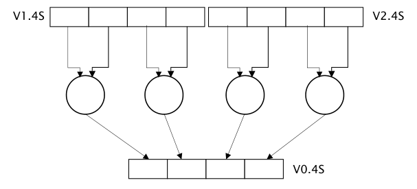


*图 7-9：成对操作*

- 新增了表示"跨所有通道（整个寄存器）"操作的 V 后缀，例如 ADDV：

  ```
  ADDV S0, V1.4S
  ```

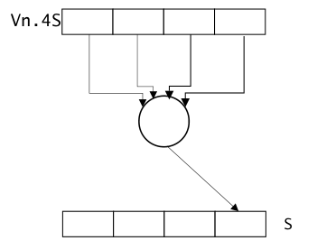


*图 7-10：跨所有通道操作*

- 新增了 2 后缀（称为"第二和上半部分说明符"），用于新的拓宽、收窄或加长"第二部分"指令。带这个后缀时，操作针对保存较窄元素那个寄存器的上 64 位进行：

  - 带 2 后缀的拓宽（Widening）指令从包含较窄值的向量里编号较高的通道取输入数据，把扩展后的结果写入 128 位目标。例如：

    ```
    SADDW2 V0.2D, V1.2D, V2.4S
    ```

  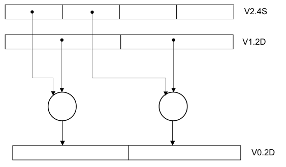

  *图 7-11：SADDW2*

  - 带 2 后缀的收窄（Narrowing）指令从 128 位源操作数取输入数据，把收窄后的结果插入 128 位目标中编号较高的通道，低位通道保持不变。例如：

    ```
    XTN2 V0.4S, V1.2D
    ```

  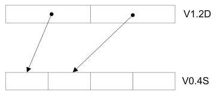

  *图 7-12：XTN2*

  - 带 2 后缀的加长（Lengthening）指令从 128 位源向量编号较高的通道取输入数据，把加长后的结果写入 128 位目标。例如：

    ```
    SADDL2 V0.2D, V1.4S, V2.4S
    ```

  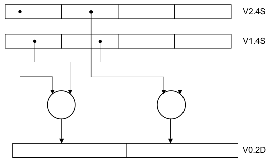

  *图 7-13：SADDL2*

- 比较指令现在改用条件码名称来表示比较的是什么条件，以及（适用时）条件是有符号还是无符号，例如 CMGT 与 CMHI、CMGE 与 CMHS。

### 7.4 NEON 编码替代方案

编写 NEON 代码有多种方式，这里简要列出（详见《ARM NEON 程序员指南》）：使用内建函数（intrinsics）、对 C 代码自动向量化、使用库，以及当然还有直接用汇编语言写。

内建函数是 C 或 C++ 的伪函数调用，编译器会把它们替换成对应的 NEON 指令。这样你既能使用 NEON 实现里可用的数据类型和操作，又可以把指令调度和寄存器分配交给编译器。内建函数定义在 ARM C 语言扩展文档里。

自动向量化由 ARM Compiler 6 中的 `-fvectorize` 选项控制，不过在更高的优化级别（-O2 及以上）会自动启用。即使在指定 `-fvectorize` 的情况下，-O0 下也会禁用自动向量化。因此，若要在 -O1 下启用自动向量化，需要这样写：

```
armclang --target=armv8a-arm-none-eabi -fvectorize -O1 -c file.c
```

有各种现成库能够使用 NEON 代码，但它们的确切状态会随时间变化，所以本指南不涉及当前的支持情况。

技术上虽然可以手工优化 NEON 汇编，但这相当困难：流水线与内存访问时序之间存在复杂的相互依赖。ARM 强烈建议用内建函数而不是手写汇编，理由如下：

- 用内建函数写代码比写汇编助记符更容易。
- 内建函数有良好的可移植性，便于跨平台开发。
- 不用操心流水线和内存访问时序。
- 大多数情况下都能得到不错的性能。

如果你不是经验丰富的汇编程序员，内建函数通常能取得比汇编更好的性能。内建函数提供的控制力几乎与汇编相当，却把寄存器分配留给编译器，让你专注于算法本身。这比手写汇编产生的源代码更易维护。
## 第8章 移植到 A64

本章不是一份面向所有系统编写可移植代码的详尽指南，而是聚焦应用工程师在 ARM 专用机器上移植代码时需要掌握的主要方面。把代码从 A32、T32 指令集迁到 AArch64 下的 A64 指令集时，有几处显著差异需要留意：

* **条件执行的范围大幅缩小。** A32 里大部分指令都支持条件执行——给指令附加一个条件码，让它根据之前置标志指令的结果决定是否执行。这确实能带来一些减小代码尺寸、降低周期数的技巧，但代价是显著抬高了高性能乱序执行处理器的设计复杂度。操作码字段里为条件执行保留的那些位，本可用于更有价值的用途（例如提供更大的通用寄存器选择空间）。因此在 A64 中只有少量指令支持条件执行，另有一些比较、选择类操作依赖特定条件。参见第 6-8 页的“条件指令”。

* **移位的处理方式变了。** 许多 A64 指令可以给源寄存器施加任意常量移位（仅受操作数大小限制），还提供了非常实用的扩展寄存器形式。更复杂的情况（如可变移位）则需要专门的显式指令。T32 比 A32 限制更多，因此 A64 在某些方面是这条原则的延续。A32 里灵活的 Operand2 在 A64 中并不以同样的形式存在，但各类指令各自提供了专属选项。

* **寻址模式有些变化。** A32、T32 中的偏移、前索引、后索引形式在 A64 中仍然可用。A64 还新增了 PC 相对寻址模式，因为 PC 已经不能像通用寄存器那样被直接访问。A64 的加载指令可以内联对寄存器移位（灵活性不如 A32），还能使用部分扩展模式（例如使用 32 位的数组索引）。

* **多内存访问指令被移除。** A64 删除了先前 ARM 架构中所有的 Load Multiple／Store Multiple（多寄存器加载／存储）指令——它们原本能从内存读写任意寄存器列表。取而代之的是只能对任意两个寄存器操作的 Load Pair（LDP）和 Store Pair（STP）指令，PUSH 和 POP 也随之移除。

* **新增带单向内存屏障的加载／存储。** ARMv8 引入了 load-acquire（加载-获取）和 store-release（存储-释放），在 ARMv8 的 A32、T32、A64 中均可用。load-acquire 保证：按程序顺序位于其后的任何内存访问，只能在该 load-acquire 之后才可见。store-release 则保证：所有更早的内存访问都在它自身变得可见之前先可见。参见第 6-18 页的“内存屏障与栅栏（fence）指令”。

* **协处理器不复存在。** AArch64 不支持协处理器（包括 CP15）的概念。AArch32 里通过 CP15 协处理器指令访问的那些寄存器，如今改由新的系统指令访问。

* **CPSR 被拆开。** 在 AArch64 中，CPSR 不再是单独一个寄存器，而是通过特殊寄存器访问 PSTATE 的各个字段（如 NZCV）。

对很多应用而言，把代码从旧版 ARM 架构或其他处理器架构迁到 A64，只需重新编译源码即可。不过仍有一些地方 C 代码并不完全可移植。

下面用一段例子展示 A64 与 A32/T32 的相似程度：依次给出一个简单 C 函数、它的 T32 输出和 A64 输出，两者对应关系一目了然。

```c
// C 代码
int foo(int val)
{
    int newval = bar(val);
    return val + newval;
}
```

```
// T32                    // A64
foo:                      foo:
    sub  sp, sp, #8           sub  sp, sp, #16
    strd r4, r14, [sp]        stp  x19, x30, [sp]
    mov  r4, r0               mov  w19, w0
    bl   bar                  bl   bar
    add  r0, r0, r4           add  w0, w0, w19
    ldrd r4, r14, [sp]        ldp  x19, x30, [sp]
    add  sp, sp, #8           add  sp, sp, #16
    bx   lr                   ret
```

A64 的通用功能是从 A32、T32 演化而来，因此在两者间移植代码相当直接。把 A32 汇编翻译成 A64 通常也很直接：绝大多数指令都能轻松对应，而且很多指令序列在 A64 中反而更简单。

### 8.1 对齐

数据和代码必须对齐到适当的边界。访问对齐与否会影响 ARM 内核的性能，在把代码从早期架构迁到 ARMv8-A 时也可能构成可移植性问题。无论是为了性能，还是在移植那些对指针或 32 位、64 位整型变量做了假设的代码时，都值得留意对齐。

早期版本的 ARM 编译语法汇编提供 `ALIGN n` 指令，其中 n 以字节为单位指定对齐边界。例如 `ALIGN 128` 会把地址对齐到 128 字节边界。

GNU 汇编语法（ARM Compiler 6 语法）提供 `.balign n` 指令，格式与 ALIGN 相同。

> 说明
>
> GNU 语法汇编还提供 `.align n` 指令，但 n 的含义因系统而异。`.balign` 提供与 `.align` 相同的对齐功能，并在所有架构上行为一致。

从旧版编译器迁到 ARM Compiler 6 时，应把所有 `ALIGN n` 换成 `.balign n`。

### 8.2 数据类型

在 64 位机器的许多 C 及类 C 编程环境中，`int` 仍为 32 位宽，但 `long` 整数和指针为 64 位宽。这就是 **LP64** 数据模型。本章假定采用 LP64，不过也存在其他数据模型，参见第 5-7 页的表 5-1。

ARM ABI 为 LP64 定义了若干基本数据类型，其中部分会因架构而异，列于表 8-1。

与 AArch64 之前的 ARM 架构相比，有了 64 位通用寄存器和 64 位操作，64 位数据类型通常能处理得更高效。`int` 仍是 32 位，走通用寄存器的 32 位视图（W 寄存器）就能高效处理；指针则是 64 位的数据或代码地址。ARM ABI 默认把 `char` 定义为无符号，这在架构早期版本中也是如此。

如果代码不以不可移植的方式操纵指针（比如向非指针类型强制转换或反向转换、做指针算术），移植就会简化——也就是说，从不把指针存进 `int` 变量（`intptr_t`、`uintptr_t` 除外），也从不把指针强制转换为 `int`。参见第 8-8 页的“将代码从 32 位环境移植到 64 位环境时的问题”。

**表 8-1 基本数据类型**

| 类型 | A32 | A64 | 说明 |
| --- | --- | --- | --- |
| int/long | 32 位 | 32 位 | 整数 |
| short | 16 位 | 16 位 | 整数 |
| char | 8 位 | 8 位 | 字节 |
| long long | 64 位 | 64 位 | 整数 |
| float | 32 位 | 32 位 | 单精度 IEEE 浮点 |
| double | 64 位 | 64 位 | 双精度 IEEE 浮点 |
| bool | 8 位 | 8 位 | 布尔 |
| wchar_t^a | 16 位无符号 | 16 位无符号 short（与编译器相关） | |
| | 32 位无符号 | 32 位无符号 int（与编译器相关） | |
| void* pointer | 32 位 | 64 位 | 指向数据或代码的地址 |
| 枚举类型 | 32 位 | 32 位^b | 有符号或无符号整数 |
| 位域 | | | 不大于其自然容器大小 |
| ABI 定义的扩展类型 | | | |
| __int128/__uint128 | 128 位 | 128 位 | 有符号/无符号四字 |
| __f16 | 16 位 | 16 位 | 半精度 |

a. 与环境相关。在基于 GNU 的系统中（如 Linux），该类型始终为 32 位。

b. 如果一个枚举类型的取值集合无法用 int 或 unsigned int 作为容器类型表示，且语言允许扩展枚举集合，则可以使用 long long 或 unsigned long long 作为容器。

除其他影响外，这也改变了结构体和参数列表的大小，可能还改变了它们的对齐。在存储大小很关键的场合，应使用 stdint.h 中的 `int32_t`、`int64_t` 类型。注意，在 AAPCS64-LP64 中 `size_t` 和 `ssize_t` 都是 64 位。

出于性能考虑，编译器会尽量把数据对齐到它的自然大小边界；多数编译器也会尽量优化编译模块内全局数据的布局。

AArch64 支持对 16、32、64、128 位数据的非对齐访问——即所用地址不是待加载或存储数据量的整数倍。但独占加载／存储、以及 load-acquire/store-release 指令只能访问对齐地址，也就是说，用于构造信号量及其他锁机制的变量通常必须对齐。

> 说明
>
> 正常情况下，所有变量都应对齐。大多数情况下，非对齐访问的平均效率仍低于对齐访问。

非对齐访问永远无法保证相对系统中其他 CPU 或总线主设备是原子的。

这条规则唯一重要的例外是访问打包（packed）数据结构——在通过文件或网络连接等与外部世界做数据编排（marshaling）时，这能省下大量工作。

和对齐访问相比，非对齐访问可能带来性能损失：对齐到自然大小边界的数据访问更高效，非对齐访问可能多耗费一些总线或缓存周期。因此要用 `packed` 属性（`__attribute__((packed, aligned(1)))`）提示编译器可能存在非对齐访问，例如在手动把指向不同数据类型的指针强制转换时。

#### 8.2.1 汇编代码

许多 A32 汇编指令都能轻松替换成类似的 A64 指令，遗憾的是不存在自动化机制，不过大量代码略作翻译即可。表 8-2 展示了 A32/T32 与 A64 指令集在许多方面的紧密对应关系。

**表 8-2 A32 与 A64 相似的指令**

| A32 | A64 |
| --- | --- |
| ADD Rd,Rn,#7 | ADD Wd,Wn,#7 |
| ADDS Rd,Rn,Rm,LSL #2 | ADDS Wd,Wn,Wm,LSL #2 |
| B label | B label |
| BFI Rd,Rn,#lsb,#wid | BFI Wd,Wn,#lsb,#wid |
| BL label | BL label |
| CBZ Rn,label | CBZ Wn,label |
| CLZ Rd,Rm | CLZ Wd,Wm |
| LDR Rt,[Rn,#imm] | LDR Wt,[Xn,#imm] |
| LDR Rt,[Rn,#imm]! | LDR Wt,[Xn,#imm]! |
| MOV Rd,#imm | MOV Wd,#imm |
| MUL Rd,Rn,Rm | MUL Wd,Wn,Wm |
| RBIT Rd,Rm | RBIT Wd,Wm |

不过在很多地方还存在需要改写的差异，下面的表格展示了其中的一些。

> 说明
>
> 64 位 APCS 要求 128 位（16 字节）的栈对齐。

表 8-4 展示了 CPSR 如何被 PSTATE 中的具名字段取代。

**表 8-3 A32 与 A64 之间存在差异的指令**

| A32 | A64 |
| --- | --- |
| LDM/STM 和 PUSH/POP 指令被替换为 LDP/STP（Load/Store Pair） | |
| PUSH {r0-r1} | STP X0, X1, [SP, #-16]! |
| POP {r0-r1} | LDP X0, X1, [SP], #16 |
| LDMIA r0, {r1, r2} | LDP X1, X2, [X0], #8 |
| STMIA r0, {r1, r2} | STP X1, X2, [X0], #8 |
| MLA | MADD |
| BX <reg> | BR <reg> |
| MOV pc, lr；BX lr | RET |
| MOVW；MOVT | MOVZ；MOVK |

**表 8-4 具名字段的使用**

| A32 | A64 |
| --- | --- |
| CPSR 被一组独立的寄存器和字段所取代 | |
| 禁止 IRQ：MRS R0, CPSR；ORR R0, R0, #IRQ_Bit；MSR CPSR_c, R0 | CPSID i；MSR DAIFSET, #IRQ_bit |
| ALU 标志：MRS R0, CPSR；MSR CPSR_f, R0 | MRS X0, NZCV；MSR NZCV, X0 |
| 设置端序：SETEND BE | SCTLR_ELn.EE 控制 ELn 的数据端序；SCTLR_EL1.E0E 控制 EL0 的数据端序；MRS X0, SCTLR_EL1；ORR X0, X0, #EE_bit；MSR SCTLR_EL1, X0 |

参见第 4-12 页的“端序”。

T32 的条件执行方案会编译成表 8-4 中 A32 列所示的指令序列，而在 A64 中则改用新的条件选择指令（表 8-4 的 A64 列所示）。

下面这个例子对比了两种指令集（T32 与 A64）在条件执行上的差异：

```c
// C 代码
int gcd (int a, int b)
{
    while (a != b)
    {
        if (a > b)
        {
            a = a - b;
        }
        else
        {
            b = b - a;
        }
    }
    return a;
}
```

```
// A32                       // A64
gcd:                         gcd:
    CMP   R0, R1                 SUBS W2, W0, W1
    ITE                          CSEL W0, W2, W0, gt
    SUBGT R0, R0, R1             CSNEG W1, W1, W2, gt
    SUBLE R1, R1, R0             BNE  gcd
    BNE   gcd                    RET
    BX    lr
```

### 8.3 将代码从 32 位环境移植到 64 位环境时的问题

把 C 代码迁到 64 位环境运行时，会出现一些常见问题，这些并非 ARM 特有：

* 留意指针和整数，二者大小可能不同。ARM 建议用 stdint.h 里的 `uintptr_t` 或 `intptr_t` 把指针类型当作整数值处理；指针算术里用到的偏移应声明为 `ptrdiff_t`，因为用 `int` 可能算出错误的结果。
* 64 位系统的潜在内存空间大得多，32 位 `int` 可能不足以索引数组中的所有条目。
* C 表达式里的隐式类型转换可能带来意想不到的效果，务必确保所用的常量值与掩码本身具有相同类型。
* 对不同长度或符号的数据类型做运算时要格外小心。例如，无符号和有符号的 32 位整数在表达式里混用、结果又赋给有符号 `long` 时，可能需要把其中一个操作数显式强制转换为其 64 位类型，这样其余所有操作数都会被提升为 64 位。注意，在 A64（LP64）中 `long` 通常是 64 位类型。

#### 8.3.1 重新编译或重写代码

任何移植都免不了既重新编译又重写代码，而多数情况下的目标是：尽可能多地重新编译、尽可能少地重写。

好消息是大量代码只需重新编译即可。不过要谨慎行事——许多基本类型的大小已经改变。虽然写得好的 C 代码不应过度依赖各类型的大小，但实际中你很可能会碰上这样的依赖。

因此最佳实践是：重新编译时开启所有警告和错误，并认真对待编译器发出的每一条警告，哪怕代码看似能无错编译。

请特别留意代码里任何显式的类型强制转换——当底层类型大小发生变化时，这些往往是错误的来源。

#### 8.3.2 面向 ARMv8-A 的 ARM Compiler 6 选项

给编译器传正确的选项、让它为 ARMv8-A 目标生成代码，这一点很重要。可使用以下选项：

```
--target
```

用于为指定目标生成代码。

`--target` 是强制性选项，没有默认值，必须始终指定一个目标架构。

**语法**

```
--target=triple
```

其中：

triple 的形式为 architecture-vendor-OS-abi。

支持的目标如下：

* aarch64-arm-none-eabi —— ARMv8-A 架构的 AArch64 状态。
* armv8a-arm-none-eabi —— ARMv8-A 架构的 AArch32 状态。
* armv7a-arm-none-eabi —— ARMv7-A 架构。

例如：

```
--target=armv8a-arm-none-eabi
```

> 说明
>
> `--target` 是 armclang 的选项。其他工具（如 armasm、armlink）请改用 `--cpu`、`--fpu` 选项来指定目标处理器和架构。

使用 `--mcpu` 选项可以为特定的 ARM 处理器启用代码生成：

```
-mcpu=<processor>+(no)crc    - 启用或禁用 crc 指令
-mcpu=<processor>+(no)crypto - 启用或禁用加密扩展
-mcpu=<processor>+(no)fp     - 启用或禁用浮点扩展
-mcpu=<processor>+(no)simd   - 启用或禁用 NEON 扩展
```

其中 `<processor>` 为 cortex-a53 或 cortex-a57。

为 AArch32 编译出的代码与为 ARMv7-A 编译的代码非常相似。虽然 AArch32 新增了一些指令（如 Load-Acquire、Store-Release），也移除了 SWP 指令，但这些通常都不是编译器会生成的指令。

用 `+nosimd` 选项编译可以避免使用任何 NEON／浮点指令或寄存器。这适用于 NEON 单元未上电的系统，或某些特定代码段（如复位代码、异常处理程序）——在这些场景里确保不使用 NEON／浮点很重要。默认不启用加密扩展，但启用 NEON。

### 8.4 对新 C 代码的建议

* 使用 `sizeof()` 而不是字面常量。例如：

  ```c
  (void**) calloc(4,100)
  ```

  改为

  ```c
  (void**) calloc(sizeof(void *), 100)
  ```

  或者更好的是

  ```c
  void *a;
  (void**) calloc(sizeof(a), 100);
  ```

* 需要显式指明类型的地方，使用 stdint.h 中的类型。
* 如果需要把指针强制转换为整数，使用能保证容纳得下的类型，如 `uintptr_t`。

  ```c
  atype *bob; bob++;
  ```

  不过如果你不关心指针的实际表示，上面的写法仍然更可取——指针算术会针对底层类型恰如其分地运算。

* 在数据大小和布局很重要的场合，注意结构体成员的排列顺序。例如：

  ```c
  struct { void *a; int b; int c } bob
  ```

  优于：

  ```c
  struct { int b; void *a; int c; }
  ```

  因为在 AAPCS64 中，为了让元素 a 保持 64 位对齐，会在它前面插入 32 位填充。

* 恰当地使用 `size_t`。
* 适当地使用 limits.h；对数据类型作出假设时要小心。
* 针对你所使用的类型，使用相应的函数／宏／内建函数。

  例如，对 `char*` 应使用 `long atol(char *)` 而不是 `int atoi(char *)`。
* 使用原子操作时，使用正确的 64 位函数，并针对 64 位类型执行。
* 不要假设对同一结构体中不同位域的操作彼此独立——与 32 位平台相比，64 位平台上可能会读写更多位。
* 对那些在 32 位编译下为 32 位、在 64 位编译下为 64 位的 `long` 字面量，使用 `L` 后缀，以确保它们与 `long` 类型匹配：

  ```c
  long value = 1L << SOMANY;
  ```

  对在 32 位和 64 位编译器下均为 64 位的字面量，使用 `LL` 或 `ULL` 后缀。
* 或者，使用 C99 中 stdint.h 提供的宏（例如 `INT64_C`、`UINT64_C`），它们允许定义字面量而无需显式使用 `L` 和 `LL` 后缀。

  例如：

  ```c
  size_t value = UINT64_C(1) << SOMANY;
  ```

#### 8.4.1 显式和隐式类型转换

当不同长度和／或符号的数据类型在表达式里混用时，C/C++ 内部的提升和类型转换可能导致一些意想不到的问题。尤其要理解：在表达式求值过程中，转换到底发生在哪一点。

例如：

```c
int + long => long;
unsigned int + signed int => unsigned int
int64_t + uint32_t => int64_t
```

如果“丢失符号”的转换先于向 `long` 的提升发生，那么把结果赋给有符号 `long` 时，结果就可能不正确。

在无符号和有符号的 32 位整数在表达式里混用、结果赋给有符号 64 位整数的情况下，应把其中一个操作数强制转换为其 64 位类型，这会让其他操作数也被提升为 64 位，从而在表达式被赋值时无需进一步转换。另一种方案是对整个表达式进行强制转换，以便在赋值时进行符号扩展。不过这些问题没有放之四海而皆准的解决方案，修复它们的最好方式其实是理解代码到底在做什么。

考虑下面的例子，你可能期望 `a` 的结果是 -1：

```c
long a;
int b;
unsigned int c;
b = -2;
c = 1;
a = b + c;
```

对 32 位 `long`，结果是 `a = -1`（表示为 `0xFFFFFFFF`）；而对 64 位 `long`，得到的却是 `a = 0x00000000FFFFFFFF`（十进制的 4 294 967 295）。这显然是一个意想不到且大错特错的结果！原因在于：在与 `c` 相加之前，`b` 被转换为 `unsigned int`（以匹配 `c`），所以加法的结果是一个 `unsigned int`。

一种解决办法是在加法之前把变量强制转换为更长的类型：

```c
long a;
int b;
unsigned int c;
b = -2;
c = 1;
a = (long)b + c;
```

这会得到 -1（二补码表示下的 `0xFFFFFFFFFFFFFFFF`），正是预期结果。计算以 64 位算术进行，此时向有符号的转换给出了正确结果。

#### 8.4.2 位操作运算

务必确保位掩码具有正确的宽度。C 表达式里的隐式类型转换可能产生一些意想不到的效果。看下面这个在 64 位变量中设置指定位的函数：

```c
long SetBitN(long value, unsigned bitNum)
{
    long mask;
    mask = 1 << bitNum;
    return value | mask;
}
```

该函数在 32 位环境下工作正常，且允许设置位 [31:0]。要把它移植到 64 位系统，你可能会想当然地认为只需把 `mask` 的类型改为允许设置位 [63:0]：

```c
long long SetBitN(long long value, unsigned bitNum)
{
    long long mask;
    mask = 1 << bitNum;
    return value | mask;
}
```

但同样地，这并不能正确工作——因为数字字面量 `1` 的类型是 `int`。确切行为取决于各编译器的配置和假设。

要让代码正确运行，需要让常量的类型与掩码的类型一致：

```c
long long SetBitN(long long value, unsigned bitNum)
{
    long long mask;
    mask = 1LL << bitNum;
    return value | mask;
}
```

如果你需要特定大小的整数，请使用 stdint.h 中定义的 `uint32_t` 等类型以及 `UINT32_C` 这一族的宏。

#### 8.4.3 索引

在 64 位环境中使用大型数组或对象时，要注意 `int` 可能不再大到足以索引所有条目。尤其要小心用 `int` 索引遍历数组的情况：

```c
static char array[BIG_NUMBER];
for (unsigned int index = 0; index != BIG_NUMBER; index++) ...
```

由于 `size_t` 是 64 位类型，而 `unsigned int` 是 32 位类型，因此很可能把对象的大小定义得使这个循环永远无法终止。
## 第9章 ARM 64 位架构的 ABI

应用程序二进制接口（ABI）是任何可执行本机代码模块都必须遵守的一套基本规则，只有大家都遵循同一套规则，这些模块才能正确地协同工作。ABI 规定的是基础规则，针对具体编程语言（如 C++）还会有补充规则。在 ARM ABI 之外，各操作系统或执行环境（如 Linux）还可以再追加自己的规则，以满足其特定需求。

AArch64 架构的 ABI 由以下几个部分组成：

- **可执行和链接格式（ELF）**：针对 ARM 64 位架构（AArch64）的 ELF 规范，规定了对象文件和可执行文件的格式。
- **过程调用标准（PCS）**：《ARM 64 位架构（AArch64）ABI 的过程调用标准》规定了子程序如何能够被分别编写、编译和汇编，然后协同工作。它定义了调用方与被调用方之间、或例程与其执行环境之间的约定，例如调用例程时要承担什么义务、栈该如何布局。
- **DWARF**：一种广泛使用的标准化调试数据格式。AArch64 的 DWARF 以 DWARF 3.0 为基础，另加了若干规则，详见《ARM 64 位架构（AArch64）的 DWARF》。
- **C 和 C++ 库**：《ARM Compiler ARM C 和 C++ 库与浮点支持用户指南》描述了 ARM 的 C 和 C++ 库。
- **C++ ABI**：《ARM 64 位架构的 C++ 应用程序二进制接口标准》描述了通用的 C++ ABI。

### 9.1 AArch64 过程调用标准中的寄存器使用

了解寄存器使用的标准很有价值。搞清楚参数是如何传递的，可以帮助你：

- 写出更高效的 C 代码；
- 看懂反汇编代码；
- 编写汇编代码；
- 调用由其他语言编写的函数。

#### 9.1.1 通用寄存器中的参数

为了进行函数调用，通用寄存器被分成四组：

- **参数寄存器（X0–X7）**：用来向函数传参并返回结果。它们也可以当暂存寄存器用，或者作为调用方保存的寄存器变量，在函数内部、两次调用之间保存中间值。相比 AArch32，AArch64 有 8 个寄存器可用于传参，从而减少了把参数溢出到栈上的需要。
- **调用方保存的临时寄存器（X9–X15）**：如果调用方希望这些寄存器里的值在调用另一个函数期间保持不变，就必须在自己的栈帧里保存受影响的寄存器。被调用子程序可以随意修改它们，返回调用方之前无须保存和恢复。
- **被调用方保存的寄存器（X19–X29）**：这些寄存器保存在被调用方的栈帧里。被调用子程序可以修改它们，只要在返回前保存并恢复即可。
- **有特殊用途的寄存器（X8、X16–X18、X29、X30）**：
  - X8 是间接结果寄存器，用于传递间接结果的地址，例如函数返回大型结构体时的存放位置。
  - X16 和 X17 是 IP0 和 IP1，即过程内调用临时寄存器。它们可以用于调用 veneer 及类似代码，或在两次子程序调用之间临时保存中间值，函数可以破坏它们。Veneer 是链接器自动插入的小段代码，例如当分支目标超出了分支指令的跳转范围时就会用到。
  - X18 是平台寄存器，保留给平台 ABI 使用。在没有给它赋予特殊含义的平台上，它就是一个额外的临时寄存器。
  - X29 是帧指针寄存器（FP）。
  - X30 是链接寄存器（LR）。

图 9-1 展示了 64 位的 X 寄存器。关于寄存器的更多信息参见第 4 章；浮点参数参见第 7-7 页的"浮点参数"。

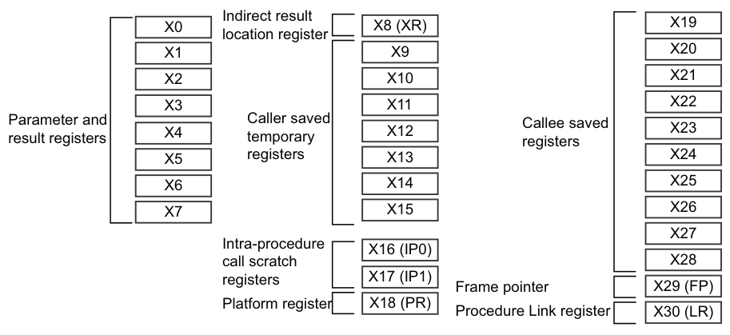


*图 9-1：ABI 中的通用寄存器使用*

#### 9.1.2 间接结果位置

X8（XR）寄存器用于传递间接结果的位置。下面这段代码演示了这一机制：

```
//test.c//
struct struct_A
{
int i0;
int i1;
double d0;
double d1;
} AA;
struct struct_A foo(int i0, int i1, double d0, double d1)
{
struct struct_A A1;
A1.i0 = i0;
A1.i1 = i1;
A1.d0 = d0;
A1.d1 = d1;
return A1;
}
void bar()
{
AA = foo(0, 1, 1.0, 2.0);
}
```

可以用下面的命令编译：

```
armclang -target aarch64-arm-none-eabi -c test.c
fromelf -c test.o
```

**注意：** 这段代码是在未优化的情况下编译的，目的是把背后的机制和原理演示清楚。如果打开优化，编译器可能会把这些代码整个删掉。

```
foo//
SUB SP, SP, #0x30
STR W0, [SP, #0x2C]
STR W1, [SP, #0x28]
STR D0, [SP, #0x20]
STR D1, [SP, #0x18]
LDR W0, [SP, #0x2C]
STR W0, [SP, #0]
LDR W0, [SP, #0x28]
STR W0, [SP, #4]
LDR W0, [SP, #0x20]
STR W0, [SP, #8]
LDR W0, [SP, #0x18]
STR W0, [SP, #10]
LDR X9, [SP, #0x0]
STR X9, [X8, #0]
LDR X9, [SP, #8]
STR X9, [X8, #8]
LDR X9, [SP, #0x10]
STR X9, [X8, #0x10]
ADD SP, SP, #0x30
RET
bar//
STP X29, X30, [SP, #0x10]!
MOV X29, SP
SUB SP, SP, #0x20
ADD X8, SP, #8
MOV W0, WZR
ORR W1, WZR, #1
FMOV D0, #1.00000000
FMOV D1, #2.00000000
BL foo:
ADRP X8, {PC}, 0x78
ADD X8, X8, #0
LDR X9, [SP, #8]
STR X9, [X8, #0]
LDR X9, [SP, #0x10]
STR X9, [X8, #8]
LDR X9, [SP, #0x18]
STR X9, [X8, #0x10]
MOV SP, X29
LDP X20, X30, [SP], #0x10
RET
```

这个例子里的结构体超过了 16 字节。按照 AArch64 的 AAPCS，返回对象会被写入 XR 所指向的内存。从生成的代码可以看出：

- W0、W1、D0 和 D1 用来传递整数和双精度参数。
- bar() 在栈上为 foo() 的返回结构体值分配空间，并把 SP 放进 X8。
- bar() 把 X8 连同 W0、W1、D0、D1 里的参数一起传给 foo()，随后 foo() 取得该地址做进一步处理。
- foo() 可能会破坏 X8，因此 bar() 改用 SP 来访问返回的结构体。

使用 X8（XR）的好处在于，它不会挤占用于传参的寄存器。

图 9-2 展示了一个 AAPCS64 栈帧。帧指针（X29）指向栈上保存的上一个帧指针，保存的 LR（X30）紧跟在它后面。链中最后一个帧指针应设为 0。栈指针必须始终按 16 字节边界对齐。栈帧的确切布局可以有一些变化，尤其是在可变参数函数或没有帧指针的函数中，详情请查阅 AAPCS64 文档。

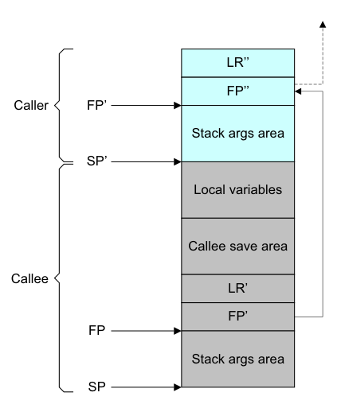


*图 9-2：栈帧*

**注意：** AAPCS 只规定了 FP、LR 块的布局以及这些块如何链接在一起。图 9-2 中其余的内容（包括两个函数帧之间边界的精确位置）都没有规定，编译器可以自由选择。

图 9-2 展示了一个使用两个被调用方保存寄存器（X19 和 X20）和一个临时变量的帧，其布局如下（左侧数字是相对 FP 的字节偏移量）：

```
40:  <padding>
32:  temp
24:  X20
16:  X19
 8:  LR'
 0:  FP'
```

填充是必需的，因为栈指针要保持 16 字节对齐。

```
function:
STP X29, X30, [SP, #-48]!   // 向下移动栈指针并保存 FP 和 LR
MOV X29, SP                  // 将帧指针设置为新帧的底部
STP X19, X20, [X29, #16]     // 保存 X19 和 X20
...
代码主体
...
LDP X19, X20, [X29, #16]     // 恢复 X19 和 X29
LDP X29, X30, [SP], #48      // 恢复 FP' 和 LR'，然后将栈指针设置回其原始位置
RET                          // 返回调用方
```

#### 9.1.3 NEON 和浮点寄存器中的参数

ARM 64 位架构还有 32 个寄存器 v0–v31，供 NEON 和浮点运算使用。引用寄存器时所用的名称会随访问的大小而变化。

**注意：** 与 AArch32 不同，AArch64 中 NEON 和浮点寄存器的 128 位视图与 64 位视图在较窄的视图里不会重叠到多个寄存器上，因此 q1、d1 和 s1 指向的都是寄存器组中的同一项。

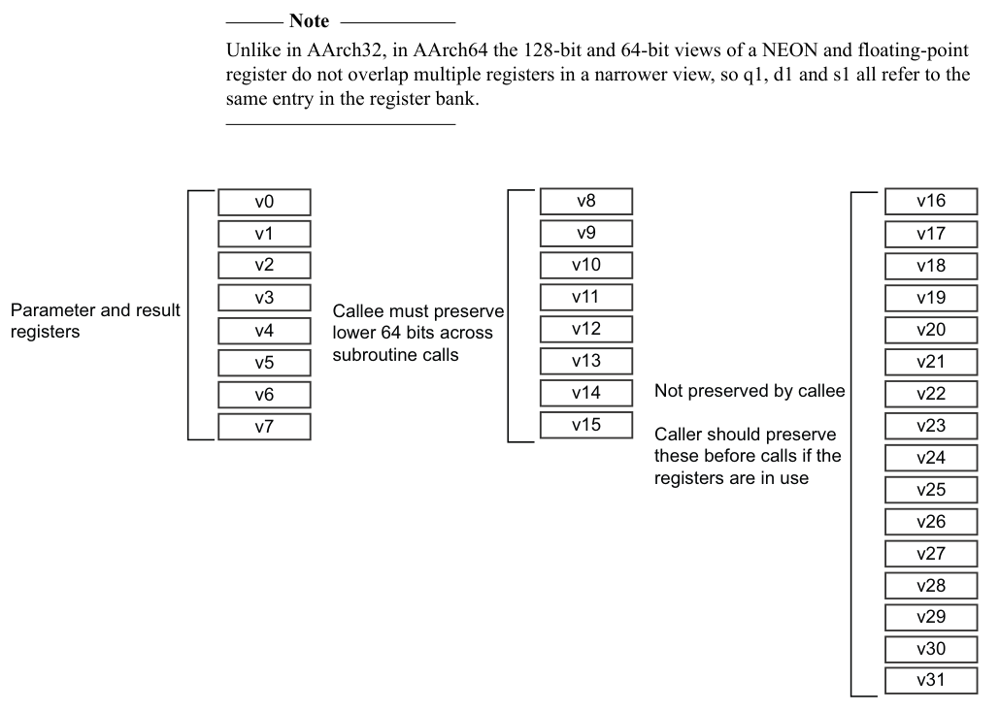


*图 9-3：ABI 中的 SIMD 和浮点寄存器*

- V0–V7 用于向子程序传参，以及从函数返回结果值。它们也可以用于在例程内部保存中间值（但通常只在两次子程序调用之间）。
- V8–V15 在子程序调用期间必须由被调用方保留，不过只需要保留其中每个存储值的低 64 位。
- V16–V31 无须保留（或者说应由调用方保留）。

## 第10章 AArch64 异常处理

异常（exception）是需要特权软件（异常处理程序）采取某种行动、以保证系统正常运转的条件或系统事件。在 ARM 术语里，我们通常说的"中断"其实只是异常的一种。每种异常类型都关联一个异常处理程序；处理程序执行完毕后，特权软件让内核准备好恢复进入异常之前正在做的工作。

ARMv8-A 的异常分为以下几类：

- **中断（Interrupt）**　分为 IRQ 和 FIQ 两种，FIQ 优先级高于 IRQ。两者通常都与内核的输入引脚关联：外部硬件置位中断请求线，在当前指令执行完毕后（个别能加载多个值的指令可以在中途被打断）触发对应异常，前提是该中断未被屏蔽。IRQ/FIQ 是发给内核的物理信号，只要置位时对应异常被使能，内核就进入该异常。几乎所有系统中，各中断源都先汇聚到一个中断控制器上，由它仲裁、排序，再输出一个串行化的单一信号接到内核的 FIQ 或 IRQ 引脚。因为 IRQ/FIQ 何时到来与内核正在执行什么软件没有直接关系，它们被归类为**异步异常**。
- **中止（Abort）**　由取指失败（指令中止）或数据访问失败（数据中止）产生。它可能来自外部内存系统对某次内存访问返回的错误响应（通常表示指定地址并不对应系统中的真实内存），也可能由内核的内存管理单元（MMU）生成——操作系统正是利用 MMU 中止来给应用程序动态分配内存的。一条指令在取指时就可以在流水线里被打上"已中止"的标记，只有当内核随后真正尝试执行它时，才会进入指令中止异常，且发生在执行之前；如果流水线在它到达执行阶段前被冲刷，中止就不会发生。数据中止则是加载/存储指令的结果，发生在数据读或写尝试之后。如果中止是执行（或尝试执行）指令流的结果，且返回地址能给出触发中止的指令详情，就称它是同步的（synchronous）；否则是异步的。在 ARMv8-A 中，指令中止和数据中止都是同步的，异步异常只有 IRQ/FIQ 和系统错误（SError）。
- **复位（Reset）**　复位被看作最高实现异常级别上的一个特殊向量，即异常触发时处理器跳转到的位置。它使用一个实现定义（IMPLEMENTATION DEFINED）的地址，记录在 RVBAR_ELn 中，其中 n 是最高实现异常级别的编号。所有内核都有复位输入，上电后立即进入复位异常。它是优先级最高、不可屏蔽的异常，用来在上电后执行初始化代码。
- **产生异常的指令**　执行某些指令本身就能产生异常，通常是为了向更高特权级别的软件请求服务：

  - 监管调用（Supervisor Call，SVC）让 User（用户）模式程序能请求操作系统服务。
  - 虚拟机管理程序调用（Hypervisor Call，HVC）让客户操作系统（guest OS）能请求 hypervisor 服务。
  - 安全监控器调用（Secure monitor Call，SMC）让普通世界能请求安全世界服务。

  这类异常若是在 EL0 取指时产生的，会作为异常进入 EL1；除非在非安全状态下 HCR_EL2.TGE 位被置位，此时它会进入 EL2。若异常是在其他异常级别取指时产生的，则异常级别保持不变。

前面章节已经讲过，ARMv8-A 架构有四个异常级别（EL0~EL3），处理器只能在进入异常或从异常返回时在异常级别之间移动。从较高级别降到较低级别时，执行状态可以保持不变，也可以从 AArch64 切换到 AArch32；反过来从低级别升到高级别时，执行状态可以保持不变，或从 AArch32 切换到 AArch64。

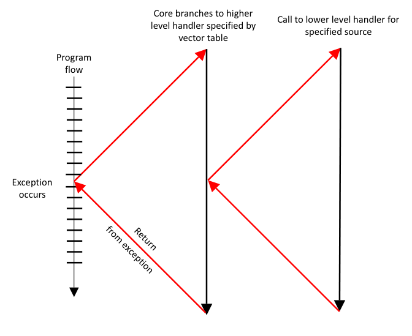


*图 10-1：异常流程*

图 10-1 示意了运行应用程序时发生异常的程序流程：处理器分支到向量表，表中为每种异常类型留有入口；入口的分发代码通常先识别异常原因，再选择并调用相应处理函数，处理完成后返回高层处理程序，最后由它执行 ERET 指令回到应用程序。

### 10.1 异常处理寄存器

第 4 章介绍过，处理器当前状态存在各自独立的 PSTATE 字段中。进入异常时，PSTATE 信息被保存到已保存程序状态寄存器（Saved Program Status Register，SPSR_ELn）里，分别有 SPSR_EL1、SPSR_EL2、SPSR_EL3。

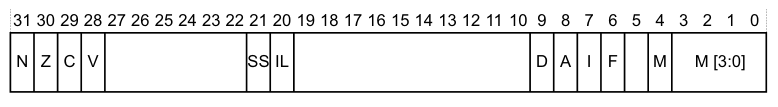


*图 10-2：从 AArch64 进入异常时*

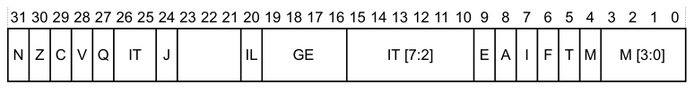


*图 10-3：从 AArch32 进入异常时*

SPSR.M 字段（第 4 位）记录执行状态：0 表示 AArch64，1 表示 AArch32。

异常位屏蔽位（DAIF）用来屏蔽异常事件，对应位置位后就不会进入该异常：

- D　调试异常屏蔽。
- A　SError 中断进程状态屏蔽，例如异步外部中止。
- I　IRQ 中断进程状态屏蔽。
- F　FIQ 中断进程状态屏蔽。

SPSel 字段选择使用当前异常级别的栈指针还是 SP_EL0，在除 EL0 之外的任何异常级别都可设置，本章稍后再讨论。

IL 字段置位时，会使下一条指令的执行触发异常。它用于非法的异常返回，例如在配置为 AArch32 的情况下以 AArch64 返回 EL2。

| 31 30 29 28 27 26 25 24 | 23 | 22 | 21 | 20 | 19 | 18 | 17 | 16 | 15 | 14 13 12 11 10 | 9 | 8 | 7 | 6 | 5 | 4 | 3 2 1 0 |
|---|---|---|---|---|---|---|---|---|---|---|---|---|---|---|---|---|---|---|
| N Z C V | SS | IL | D | A | I | F | M | M[3:0] |

| 31 30 29 28 27 26 25 24 | 23 | 22 | 21 | 20 | 19 | 18 | 17 | 16 | 15 | 14 13 12 11 10 | 9 | 8 | 7 | 6 | 5 | 4 | 3 2 1 0 |
|---|---|---|---|---|---|---|---|---|---|---|---|---|---|---|---|---|---|---|
| N Z C V | Q | IT J | IL | GE | IT[7:2] | E | A | I | F | T | M | M[3:0] |

**表 10-1　PSTATE 字段**

| PSTATE 字段 | 描述 |
|---|---|
| NZCV | 条件标志 |
| Q | 累计饱和位 |
| DAIF | 异常屏蔽位 |
| SPSel | SP 选择（EL0 或 ELn），不适用于 EL0 |
| E | 数据端序（仅 AArch32） |
| IL | 非法标志 |
| SS | 软件单步位 |

软件单步（Software Stepping，SS）位在第 18 章"调试"中介绍，调试器用它来单条执行指令，再在下一条指令上进入调试异常。

其中一些独立字段（CurrentEL、DAIF、NZCV 等）在进入异常时被复制成 SPSR_ELn 的紧凑形式，返回时再还原。

当触发异常的事件发生时，处理器硬件会自动做几件事：更新 SPSR_ELn（n 是进入的异常级别），存入异常结束时正确返回所需的 PSTATE 信息；更新 PSTATE 反映新的处理器状态（可能提升异常级别，也可能保持不变）；把异常结束时要用的返回地址存入 ELR_ELn。

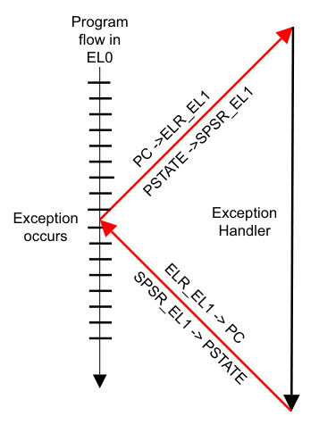


*图 10-4：异常处理*

注意寄存器名上的 `_ELn` 后缀表示同一寄存器在不同异常级别有多份物理副本，例如 SPSR_EL1 与 SPSR_EL2 就是不同的物理寄存器。此外，对同步异常或 SError 异常，ESR_ELn 也会被更新，其值指示异常原因。

处理器需要由软件告知何时从异常返回，这靠 ERET 指令完成：它从 SPSR_ELn 恢复异常前的 PSTATE，并从 ELR_ELn 恢复 PC，使执行回到原来的位置。

SPSR 记录的是返回所需的状态信息，返回地址则靠链接寄存器来存。架构为函数调用和异常返回各自准备了独立的链接寄存器。

如第 6 章"A64 指令集"所述，寄存器 X30 配合 RET 指令用于从子程序返回；每执行一次带链接的分支指令（BL 或 BLR），它的值就被更新为要返回的指令地址。ELR_ELn 则专用于存异常的返回地址：进入异常时该值被自动写入，执行 ERET 返回时它被写入 PC。

> 注意
>
> 从异常返回时，如果 SPSR 中的值与系统寄存器中的设置冲突，你会看到错误。

ELR_ELn 存的是针对特定异常类型偏好的返回地址。对某些异常，这是产生异常的指令之后的下一条指令地址——例如执行 SVC（系统调用）时，我们只想返回应用程序中的下一条指令。对另一些异常，则可能要重新执行产生异常的那条指令。

对异步异常，ELR_ELn 指向因进入中断而尚未执行（或尚未完全执行）的第一条指令的地址。处理程序可以修改 ELR_ELn，比如需要返回到同步中止之后的下一条指令时。相比 ARMv7-A（出于向后兼容，从某些异常返回时必须把链接寄存器值减去 4 或 8），ARMv8-A 的模型要简单得多。

除了 SPSR 和 ELR，每个异常级别都有自己的专用栈指针寄存器，分别命名为 SP_EL0、SP_EL1、SP_EL2、SP_EL3。它们指向一个专用栈，用来存放被异常处理程序破坏的寄存器，返回原代码前再恢复原值。

处理程序可以在 SP_ELn 与 SP_EL0 之间切换。例如 SP_EL1 可以指向一块保存着小栈、内核保证始终有效的内存，而 SP_EL0 指向更大、但无法保证不溢出的内核任务栈。切换通过写 SPSel 位控制：

```asm
MSR SPSel, #0  // 切换到 SP_EL0
MSR SPSel, #1  // 切换到 SP_ELn
```

### 10.2 同步异常和异步异常

AArch64 的异常分同步、异步两类。同步异常是执行（或尝试执行）指令流的结果，返回地址能给出触发它的指令详情；异步异常不是执行指令生成的，返回地址往往无法指明原因。

异步异常有三个来源：IRQ（普通优先级中断）、FIQ（快速中断）和 SError（系统错误）。系统错误的可能原因有多种，最常见的是异步数据中止，例如脏数据从缓存行写回外部内存时触发的中止。

同步异常则有若干来源：

- 来自 MMU 的指令中止，例如从标记为"禁止执行"的内存位置读取指令。
- 来自 MMU 的数据中止，例如权限失败或对齐检查。
- SP 和 PC 对齐检查。
- 同步外部中止，例如读取转换表时的中止。
- 未分配的指令。
- 调试异常。

#### 10.2.1 同步中止

同步异常可能由多种原因产生：

- 来自 MMU 的中止，例如权限失败，或访问了标记为访问标志故障的内存区域。
- SP 和 PC 对齐检查。
- 未分配的指令。
- 服务调用（SVC、SMC 和 HVC）。

这类异常完全可能是操作系统正常运转的一部分。以 Linux 为例，任务请求分配新内存页时，正是通过 MMU 中止机制来处理的。

在 ARMv7-A 里，预取中止、数据中止和未定义（undef）异常是彼此独立的；而在 AArch64 中，所有这些事件都产生同一个同步中止。异常处理程序随后读取综合征（syndrome）寄存器和 FAR 寄存器，就能拿到区分它们所需的信息（稍后详述）。

#### 10.2.2 处理同步异常

架构提供了一组寄存器，向异常处理程序说明同步异常的原因。异常综合征寄存器（Exception Syndrome Register，ESR_ELn）给出异常原因；故障地址寄存器（Fault Address Register，FAR_ELn）保存所有同步指令中止、数据中止和对齐故障的出错的虚拟地址。

异常链接寄存器（Exception Link Register，ELR_ELn）保存触发中止的数据访问（对数据中止而言）的指令地址。它通常在内存故障后被更新，但在其他情况下也会被设置，例如分支到未对齐地址时。

若异常从使用 AArch32 的异常级别进入使用 AArch64 的异常级别，且该异常写入了与目标异常级别关联的故障地址寄存器，则 FAR_ELn 的高 32 位被全部置零。

对于实现 EL2（hypervisor）或 EL3（安全内核）的系统，同步异常通常在当前或更高的异常级别被进入；异步异常也可以（在需要时）被路由到更高异常级别，交由 hypervisor 或安全内核处理。SCR_EL3 指定哪些异常被路由到 EL3，HCR_EL2 类似地指定哪些被路由到 EL2，两者都为 IRQ、FIQ、SError 分别留了独立控制位。

#### 10.2.3 系统调用

某些指令或系统功能只能在特定异常级别执行。当低级别代码需要执行特权操作时——比如应用程序请求内核功能——一种做法是使用 SVC 指令产生异常，参数可以放在寄存器里，或编码在系统调用本身中。

#### 10.2.4 对 EL2/EL3 的系统调用

前面看到 SVC 用于让 EL0 的用户应用程序调用 EL1 的内核；HVC 和 SMC 指令则以类似方式把处理器移到 EL2 和 EL3。

处理器在 EL0（应用程序）执行时，不能直接调用 hypervisor（EL2）或安全监控器（EL3），这只能从 EL1 及以上级别进行。因此应用程序必须先用 SVC 调用内核，由内核代它调用更高异常级别。

从操作系统内核（EL1），软件可以用 HVC 调用 hypervisor（EL2），或用 SMC 调用安全监控器（EL3）。如果处理器实现了 EL3，则提供让 EL2 捕获来自 EL1 的 SMC 的能力；若没有 EL3，SMC 就未被分配，在当前异常级别触发。

同理，从 hypervisor 代码（EL2），程序可以用 SMC 调用安全监控器（EL3）。如果在 EL2 或 EL3 中做 SVC 调用，它仍会在相同异常级别产生同步异常，由该级别的处理程序决定如何响应。

#### 10.2.5 未分配的指令

未分配的指令在 AArch64 中产生同步中止。执行下列任意一项时就会生成该异常：

- 一个未被分配的操作码的指令。
- 一个要求比当前异常级别更高特权级别的指令。
- 一个已被禁用的指令。
- 当 PSTATE.IL 字段被设置时的任何指令。

#### 10.2.6 异常综合征寄存器

异常综合征寄存器 ESR_ELn 保存让处理程序确定异常原因的信息。它只对同步异常和 SError 更新，对 IRQ/FIQ 不更新，因为这些中断处理程序通常从通用中断控制器（GIC）的寄存器中读取状态信息（见 10.6 节"通用中断控制器"）。该寄存器的位编码如下：

- 位 [31:26] 指示异常类别，让处理程序区分各种可能原因：未分配指令、来自对 CP15 的 MCR/MRC 的异常、来自 FP 操作的异常、执行的 SVC/HVC/SMC、数据中止以及对齐异常等。
- 位 [25] 指示被捕获指令的长度（0 表示 16 位指令，1 表示 32 位指令），对某些异常类别也会被设置。
- 位 [24:0] 构成指令特定综合征（Instruction Specific Syndrome，ISS）字段，承载该异常类型特有的信息。例如执行系统调用指令（SVC、HVC 或 SMC）时，它存的是与操作码关联的立即数，如 `SVC 0x123456` 中的 `0x123456`。
### 10.3 异常引起的执行状态和异常级别的变化

进入异常时，处理器可能改变执行状态（从 AArch64 到 AArch32），也可能保持不变。例如，外部源可能在执行 AArch32 模式的应用程序时产生 IRQ 中断，随后该 IRQ 处理程序在 AArch64 模式的操作系统内核里执行。

SPSR 记录要返回到的执行状态和异常级别，进入异常时由处理器自动设置。而每个异常级别进入异常时的执行状态，由下面几点控制：

- 最高异常级别（不一定是 EL3）的复位执行状态通常由硬件配置输入决定，但并非固定不变——RMR_ELn 寄存器可以在运行时改变最高异常级别的执行状态（寄存器宽度），从而引发软复位。记住 EL3 与安全监控器代码关联，监控器是一小段始终在特定状态下运行的可信代码。
- 对 EL2 和 EL1，执行状态由 SCR_EL3.RW 和 HCR_EL2.RW 位控制。SCR_EL3.RW 在 EL3（安全监控器）中编程，设置下一较低级别（EL2）的状态；HCR_EL2.RW 可以在 EL2 或 EL3 中编程，设置 EL1/EL0 的状态。
- 你永远不会在 EL0 进入异常（EL0 是最低特权级别，只跑应用程序代码）。

以图 10-5 为例：一个运行在 EL0 的应用程序被 IRQ 打断，内核 IRQ 处理程序运行在 EL1。处理器在进入 IRQ 异常时，靠查看正在处理异常的异常级别的上一级控制寄存器的 RW 位，来决定设置哪个执行状态。本例中异常进入 EL1，所以决定处理程序执行状态的是 HCR_EL2.RW。

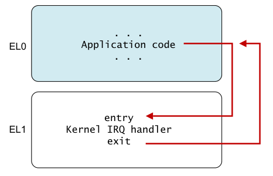


*图 10-5：进入 EL1 的异常*

接着要考虑异常在哪个异常级别进入。同样，进入异常时异常级别可以保持不变或升高，但永远不会进入 EL0。

同步异常通常在当前或更高的异常级别进入；异步异常则可以被路由到更高的异常级别。对安全代码，SCR_EL3 指定哪些异常路由到 EL3；对 hypervisor 代码，HCR_EL2 指定路由到 EL2 的异常。

两种情况都用独立的位分别控制 IRQ、FIQ、SError 的路由。处理器只把异常送入其被路由到的异常级别；异常级别不会因进入异常而下降。在中断被进入的那个异常级别，中断总是被屏蔽的。

从 AArch32 进入 AArch64 的异常时，有一些特殊注意事项：AArch64 处理程序可能需要访问 AArch32 寄存器，因此架构定义了让 AArch64 访问这些寄存器的映射。

AArch32 寄存器 R0~R12 作为 X0~X12 访问；各 AArch32 模式下 SP 和 LR 的 banked 版本通过 X13~X23 访问，banked 的 R8~R12 FIQ 寄存器作为 X24~X29 访问。这些寄存器的位 [63:32] 在 AArch32 状态下不可用，其内容要么为 0，要么为之前在 AArch64 中最后写入的值，架构不保证是哪个，所以通常以 W 寄存器访问它们。

### 10.4 AArch64 异常表

异常发生时，处理器要执行对应的处理程序。处理程序在内存里存放的位置叫异常向量（exception vector），异常向量存成一张表，即异常向量表。每个异常级别各有一张表（EL3、EL2、EL1 各一份），表里放的是要执行的指令，而不是一组地址。各异常对应的向量位于表起点处的固定偏移上，每个表基址的虚拟地址由向量基址寄存器 VBAR_EL3、VBAR_EL2、VBAR_EL1 设置。

向量表里每个条目有 16 条指令的空间。这相比 ARMv7 是个重大变化——后者每个条目只有 4 字节，几乎总是一条跳到内存别处的分支。AArch64 留给向量的间距更大，所以顶层处理程序可以直接写在向量表里。

表 10-2 展示了其中一张向量表：基址由 VBAR_ELn 给出，每个条目相对基址有一个定义好的偏移。每张表 16 个条目，每个条目 128 字节（32 条指令），实际上由 4 组、每组 4 个条目构成。使用哪个条目取决于几个因素：

- 异常的类型（SError、FIQ、IRQ 或同步异常）
- 若异常在同一异常级别进入，使用哪个栈指针（SP0 或 SPx）
- 若异常在较低异常级别进入，下一较低级别的执行状态（AArch64 或 AArch32）

**表 10-2　向量表相对向量表基址的偏移**

| 地址 | 异常类型 | 描述 |
|---|---|---|
| VBAR_ELn + 0x000 | 同步异常 | 当前 EL 使用 SP0 |
| + 0x080 | IRQ/vIRQ | |
| + 0x100 | FIQ/vFIQ | |
| + 0x180 | SError/vSError | |
| + 0x200 | 同步异常 | 当前 EL 使用 SPx |
| + 0x280 | IRQ/vIRQ | |
| + 0x300 | FIQ/vFIQ | |
| + 0x380 | SError/vSError | |
| + 0x400 | 同步异常 | 较低 EL 使用 AArch64 |
| + 0x480 | IRQ/vIRQ | |
| + 0x500 | FIQ/vFIQ | |
| + 0x580 | SError/vSError | |

举个具体例子就好理解了。

假设内核代码正在 EL1 执行，此时发出 IRQ 中断信号，就发生 IRQ 异常。该中断与 hypervisor 或安全环境无关，也在内核内用 SP_EL1 处理，且 SPSel 位被设置、正在使用 SP_EL1，于是执行从地址 VBAR_EL1 + 0x280 开始。

在 ARMv8-A 架构中，因为没有 `LDR PC, [PC, #offset]`，必须用更多指令从寄存器表读目的地址。向量间距之所以这么选，是为了避免未使用的向量对常见大小的指令缓存行造成缓存污染。复位地址则是一个完全独立的地址，由实现定义、通常由内核内的硬连线配置设定，可从 RVBAR_EL1/2/3 寄存器读取。

为来自当前异常级别和较低异常级别的异常分别提供向量，让操作系统或 hypervisor 能灵活应对较低级别的 AArch64/AArch32 状态。从较低级别产生的异常用 SP_ELn，不过软件也可以在处理程序内部切换到 SP_EL0，这样便于在处理程序中访问线程里的值。

**表 10-2　向量表相对向量表基址的偏移（续）**

| 地址 | 异常类型 | 描述 |
|---|---|---|
| + 0x600 | 同步异常 | 较低 EL 使用 AArch32 |
| + 0x680 | IRQ/vIRQ | |
| + 0x700 | FIQ/vFIQ | |
| + 0x780 | SError/vSError | |
### 10.5 中断处理

在 ARM 语境中，"中断"通常指中断信号，对 A-profile 与 R-profile 处理器就是外部的 IRQ 或 FIQ 信号。架构并没有规定这些信号该怎么用：FIQ 常常保留给安全中断源。较早的架构版本里 FIQ 与 IRQ 分别代表高优先级与标准优先级中断，但在 ARMv8-A 中并非如此。

当处理器以 AArch64 执行状态进入异常时，所有 PSTATE 中断屏蔽位都会被自动置位，意味着后续中断被禁用。软件若要支持嵌套异常——例如允许更高优先级的中断打断较低优先级源的处理——就必须显式重新使能中断。

用这条指令：

```asm
MSR DAIFClr, #imm
```

这里的立即数实际上是一个 4 位字段，因为还包含以下屏蔽位：

- PSTATE.A（用于 SError）
- PSTATE.D（用于 Debug）

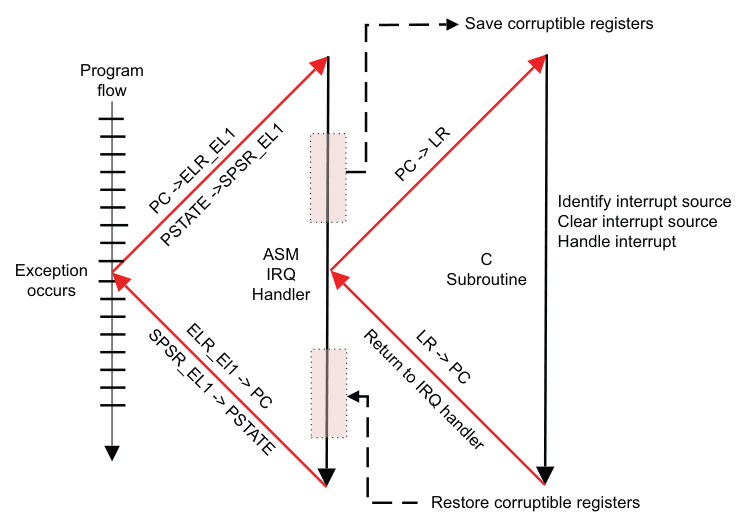


*图 10-6：C 代码中的中断处理程序*

一个汇编语言 IRQ 处理程序示例如下：

```asm
IRQ_Handler
     // 将所有可被破坏的寄存器入栈
     STP X0, X1, [SP, #-16]! // SP = SP -16
...
     STP X2, X3, [SP, #-16]! // SP = SP - 16
     // 与 ARMv7 不同，没有 STM 指令，
     // 因此我们可能需要几条 STP 指令
   BL read_irq_source       // 用于确定为什么进入中断的函数
                            // 并清除该请求
   BL C_irq_handler        // C 中断处理程序
                            // 从栈中恢复可被破坏的寄存器
   LDP X2, X3, [SP], #16 // SP = SP + 16
   LDP X0, X1, [SP], #16 // SP = SP + 16
     …
   ERET
```

不过从性能角度看，下面的序列可能更可取：

```asm
IRQ_Handler
SUB SP, SP, #<frame_size> // SP = SP - <frame_size>
     STP X0, X1, [SP] // 将 X0 和 X1 存储在帧的基址
     STP X2, X3, [SP] // 将 X2 和 X3 存储在帧的基址 + 16 字节
     ... // 存储更多寄存器
...
     // 中断处理
   BL read_irq_source       // 用于确定为什么进入中断的函数
                            // 并清除该请求
   BL C_irq_handler         // C 中断处理程序
                            // 从栈中恢复可被破坏的寄存器
LDP X0, X1, [SP] // 在帧的基址加载 X0 和 X1
 LDP X2, X3, [SP] // 在帧的基址 + 16 字节加载 X2 和 X3
... // 加载更多寄存器
ADD SP, SP, #<frame_size> // 将 SP 恢复为其原始值
     …
   ERET
```

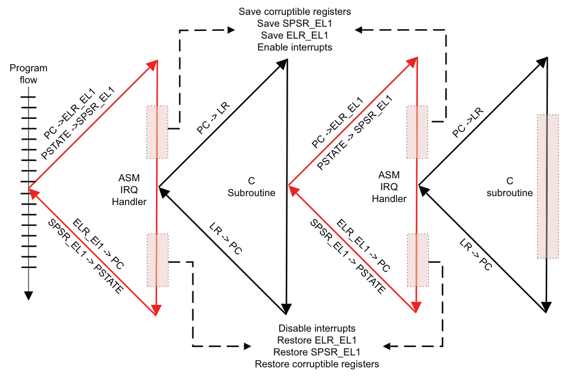


*图 10-7：处理嵌套中断*

嵌套处理程序需要稍多一些代码：它必须在栈上保存 SPSR_EL1 和 ELR_EL1 的内容，还必须在确定（并清除）中断源之后重新使能 IRQ。不过（与 ARMv7-A 不同），由于子程序调用使用的链接寄存器与异常使用的链接寄存器不同，我们不必在 LR 或模式上做任何特殊处理。

### 10.6 通用中断控制器

ARM 为 ARMv8-A 系统提供了一个标准中断控制器，其编程接口在 GIC 架构规范中定义。GIC 架构规范有多个版本，本文集中介绍版本 2（GICv2）。ARMv8-A 处理器通常连接到一个 GIC，例如 GIC-400 或 GIC-500。通用中断控制器（GIC）支持在多核系统中对各核之间路由软件生成中断、私有外设中断和共享外设中断。

GIC 架构提供的寄存器用于管理中断源和中断行为，并在多核系统中把中断路由到各个核。它让软件能对单个中断源做屏蔽、使能和禁用，对单个来源（在硬件中）做优先级排序，还能生成软件中断。GIC 接受系统级置位的中断，把它们发信号给它所连接的每个核，可能导致进入 IRQ 或 FIQ 异常。

从软件角度看，GIC 有两个主要功能块：

- **分发器（Distributor）**　系统的所有中断源都连到这里。分发器有寄存器控制单个中断的属性——优先级、状态、安全性、路由信息和使能状态——并决定哪个中断通过所连接的 CPU 接口转发给核。
- **CPU 接口（CPU Interface）**　核通过它接收中断。CPU 接口承载用于屏蔽、识别和控制转发给该核的中断状态的寄存器，系统中每个核各有一个独立的 CPU 接口。

中断在软件里用一个叫**中断 ID** 的编号来标识，一个中断 ID 唯一对应一个中断源。软件用中断 ID 识别中断源并调用相应处理程序；呈现给软件的确切中断 ID 由系统设计决定。

中断有多种类型：

- **软件生成中断（Software Generated Interrupt，SGI）**　由软件显式写入专用分发器寄存器——软件生成中断寄存器（GICD_SGIR）来生成，最常用于核间通信。SGI 可以针对系统里所有核或选定核组，中断 ID 0-15 保留给它，用到的 ID 由生成它的软件设置。
- **私有外设中断（Private Peripheral Interrupt，PPI）**　这是分发器可以路由到指定核或多个核的全局外设中断。中断 ID 16-31 保留给它。这些 ID 标识该核私有的中断源，与另一核上的同源中断相互独立，例如每核定时器。
- **共享外设中断（Shared Peripheral Interrupt，SPI）**　由 GIC 可以路由到不止一个核的外设产生，中断编号 32-1020 用于此目的。SPI 用于通知整个系统可访问的各种外设的中断。
- **局部特定外设中断（Locality-specific Peripheral Interrupt，LPI）**　基于消息的中断，路由到特定核，GICv2 或 GICv1 不支持。

中断可以是**边沿触发**的（GIC 检测到相关输入上的上升沿时视为置位，并保持置位直到被清除），也可以是**电平敏感**的（仅当 GIC 相关输入为高电平时视为置位）。

中断可以处于多种状态：

- 非活动（Inactive）——中断当前未被置位。
- 待处理（Pending）——中断源已置位，正等待某个核处理；待处理中断是转发到 CPU 接口、随后转发到核的候选。
- 活动（Active）——中断已被某个核确认，正在被服务。
- 活动且待处理（Active and pending）——某个核正在服务该中断，同时 GIC 又从同一来源收到一个待处理中断。

中断的优先级和可送达核的列表都在分发器中配置。外设送达分发器的中断处于待处理状态（若已是活动状态则为活动且待处理）。分发器确定可送达某个核的最高优先级待处理中断，转发到该核的 CPU 接口；在 CPU 接口处，该中断被发信号给核，核随之进入 FIQ 或 IRQ 异常。

核执行异常处理程序作为响应。处理程序必须从 CPU 接口寄存器查询中断 ID，并开始服务中断源；完成后，处理程序要写一个 CPU 接口寄存器报告处理结束。

对给定中断，典型的状态流转为：

- Inactive -> Pending　外设置位该中断时。
- Pending -> Active　处理程序确认该中断时。
- Active -> Inactive　处理程序完成对该中断的处理时。

分发器提供寄存器来报告不同中断 ID 的当前状态。

在多核/多处理器系统中，单个 GIC 可被多个核共享（GICv2 中最多八个）。GIC 提供寄存器控制 SPI 针对哪个核或哪些核，这套机制让操作系统可以在各核之间共享、分配中断并协调活动。

有关 GIC 行为的更详细信息，可参见各处理器类型的 TRM 以及《ARM 通用中断控制器架构规范》。

#### 10.6.1 配置

GIC 作为内存映射外设访问。所有核都能访问公共分发器，但 CPU 接口是分体（banked）的——每个核用相同地址访问自己私有的 CPU 接口，一个核无法访问另一个核的 CPU 接口。

分发器承载若干寄存器，用于配置单个中断的属性。可配置属性包括：

- 中断优先级（GICD_IPRIORITY<n>）。分发器据此确定下一个转发到 CPU 接口的中断。
- 中断配置（GICD_ICFGR<n>）。确定中断是电平敏感还是边沿敏感，不适用于 SGI。
- 中断目标（GICD_ITARGETSR<n>）。确定中断可转发到的核的列表，仅适用于 SPI。
- 中断使能或禁用状态（GICD_ISENABLER<n> 和 GICD_ICENABLER<n>）。只有在分发器中使能的中断才有资格在变为待处理时被转发。
- 中断安全性（GICD_IGROUPR<n>）。确定中断分配给安全世界软件还是普通世界软件。
- 中断状态。

分发器还提供优先级屏蔽：低于某优先级的中断被阻止到达核，分发器在判断待处理中断能否转发到特定核时用到它。

每个核上的 CPU 接口则用于对该核的中断控制和处理做微调。

#### 10.6.2 初始化

分发器和 CPU 接口在复位时都被禁用，GIC 必须在复位之后初始化才能向核交付中断。

在分发器中，软件必须配置单个中断的优先级、目标、安全性并使其使能，随后通过控制寄存器（GICD_CTLR）使能分发器。对每个 CPU 接口，软件还必须编程优先级屏蔽和抢占设置。

每个 CPU 接口块本身也要通过其控制寄存器（GICD_CTLR）使能，这让 GIC 准备好向核交付中断。

在核预期接收中断之前，软件通过在向量表中设置有效中断向量、清除 PSTATE 中的中断屏蔽位、设置路由控制，让核准备好接收中断。

整个中断机制可以通过禁用分发器来停用；禁用某个核的 CPU 接口可以停用向该核的中断交付；单个中断也可以在分发器中单独禁用（或使能）。

要让中断到达核，单个中断、分发器和 CPU 接口三者都必须使能，且中断优先级要高于核的优先级屏蔽。

#### 10.6.3 中断处理

核进入中断时，跳转到从向量表取得的顶层中断向量并开始执行。

顶层中断处理程序从 CPU 接口块读取中断确认寄存器（Interrupt Acknowledge Register）以获取中断 ID。

除了返回中断 ID，这次读取还会使中断在分发器中被标记为活动。一旦知道中断 ID（识别出中断源），顶层处理程序就能分派一个设备特定的处理程序去服务该中断。

设备特定处理程序执行完毕后，顶层处理程序把相同的中断 ID 写入 CPU 接口块的中断结束（End of Interrupt，EoI）寄存器，指示中断处理结束。

这除了移除活动状态（使最终状态变为非活动；若此前是活动且待处理，则变为待处理）之外，还让 CPU 接口能把更多待处理中断转发给核，从而完成对单个中断的处理。

同一个核上可能同时有多个中断等待服务，但 CPU 接口一次只能发出一个中断信号。顶层处理程序可以重复上面的序列，直到读到特殊的中断 ID 值 1023，表示该核上已没有更多待处理中断。这个特殊值叫伪中断（spurious）ID。

伪中断 ID 是保留值，不能分配给系统中任何设备。顶层处理程序读到伪中断 ID 后即可结束执行，让核准备好恢复进入中断前正在执行的任务。

通用中断控制器（GIC）通常管理来自多个中断源的输入，并把它们分配到 IRQ 或 FIQ 请求。

## 第11章 缓存

处理器内核的时钟频率如今已经远远高于外部内存的访问速度。ARM 架构诞生之初，处理器时钟与内存访问速度大致相当；现在内核能以高出几个数量级的频率运行，而外部总线和内存设备并没有同步提速。可以做出与内核同速的小块片上 SRAM，但它远比标准 DRAM 昂贵——后者的容量能高出数千倍。因此，在许多基于 ARM 处理器的系统中，访问一次外部内存要耗费数十甚至数百个内核周期。

缓存就是为了解决这个问题：它是内核与主存之间的一小块高速存储器，保存主存中各项的副本。访问缓存远比访问主存快。每当内核读或写某个地址时，都会先在缓存里查找；命中就直接用缓存里的数据，不再去访问主存。这样既显著提升了系统性能（减小了外部内存访问慢的影响），也降低了功耗（省去了驱动外部信号的开销）。

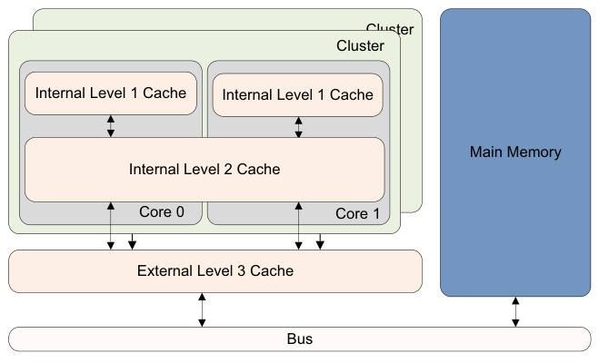


*图 11-1：基本缓存结构*

实现 ARMv8-A 架构的处理器通常带两级或更多级缓存，即每个内核有一小块 L1 指令缓存和 L1 数据缓存。Cortex-A53 和 Cortex-A57 处理器在实现上通常带两级或更多级：一个小的 L1 指令缓存和数据缓存，外加一个更大、在簇内多个核心间共享的统一 L2 缓存。此外还可以有作为外部硬件块的 L3 缓存，在多个簇之间共享。

要理解一点：第一次访问某数据（把它装入缓存的那次）并不会比正常访问更快，真正的性能提升来自之后对已缓存值的各次访问。内核硬件会检查所有的取指和数据读写，因此你必须把内存中某些部分（例如外设所在区域）标记为不可缓存。又因为缓存只保存主存的一个子集，你需要一种机制来快速判断要找的地址是否在缓存中。

缓存里的数据和指令偶尔会与外部内存不一致：可能是处理器更新了缓存内容但尚未写回主存，也可能是内核取得自己的副本之后，另一个代理又更新了主存。这是一致性问题，将在第 14 章讨论；当系统里有多个内核或 DMA 控制器等内存代理时，这个问题尤其突出。

### 11.1 缓存术语

冯·诺依曼架构中，指令和数据共用同一个缓存（统一缓存）；改进型哈佛架构则有分离的指令总线和数据总线，因而有两个缓存：指令缓存（I-cache）和数据缓存（D-cache）。ARMv8 处理器采用分离的 L1 指令缓存和数据缓存，由统一的 L2 缓存作为后备。

缓存需要保存地址、一些数据以及状态信息。下面先总结几个术语，并结合图 11-2 说明缓存的基本结构。


*图 11-2：缓存术语*

- **标签（tag）**是存储在缓存内的内存地址的一部分，用来标识与某一行数据关联的主存地址。

  64 位地址的高位告诉缓存这份数据来自主存的哪个位置，这些高位就是标签。缓存总大小度量的是它能容纳的数据量，保存标签值的 RAM 不计入其中，但标签确实会占用缓存里的物理空间。

- 只为一个标签地址保存一个数据字效率太低，所以通常把若干个位置归到同一个标签下。这个逻辑块称为**缓存行（cache line）**，是缓存最小的可加载单元，即来自主存的一块连续的字。缓存行里装的是有效数据或指令时称其为**有效**，否则**无效**。

  每行数据都关联一个或多个状态位。通常有一个**有效位**，标记该行装的是可用数据，也就是地址标签确实代表某个真实值。数据缓存里还可以有一个或多个**脏位**，标记该行（或其一部分）保存的数据与主存内容不同（已被更新）。

- **索引（index）**是内存地址的一部分，用来确定这个地址可以落在缓存的哪些行里。

  地址中间的几位（索引）标识了具体是哪一行。索引用作缓存 RAM 的地址，不必作为标签的一部分存储。后面会进一步说明。

- **路（way）**是缓存的一个细分部分，各路大小相等、以同样方式索引；**组（set）**由共享同一索引的所有路的缓存行组成。

- 地址最低几位（**偏移 offset**）不必存进标签——你需要的是整行的地址，而不是行内每个字节的地址，所以最低五六个有效位始终为 0。

#### 11.1.1 组相联缓存与路

ARM 内核的主缓存一律用组相联缓存实现。这大大降低了直接映射缓存那种“缓存抖动”的可能性，从而提升程序执行速度、让执行时间更确定。代价是硬件更复杂、功耗略增，因为每个周期要比较多个标签。

这种组织方式下，缓存被划分成若干个大小相等的部分——路，内存位置映射到某一路而不是某一行。索引字段仍然用来选择行，但它指向的是每一路中的那一行。L1 数据缓存通常是两路或四路；Cortex-A57 的 L1 指令缓存是三路；L2 缓存通常有 16 路。

外部 L3 缓存（如 ARM CCN-504 缓存一致网络）规模大得多，可以有更多路，也就是更高的相联度。索引值相同的缓存行归入同一组；要判断是否命中，必须检查组内每一个标签。

图 11-3 是一个 2 路缓存：地址 0x00、0x40、0x80 的数据可能落在任一路的第 0 行，但不可能同时出现在两路中。


*图 11-3：2 路组相联缓存*

提高相联度能降低抖动概率。理想是全相联缓存——任何主存位置都能映射到缓存内任意位置；但除了极小缓存（如与 MMU 的 TLB 相关的那些）之外，这种缓存不切实际。实际上相联度超过 8 路后性能提升微乎其微，而 16 路相联对较大的 L2 缓存更有用。

#### 11.1.2 缓存标签与物理地址

每行都有一个标签，记录该行关联的外部内存物理地址。缓存行大小由实现定义，但由于互连的原因，所有核心应当采用相同的缓存行大小。

访问所用的物理地址决定了数据在缓存中的位置：最低有效位用来选择缓存行内的具体项；中间位作索引，选择缓存组内的行；最高有效位是地址的其余部分，用来与该行存储的标签比较。ARMv8 中数据缓存通常是物理索引、物理标签（PIPT）的，但也可以是非别名（non-aliasing）的虚拟索引、物理标签（VIPT）。

缓存中每一行都包含：

- 来自相关物理地址的标签值；
- 有效位，指示该行是否存在（标签是否有效）；若缓存在多核间保持一致，有效位也可以是 MESI 状态的各个状态位；
- 脏数据位，指示该行数据是否与外部内存不一致。

ARM 缓存是组相联的：任何给定地址都有多个可能的存放位置（路）。组相联显著降低缓存抖动的可能性，从而提升程序执行速度，代价是硬件复杂度和功耗略增。

图 11-4 是一个简化的四路组相联 32KB L1 缓存（如 Cortex-A57 的数据缓存），缓存行长度 16 字（64 字节）。


*图 11-4：32KB 4 路组相联数据缓存*

#### 11.1.3 包含式与独占式缓存

以单核处理器里的一条简单内存读 `LDR X0, [X1]` 为例：

- 若 X1 指向的地址标记为可缓存，就在 L1 数据缓存里做一次查找。
- 在 L1 缓存里找到了，就从 L1 读出数据返回内核。


*图 11-5：在 L1 缓存中找到*

- 在 L1 里没找到、但在 L2 里找到了，就把该缓存行从 L2 装入 L1，并把数据返回内核。这可能从 L1 逐出一行来腾地方，但被逐出的行可能仍留在更大的 L2 缓存里。


*图 11-6：在 L2 缓存中找到*

- 在 L1 和 L2 里都没找到，就把数据从外部内存装入 L1 和 L2，再提供给内核，这一过程可能导致各缓存行被逐出。


*图 11-7：在外部内存中找到*

这是相当简化的描述。在多核、多簇系统中，从外部内存加载之前，还可能要先检查簇内其他核心或其他簇核心的 L2、L1 缓存；L3 缓存和系统缓存此时也都没被考虑。

上面描述的是**包含式**缓存模型——同一份数据可以同时存在于 L1 和 L2。在**独占式**缓存里，数据只能存在于某一级缓存中，同一个地址不可能同时出现在 L1 和 L2。

### 11.2 缓存控制器

缓存控制器是负责管理缓存存储器的硬件块，其工作方式对程序来说基本不可见。它会自动把代码或数据从主存写进缓存，接收来自内核的读写请求，并对缓存存储器或外部内存执行必要的操作。

收到内核请求时，控制器必须先检查所请求的地址能否在缓存中找到，这一步叫**缓存查找**：把请求地址位的某个子集与各行的标签值比较。若匹配（**命中**）且该行有效，就用缓存存储器完成读或写。

若内核请求的指令或数据在缓存标签里找不到匹配、或标签无效，就发生**缓存未命中**，请求被传递给内存层次结构的下一级——L2 缓存或外部内存。这还可能触发**缓存行填充（cache linefill）**：把主存中某一块的内容复制进缓存，同时把所请求的数据或指令流式传送给内核。整个过程对软件开发人员透明，内核无需等行填充完成就能用上数据。缓存控制器通常先访问缓存行内的**关键字（critical word）**：比如一条加载指令未命中触发行填充时，内核先取回缓存行中包含所请求数据的那部分；这些关键数据被送入内核流水线，缓存硬件和外部总线接口随后在后台把该行其余部分读完。

### 11.3 缓存策略

缓存策略描述两件事：什么时候把一行分配到数据缓存里，以及一条命中数据缓存的存储指令应当产生什么行为。

**分配策略**决定何时分配缓存行：

**写分配（Write allocation，WA）**：写未命中时分配缓存行。也就是说，处理器上的一条存储指令可能导致一次突发读——执行写之前先做一次行填充，把该缓存行的数据取来。即使你只写行内一个字节，缓存里也会装入整行，因为行是最小的可加载单元。

**读分配（Read allocation，RA）**：读未命中时分配缓存行。

**更新策略**决定写入时的行为：

**写回（Write-back，WB）**：写操作只更新缓存并把缓存行标为脏，只有在该行被逐出或被显式清洁时外部内存才被更新。


*图 11-8：写回*

**写直通（Write-through，WT）**：写操作同时更新缓存和外部内存系统，不把缓存行标为脏。


*图 11-9：写直通*

无论 WT 还是 WB，命中缓存的数据读行为都一样。

正常内存的可缓存属性被分别指定为**内部（inner）**和**外部（outer）**属性。内部与外部的划分由实现定义，第 13 章有更详细介绍。通常内部属性由集成的缓存使用，外部属性经处理器内存总线提供给外部缓存使用。


*图 11-10：内存的可缓存属性*

正常内存可以被处理器推测性地访问——即使程序员没显式请求某个地址，处理器也可能自动把数据加载进缓存，详见第 13 章“内存排序”。程序员也可以向内核提示将来会用到哪些数据，ARMv8-A 提供了预加载提示指令。缓存是否支持推测和预加载由实现定义。可用指令如下：

- AArch64: `PRFM PLDL1KEEP, [Xm, #imm]`；表示从 Xm 加偏移处预取一次加载到 L1 缓存，作为时间性（temporal）预取——意味着该数据可能被使用不止一次。
- AArch32: `PLD Rm`；把地址在 Rm 中的数据预加载到缓存。

更一般地，A64 预取内存指令的形式如下：

```
PRFM <prfop>, addr
```

其中：

- `<prfop>`：`<type><target><policy> | #uimm5`
- `<type>`：`PLD` 用于预取加载；`PST` 用于预取存储
- `<target>`：`L1` 用于 L1 缓存，`L2` 用于 L2 缓存，`L3` 用于 L3 缓存
- `<policy>`：`KEEP` 用于保留或时间性预取，表示在缓存中正常分配；`STRM` 用于流式或非时间性预取，表示该内存仅使用一次
- `uimm5`：以 5 位立即数表示提示编码，这些是可选的

### 11.4 一致性点与统一点

按组、按路清洁与无效化的操作作用在特定级别的缓存上；而使用虚拟地址的操作，架构定义了两个点：

- **一致性点（Point of Coherency，PoC）**：对某个地址而言，所有能访问内存的观察者（核心、DSP、DMA 引擎等）在此点保证能看到同一份内存位置的副本。通常这就是主外部系统内存。


*图 11-11：一致性点*

- **统一点（Point of Unification，PoU）**：核心的 PoU 是这样的点——该核心的指令缓存、数据缓存和转换表遍历在此点保证能看到同一份内存位置的副本。例如，一个有哈佛式 L1 缓存和一个缓存转换表项的 TLB 的系统里，统一 L2 缓存就是统一点；如果没有外部缓存，主存就是统一点。


*图 11-12：统一点*

理解 PoU 让自修改代码能够确保将来的取指正确地取到修改后的代码版本，做法是一个两阶段过程：

- 按地址清洁相关的数据缓存项；
- 按地址无效化指令缓存项。

ARM 架构并不要求硬件保证指令缓存与内存之间的一致性，即使对共享内存位置也是如此。

### 11.5 缓存维护

有时软件需要清洁或无效化缓存：外部内存内容变了、需要从缓存里移除陈旧数据时；在 MMU 相关活动（如更改访问权限、缓存策略或虚拟到物理地址映射）之后；或者动态生成代码（JIT 编译器、动态库加载器）需要同步指令缓存与数据缓存时。

- **无效化**缓存或缓存行：清零一个或多个缓存行的有效位，从而清除其中的数据。复位后必须始终无效化缓存，因为其内容不确定。这也可以看作把外部内存域中的更改呈现给缓存用户。
- **清洁**缓存或缓存行：把标为脏的缓存行内容写出到下一级缓存或主存，并清零脏位，使缓存行内容与下一级缓存或内存系统一致。这只适用于写回策略的数据缓存。这也是把缓存中的更改呈现给外部内存域用户的方式，但仅限数据缓存。
- **清零（Zero）**：在缓存内把一个内存块清零，无需先从外部域读取内容。仅适用于数据缓存。

对每种操作，你都可以选择作用范围：

- **全部（All）**：整个缓存，对数据或统一缓存不可用。
- **修改后虚拟地址（Modified Virtual Address，MVA）**：VA 的另一种叫法，指包含某个特定虚拟地址的缓存行。
- **组或路（Set or Way）**：按其在缓存结构中的位置选定的特定缓存行。

AArch64 缓存维护操作用以下通用形式指令执行：

```
<cache> <operation>{, <Xt>}
```

可用的操作有很多。

表 11-1 数据缓存、指令缓存和统一缓存操作

| 缓存 | 操作 | 说明 | AArch32 等价指令 |
| --- | --- | --- | --- |
| DC | CISW | 按组/路清洁并无效化 | DCCISW |
| DC | CIVAC | 按虚拟地址清洁并无效化至一致性点 | DCCIMVAC |
| DC | CSW | 按组/路清洁 | DCCSW |
| DC | CVAC | 按虚拟地址清洁至一致性点 | DCCMVAC |
| DC | CVAU | 按虚拟地址清洁至统一点 | DCCMVAU |
| DC | ISW | 按组/路无效化 | DCISW |
| DC | IVAC | 按虚拟地址无效化至一致性点 | DCIMVAC |
| DC | ZVA | 按虚拟地址缓存清零 | - |

接受地址参数的指令用一个 64 位寄存器保存要维护的虚拟地址，该地址没有对齐限制。接受组/路/级别（Set/Way/Level）参数的指令用一个 64 位寄存器，其低 32 位遵循 ARMv7 架构中描述的格式。按地址执行 AArch64 数据缓存无效化指令 `DC IVAC` 需要写权限，否则会产生权限故障。

所有指令缓存维护指令都可以相对于其他指令缓存维护指令、数据缓存维护指令以及加载和存储以任意顺序执行，除非中间执行了 DSB。

除 `DC ZVA` 之外，指定地址的数据缓存操作只有指定同一地址时才保证彼此按程序顺序执行；那些指定地址的操作，相对于所有未指定地址的维护操作，按程序顺序执行。

看下面这段代码。

示例 11-1 高速缓存无效化并清洁至统一点

```
IC IVAU, X0  // 按地址无效化指令缓存至统一点
DC CVAC, X0  // 按地址清洁数据缓存至一致性点
IC IVAU, X1  // 如果 x0 与 x1 不同，可能相对于前序操作乱序执行
```

前两条指令引用同一地址，所以按顺序执行；最后一条引用不同的地址，因此可能相对于前序操作被重排序。

示例 11-2 无效化缓存至统一点

```
IC IVAU, X0  // 按地址无效化指令缓存至统一点
IC IALLU     // 全部无效化指令缓存至统一点
             // 各操作按顺序执行
```

这保证的只是指令本身的发出顺序，完成与否要等 DSB 之后才有保证。

`DC ZVA` 指令把数据缓存预加载为零值，是 ARMv8-A 新增的能力。处理器的运行速度可以明显快于外部内存系统，从内存加载一个缓存行有时要花很长时间。

缓存行清零的行为与预取类似——都是向处理器提示某些地址将来可能被使用，但清零快得多，因为无需等待外部内存访问完成。

表 11-1 数据缓存、指令缓存和统一缓存操作（续）

| 缓存 | 操作 | 说明 | AArch32 等价指令 |
| --- | --- | --- | --- |
| IC | IALLUIS | 全部无效化，至统一点，内部可共享 | ICIALLUIS |
| IC | IALLU | 全部无效化，至统一点，内部可共享 | ICIALLU |
| IC | IVAU | 按虚拟地址无效化至统一点 | ICIMVAU |

你不是从内存读取实际数据装入缓存，而是让缓存行用零填充。这等于告诉处理器：代码会完全覆写该缓存行的内容，因此无需先读。

考虑需要一个大的临时缓冲区、或正在初始化新结构的场景。你可以直接开始使用该内存，也可以在使用前先预取它；两种做法在把初始内容读进缓存时都会消耗大量周期和内存带宽。用缓存清零选项，就可能省下这些浪费的带宽、让代码执行更快。

缓存维护指令的执行点，根据该指令是按 VA 还是按组/路操作来定义。

你可以选择作用范围 PoC 或 PoU；对于可以广播的操作（见第 14 章“多核处理器”），还可以选择可共享性（Shareability）。

下面这段代码演示把整个数据缓存或统一缓存清洁到 PoC 的通用机制。

示例 11-3 清洁至一致性点

```
MRS X0, CLIDR_EL1
AND W3, W0, #0x07000000 // 获取 2 x 一致性级别
LSR W3, W3, #23
CBZ W3, Finished
MOV W10, #0 // W10 = 2 x 缓存级别
MOV W8, #1 // W8 = 常量 0b1
Loop1: ADD W2, W10, W10, LSR #1 // 计算 3 x 缓存级别
LSR W1, W0, W2 // 提取本级别的 3 位缓存类型
AND W1, W1, #0x7
CMP W1, #2
B.LT Skip // 本级别没有数据或统一缓存
MSR CSSELR_EL1, X10 // 选择此缓存级别
ISB // 同步 CSSELR 的更改
MRS X1, CCSIDR_EL1 // 读取 CCSIDR
AND W2, W1, #7 // W2 = log2(行长度)-4
ADD W2, W2, #4 // W2 = log2(行长度)
UBFX W4, W1, #3, #10 // W4 = 最大路号，右对齐
CLZ W5, W4 /* W5 = 32-log2(路数)，路号在 DC 操作数中的位位置 */
LSL W9, W4, W5 /* W9 = 最大路号，对齐到 DC 操作数中的位置 */
LSL W16, W8, W5 // W16 = 每次迭代路号递减量
Loop2: UBFX W7, W1, #13, #15 // W7 = 最大组号，右对齐
LSL W7, W7, W2 /* W7 = 最大组号，对齐到 DC 操作数中的位置 */
LSL W17, W8, W2 // W17 = 每次迭代组号递减量
Loop3: ORR W11, W10, W9 // W11 = 组合路号和缓存号...
ORR W11, W11, W7 // ... 以及 DC 操作数的组号
DC CSW, X11 // 按组和路执行数据缓存清洁
SUBS W7, W7, W17 // 递减组号
B.GE Loop3
SUBS X9, X9, X16 // 递减路号
B.GE Loop2
Skip: ADD W10, W10, #2 // 递增 2 x 缓存级别
CMP W3, W10
DSB  /* 确保前序缓存维护操作完成 */
B.GT Loop1
Finished:
```

需注意的几点：

- 正常情况下，清洁或无效化整个缓存只有固件才做，是核心上电或断电序列的一部分。它可能非常耗时——L2 缓存里的行数可能相当大，必须逐行循环处理，所以这种清洁只适用于特殊场合。
- 诸如 `DC CSW` 之类的缓存维护操作在第 11-13 页的“缓存维护”中描述。
- 序列开始时必须禁用缓存，防止序列过程中分配新行；如果缓存是独占式的，某一行可能会在级别之间迁移。
- 在 SMP 系统里，另一个核心可能在序列过程中从缓存取得脏缓存行，使它们无法到达 PoC。Cortex-A53 和 Cortex-A7 处理器都可能这样。
- 若存在 EL3，则必须从安全世界无效化缓存，因为有些项是“安全脏”数据，无法从普通世界无效化；否则当安全脏数据在安全世界或普通世界里因正常缓存使用被逐出时，可能破坏内存系统。

如果软件需要指令执行与内存保持一致，必须用 ISB、DSB 屏障配合缓存维护指令来管理。示例 11-4 的代码序列就是为此目的。

示例 11-4 清洁一行自修改代码

```
/* 在同一内部可共享域内进行数据与指令访问的一致性示例。
   以 <Wt> 进入此代码，其中包含一条新的 32 位指令，
   该指令保存在 Xn 所指向位置的可缓存空间中。 */
STR Wt, [Xn]
DC CVAU, Xn  // 按虚拟地址清洁数据缓存至统一点（PoU）
DSB ISH      // 确保从缓存清洁出的数据的可见性
IC IVAU, Xn  // 按虚拟地址无效化指令缓存至 PoU
DSB ISH      // 确保各无效化操作完成
ISB          // 同步取指指令流
```

这个序列只适用于能容纳在单个指令或数据缓存行内的指令序列。

下面这段代码按虚拟地址清洁并无效化数据缓存和指令缓存，区域起始于 x0 给的基地址、长度由 x1 给出。

示例 11-5 按虚拟地址清洁

```
//
// X0 = 基地址
// X1 = 长度（我们假设长度不为 0）
//
// 计算区域末尾
ADD x1, x1, x0 // 基地址 + 长度
//
// 按 MVA 清洁数据缓存
//
MRS X2, CTR_EL0 // 读取缓存类型寄存器
// 获取最小数据缓存行
//
UBFX X4, X2, #16, #4 // 提取 DminLine（缓存行的 log2）
MOV X3, #4 // DminLine 是字数（4 字节）
LSL X3, X3, X4 // X3 应包含缓存行
SUB X4, X3, #1 // 获取缓存行的掩码
BIC X4, X0, X4 // 对齐区域基地址
clean data cache:
DC CVAU, X4 // 按 VA 清洁数据缓存行至 PoU
ADD X4, X4, X3 // 下一个缓存行
CMP X4, X1 // X4（当前缓存行）是否小于区域末尾
B.LT clean_data_cache // while (address < end_address)
DSB ISH // 确保从缓存清洁出的数据的可见性
//
// 按 VA 清洁指令缓存
//
// 获取最小指令缓存行（X2 包含 ctr_el0）
AND X2, X2, #0xF // 提取 IminLine（缓存行的 log2）
MOV X3, #4 // IminLine 是字数（4 字节）
LSL X3, X3, X2 // X3 应包含缓存行
SUB x4, x3, #1 // 获取缓存行的掩码
BIC X4, X0, X4 // 对齐区域基地址
clean_instruction_cache:
IC IVAU, X4 // 按 VA 清洁指令缓存行至 PoU
ADD X4, X4, X3 // 下一个缓存行
CMP X4, X1 // X4（当前缓存行）是否小于区域末尾
B.LT clean_instruction_cache // while (address < end_address)
DSB ISH // 确保各无效化操作完成
ISB // 同步取指指令流
```

### 11.6 缓存发现

缓存维护操作可以按缓存组、按路或按虚拟地址执行。与平台无关的代码可能需要知道缓存大小、缓存行大小、组数和路数，以及系统里有多少级缓存——这种需求最可能出现在复位后的缓存无效化和清零操作中。对架构性缓存的所有其他操作，很可能都按 PoC 或 PoU 来进行。

有若干系统控制寄存器保存这些信息：

- 存在的缓存级数可读缓存级别标识寄存器（CLIDR_EL1）确定。
- 缓存行大小在缓存类型寄存器（CTR_EL0）中给出。
- 若需要 EL0 的用户代码访问它，可设置系统控制寄存器（SCTLR/SCTLR_EL1）的 UCT 位。

要确定缓存中的组数和路数，需要访问两个独立寄存器（都在异常级别下进行）：

1. 先写缓存大小选择寄存器（CSSELR_EL1），选择想获取信息的缓存；
2. 再读缓存大小标识寄存器（CCSIDR/CCSIDR_EL1）；
3. 数据缓存清零标识寄存器（DCZID_EL0）包含清零操作要清零的块大小；
4. SCTLR/SCTLR_EL1 的 [DZE] 位和虚拟机管理程序配置寄存器（HCR/HCR_EL2）的 [TDZ] 位控制哪些执行级别、哪些世界能访问 DCZID_EL0。CLIDR_EL1、CSSELR_EL1、CCSIDR_EL1 只能由特权代码访问——AArch32 中为 PL1 或更高，AArch64 中为 EL1 或更高；
5. 若按虚拟地址执行的数据缓存清零指令（DC ZVA）在某个异常级别被禁止——EL0 由 SCTLR_EL1.DZE 位控制，EL1 和 EL0 中的非安全执行由 HCR_EL2.TDZ 位控制——那么读该寄存器会返回一个表示不支持该指令的值；
6. CLIDR 寄存器只知道集成在处理器内部的缓存级数，无法提供外部内存系统中任何缓存的信息。

例如，只集成 L1 和 L2 时，CLIDR/CLIDR_EL1 会标识两级缓存，处理器完全不知道外部 L3 缓存的存在。


*图 11-13*

在执行缓存维护、或维护与集成缓存一致性的代码时，可能有必要把非集成缓存也纳入考虑。

此外，在 big.LITTLE 系统里，各核心的缓存层次结构可能不同，例如 Cortex-A53 和 Cortex-A57 处理器的 CTR.L1IP 字段就不一样。

## 第12章 内存管理单元（MMU）

内存管理单元（MMU）最重要的作用之一，是让系统能同时运行多个任务——每个任务都作为一个独立的程序，运行在属于自己的私有虚拟内存空间里。它们既不需要知道系统的物理内存映射（即硬件实际使用的地址），也不需要关心同时运行的其他程序。


*图 12-1：内存管理单元*

借助 MMU，你可以为每个程序使用相同的虚拟地址空间；即使物理内存是碎片化的，你依然可以使用连续的虚拟内存映射。这个虚拟地址空间与系统中实际的物理内存映射相互分离。你可以编写、编译并链接应用程序，让它直接运行在虚拟内存空间中。

第 12-2 页的图 12-2 用一个示例系统展示了内存的虚拟视图与物理视图。同一个系统里的不同处理器和设备，可以拥有不同的虚拟地址与物理地址映射。操作系统通过编程 MMU，在这两种内存视图之间进行转换。


*图 12-2：虚拟内存与物理内存*

要做到这一点，虚拟内存系统中的硬件必须提供**地址转换**：把处理器发出的虚拟地址转换成主内存中的物理地址。

- **虚拟地址**：你在内存中放置代码时，以及编译器和链接器所使用的地址。
- **物理地址**：实际硬件系统所使用的地址。

MMU 用虚拟地址的最高有效位来索引转换表中的条目，确定正在访问哪一个块，然后把代码和数据的虚拟地址转换成实际系统中的物理地址。这个转换由硬件自动完成，对应用程序完全透明。除了地址转换，MMU 还控制着每个内存区域的访问权限、内存排序和缓存策略。


*图 12-3：使用转换表进行地址转换*

### 12.1 转换旁路缓存（TLB）

转换旁路缓存（TLB）是 MMU 中最近访问过的页转换的缓存。处理器每次访问内存时，MMU 都会先检查该转换是否已缓存在 TLB 中。如果请求的地址转换在 TLB 中命中，那么这个地址的转换立即可用。

每个 TLB 条目通常不只包含物理地址和虚拟地址，还包含内存类型、缓存策略、访问权限、地址空间标识符（ASID）和虚拟机标识符（VMID）等属性。如果 TLB 中没有处理器所发虚拟地址的有效转换（称为 TLB 未命中），就会触发一次外部的转换表遍历或查找。MMU 中的专用硬件负责读取内存中的转换表。只要这次遍历没有导致缺页，新加载的转换随后就可以缓存在 TLB 中，供以后复用。TLB 的具体结构因 ARM 处理器实现而异。

如果操作系统修改了可能已缓存在 TLB 中的转换条目，它就有责任把这些过期的 TLB 条目失效。执行 A64 代码时，对应的就是 TLB 失效指令 `TLBI`：

```
TLBI <type><level>{IS} {, <Xt>}
```

下面是 `type` 字段一些较常用的选项，完整列表见第 12-5 页的表 12-1。

- `ALL`：所有 TLB 条目。
- `VMALL`：所有 TLB 条目。这是当前客户机操作系统的第 1 级。
- `VMALLS12`：所有 TLB 条目。这是当前客户机操作系统的第 1 级和第 2 级。
- `ASID`：与 Xt 中 ASID 匹配的条目。
- `VA`：与 Xt 中指定的虚拟地址和 ASID 对应的条目。
- `VAA`：与 Xt 中指定的虚拟地址对应的条目，不限 ASID。

每个异常级别（EL3、EL2、EL1）都有该操作所作用的各自的虚拟地址空间。`IS` 字段指定该操作只作用于内部可共享条目。

> 注意：
> 关于 ASID，参见第 12-27 页的"上下文切换"；关于可共享性的概念，参见第 12-18 页的"转换表配置"。

`<level>` 字段只指定该操作应作用的异常级别虚拟地址空间（可以是 3、2 或 1）。

下面的代码示例展示了当转换表以内部可共享内存为后端时，写入转换表的指令序列：

```
// 写入转换表
DSB ISHST     // 确保写入已完成
TLBI ALLE1    // 使所有 TLB 条目失效
DSB ISH       // 确保 TLB 失效完成
ISB           // 同步上下文，并确保没有指令使用旧转换被取指
```

关于示例中出现的 DSB 和 ISB 屏障指令，详见第 13-6 页的"屏障"。

表 12-1：TLB 配置指令

| TLB 失效变体 | 说明 |
|---|---|
| TLBI ALLEn | TLB 全部失效，ELn。 |
| ALLEnIS | TLB 全部失效，ELn，内部可共享。 |
| ASIDE1 | 按 ASID 使 TLB 失效，EL1。 |
| ASIDE1IS | 按 ASID 使 TLB 失效，EL1，内部可共享。 |
| IPAS2E1 | 按 IPA 使 TLB 失效，第 2 级，EL1。 |
| IPAS2E1IS | 按 IPA 使 TLB 失效，第 2 级，EL1，内部可共享。 |
| IPAS2LE1IS | 按 IPA 使 TLB 失效，第 2 级，最后一级，EL1，内部可共享。 |
| VAAE1 | 按 VA 使 TLB 失效，所有 ASID，EL1。 |
| VAAE1IS | 按 VA 使 TLB 失效，所有 ASID，EL1，内部可共享。 |
| VAALE1IS | 按 VA 使最后一级 TLB 失效，所有 ASID，EL1，内部可共享。 |
| VAEn | 按 VA 使 TLB 失效，ELn。 |
| VAEnIS | 按 VA 使 TLB 失效，ELn，内部可共享。 |
| VALEn | 按 VA 使 TLB 失效，最后一级，ELn。 |
| VALEnIS | 按 VA 使 TLB 失效，最后一级，ELn，内部可共享。 |
| VMALLE1 | 按 VMID 使 TLB 失效，第 1 级全部，EL1。 |
| VMALLE1IS | 按 VMID 使 TLB 失效，EL1，内部可共享。 |
| VMALLS12E1 | 按 VMID 使 TLB 失效，第 1 级和第 2 级全部，EL1。 |
| VMALLS12E1IS | 按 VMID 使 TLB 失效，第 1 级和第 2 级全部，EL1，内部可共享。 |

例如，若要更改单个条目，可用：

```
TLBI VAE1, X0
```

这条指令使与寄存器 X0 中指定地址相关联的条目失效。

TLB 能容纳的条目数是固定的。想获得最佳性能，就要尽量减少转换表遍历带来的外部内存访问，并保持较高的 TLB 命中率。ARMv8-A 架构提供了一种叫"连续块条目"的特性，用来高效利用 TLB 空间。转换表的块条目各自含有一个连续位（contiguous bit）。当该位被置位时，它会告诉 TLB 可以缓存一个覆盖多个块转换的单个条目；查找可以在连续块所覆盖地址范围内的任何位置索引。这样，TLB 就能为一段定义的地址范围只缓存一个条目，从而在 TLB 中容纳比原本更多的虚拟地址范围。

要使用连续位，这些连续块必须相邻，也就是必须对应一个连续的虚拟地址范围；必须从对齐的边界开始；必须具有一致的属性；并且指向同一转换级别上连续的输出地址范围。所需的对齐要求是：对于 4KB 粒度，VA[20:16]；对于 64KB 粒度，VA[28:21]，所有地址的这些位必须相同。所需的连续块数量如下：

- 16 个 4KB 相邻块，在 4KB 粒度下得到一个 64KB 的条目。
- 32 个 32MB 相邻块，在 L2 描述符下得到一个 1GB 的条目；使用 16KB 粒度时，128 个 16KB 相邻块在 L3 描述符下得到一个 2MB 的条目。
- 32 个 64KB 相邻块，在 64KB 粒度下得到一个 2MB 的条目。

如果不满足这些条件，就会发生编程错误，可能导致 TLB 中止或查找损坏。此类错误可能的例子包括：

- 一个或多个表条目未设置连续位。
- 其中一个条目的输出指向对齐范围之外。

在 ARMv8 架构中，错误使用不会使权限检查超出 EL0 和 EL1 有效地址空间的范围，也不会错误地提供对 EL3 空间的访问。

### 12.2 内核与应用程序虚拟地址空间的分离

操作系统通常同时运行多个应用程序或任务。每个任务都有一套各自唯一的转换表，内核在任务间切换上下文时，会从一个转换表切换到另一个。不过，内存系统的大部分只供内核使用，其虚拟地址到物理地址的映射是固定的，转换表条目很少变化。ARMv8 架构提供了一系列特性来高效应对这一需求。

表基地址存放在转换表基址寄存器 TTBR0_EL1 和 TTBR1_EL1 中。当虚拟地址的高位全为 0 时，选择 TTBR0 所指向的转换表；当高位全置为 1 时，选择 TTBR1。你还可以启用 VA 标记，把最高 8 位排除在检查之外。

处理器执行指令取指或数据访问时发出的虚拟地址是 64 位的，但你必须把上面定义的两个区域映射到同一个 48 位物理地址内存映射内。

EL2 和 EL3 只有 TTBR0，没有 TTBR1。这意味着：

- 如果 EL2 使用 AArch64，则它只能使用 0x0 到 0x0000FFFF_FFFFFFFF 范围内的虚拟地址。
- 如果 EL3 使用 AArch64，则它只能使用 0x0 到 0x0000FFFF_FFFFFFFF 范围内的虚拟地址。

图 12-4 展示了内核空间如何映射到内存的最高有效区域，以及与每个应用程序关联的虚拟地址空间如何映射到内存的最低有效区域。不过，这两者最终都映射到一个远小得多的物理地址空间。


*图 12-4：内核与应用程序内存映射*

转换控制寄存器 TCR_EL1 定义了要检查的最高有效位的精确数量。TCR_EL1 含有大小字段 T0SZ[5:0] 和 T1SZ[5:0]，字段中的整数给出了最高有效位必须全为 0 或全为 1 的位数。这些字段规定了最小值和最大值，它们随粒度大小和起始表级别而变化。因此，你必须始终使用这两个空间，所有系统都至少需要两个转换表。一个没有操作系统的简单裸机系统，也仍需要一个只含故障条目的小型上层表。


*图 12-5：转换表控制配置*

TCR_EL1 还控制 EL1 和 EL0 处的其他内存管理特性，图 12-5 只显示了控制地址范围和粒度大小的那些字段。


*图 12-6：转换表控制寄存器*

中间物理地址大小（IPS）字段控制最大输出地址大小。如果转换指定的输出地址超出这个范围，访问就会产生错误：000=32 位物理地址，101=48 位。两位的转换粒度（TG）字段 TG1 和 TG0 分别给出内核空间或用户空间的粒度大小：00=4KB，01=16KB，11=64KB。

你也可以配置用于第一次查找的转换表级别。完整的转换过程可能需要三级或四级表，但你无须实现所有级别。第一次查找的级别实际上由粒度大小和 TCR_ELn.TxSZ 字段共同决定，可以分别针对 TTBR0_EL1 和 TTBR1_EL1 进行配置。

### 12.3 将虚拟地址转换为物理地址

处理器为指令取指或数据访问发出 64 位虚拟地址时，MMU 硬件把这个虚拟地址转换为对应的物理地址。对虚拟地址而言，最高 16 位 [63:47] 必须全为 0 或全为 1，否则该地址会触发错误。

接着，最低有效位用来给出所选段内的偏移量：MMU 把块表条目中的物理地址位与原始地址中的最低有效位拼在一起，得到最终地址。

架构还支持带标记的地址。此时地址的最高 8 位被忽略（视为不属于地址的一部分），这些位就可以挪作他用，例如记录关于指针的信息。


*图 12-7：512MB 块的虚拟地址到物理地址转换*

在只涉及一级查找的简单地址转换中，假设使用 64KB 粒度和 42 位虚拟地址，MMU 按如下步骤转换虚拟地址：

1. 如果 VA[63:42] = 1，则用 TTBR1 作为第一个页表的基地址；当 VA[63:42] = 0 时，用 TTBR0 作为第一个页表的基地址。
2. 该页表包含 8192 个 64 位页表条目，用 VA[41:29] 进行索引。MMU 从表中读出相关的第 2 级页表条目。
3. MMU 检查该页表条目的有效性，以及所请求的内存访问是否被允许。假设其有效，则内存访问被允许。
4. 在第 12-9 页的图 12-7 中，该页表条目指向一个 512MB 页（它是一个块描述符）。
5. 位 [47:29] 取自该页表条目，构成物理地址的位 [47:29]。
6. 因为这是一个 512MB 页，所以取 VA 的位 [28:0] 来构成 PA[28:0]。参见第 12-15 页的"粒度大小对转换表的影响"。
7. 返回完整的 PA[47:0]，以及来自页表条目的附加信息。

实际上，如此简单的转换过程会严重限制你对地址空间进行精细划分的能力。除了只使用这个第一级转换表之外，第一级表条目还可以指向第二级页表。

这样，操作系统就能把一大段虚拟内存进一步划分成更小的页。对于第二级表，第一级描述符包含第二级页表的物理基地址；与处理器所请求的虚拟地址对应的物理地址，要在第二级描述符里才能找到。

图 12-8 展示了一个 64KB 粒度的转换示例：普通 64KB 页从第 1 级（第 2 级表）开始。


*图 12-8：64KB 页的虚拟地址到物理地址转换*

每个第二级表都与一个或多个第一级条目相关联。你可以有多个指向同一个第二级表的第一级描述符，这意味着可以把多个虚拟位置别名映射到同一个物理地址。

第 12-10 页的图 12-8 描述的是存在两级查找的情况，同样假设使用 64KB 粒度和 42 位虚拟地址空间。

1. 如果 VA[63:42] = 1，则用 TTBR1 作为第一个页表的基地址；当 VA[63:42] = 0 时，用 TTBR0 作为第一个页表的基地址。
2. 该页表包含 8192 个 64 位页表条目，用 VA[41:29] 进行索引。MMU 从表中读出相关的第 2 级页表条目。
3. MMU 检查第 2 级页表条目的有效性，以及所请求的内存访问是否被允许。假设其有效，则内存访问被允许。
4. 在第 12-10 页的图 12-8 中，第 2 级页表条目指向第 3 级页表的地址（它是一个表描述符）。
5. 位 [47:16] 取自第 2 级页表条目，构成第 3 级页表的基地址。
6. VA 的位 [28:16] 用于索引第 3 级页表条目。MMU 从表中读出相关的第 3 级页表条目。
7. MMU 检查第 3 级页表条目的有效性，以及所请求的内存访问是否被允许。假设其有效，则内存访问被允许。
8. 在第 12-10 页的图 12-8 中，第 3 级页表条目指向一个 64KB 页（它是一个页描述符）。
9. 位 [47:16] 取自第 3 级页表条目，用于构成 PA[47:16]。
10. 因为这是一个 64KB 页，所以取 VA[15:0] 来构成 PA[15:0]。
11. 返回完整的 PA[47:0]，以及来自页表条目的附加信息。

#### 12.3.1 安全地址与非安全地址

理论上，安全与非安全物理地址空间彼此独立、并行存在，完全可能设计一个拥有两套独立内存系统的系统。然而，大多数实际系统把安全与非安全当作一种访问控制属性：普通（非安全）世界只能访问非安全物理地址空间，安全世界可以访问这两个物理地址空间。这同样通过转换表来控制。


*图 12-9：物理地址空间*

这对缓存一致性也有影响。例如，安全的 0x8000 与非安全的 0x8000 严格来说是不同的物理地址，它们可能同时位于缓存中。

在安全与非安全内存位于不同位置的系统里，这不成问题；更常见的是它们位于相同位置。理想情况下，内存系统应当阻止对非安全内存的安全访问、以及对安全内存的非安全访问。实际上，大多数系统只阻止对安全内存的非安全访问。这意味着同一块物理内存可能在缓存中出现两次——安全和非安全各一次。这始终是一个编程错误。为避免这种情况，安全世界必须始终使用非安全访问来访问非安全内存。

#### 12.3.2 配置并启用 MMU

对控制 MMU 的系统寄存器的写入属于上下文更改事件，它们之间没有排序要求。这些事件的结果在发生上下文同步事件之前不保证可见（参见第 13-6 页的"屏障"）。

```
MSR TTBR0_EL1, X0    // 设置 TTBR0
MSR TTBR1_EL1, X1    // 设置 TTBR1
MSR TCR_EL1, X2      // 设置 TCR
ISB                  // ISB 强制在启用 MMU 之前使这些更改可见
MRS X0, SCTLR_EL1    // 读取系统控制寄存器配置数据
ORR X0, X0, #1       // 设置 [M] 位并启用 MMU
MSR SCTLR_EL1, X0    // 写入系统控制寄存器配置数据
ISB                  // ISB 强制下一条指令看到这些更改
```

这与扁平映射的要求不同。扁平映射是为了确保我们知道在写入 SCTLR_EL1.M 之后紧接着执行的是哪条指令：如果能看到写入的结果，那么它就是使用新转换机制的 VA+4 处指令；如果看不到结果，它仍是 VA+4 处的指令，但此时 VA = PA。ISB 在这里帮不上忙，因为除非进行扁平映射，否则无法保证那就是下一条执行的指令。

#### 12.3.3 内存管理单元被禁用时的操作

当第 1 级 MMU 被禁用时，对于非安全 EL0 和 EL1 访问（当 HCR_EL2.DC 位被置位以启用数据缓存时），默认内存类型为 Normal 不可共享、内部写回读写分配、外部写回读写分配。

### 12.4 ARMv8-A 中的转换表

ARMv8-A 架构支持三组不同的转换表格式：

- ARMv8-A AArch64 长描述符格式。
- ARMv7-A 长描述符格式，例如 ARMv7-A 架构的大物理地址扩展（LPAE），在 ARM Cortex-A15 等处理器中可以找到。
- ARMv7-A 短描述符格式。

在 AArch32 状态下，你可以沿用现有的 ARMv7-A 长描述符和短描述符格式，不经修改地运行现有客户机操作系统和应用程序代码。ARMv7-A 短描述符只能在 EL0 和 EL1 的第 1 级转换中使用，因此不能被虚拟机管理程序或安全监控器代码使用。

在 AArch64 执行状态下，始终使用 ARMv8-A 长描述符格式。它与带大物理地址扩展的 ARMv7-A 长描述符格式非常相似，使用同样的 64 位长描述符格式，但有一些变化：引入了一个新的第 0 级表索引，使用与第 1 级表相同的描述符格式；还增加了对最多 48 位输入和输出地址的支持。输入的虚拟地址现在来自 64 位寄存器，但由于架构不支持完整的 64 位寻址，地址的位 63:48 必须全部相同（全为 0 或全为 1），或者最高 8 位用于 VA 标记。

AArch64 支持三种不同的转换粒度，它们定义了转换表最低级别的块大小，并控制所用转换表的大小。较大的粒度减少了所需页表级别的数量，这在用虚拟机管理程序提供虚拟化的系统中可能成为一个重要考虑因素。

支持的粒度大小为 4KB、16KB 和 64KB，具体支持其中哪三种取决于具体实现。创建页表的代码能够读取系统寄存器 ID_AA64MMFR0_EL1 来查明受支持的大小。Cortex-A53 处理器支持全部三种大小，但某些处理器的早期版本并非如此，例如 Cortex-A57 就不支持 16K 粒度大小。对于转换控制寄存器（TCR_EL1）中的每个转换表，其大小可单独配置。

#### 12.4.1 AArch64 描述符格式

你可以在从第 0 级到第 3 级的所有表级别中使用这个描述符格式。第 0 级描述符只能输出第 1 级表的地址；第 3 级描述符不能指向另一个表，只能输出块地址。因此第 3 级的表格式略有不同。

第 12-15 页的图 12-10 显示，表描述符类型由条目的位 1:0 标识，并且可以指向以下任意一项：

- 下一级表的地址，此时内存可进一步细分为更小的块。
- 可变大小内存块的地址。
- 可标为故障或无效的表条目。


*图 12-10：A64 表描述符类型*

> 注意：
> 为清晰起见，该图未指定位字段的宽度。

#### 12.4.2 粒度大小对转换表的影响

三种不同的粒度大小会影响所需转换表的数量和大小。

> 注意：
> 在所有情况下，如果 VA 输入范围被限制为 42 位，你可以省略第一级表。

根据可能的 VA 范围大小，级别甚至可以更少。例如，使用 4KB 粒度时，如果 TTBCR 的设置使得低地址仅跨越 1GB，就不需要第 0 级和第 1 级，转换从第 2 级开始，对于 4KB 页向下延伸到第 3 级。

- **4KB**：使用 4KB 粒度时，硬件可以使用 4 级查找过程。48 位地址每一级转换 9 个地址位（每级 512 个条目），最后的 12 位直接从原始地址中选出 4KB 内的一个字节。

  虚拟地址的位 47:39 索引到 512 个条目的 L0 表中。每个这样的表条目跨越 512GB 的范围，并指向一个 L1 表。在 512 个条目的 L1 表中，位 38:30 用作索引来选择条目，每个条目指向一个 1GB 块或一个 L2 表。位 29:21 索引到 512 个条目的 L2 表中，每个条目指向一个 2MB 块或下一表级别。在最后一级，位 20:12 索引到 512 个条目的 L3 表中，每个条目指向一个 4KB 块。

  

  *图 12-11：4KB 粒度*

- **16KB**：使用 16KB 粒度时，硬件可以使用 4 级查找过程。48 位地址每一级转换 11 个地址位（每级 2048 个条目），最后的 14 位直接从原始地址中选出 16KB 内的一个字节。第 0 级表仅含两个条目。虚拟地址的位 47 从两个条目的 L0 表中选择一个描述符。每个这样的表条目跨越 128TB 的范围，并指向一个 L1 表。在 2048 个条目的 L1 表中，位 46:36 用作索引来选择条目，每个条目指向一个 L2 表。位 35:25 索引到 2048 个条目的 L2 表中，每个条目指向一个 32MB 块或下一表级别。在最后一级，位 24:14 索引到 2048 个条目的 L3 表中，每个条目指向一个 16KB 块。

  

  *图 12-12：16KB 粒度*

- **64KB**：使用 64KB 粒度时，硬件可以使用 3 级查找过程。第 1 级表仅含 64 个条目。虚拟地址的位 47:42 从 64 个条目的 L1 表中选择一个描述符。每个这样的表条目跨越 4TB 的范围，并指向一个 L2 表。在 8192 个条目的 L2 表中，位 41:29 用作索引来选择条目，每个条目指向一个 512MB 块或一个 L3 表。在最后一级，位 28:16 索引到 8192 个条目的 L3 表中，每个条目指向一个 64KB 块。

  

  *图 12-13：64KB 粒度*

#### 12.4.3 缓存配置

MMU 使用转换表和转换寄存器来控制哪些内存位置是可缓存的。MMU 控制缓存策略、内存属性和访问权限，并提供虚拟地址到物理地址的转换。


*图 12-14：内存总线与缓存*

软件配置由系统寄存器完成（其中一些在第 4 章"ARMv8 寄存器"中列出）。

在某些设计中，外部内存系统可能包含更多针对外部内存的具体实现缓存。

#### 12.4.4 缓存策略

MMU 转换表还定义了内存系统中每个块的缓存策略。定义为 Normal 的内存区域可以被标为可缓存或不可缓存。转换表条目的位 [4:2] 指向内存属性间接寄存器（MAIR）中八种内存属性编码之一。该内存属性编码随后指定访问该内存时要使用的缓存策略。这些是对处理器的提示，而具体实现是否支持所有缓存策略、以及哪些缓存数据被视为一致，取决于具体实现。内存区域可以依据其可共享性属性来定义。

### 12.5 转换表配置

除了在转换旁路缓存（TLB）中存储各个转换之外，你还可以把内存管理单元（MMU）配置成把转换表存储在可缓存内存中，这通常比始终从外部内存读取更快。TCR_EL1 还有其他字段控制这一点，它们指定了 TTBR0 和 TTBR1 转换表的可缓存性和可共享性，分别称为可共享性 SH0/1、内部可缓存 IRGN0/1 和外部可缓存 ORGN0/1。表 12-2 显示了可缓存性的允许设置，与之对应的是与转换表遍历（table walk）关联的内存可共享性表。对于设备或强序内存区域，该值被忽略。TCR_EL1 中指定的属性必须与存储转换表的虚拟内存区域所指定的属性相同。缓存转换表是正常的默认行为。

表 12-2 可缓存性设置

| IRGN/ORGN 位（TTBR0/TTBR1） | 可缓存属性 |
| --- | --- |
| 00 | 普通内存，内部不可缓存 |
| 01 | 普通内存，内部写回写分配可缓存 |
| 10 | 普通内存，内部写直通可缓存 |
| 11 | 普通内存，内部写回不写分配可缓存 |

表 12-3 内存可共享性

| SH0 位[13:12] | 可共享性 |
| --- | --- |
| 00 | 不可共享 |
| 01 | UNPREDICTABLE |
| 10 | 外部共享 |
| 11 | 内部共享 |

#### 12.5.1 虚拟地址标记

转换控制寄存器 TCR_ELn 还有一个称为顶部字节忽略（Top Byte Ignore，TBI）的额外字段，提供标记寻址支持。通用寄存器为 64 位宽，但地址的最高 16 位必须全部是 0xFFFF 或 0x0000，任何使用不同位值的尝试都会触发故障。当启用标记寻址支持后，虚拟地址的最高八位 [63:56] 会被处理器忽略；处理器在内部把位 [55] 设置为对地址进行符号扩展，以得到 64 位格式。这样，虚拟地址的最高八位就可以用来传递数据。这些位在寻址和转换故障中都被忽略。TCR_EL1 对 EL0 和 EL1 有单独的使能位。ARM 并未规定或强制要求标记寻址的特定用例。

一个示例用例是支持面向对象编程语言：除了拥有指向对象的指针之外，可能还需要维护一个引用计数，用来跟踪指向该对象的引用、指针或句柄的数量，这样自动垃圾回收代码就可以释放不再被引用的对象。这个引用计数可以作为标记地址的一部分存储，而不是存放在单独的表中，从而加快对象创建或销毁的过程。

### 12.6 EL2 和 EL3 的转换

ARMv8-A 架构的虚拟化扩展引入了第二阶段的转换。当系统中存在虚拟机管理程序（hypervisor）时，可能存在一个或多个客户机操作系统。它们继续如前所述使用 TTBRn_EL1，MMU 的操作看起来没有变化。虚拟机管理程序必须在一个两阶段过程中执行一些额外的转换步骤，以便在不同的客户机操作系统之间共享物理内存系统：第一阶段把虚拟地址（VA）转换为中间物理地址（IPA），这通常由操作系统控制；第二阶段由虚拟机管理程序控制，把 IPA 转换为最终的物理地址（PA）。虚拟机管理程序和安全监控器也有各自的一组第一阶段转换表，用于其自身的代码和数据，直接执行从 VA 到 PA 的映射。

> 注意
> 架构参考手册使用术语"转换机制"（Translation Regimes）来指代这些不同的表。

图 12-15 总结了这个两阶段转换过程。


*图 12-15：两阶段转换过程*

图中文字：

- OS（EL1）
- 应用程序（EL0）
- 虚拟机管理程序（EL2）
- 安全监控器（EL3）
- 虚拟内存映射
- 由客户机操作系统控制
- 虚拟机管理程序和安全监控器看到的虚拟内存空间
- 客户机操作系统转换表 TTBRn_EL1
- 虚拟机管理程序转换表 TTBR0_EL2
- 监控器转换表 TTBR0_EL3
- 外设 / Flash / RAM
- 转换表 VTTBR0_EL2
- 外设 / Flash / RAM
- 外设 / RAM
- 客户机看到的物理内存映射（IPA）
- 真实物理内存映射

第二阶段转换把中间物理地址转换为物理地址，使用由虚拟机管理程序控制的一组额外表。它必须通过写虚拟机管理程序配置寄存器 HCR_EL2 来显式启用，且仅适用于非安全的 EL1/0 访问。第二阶段转换表的基地址由虚拟化转换表基地址寄存器 VTTBR0_EL2 指定，它指定了内存底部一个单一的连续地址空间。支持的地址空间大小由虚拟化转换控制寄存器 VTCR_EL2 的 TSZ[5:0] 字段指定；该寄存器的 TG 字段指定粒度大小，SL0 字段控制表查找的第一级。任何在定义的地址范围之外的访问都会导致转换故障。


*图 12-16：最大 IPA 空间*

虚拟机管理程序 EL2 和安全监控器 EL3 有自己的第一级表，直接从虚拟地址空间映射到物理地址空间。表基地址分别由 TTBR0_EL2 和 TTBR0_EL3 指定，在内存底部启用一个大小可变、单一的连续地址空间。TG 字段指定粒度大小，SL0 字段控制表查找的第一级。任何在定义的地址范围之外的访问都会导致转换故障。


*图 12-17：最大虚拟地址空间*

图中文字：

- FAULT（故障）
- VTTBR0
- 0x0000FFFF_FFFFFFFF
- 0x00000000_00000000
- FAULT（故障）
- TTBR0 EL2/3
- 虚拟机管理程序或安全监控器

安全监控器 EL3 有自己的专用转换表。表基地址由 TTBR0_EL3 指定，并通过 TCR_EL3 配置。转换表能够访问安全和非安全物理地址。TTBR0_EL3 仅在安全监控器 EL3 模式下使用，而不是由可信内核本身使用。当转换到安全世界完成后，可信内核使用 EL1 转换，也就是由 TTBR0_EL1 和 TTBR1_EL1 指向的转换表。由于这些寄存器在 AArch64 中不进行存体（banked）分组，安全监控器代码必须为安全世界配置新表，并保存和恢复 TTBR0_EL1 和 TTBR1_EL1 的副本。

与在非安全状态下的正常运行相比，EL1 转换机制在安全状态下的行为不同：第二阶段的转换被禁用，EL1 转换机制现在能够指向安全或非安全物理地址。安全世界中没有虚拟化，因此 IPA 始终与最终 PA 相同。TLB 中的条目被标记为安全或非安全，因此当在安全世界和普通世界之间切换时，永远不需要进行 TLB 维护。

### 12.7 访问权限

访问权限由转换表条目控制。它控制一个区域是可读还是可写、或者两者皆可，并且可以分别对 EL0 的非特权访问和 EL1、EL2、EL3 的特权访问进行设置，如表 12-4 所示。

操作系统内核运行在异常级别 EL1。它定义的转换表映射，既供内核自身使用，也供在 EL0 运行的应用程序使用。之所以要区分非特权和特权访问权限，是因为内核为自身代码和应用程序指定了不同的权限。运行在 EL2 的虚拟机管理程序以及 EL3 的安全监控器只有供自身使用的转换方案，因此无须在自己的权限中做特权与非特权的划分。

另一种访问权限是可执行属性。块可以被标记为可执行或不可执行（禁止执行，XN）。你可以分别设置禁止非特权执行属性（UXN）和禁止特权执行属性（PXN），以此防止例如应用程序代码以内核权限运行、或者试图在非特权状态下执行内核代码。设置这些属性可以阻止处理器对该内存位置进行推测性指令取指，并确保推测性取指不会意外访问可能受此类访问干扰的位置，例如先进先出（FIFO）页面置换队列。因此，设备区域必须始终标记为禁止执行。


*图 12-18：设备区域*

图中文字：

- 外设
- OS
- 应用程序数据
- 应用程序数据
- 可执行
- 可执行
- 不可执行

你可以使用 SCTLR 寄存器中的以下位来配置处理器把可写区域视为禁止执行：

- SCTLR_EL1.WXN。在 EL0 可写的区域在 EL0 和 EL1 被视为 XN。在 EL1 可写的区域在 EL1 被视为 XN。
- SCTLR_EL2 和 3.WXN。在 ELn 可写的区域在 ELn 被视为 XN。

表 12-4 访问权限

| AP | 非特权（EL0） | 特权（EL1/2/3） |
| --- | --- | --- |
| 00 | 不可访问 | 读写 |
| 01 | 读写 | 读写 |
| 10 | 不可访问 | 只读 |
| 11 | 只读 | 只读 |

- SCTLR.UWXN。在 EL0 可写的区域在 EL1 被视为 XN。这仅适用于 AArch32。

SCTLR_ELn 位可以被缓存在 TLB 条目中，因此修改 SCTLR 中的位可能不会影响已经位于 TLB 中的条目。当修改这些位时，需要执行 TLB 失效和 ISB 序列。关于 ISB 屏障，参见第 13-6 页的"屏障"。

### 12.8 操作系统对转换表描述符的使用

描述符中的另一个内存属性位——访问标志（AF）——指示某个块条目何时被首次使用：

- AF = 0：该块条目尚未被使用。
- AF = 1：该块条目已被使用。

操作系统使用访问标志位来跟踪哪些页正在被使用，该标志由软件管理。当页首次创建时，它的条目中 AF 被置为 0。代码第一次访问该页时，如果其 AF 为 0，会触发 MMU 故障；页故障处理程序记录该页现在正在被使用，并手动在表条目中置位 AF 位。例如，Linux 内核在 ARM64（Linux 内核对 AArch64 的叫法）上使用 [AF] 位作为 PTE_AF，检查一个页是否曾被访问过。这会影响内核的一些内存管理决策，例如当一个页必须被换出内存时，正在被积极使用的页不太可能被换出。

描述符的位 [58:55] 被标记为软件保留（Reserved for Software Use），可用来在转换表中记录操作系统特定的信息。例如，Linux 内核使用其中一个位把条目标记为干净或脏：脏状态记录该页是否被写入过；如果该页之后被换出内存，干净的页可以直接丢弃，而脏页必须先保存其内容。


*图 12-19：转换表描述符*

图中文字：

- 上位属性（Upper attributes）
- 输出块地址（Output block address）
- 下位属性（Lower attributes）
- 软件保留使用 [58:55]
- 表属性（Table attributes）
- 下一级表地址（Next level table address）
- 块条目（Block entry）
- 表条目（Table entry）
- 63 / 0

关于指定内存类型及其可缓存性和可共享性属性的其他内存属性，参见第 13 章"内存排序"。

### 12.9 安全性与 MMU

ARMv8-A 架构定义了两种安全状态（安全和非安全），以及两个物理地址空间（安全和非安全），这样普通世界只能访问非安全物理地址空间，安全世界可以访问安全和非安全两个物理地址空间。在非安全状态下，转换表中的 NS 位和 NSTable 位被忽略，只能访问非安全内存；在安全状态下，NS 位和 NSTable 位控制虚拟地址是转换为安全还是非安全物理地址。你可以使用 SCR_EL3.CIF 防止安全世界从任何转换为非安全物理地址的虚拟地址执行代码。此外，当处于安全世界时，你还可以使用 SCR.CIF 位控制是否可以对非安全物理内存进行安全指令取指。

### 12.10 上下文切换

实现 ARMv8-A 架构的处理器通常用于运行复杂操作系统的系统，其中有大量并发运行的应用程序或任务。每个进程在物理内存中都有自己唯一的转换表。应用程序启动时，操作系统为它分配一组转换表条目，把应用程序使用的代码和数据映射到物理内存。这些表之后还可以由内核修改（例如映射额外的空间），并在应用程序不再运行时被移除。因此，内存系统中可能同时存在多个任务。内核调度器周期性地把执行从一个任务转移到另一个任务，这称为上下文切换：要求内核保存与该进程关联的所有执行状态，并恢复下一个要运行的进程的状态，同时还要把转换表条目切换到下一个要运行的进程。当前未运行任务的内存完全受到正在运行任务保护，不会被其访问。

到底需要保存和恢复什么因不同的操作系统而异，但通常进程上下文切换包括保存或恢复以下部分或全部元素：

- 通用寄存器 X0-X30。
- 高级 SIMD 和浮点寄存器 V0-V31。
- 一些状态寄存器。
- TTBR0_EL1 和 TTBR0。
- 线程进程标识（TPIDxxx）寄存器。
- 地址空间标识符（ASID）。

对于 EL0 和 EL1，有两个转换表：TTBR0_EL1 提供虚拟地址空间底部的转换（这通常是应用程序空间），而 TTBR1_EL1 覆盖虚拟地址空间顶部（通常是内核空间）。这种划分意味着操作系统的映射无须在每个任务的转换表中复制。

转换表条目含有一个非全局（nG）位。如果某个特定页的 nG 位被置位，那么它与特定的任务或应用程序相关联；如果该位被标记为 0，则该条目是全局的，适用于所有任务。对于非全局条目，当 TLB 被更新且条目被标记为非全局时，除了正常的转换信息之外，TLB 条目中还会存储一个值——地址空间标识符（ASID），它是操作系统分配给每个单独任务的编号。后续的 TLB 查询只有在当前 ASID 与条目中存储的 ASID 匹配时才会命中该条目。这就允许为标记为非全局的某个特定页存在多个有效的 TLB 条目，但具有不同的 ASID 值——换句话说，在进行上下文切换时，我们不一定需要刷新 TLB。

在 AArch64 中，这个 ASID 值可以指定为 8 位或 16 位值，由 TCR_EL1.AS 位控制；当前 ASID 值由 TTBR0_EL1 或 TTBR1_EL1 指定。TCR_EL1 控制哪个 TTBR 保存 ASID，但通常是 TTBR0_EL1，因为它对应应用程序空间。

> 注意
> ASID 的当前值存储在转换表寄存器中，意味着你可以用单条指令原子地同时修改转换表和 ASID。与 ARMv7-A 架构相比，这简化了更改表和 ASID 的过程。

此外，ARMv8-A 架构还提供了线程 ID 寄存器供操作系统软件使用。这些寄存器没有硬件意义，通常由线程库用作指向每线程数据的基指针，这通常称为线程本地存储（TLS）。例如，pthreads 库使用这一特性，包含以下寄存器：

- 用户可读写线程 ID 寄存器（TPIDR_EL0）。
- 用户只读线程 ID 寄存器（TPIDRRO_EL0）。
- 线程 ID 寄存器，仅特权访问（TPIDR_EL1）。

### 12.11 内核以用户权限进行访问

有一些指令允许在 EL1 执行的代码（例如操作系统）以 EL0 或应用程序权限进行内存访问，例如可用于解引用系统调用所提供的指针，并确保操作系统只检查应用程序可访问的数据是否会被访问。这可以通过 LDTR 或 STTR 指令实现。当在 EL1 执行时，这些指令执行加载或存储，如同在 EL0 执行一样；在所有其他异常级别，LDTR 和 STTR 的行为与常规 LDR 或 STR 指令相同。与普通的加载和存储指令一样，也有通常的大小以及有符号和无符号变体，但偏移量更小，索引选项受限。

## 第13章 内存排序与屏障

只要你的代码需要与硬件交互，或与运行在其他核上的代码通信，或直接加载/写入即将执行的指令，或修改页表，就必须关心内存排序问题。

对应用开发者来说，这三类交互通常都已由别人兜底：与硬件的交互经由设备驱动，与其他核的交互经由 Pthreads 等多线程 API，与分页内存系统的交互则经由操作系统。但如果你是操作系统内核、设备驱动、虚拟机管理程序（hypervisor）、JIT 编译器或多线程库的编写者，就必须完整理解 ARM 架构的内存排序规则，并保证：代码中凡需要显式内存访问排序之处，都用正确的屏障来实现。

### 13.1 内存类型

ARMv8-A 采用**弱排序（weakly-ordered）内存模型**：加载和存储的实际执行顺序不必与程序顺序一致。处理器可以对读取彼此重排序，写入也可以被重排序（例如写合并）。正是这种宽松，让缓存、写缓冲等硬件优化得以生效，既降低了处理器与外部内存之间的带宽需求，也掩盖了外部内存访问的长延迟。

对 Normal 内存的读写可被硬件重排序，唯一的约束来自数据依赖和显式的内存屏障指令。某些场合需要更强的排序，你可以通过转换表条目中的内存类型属性把这一信息告知内核。

高性能系统还会借助下面这些技术，进一步放大硬件重排序的空间：

- **多发射指令**：处理器每个周期可发射并执行多条指令，程序顺序上相邻的指令可同时执行。
- **乱序执行**：处理器可对无依赖的指令乱序执行。当一条指令因等待前一条的结果而停滞时，处理器转而执行后续无依赖的指令。
- **推测**：遇到分支这类条件指令时，处理器在尚未确定是否必须执行前就先行执行，若最终证明推测正确，结果更早可用。
- **推测性加载**：推测执行一条从可缓存位置读取的加载指令，可能引发缓存行填充（cache linefill），并可能驱逐已有的缓存行。
- **加载和存储优化**：外部内存读写延迟长，处理器可把多次存储合并为一次更大的传输，减少传输次数。
- **外部内存系统**：复杂 SoC 里有多个能发起传输的主体，以及通往被读写从设备的多条路径。部分设备（如 DRAM 控制器）能接受来自不同主设备的并发请求。传输可能被缓冲，或被互连（interconnect）重排序，因此来自不同主设备的访问完成所需的周期数各不相同，且可能彼此超越。
- **缓存一致的多核处理**：硬件缓存一致性会在核之间迁移缓存行，不同核观察同一被缓存内存位置更新的顺序可能彼此不同。
- **优化编译器**：编译器为隐藏延迟或更好利用硬件特性会重排序指令，常常把内存访问向前移，使其在数值被用到之前有更多时间完成。

单核系统里这类重排序对程序员基本透明，因为单个处理器能检查冒险（hazard）并保证数据依赖得到遵守。一旦出现多个核通过共享内存通信或共享数据的场景，内存排序就变得关键。本章讨论多处理（MP）操作与多执行线程同步相关的主题，以及内存类型、架构定义的规则和它们如何被控制。

ARMv8 定义了两种互斥的内存类型，所有内存区域都必须配置为其中之一：**Normal** 和 **Device**。第三种类型——强排序（Strongly Ordered）——是 ARMv7 的一部分，它与 Device 内存差异很小，ARMv8 已将其省略（见 Device 内存一节）。

除内存类型外，属性还控制可缓存性、共享性、访问权限与执行权限。其中可共享属性和缓存属性只适用于 Normal 内存；Device 区域总被视为不可缓存且为外部共享。对于可缓存位置，你可以用属性向处理器指明缓存的分配策略。

内存类型并不直接编码在转换表条目里。每个块条目指定一个 3 位索引，指向内存类型表，该表保存在内存属性间接寄存器 MAIR_ELn 中。如表 13-1 所示，该表有八个条目，每个八位长。


*图 13-1：类型编码*

虽然转换表块条目本身不直接包含内存类型编码，但处理器内部的 TLB 条目通常会为特定条目存下这一信息。因此，对 MAIR_ELn 的修改可能要等到执行一条 ISB 指令屏障和一次 TLB 使操作之后才会被观察到。

#### 13.1.1 Normal 内存

所有代码以及内存中的大多数数据区域都该用 Normal 内存，例如物理内存里的 RAM、Flash 或 ROM。Normal 内存是弱排序的、对处理器限制最少，因此性能最高。处理器可以对其访问进行重排序、重复和合并。

被标记为 Normal 的地址还可以被**推测性访问**——无需在程序中显式引用（或在真正执行显式引用之前）就读取数据或指令。这类推测性访问可能来自分支预测、推测性缓存行填充、乱序数据加载或其他硬件优化。

为了最佳性能，应始终把应用程序代码和数据标记为 Normal；需要强制内存排序时，用显式屏障操作来实现。Normal 内存实现的是弱排序模式：既不要求 Normal 访问相对其他 Normal 访问或 Device 访问按顺序完成。

但处理器**必须**始终处理由地址依赖引起的冒险。看下面这段代码：

```asm
STR X0, [X2]
LDR X1, [X2]
```

处理器始终保证放进 X1 的值，就是写入地址 X2 所存地址处的值。

更复杂的依赖关系同样如此：

```asm
ADD X4, X3, #3
ADD X5, X3, #2
STR X0, [X3]
STRB W1, [X4]
LDRH W2, [X5]
```

这里访问落在彼此重叠的地址上。处理器必须保证内存更新得如同 STR 和 STRB 依序发生一样，让 LDRH 返回最新值。把 STR 和 STRB 合并为一次携带最新正确数据的访问，仍是合法的。

#### 13.1.2 Device 内存

凡访问可能产生副作用的区域，都应该用 Device 内存。例如对 FIFO 位置或定时器的读取不可重复（每次读到的值都不同），对控制寄存器的写入可能触发中断。它通常只用于系统外设，对内核施加的限制更多。

标记为 Device 的区域禁止推测性数据访问。唯一少见的例外是：用 NEON 操作从 Device 内存读取字节时，如果这些字节落在某个包含一个或多个被显式引用字节的对齐 16 字节块内，处理器可能读取未被显式引用的字节。

从标记为 Device 的区域执行代码通常是不可预测（UNPREDICTABLE）的：实现可能把该指令读取当作对具有 Normal 不可缓存属性的位置进行，也可能产生权限错误（permission fault）。

Device 内存分四种类型，规则各不相同：

- Device-nGnRnE：最严格（相当于 ARMv7 的强排序内存）。
- Device-nGnRE
- Device-nGRE
- Device-GRE：最不严格

字母后缀对应三个属性：

**合并与非合并（G 或 nG）**：决定对该区域的多次访问能否合并为一次总线传输。标记为非合并（nG）时，对该位置的内存总线访问次数和大小必须与代码显式访问的次数和大小完全一致。标记为合并（G）时，处理器可以把两次字节写合并为一次半字写，对同一位置的多次访问也可合并——例如程序两次读同一位置，内核只读一次，为两条指令返回相同结果。对于标记为非合并区域的读取，数据值必须来自末端设备，不能从写缓冲或其他位置被监听（snoop）获取。

**重排序（R 或 nR）**：决定对同一设备的访问能否彼此重排序。标记为非重排序（nR）时，同一块内的访问在总线上总按程序顺序出现。块大小是实现定义（IMPLEMENTATION DEFINED）的；当块很大时可能跨越多个表条目，此时相对于其他同样标记为 nR 的访问，排序规则仍须遵守。

**提前写确认（E 或 nE）**：决定处理器与被访问从设备之间的中间写缓冲是否允许提前发送写完成确认。标记为非提前写确认（nE）时，写响应必须来自外设。标记为提前写确认（E）时，允许互连逻辑中的缓冲在末端设备真正收到写入之前就发出写接受信号——本质上是发给外部内存系统的一条消息。

### 13.2 屏障

ARM 架构提供屏障指令，在特定点强制访问排序与访问完成。有些架构把类似指令称为栅栏（fence）。若你在写排序关键的代码，可参考《ARM 架构参考手册 - ARMv8，用于 ARMv8-A 架构配置文件》附录 J7 的屏障 Litmus 测试，以及《ARM 架构参考手册 ARMv7-A/R 版本》附录 G 的屏障 Litmus 测试，其中包含大量完整示例。

《ARM 架构参考手册》定义了几个关键词，特别是“观察到（observe）”和“必须被观察到（must be observed）”。在典型系统中，这定义了主设备（如内核或 GPU）的总线接口与互连之间必须如何处理总线传输。只有主设备能观察到传输，所有总线传输都由主设备发起。主设备发起传输的顺序未必与这些传输在从设备处完成的顺序相同——除非显式强制排序，否则互连可能对传输重排序。

可观察性可以这样通俗理解：“当我读到你写的内容时，我就观察到了你的写入；当我不能再更改你读到的值时，我就观察到了你的读取。”这里的“我”和“你”都指系统中的内核或其他主设备。

架构提供三种屏障指令：

**指令同步屏障（ISB）**：保证后续任何指令都被重新取指，用当前 MMU 配置检查权限和访问。它确保先前已执行的改变上下文操作（如对系统控制寄存器的写入）在 ISB 完成时已经完成。从硬件角度看，这可能意味着冲刷指令流水线。典型用途是内存管理、缓存控制、上下文切换代码，或代码在内存中被移动的场景。

**数据内存屏障（DMB）**：防止数据访问指令被重排序到屏障前后。处理器在 DMB 之前执行的所有数据访问（即加载或存储，但不含指令取指），在 DMB 之后的任何数据访问之前，对指定共享域内的所有其他主设备可见。例如：

```asm
LDR x0, [x1] // 必须在下方 STR 之前被内存系统观察到。
DMB ISHLD
ADD x2, #1 // 可以在内存系统观察到 LDR 之前或之后执行。
STR x3, [x4] // 必须在上方 LDR 之后被内存系统观察到。
```

它还确保任何显式的先前数据或统一缓存维护操作在任何后续数据访问执行前已完成：

```asm
DC CSW, x5 // 按 Set/way 清理数据缓存
LDR x0, [x1] // 该指令可能看不到数据缓存清理的效果
DMB ISH
LDR x2, [x3] // 该指令将看到数据缓存清理的效果
```

**数据同步屏障（DSB）**：强制与 DMB 相同的排序，但额外阻止任何后续指令（不仅是加载或存储）的执行，直到同步完成。例如，它可用于阻止执行向其他内核发事件信号的 SEV 指令。它会等待本处理器发出的所有缓存、TLB 和分支预测器维护操作对指定共享域全部完成。例如：

```asm
DC ISW, x5 // 在 DSB 完成之前，该操作必须已经完成
STR x0, [x1] // 在 DSB 完成之前，该访问必须已经完成
DSB ISH
ADD x2, x2, #3 // 在 DSB 完成之前不能执行
```

从示例可见，DMB 和 DSB 都接受一个参数，指定屏障作用的访问类型（之前/之后）以及共享域。可选参数列于下表。

**表 13-1 屏障参数**

| <option> | 顺序化访问（之前 - 之后） | 共享域 |
| --- | --- | --- |
| OSHLD | Load - Load、Load - Store | 外部共享 |
| OSHST | Store - Store | |
| OSH | Any - Any | |
| NSHLD | Load - Load、Load - Store | 非共享 |
| NSHST | Store - Store | |
| NSH | Any - Any | |
| ISHLD | Load - Load、Load - Store | 内部共享 |
| ISHST | Store - Store | |
| ISH | Any - Any | |
| LD | Load - Load、Load - Store | 全系统 |
| ST | Store - Store | |
| SY | Any - Any | |

顺序化访问字段指定屏障作用于哪类访问，共三个选项：

**Load - Load/Store**：所有加载须在屏障之前完成，不要求存储完成；程序顺序中位于屏障之后的加载和存储都必须等待屏障完成。

**Store - Store**：只影响存储访问，加载仍可在屏障前后自由重排序。

**Any - Any**：加载和存储都必须在屏障之前完成；程序顺序中位于屏障之后的加载和存储都必须等待屏障完成。

屏障的作用是阻止不安全的优化、强制特定内存排序，因此不必要的屏障会降低性能。请仔细权衡特定场景是否需要屏障，以及需要哪一种。

排序规则还有一个更微妙的影响：内核的指令接口、数据接口和 MMU 表遍历器被视为彼此独立的观察者。这意味着你可能需要 DSB，来保证某个接口上的一次访问一定能在另一个接口上被观察到。例如执行数据缓存清理并使失效指令（如 `DCCVAU, X0`）后，必须紧跟一条 DSB，才能保证后续的页表遍历、对转换表条目的修改、指令取指或对内存中指令的更新都能看到新值。

考虑对转换表的更新：

```asm
STR X0, [X1] // 更新转换表条目
DSB ISHST // 确保写入已完成
TLBI VAE1IS, X2 // 使发生变化条目的 TLB 条目失效
DSB ISH // 确保 TLB 失效操作已完成
ISB // 同步该处理器上的上下文
```

这里需要一条 DSB 保证维护操作完成，再需要一条 ISB 保证这些操作的效果能被后续指令看到。

处理器可能随时推测性地访问标记为 Normal 的地址，因此考虑是否需要屏障时，不要只盯着加载/存储指令产生的显式访问。

#### 13.2.1 单向屏障

AArch64 新增了自带隐式屏障语义的加载和存储指令，要求隐式屏障前后所有匹配的加载和存储在程序顺序上被观察到。

**获取加载（LDAR）**：程序顺序上位于 LDAR 之后、且与目标地址共享域匹配的所有加载和存储，必须在 LDAR 之后被观察到。

**释放存储（STLR）**：位于 STLR 之前、且与目标地址共享域匹配的所有加载和存储，必须在 STLR 之前被观察到。

这两条指令还有独占版本：LDAXR 和 STLXR。

与数据屏障指令需要限定符决定哪些共享域能看到屏障效果不同，LDAR 和 STLR 直接使用所访问地址的属性。

LDAR 保证其后的任何内存访问指令只有在该获取加载之后才可见；STLR 保证所有更早的内存访问在释放存储变得可见之前就已可见，且该存储在同一时刻对系统中所有能缓存数据的地方都可见。


*图 13-2：单向屏障*

该图显示访问如何能在一个方向上越过单向屏障，而在另一个方向上不能。

#### 13.2.2 ISB 详解

ARMv8 把**上下文**定义为系统寄存器的状态，把改变上下文的操作定义为缓存、TLB 和分支预测器维护操作，或对系统控制寄存器（如 SCTLR_EL1、TCR_EL1、TTBRn_EL1）的修改。这类操作的效果，只有在**上下文同步事件**之后才保证被观察到。

上下文同步事件有三种：

- 进入一次异常。
- 从一次异常返回。
- 指令同步屏障（ISB）。

ISB 冲刷流水线并从缓存或内存重新取指，同时保证 ISB 之前已完成的改变上下文操作的效果对 ISB 之后的任何指令可见。它还保证 ISB 之后的任何改变上下文操作只有在 ISB 执行后才生效，不会被 ISB 之前的指令看到。但这并不意味着每条修改处理器寄存器的指令后都要一条 ISB——例如对 PSTATE 字段、ELR、SP、SPSR 的读写，相对其他指令都是按程序顺序发生的。

下面这个例子演示如何启用浮点单元和 NEON：在 AArch64 中，写入 CPACR_EL1 的第 [20] 位即可。ISB 作为上下文同步事件，保证在任何后续浮点或 NEON 指令执行之前，使能操作已经完成。

```asm
MRS X1, CPACR_EL1
ORR X1, X1, #(0x3 << 20)
MSR CPACR_EL1, X1
ISB
```

#### 13.2.3 在 C 代码中使用屏障

C11 和 C++11 提供了良好的平台无关内存模型，能用时优先于内建函数（intrinsic）。

所有版本的 C 和 C++ 都有序列点（sequence point），但只有 C11 和 C++11 进一步提供了内存模型。序列点只能阻止编译器对 C++ 源码重排序，无法阻止处理器对生成的目标代码中的指令重排序，也无法阻止读写缓冲对发往缓存的数据传输序列重排序。换句话说，序列点只对单线程代码有意义。多线程代码要么用 C11/C++11 的内存模型特性，要么用操作系统提供的同步机制（如互斥锁 mutex）。通常编译器不能在序列点前后重排语句，序列点也限制了编译器的优化空间。序列点的例子包括函数调用和对 volatile 变量的访问。

C 语言规范对序列点的定义是：

> 在执行序列中某些特定的点，即序列点处，先前求值的所有副作用都应已完成，且后续求值的副作用都尚未发生。

**Linux 中的屏障**：Linux 内核包含许多平台无关的屏障函数，详见 Linux 内核文档的 memory-barriers.txt：

<https://git.kernel.org/cgit/linux/kernel/git/torvalds/linux.git/tree/Documentation/>

#### 13.2.4 非临时加载和存储对

ARMv8 引入了**非临时（non-temporal）加载和存储**：LDNP 和 STNP 指令，它们对一对寄存器值进行读或写，并向内存系统给出提示——缓存对此数据并无用处。该提示并不禁止缓存、预加载、合并等内存系统活动，只表明缓存不太可能提升性能。典型用例是流式数据；但要注意，有效使用这些指令需要针对具体微架构的方法。

非临时加载和存储**放宽**了内存排序要求。下面例子中，LDNP 可能在它前面的 LDR 之前被观察到，导致从 X0 中一个不可预测的地址读取：

```asm
LDR X0, [X3]
LDNP X2, X1, [X0]
```

要修正它，需要一条显式加载屏障：

```asm
LDR X0, [X3]
DMB NSHLD
LDNP X2, X1, [X0]
```

### 13.3 内存属性

系统内存映射被划分为若干区域，每个区域可能需要不同的内存属性，例如针对不同特权级别的读写权限、内存类型和缓存策略。功能性的代码段和数据段通常聚合在一起，各区域属性分别控制。这一功能由内存管理单元（MMU）执行：转换表条目让 MMU 硬件把虚拟地址转换为物理地址，同时还指定与每个页关联的若干属性。

图 13-3 展示内存属性如何在 stage 1 块条目中指定。转换表中的块条目为每个内存区域定义属性，stage 2 条目布局不同。


*图 13-3：Stage 1 块内存属性*

其中：

- UXN 和 PXN 是执行权限。
- AF 是访问标志。
- SH 是可共享属性。
- AP 是访问权限。
- NS 是安全位，但仅在 EL3 和安全 EL1 下存在。
- Indx 是指向内存属性间接寄存器 MAIR_ELn 的索引。

> **注意**
>
> 为清晰起见，图中并未显示所有位。

描述符格式支持**层级属性**：某一级设置的属性可被更低级继承。L0、L1 或 L2 表中的表条目可以覆盖（override）它所指向的表中指定的一个或多个属性，这适用于访问权限、安全和执行权限。例如，L1 表某条目的 NSTable=1，意味着它所指向的 L2、L3 表中的 NS 位被忽略，所有条目都视为 NS=1。此特性只限制同一翻译阶段后续层次的查找。

#### 13.3.1 可缓存和可共享内存属性

标记为 Normal 的内存区域可被指定为缓存或非缓存。关于可缓存内存的更多内容见第 14 章“多核处理器”。内存缓存可通过内部属性和外部属性分别控制，对应多级缓存。内部与外部的划分是实现定义（IMPLEMENTATION DEFINED）的，但通常内部属性供集成在处理器内的缓存使用，外部属性则从处理器导出到外部内存总线，供内核或簇之外的外部缓存硬件使用。

可共享属性定义一个位置是否被多个内核共享。标记为非共享意味着仅该内核使用；标记为内部共享或外部共享（或两者兼有），则该位置与其他观察者共享，GPU 或 DMA 设备可视为另一个观察者。内部与外部的划分同样实现定义。这些属性的架构意义在于定义一组观察者集合，使共享性属性让数据或统一缓存对数据访问透明——系统提供硬件一致性管理，内部共享域中的两个内核必须看到标记为内部共享位置的一致副本。若系统中某处理器或其他主设备不支持一致性，它必须把共享区域视为不可缓存。


*图 13-4：内部和外部共享域*

缓存一致性硬件伴随开销：数据内存访问可能比原本更慢、更耗电。把一致性的主设备数量维持得较少、并让它们在硅片上物理靠近，可把开销降到最低。正因如此，架构把系统划分成多个域，把开销限制在仅需要一致性的位置上。

可用的共享域选项如下：

**非共享**：仅可由单个处理器或其他主体访问的内存，内存访问永不需与其他处理器同步。SMP 系统通常不用该域。

**内部共享**：可由多个处理器共享、但未必由系统所有主体共享的共享域。一个系统可有多个内部共享域；影响某个内部共享域的操作不影响其他内部共享域。例如一个四核 Cortex-A57 簇。

**外部共享**：外部共享（OSH）域由多个主体共享，可包含一个或多个内部共享域。影响外部共享域的操作会隐式影响其内所有内部共享域，但在其他方面并不表现得像内部共享操作。

**全系统**：作用于全系统（SY）的操作影响系统中的所有观察者。

## 第14章 多核处理器

ARMv8-A 架构为包含多个处理单元的系统提供了充分支持。ARM 的多核处理器，例如 Cortex-A57MPCore 和 Cortex-A53MPCore，可以包含一到四个核。基于 Cortex-A57 或 Cortex-A53 的系统几乎都以这种方式实现。一个多核处理器内含多个能够独立执行指令的核，这些核可以被视为一个单元（或"簇"）。ARM 多核技术允许簇内的四个组成核在空闲时任意关闭一个以节省功耗，比如设备负载较轻或处于待机时。当需要更高性能时，再让每个核都投入运行以满足需求，同时仍共同分担工作负载，把功耗压到尽可能低。

多处理可以定义为：在包含两个或更多核的单个设备内，同时运行两条或更多指令序列。如今，无论在面向通用应用处理器的系统中，还是在传统上更多被称为嵌入式系统的领域，这都已是一项被广泛采用的技术。

相对于单核系统，多核系统整体能耗可以显著更低。多个核能让执行更快完成，因此系统的某些部分可以在更长时间内彻底断电；或者，多核系统可以在比单核实现相同吞吐量所需更低的频率下运行。更省电的硅工艺或更低的供电电压，都能带来更低的功耗与更少的能耗。目前大多数系统不允许各核独立调频，但每个核都可以动态时钟门控，从而带来额外的功耗与能耗节省。

拥有多个核也带来了更多系统配置选项。例如，你可能有一个使用独立核的系统：一个核处理硬实时需求，另一个核运行需要高且不间断性能的应用。它们可以整合到同一个多处理器系统中。

多核设备也可能比单核设备更具响应性。当中断在各核之间分发时，就不止一个核可用于响应中断，每个核需要服务的中断也更少。多个核还让重要的后台进程能与一个重要但无关的前台进程同时推进。

### 14.1 多处理系统

我们可以区分包含以下内容的系统：

- 包含单个核的单个处理器。
- 多核处理器，例如 Cortex-A53，具有多个能够独立执行指令的核，并且可以由系统设计者、或由能够将底层资源从应用层抽象出来的操作系统，从外部视为一个单元或簇。
- 多个簇（如图 14-1 所示，见第 14-8 页），其中每个簇包含多个核。

以下关于多处理系统的描述，定义了本书中使用的术语。在其他操作系统上，这些术语可能有不同的含义。

#### 14.1.1 确定代码运行在哪个核上

某些软件操作取决于代码运行在哪个核上。例如，全局初始化通常由运行在单个核上的代码执行，之后再由所有核各自进行局部初始化。

多处理器亲和寄存器（MPIDR_EL1）使软件能够确定它正在哪个核上执行：无论是在一个簇内，还是在具有多个簇的系统中，它都能确定当前在哪个核上、哪个簇中执行。

在某些处理器配置中，U 位指示这是单核还是多核簇。亲和字段给出了该核相对于其他核位置的层次化描述。通常，Affinity 0 是簇内的核 ID，Affinity 1 是簇 ID。

> **注意：** 运行在 EL1 的软件可能运行在由虚拟机管理程序（hypervisor）管理的虚拟机内。为了配置虚拟机，EL2 或 EL3 可以在运行时将 MPIDR_EL1 设置为不同的值，从而使特定虚拟机看到每个虚拟核的一致、唯一的值。虚拟核与物理核之间的关系由虚拟机管理程序控制，并且可能随时间变化。

MPIDR_EL3 则包含每个物理核不可更改的 ID。没有两个核共享相同的 MPIDR_EL3 值。

#### 14.1.2 对称多处理

对称多处理（SMP）是一种动态确定各核角色的软件架构。簇中的每个核对内存和共享硬件具有相同的视图。任何应用、进程或任务都可以在任意核上运行，操作系统调度器可以在核之间动态迁移任务以实现最佳系统负载。多线程应用可以同时运行在多个核上，操作系统向应用隐藏了大部分复杂性。

在本指南中，应用在操作系统下的每个运行实例被称为**进程**。应用通过调用系统库执行许多操作；系统库既提供来自库代码的某些函数，也充当到内核操作的系统调用的封装。各个进程具有关联的资源，包括栈、堆和常量数据区，以及诸如调度优先级设置之类的属性。内核对进程的视图称为**任务**；进程是共享某些公共资源的任务的集合。其他操作系统可能有不同的定义。

在描述 SMP 操作时，我们用"内核"来表示操作系统中包含异常处理器、设备驱动程序以及其他资源和进程管理代码的那一部分。我们还假设存在一个任务调度器，它通常通过定时器中断来调用。调度器负责在内核上可用的周期在多个任务之间进行时间片划分，动态确定各个任务的优先级，并决定下一个运行哪个任务。

**线程**是在同一进程空间内执行的独立任务，使应用的不同部分能够在不同核上并行执行。它们还允许应用的一部分在另一部分等待资源时继续执行。

一般而言，进程内的所有线程共享若干全局资源（包括相同的内存映射以及对任何打开的文件和资源句柄的访问）。线程也有自己的本地资源，包括它们自己的栈和寄存器使用，这些在上下文切换时由内核保存和恢复。然而，"本地"并不意味着任何线程的本地资源都保证受到保护而不被其他线程错误访问。线程被单独调度，即使是在单个进程内也可以具有不同的优先级级别。

支持 SMP 的操作系统向应用提供可用核资源的抽象视图。多个应用可以在 SMP 系统中并发运行，而无需重新编译或修改源代码。传统的多任务操作系统使系统能够在单核或多核处理器上同时执行多个任务或活动。在多核系统中，我们可以实现真正的并发——多个任务实际上同时、并行地在不同的核上运行。把这些任务分发到可用核之间的职责，由操作系统承担。

通常，操作系统任务调度器可以在系统中的可用核之间分发任务，这一特性被称为**负载均衡**，旨在获得更好的性能或能耗节省，甚至两者兼得。例如，对于某些类型的工作负载，如果组成工作负载的任务被调度到更少的核上，就可以实现能耗节省：这将使更多资源空闲更长时间，从而节省能源。

在其他情况下，如果任务被分散到更多核上，工作负载的性能可能会得到提升：这些任务可以更快地取得进展，而不会相互干扰，这比在更少的核上运行更有优势。

在另一种情况下，与在更少核上以更高频率运行相比，在更多核上以降低的频率运行任务可能是值得的，这样做可以在能耗节省和性能之间取得更好的权衡。

SMP 系统中的调度器可以动态地重新确定任务的优先级。这种动态任务优先级调整使其他任务能够在当前任务休眠时运行。例如，在 Linux 中，性能受处理器活动限制的任务可以降低其优先级，以利于性能受 I/O 活动限制的任务。I/O 密集型进程打断计算密集型进程，从而启动其 I/O 操作然后重新休眠，处理器就可以在 I/O 操作完成时执行计算密集型代码。

中断处理也可以在核之间进行负载均衡，这有助于提高性能或节省能源。在核之间均衡中断，或为特定类型的中断保留核，可以减少中断延迟，也可能减少缓存使用，从而有助于提高性能。

使用更少的核来处理中断可能使更多资源空闲更长时间，从而在性能降低的代价下节省能源。Linux 内核不支持自动中断负载均衡；不过，内核提供了改变中断与特定核绑定的机制。有诸如 irqbalance（https://github.com/Irqbalance/irqbalance）之类的开源项目使用这些机制来安排中断在可用核之间的分布。irqbalance 会感知系统属性，例如共享缓存层次结构（哪些核具有公共缓存）和电源域布局（哪些核可以独立断电），然后它可以确定最佳的中断到核的绑定。

根据定义，SMP 系统在簇内的核之间具有共享内存。为了向应用软件维持所需的抽象级别，硬件必须负责为你提供一致且连贯的内存视图。

对共享内存区域的更改必须对所有核可见，而无需任何显式的软件一致性管理，尽管需要诸如屏障之类的同步指令来确保更新以正确的顺序被看到。同样，内核或应用对内存映射的任何更新（例如，由于按需分页、分配新内存或将设备映射到当前虚拟地址空间）都必须一致地呈现给所有核。
#### 14.1.3 定时器

支持 SMP 操作的操作系统内核通常有一个任务调度器，负责在内核上可用的周期在多个任务之间进行时间片划分。它动态确定各个任务的优先级，并决定在每个核上接下来运行哪个任务。通常还需要一个定时器，以使每个核上的活动任务能够被周期性地中断，从而让调度器有机会选择不同的任务来推进。

当所有核竞争同一关键资源时可能会出现问题：每个核都运行调度器来决定它应该执行哪个任务，并且这以固定的间隔发生。内核调度器代码需要使用一些共享数据（例如任务列表），这些数据可以通过互斥（由互斥量提供）来保护免受并发访问。互斥量在任何时刻只允许一个核有效地运行调度器。

系统定时器架构描述了一个公共系统计数器，它为每个核提供最多四个定时器通道。该系统计数器应处于固定时钟频率。有安全和非安全物理定时器，以及两个用于虚拟化目的的定时器。每个通道都有一个比较器，它与一个系统范围的 64 位计数值进行比较，该计数值从零开始向上计数。你可以配置定时器，使计数值大于或等于编程的比较器值时产生中断。

尽管系统定时器必须具有固定频率（通常以 MHz 计），但允许不同的更新粒度。这意味着，与其在每个时钟节拍将计数值加 1，你可以以较大的量（例如 10 或 100）在相应降低的速率（每 10 或 100 个周期）上递增定时器。这给出相同的有效频率，但具有降低的更新粒度，这对于实现较低的功耗状态可能是有用的。

CNTFRQ_EL0 寄存器报告系统定时器的频率。

一个常见的误解是 CNTFRQ_EL0 由所有核共享。实际上，只有该寄存器是每核独立的，而且仅从固件的角度来看如此：所有其他软件都应该看到该寄存器已经在所有核上初始化为正确的公共值。然而，计数器频率是全局的，并且对所有核都是固定的。CNTFRQ_EL0 为启动 ROM 或固件提供了一种方便的方式，告知其他软件全局计数器频率是多少，但不控制硬件行为的任何方面。

CNTPCT_EL0 寄存器报告当前计数值。CNTKCTL_EL1 控制 EL0 是否可以访问系统定时器。

要配置定时器，请完成以下步骤：

1. 将比较器值写入 CNTP_CVAL_EL0，这是一个 64 位寄存器。
2. 在 CNTP_CTL_EL0 中使能计数器和中断生成。
3. 轮询 CNTP_CTL_EL0 以报告 EL0 定时器中断的原始状态。

你也可以将系统定时器用作倒计时定时器：在这种情况下，所需计数值被写入 32 位的 CNTP_TVAL_EL0 寄存器，硬件会为你计算正确的 CNTP_CVAL_EL0 值。

#### 14.1.4 同步

在 SMP 系统中，数据访问必须经常在任何特定时刻限制为单个修改者。这对于外围设备成立，对于由多个线程或进程访问的全局变量和数据结构也成立。对这种共享资源的保护通常通过一种称为互斥的方法来实现。在多核系统中，你可以使用自旋锁，它实际上是一个带有原子不可分割机制的共享标志，用于测试和设置其值。ARM 架构提供了三条与独占访问相关的指令，以及这些指令的变体，它们对字节、半字、字或双字大小的数据进行操作。

这些指令依赖于核或内存系统使用**独占访问监视器**标记特定地址以供该核进行独占访问监视的能力。这些指令的使用在多核系统中很常见，但在单核系统中也会出现，用于在同一核上运行的线程之间实现同步操作。

A64 指令集具有用于实现这种同步功能的指令：

- 独占加载 Load Exclusive（LDXR）：`LDXR W|Xt, [Xn]`
- 独占存储 Store Exclusive（STXR）：`STXR Ws, W|Xt, [Xn]`，其中 Ws 指示存储是否成功完成。0 = 成功。
- 清除独占访问监视器 Clear Exclusive access monitor（CLREX）：用于清除本地独占监视器的状态。

LDXR 执行内存加载，但也标记要由该核监视独占访问的物理地址。STXR 执行到内存的条件存储，仅当目标位置被标记为由该核监视独占访问时才成功。如果存储未成功，该指令在通用寄存器 Ws 中返回非零值；如果存储成功则返回 0 值。在汇编语法中，它始终被指定为 W 寄存器，即不是 X 寄存器。此外，STXR 会清除独占标记。

加载独占和存储独占操作仅保证对映射有以下所有属性的普通内存（Normal Memory）起作用：

- Inner 或 Outer Shareable。
- Inner Write-Back。
- Outer Write-Back。
- Read 和 Write allocate 提示。
- 非 transient（Not transient）。

互斥量或自旋锁可用于控制对外围设备的访问。锁位置将存放在普通 RAM 中；你不使用加载或存储独占来访问外围设备本身。

每个核只能标记一个地址。独占监视器并不会阻止另一个核或线程读取或写入被监视的位置，而只是监视该位置在 LDXR 之后是否被写入过。

尽管架构和硬件支持独占访问的实现，它们仍依赖于程序员强制执行正确的软件行为。互斥量只是一个标志，独占访问机制使该标志能够以原子的方式被访问。任何访问该标志的线程或程序都可以知道它被正确设置了。然而，互斥量实际控制的资源仍然可以被行为不正确的软件直接访问。类似地，用于存储互斥量的内存没有任何特殊属性：当独占访问序列完成时，它只是内存中的另一块数据。

此外，在编写使用互斥量进行资源保护的代码时，理解弱排序内存模型至关重要。例如，如果没有正确使用屏障和其他内存排序考量，推测性执行可能意味着数据在互斥量被授予之前就已经被加载，或者互斥量在关键资源被更新之前就被释放。有关内存排序考量的更多信息，请参见第 13 章 内存排序。

#### 14.1.5 非对称多处理

非对称多处理（AMP）系统使你能够将各个角色静态分配给簇内的核，从而实际上你拥有独立的核，每个核在每个簇内执行独立的工作。这被称为功能分布软件架构，通常意味着你在各个核上运行独立的操作系统。系统对你来说可以表现为一个单核系统，带有用于某些关键系统服务的专用加速器。AMP 不指任务或中断与特定核相关联的系统。

在 AMP 系统中，每个任务可以有不同内存视图，并且没有让负载较重的核把工作交给负载较轻的核的空间。这类系统不要求硬件缓存一致性，尽管通常有通过共享资源在核之间通信的机制，可能需要专用硬件。第 14-10 页的"缓存一致性"中描述的系统有助于减少在系统之间共享数据带来的开销。

使用多核处理器实现 AMP 系统的原因可能包括安全性、保证满足实时截止时间的要求，或者因为各个核被专用于执行特定任务。

有些类别的系统同时具有 SMP 和 AMP 特性：这意味着有两个或更多核运行 SMP 操作系统，但系统还有不作为 SMP 系统一部分运行的附加元素。SMP 子系统可以被视为 AMP 系统中的一个元素。缓存在 SMP 核之间实现一致性，但在 SMP 核与系统中的 AMP 元素之间不一定实现一致性。这样，独立的子系统就可以在同一簇内实现。

完全可能（而且很正常）构建各个核运行不同操作系统的 AMP 系统——这些被称为多操作系统系统。

> **注意：** 在需要在这些独立核之间同步的地方，可以通过消息传递通信协议来提供，例如多核通信协会 API（MCAPI）。这些可以通过使用共享内存来传递数据包，并使用软件触发的中断来实现所谓的门铃机制。

#### 14.1.6 异构多处理

术语异构多处理（HMP）在许多不同的上下文中都有应用。它常常与 AMP 混为一谈，用来描述由不同类型处理器组成的系统，例如多核 ARM 应用处理器和应用专用处理器（例如基带控制器芯片或音频编解码器芯片）。

ARM 使用 HMP 表示由应用处理器簇组成的系统，这些应用处理器在指令集架构上 100% 相同，但在微架构上非常不同。所有处理器都完全缓存一致，并且属于同一一致性域。

这最好用称为 big.LITTLE 的 HMP 技术的 ARM 实现来解释。在 big.LITTLE 系统中，高能效的 LITTLE 核与高性能的 big 核一致地耦合，形成一个能够以最节能的方式完成高强度任务和低强度任务的系统。


*图 14-1：典型的 big.LITTLE 系统*

big.LITTLE 的核心原则是应用软件可以无需修改地在任一类型的处理器上运行。有关 big.LITTLE 技术及其软件执行模型的详细概述，请参见第 16 章。

#### 14.1.7 独占监视器的系统位置

典型的多核系统可能包含多个独占监视器：每个核都有自己的本地监视器，并且有一个或多个全局监视器。与独占加载或存储指令所用的位置相关的转换表项的 shareable 和 cacheable 属性决定了使用哪个独占监视器。

在硬件中，核包含一个称为**本地监视器**的设备，该监视器观察该核。当核执行独占加载访问时，它将该事实记录在本地监视器中；当它执行独占存储时，它检查之前是否执行过独占加载，如果没有则使独占存储失败。该架构使各个实现能够确定监视器执行的检查级别。核一次只能标记一个物理地址。

本地独占监视器在每次异常返回时被清除，即在执行 ERET 指令时被清除。在 Linux 内核中，多个任务在 EL1 的内核上下文中运行，可以在没有异常返回的情况下进行上下文切换；只有当我们返回其关联内核任务的上下文中的用户空间线程时，我们才执行异常返回。这与 ARMv7 架构不同，在 ARMv7 架构中，内核任务调度器必须在每次任务切换时显式清除独占访问监视器。重置本地独占监视器是否也会重置全局独占监视器是"实现定义"的。

当用于独占访问的位置被标记为 non-shareable 时使用本地监视器，即仅限运行在同一核上的线程。本地监视器还可以处理访问被标记为 Inner Shareable 的情况，例如保护在 shareable 域内任意核上运行的 SMP 线程之间共享资源的互斥量。对于运行在不同、非一致核上的线程，互斥量位置被标记为 normal、non-cacheable，并且需要系统中的全局访问监视器。

系统可能不包含全局监视器，或者全局监视器可能仅对某些地址区域可用。如果对系统中不存在合适监视器的位置执行独占访问，会发生什么是"实现定义"的。以下是允许的几种选项：

- 指令产生外部中止（External Abort）。
- 指令产生 MMU 故障。
- 指令被视为 NOP。
- 独占指令被视为标准的 LDR/STR 指令，存储独占指令的结果寄存器中保存的值变为 UNKNOWN。

独占保留粒度（ERG）是独占监视器的粒度。其大小是"实现定义"的，但通常是一个缓存行。它给出了监视器区分地址之间的最小间距。将两个互斥量放在单个 ERG 内可能导致假阴性，即对任一互斥量执行 STXR 指令会清除两者的独占标记。这不会阻止架构上正确的软件正常运行，但效率可能较低。特定核上独占监视器的 ERG 大小可以从缓存类型寄存器 CTR_EL0 读取。

### 14.2 缓存一致性

第 11 章 缓存仅考虑了单个处理器内缓存的影响。Cortex-A53 和 Cortex-A57 处理器支持簇内不同核之间的一致性管理，这要求地址区域用正确的 shareable 属性标记。这些处理器允许构建包含多核簇的系统，其中可以为簇之间共享的数据维持一致性。这种系统级一致性需要缓存一致性互联，例如实现 AMBA 4 ACE 总线规范的 ARM CCI-400。参见图 14-2。


*图 14-2：缓存一致性分组*

系统中的一致性支持取决于硬件设计决策，存在许多可能的配置。例如，一致性可能只在单个簇内支持。可以构建一个双簇 big.LITTLE 系统，其中 inner 域包含两个簇的核；也可以构建一个多簇系统，其中 inner 域包含该簇，outer 域包含其他簇。有关 big.LITTLE 系统的更多信息，请参见第 16 章 big.LITTLE 技术。

除了维持缓存之间数据一致性的硬件之外，你还必须能够将一个核上运行的代码所执行的缓存维护活动广播到系统的其他部分。有硬件配置信号在复位时被采样，用于控制 inner 还是 outer 还是两者的缓存维护操作被广播，以及系统屏障指令是否被广播。AMBA 4 ACE 协议允许向其他主设备发送屏障信号，从而维持维护和一致性操作的顺序。互联逻辑可能需要启动代码进行初始化。

软件必须通过创建适当的转换表项来定义哪些地址区域由哪组主设备使用，即哪些其他主设备在共享此地址。对于普通可缓存区域，这意味着将 shareable 属性设置为 Non-shareable、Inner Shareable 或 Outer Shareable 之一。对于不可缓存区域，shareable 属性被忽略。

在多核系统中，不可能知道特定核是否在其某个缓存中有覆盖特定地址的缓存行（尤其是在互联具有缓存的情况下，例如 CCN-50x）。

维护可能需要被广播到互联。这意味着一个核上的软件可以对当前可能存储在保存该地址的不同核的数据缓存中的地址发出缓存清理或失效操作。当维护操作如图 14-3 所示被广播时，该操作由特定 shareability 域中的所有核执行。


*图 14-3：向其他核广播缓存操作*

SMP 操作系统通常依赖于能够广播缓存和 TLB 维护操作。考虑外部 DMA 引擎能够修改外部内存内容的情况。

运行在特定核上的 SMP 操作系统不知道哪个核拥有哪个数据，它只是要求地址范围在簇中的任何地方被失效。如果操作不被广播，操作系统必须在每个核上本地发出清理或失效操作。DSB 屏障指令使核等待它所发出的广播操作完成；屏障不会强制通过广播接收的操作完成。有关屏障指令的更多信息，请参见第 13 章 内存排序。

表 14-1 列出了第 11 章中描述的缓存维护操作以及它们是否被广播。

| 指令 | 描述 | 是否广播？ |
|------|------|------------|
| IC IALLUIS | I-cache 全部失效到统一点，Inner Shareable | 是（仅 inner） |
| IC IALLU | I-cache 全部失效到统一点 | 否a |
| IC IVAU, Xt | I-cache 按地址失效到统一点 | 可能b |
| DC ZVA, Xt | D-cache 按地址清零 | 否 |
| DC IVAC, Xt | D-cache 按地址失效到一致性点 | 是 |
| DC ISW, Xt | D-cache 按 Set/Way 失效 | 否 |
| DC CVAC, Xt | D-cache 按地址清理到一致性点 | 可能b |
| DC CSW, Xt | D-cache 按 Set/Way 清理 | 否 |
| DC CVAU, Xt | D-cache 按地址清理到统一点 | 可能b |
| DC CIVAC, Xt | D-cache 按地址清理并失效到一致性点 | 是 |
| DC CISW, Xt | D-cache 按 Set/Way 清理并失效 | 否 |

> a. 在非安全 EL1 中，若 HCR/HCR_EL2 的 FB 位被置位，则会广播，覆盖正常行为。该位使以下指令在从非安全状态执行时在 Inner Shareable 域内广播：
> EL1：TLBI VMALLE1、TLBI VAE1、TLBI ASIDE1、TLBI VAAE1、TLBI VALE1、TLBI VAALE1、IC IALLU。
>
> b. 是否广播由内存区域的 shareability 属性决定。

对于 IC 指令，即指令缓存维护操作，IS 表示该功能应用于 Inner Shareable 域内的所有指令缓存。

### 14.3 簇内的多核缓存一致性

一致性意味着确保系统内的所有处理器或总线主设备对共享内存具有相同的视图：一个核缓存中保存的数据的更改对其他核可见，使核不可能看到陈旧或旧的数据副本。这可以通过简单地不缓存（即对共享内存位置禁用缓存）来处理，但这通常具有很高的性能成本。

**软件管理的一致性**
软件管理的一致性是处理数据共享的更常见方式。数据被缓存，但软件（通常是设备驱动程序）必须清理脏数据或使旧数据从缓存中失效。这需要时间，增加了软件复杂性，并且在共享率高时会降低性能。

**硬件管理的一致性**
硬件维持簇内一级数据缓存之间的一致性。当核上电、其 D-cache 和 MMU 被使能，并且地址被标记为一致时，核自动参与一致性方案。然而，此缓存一致性逻辑不维持数据缓存和指令缓存之间的一致性。

在 ARMv8-A 架构及相关实现中，很可能存在硬件管理的一致方案。它们确保在硬件一致系统中标记为 shareable 的任何数据，在该 shareability 域中的所有核和总线主设备看到相同的值。这增加了互联和簇的一些硬件复杂性，但大大简化了软件，并使仅使用软件一致性否则无法实现的应用成为可能。

缓存一致性方案的运作方式有若干标准。ARMv8 处理器使用 MOESI 协议。ARMv8 处理器还可以连接到 AMBA 5 CHI 互联，其缓存一致性协议与 MOESI 相似（但不完全相同）。

根据使用哪个协议，SCU 用以下属性之一标记缓存中的每一行：M（Modified）、O（Owned）、E（Exclusive）、S（Shared）或 I（Invalid）。这些描述如下：

| 状态 | 描述 |
|------|------|
| Modified | 缓存行的最新版本在此缓存中。其他缓存中不存在该内存位置的其他副本。该缓存行的内容不再与主内存一致。 |
| Owned | 描述一个脏的、可能存在于不止一个缓存中的行。处于 Owned 状态的缓存行保存着最新、正确的数据副本。只有一个核可以以 Owned 状态保存该数据。其他核可以以 Shared 状态保存该数据。 |
| Exclusive | 缓存行存在于此缓存中并且与主内存一致。其他缓存中不存在该内存位置的其他副本。 |
| Shared | 缓存行存在于此缓存中并且不一定与内存一致，因为 Owned 的定义允许将脏行复制为共享行。不过，它将具有数据的最新版本。它的副本也可以存在于一致性方案中的其他缓存中。 |
| Invalid | 缓存行无效。 |

以下规则适用于协议的标准实现：

- 只有当缓存行处于 Modified 或 Exclusive 状态时才能执行写入。如果它处于 Shared 状态，则必须首先使所有其他缓存的副本失效。写入会将行移入 Modified 状态。
- 缓存可以随时丢弃共享行，将其更改为 Invalid 状态。Modified 行会先被写回。
- 如果缓存以 Modified 状态保存一行，系统中其他缓存的读取会从该缓存接收到更新后的数据。按惯例，这是通过首先将数据写入主内存，然后将缓存行更改为 Shared 状态，然后执行读取来实现的。
- 当另一个缓存读取该行时，以 Exclusive 状态保存一行的缓存必须将该行移至 Shared 状态。
- Shared 状态可能不精确。如果一个缓存丢弃了共享行，另一个缓存可能不知道它现在可以将该行移至 Exclusive 状态。

处理器簇包含一个 Snoop 控制单元（SCU），它保存各个 L1 数据缓存中存储的标签的重复副本。因此，缓存一致性逻辑：

- 维持 L1 数据缓存之间的一致性。
- 仲裁对 L2 接口的访问，用于指令和数据。
- 具有重复的标签 RAM，以跟踪每个核数据缓存中分配了哪些数据。


*图 14-4：缓存一致性逻辑*

图 14-4 中的每个核都有自己的数据和指令缓存。缓存一致性逻辑包含来自 D-cache 的标签的本地副本。然而，指令缓存不参与一致性。数据缓存和一致性逻辑之间存在双向通信。

ARM 多核处理器还实现了优化，可以在参与的各 L1 缓存之间直接复制干净数据并移动脏数据，而无需访问和等待外部内存。此活动在多核系统中由 SCU 处理。

多核技术的关键方面如下。

#### 14.3.1 Snoop 控制单元

Snoop 控制单元（SCU）维持每个核的 L1 数据缓存之间的一致性，并负责管理以下互联动作：

- 仲裁。
- 通信。
- Cache-2-cache 和系统内存传输。

处理器还将这些能力暴露给其他系统加速器和非缓存的 DMA 驱动外围设备，以提高性能并降低系统级功耗。这种系统一致性还降低了在每个操作系统驱动程序中维持软件一致性所涉及的软件复杂性。

每个核可以单独配置是否参与数据缓存一致性管理方案。处理器内部的 SCU 设备自动维持簇内各核之间的一级数据缓存一致性。有关更多信息，请参见第 14-10 页的"缓存一致性"和第 14-13 页的"簇内的多核缓存一致性"。

由于可执行代码的变化频率低得多，此功能不扩展到 L1 指令缓存。一致性管理使用基于 MOESI 的协议实现，经过优化以减少外部内存访问的次数。为了对某次内存访问激活一致性管理，以下所有条件都必须成立：

- SCU 通过其位于私有内存区域的控制寄存器被使能。SCU 具有可配置的访问控制，限制哪些处理器可以配置它。
- MMU 被使能。
- 被访问的页面被标记为 Normal Shareable，缓存策略为写回、写分配。然而，Device 和 Strongly-ordered 内存不可缓存，从核的角度看，写直通缓存的行为类似于未缓存内存。

SCU 只能在单个簇内维持一致性。如果系统中还有其他处理器或其他总线主设备，当它们与 MP 块共享内存时，需要显式的软件同步。

#### 14.3.2 加速器一致性端口

SCU 上的这个与 AMBA 4 AXI 兼容的从接口为直接与 ARMv8 处理器接口的主设备提供了一个互联点：

- 该接口支持所有标准的读和写事务，无需额外的一致性要求。然而，对内存一致区域的任何读事务都会与 SCU 交互，以测试信息是否已经存储在 L1 缓存中。
- SCU 在写入被转发到内存系统之前强制执行写一致性，并可能分配进 L2 缓存，从而消除直接写入片外内存的功耗和性能影响。

#### 14.3.3 簇间缓存一致性

第 14-13 页的"簇内的多核缓存一致性"展示了硬件如何维持同一簇中多个处理器缓存之间共享的数据的一致性。系统还可以包含通过处理 shareable 数据事务以及广播屏障和维护操作来维持簇间一致性的硬件。簇可以动态地加入或退出一致性管理，例如当整个簇（包括 L2 缓存）断电时。操作系统可以通过内置的性能监视单元（PMU）监视一致性互联上的活动。

#### 14.3.4 域

在 ARMv8-A 架构中，术语"域"用于指一组主总线主设备。域决定了哪些主设备会被监听（snoop），用于一致事务——监听是检查主设备的缓存以查看所请求的位置是否存储在其中。有四种已定义的域类型：

- Non-shareable。
- Inner Shareable。
- Outer Shareable。
- System。

典型的系统用法是，在相同操作系统下运行的主设备处于相同的 Inner Shareable 域中。共享可缓存数据但耦合不那么紧密的主设备处于相同的 Outer Shareable 域中。同一 inner 域中的主设备也必须处于同一 outer 域中。内存访问的域选择通过页表中的项来控制。


*图 14-5：总线主设备一致性域*

### 14.4 总线协议与缓存一致性互联

把硬件一致性从单个簇扩展到多簇系统，离不开一条支持一致性的总线协议。AMBA 4 ACE 规范就是在 AXI 基础上引入的一致性扩展，其名字 ACE 即 "AXI Coherency Extensions"（AXI 一致性扩展）。一个实现了完整 ACE 接口的系统，能够在簇与簇之间维持硬件一致性，从而让 SMP 操作系统在数量众多的核上运行。

只要系统里不止一个簇，那么某个簇对内存的任何共享访问，都需要去**监听**其他簇的缓存：看看这份数据是不是恰好躺在别的簇的缓存里，还是说必须从外部内存加载。AMBA 4 ACE-Lite 接口是完整 ACE 接口的一个子集，专为单向 IO 一致的系统主设备设计，典型的比如 DMA 引擎、网络接口和 GPU。这类设备可能自己没有缓存，但可以直接读取 ACE 处理器里存放的共享数据。反过来，非核主设备自己的缓存通常并不与核的缓存保持一致——例如在许多系统里，核是看不到 GPU 端口内部缓存的，不过这个关系并不总是对称的。

ACE-Lite 让其他主设备得以监听别的簇的缓存内部。这意味着对于可共享（shareable）位置：读操作在需要时直接由一致性缓存来满足，可共享的写操作则会与一致缓存行的强制清理（clean）和失效（invalidate）合并处理。ACE 规范还让 TLB 维护和 I-Cache 维护操作得以广播到所有能接收它们的设备；数据屏障则被下发到从接口，确保它们在程序层面真正完成。

CoreLink CCI-400 缓存一致性互联是 AMBA 4 ACE 最早的一批实现之一，最多支持两个 ACE 簇，让最多八个核看到同一份内存视图并运行 SMP 操作系统——例如 Cortex-A57 与 Cortex-A53 组成的 big.LITTLE 组合，如图 14-6 所示。


*图 14-6：多簇系统*

它另外还提供三个 ACE-Lite 一致性接口，可以交给 DMA 控制器或 GPU 使用。

图 14-7 展示了从 Cortex-A53 簇向 Cortex-A57 簇读取一致数据的完整过程：

1. Cortex-A53 簇发出一致读取请求。
2. CCI-400 把请求转交给 Cortex-A57 处理器，以监听 Cortex-A57 簇的缓存。
3. 收到请求后，Cortex-A57 簇检查自己数据缓存中是否有这份数据，并带着所需信息做出响应。
4. 如果请求的数据确实在缓存里，CCI-400 就把数据从 Cortex-A57 簇搬到 Cortex-A53 簇，从而在 Cortex-A53 簇中产生一次缓存行填充。


*图 14-7：CCI 监听请求*

凭借 CCI-400 和 ACE 协议，Cortex-A57 与 Cortex-A53 两个簇之间实现了完全一致，数据共享无需再经过外部内存事务。ARM 的 CoreLink 互联和内存控制器系统 IP 解决的正是这类关键难题：如何在 Cortex-A 系列处理器、高性能媒体处理器和动态内存之间高效地搬运和存储数据，从而优化整个片上系统（SoC）的性能与功耗。借助 CoreLink 系统 IP，SoC 设计者能够最大化地利用系统内存带宽，并同时压低静态与动态延迟。

#### 14.4.1 计算子系统与移动应用

下图是一个移动应用处理器示例，它集成了 Cortex-A57 和 Cortex-A53 系列处理器、CoreLink MMU-500 系统 MMU，以及一系列 CoreLink 400 系统 IP。


*图 14-8：采用 CoreLink IP 的移动应用处理器示例*

在这个系统里，Cortex-A57 与 Cortex-A53 处理器组成 big.LITTLE 簇，通过 AMBA 4 ACE 连接到 CCI-400，从而获得完整的硬件一致性。ARM Mali®-T628 GPU 以及 IO 一致主设备则通过 AMBA 4 ACE-Lite 接口接入 CCI-400。

ARM 为维持跨簇一致性提供了多种互联方案：

**CoreLink CCI-400 缓存一致性互联**

支持两个多核簇，采用 AMBA 4 及 AMBA 一致性扩展（ACE）。ACE 依靠 MOESI 状态机来实现跨簇一致性。

**CoreLink CCN-504 缓存一致性网络**

支持最多四个多核簇，并集成 L3 缓存与双通道 72 位 DDR。

ARM CoreLink CCN-504 缓存一致性网络提供了最佳的系统带宽和延迟。CCN 系列互联设计上让核通过 AMBA 5 CHI 接入，同时也提供部分 AMBA 4 ACE 支持。具体到 CCN-504，它提供符合 AMBA 4 AXI 一致性扩展（ACE）的端口，用于多个 Cortex-A 系列处理器之间的完全一致性、更好的缓存利用以及更简化的软件开发。对于高带宽应用——包括需要一致单核与多核处理器簇的游戏服务器和网络——这一特性至关重要。与 ARM CoreLink 网络互联和内存控制器 IP 相结合，CCN 进一步提升了系统性能和功耗效率。

**CoreLink CCN-508 缓存一致性网络**

支持最多八个多核簇、32 个核，并集成 L3 缓存与四通道 72 位 DDR。

**CoreLink MMU-500 系统 MMU**

为系统组件提供地址转换，参见第 12 章 内存管理单元。

**CoreLink TZC-400 TrustZone 地址空间控制器**

对发往内存或外设的事务执行安全检查，并允许把内存区域标记为安全区域。

**CoreLink DMC-400 动态内存控制器**

提供动态内存调度以及与外部 DDR2/3 或 LPDDR2 内存的接口。

**CoreLink NIC-400 网络互联**

这是一个高度可配置的组件，让你能够搭建一套完整的高性能、优化且符合 AMBA 的网络基础设施。

CoreLink NIC-400 网络互联的可配置范围很广：小到单个桥接组件（例如 AHB 到 AXI 的协议转换桥），大到由多达 128 个主设备和 64 个从设备组成的复杂 AMBA 协议互联。

## 第15章 电源管理

许多 ARM 系统是电池供电的移动设备，优化功耗和总能耗是这类系统最关键的设计约束，程序员也常常把大量时间花在延长电池寿命上。即便不是电池供电，节能同样值得投入——可以降低用户的电费、减少碳排放，也可以少产生热量。

ARM 内核在硬件层面内置了大量省电设计。能耗由两部分构成：

- **静态功耗**（Static，又称漏电流 leakage）：只要内核逻辑或 RAM 模块被上电就会产生。漏电流一般与硅片总面积成正比，芯片越大漏电越大。随着制造工艺向更小尺寸演进，漏电在总功耗中的占比会显著上升。
- **动态功耗**（Dynamic）：由晶体管翻转产生，是内核时钟频率与每周期状态发生改变的晶体管数量的函数。时钟频率越高、内核越复杂，功耗就越高。

具备电源管理意识的操作系统会动态改变各内核的电源状态，在可用计算能力与当前工作负载之间取得平衡，同时尽量少耗电。其中一类技术是动态开启或关闭内核，或者把内核置于静默、不再执行计算的状态，使功耗降到极低。最主要的两个例子是：

- 空闲管理（见 15.1 节）。
- 动态电压与频率调节（见 15.2 节）。

### 15.1 空闲管理

内核空闲时，操作系统电源管理（OSPM）会把它转到低功耗状态。通常有多种状态可选，每种状态对应不同的进入/退出延迟和功耗水平。具体选哪种，取决于内核多久之后需要再次投入使用；而任一时刻可用的电源状态，还可能取决于 SoC 中除内核之外其他组件的活动情况。每种状态都由进入该状态时被时钟门控或电源门控的组件集合来定义。

从低功耗状态回到运行状态所需的时间称为**唤醒延迟**（wakeup latency），状态越深，延迟越长。空闲电源管理由内核上的线程行为驱动，但 OSPM 可以把平台置于影响内核之外其他组件的状态：如果簇中最后一个内核变为空闲，OSPM 可以针对影响整个簇的电源状态；如果 SoC 中最后一个内核变为空闲，则针对影响整个 SoC 的状态。状态的选择也受系统中其他组件使用情况影响，一个典型例子是：当所有内核以及其他总线主设备都空闲时，把内存置于自刷新状态。

OSPM 必须提供必要的电源管理软件基础设施，才能确定正确的状态选择。内核或簇进入低功耗状态后，可以随时被**唤醒事件**（wakeup event）——例如中断——重新激活。OSPM 无需发出显式命令就能让内核或簇恢复运行，它始终认为受影响的一个或多个内核可用，即便它们当前处于低功耗状态。

#### 15.1.1 电源与时钟

降低能耗有两种手段：一是切断电源，同时消除动态和静态电流，称为**电源门控**（power-gating）；二是停止内核时钟，只消除动态功耗，称为**时钟门控**（clock-gating）。

ARM 内核通常支持多级电源管理：

- 待机（Standby）。
- 保持（Retention）。
- 断电（Power down）。
- 休眠模式（Dormant mode）。
- 热插拔（Hotplug）。

对某些操作，需要在切断电源之前、恢复电源之后分别保存和恢复状态。保存恢复所花的时间，以及这些额外工作消耗的功耗，都会成为软件选择合适电源管理操作时的重要考量因素。

包含该内核的 SoC 器件还可能提供额外低功耗状态，名称如 STOP 和深度睡眠（Deep sleep），这些状态指硬件锁相环（PLL）和电压调节器能被电源管理软件控制的能力。

#### 15.1.2 待机

待机模式下内核保持上电，但大部分时钟被停止，也就是被时钟门控。此时内核几乎全部处于静态状态，唯一的功耗来自漏电流，以及少量负责监测唤醒条件的逻辑的时钟。

进入待机用 WFI（等待中断，Wait For Interrupt）或 WFE（等待事件，Wait For Event）指令。ARM 建议在 WFI 或 WFE 之前先执行数据同步屏障（DSB），确保改变状态之前挂起的内存事务已经完成。

如果调试通道处于活动状态，它会保持活动。内核停止执行，直到检测到唤醒事件。唤醒条件取决于进入时用的哪条指令：

- WFI：由中断或外部调试请求唤醒。
- WFE：存在多种指定事件，包括簇中另一个内核执行 SEV 指令。

监听控制单元（SCU）的请求也可以在多核系统中为缓存一致性操作唤醒时钟。这意味着处于待机状态的内核的缓存与其他内核的缓存继续保持一致（但待机内核不一定执行下一条指令）。内核复位总是会强制内核退出待机状态。

硬件中还能实现各种形式的动态时钟门控。例如，检测到空闲状态时，SCU、GIC、定时器、指令流水线或 NEON 模块可被自动时钟门控以省电。

待机模式进入和退出都很快（通常两个时钟周期内），因此对内核延迟和响应能力的影响几乎可以忽略。

对 OSPM 而言，待机状态与保持状态基本无法区分。两者的区别对外部调试器和硬件实现是明显的，但对操作系统的空闲管理子系统并不明显。

#### 15.1.3 保持

保持状态下，内核状态（包括调试设置）被保存在低功耗结构中，使内核能够至少部分关闭电源。从低功耗保持状态回到运行状态不需要复位内核，保存的内核状态会被恢复。从操作系统角度看，保持与待机没有区别，除了进入方式、延迟以及相关使用约束。但从外部调试器角度看二者不同：外部调试请求或调试事件会保持挂起，且内核电源域中的调试寄存器无法访问。

#### 15.1.4 断电

断电状态下内核被关闭电源，设备上的软件必须保存所有内核状态，以便在断电期间得以保留。从断电转换到运行状态必须包括：

- 电源恢复之后，对内核进行复位。
- 恢复保存的内核状态。

断电状态的定义性特征在于它会**破坏上下文**，影响给定状态下被关闭的所有组件——既包括内核本身，也包括更深状态下系统的其他组件，例如 GIC 或平台特定的 IP。根据调试和跟踪电源域的划分方式，在某些断电状态下，调试和跟踪上下文中的一个或两个可能丢失。必须提供相应机制，让操作系统能针对每个给定状态执行相关的上下文保存和恢复。恢复执行从复位向量开始，此后每个操作系统必须恢复自己的上下文。

#### 15.1.5 休眠模式

休眠模式是断电状态的一种实现：内核逻辑断电，但缓存 RAM 保持上电。这些 RAM 通常被保持在低功耗保持状态——保存内容但不具备其他功能。这带来了比完全关闭快得多的重启速度，因为有效数据和代码仍保留在缓存中。在多核系统中，也可以单独把各个内核置于休眠模式。

在允许簇内各内核单独进入休眠的多核系统中，内核断电后就无法维持一致性，因此此类内核必须先把自己从一致性域中隔离出来：在这样做之前清理所有脏数据，并且通常通过另一个内核向外部逻辑发信号重新施加电源来唤醒。

被唤醒的内核随后必须恢复原始内核状态，才能重新加入一致性域。由于内核休眠期间内存状态可能已经改变，它无论如何都可能需要使缓存失效。因此，休眠模式在单核环境中比在簇中更可能有用——离开和重新加入一致性域会带来额外开销。在簇中，休眠通常可能只在最后一个内核上使用，此时其他内核已经关闭。

#### 15.1.6 热插拔

CPU 热插拔是一种动态开启或关闭内核的技术。OSPM 可以用它根据当前计算需求改变可用的计算能力，有时也出于可靠性原因使用。热插拔与用断电状态做空闲存在若干差异：

1. 某个内核被热拔出时，监管软件停止在中断和线程处理中对该内核的所有使用，调用方操作系统不再认为该内核可用。
2. OSPM 必须发出显式命令才能使某个内核重新上线，也就是热插入该内核。只有发出此命令之后，相应监管软件才开始在该内核上调度或使能中断。

操作系统通常在一个主内核上执行大部分内核启动过程，在稍后阶段再让次级内核上线。次级启动的行为与把一个内核热插入系统非常相似，两种情况的处理几乎完全相同。

### 15.2 动态电压与频率调节

许多系统在负载可变的情况下运行，因此能降低或提高内核性能以匹配预期工作负载非常有用——以更慢的时钟运行内核就能降低动态功耗。

动态电压与频率调节（DVFS）是一种节能技术，它利用了两条关系：

- 功耗与运行频率之间是线性关系。
- 功耗与运行电压之间是二次方关系。

该关系可以表示为：

```
P = C × V² × f
```

其中：

- **P** 是动态功耗。
- **C** 是相关逻辑电路的开关电容。
- **V** 是运行电压。
- **f** 是运行频率。

通过调节内核时钟的频率即可实现省电。

在较低频率下，内核也可以在较低电压下运行。降低供电电压的好处在于，它能同时降低动态功耗和静态功耗。

对于给定的电路，其运行电压与该电路能安全工作频率范围之间的关系是取决于具体实现的（IMPLEMENTATION SPECIFIC）。给定的运行频率及其对应运行电压被表示为一个二元组，称为**运行性能点**（OPP）。给定系统可达到的 OPP 范围，统称为系统的 DVFS 曲线。

操作系统用 DVFS 来节省能耗，并在必要时保持在热限制范围内。OS 提供 DVFS 策略来管理所耗功耗与所需性能：面向高性能的策略选择更高频率、消耗更多能量；面向节能的策略选择更低频率，因而性能更低。

### 15.3 汇编语言电源指令

ARM 汇编语言包含可用于把内核置于低功耗状态的指令。架构把这些指令定义为**提示**（hint），意味着内核执行它们时并非必须采取任何特定动作。不过在 Cortex-A 处理器系列中，这些指令的实现会关闭内核几乎所有部分的时钟，使内核功耗显著降低——只剩静态漏电流，没有动态功耗。

WFI 指令挂起执行，直到内核被下列条件之一唤醒：

- 一个 IRQ 中断，即使 PSTATE 的 I 位被置位。
- 一个 FIQ 中断，即使 PSTATE 的 F 位被置位。
- 一个异步中止。

如果内核在相关 PSTATE 中断标志被禁用的情况下被中断唤醒，它会执行 WFI 之后的下一条指令。

WFI 在电池供电系统中被广泛使用。例如，移动电话可以在等待你按某个按钮的一秒钟内多次把内核置于待机模式。

WFE 与 WFI 类似，它挂起执行直到发生某个事件。这个事件可以是所列事件条件之一，也可以是簇中另一个内核发出信号的事件。其他内核通过执行 SEV 指令发出事件信号，SEV 会向所有内核发信号。通用定时器也可以被编程为触发周期性事件，从而把内核从 WFE 唤醒。

### 15.4 电源状态协调接口

电源状态协调接口（PSCI）提供了一种与操作系统无关的方法，用于实现内核上电或断电的电源管理用例。这包括：

- 内核空闲管理。
- 内核的动态添加与移除（热插拔），以及次级内核启动。
- big.LITTLE 迁移。
- 系统关机和复位。

通过该接口发送的消息会被所有相关执行级别接收：如果实现了 EL2 和 EL3，那么在客户机中执行的富操作系统（Rich OS）发送的消息必须由虚拟机管理程序接收；如果由虚拟机管理程序发送，则必须由安全固件接收，安全固件随后再与可信操作系统（Trusted OS）协调。这使得每个操作系统都能确定是否需要进行上下文保存。

更多信息，请参阅电源状态协调接口（PSCI）规范。

## 第16章 big.LITTLE 大小核技术

现代软件栈给移动系统提出了相互冲突的需求：游戏这类任务要求极高的峰值性能，而音频播放这类低强度应用又要求持续省电。传统上，没有一个处理器能同时做到"峰值性能高"和"能效高"。结果是大量能量被浪费——高性能核被拿去做低强度任务，电池续航被拖垮；而且核在持续运行中受热限制，性能本身也上不去。

big.LITTLE 的思路，就是把高能效的 LITTLE 核和高性能的 big 核耦合成一套系统来同时使用。它是一种异构处理系统的典型例子。一般的异构系统混用多种微架构不同的处理器（比如通用处理器配专用 ASIC），而 big.LITTLE 更进一步：它包含的都是通用处理器，微架构不同，但指令集架构（ISA）完全兼容。这类系统有个专门的名字叫**异构多处理（HMP）**（第 14-8 页"异构多处理"）。HMP 与**非对称多处理（AMP）**（第 14-7 页）的区别在于：HMP 系统里所有处理器完全保持一致，运行同一个操作系统映像。

软件按性能需求决定跑在 big 还是 LITTLE 核上（也可以两者都用）：要峰值性能时迁到 big 核；日常任务完全够用就留在 LITTLE 核。这样，big.LITTLE 就在系统热边界之内、以最大能效满足了最新移动设备的峰值性能需求。

### 16.1 big.LITTLE 系统的结构

big.LITTLE 里的两类核完全缓存一致，共享同一套 ISA。同一个应用二进制不用改动，直接能在任一核上跑。两类核真正的差别在处理器内部微架构，这带来不同的功耗与性能特性——这正是 big.LITTLE 概念的根本。这些特性通常交由操作系统管理。

big.LITTLE 软件模型要求 big 簇与 LITTLE 簇之间能透明、高效地传数据。硬件一致性让这件事对软件完全透明：簇间一致性由缓存一致性互连提供，比如第 14 章讲过的 ARM CoreLink CCI-400。要是没有硬件一致性，big 与 LITTLE 核之间的数据传输就总得经过主存，又慢又费电，还得写一套复杂的缓存管理软件来维持两簇的数据一致。

这样的系统还需要一个共享的中断控制器（比如 GIC-400），让中断能在簇内任意核之间迁移。所有核都能用 CoreLink GIC-400 这类分布式中断控制器互相发信号。至于任务切换，通常完全在 OS 调度器内部完成，对应用软件不可见。图 16-1 给出了一套典型系统。


*图 16-1：典型的 big.LITTLE 系统*

#### 16.1.1 big.LITTLE 配置

big.LITTLE 可以有多种配置。图 16-1 用 Cortex-A57 核做 big 簇、Cortex-A53 核做 LITTLE 簇，但其他配置也是支持的。

LITTLE 簇能应付大多数低强度任务：音频播放、网页滚动、操作系统事件，以及其他"始终在线、始终连接"的任务。所以软件栈很可能一直待在 LITTLE 簇，直到要跑游戏、视频处理这类密集任务才换。

big 簇则用来扛重负载，比如某些高性能游戏图形，网页渲染也是常见例子。把这两种簇耦合起来，就能在满足移动应用栈日益增长的性能需求的同时省下能量。

### 16.2 big.LITTLE 中的软件执行模型

big.LITTLE 有两种主要的执行模型：

**迁移**　迁移模型是对 DVFS（动态电压与频率调节，见第 15-6 页）这类功率-性能管理技术的自然延伸。一次迁移动作就好比一次 DVFS 工作点切换。核在 DVFS 曲线上按负载变化逐级遍历工作点，当当前核（或簇）达到最高工作点、软件栈还想要更高性能时，就执行一次核（或簇）迁移；随后执行切换到另一个核（或簇）上继续，并在那边遍历工作点。等不再需要性能了，再切回来。

迁移模型又分两种：

- 簇迁移。
- CPU 迁移。

**全局任务调度**　在全局任务调度（第 16-5 页"全局任务调度"）里，操作系统任务调度器清楚 big 与 LITTLE 核之间算力的差异。调度器跟踪每个软件线程的性能需求，据此决定每个线程用哪类核；用不到的核可以断电。相比迁移模型，这种方式有不少优势。

#### 16.2.1 簇迁移

任意时刻只有一个簇处于活动状态——big 或 LITTLE，除非正处在向另一簇切换的极短瞬间。为了功耗与性能两全，软件栈大部分时间跑在高能效的 LITTLE 簇上，只在短时段跑 big 簇。该模型要求两个簇核数相同。

它应付不了不均衡的负载——也就是给簇内各核施加明显不同负载的工作负载。这种场景下，簇迁移会直接整体切到 big 簇，哪怕并非所有核都需要这个性能级别。因此簇迁移不如其他方法流行。

#### 16.2.2 CPU 迁移

在这个模型里，每个 big 核和一个 LITTLE 核配对，任意时刻每对里只有一个处于活动状态，另一个断电。谁活动，看当前负载。以第 16-5 页图 16-2 为例：操作系统看到四个逻辑核，每个逻辑核在物理上可以是 big 也可以是 LITTLE 核，这个选择由 DVFS 驱动。该模型同样要求两个簇核数相同。


*图 16-2：CPU 迁移*

系统持续监控每个核的负载：负载高，执行上下文就移到 big 核；负载低，就移到 LITTLE 核。配对里任意时刻只有一个核活动。当负载从出核（负载离开的核）移到入核（负载到达的核）时，前者被关闭。这个模型允许 big 与 LITTLE 核在任意时刻混合地同时活动。

#### 16.2.3 全局任务调度

在 big.LITTLE 技术的发展中，ARM 从各种迁移模型演进到了全局任务调度（GTS），后者成为 big.LITTLE 技术后续所有发展的基础。ARM 对 GTS 的实现叫 **big.LITTLE 多处理（MP）**。


*图 16-3：全局任务调度*

这个模型里，OS 任务调度器清楚 big 与 LITTLE 核之间算力的差异，并借助统计数据跟踪每个软件线程的性能需求，据此决定每个线程用哪类核。它能工作在任一簇里任意核数的 big.LITTLE 系统上，如图 16-3（第 16-5 页）所示。相比迁移模型，它的优势包括：

- 系统里 big 与 LITTLE 核的数量可以不一样。
- 任意时刻可以有任意数量的核活动（迁移模型做不到）。要峰值性能时，这能把可用的最大算力顶上去。
- 可以把 big 簇隔离出来专供密集线程，轻量线程跑在 LITTLE 簇。因为没有多余的后台线程，繁重的计算任务能更快完成。
- 中断可以单独定向到 big 或 LITTLE 核。

### 16.3 big.LITTLE MP

Linux 内核上 big.LITTLE MP 的根本需求，是让调度器决定一个软件线程什么时候跑在 LITTLE 核、什么时候跑在 big 核。做法是：把跟踪到的线程负载和可调负载阈值比较——一个向上迁移阈值、一个向下迁移阈值，如图 16-4 所示。


*图 16-4：迁移阈值*

当前分配到 LITTLE 核的线程，其跟踪负载平均值一旦超过向上迁移阈值，就有资格迁到 big 核；反过来，分配到 big 核的线程，负载平均值降到向下迁移阈值以下，就有资格迁回 LITTLE 核。这两条基本规则支配着 big.LITTLE MP 里 big 与 LITTLE 核之间的任务迁移。而在簇内部，走的是标准 Linux 调度器负载均衡——它试图让负载在单个簇内的所有核之间保持均衡。

这个模型还会按核的当前频率对跟踪负载度量做进一步修正：核半速运行时任务累计的跟踪负载速率，是核全速运行时的一半。这让 big.LITTLE MP 能和 DVFS 管理和谐配合。

big.LITTLE MP 用多种机制决定何时在 big 与 LITTLE 核之间迁移任务：

#### 16.3.1 Fork 迁移

它在用 fork 系统调用创建新软件线程时生效。此时显然还没有历史负载信息可用，系统默认为新线程用 big 核——前提假设是轻量线程会通过 Wake 迁移很快向下迁到 LITTLE 核。

Fork 迁移以不大的代价让高要求任务受益：低强度且持久的线程（比如 Android 系统服务）只在创建时被放到 big 核，随后很快移到更合适的 LITTLE 核；自始至终明显高要求的线程，不会因为被迫先在 LITTLE 核上启动而吃亏；偶尔运行、但往往需要性能的线程，则受益于在 big 簇上启动并按需继续留在那里。

#### 16.3.2 Wake 迁移

当一个先前空闲的任务变为就绪可运行时，调度器必须决定由哪个簇执行它。为了在 big 与 LITTLE 之间选，big.LITTLE MP 用任务跟踪到的负载历史。总的原则是：任务在它之前待过的同一簇上恢复运行。负载度量不会为正在睡眠的任务更新，所以调度器在唤醒时、选定执行簇之前检查任务负载度量，看到的是任务上次运行时的值。这一特性意味着足够繁忙的任务总是倾向于在 big 核上唤醒。比如音频播放任务周期性繁忙，但总体要求不高，整体负载轻松装进一个 little 核就够了。任务必须真正改变自身行为，才会换簇。


*图 16-5：big 核上的 Wake 迁移*


*图 16-6：LITTLE 核上的 Wake 迁移*

如果任务改变了行为，负载度量跨越了向上或向下迁移阈值中的任何一个，任务就可以被分到另一个簇。图 16-5 和图 16-6 展示了这个过程。规定的规则保证 big 核通常只运行单个密集线程并把它跑到完，所以向上迁移只会迁到空闲的 big 核；向下迁移则不受这条规则约束，可以有多个软件线程被分到一个 little 核。

#### 16.3.3 强制迁移

强制迁移处理的是那些不睡眠、或不常睡眠的长时间运行线程。调度器定期检查每个 LITTLE 核上当前运行的线程，一旦跟踪负载超过向上迁移阈值，这个任务就被转到 big 核，如第 16-9 页图 16-7 所示。


*图 16-7：强制迁移*

#### 16.3.4 空闲拉取迁移

空闲拉取迁移是为了充分利用活动的 big 核。当某个 big 核没有任务可跑时，就去检查所有 LITTLE 核，看上面当前运行的任务里，有没有负载度量高于向上迁移阈值的——有的话就立即迁到空闲的 big 核；找不到合适任务，big 核就可以断电。这套办法保证 big 核运行时，总是承担系统里最密集的任务并将其跑到完。

#### 16.3.5 卸载迁移

卸载迁移要求禁用正常的调度器负载均衡。缺点是长时间运行的线程会扎堆在 big 核上，LITTLE 核反而空闲、利用不足。这种情况下，把全部核都用起来显然能提升整体系统性能。

卸载迁移的做法是定期把线程向下迁到 LITTLE 核，以此利用未使用的算力。这样迁下去的线程，如果到了下一个调度时机又超过阈值，仍然可以再次向上迁移。
## 第17章 安全与 TrustZone

一个"可信系统"要保护它的资产——口令、加密密钥、信用卡信息——免遭复制、破坏或被锁死。安全性通常由三项原则定义：机密性、完整性和可用性。对口令、密钥这类资产来说，机密性最受关注；对安全软件和片上秘密信息来说，防篡改和真实性证明则至关重要。典型的可信系统场景包括移动支付的口令输入、数字版权管理（DRM）和电子票务。

在开放环境中做安全更难：你可以在平台上随意下载各种软件，很可能在不知情时把恶意或不可信代码装进系统，而这些代码会篡改你的系统。移动设备既能看视频、听音乐、玩游戏，也能浏览网页、访问金融服务，这既要求用户信任设备，也要求银行或服务提供商信任设备。设备上跑着一个高度联网、复杂的操作系统，容易成为恶意软件的目标。软件层面的设计能提供一定程度的安全，但要得到更强保护，还得靠 CPU 和系统级的内存分区。

ARM 处理器内建了用于构建可信系统的硬件扩展。编写可信操作系统或可信执行环境（TEE）系统超出了本书范围；但要注意，启用 ARMv7 安全扩展会给操作系统以及非特权代码（即不属于可信系统的代码）带来一些限制。

攻击可分为以下几类：

- **软件攻击**：恶意软件发起的攻击，通常不需要接触设备硬件，靠的是操作系统或应用程序中的漏洞。
- **简单硬件攻击**：大多是被动且非破坏性的，需要接触设备和电子器件，使用逻辑探针、JTAG 运行控制单元这类常见现成工具。
- **实验室硬件攻击**：需要复杂昂贵的工具，比如聚焦离子束（FIB）或功耗分析，更多用于攻击智能卡设备。

TrustZone 技术要抵御的，正是软件攻击和简单硬件攻击。

### 17.1 TrustZone 硬件架构

TrustZone 架构利用安全扩展和安全外设，帮助系统设计者保护系统。即使你不使用这些安全特性，作为底层程序员也必须理解 TrustZone 给系统带来的限制。

ARM 安全模型把设备的硬件和软件资源一分为二：要么位于安全子系统所在的**安全世界**，要么位于其余一切所在的**普通世界**。系统硬件保证普通世界中的任何代码都访问不到安全世界的资产。一个安全设计会把所有敏感资源都放进安全世界，并在其上运行健壮的软件，以此保护资产免受各种软件攻击。

《ARM 架构参考手册》用"安全（Secure）"和"非安全（Non-secure）"两个术语指代系统的安全状态。非安全状态不等于"有漏洞"，它就是正常操作，等同于普通世界。通常安全世界与非安全世界是主从关系：只有普通世界执行安全监控器调用（SMC）指令，安全世界才得以运行。"世界"这个词实际上不只描述执行状态，也描述只有在那个状态下才能访问的所有内存和外设。

这些架构扩展意味着：单个物理核心可以按时间片轮流执行普通世界和安全世界的代码——不过前提是存在可被配置为仅安全世界可访问的中断产生外设。比如，可以用安全定时器中断来保证安全世界获得一定的执行时间，机制类似于抢占式多任务。这类外设是否可用，取决于平台设计者打算支持的安全级别和用例。

也可以用更接近协作式多任务的模型：就每个世界能访问的资源而言，安全世界独立于普通世界，但执行时间的调度需要两个世界相互配合。

安全世界的软件和固件、其他系统软件一样，要尽量降低对系统其他部分的影响。比如，除非正在执行普通世界请求的操作，否则应避免长时间占用执行时间；非安全中断要尽快传给普通世界。这样才能在不做大量移植的前提下，保证普通世界软件的性能和响应。

内存系统通过一个随外设和内存地址一起传递的附加位来划分。这个位叫 **NS 位**，指示本次访问是安全访问还是非安全访问。它会被附加到所有内存系统事务上，包括缓存标签以及对系统内存和外设的访问。这个附加地址位为安全世界提供了一个物理地址空间，为普通世界提供了另一个完全独立的物理地址空间。普通世界的软件只能发起非安全内存访问，因为核心会把普通世界产生的任何内存事务中的 NS 位恒置为 1。安全世界的软件通常只发起安全内存访问，但可以利用其页表项中的 NS 和 NSTable 标志，对特定内存映射发起非安全访问。

对标记为安全的缓存数据发起非安全访问，会导致缓存未命中；对标记为安全的外部内存发起非安全访问，内存系统会拒绝请求并从设备返回错误响应。非安全系统得不到任何提示，说明这个错误是因为尝试访问安全内存造成的。

在 AArch64 中，EL3 拥有自己的转换表，由 TTBR0_EL3 和 TCR_EL3 寄存器管理。安全世界只允许一级转换（stage 1），且没有 TTBR1_EL3。AArch64 的 EL1 转换表寄存器在两种安全状态之间不分体（banked），因此作为安全监控器上下文切换的一部分，必须为每个世界保存并恢复 TTBR0_EL1、TTBR1_EL1 和 TCR_EL1 的值。这样每个世界都能有一套本地的转换表，安全世界的映射对普通世界隐藏并受其保护。安全世界转换表的表项含有 NS 和 NSTable 属性位，决定某次访问能到达安全还是非安全的物理地址空间。

安全和非安全表项可以同时存在于缓存和转换旁路缓存（TLB）中。在两个世界之间切换时无需使缓存失效。普通世界只能产生非安全访问，因此只能命中标记为非安全的缓存行；安全世界则既能产生安全访问也能产生非安全访问。TLB 表项记录了是哪个世界产生了该表项——非安全状态永远无法操作安全数据，但安全世界可能会把 NS 行分配到缓存中。此外，缓存是分别按各异常级别使能和禁止的：缓存控制对两个世界相互独立，但不是对所有异常级别都独立——EL0 永远不能直接使能或禁止缓存，而 EL2 可以覆盖非安全 EL1 的行为。

### 17.2 通过中断在安全世界之间切换

当核心执行来自两个世界的代码时，两者之间的上下文切换通过执行安全监控器（SMC）指令，或通过中断之类的硬件异常机制来完成。ARM 处理器有两种中断：FIQ 和 IRQ。


*图 17-1：非安全中断*

架构通过控制位显式支持安全中断——可以把异常和中断独立于当前的 DAIF 状态重定向到 EL3。不过这些控制只能区分主要中断类型（IRQ、FIQ 和异步中止）。更细粒度的控制需要把中断过滤为安全组和非安全组。高效地做到这一点需要通用中断控制器（GIC）的支持，GIC 为此提供了明确的设施。

一个典型用例是把安全中断源映射为 FIQ（在中断控制器内），从而把 FIQ 用作安全中断。相关外设和中断控制器的寄存器必须标记为仅安全访问，以防普通世界重新配置这些中断。


*图 17-2：安全中断*

这些安全 FIQ 中断必须路由到安全执行状态中的处理程序。

使用安全扩展的实现通常在安全世界里放一个承载安全服务（如加密）的轻量级可信内核。完整的操作系统运行在普通世界，通过 SMC 指令访问安全服务。这样普通世界就能使用服务功能，又不必把密钥材料或其他受保护数据等安全资产暴露给普通世界的任意代码。

### 17.3 多核系统中的安全性

多核系统中的每个核心都具有本章所述的安全特性。簇内任意数量的核心可以在任意时刻执行于安全世界，各核心彼此独立地在两个世界之间切换。另有寄存器控制普通世界代码能否修改监听控制单元（SCU）的设置；同样，在多核簇间分配带优先级中断的 GIC 也必须被配置为感知安全问题。

#### 17.3.1 普通世界与安全世界的交互

如果你在带安全服务的系统上写代码，理解这些服务如何被使用会很有帮助。典型系统在安全世界有一个承载服务（如加密）的轻量级内核或 TEE，与普通世界里完整的操作系统交互，后者通过 SMC 调用访问安全服务。这样普通世界就能访问服务功能，而不必把密钥暴露给风险。

一般来说，应用开发者不会直接接触安全扩展、TEE 或可信服务，而是使用普通世界库提供的高级 API，例如 `authenticate()`。该库由与可信服务相同的供应商（如信用卡公司）提供，负责处理底层交互。图 17-3 以流程图展示了这种交互：用户应用调用 API → API 发起相应的 OS 调用 → 传递给驱动代码 → 通过安全监控器把执行传入 TEE。


*图 17-3：与安全扩展的交互*

在安全世界和普通世界之间传递数据很常见。例如，安全世界里可能有一个签名检查器，普通世界请求它通过 SMC 调用验证某个下载更新的签名。安全世界需要访问普通世界使用的内存，于是可以利用其转换表描述符中的 NS 位，确保用非安全访问来读取数据。这一点很重要：与该软件包相关的数据可能已经存在于缓存里——因为普通世界此前以标记为非安全的地址执行过访问。安全属性可以看作一个附加地址位：如果核心用安全内存访问去读该软件包，就不会命中缓存里已有的非安全数据。

如果你是一名普通世界程序员，一般可以忽略安全世界里的情况，因为它的运作对你隐藏。一个副作用是，安全世界发生中断时，中断延迟可能略有增加，但与典型操作系统上的总延迟相比增加很小。要注意，这类服务质量问题取决于安全世界操作系统的良好设计与实现。

创建安全世界操作系统和应用的细节超出了本书范围。

#### 17.3.2 安全调试

安全系统还控制调试配置的可用性。你可以为普通世界和安全世界软件分别配置完整的 JTAG 调试和跟踪控制的独立硬件，确保可信系统的信息不会泄露。硬件配置选项可以通过安全外设控制，也可以硬连线，并用以下信号控制：

- **安全特权侵入式调试使能（SPIDEN）**：JTAG 调试。
- **安全特权非侵入式调试使能（SPNIDEN）**：跟踪与性能监控器。

### 17.4 在安全与非安全状态之间切换

在 ARMv7 安全扩展中，软件用监控模式在安全与非安全状态之间切换；该模式是安全状态内其他特权模式的同级模式。

对 ARMv8 架构，当 EL3 使用 AArch32 时，系统表现为 ARMv7 以保持完全兼容，结果是安全状态内的所有特权模式都被视为处于 EL3。

AArch32 的安全模型见图 17-4。这种情况下，AArch32 用 EL3 提供安全操作系统和监控器。


*图 17-4：EL3 使用 AArch32 时的安全模型*

与 ARMv7 架构一致，安全状态的 EL1 和 EL0 拥有与非安全状态 EL1 和 EL0 不同的虚拟地址空间。这使得来自 ARMv7 32 位架构安全侧的代码，能用于非安全侧跑 64 位操作系统或虚拟机管理程序（hypervisor）的系统。

图 17-5（见 17-9 页）展示了 AArch64 用 EL3 提供安全监控器时的安全模型。AArch32 不提供 EL3 状态，但 EL1 可用于安全操作系统。当 EL3 使用 AArch64 时，EL3 级别被用来执行负责在非安全状态与安全状态之间切换的代码。


*图 17-5：EL3 使用 AArch64 时的安全模型*

## 第18章 调试与跟踪

调试是软件开发的关键环节，往往也是整个流程里最耗时、最昂贵的一部分。借助调试，开发人员才能造出同时满足高性能、低功耗和高可靠性三项标准要求的应用、中间件与平台软件。然而缺陷（bug）通常难以检测、复现和修复，解决某个缺陷要花多少时间也很难预估；产品一旦交付到客户手中，修复成本还会大幅上升。许多产品的销售时间窗口很短，一次延期就可能错失市场机会。因此，系统提供的调试设施，是任何开发人员在选型时都必须认真权衡的因素。

很多 ARM 嵌入式系统的输入输出设施十分有限，桌面端惯用的 `printf()` 式调试在这里往往行不通。过去的开发人员只能借助逻辑分析仪、示波器这类昂贵硬件来观察程序行为。而本书描述的处理器都属于复杂片上系统（SoC）的一部分，芯片内部集成了内存、缓存和众多其他模块，处理器甚至可能没有任何信号引出到芯片之外，根本无法外接逻辑分析仪（或类似设备）来监控其行为。正因如此，ARM 系统普遍内置专用硬件，为调试提供广泛的控制与观测能力。

外部调试特性最早出现在 ARMv4 架构处理器上，服务于嵌入式与深度嵌入式的开发人员，此后逐步演进为一套丰富的调试与跟踪特性组合。而对富应用软件平台——尤其是自托管调试与性能分析——的支持，则是到 ARMv6 与 ARMv7-A 架构才较晚加入的。

ARMv8 处理器提供的硬件特性，让调试工具既能对内核活动施加高度控制，又能以非侵入方式采集大量程序执行数据。这些硬件特性分为两大类：侵入式与非侵入式。

### 18.1 ARM 调试硬件

侵入式调试提供停止程序、逐步单步执行的能力，既可以停在 C 源码层面，也可以逐条执行汇编指令。这种调试既可以借助芯片 JTAG 引脚连接的外部设备实现，也可以借助调试监控代码实现。

> **注：** JTAG 是联合测试行动组（Joint Test Action Group）的缩写，指 IEEE-1149.1 规范。该规范最初旨在标准化电子器件在板级上的测试，如今已被广泛复用于内核调试连接。

### 18.1.1 概述

调试器能够控制程序的执行：把代码运行到指定位置、暂停内核、单步执行、再恢复运行。你可以把断点设在特定指令上，内核执行到该指令时，调试器便接管控制。断点有两种实现方式，工作原理不同。

软件断点是把目标指令替换成 `HLT` 或 `BRK` 指令的操作码。当外接调试器且相关安全权限允许进入调试状态时，`HLT` 指令会让内核进入调试状态；而 AArch64 中的 `BRK` 指令只生成一个同步调试异常，不会让内核进入调试状态。关于调试状态，详见 18.1.3 的"调试事件"。

软件断点显然只能用于存放在 RAM 中的代码，好处是数量只受内存限制，可以大量使用。调试软件必须记录自己在哪里放置了断点、这些地址上原本是什么操作码，这样才能在需要执行那条被替换的指令时，先把正确的代码还原回去。硬件断点则利用内核内置的比较器，执行到指定地址时停止，无需修改代码，因此可用于内存中任意位置；但硬件提供的断点单元数量是有限的。

调试工具还能支持更复杂的断点，例如在某个地址范围中的任意指令上停止，或仅在特定执行事件序列发生、硬件处于特定状态时才停止。数据观察点（data watchpoint，也叫数据断点 data breakpoint）则在读取或写入特定数据地址或地址范围时，让调试器获得控制权。例如，Cortex-A57 处理器在硬件资源中提供了六个硬件断点和四个观察点。具体实现中的这些数值，可查询调试 ID 寄存器（DBGDIDR）。

单步指的是调试器每次移动一条指令、逐条执行一段代码。单步进入（Step-In）与单步跳过（Step-Over）的区别，通过函数调用就能说清楚：对函数调用做单步跳过，整个函数会被当作一步执行，让你可以在函数之后继续而不必逐条执行它；单步进入则是转而逐条执行该函数。

在命中断点或单步执行时，你可以检查并修改 ARM 寄存器与内存的内容。修改内存的一个特例是代码下载：调试工具通常能让你修改代码、重新编译，再把新的映像下载到系统中。

### 18.1.2 停机调试或自托管调试

侵入式调试可以划分为停机调试（halting debug，也叫外部调试）与监控调试（monitor debug，也叫自托管调试）。两种方式下，内核的调试逻辑都会针对某种情况（例如命中断点）生成调试事件；两者真正的区别，在于如何处理这个调试事件。

停机调试中，调试事件让内核进入调试状态。此时内核被暂停（halted），不再取指令；相反，内核在通过 JTAG 或其他外部接口连接、运行在另一台主机上的调试器引导下执行指令。

监控调试中，调试事件则触发一个调试异常，这个异常必须由运行在同一内核上的专用调试监控软件处理。换言之，监控调试以软件支持为前提。

### 18.1.3 调试事件

处理器的调试逻辑负责生成调试事件。调试事件是被调试进程中的某个环节，它让系统通知调试器——例如断点单元把指令地址与其寄存器中存储的地址进行匹配这类事件。调试事件分为同步与异步两类：断点、`BRK` 指令、`HLT` 指令以及观察点都属于同步调试事件。处理器把调试事件转化为以下若干动作之一：

- 调试异常——这是自托管调试模型的基础。
- 进入特殊的调试状态——这是外部调试模型的基础。
- 忽略该调试事件。
- 挂起（pend）该调试事件，稍后再把它转化为某种动作。
- 根据外部调试状态与控制寄存器（EDSCR）的设置，进入两种调试模式之一：
  - 监控调试模式。
  - 停机调试模式。

把调试事件转化为异常还是进入调试状态，取决于调试逻辑的配置以及事件的类型。例如，某些调试事件永远不会导致进入调试状态，另一些则永远不会引发调试异常。一个调试事件绝不会同时被转化为调试异常和进入调试状态。

有时尽管调试逻辑已如此配置，处理器仍无法把调试事件转化为上述动作之一，否则会破坏处理器的安全模型。例如处理器正在安全状态下执行，而连接的外部调试器不受信任时，处理器就不允许进入调试状态。

**软件调试事件**

软件调试事件包括：

- 断点调试事件。
- 观察点调试事件。
- 软件单步调试事件。
- 软件断点指令调试事件。
- 向量捕获（Vector Catch）调试事件。

除下文"外部调试对断点和观察点的使用"所述情况外，断点和观察点调试事件会：若针对当前安全状态和异常级别已使能，则向调试异常目标异常级别生成调试异常。软件单步调试事件仅在调试异常使能时才生成。软件断点指令调试事件则始终生成调试异常。

**断点调试事件**

地址断点通过把保存在系统寄存器中的值与指令地址进行比较来生成调试事件。

某些断点是上下文感知的，可被编程为上下文断点（context breakpoint），即与上下文 ID 的值、或（在非安全状态下）虚拟机标识符（VMID）的值进行比较。

断点可以被编程为仅在特定模式、异常级别和安全状态下匹配；地址断点还可以与上下文断点链接。

处理器中断点的数量由实现定义（IMPLEMENTATION DEFINED）。

**观察点调试事件**

地址观察点通过把保存在系统寄存器中的值与加载/存储指令所生成的数据地址进行比较来生成调试事件。

观察点可以被编程为仅在特定模式、异常级别和安全状态下匹配；地址观察点同样可以与上下文断点链接。

观察点还可以按访问类型匹配，即仅匹配加载、仅匹配存储，或同时匹配加载与存储。注意，观察点不匹配指令取指。

处理器中观察点的数量由实现定义。

**软件单步调试事件**

软件单步调试事件用于单步执行一条指令——执行单条指令后就把控制权交还给调试器。要单步执行一条指令：

1. 调试器软件使能软件单步。
2. 调试器软件把 PC 设为要单步执行的指令。
3. 处理器执行该条指令。
4. 在下一条指令上触发软件单步异常。

不过，在该指令执行期间，也可能同时生成另一个同步异常。

**软件断点指令调试事件**

A64 指令集定义了一条软件断点指令。

```
BRK #<immediate>
```

A32 与 T32 指令集则定义了以下软件断点指令。

```
BKPT #<immediate>
```

软件断点指令生成无法被屏蔽的同步调试异常。

**向量捕获调试事件**

向量捕获（Vector Catch）调试事件仅在 AArch32 的第 1 阶段转换机制中生成，且仅生成调试异常。也就是说，向量捕获异常只由 AArch32 状态生成。

### 18.1.4 外部调试

一个复杂系统要能使用任何标准调试接口，前提是它的大部分硬件和软件已经能正常工作。调试系统时，不依赖被调试系统本身这一点极为重要。为此你需要可靠的外部调试——也就是由硬件辅助的运行控制（run-control）调试与跟踪特性。这些特性的控制完全不需要平台上运行的软件参与，因此在产品设计周期的早期往往就已用到。

自托管工具通常需要多层软件支撑，这让调试软件的某些部分变得困难，或者使调试对某些缺陷的诊断过于侵入。而串行线调试（SWD）这类低成本调试接口，也进一步扩大了外部调试吸引人的适用范围。详见 18.2.1 的"CoreSight"。

### 18.1.5 停机调试模式

在停机调试模式下，调试事件让内核进入调试状态。内核被暂停，并与系统其余部分隔离；这意味着调试器看到的是内核眼中的内存，内存管理与缓存操作的影响也变得可见。处于调试状态时，内核不再从程序计数器所指位置执行指令，而是改由外部调试接口加以控制，使调试器这类外部代理能够查询内核上下文，并控制后续所有指令执行——内核与系统状态都可以被修改。由于内核已停止，在调试器重新启动执行之前，不会处理任何中断。

停机调试的基本原理自 ARMv7-A 起保持不变：

- 被编程为停机调试时，调试事件导致进入特殊的调试状态。
- 在调试状态下，内核不从内存取指令，而是从一个特殊的指令传输寄存器取指令。
- 数据传输寄存器用于在主机与目标之间传输寄存器与内存的内容。

外部调试器的一大特点是，它与被调试的进程或处理器并发（并且可能独立）运行，而且调试必须在器件复位后立即可用。因此，ARMv8-A 中的外部调试器也使用了外部认证接口。

### 18.1.6 自托管调试

如前所见，ARM 架构为外部调试器提供了广泛可访问的特性。其中许多特性也能被运行在内核上的软件使用，也就是驻留在目标系统上的调试监控程序（debug monitor）。监控系统可能价格低廉，因为往往不需要额外硬件；但代价是它们会占用系统的内存空间，而且只有在目标系统本身真正运行时才能使用。对于一个至少无法正确启动的系统，它们的价值微乎其微。

为协助开发人员创建应用，平台需要开发工具，而这些工具通常至少有一部分就运行在应用处理器本身上，而不是依赖昂贵接口硬件去连接第二台主机。ARMv8-A 在架构层面改进了对这种自托管调试的支持。在现有桌面平台上，自托管已是软件开发的主流方式。

### 18.1.7 调试 Linux 应用程序

Linux 是一个多任务操作系统，每个进程都有自己的进程地址空间，并配有私有的转换表映射，这让调试某些类型的问题相当棘手。

一般而言，Linux 系统中有两种调试方法。

Linux 应用程序通常借助运行在目标机上的 GDB 调试服务器来调试，该服务器通过（通常是）以太网与主机通信。调试会话期间，内核继续正常运行。这种调试方法不提供对内置硬件调试设施的访问，目标系统始终保持运行。服务器接收主机调试器的连接请求，然后接收命令并把数据返回主机。

主机调试器向 GDB 服务器发送加载请求，服务器启动一个新进程来运行待调试的应用程序作为响应。执行开始前，它用系统调用 `ptrace()` 控制应用进程，来自该进程的所有信号都被转发给 GDB 服务器。发送给应用程序的信号转而会送到 GDB 服务器，后者可以处理它，也可以再转发给被调试的应用程序。

设置断点时，GDB 服务器在代码中所需位置插入一段会生成 SIGTRAP 信号的代码。这段代码被执行时，GDB 服务器被调用，随后便可执行经典调试任务，例如检查调用栈信息、变量或寄存器的内容。

### 18.1.8 调试 Linux 内核

内核调试使用基于 JTAG 的调试器：执行到断点时系统被暂停。这是检查设备驱动加载或操作错误、内核启动失败等问题最简单的方法。另一种常见做法是借助 `printk()` 函数调用。strace 工具则显示用户系统调用的相关信息。

Kgdb 是 Linux 内核的源码级调试器，在单独一台机器上与 GDB 配合，让你能检查栈回溯、查看内核状态（如 PC 值、定时器内容与内存）。设备 `/dev/kmem` 允许在运行时访问内核内存。

当然，可以用支持 Linux 的 JTAG 调试器来调试线程，但通常只能暂停所有进程，无法只停住单个线程或进程而让其余线程或进程继续运行。断点既可以针对所有线程设置，也可以只设置在某个特定线程上。

由于内存映射取决于哪个进程处于活动状态，软件断点通常只有在特定进程被映射入时才可设置。ARM DS-5 调试器能够用 gdbserver 调试 Linux 应用程序，并用 JTAG 调试 Linux 内核与内核模块。DS-5 调试器的调试与跟踪特性将在 18.3 节介绍。

### 18.1.9 调用栈

应用代码用调用栈来传递参数、存储局部数据以及保存返回地址。每个函数压入栈中的数据被组织为一个栈帧。调试器停止内核时，或许能分析栈上的数据，从而给出一个调用栈——即通往当前状态的一系列函数调用列表。这在调试时非常有用，因为它能让你弄清应用程序为何到达了某个特定状态。

要重建调用栈，调试器必须能确定栈上哪些条目包含返回地址信息。这些信息要么在构建时已经写入（比如包含在 DWARF 调试表里），要么通过跟随应用程序压入栈中的帧指针链来确定。若是后者，代码必须以使用帧指针的方式构建。如果两类信息都不存在，就无法构建调用栈。

多线程应用程序中，每个线程都有自己的栈，因此调用栈信息只与被检查的那个特定线程相关。

### 18.1.10 半主机调试

半主机（semihosting）是一种机制，让运行在 ARM 目标上的代码能够使用运行调试器的主机所提供的设施。

这类设施的典型例子包括键盘输入、屏幕输出和磁盘 I/O。例如，你可以用它让 `printf()`、`scanf()` 等 C 库函数使用主机的屏幕和键盘。开发硬件通常不具备完整的输入输出设施，而半主机让主机能够补上这些。

半主机靠一组会生成异常的、已定义的软件指令实现：应用程序调用相应的半主机调用，随后调试代理（Debug Agent）处理该异常，并提供与主机之间所需的通信。

ARMv8 处理器所用半主机规范与 ARMv7 处理器所用的规范并不相同。DS-5 调试器通过在 AArch64 中拦截 `HLT 0xF000` 来处理半主机。

当然，在开发环境之外，运行于主机上的调试器通常并不连接系统。因此开发人员必须重新定位所有使用半主机的 C 库函数，例如改用 `fputc()`——这需要用能输出一个字符的代码来替换那些使用了 SVC 调用的库代码。
### 18.2 ARM 跟踪硬件

非侵入式调试让你能在内核执行期间观察其行为。非侵入式调试有不同种类，本节专门介绍跟踪（trace）与跟踪硬件。它可以记录所执行的内存访问（含地址与数据值），生成程序的实时跟踪，从而观察到外设访问、栈与堆的访问以及变量的变化。对许多实时系统而言，侵入式调试根本不可用：以发动机管理系统为例，你虽然可以在某个点停止内核，但发动机仍在运转，这样无法进行有用的调试。即使在实时性要求不那么严格的系统中，跟踪同样可能非常有价值。

跟踪通常由连接到内核的内部硬件块提供。这个硬件块称为嵌入式跟踪宏单元（ETM），是大多数基于 ARM 处理器系统的组成部分，有些情况下每个内核配一个 ETM。片上系统设计人员可以从硅片中省略此块以降低成本。这些块只观察、不影响内核行为，能够监控指令执行与数据访问。

采集跟踪面临两个主要问题。其一，当前内核时钟速度极高，即使只运行几秒也可能意味着数万亿个执行周期，要厘清如此海量的信息极其困难。其二，当前内核每个周期可以执行一次或多次 64 位缓存访问，同时记录数据地址与数据值可能需要很大的带宽——而芯片上通常只提供少数几个引脚，且这些输出翻转的速率远低于内核时钟。如果内核每个周期生成 100 位信息、速度为 1 GHz，而芯片只能以 200 MHz 的速度输出 4 位跟踪信息，问题就出现了。

为解决后一个问题，跟踪宏单元会对信息进行压缩以降低所需带宽。不过，应对这些问题的主要手段，是控制跟踪块使其只采集选定的跟踪信息——例如只跟踪执行、不记录数据值。

此外，通常还会把跟踪信息存入片内内存缓冲区，即嵌入式跟踪缓冲区（ETB）。这缓解了高速把信息传出芯片的压力，但会带来额外的硅片面积成本（进而影响芯片价格），并且对可采集的跟踪量设定了固定上限。

ETB 以循环方式存储压缩后的跟踪信息，持续采集直到停止。ETB 大小因芯片实现而异，但 8 或 16 KB 的缓冲区通常足以容纳数千行程序跟踪。程序失败时，若跟踪缓冲区已使能，你就能看到程序历史的一部分，借此更方便地回溯程序、查看失败点之前发生了什么。这对调查间歇性与实时性故障尤其有用——这类故障用需要停启内核的传统调试方法往往难以识别。使用硬件跟踪能显著缩短查找这些故障所需的时间，因为它准确显示了执行了什么、时序如何、发生了哪些数据访问。

### 18.2.1 CoreSight

ARM CoreSight™ 技术在 ETM 能力的基础上做了扩展。与 ETM 一样，它在特定系统中的存在与否及能力由系统设计者决定。CoreSight 提供大量极为强大的调试设施：它能调试多核系统（无论非对称还是对称多处理（SMP）），这些系统可以共享调试访问与跟踪引脚，并对哪些内核在何时被跟踪进行完全控制。嵌入式交叉触发机制让工具能以同步方式控制多个内核，例如一个内核命中断点时，其余所有内核也一并停止。

性能分析工具可以用这些数据显示程序把时间花在哪里、存在哪些性能瓶颈；代码覆盖率工具可以利用跟踪数据进行调用图探索；操作系统感知的调试器则可以利用跟踪（有时再加额外的代码插桩）来提供高层系统上下文信息。以下是部分可用 CoreSight 组件的简要说明。

**调试访问端口（DAP）**

DAP 是 ARM CoreSight 系统的可选部分，并非每个器件都包含。它让外部调试器能直接访问系统的内存空间，而无需把内核置于调试状态。没有 DAP 时，读写内存可能需要调试器先停住内核、再让它执行加载/存储指令。DAP 为外部调试工具提供对系统中所有 JTAG 扫描链的访问，从而能够访问可用内核及其他组件的调试与跟踪配置寄存器。

**嵌入式交叉触发（ECT）**

ECT 块是 CoreSight 组件，可以包含在 CoreSight 系统中，目的是把系统中多个器件的调试能力连接起来。例如有两个相互独立运行的内核，你在一个内核的程序上设断点时，能指定该内核在断点处停止时另一个内核也必须停止（无论它正在执行什么指令），这会非常有用。ECT 内的交叉触发矩阵与接口让调试状态和控制信息得以在内核与跟踪宏单元之间传播。

在 ARMv8 处理器系统中，交叉触发块始终需要，因为它提供了处理器进入停止模式后重新启动执行的唯一途径。

**CoreSight 串行线**

CoreSight 串行线调试使用调试访问端口（DAP）提供 2 引脚连接，功能等同于 5 引脚的 JTAG 接口。

**系统跟踪宏单元（STM）**

它为多个内核（和进程）执行 `printf()` 风格的调试提供了一种方式。系统中任何主设备上运行的软件，都能通过非常简单的代码片段访问 STM 通道，而无需感知其他设备的使用情况。这让内核与用户空间代码都能做带时间戳的软件插桩：时间戳信息给出相对于先前事件的增量，可能极为有用。

**跟踪内存控制器（TMC）**

如前所述，为封装好的 IC 增加额外引脚会显著提高成本。当单个器件上有多个内核（或其他能生成跟踪信息的块）时，经济因素很可能排除了提供多个跟踪端口的可能。CoreSight 跟踪内存控制器是一个跟踪汇聚器（funnel），能把多个跟踪源合并到系统内存中的单一总线上，并提供相应的控制，用于在这些输入源之间做使能、优先级排序和选择。跟踪信息可以经由专用跟踪端口、JTAG 或串行线接口、或复用 SoC 的 I/O 端口导出到芯片之外，也可以存储在 ETB 或系统内存中。

### 18.3 DS-5 调试与跟踪

DS-5 调试器是一个强大工具，用于在基于 ARM 架构处理器的硬件目标与模型上调试应用程序。你可以完全控制执行流程，从而快速定位并纠正错误。

DS-5 调试器提供广泛的调试特性，例如：

- 加载映像与符号。
- 运行映像。
- 断点与观察点。
- 源码级与指令级单步。
- 控制变量与寄存器值。
- 查看调用栈。
- 支持处理异常与 Linux 信号。
- 调试多线程 Linux 与 Android 应用程序。
- 调试 Linux 内核及 Android 模块、启动代码与内核移植。
- 应用程序回放，让你能对 Linux 与 Android 应用程序进行向后以及向前的调试。

该调试器支持一整套 DS-5 调试器命令，可在 Eclipse IDE、脚本文件或命令行控制台中执行。此外还有一个 CMM 风格命令的小子集，足以运行目标初始化脚本。

DS-5 调试器支持用 JTAG 做裸机调试、用 gdbserver 做 Linux 应用程序调试，以及用 JTAG 做 Linux 内核与内核模块调试；还支持对裸机 SMP 系统的调试与跟踪，包括交叉触发、内核相关视图与断点、PTM 跟踪，以及借助 DSTREAM 提供高达 4 GB 的跟踪。这些支持将在以下各节介绍。

此外，DS-5 调试器支持 ARM CoreSight ETM、PTM、ETB 与 STM，以提供非侵入式程序跟踪，让你能回顾已发生的指令（及关联的源代码）。它还提供了调试时间敏感问题的能力——这类问题靠传统的侵入式单步技术是发现不了的。

### 18.3.1 使用 DS-5 调试 Linux 或 Android 应用程序

调试 Linux 或 Android 应用程序，需要目标机上安装并运行调试服务器（如 gdbserver）。你可以用 TCP 或串行连接，连接到运行操作系统（可以是真实目标硬件，也可以是软件模型）的目标机。

DS-5 调试器负责下载并连接调试服务器，开发人员只需指定平台与 IP 地址，就把一个涉及多个应用与终端的复杂任务，在 IDE 里简化成了几步操作。

### 18.3.2 调试 Linux 内核模块

Linux 内核模块提供一种扩展内核功能的方式，常用于设备驱动与文件系统驱动等场合。模块既可以构建进内核，也可以编译为可加载模块，在开发过程中动态插入运行中的内核或从中移除，从而避免频繁重新编译内核。

不过，某些模块必须构建进内核、不适合动态加载。内置模块的一个例子，是内核启动期间所需、且必须在根文件系统挂载之前就可用的模块。

只要调试信息已加载到调试器中，你就可以用 DS-5 调试器在模块里设置源码级断点。在模块插入内核之前就尝试为它设置断点，会导致该断点被挂起。

调试模块时，必须确保目标机上的模块与主机上的模块相同——代码布局必须一致，但目标机上的模块不必包含调试信息。

**内置模块**

用 DS-5 调试器调试已构建进内核的模块，步骤与调试内核本身相同：

1. 把内核与模块一起编译。
2. 把内核映像加载到目标机。
3. 把带调试信息的相关内核映像加载到调试器中。
4. 像调试任何其他内核代码一样调试该模块。

**可加载模块**

调试可加载内核模块的过程更为复杂。在 Linux 终端 shell 中，可以用 `insmod` 和 `rmmod` 命令插入和移除模块。内核与可加载模块的调试信息都必须加载到调试器中。当插入或移除模块时，DS-5 调试器会自动解析调试信息与现有断点的内存位置。

为此，DS-5 调试器会拦截内核内部用于插入和移除模块的调用。这会在调试器停止内核以查询各种数据结构时，为每个操作引入少量延迟。

### 18.3.3 使用 DS-5 调试 Linux 内核

调试 Linux 内核模块，可以用连接在主机工作站与运行中的目标机之间的调试硬件代理（如 DSTREAM）。要能在源码级调试内核，需要把包含调试符号的 `vmlinux` 文件加载到调试器中。


*图 18-1：使用 DS-5 调试内核*

### 18.3.4 使用 DS-5 调试多线程应用程序

DS-5 调试器用调试器变量 `$thread` 跟踪当前线程，你可以在打印命令或表达式中使用它。线程显示在调试控制视图中，带有一个调试器所用的唯一 ID 和一个来自操作系统的唯一 ID。例如：

```
Thread 1 (OS ID 1036)
```

其中 Thread 1 是调试器使用的 ID，OS ID 1036 是来自操作系统的 ID。

每个线程维护一个单独的调用栈，选中的栈帧以粗体显示。DS-5 调试透视图中的所有视图都与选中的栈帧相关联，并在你选择另一个帧时更新。


*图 18-2：DS-5 调试控制视图中的线程调用栈*

### 18.3.5 调试共享库

共享库让应用程序的部分内容能在运行时动态加载。你必须确保目标机上的共享库与主机上的相同——代码布局必须一致，但目标机上的共享库不必包含调试信息。

你可以在共享库中设置标准执行断点，但要等到应用程序加载该库、并把调试信息加载到调试器中之后。不过，挂起断点让你能在该库被应用程序加载之前就为它设置执行断点。

加载新的共享库时，DS-5 调试器会重新评估所有挂起的断点：地址能够被解析的，会被设为标准执行断点；无法解析的地址仍保留为挂起断点。

当应用程序卸载某个共享库时，调试器会自动把该库中的任何断点改为挂起断点。

### 18.3.6 DS-5 中的跟踪支持

DS-5 让你能对应用程序或系统执行跟踪，在运行中实时采集指令的历史性、非侵入式跟踪。跟踪是一种强大工具，让你能在系统全速运行的同时调查问题——这些问题可能是间歇性的，难以用需要停启内核的传统调试方法识别。在识别潜在瓶颈、改进应用中性能关键区域时，跟踪也非常有用。

**跟踪视图**

采集到跟踪后，调试器从跟踪流中提取信息并解压，给出所执行代码的完整反汇编（带符号）。

该视图显示一个图形化导航图表，以导航时间轴展示函数的执行情况。此外，反汇编跟踪显示函数调用及其关联地址，如果选中，还会显示指令。点击图表中的特定时间，会同步反汇编视图。

图表左侧列显示每个函数占跟踪总量的百分比。例如总共执行 1000 条指令，其中 300 条与 `myFunction()` 相关，则该函数显示为 30%。

导航时间轴中，颜色编码是一张"热力图"，显示每个时间轴执行的指令以及每个函数执行的指令数量：较深的红色表示指令较多，较浅的黄色表示指令较少。不过，在 1:1 的比例下配色方案会改变——内存访问指令显示为较深的红色，分支指令显示为中等橙色，其他所有指令显示为较浅的绿色。


*图 18-3：DS-5 调试器跟踪视图*

**基于跟踪的性能分析**

基于从目标机接收的跟踪数据，DS-5 调试器可以生成带时间轴的图表，其中的信息有助于开发人员快速了解软件在目标机上的执行方式，以及哪些函数对内核的使用最多。该时间轴提供各种缩放级别：可以基于每时间单位的指令数量显示热力图，或在最高分辨率下，提供按每组指令的典型延迟进行颜色编码的逐指令可视化。

## 第19章 ARMv8 开发模型与虚拟平台

平台模型让软件开发不必等到真实硬件到位就能开始。软件模型从程序员视角提供处理器与设备的模型，功能行为与实际硬件等价。

为获得高速的模拟执行，模型牺牲了绝对的时序精度：你可以用程序员视图（PV）模型确认软件功能是否正确，但不能依赖周期计数、底层组件交互等硬件相关行为的准确性。

ARMv8-A Foundation Platform 中的处理器并不基于任何现有的处理器设计，但仍符合 ARMv8-A 架构规范。它使用 ARM Fast Model 技术，是 ARM 处理器建模解决方案套件的组成部分，可通过 ARM Fast Models 交付的模型组合获得。Base Platform FVP 中建模的处理器可以配置为按 Cortex-A53 和 Cortex-A57 处理器的方式运行。

### 19.1 ARM Fast Models

Fast Models 是用于创建以高模拟速度运行的虚拟平台模型的环境，能在硅片可用之前就提供对 ARM 系统的访问，适合早期软件开发。与 ARM Development Studio 5（DS-5）配合使用时，可帮助开发人员在整个开发周期中调试、分析和优化应用程序。

生成的虚拟平台可以方便地分发给软件开发人员用于早期开发，无需昂贵的开发板。它们具备以下功能：

- 每秒执行多达 2.5 亿条 ARM 指令，与实际硬件相当。
- 针对应用程序、固件以及早期驱动开发量身定制性能与精度。
- 快速启动 Linux、Android 等操作系统。
- 提供基于 ARM 处理器子系统的 SystemC 事务级消息传递（TLM）2.0 导出。
- 具有功能精确的 ARM 指令集模型，并针对 ARM 处理器设计进行充分验证。
- 建模缓存、MMU、LPAE、虚拟化、TrustZone、VFP 等高级 ARM 技术。
- 建模外设，例如以太网、LCD、键盘和鼠标。

生成的平台配备组件架构调试接口（CADI），可独立运行，也可从合适的调试器运行。Fast Models 会为独立平台和集成平台自动生成所需接口。

Fast Models 可用于众多 ARM 处理器和系统控制器，以及经典 ARM 处理器和 CoreLink 系统控制器。

Fast Models 只关心运行在处理器上的程序的视角是否准确：它不精确建模总线事务，也不精确建模指令时序。整个模拟具有非常精确的时序概念，但代码转换（CT）处理器并不宣称按与器件一致的时序来分派指令。

Fast Models 力求精确建模硬件，但在执行速度、精度和其他标准之间存在权衡，特定条件下处理器模型可能与硬件不一致。

Fast Models 能够：

- 精确建模指令。
- 正确执行架构上正确的代码。

但 Fast Models 不能：

- 验证硬件。
- 建模所有架构上不可预测（UNPREDICTABLE）的行为。
- 建模周期计数。
- 建模对时序敏感的行为。
- 建模 SMP 指令调度。
- 测量软件性能。
- 模拟总线流量。

Fast Models 力求对系统程序员精确。软件能够检测出硬件与模型之间的差异，但这些差异通常取决于未精确规定的行为。例如，可以检测出指令与总线事务的精确时序、推测性预取以及缓存淘汰（victim）选择效果的差异。某些行为被规定为不可预测（UNPREDICTABLE），软件可以检测到这些情况；依赖此类行为的程序（即使是无意中）无法保证在任何设备或 Fast Model 上可靠工作，在硬件与模型之间可能执行方式不同。

一般来说，处理器在模拟时间的同一时刻发出一组指令（一个量子），然后等待一段时间再执行下一个量子。时序安排使处理器平均每个时钟节拍执行一条指令。其后果是：

- 软件在模型上感知的性能与真实世界不同，尤其是内存访问和算术运算都需要相当长的时间。
- 程序可能检测到处理器的量化执行行为，例如通过轮询高分辨率定时器。

#### 19.1.1 获取 ARM Fast Models 的途径

关于购买 ARM Fast Models 的详细信息，请访问 http://www.arm.com/fastmodels。

### 19.2 ARMv8-A Foundation Platform

ARMv8-A Foundation Platform 是面向 ARMv8-A 架构的测试平台：一个简单的平台模型，既能运行裸机半主机（semihosted）应用程序，也能启动完整的操作系统。它以平台模型形式提供，可从命令行配置模拟，并通过平台中的外设进行控制。

Foundation Platform 具有：

- 一个包含 1 到 4 个核的 ARMv8-A 处理器簇模型，它实现了：
  - 在所有异常级别上支持 AArch64。
  - 在 EL0 和 EL1 上支持 AArch32。
  - 在所有异常级别上支持小端和大端。
  - 通用定时器。
  - 自托管调试。
  - GICv2，以及可选的 GICv3 内存映射处理器接口和分配器。
- 8GB 的 RAM。

> **注：** 该平台最多模拟 8GB 的 RAM。要模拟具有 4GB RAM 的系统，主机至少需要 8GB RAM；要模拟具有 8GB RAM 的系统，主机至少需要 12GB RAM。

- 四个连接到 xterm 的 PL011 UART。
- 平台外设，包括实时时钟、看门狗定时器、实时定时器和电源控制器。
- 安全外设，包括可信看门狗、随机数生成器、非易失性计数器和根密钥存储。
- 连接到主机网络资源的网络设备模型。
- 在主机上以文件形式实现的块存储设备。
- 一个小的系统寄存器块，带有可通过 Web 服务器查看的 LED 和开关。
- 一个用于指示模型状态的简单 Web 界面（参见 "Web interface"）。
- 作为 Plan 9 文件系统实现的主机文件系统访问。

缓存被建模为无状态且没有写缓冲，因此在数据侧产生完美的内存一致性效果。指令侧具有可变大小的预取缓冲，所以目标代码必须使用正确的屏障才能正常工作。

除非簇中的所有核都处于等待中断（WFI）或等待异常（WFE）状态，否则平台尽可能快地运行；一旦全部处于 WFI/WFE 状态，平台会一直空闲，直到发生中断或外部事件。

Foundation Platform 经过修订，支持 ARM 可信基础系统架构（TBSA）和服务器基础系统架构（SBSA），新增了许多外设并相应修改了内存映射。它还更新得更贴近 Versatile Express 底板和 ARM Fast Models 中的外设。在合适情况下，原 Foundation Model 现在被称为 Foundation v1 或 Foundation v2，而 Foundation Platform 为 Foundation v9.1。

针对平台早期版本编写的软件，使用默认的 --no-gicv3 配置选项时可直接原样运行；只有使用 RAM 早期块的软件才可能需要进行一些调整。


*图 19-1：ARMv8-A Foundation Platform 框图*

> **注：** 地址解码模块的行为取决于是否使用 --secure-memory 命令行选项。

该平台提供以下两类网络支持：

| 类型 | 说明 |
| --- | --- |
| NAT（基于 IPv4 的 NAT） | 基于 IPv4 的网络通过使用用户级 IP 服务提供有限的 IP 连接。设置或使用无需额外权限，但具有固有的局限性。系统级服务，或与主机上服务冲突的服务，可以使用端口重映射来提供。 |
| 桥接（Bridged） | 桥接网络需要设置一个以太网桥设备，以在主机上的以太网端口与平台提供的网络接口之间建立桥接，通常需要管理员权限。更多信息请参阅 Linux bridge-utils 软件包中的文档。 |

#### 19.2.1 Foundation Platform 的局限性

以下限制适用于 ARMv8-A Foundation Platform：

- 不建模写缓冲。
- 中断不是在每条指令边界处被接受。
- 缓存被建模为无状态。
- 没有组件架构调试接口（CADI）、CADI Server、跟踪（Trace）或其他插件支持。
- 不支持 Thumb2EE。
- 不支持 ARMv8 加密扩展。

#### 19.2.2 软件需求

运行 ARMv8-A Foundation Platform 所需的软件如下：

**操作系统**

- 适用于 64 位 Intel 架构的 Red Hat Enterprise Linux 5.x 版本。
- 适用于 64 位 Intel 架构的 Red Hat Enterprise Linux 6.x 版本。
- 适用于 64 位 Intel 架构的 Ubuntu 10.04 或更高版本。

> **注：** 目前不支持在其他操作系统上运行该平台。不过，只要存在 glibc v2.3.2 或更高版本以及 libstdc++ 6.0.0 或更高版本，该模型应该可以在任何较新的 x86 64 位 Linux 操作系统上运行。

**UART 输出**

为使通用异步收发器（UART）输出可见，主机上必须安装 xterm 和 telnet，并在 PATH 中指定这两个程序。

#### 19.2.3 获取 ARM Foundation Platform 的途径

ARMv8-A Foundation Platform 是一个开源平台，可以从 http://www.arm.com/fvp 免费下载。

#### 19.2.4 验证安装

Foundation Platform 仅以预构建的平台二进制文件形式提供。安装目录结构如下：


*图 19-2：已安装的文件*

其中：

**examples**：包含示例程序的 C 版本和 .axf 文件（即 "运行示例程序" 所述示例），还包含 Makefile 以及用于设备树的示例源代码 Foundation_Platform.dts。

**Foundation_Platform**：ARMv8-A Foundation Platform 可执行文件。

**libMAXCOREInitSimulationEngine.so**：平台所需的辅助库。

**libarmctmodel.so**：代码转换库。

**FoundationPlatform_Readme.txt**：自述文件，本用户指南的简要总结。

**DUI0677E_foundation_platform_ug.pdf**：文档。

**LES-PRE-20164_V1_-_Foundation_Platform.txt**：最终用户许可协议文本。

```
$Foundation_Platform/
    examples/
        hello.c
        hello.axf
        Makefile
        foundation_platform.dts
    models/
    Linux64_GCC-4.1/
        Foundation_Platform
        libarmctmodel.so
        libMAXCOREinitSimulationEngine.so.2
    doc/
        FoundationPlatform_Readme.txt
        DUI0677E_foundation_platform_ug.pdf
        LES-PRE-20164_V1_-_Foundation_Platform.txt
```

#### 19.2.5 运行示例程序

可以用随附的示例程序确认 Foundation Platform 正常工作。用以下命令行运行平台：

```
./Foundation_v8 --image hello.axf
```

添加 --quiet 可抑制除示例程序输出之外的所有输出。

程序应打印类似以下输出：

```
terminal_0: Listening for serial connection on port 5000
terminal_1: Listening for serial connection on port 5001
terminal_2: Listening for serial connection on port 5002
terminal_3: Listening for serial connection on port 5003
Simulation is started
Hello, 64-bit world!
Simulation is terminating. Reason: Simulation stopped
```

该示例表明：平台能正确初始化、加载并执行示例程序，用于打印输出和停止平台的半主机调用也正常工作。

#### 19.2.6 示例程序故障排除

- 若在 32 位 Linux 主机上运行示例程序，会报类似以下错误：

```
./Foundation_Platform: /lib64/ld-linux-x86-64.so.2: bad ELF interpreter: No such
file or directory
```

- 若系统未安装 libstdc++，启动时会得到以下错误：

```
./Foundation_Platform: error while loading shared libraries: libstdc++.so.6:
cannot open shared object file
```

- 若系统的 glibc 或 libstdc++ 太旧，会得到以下消息：

```
./Foundation_Platform: /usr/lib64/libstdc++.so.6: version `GLIBCXX_3.4' not found
(required by Foundation_Platform)
./Foundation_v8: /lib64/libc.so.6: version `GLIBC_2.3.2' not found (required by
Foundation_Platform)
./Foundation_Platform: /lib64/libc.so.6: version `GLIBC_2.2.5' not found (required
by Foundation_Platform)
```

libstdc++ 和 glibc 通常是核心操作系统安装的一部分。

#### 19.2.7 内核

ARMv8 Foundation Platform 不附带内核，但 AArch64（ARM64）补丁是可用的。使用这些补丁后，主线内核无需额外补丁即可在 ARMv8 Foundation Platform 中正常工作。构建 ARM64 内核需要交叉工具链，默认内核配置无需任何更改即可在 Foundation Platform 中工作。

#### 19.2.8 配置内核命令行

在大多数 Linux 系统上，配置内核命令行常用引导加载程序（boot loader）。但 Foundation Platform 直接引导内核，不调用中间引导加载程序，因此配置方式不同。构建内核镜像后，必须添加一个引导包装器（boot wrapper），它以平台能使用的方式向内核镜像加入额外配置，包括：

- 内核命令行。
- 表示平台硬件配置的扁平设备树（FDT）数据块。
- initramfs 镜像（如果需要）。

示例引导包装器源代码随内核一起提供，通过编辑随附的 Makefile 进行配置。可更改的设置很多，但常见用法中大多数无需修改。最可能用到的设置是：

**INITRD_FLAGS**：设为 -DUSE_INITRD 以追加 initramfs 文件系统。

**FILESYSTEM**：当 INITRD_FLAGS 设为 -DUSE_INITRD 时，要使用的 initramfs 镜像的路径。

**BOOTARGS**：内核命令行。

配置后用 make，引导包装器会把内核及其配置链接成一个供模型使用的文件（通常为 linux-system.axf）。

#### 19.2.9 根文件系统的选择

把 initramfs 与内核一起使用最简单，但它还必须存储文件系统，因此会占用更多内存。对于更大、更有用的文件系统，ARM 建议使用虚拟块设备（使用 --block-device 选项，参见 "Command-line overview"）或 NFS 根。若你交叉构建程序并在平台中测试，NFS 根更便捷，但配置更复杂。

#### 19.2.10 为根文件系统设置块设备镜像

这种方法的前提是，你已经为要放进根文件系统的文件生成了一份压缩文件系统。要生成块设备镜像，按下面的步骤做：

1. 用以下命令创建一个大小正确的空文件（`filename`，大小以 MB 计）：

```
# dd if=/dev/zero of=<filename> bs=1M count=<number of megabytes>
```

2. 用以下命令在该文件中创建文件系统：

```
# mkfs.ext4 <filename>
```

3. 用以下命令在宿主机上挂载该文件系统：

```
# mkdir /mnt/AArch64
# mount -o loop <filename> /mnt/AArch64
```

4. 用以下命令把文件系统解压到设备上：

```
# cd /mnt/AArch64
# zcat /path/to/filesystem.cpio.gz | cpio -divmu --no-absolute-filenames
# cd /
```

5. 用以下命令卸载设备：

```
# umount /mnt/AArch64
```

6. 至此块设备镜像就准备好了。要在平台中使用它，把引导包装器 Makefile 中的根设备配置成 `root=/dev/vda`，然后重新构建引导包装器。

警告：对大多数网络协议来说，网络地址转换（NAT）或用户模式网络就够用了。但如果你要访问的 NFS 服务器和平台跑在同一台机器上，用户模式网络做不到这一点，应改用桥接配置网络，见 19.2.12「网络连接」。

注：如果你用 nfsroot，要确保使用过程中主机的 IP 地址不变。配置不当的 DHCP 服务器可能导致地址意外变化，而当你依赖 NFS 服务器提供根文件系统时，这会带来问题。

#### 19.2.11 启动 Foundation Platform

模型可以按几种组合方式启动，取决于你用的是哪种启动映像。更完整的命令行选项见 19.2.14「命令行概述」。

**使用 ARM 可信固件（Trusted Firmware）、UEFI、Linux 内核和块设备上的文件系统启动**

用这条命令启动缺少不了：

```
./Foundation_Platform \
--data=fvp_bl1.bin@0x0 \
--data=fvp_fip.bin@0x8000000 \
--block-device=filesystem.img
```

其中 `fvp_bl1.bin` 和 `fvp_fip.bin` 可以从 Linaro 网站下载：http://releases.linaro.org/latest/openembedded/aarch64/。

**使用内核和 initramfs 启动**

1. 把 initramfs 构建进内核。
2. 用引导包装器生成一个 AXF（通常命名为 `linux-system.axf`）。
3. 用以下命令在 Foundation Platform 上启动该 AXF：

```
./Linux64_Foundation_v8/Foundation_v8 --image linux-system.axf
```

**使用用户模式网络启动**

```
./Foundation_v8 --network=nat --image linux-system.axf
```

**使用内核和块设备上的文件系统启动**

```
./Foundation_v8 --image linux-system.axf --block-device filesystem.img
```

Linux 内核必须用 `CONFIG_VIRTIO`、`CONFIG_VIRTIO_MMIO`、`CONFIG_VIRTIO_RING` 和 `CONFIG_VIRTIO_BLK` 编译，且引导包装器提供的内核引导参数里必须包含 `root=/dev/vda`——这是 virtio 系统块的设备名。

#### 19.2.12 网络连接

本节先说明如何建立网络连接，再说明如何配置网络环境供 Linux 平台使用。下面的步骤假定你的网络通过 DHCP 分配 IP 地址；如果不是这样，请咨询网络管理员。

注：基于 IPv4 的 NAT 网络通过用户级 IP 服务提供有限的 IP 连接。设置和使用它无需额外权限，但有固有局限。系统级服务（或与主机上的服务相冲突的服务）可以借助端口重映射来提供。

注：NAT（用户模式）网络支持存在已知问题，会间歇性导致网络变慢。

用户模式网络有一个麻烦：它充当模型中虚拟网络与主机网络之间的 NAT 路由器，会重映射客户机（guest）连接的源端口。这会让 NFS 服务器出问题——这类服务器通常默认拒绝源端口号大于 1023 的客户端连接。对大多数 Linux 发行版自带的 NFS 服务器，可以在要挂载的 NFS 导出配置条目里加上 `insecure` 选项来解决。

注：`/etc/exports` 目录里是用 NFS 导出的本地文件系统路径列表。对其中任意条目，都可以用下面的方式指定 `insecure` 选项：

```
/pub *(ro,insecure,all_squash)
```

#### 19.2.13 设置网络连接

NAT 网络能满足平台的大部分需要，但某些场景（例如使用本地 nfsroot 时）必须用桥接。为此要更新主机 Linux 机器上的网络配置，分几步进行：

1. 确认系统已安装 `brctl` 工具。

注：ARM 建议使用 Linux 发行版自带的标准 Linux 桥接工具。更多信息见：http://www.linuxfoundation.org/collaborate/workgroups/networking/bridge

2. 用以下命令禁用当前以太网设备（本例为 `eth0`）：

```
# ifconfig eth0 down
```

注：执行此操作前必须关闭 Network Manager，它不支持桥接这类高级网络选项。

3. 关闭 Network Manager：

```
/etc/init.d/NetworkManager stop
```

注：关闭 Network Manager 的方式因系统而异，请查阅操作系统文档了解如何禁用。

4. 用以下命令添加新的虚拟设备（本例为 `tap0`）：

```
# ip tuntap add dev tap0 mode tap
```

5. 用以下命令添加新的桥设备（使用 `eth0` 和 `tap0`）：

```
# brctl addbr br0
# brctl addif br0 eth0
# brctl addif br0 tap0
```

6. 用以下命令启用新的桥设备并通过 DHCP 申请 IP 地址：

```
# ifconfig br0 up
# dhclient br0
```

7. 新设备 `br0` 应当和原来的 `eth0` 一样工作，但会在 `eth0` 和 `tap0` 之间共享物理网络连接。模型通过 `tap0` 虚拟设备访问网络。

8. 用命令行选项 `--network=bridged --network-bridge=<bridge name>` 运行模型，其中 `<bridge_name>` = `tap0`。

9. 对任意可达的网站执行 ping，检查网络功能是否可用。

#### 19.2.14 命令行概述

模型的所有配置都通过命令行参数完成。用 `--help` 运行模型，可得到可用命令的概述。

命令行语法为：

```
./Foundation_v8 [OPTIONS...]
```

表 19-1 列出了这些选项。

**表 19-1 命令行选项**

| 选项 | 说明 |
| --- | --- |
| --help | 显示此帮助消息并退出。 |
| --version | 显示版本号和构建号并退出。 |
| --quiet | 抑制 stdout 或 stderr 上的任何非模拟输出。 |
| --cores=N | 指定核的数量，N 为 1 到 4。默认为 1。参见第 19-14 页的“Multicore configuration”。 |
| --bigendian | 以大端模式启动处理器。默认为小端。 |
| --(no-)secure-memory | 启用或禁用独立的安全和非安全地址空间。默认禁用。 |
| --(no-)gicv3 | 启用 GICv3 或传统兼容的 GICv2 作为中断控制器。默认为 --no-gicv3，即 GICv2 模式。 |
| --block-device=file | 用作持久块存储的镜像文件。 |
| --read-only | 以只读模式挂载块设备镜像。 |
| --image=file | 要加载的可执行与链接格式（ELF）镜像。 |
| --data=file@address | 在安全内存中的某个地址加载的原始文件。 |
| --nsdata=file@address | 在非安全内存中的某个地址加载的原始文件。 |
| --(no-)semihost | 启用或禁用半主机支持。默认启用。参见第 19-15 页的“Semihosting”。 |
| --semihost-cmd=cmd | 用作半主机命令行的字符串。参见第 19-15 页的“Semihosting”。 |
| --uart-start-port=P | 尝试为每个 UART 监听 P 到 P+100 范围内的一个空闲 TCP 端口。默认为 5000。 |
| --network=(none|nat|bridged) | 配置网络访问模式。默认为 none。 |
| --network-nat-subnet=S | 用于 NAT 网络的子网。默认为 172.20.51.0/24。 |
| --network-nat-ports=M | 可选的以逗号分隔的 NAT 端口映射列表，形式为：host_port=model_port，例如 8022=22。 |
| --network-mac-address | 用于网络的 MAC 地址。默认为 00:02:f7:ef:f6:74。 |
| --network-bridge=dev | 桥接网络设备名称。默认为 ARM0。 |
| --switches=val | 系统寄存器块中开关的初始设置（默认：0）。 |
| --(no-)visualization | 启动一个小型 Web 服务器以可视化平台状态。默认禁用。参见“Web interface”。 |
| --use-real-time | 设置通用定时器寄存器报告在主机平台上看到的时间视图，无论模拟运行得多慢或多快。 |
| --p9_root_dir | 要与客户机共享的主机文件夹。 |

如果提供了多个 `--image`、`--data` 或 `--nsdata` 选项，镜像和数据会按它们在命令行上出现的顺序加载；模拟从最后指定的 ELF 的入口点开始，如果没有提供 ELF 镜像，则从地址 0 开始。你可以同时指定多个 `--image`、`--data` 或 `--nsdata` 选项。

#### 19.2.15 Web 界面

命令行语法如下：

```
./Foundation_v8 --visualization
```

或

```
./Foundation_v8 --no-visualization
```

用 `--visualization` 选项（且不加 `--quiet`）运行模型时，会额外输出：

```
terminal_0: Listening for serial connection on port 5000
terminal_1: Listening for serial connection on port 5001
terminal_2: Listening for serial connection on port 5002
terminal_3: Listening for serial connection on port 5003
Visualization web server started on port 2001
```

其中 `terminal_n` 行与 UART 相关，见 19.2.16「UART」。

用 Web 浏览器访问 http://127.0.0.1:2001

浏览器会显示一个可视化窗口，如图 19-3 所示。


*图 19-3：可视化窗口*

可视化窗口提供模型各部分状态的动态视图，并允许更改平台开关的状态。

#### 19.2.16 UART

Foundation Platform 启动时会初始化四个 UART。每个 UART 都会搜索一个空闲的 TCP 端口，用于对 UART 的 telnet 访问。实现方式是依次扫描 100 个端口，取第一个空闲端口。起始端口默认为 5000，可用 `--uart-start-port` 命令行参数修改。

把终端或程序连接到给定端口，就能显示并接收相应 UART 的输出，也能向 UART 输入。

如果 UART 输出数据时没有终端或程序连接在该端口上，会自动启动一个终端。

注：只有设置了 `DISPLAY` 环境变量且不为空时，才会自动启动终端。

#### 19.2.17 UART 输出

要让 UART 输出可见，宿主机上必须安装 xterm 和 telnet，且这两个程序都在 `PATH` 中。

#### 19.2.18 多核配置

默认情况下，模型以单个处理器启动，从最后提供的 ELF 镜像的入口点开始执行；如果没有提供 ELF 镜像，则从地址 0 开始执行。

你可以用 `--cores=N` 把模型配置成最多四个处理器核。每个核从同一地址开始执行同一组镜像。`--visualization` 命令行选项与多核选项一起使用，会得到如图 19-4 所示的可视化窗口。


*图 19-4：核数 = 4 的多核选项*

#### 19.2.19 半主机

半主机（Semihosting）让跑在平台模型上的代码能直接访问主机上的 I/O 设施，例如控制台 I/O 和文件 I/O。更多信息见《ARM® Compiler Software Development Guide》。

模拟器按以下任一方式处理半主机：

- 在 AArch32 中，根据处理器处于 ARM 还是 Thumb 状态，拦截 `SVC 0x123456` 或 `0xAB`。
- 在 AArch64 中拦截 `HLT 0xF000`。

#### 19.2.20 半主机配置

在命令行上启用或禁用半主机的语法如下：

```
./Foundation_v8 --(no-)semihost
```

在命令行上设置半主机命令行字符串的语法如下：

```
./Foundation_v8 --semihost-cmd=<command string>
```
### 19.3 基础平台 FVP

**FVP（固定虚拟平台，Fixed Virtual Platform）** 让你在没有真实硬件的情况下也能开发软件。其中 AEMv8-A 基础平台 FVP 是 ARMv8 开发平台的一个纯软件虚拟实现，你可以在上面直接运行应用程序；它同时也是 ARM 软件交付物开发、分发和演示的标准参考平台。

在硬件层面，它模拟了两个功能完整的 ARMv8 架构封装模型（AEMv8-A）处理器簇，外加一组专为支持软件开发和移植而设计的标准外设。这个平台的来历是早期的 VE 实时系统模型（RTSM），底层基于 ARM 出品的 Versatile™ Express（VE）硬件开发平台。

AEMv8-A 基础平台 FVP 具体具备以下能力：

- 两个可配置的簇，每个簇最多包含四个 AEMv8-A 多处理器模型，每个模型实现了：
  - 在所有异常级别上支持 AArch64。
  - 在所有异常级别上支持可配置的 AArch32。
  - 在所有异常级别上支持可配置的小端和大端。
  - 通用定时器。
  - 自托管调试。
  - CADI 调试。
  - GICv3 内存映射处理器接口与分配器（distributor）。
- 用于多媒体或网络环境的外设。
- 四个 PL011 UART。
- 一个 CoreLink CCI-400 缓存一致性互连。
- 架构 GICv3 模型。
- ARM 高清晰度 LCD 显示控制器，1920 × 1080 分辨率、60fps，带单个 I2S 与四个立体声通道。
- 64 MB NOR flash 与板级外设。
- CoreLink TZC-400 TrustZone 地址空间控制器。

#### 19.3.1 软件要求

跑这个平台之前，宿主机上需要先装好对应软件组件，按 Linux 与 Windows 两类分别说明如下。

**Linux**

支持的软件组合为：

**操作系统**
- 适用于 64 位和 32 位架构的 Red Hat Enterprise Linux 5.x 版本。
- 适用于 64 位和 32 位架构的 Red Hat Enterprise Linux 6.x 版本。

**Shell** 需要与 sh 兼容的 shell，例如 bash 或 tcsh。

此外，只要系统里有 glibc v2.3.2（或更高版本）和 libstdc++ 6.0.0（或更高版本），该模型其实可以在任何较新的 x86 64 位 Linux 操作系统上运行。

**Microsoft Windows**

Windows 平台需要以下软件：

**操作系统**
- Microsoft Windows 7 Service Pack 1，32 位或 64 位。
- Microsoft Visual C++ 2008 Redistributable Package ATL 安全更新（KB973551）。

**Adobe Acrobat reader** 版本 8 或更高。

#### 19.3.2 验证安装

AEMv8-A 基础平台 FVP 只以预构建的平台二进制文件形式发布。安装目录的结构如下图所示：


*图 19-5：AEMv8-A 基础平台 FVP 目录树*

```
$FVP_Base_AEMv8A-AEMv8A/
bin/
doc/
license.txt
install_history
lib/
libqt-mt.so.3
models/
Linux64_GCC-4.1/
FVP_Base_AEMv8A-AEMv8A
libarmctmodel.so
libMAXCOREInitSimulationEngine.so.2
libSDL-1.2.so.0.11.2
Linux_GCC-4.1/
FVP_Base_AEMv8A-AEMv8A
libarmctmodel.so
libMAXCOREInitSimulationEngine.so.2
libSDL-1.2.so.0.11.2
images/
plugins/
Linux64_GCC-4.1/
ArchMsgTrace.so
TarmacTraceV8.so
Linux_GCC-4.1/
ArchMsgTrace.so
TarmacTraceV8.so
scripts/
sw/
ARM_Fast_Models_FVP_AEMv8_Base/
rev
```

其中各部分含义是：

- **bin** Model Debugger 可执行文件。更多信息见《Model Debugger for Fast Models User Guide》。
- **doc** 模型和工具的文档。
- **license.txt** 使用该模型的许可条款。
- **install_history** 安装日志文件。
- **images** 一个简单演示程序的源代码和可执行文件。
- **lib** **libqt-mt.so.3** 为 Model Debugger 支持库。
- **models**
  - **compiler**
  - **FVP_Base_AEMv8A-AEMv8A** AEMv8-A 基础平台 FVP 可执行文件。
  - **libarmctmodel.so** 代码翻译库。
  - **libMAXCOREInitSimulationEngine.so.2** 模型所需的辅助库。
  - **libSDL-1.2.so.0.11.2** 模型所需的辅助库。
- **plugins**
  - **TarmacTraceV8** 生成已执行代码文本跟踪输出的插件。
  - **ArchMsgTrace** 当模型检测到目标代码使用了处理器的实现定义（IMPLEMENTATION DEFINED）或不可预测（UNPREDICTABLE）行为时生成警告的插件。
- **scripts** 使用 TAP 形式模型网络的设置脚本。
- **sw** **ARM_Fast_Models_FVP_AEMv8_Base**
- **rev** 模型构建号和修订标识符。

#### 19.3.3 半主机支持

**半主机（semihosting）** 让运行在平台模型上的代码能直接访问宿主机上的 I/O 设施，典型用途包括控制台 I/O 和文件 I/O。详情见《ARM® Compiler Software Development Guide》。

模拟器通过下面两种方式之一拦截半主机请求：

- 在 AArch32 中拦截 SVC 0x123456 或 0xAB，具体取决于处理器处于 ARM 还是 Thumb 状态。
- 在 AArch64 中拦截 HLT 0xF000。

#### 19.3.4 在调试器中使用配置 GUI

在调试器里，你可能可以在连接到模型并启动模型之前先配置 FVP 参数，具体做法见随调试器提供的文档。

**注意** 要连接到 AEMv8-A 基础平台 FVP，你的调试器必须带有 CADI 接口。

#### 19.3.5 从 Model Shell 设置模型配置选项

AEMv8-A 基础平台 FVP 的初始状态可以通过命令行传入，或通过模型的 CADI 属性中的配置设置来控制。下面分别说明两种方式。

**使用配置文件**

如果想在命令行里用 Model Shell 启动模型并对其配置，可以在启动 AEMv8-A 基础平台 FVP 时引用一个可选的纯文本配置文件。

配置文件里，注释行以 `#` 字符开头；每个非注释行则包含两项内容：

- 组件实例的名称。
- 要修改的参数及其值。

布尔值可以用 `true/false` 或 `1/0` 表示。字符串若含有空白字符，必须用双引号括起来。

**示例 19-1 典型配置文件**

```
# 使用 true/false 语法禁用半主机
semihosting-enable=false
#
# 使用 1/0 语法使能启动开关
bp.sp810_sysctrl.use_s8=1
#
# 设置启动开关位置
bp.ve_sysregs.user_switches_value=1
```

要拿到模型参数的完整列表，传入 `-l` 开关即可。例如：

```
models/Linux64_GCC-4.1/FVP_Base_AEMv8A-AEMv8A -l
# Parameters:
# instance.parameter=value #(type, mode) default = 'def value' : description : [min..max]
#----------------------------------------------------------------------------------------------
cache_state_modelled=1 # (bool, init-time) default = '1' // 为所有组件使能 d-cache 和 i-cache 状态
cluster0.NUM_CORES=0x4 # (int , init-time) default = '0x4' // cluster0 中的核心数：[0x1..0x4]
cluster1.NUM_CORES=0x4 # (int , init-time) default = '0x4' // cluster1 中的核心数：[0x0..0x4]
gicv3.gicv2-only=0 # (bool, init-time) default = '0' // 使用 GICv3 模型时，伪装成 GICv2 系统。
semihosting-enable=1 # (bool, init-time) default = '1' // 为所有核心使能半主机
spiden=1 # (bool, init-time) default = '1' // 调试认证信号 spiden
spniden=1 # (bool, init-time) default = '1' // 调试认证信号 spniden
<output truncated>
```

**使用命令行**

也可以在调用模型时用 `-C` 开关来定义模型参数，`--parameter` 是 `-C` 的同义词。语法与配置文件完全一致，区别只在于每个参数前要加上 `-C` 开关。
#### 19.3.6 在 AEMv8-A 基础平台 FVP 上加载并运行应用程序

AEMv8-A 基础平台 FVP 自带了一些示例应用程序，可以直接加载运行。

**注意** 这些程序仅用于演示，ARM 不提供技术支持；示例的数量或实现细节也可能随系统模型版本而有所变化。

一个在所有版本的 AEMv8-A 基础平台 FVP 上都能运行的有用示例是：

**brot_ve_64.axf** 演示把一幅图像渲染到 CLCD 显示器上，附有源代码。

这些示例位于 `%PVLIB_HOME%\images` 目录中。

#### 19.3.7 从命令行运行示例程序

1. 打开一个终端窗口，进入安装目录。
2. 执行下面这条命令，打开并运行示例程序：

```
models/Linux64_GCC-4.1/FVP_Base_AEMv8A-AEMv8A \
 -a cluster\*.cpu\*=images/brot_ve_64.axf \
-C bp.secure_memory=false
```

各参数的作用如下：

- **models/Linux64_GCC-4.1/FVP_Base_AEMv8A-AEMv8A** 是模型可执行文件，这个版本只支持 64 位宿主机；`Linux_GCC-4.1` 目录下的版本则同时支持 32 位和 64 位宿主机。
- **-a cluster\*.cpu\*** 让模型加载映像，并为所有簇的所有核设置 pc 初始值。
- **-C bp.secure_memory=false** 关闭 CoreLink TZC-400 对 DRAM 的访问控制。这一步必不可少，因为这个简单的示例映像不含初始化 TZC-400 的固件。

#### 19.3.8 使用 Model Debugger 运行示例程序

1. 启动 Model Debugger。它位于安装目录的 `bin/modeldebugger` 中，Windows 上也可从"开始"菜单启动。
2. 选择 File → Debug Isim System，会弹出一个对话框。
3. 在 System 中，选择下面的模型可执行文件：
   models/Linux64_GCC-4.1/FVP_Base_AEMv8A-AEMv8A
4. 在 Additional command-line options 中，输入：
   -C bp.secure_memory=false
   然后单击 OK。
5. 选择 cluster0 中的一个或多个目标核，单击 OK。
6. 在 Load Application 对话框中，确保勾选 Enable SMP Application Loading，然后找到并选中 `images/brot_ve_64.axf` 文件。
7. 在其中一个已打开的 ModelDebugger 窗口中单击 Run。

#### 19.3.9 使用 CLCD 窗口

AEMv8-A 基础平台 FVP 启动时，会打开一个 FVP CLCD 窗口，用来显示被模拟的彩色 LCD 帧缓冲区的内容。窗口会自动调整大小，与 CLCD 外设寄存器中设置的水平、垂直分辨率保持一致。

图 19-6 展示了 CLCD 窗口在启动后立即处于默认状态的样子。


*图 19-6：启动时的 CLCD 窗口*

CLCD 窗口的顶部区域显示下列状态信息：

- **Total Instr** 一个计数器，显示已执行指令的总数。
- **Total Time** 一个计数器，显示已经流逝的总时间（秒）。这是墙钟时间（wall clock time），不是模拟时间。
- **Rate Limit** 当核心处于 WFI、复位或空闲状态时，该选项限制模拟时间的推进速率。Rate Limit 默认启用，模拟时间会被限速以更接近实时。单击方形按钮可以关闭或重新启用 Rate Limit。关闭后文本会从 ON 变成 OFF，彩色框变暗。图 19-7（第 19-22 页）展示了关闭 Rate Limit 后的 CLCD。

**注意** 在实例化模型时，可以通过 `rate_limit-enable` 参数控制是否启用 Rate Limit——它是 AEMv8-A 基础平台 FVP Visualization 组件的可视化参数之一。

- **Instr/sec** 每秒钟墙钟时间内执行的指令数。
- **Perf Index** 实时时间与模拟时间之比。比值越大，模拟跑得越快；如果启用了 Rate Limit，Perf Index 会趋近于 1。
- **CLCD display** 窗口底部的大块区域显示 CLCD 缓冲区的内容，见图 19-7。


*图 19-7：处于活动状态的 CLCD 窗口*

**表 19-2 核心运行状态图标说明**

| 图标 | 状态标签 | 描述 |
|---|---|---|
| | UNKNOWN | 运行状态未知，即模拟尚未开始。 |
| | RUNNING | 核心正在运行、未空闲，并且正在执行指令。 |
| | HALTED | 外部停止（halt）信号已置位。 |
| | STANDBY_WFE | 最后执行的指令是 WFE，已进入待机模式。 |
| | STANDBY_WFI | 最后执行的指令是 WFI，已进入待机模式。 |
| | IN_RESET | 外部复位信号已置位。 |
| | DORMANT | 核心部分断电。 |
| | SHUTDOWN | 核心完全断电。 |

**注意** 这些图标只有在你开始模拟之后才会出现。

按下 Left Ctrl+Left Alt 可以隐藏宿主机鼠标指针，再按一次可重新显示。只有键盘左侧的 Ctrl 键有效，右侧的 Ctrl 键没有同样的效果。

如果不想用这两个键，可以用 `trap_key` 配置选项换成别的键，它也是 Visualization 组件的可视化参数之一。

#### 19.3.10 在 AEMv8-A 基础平台 FVP 上使用以太网

AEMv8-A 基础平台 FVP 提供了一个虚拟以太网组件，它是 SMSC91C111 以太网控制器的模型，通过 TAP 设备与网络通信。以太网组件默认是禁用的。

该平台包含 SMSC91C111 以太网控制器的软件实现，因此你的目标操作系统必须自带这个设备的驱动，并且你必须配置内核以使用 SMSC 芯片。Linux 就是支持 SMSC91C111 的操作系统之一。

SMSC91C111 组件有三个可配置参数：

- enabled
- mac_address
- promiscuous

**enabled** 当设备被禁用时，内核无法检测到它。更多信息见《Fast Models Reference Manual》中的 SMSC_91C111 组件一节。图 19-8（第 19-24 页）展示了模型网络结构的框图。


*图 19-8：模型网络结构框图*

你必须配置一个 HostBridge 组件来对 TAP 设备执行读写。HostBridge 是一个虚拟程序员视图模型，充当网络网关，与宿主机上的 TAP 设备交换以太网数据包，再把数据包转发给 NIC 模型。

**mac_address** 如果没有指定 MAC 地址，模拟器运行时会采用一个随机生成的默认 MAC 地址。这样在本地网络的多台主机上同时运行模型时，能在一定程度上保证 MAC 地址唯一。

**promiscuous** 以太网组件默认以混杂（promiscuous）模式启动，这意味着它会接收所有网络流量，包括并非专门发给它的流量。如果你用单个网络设备承载多个 MAC 地址，就必须使用这种模式。例如，当宿主机操作系统与 AEMv8-A 基础平台 FVP 以太网组件共享同一张网卡时，就用这个模式。

总而言之，AEMv8-A 基础平台 FVP 的以太网设备默认使用随机生成的 MAC 地址，并以混杂模式启动。

#### 19.3.11 与 VE 模型和平台的兼容性

原先在 VE 模型上运行的软件，应当也能与 AEMv8-A 基础平台 FVP 兼容，但可能需要对下列配置选项做调整：

- GICv2。
- GICv3。
- 系统全局计数器。
- 禁用平台安全。

**GICv2**

AEMv8-A 基础平台 FVP 默认使用 GICv3，但也可以配置成 GICv2 或 GICv2m 兼容模式。

要把模型配置成 GICv2m，设置以下内容：

```
-C gicv3.gicv2-only=1 \
-C cluster0.gic.GICD-offset=0x10000 \
-C cluster0.gic.GICC-offset=0x2F000 \
-C cluster0.gic.GICH-offset=0x4F000 \
-C cluster0.gic.GICH-other-CPU-offset=0x50000 \
-C cluster0.gic.GICV-offset=0x6F000 \
-C cluster0.gic.PERIPH-size=0x80000 \
-C cluster1.gic.GICD-offset=0x10000 \
-C cluster1.gic.GICC-offset=0x2F000 \
-C cluster1.gic.GICH-offset=0x4F000 \
-C cluster1.gic.GICH-other-CPU-offset=0x50000 \
-C cluster1.gic.GICV-offset=0x6F000 \
-C cluster1.gic.PERIPH-size=0x80000 \
-C gic_distributor.GICD-alias=0x2c010000
```

要把模型配置成 GICv2，设置以下内容：

```
-C gicv3.gicv2-only=1 \
-C cluster0.gic.GICD-offset=0x1000 \
-C cluster0.gic.GICC-offset=0x2000 \
-C cluster0.gic.GICH-offset=0x4000 \
-C cluster0.gic.GICH-other-CPU-offset=0x5000 \
-C cluster0.gic.GICV-offset=0x6000 \
-C cluster0.gic.PERIPH-size=0x8000 \
-C cluster1.gic.GICD-offset=0x1000 \
-C cluster1.gic.GICC-offset=0x2000 \
-C cluster1.gic.GICH-offset=0x4000 \
-C cluster1.gic.GICH-other-CPU-offset=0x5000 \
-C cluster1.gic.GICV-offset=0x6000 \
-C cluster1.gic.PERIPH-size=0x8000 \
-C gic_distributor.GICD-alias=0x2c010000
```

要为 GICv2m 配置 MSI 帧，可以用额外参数来设置 16 个可能帧（8 个安全、8 个非安全）中每个帧的基地址和配置：

```
-C gic_distributor.MSI_S-frame0-base=ADDRESS \
-C gic_distributor.MSI_S-frame0-min-SPI=NUM \
-C gic_distributor.MSI_S-frame0-max-SPI=NUM
```

在这个示例里，对于 NS 帧，把 MSI_S 换成 MSI_NS；对于 16 个可能帧中的每一个，把 frame0 换成 frame1 到 frame7。如果某个帧没有指定基地址，或 SPI 编号超出范围，那么对应的帧就不会被实例化。

**GICv3**

AEMv8-A 核心模型包含 GICv3 系统寄存器的实现，默认启用。

GIC 分配器和 CPU 接口有多个参数，用于把模型配置成匹配不同的实现选项。用 `--list-params` 可获取完整列表。GIC 模型的配置选项位于：

- cpu/cluster.gic.*
- cpu/cluster.gicv3.*
- gic_distributor.*

**系统全局计数器**

VE 模型没有为系统全局计数器提供内存映射接口，而且自由运行定时器从复位起就被启用。然而架构要求这种计数器在复位时不应被启用。这意味着核心的通用定时器寄存器只有在满足以下任一条件时才会工作：

- 软件在 0x2a43000 处写 CNTCR 的 FCREQ[0] 和 EN 位来启用计数器外设。这是首选方法。
- 设置 `-C bp.refcounter.non_arch_start_at_default=1` 参数。这是与旧软件兼容的备选方法。

**禁用平台安全**

VE 模型可以选择按固定安全映射来限制访问。在 AEMv8-A 基础平台 FVP 中，外设的安全映射得到增强，现在默认启用。由于复位配置下所有访问都被阻止，软件必须先对 TZC-400 编程，才能对 DRAM 做任何访问。

为了兼容那些尚未更新、还没有对 TZC-400 编程的软件，提供了下面的参数，它让所有访问不论安全状态如何都被放行：

```
-C bp.secure_memory=false
```

#### 19.3.12 从哪里获取 ARMv8-A Base Platform FVP

关于 ARMv8-A Base Platform FVP 的详细信息，请访问 http://www.arm.com/fvp。

---

## 附录：术语速查


此处定义本文档中使用的缩写与术语。

| 缩写/术语 | 含义 |
| --- | --- |
| AAPCS | ARM 架构过程调用标准 |
| AArch32 状态 | 使用 32 位通用寄存器、32 位程序计数器（PC）、栈指针（SP）和链接寄存器（LR）的 ARM 32 位执行状态。AArch32 执行状态提供两种指令集可选：A32 和 T32（此前分别称为 ARM 和 Thumb 指令集）。 |
| AArch64 状态 | 使用 64 位通用寄存器、64 位程序计数器（PC）、栈指针（SP）和异常链接寄存器（ELR）的 ARM 64 位执行状态。AArch64 执行状态只提供一种指令集：A64。 |
| ABI | 应用二进制接口 |
| ACE | AXI 一致性扩展 |
| AES | 高级加密标准 |
| AMBA® | 高级微控制器总线架构 |
| AMP | 非对称多处理 |
| ARM ARM | 《ARM 架构参考手册》 |
| ASIC | 专用集成电路 |
| ASID | 地址空间标识符 |
| AXI | 高级可扩展接口 |
| BE8 | 字节不变大端模式 |
| BTAC | 分支目标地址缓存 |
| BTB | 分支目标缓冲 |
| CCI | 缓存一致性接口 |
| CHI | 一致性集线器接口 |
| CP15 | AArch32 和 ARMv7-A 的协处理器 15——系统控制协处理器 |
| DAP | 调试访问端口 |
| DMA | 直接内存访问 |
| DMB | 数据内存屏障 |
| DS-5™ | ARM Development Studio |
| DSB | 数据同步屏障 |
| DSP | 数字信号处理 |
| DSTREAM | 一种 ARM 调试与跟踪单元 |
| DVFS | 动态电压/频率调节 |
| EABI | 嵌入式 ABI |
| ECC | 纠错码 |
| ECT | 嵌入式交叉触发 |
| EL0 | 用于执行用户应用的异常级别 |
| EL1 | 通常用于运行操作系统的异常级别 |
| EL2 | 虚拟机管理程序异常级别。在普通世界（即非安全状态）中，用于执行 hypervisor 代码。 |
| EL3 | 安全监控器异常级别。用于执行守护安全世界与普通世界之间切换的代码。 |
| ETB | 嵌入式跟踪缓冲™ |
| ETM | 嵌入式跟踪宏单元™ |
| 执行状态 | 处理器的工作状态，分为 64 位（AArch64）或 32 位（AArch32）两种 |
| FIQ | 一种中断类型（旧称快速中断） |
| FPSCR | 浮点状态与控制寄存器 |
| GCC | GNU 编译器套件 |
| GIC | 通用中断控制器 |
| 哈佛架构 | 指令和数据在物理上拥有独立存储与信号通路的架构 |
| HCR | Hypervisor 配置寄存器 |
| HMP | 异构多处理 |
| 实现定义（IMPLEMENTATION DEFINED） | 处理器的某些属性由制造商定义 |
| IPA | 中间物理地址 |
| IRQ | 中断请求，通常用于外部中断 |
| ISA | 指令集架构 |
| ISB | 指令同步屏障 |
| ISR | 中断服务程序 |
| Jazelle™ | ARM 字节码加速技术 |
| LLP64 | 表示 C 基本数据类型的位数。LLP64 下 int 和 long 为 32 位，指针和 long long 为 64 位。 |
| LP64 | 表示 C 基本数据类型的位数。LP64 下 int 为 32 位，其余均为 64 位。 |
| LPAE | 大物理地址扩展 |
| LSB | 最低有效位 |
| MESI | 一种缓存一致性协议，包含修改（Modified）、独占（Exclusive）、共享（Shared）和无效（Invalid）四种状态 |
| MMU | 内存管理单元 |
| MOESI | 一种缓存一致性协议，包含修改（Modified）、拥有（Owned）、独占（Exclusive）、共享（Shared）和无效（Invalid）五种状态 |
| 监控模式（Monitor mode） | 当 EL3 使用 AArch32 时，安全监控器必须执行的处理单元（PE）模式。该模式守护安全世界与普通世界之间的切换。 |
| MPU | 内存保护单元 |
| NEON™ | ARM 高级 SIMD 扩展 |
| NIC | 网络互连 |
| 普通世界（Normal world） | 处理器处于非安全状态时的执行环境 |
| PCS | 过程调用标准 |
| PIPT | 物理索引、物理标记 |
| PoC | 一致性点 |
| PoU | 统一点 |
| PSR | 程序状态寄存器 |
| SCU | 监听控制单元 |
| 安全世界（Secure world） | 处理器处于安全状态时的执行环境 |
| SIMD | 单指令多数据 |
| SMC | 安全监控调用。一种 ARM 汇编指令，会引发一个被同步带入 EL3 的异常。 |
| SMC32 | 32 位 SMC 调用约定 |
| SMC64 | 64 位 SMC 调用约定 |
| SMC 函数标识符 | 一个 32 位整数，标识本次 SMC 调用所调用的函数。通过 R0 或 W0 传递给每次 SMC 调用。 |
| SMMU | 系统 MMU |
| SMP | 对称多处理 |
| SoC | 片上系统 |
| SP | 栈指针 |
| SPSR | 保存的程序状态寄存器 |
| Streamline | 一种图形化性能分析工具 |
| SVC | 监管调用指令 |
| SYS | 系统模式 |
| Thumb® | ARM 的一个指令集扩展 |
| Thumb-2 | 一种扩展 Thumb 指令集的技术，使其同时支持 16 位和 32 位指令 |
| TLB | 转换旁路缓存 |
| TrustedOS | 运行在安全世界中的操作系统。它支持在安全 EL0 中执行可信应用。当 EL3 使用 AArch64 时，它运行在安全 EL1；当 EL3 使用 AArch32 时，它运行在监控模式之外的安全 EL3 各模式。 |
| TrustZone® | ARM 安全扩展 |
| TTB | 转换表基址 |
| TTBR | 转换表基址寄存器 |
| UART | 通用异步收发器 |
| UEFI | 统一可扩展固件接口 |
| U-Boot | 一种 Linux 引导加载器 |
| UNK | 未知 |
| UNKNOWN | 寄存器中的值在复位之前无法确定 |
| UNPREDICTABLE | 所取的值无法预测 |
| USR | 用户模式，一种非特权处理器模式 |
| VFP | ARM 浮点指令集。在 ARMv7 之前，VFP 扩展被称为向量浮点架构，用于向量运算。 |
| VIPT | 虚拟索引、物理标记 |
| VMID | 虚拟机标识符 |
| XN | 禁止执行 |

