# 读懂 AArch64 内存属性与特性（中文精读版）

> 原文：*Learn the architecture - AArch64 memory attributes and properties*
>
> 版本：Version 2.0　|　文档 ID：102376_0200_01_en　|　Issue 01（2022-11-14）
>
> 版权 © 2019, 2022 Arm Limited（或其关联公司）。保留所有权利。非保密。
>
> 说明：本文在原中文翻译的基础上重新组织了叙述逻辑与表达方式，技术内容、表格与图表保持原意；个别明显笔误已按 Arm 架构规范订正。

---

## 导读：这篇文章讲什么

处理器访问内存和外设，用的是两套截然不同的规则：读内存可以缓存、可以乱序、可以合并；读写外设寄存器却必须按部就班、一次不多一次不少。这套规则，就是**内存属性（attribute）与特性（property）**。

这篇文章要回答三个问题：**属性从哪来**（转换表描述符）、**有哪些属性**（内存类型、可缓存性/可共享性、权限、访问标志、对齐端序）、以及**它们怎么起作用**（普通内存 vs 设备内存、直接权限 vs 间接权限）。

面向对象是写启动代码、驱动程序、以及设置和管理 MMU 的人。读完你会：分清两种内存类型和它们的区别，能说出某个地址上能挂哪些属性。

## 1. 为什么要给内存定属性

先看一个最简单的系统。它的地址空间可以画成这样：

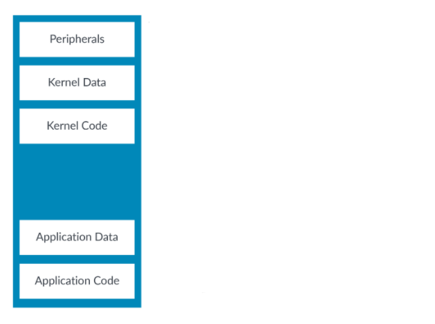

*图 2-1：展示简单地址空间的示意图*

地址空间里各区域的排布叫**地址映射（address map）**。一个地址映射里通常有：内存和外设；内存里的代码和数据；属于操作系统的资源和属于用户应用的资源。

问题在于，处理器对待外设的方式，和对待内存的方式**不该一样**：你通常想缓存内存，但绝不想缓存外设；你通常想让用户访问自己的数据，但不想让用户碰内核的外设。所以同一个地址空间里的不同区域，要挂上不同的属性：

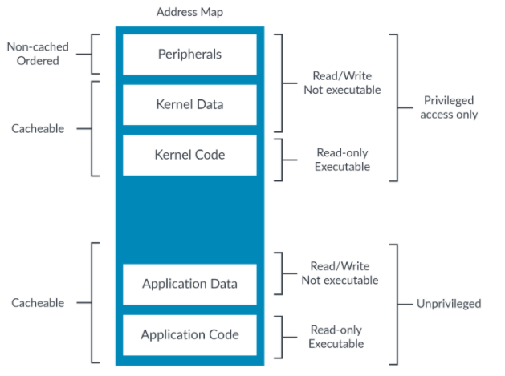

*图 2-2：展示内存区域地址映射的示意图*

一句话：内存属性就是"告诉处理器该以什么方式访问这块地址"的规则。

## 2. 属性从哪来：转换表与描述符

虚拟地址到物理地址的映射，定义在一组**转换表（translation table，也叫页表）**里。每个虚拟地址块或页，都在转换表里有一个对应条目，给出物理地址和访问该页的属性。这个条目叫**块描述符（block descriptor）**或**页描述符（page descriptor）**。属性，绝大多数就来自这个描述符：

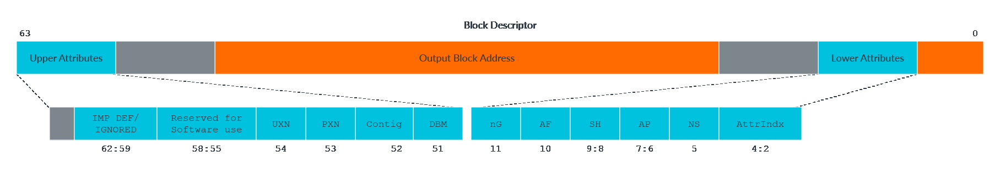

*图 3-1：展示块描述符的示意图*

描述符里和本文相关的重要字段有：UXN/PXN（执行权限）、DBM（脏位修饰符）、AF（访问标志）、AP（访问权限）、AttrIndx（内存类型与属性的选择器）。下面逐个展开。

### 2.1 层次化属性：上层表可以"一票否决"

有些属性也可以写在上层表的**表描述符（Table descriptor）**里，这叫**层次化属性（hierarchical attributes）**，适用于访问权限、执行权限和物理地址空间。规则是：上层位**置 1** 就覆盖下层；**清零**就原样沿用下层。以执行权限 PXNTable 为例：

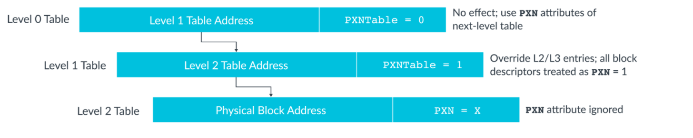

*图 3-2：展示带执行权限的 PXNTable 的示意图*

从 Armv8.1-A 起，可以通过 TCR_ELx 里的 **层次化权限禁用（HPD）** 位，把这种"用层次化属性设置访问/执行权限"的能力关掉；关掉后，这些位就归软件自由支配。

### 2.2 MMU 关掉时，属性是什么？

写复位后立刻运行的代码时，这个问题很关键。当第 1 级 MMU 被禁用：

- 所有**数据访问**都按 **Device-nGnRnE** 处理；
- 所有**指令取指**按 SCTLR_ELx.I 字段决定是否可缓存；
- 所有地址都**可读可写、可执行**。

对受虚拟化覆盖的异常级别，第 2 级禁用时，第 1 级的属性原样使用。

## 3. 两种内存类型：普通 vs 设备

Armv8-A / Armv9-A 只有两种内存类型：**普通内存（Normal）**和**设备内存（Device）**。（Armv6/v7 里的第三种"强排序 Strongly Ordered"，在 Armv8 里映射为 Device-nGnRnE。）

**普通内存**：给一切"像内存的东西"用——RAM、Flash、ROM。代码只能放在普通内存。它也是最常见的类型：

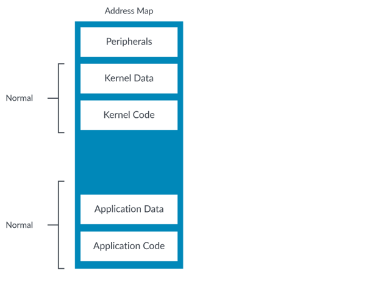

*图 5-1：展示普通类型的示意图*

普通内存有一个关键假设：**访问它没有副作用**。读只是把数据读回来，不会改变数据、也不会触发别的事情。正因为如此，处理器对普通内存可以**合并访问、推测执行、重排序访问**。这就是所谓的"简单顺序执行（SSE）模型"被打破的地方——处理器表面按程序顺序执行，背后做了各种优化。

**设备内存**：给外设用。外设寄存器常叫**内存映射 I/O（MMIO）**：

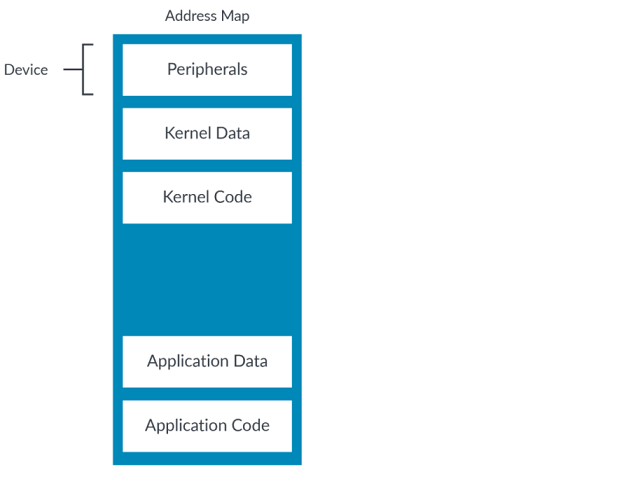

*图 6-1：展示内存映射设备类型的示意图*

设备内存和普通内存正相反——访问它**有副作用**。读一个 FIFO 会让它前进到下一段数据，所以访问次数是重要的，处理器必须严格按程序指定的来。设备区域也**永远不可缓存**，也**不允许推测性数据访问**——只有被架构执行到的指令才真会去访问那个位置。

> 一个容易漏掉的细节：标记为 Device 只挡住**推测性数据访问**；标记为**不可执行**才挡住**推测性指令取指**。要彻底杜绝推测访问，必须**两者都标**。所以设备区域一般还要标成 XN（禁止执行），否则处理器可能从 FIFO 这类读敏感设备里推测取指。

## 4. 设备内存的四个子类型

设备内存按限制松紧分四档，最松的是 Device-GRE，最紧的是 Device-nGnRnE。Device 后面那串字母对应三种属性的组合：

- **聚合（Gathering，G/nG）**：多次访问能不能合并（合并同地址的多次访问，或多笔小访问合成一笔大访问）。
- **重排序（Re-ordering，R/nR）**：对同一外设的访问能不能乱序。
- **提前写确认（Early Write Acknowledgement，E/nE）**：写什么时候算"完成"。允许提前确认（E）时，写在到达目的地之前、只要对其他观察者可见就算完成；不允许（nE）则必须真正到达目的地。

所以：Device-GRE = 聚合 + 重排序 + 提前写确认都允许；Device-nGnRnE = 三者都不允许。

四种子类型允许的行为范围，可以这样看：

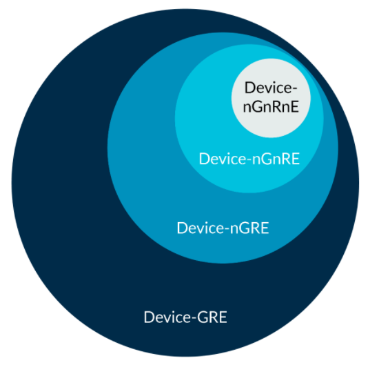

*图 6-2：展示设备类型的示意图*

关键点是：**nGnRnE 允许的，GRE 全都允许**。也就是说处理器完全可以把 Device-GRE 当 Device-nGnRnE 处理——只要永远往更严格的方向靠，就是合规的。现实中 Cortex-A 处理器常常不区分所有子类型（比如把 GRE 和 nGRE 同等对待）。

再补一个坑：某些互连撑不起 Device-nGnRnE。比如往 PCIe BAR 空间的 nGnRnE 写，一旦进了 PCIe 拓扑就变成 posted write（不期待完成响应），实际只能达到 nGnRE 的水平。而对 PCIe 配置空间的 nGnRnE 写是 non-posted write，才真正满足 nGnRnE。

> 普通不可缓存和 Device-GRE 长得像，但不是一回事：普通不可缓存仍允许**推测性数据访问**，Device-GRE 不允许。

## 5. 内存类型怎么存：MAIR 间接寄存器

内存类型并不直接写进转换表条目——条目里放的是 **AttrIndx** 字段，用它在  **MAIR_ELx（内存属性间接寄存器）** 里选一个条目：

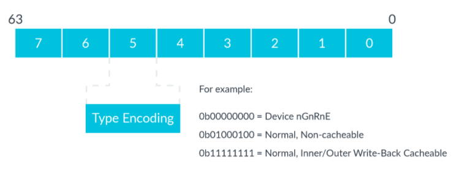

*图 7-1：展示内存属性间接寄存器的示意图*

为什么不直接编码？因为转换表条目位数金贵：内存类型要 8 位，而 MAIR 索引只要 3 位。用一个 3 位索引去指一个 8 位的类型值，省下的是每一条转换表条目的空间。

## 6. 可缓存性与可共享性

普通内存的位置还挂两个属性：**可缓存性（cacheability）** 控制能不能缓存；**可共享性（shareability）** 控制哪些代理需要看到一致副本。这套配置可以很复杂（超出本文范围）。Arm 的期望是：操作系统把大多数 DRAM 标成"普通、写回可缓存、内部可共享（Normal Write-back cacheable, Inner shareable）"。

## 7. 权限：谁能读、谁能写、谁能执行

权限有**直接方案**和**间接方案**两套（间接方案见下一节）。直接方案里，**AP（访问权限）** 字段决定一个位置能否读写、需要什么特权：

| AP | 非特权（EL0） | 特权（EL1/2/3） |
| --- | --- | --- |
| 00 | 无访问权限 | 读/写 |
| 01 | 读/写 | 读/写 |
| 10 | 无访问权限 | 只读 |
| 11 | 只读 | 只读 |

违反权限（比如写只读区）会触发**权限故障（permission fault）**。

### 7.1 特权访问非特权数据：PAN 与 LDTR/STTR

特权高的实体默认能看特权低的一切——OS 能看应用的所有资源，hypervisor 能看 VM 的所有资源。但这不总是好事：恶意应用可能骗 OS 替它读自己不该看的数据。

Armv8.1-A 引入的 **PSTATE.PAN（Privileged Access Never）** 就是为此设计的：PAN 置位后，从 EL1（或 E2H==1 的 EL2）访问非特权区域就会产生权限故障：

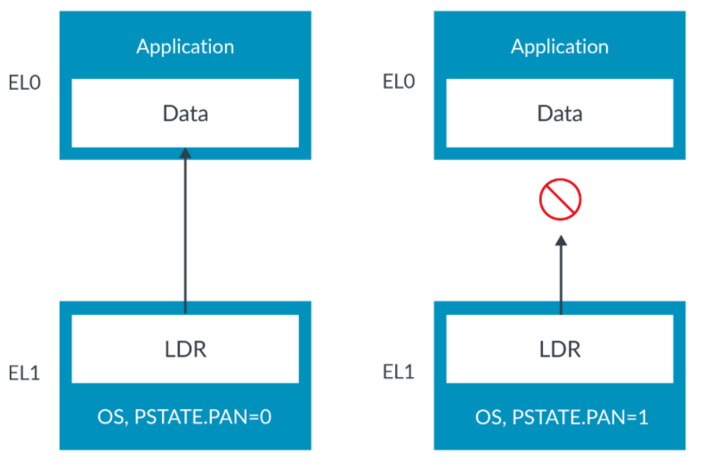

*图 9-1：展示禁止特权访问的示意图*

但 OS 有时确实要碰应用的数据（比如往应用的缓冲区写东西）。为此有 **LDTR/STTR** 指令——显式的非特权加载/存储，即使 OS 在 EL1/EL2 执行也按 EL0 权限检查，所以不被 PAN 拦：

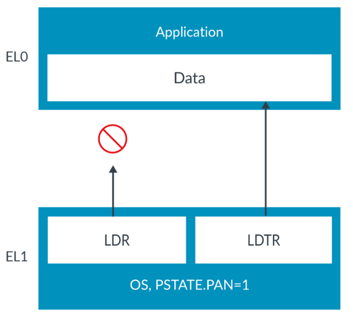

*图 9-2：展示非特权访问的示意图*

> LDTR 里的 T 是"translation"。最早只有用户模式做虚拟地址转换，OS 要访问应用数据就得用"带转换的加载"，名字就这么留了下来。

### 7.2 执行权限：UXN 与 PXN

除了数据权限，还有执行权限——指定某地址**不能执行指令**：

- **UXN**：用户（EL0）禁止执行（EL3、或 HCR_EL2.E2H==0 的 EL2 不用）
- **PXN**：特权禁止执行（这两个级别里叫 XN）

特权位和非特权位分开，是因为应用代码要在 EL0 可执行、却绝不该在内核权限下执行：

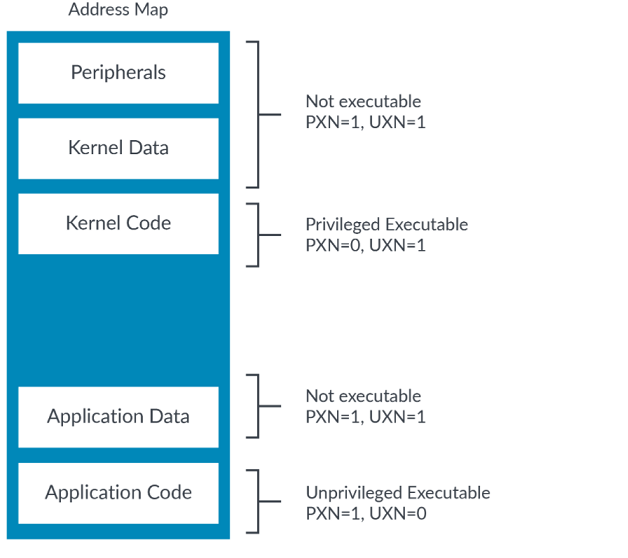

*图 9-3：展示内核权限的示意图*

另外 SCTLR_ELx 里还有控制位可以让所有可写地址都不可执行；而"有 EL0 写权限的位置在 EL1 永远不可执行"是一条硬规则。

## 8. 权限间接与权限覆盖

Armv8.9-A / Armv9.4-A 引入了更灵活的**间接权限方案**，解决两个痛点：直接方案下 TTD 权限位不够用，以及改权限要频繁调 OS、还要昂贵的 TLB 维护。

### 8.1 权限间接：用一个索引指向基础权限

启用后，TTD 里出现 **PIIndex（权限间接索引）** 字段，指向对应异常级别的 **PIR（权限间接寄存器）**：

| 寄存器 | 描述 |
| --- | --- |
| PIRE0_EL1 | 设置非特权 EL1&0 基础权限 |
| PIRE0_EL2 | 设置非特权 EL2&0 基础权限 |
| PIR_EL1 | 设置特权 EL1 基础权限 |
| PIR_EL2 | 设置特权 EL2 基础权限 |
| PIR_EL3 | 设置特权 EL3 基础权限 |

### 8.2 权限覆盖：在基础权限上再收紧

TTD 里的 **POIndex（权限覆盖索引）** 字段指向 **POR（权限覆盖寄存器）**，在基础权限之上再叠加一层覆盖权限：

| 寄存器 | 描述 |
| --- | --- |
| POR_EL0 | 非特权 EL0 覆盖权限 |
| POR_EL1 | 特权 EL1 覆盖权限 |
| POR_EL2 | 特权 EL2 覆盖权限 |
| POR_EL3 | 特权 EL3 覆盖权限 |

> 关键区别：**基础权限可以缓存进 TLB，覆盖设置不能**。所以改覆盖权限不需要昂贵的 TLBI（TLB 无效化）。

### 8.3 一个例子

OS（EL1）要给 EL0 应用的一段内存设权限。先设基础权限：在 PIR_ELx 里选索引 3，把它的位设为 0b0101（"读写，应用覆盖"），再把范围内各页 TTD 的 PIIndex 设为 0b0011（3）。

再设覆盖权限：在 POR_ELx 里选索引 6，把它的位设为 0b0001（"只读"）。之后应用通过系统调用请求应用覆盖，OS 就把这些页 TTD 的 POIndex 设为 0b110（6）——于是这些页在"读写"基础上被减掉了写权限，变成只读。整个过程 EL0 的进程不用频繁调 OS，也不用做 TLB 维护。

两种机制合起来的工作方式：

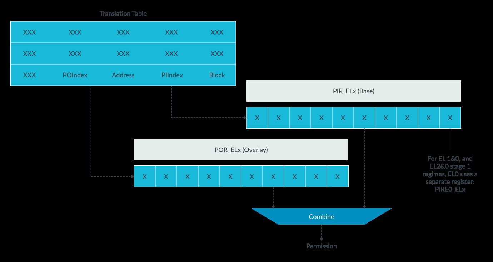

*图 10-1：展示权限间接与权限覆盖如何结合的示意图*

## 9. 访问标志与脏状态

**访问标志（AF）** 位跟踪一个转换表条目覆盖的区域是否被访问过：AF=0 未访问，AF=1 已访问。OS 用它找出"当前没在用、可以换出 RAM"的页。裸机环境一般不用它，直接预置 AF=1 就行。

AF 位的设置有两种方式：**软件更新**（访问触发访问标志故障，异常处理程序手动置位再返回）和**硬件更新**（Armv8.1-A 起，用 TCR_ELx.HA 启用，硬件自动置位，不产生异常）。

**脏状态（dirty state）**（Armv8.1-A）记录块/页是否被写过。场景：一个文本文件从磁盘加载进 RAM，OS 换出它时需要知道 RAM 里的内容是不是比磁盘新——新就得回写，旧就能直接丢。启用后，软件建条目时设成只读 + 置 DBM 位；一旦被写，硬件自动把权限改成读写。DBM=1 会**改写 AP[2]/S2AP[1] 的语义**：它们不再记录写权限，而是记录脏状态，所以这时权限位不会触发权限故障。

> 不用硬件更新也能达到同样效果：页设只读，首次写触发权限故障，处理程序手动改成读写再返回。想做写时复制（copy-on-write）时仍会用到这套。

## 10. 对齐与端序

**对齐**：地址是元素大小的倍数，就算对齐。LDR/STR 的元素大小就是访问大小（LDRH 加载 16 位，地址要是 2 的倍数）。LDP/STP 的对齐按**单个元素**大小算，不是两个元素合计：

```asm
LDP X0, X1, [X2]
```

加载两个 64 位值（共 128 位），但 X2 只需是 **64 位**的倍数就对齐。

非对齐访问：对普通内存允许，对设备区域**不允许**（会触发对齐故障）。想让普通内存的非对齐访问也报错，可以置 SCTLR_ELx.A。

**端序**：指令取指**永远小端**。数据访问是否支持大端是"实现定义"的（支持哪种也是）。Cortex-A 处理器大小端都支持，端序按异常级别分别配置。

## 11. 内存别名

物理地址空间的同一位置有多个虚拟地址，叫**别名（aliasing）**。属性是跟着虚拟地址走的（因为属性来自转换表），所以同一物理位置的多个别名**属性必须兼容**：内存类型一致（设备还要子类型一致）、普通位置还要可缓存性/可共享性一致。不兼容，行为就可能出问题：

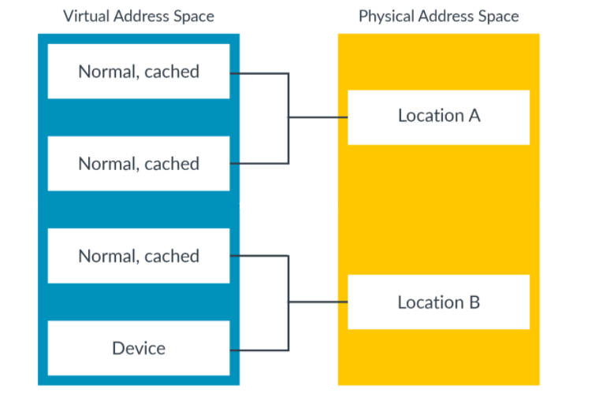

*图 13-1：展示虚拟地址空间的示意图*

Arm 强烈建议别给同一位置的不同别名分配不兼容属性。

## 12. 知识自测

- **某地址位置的属性从哪来？** 转换表，通常是块/页描述符，层次化属性可覆盖。
- **Armv8-A 的两种内存类型？** 普通（Normal）和设备（Device）。
- **Device-nGnRE 的 -nGnRE 是什么意思？** 不允许聚合和重排序，但允许提前写确认。
- **为什么某页会标 PXN=1、UXN=0？** 应用代码要在用户空间可执行、在内核空间不可执行。
- **AF 位通常干什么用？** 跟踪哪些页被访问过。
- **指令取指是什么端序？** 小端。
- **启用 MMU 前，启动代码做了次非对齐访问就对齐故障，为什么？** MMU 禁用时所有访问都按设备处理，设备区域非对齐访问必故障。

## 13. 下一步

这套属性是处理器与内存交互的底层规则。写启动代码、驱动、设置 MMU 时都用得上。系列下一本讲内存管理里的地址转换。
