# 读懂 AArch64 内存属性与特性（中文精读版）

> 原文：*Learn the architecture - AArch64 memory attributes and properties*
>
> 版本：Version 2.0　|　文档 ID：102376_0200_01_en　|　Issue 01（2022-11-14）
>
> 版权 © 2019, 2022 Arm Limited（或其关联公司）。保留所有权利。非保密。
>
> 说明：本文在原中文翻译的基础上重新组织了叙述逻辑与表达方式，技术内容、表格与图表保持原意；个别明显笔误已按 Arm 架构规范订正。

---

## 导读：这篇文章讲什么

处理器访问内存和外设，用的是两套截然不同的规则：读内存可以缓存、可以乱序、可以合并；读写外设寄存器却必须按部就班、一次不多一次不少。这套规则，就是**内存属性（attribute）与特性（property）**。

这篇文章要回答三个问题：**属性从哪来**（转换表描述符）、**有哪些属性**（内存类型、可缓存性/可共享性、权限、访问标志、对齐端序）、以及**它们怎么起作用**（普通内存 vs 设备内存、直接权限 vs 间接权限）。

面向对象是写启动代码、驱动程序、以及设置和管理 MMU 的人。读完你会：分清两种内存类型和它们的区别，能说出某个地址上能挂哪些属性。

## 1. 为什么要给内存定属性

先看一个最简单的系统。它的地址空间可以画成这样：

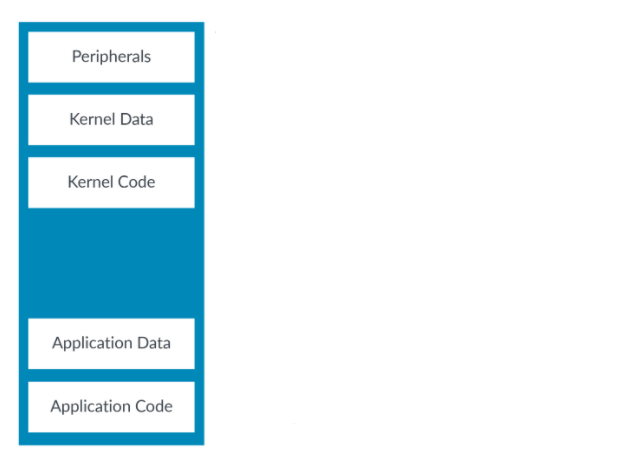

*图 2-1：展示简单地址空间的示意图*

地址空间里各区域的排布叫**地址映射（address map）**。一个地址映射里通常有：

1. 内存和外设
2. 内存里的代码和数据
3. 属于操作系统的资源和属于用户应用的资源

问题在于，处理器对待外设的方式，和对待内存的方式**不该一样**：你通常想缓存内存，但不希望缓存外设；你通常想让用户访问自己的数据，但不想让用户碰内核的外设。所以同一个地址空间里的不同区域，要挂上不同的属性：

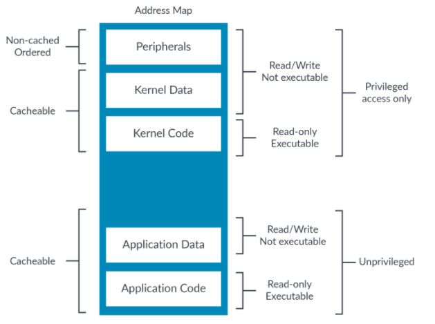

*图 2-2：展示内存区域地址映射的示意图*

一句话：内存属性就是告诉处理器该**以什么方式访问这块地址**的规则。

## 2. 属性从哪来：转换表与描述符

虚拟地址到物理地址的映射，定义在一组 **转换表（translation table，也叫页表）** 里。每个虚拟地址块或页，都在转换表里有一个对应条目，给出物理地址和访问该页的属性。这个条目叫 **块描述符（block descriptor）** 或 **页描述符（page descriptor）**。属性，绝大多数就来自这个描述符：

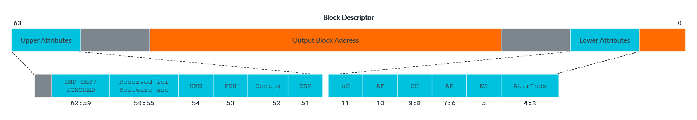

*图 3-1：展示块描述符的示意图*

描述符里和本文相关的重要字段有：

- UXN 与 PXN —— 执行权限
- DBM —— 脏位修饰符
- AF —— 访问标志
- AP —— 访问权限
- AttrIndx —— 内存类型与属性的选择器

### 2.1 层次化属性：上层表可以"一票否决"

有些属性也可以写在上层表的 **表描述符（Table descriptor）** 里，这叫 **层次化属性（hierarchical attributes）**，适用于访问权限、执行权限和物理地址空间。规则是：上层位**置 1** 就覆盖下层；**清零**就原样沿用下层。以执行权限 PXNTable 为例：

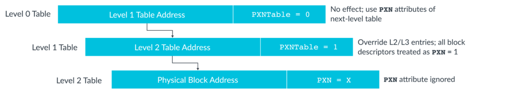

*图 3-2：展示带执行权限的 PXNTable 的示意图*

从 Armv8.1-A 起，可以通过 `TCR_ELx` 里的 **层次化权限禁用（HPD）** 位，把这种"用层次化属性设置访问/执行权限"的能力关掉；关掉后，这些位就归软件自由支配。

### 2.2 MMU 关掉时，属性是什么？

编写复位后立刻运行的代码时，这个问题很关键。属性平时住在翻译表里——类型、可缓存性、权限全写在表项中，MMU 查表时一并拿到。但 MMU 一关就没有表可查，而硬件时时刻刻仍需要属性来决定行为（能不能过 cache、能不能重排、有没有权限）。所以架构为“MMU 关闭”状态规定了一套**默认属性**。当第 1 级 MMU 被禁用：

- 所有**数据访问**都按 **Device-nGnRnE** 处理——MMU 关着时，软件访问的任何地址都可能是外设寄存器（MMIO），而访问外设绝不能聚合、重排、推测。既然无法区分哪块是 RAM、哪块是外设，架构干脆一刀切：全部按**最严格的设备内存**对待。代价是慢（访存直通、严格保序、不缓存），换来的是绝不出错；
- 所有**指令取指**按 `SCTLR_ELx.I` 字段决定是否可缓存——取指几乎不可能落在外设上（代码必然在 ROM/RAM 里），按 nGnRnE 走会慢得离谱，所以取指是例外：`I=0` 时同为 nGnRnE（复位后 I 通常为 0，初期连取指都直通），`I=1` 时按普通可缓存内存走、能过 I-cache；
- 所有地址都**可读可写、可执行**——权限（AP/PXN/UXN）同样来自表项，没表就没有任何权限检查，默认全开。

这套默认值对启动代码有两面影响。其一，性能：复位后 `SCTLR.M=0`，启动代码就运行在这套默认属性下——访存、取指全部直通，没有缓存可用，性能极差。所以启动流程的一项标准任务就是尽早配好翻译表、依次打开 M/C/I，把自己从这套默认值里“解救”出来。其二，安全：全地址可读写可执行、没有任何隔离，等于一个无保护窗口——安全敏感的系统应尽量缩短它。

对受虚拟化覆盖的异常级别，还有一条补充规则：第 2 级被禁用时，第 1 级的属性原样使用。原因不难理解——正常虚拟化下，最终权限是 stage 1 与 stage 2 两级属性组合“取更严格”的结果（见《AArch64 内存管理》§6.4）；第 2 级一关，第二道组合就不存在了，stage 1 表项里写的属性直接生效。非虚拟化系统正是这种状态：stage 2 一直关闭，所有属性都由 stage 1 决定。

## 3. 两种内存类型：普通 vs 设备

Armv8-A / Armv9-A 只有两种内存类型：**普通内存（Normal）**和**设备内存（Device）**。（Armv6/v7 里的第三种"强排序 Strongly Ordered"，在 Armv8 里映射为 Device-nGnRnE。）

**普通内存**：给一切"像内存的东西"用——RAM、Flash、ROM。代码只能放在普通内存。它也是最常见的类型：

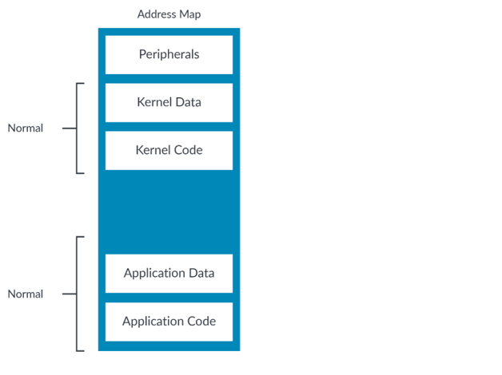

*图 5-1：展示普通类型的示意图*

普通内存有一个关键假设：**访问它没有副作用**。读，只是把数据读回来，不会改变数据，也不会触发别的事情；写，也只改变数据本身。SSE（简单顺序执行）指一个理想化的抽象机器：按程序顺序一次执行一条指令、每条的效果立即可见——它是软件推理行为的基准，但不是硬件的真实工作方式。正因为普通内存无副作用，处理器对它做的合并访问、推测执行、重排序访问都不会改变读到的值，对软件不可见，架构也因而允许处理器表面按程序顺序执行背后做优化。但另一个观察者（他核、DMA 设备）能看到访问完成顺序与程序顺序不同——软件若仍按 SSE 假设推理就会出错，这正是需要 DMB/DSB 屏障的场景，详见《内存系统排序与屏障》。

**设备内存**：给外设用。外设寄存器常叫**内存映射 I/O（MMIO）**：

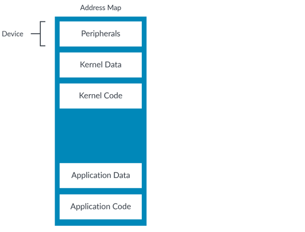

*图 6-1：展示内存映射设备类型的示意图*

设备内存和普通内存正相反——访问它**有副作用**：对 MMIO 寄存器的每次读、写，都是在操作设备。因此次数和时序本身就是可观察行为，处理器必须严格按程序指定的来。三条铁律：

- **合并、重排被禁止**：读 UART 接收 FIFO 会弹出一个字节，读“读清零”型状态寄存器会清掉标志——程序读两次就必须真的读两次，不能合并成一次；写命令寄存器两次就是执行两次，先后顺序也不许颠倒。
- **永远不可缓存**：缓存的语义是“重复访问直接拿缓存值、写可以延迟合并送达”——对设备是灾难：状态寄存器会变成过时快照（设备明明变了，程序还读到旧值），命令写了设备却还没收到。
- **不允许推测性数据访问**：处理器为提速会推测执行、提前访存。对普通内存，猜错了把读回的值丢掉就行（反正无副作用）；对设备内存，**推测性读一次 FIFO，FIFO 就真的前移一格**——一个字节凭空消失，而程序根本没执行过那条读指令。所以架构规定：只有真正被架构执行到的指令，才真会去访问那个位置。

> 一个容易漏掉的细节：标记为 Device 只挡住**推测性数据访问**；标记为**不可执行**才挡住**推测性指令取指**。要彻底杜绝推测访问，必须**两者都标**。所以设备区域一般还要标成 XN（禁止执行），否则处理器可能从 FIFO 这类读敏感设备里推测取指。

## 4. 设备内存的四个子类型

设备内存按限制松紧分四档，最松的是 Device-GRE，最紧的是 Device-nGnRnE。Device 后面那串字母对应三种属性的组合：

- **聚合（Gathering，G/nG）**：多次访问能不能合并（合并同地址的多次访问，或多笔小访问合成一笔大访问）。
- **重排序（Re-ordering，R/nR）**：对同一外设的访问能不能乱序。
- **提前写确认（Early Write Acknowledgement，E/nE）**：写什么时候算"完成"。允许提前确认（E）时，写在到达目的地之前、只要对其他观察者可见就算完成；不允许（nE）则必须真正到达目的地。

所以：Device-GRE = 聚合 + 重排序 + 提前写确认都允许；Device-nGnRnE = 三者都不允许。

四种子类型允许的行为范围，可以这样看：

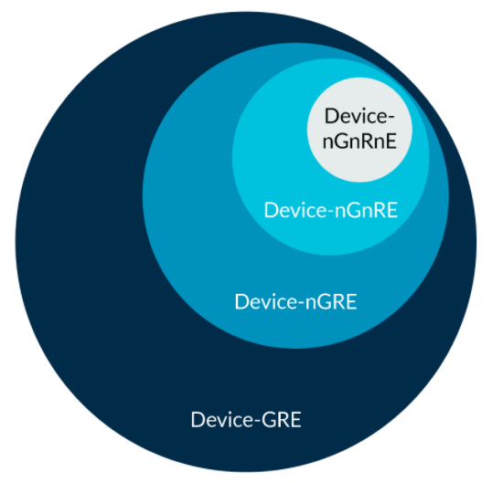

*图 6-2：展示设备类型的示意图*

关键点是：**nGnRnE 允许的，GRE 全都允许**。也就是说处理器完全可以把 Device-GRE 当 Device-nGnRnE 处理——只要永远往更严格的方向靠，就是合规的。现实中 Cortex-A 处理器常常不区分所有子类型（比如把 GRE 和 nGRE 同等对待）。

再补一个坑：某些互连撑不起 Device-nGnRnE。比如往 PCIe BAR 空间的 nGnRnE 写，一旦进了 PCIe 拓扑就变成 posted write（不期待完成响应），实际只能达到 nGnRE 的水平。而对 PCIe 配置空间的 nGnRnE 写是 non-posted write，才真正满足 nGnRnE。

> 普通不可缓存和 Device-GRE 长得像，但不是一回事：普通不可缓存仍允许**推测性数据访问**，Device-GRE 不允许。

## 5. 内存类型怎么存：MAIR 间接寄存器

内存类型并不直接写进转换表条目——条目里放的是 **AttrIndx** 字段，用它在  **MAIR_ELx（内存属性间接寄存器）** 里选一个条目：

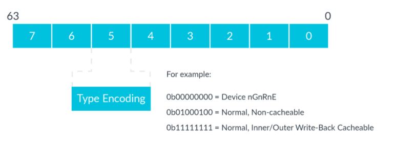

*图 7-1：展示内存属性间接寄存器的示意图*

为什么不直接编码？因为转换表条目位数金贵：内存类型要 8 位，而 MAIR 索引只要 3 位。用一个 3 位索引去指一个 8 位的类型值，省下的是每一条转换表条目的空间。

## 6. 可缓存性与可共享性

普通内存的位置还挂两个属性：**可缓存性（cacheability）** 控制能不能缓存；**可共享性（shareability）** 控制哪些代理需要看到一致副本。这套配置可以很复杂（超出本文范围）。Arm 的期望是：操作系统把大多数 DRAM 标成"普通、写回可缓存、内部可共享（Normal Write-back cacheable, Inner shareable）"。

## 7. 权限：谁能读、谁能写、谁能执行

权限有**直接方案**和**间接方案**两套（间接方案见下一节）。直接方案里，**AP（访问权限）** 字段决定一个位置能否读写、需要什么特权：

| AP | 非特权（EL0） | 特权（EL1/2/3） |
| --- | --- | --- |
| 00 | 无访问权限 | 读/写 |
| 01 | 读/写 | 读/写 |
| 10 | 无访问权限 | 只读 |
| 11 | 只读 | 只读 |

违反权限（比如写只读区）会触发**权限故障（permission fault）**。

### 7.1 特权访问非特权数据：PAN 与 LDTR/STTR

特权高的实体默认能看特权低的一切——OS 能看应用的所有资源，hypervisor 能看 VM 的所有资源。但这不总是好事：恶意应用可能骗 OS 替它读自己不该看的数据。

Armv8.1-A 引入的 **PSTATE.PAN（Privileged Access Never）** 就是为此设计的：PAN 置位后，从 EL1（或 E2H==1 的 EL2）访问非特权区域就会产生权限故障：

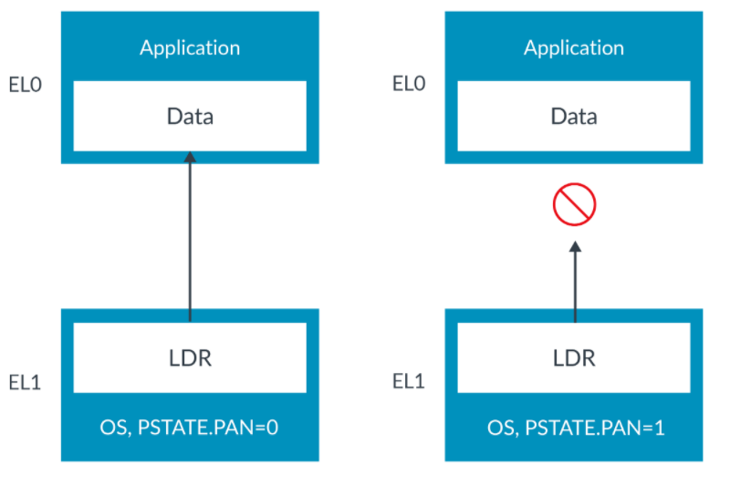

*图 9-1：展示禁止特权访问的示意图*

但 OS 有时确实要碰应用的数据（比如往应用的缓冲区写东西）。为此有 **LDTR/STTR** 指令——显式的非特权加载/存储，即使 OS 在 EL1/EL2 执行也按 EL0 权限检查，所以不被 PAN 拦：

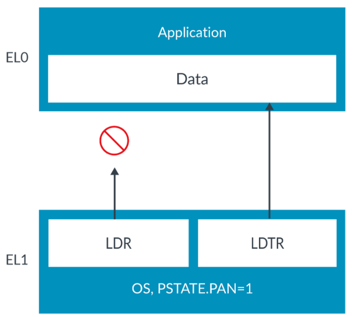

*图 9-2：展示非特权访问的示意图*

> LDTR 里的 T 是"translation"。最早只有用户模式做虚拟地址转换，OS 要访问应用数据就得用"带转换的加载"。现在所有软件看到的都是虚拟地址，但这个名字保留了下来。

### 7.2 执行权限：UXN 与 PXN

除了数据权限，还有执行权限——指定某地址**不能执行指令**：

- **UXN**（Unprivileged eXecute Never）：禁止 **EL0（用户态）** 在此取指执行；
- **PXN**（Privileged eXecute Never）：禁止 **EL1（特权态/内核）** 在此取指执行。

注意 EL3 和 `HCR_EL2.E2H==0` 的 EL2 表项里没有这两位，取而代之的是一个统一的 **XN** 位——同时禁掉该机制内所有可执行的级别，功能上相当于“UXN=1 和 PXN=1 合并成一个开关”。为什么这两类机制只需要一个位？因为每个 EL 的翻译机制是独立的，而 UXN/PXN 的“用户/特权”之分，只对**一个地址空间里同时跑两级代码**的机制有意义：

| 翻译机制 | 空间里住着谁 | 执行权限位 |
| --- | --- | --- |
| EL0/EL1 | 应用（EL0）和内核（EL1） | UXN + PXN 两位 |
| EL2（`E2H==0`，裸 hypervisor） | 只有 EL2 自己 | 一个 XN 位就够\* |
| EL3 | 只有 EL3 自己 | 一个 XN 位就够\* |
| EL2（`E2H==1`，VHE） | EL0 应用 + EL2 内核 | UXN + PXN 两位 |

> XN 是一位**独立的位**，不是“从 UXN、PXN 里二选一”：这些机制的空间里只有自己一个特权级会取指，没有“用户 vs 内核”的分化对象，一个开关同时管所有级别，就是管住了唯一的执行者。此外这是架构对描述符按机制固定解读的（同一 bit 位置在 EL0/EL1 格式里是 UXN、在 EL3/非 VHE EL2 格式里就是 XN），软件没有选择权。

特权位和非特权位分开，是因为应用代码要在 EL0 可执行、却绝不该在内核权限下执行：

| UXN | PXN | EL0（应用） | EL1（内核） | 用在哪 |
| --- | --- | --- | --- | --- |
| 0 | 1 | 可执行 | 禁执行 | **应用代码页**（防 ret2usr） |
| 1 | 0 | 禁执行 | 可执行 | 内核代码页 |
| 1 | 1 | 禁执行 | 禁执行 | 纯数据页（栈、堆，防注入 shellcode） |
| 0 | 0 | 可执行 | 可执行 | 一般不用，等于没设防 |

其中“应用代码页”那行就是图 9-3 的场景，也是**ret2usr 攻击**的防线：攻击者控制了内核执行流，把它引到用户空间的代码上——用户空间内容攻击者完全可控，若内核能执行用户代码，等于借内核特权跑任意代码。PXN=1 把这条路堵死。一个位表达不出“对 A 级别可执行、对 B 级别禁止”，这正是特权/非特权必须分开设位的原因：

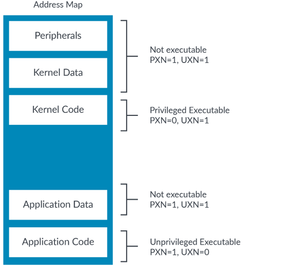

*图 9-3：展示内核权限的示意图*

另外 `SCTLR_ELx` 里还有控制位可以让所有可写地址都不可执行；而“有 EL0 写权限的位置在 EL1 永远不可执行”是一条硬规则。

## 8. 权限间接与权限覆盖

Armv8.9-A / Armv9.4-A 引入更灵活的间接权限方案，两种机制各管一件事：

- **权限间接（Permission indirection）**：用索引代替直接位编码，解决直接方案下转换表描述符(TTD) 权限位不够用的问题，也为将来引入新权限类型留出空间；
- **权限覆盖（Permission overlay）**：让 EL0 的进程能逐步收紧自己页面的权限，减少对更高特权级（OS）的调用，也不需要昂贵的 TLB 维护。

两者合起来，既能更灵活地设置页权限，又把“改权限”的性能影响降到最小。

### 8.1 权限间接：用一个索引指向基础权限

启用后，TTD 里出现 **PIIndex（权限间接索引）** 字段，索引到对应异常级别的 **PIR（权限间接寄存器）**——基础权限由 OS（EL1）、hypervisor（EL2）或固件（EL3）在这些寄存器里设置：

| 寄存器 | 描述 |
| --- | --- |
| PIRE0_EL1 | 设置非特权 EL1&0 基础权限 |
| PIRE0_EL2 | 设置非特权 EL2&0 基础权限 |
| PIR_EL1 | 设置特权 EL1 基础权限 |
| PIR_EL2 | 设置特权 EL2 基础权限 |
| PIR_EL3 | 设置特权 EL3 基础权限 |

> PIR 条目除了基础权限，还指定**该页是否应用权限覆盖**。若 PIR 指示不应用，则 TTD 里的 POIndex 字段被忽略。

### 8.2 权限覆盖：在基础权限上再收紧

TTD 里的 **POIndex（权限覆盖索引）** 字段索引到对应级别的 **POR（权限覆盖寄存器）**，在基础权限之外再收紧一层。典型受益者是 EL0 的进程：它可以逐步收紧自己页面的权限（比如把某页从读写降为只读），而不必每一步都请 OS 出手：

| 寄存器 | 描述 |
| --- | --- |
| POR_EL0 | 非特权 EL0 覆盖权限 |
| POR_EL1 | 特权 EL1 覆盖权限 |
| POR_EL2 | 特权 EL2 覆盖权限 |
| POR_EL3 | 特权 EL3 覆盖权限 |

> 关键区别：**基础权限允许缓存进 TLB，覆盖设置不允许**。所以改覆盖权限不需要昂贵的 TLBI（TLB 无效化）——这正是覆盖能做到轻量的原因。

### 8.3 一个例子

OS（EL1）要给 EL0 应用的一段内存设置权限，分两步走。

**第 1 步：设置基础权限**（权限间接）：

1. 在 `PIR_ELx` 里分配一个权限索引——本例选索引 3；
2. 把索引 3 的位设为 0b0101，即“读写，应用覆盖”；
3. 把该范围内各页 TTD 的 PIIndex 字段设为 0b0011（3）。

至此这段内存的基础权限是“读写，且允许叠加覆盖”。

**第 2 步：定义并应用覆盖**（权限覆盖）：

1. 应用通过系统调用，请求 OS 定义一个覆盖——OS 在 `POR_ELx` 里分配索引 6，把它的位设为 0b0001（“只读”）；
2. 应用随后再请求把该覆盖**应用于内存范围的一个子集**——OS 把这些页 TTD 的 POIndex 字段设为 0b110（6）。

于是这些页在“读写”的基础上被减掉了写权限，变成只读。

这个例子点出了两种机制的分工：权限间接把一整套基础权限**一次性铺到一大片页**（每页只需记住一个索引）；覆盖则由 EL0 应用按需请求、只作用于**子集**——整个过程既不需要 TLBI 维护，对 OS 的调用也降到最少。这正是两者配合的意义：

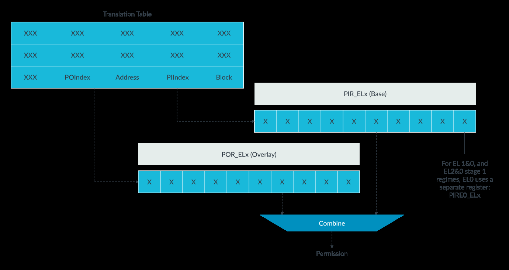

*图 10-1：展示权限间接与权限覆盖如何结合的示意图*

## 9. 访问标志与脏状态

### 9.1 访问标志（AF）

**访问标志（Access Flag，AF）** 位跟踪转换表条目覆盖的区域是否被访问过：

- AF=0：区域未被访问；
- AF=1：区域已被访问。

使用 AF 位时，表项在创建时初始为 AF=0，页被访问后置 1。软件解析翻译表、检查各位，就能判断哪些页没在用：**AF=0 的页必然没被访问过，是更好的换出候选**——这正是 OS 页面管理需要它的原因。

> 裸机环境通常不用访问标志，建表时直接预置 AF=1 即可。

### 9.2 更新 AF 位：软件还是硬件

页被访问时，AF 位怎么置 1？两种方式：

- **软件更新**：访问该页触发同步异常（**访问标志故障**，Access Flag fault）；异常处理程序在表项里手动置 AF=1，再返回；
- **硬件更新**（Armv8.1-A 起）：置 `TCR_ELx.HA` 位启用，硬件在访问时自动置 AF=1，不产生异常。

### 9.3 脏状态（dirty state）

Armv8.1-A 起支持硬件管理块/页的**脏状态**——记录它是否被写过。用途在换出时：脏状态告诉管理软件，RAM 里的内容要不要写回存储。例如一个文本文件从磁盘（Flash 或硬盘）加载进 RAM，之后被移除时，OS 需要知道 RAM 里的副本是不是比磁盘新：新就得回写磁盘，不新就能直接丢弃。

启用脏状态管理后，软件建表项时把访问权限设为**只读**、并置 **DBM（Dirty Bit Modifier，脏位修饰符）** 位；页一旦被写，硬件自动把权限改成读写——权限位的翻转就是“已写”的记录。

注意 DBM=1 会**改写 AP[2]/S2AP[1] 的语义**：它们不再记录写权限，而是改记脏状态，因此这时访问权限位不会触发权限故障。

> 不用硬件更新也能达到同样效果：页设只读，首次写触发权限故障，处理程序手动改成读写再返回。想做写时复制（copy-on-write）时仍会用到这套。

## 10. 对齐与端序

### 10.1 对齐

地址是**元素大小**的倍数，访问就算**对齐（aligned）**；不是倍数，就是**非对齐（unaligned）**。

- **LDR/STR**：元素大小就是访问大小。例如 LDRH 加载 16 位值，地址须是 2 字节的倍数才算对齐；
- **LDP/STP**：加载/存储的是一对元素，但对齐按**单个元素**大小算，不是两个元素合计：

```asm
LDP X0, X1, [X2]
```

加载两个 64 位值（共 128 位），但 X2 只需是 **64 位**的倍数就算对齐。同样的原则适用于向量加载/存储。

非对齐访问的许可范围：普通内存**允许**；设备区域**不允许**，会触发**对齐故障（alignment fault）**。若想让普通内存的非对齐访问也报错，置 `SCTLR_ELx.A` 即可。

### 10.2 端序

- **指令取指**：永远小端（little-endian）；
- **数据访问**：是否同时支持小端和大端是**实现定义**的；若只支持一种，具体支持哪种也是实现定义；
- 同时支持两种端序的处理器（Cortex-A 均如此），端序**按异常级别分别配置**。

## 11. 内存别名与不匹配的内存类型

物理地址空间的同一位置有多个虚拟地址，称为**别名（aliasing）**。

属性是跟着**虚拟地址**走的——因为属性来自转换表。所以一个物理位置有多个别名时，所有别名的属性必须**兼容**。“兼容”指：

- 相同的内存类型；若是设备类型，子类型也要相同；
- 若是普通内存，可缓存性与可共享性也要相同。

属性不兼容时，内存访问可能不按预期行为，对一致性和性能都有负面影响：

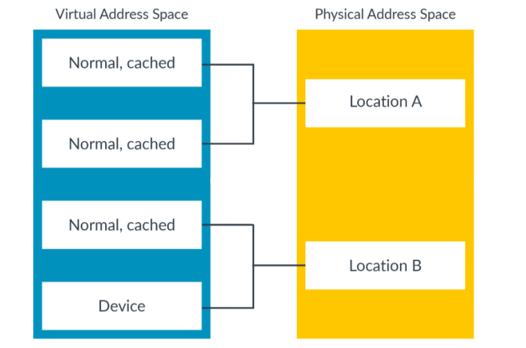

*图 13-1：展示虚拟地址空间的示意图*

图中两个例子对照：位置 A 的两个别名属性兼容，是推荐做法；位置 B 的两个别名一个是普通、一个是设备，属性不兼容。

> Arm 强烈建议软件不要给同一位置的不同别名分配不兼容的属性。

## 12. 知识自测

以下问题帮助你检验所学知识。

**某个地址位置的属性从何而来？**

来自转换表，通常是块/页描述符，尽管层次化属性可以覆盖它。

**Armv8-A 中的两种内存类型是什么？**

普通（Normal）和设备（Device）。

**Device-nGnRE 中的 -nGnRE 是什么意思？**

不允许聚合和重排序，但允许提前写确认。

**为什么某页可能被标记为 PXN=1、UXN=0？**

应用程序代码需要在用户空间可执行，在内核空间不可执行。

**AF 位通常用于什么？**

跟踪哪些页已被访问。

**指令取指是什么端序？**

小端。

**在启用内存管理单元（MMU）之前，某些启动代码进行了非对齐访问，导致对齐故障。为什么？**

当 MMU 被禁用时，所有访问都按设备处理。对标记为设备的区域的非对齐访问总是会故障。

## 13. 延伸资料

- 《内存系统排序与屏障》——本指南多处提到普通内存可重排、SSE 被打破，屏障的完整用法在那里展开；
- 《AArch64 内存管理》——地址转换与 stage 1/stage 2 属性组合的完整细节，背景可参见《AArch64 虚拟化》；
- 《AArch64 虚拟化》——EL0/EL1 的取指可缓存性可被虚拟化控制部分覆盖；
- 《缓存与一致性》（即将发布）——取指的可缓存性比想象中复杂，可缓存性与可共享性的深入讨论；
- 《A64 指令集架构指南》——SSE（简单顺序执行）的信息；
- 指针签名与着陆台指南（即将发布）——BTI（分支目标指令，Armv8.5-A）由第 1 阶段转换表的 GP 位控制，将在此讨论；
- 转换过程的完整细节在架构伪代码中有全量描述（随指令集 XML 提供），一个好起点是 `AArch64.FullTranslate()`；
- Arm Community——提问、查找专家文章与博客；相关培训模块：Introduction to Armv8-A、Memory model overview、What does architecture consist of?。

## 14. 下一步

这套属性是处理器与内存交互的底层规则。开始写启动代码、驱动，或配置 MMU 时，都可以直接应用本指南的原则。系列下一本讲内存管理中的地址转换；要继续学习 Armv8-A 架构，可参阅系列中的更多指南。
