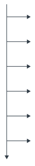
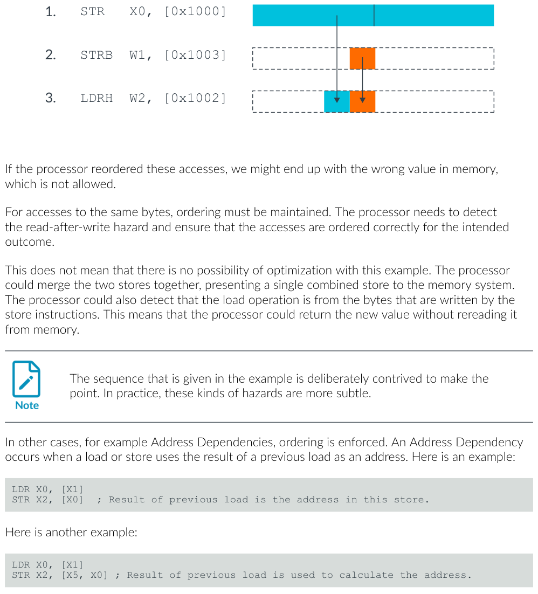
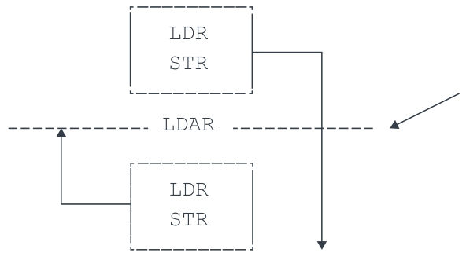
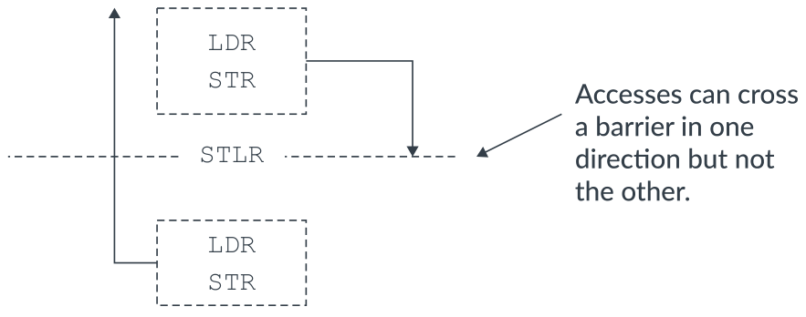
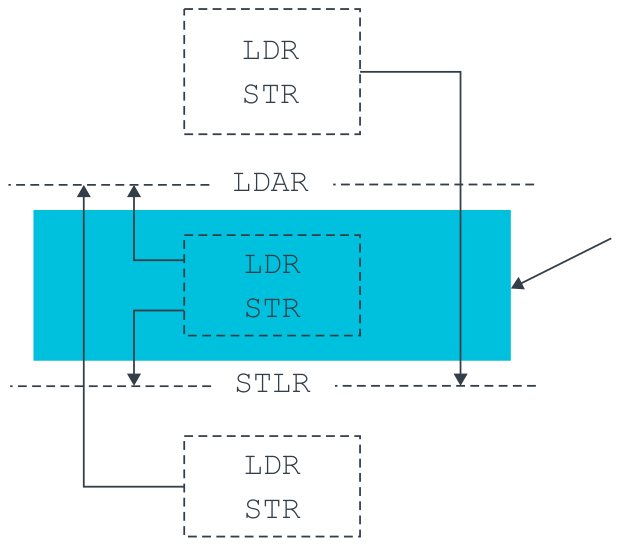
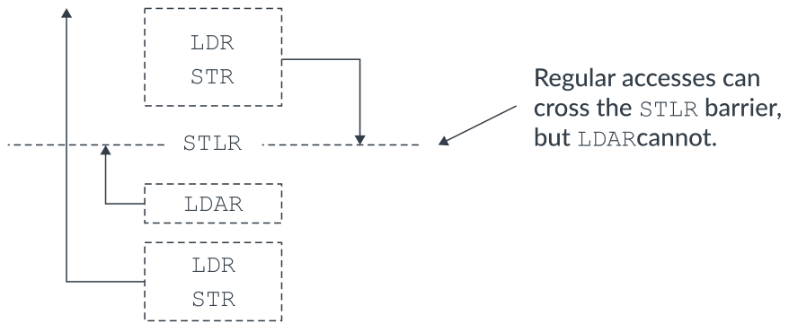
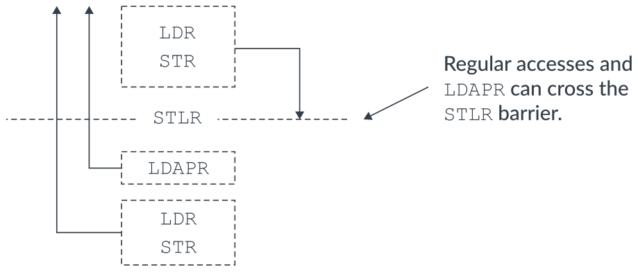
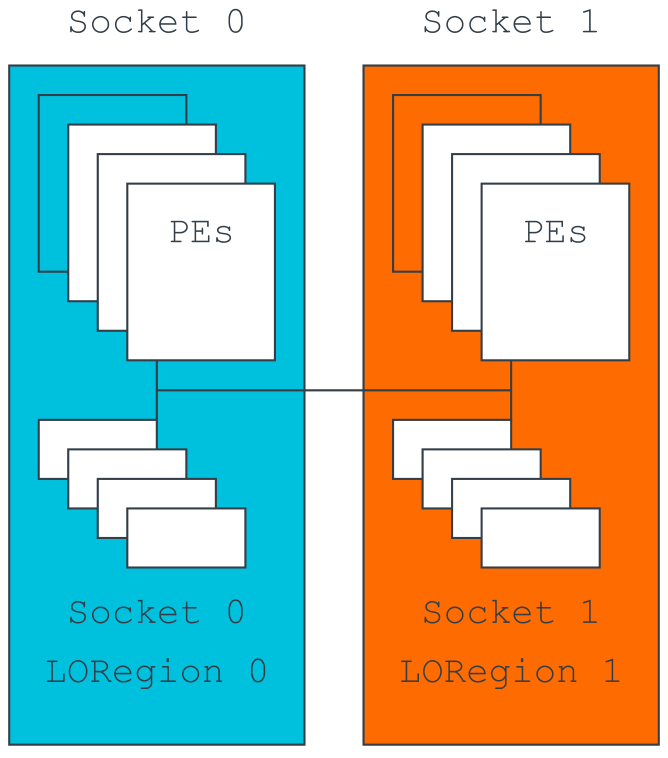
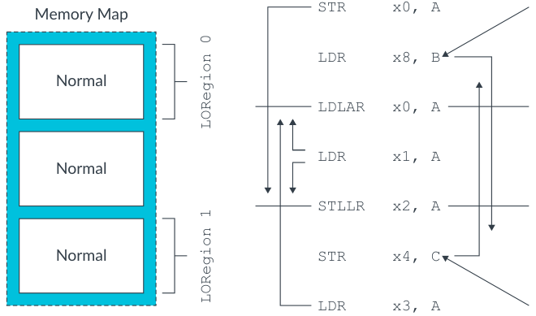

# 读懂 AArch64 内存系统、排序与屏障（中文精读版）

> 原文：*Learn the architecture - Memory Systems, Ordering, and Barriers Guide*
>
> 版本：Version 1.1　|　文档 ID：102336_0101_01_en　|　Issue 01（2026-05-01）
>
> 版权 © 2022, 2026 Arm Limited（或其关联公司）。保留所有权利。非保密。
>
> 说明：本文在原中文翻译的基础上重新组织了叙述逻辑与表达方式，技术内容、表格与图表保持原意；个别明显笔误已按 Arm 架构规范订正。

---

## 导读：这篇文章讲什么

处理器嘴上说"按程序顺序一条一条执行"，身体却很诚实——流水线会乱序、并行，写缓冲和缓存还会让内存访问更乱。这篇文章讲的就是**内存排序（memory ordering）**：Armv8-A 是弱排序架构，乱到什么程度、哪里绝对不能乱，以及用**屏障（barrier）**和**获取/释放指令**把顺序重新管起来的方法。

先记住一件事：**指令排序**和**内存排序**是两码事。SSE 模型管的是"处理器看起来按顺序执行指令"；内存排序管的是"内存访问在内存系统里按什么顺序出现"。就算指令顺序没乱，写缓冲和缓存也能让内存访问乱掉。

读完你要能：说清观察者（Observer）是谁、DMB/DSB/ISB 三兄弟各干什么、什么时候用 LDAR/STLR 而不是 DMB。面向写启动代码、驱动、多线程/共享内存代码的人。

## 1. 弱排序：乱到什么程度、哪里不能乱

Armv8-A 是**弱排序（weakly-ordered）**架构：没有依赖关系的内存访问，可以按和程序顺序不同的顺序发出、观察、完成。但这个"乱"是有边界的——只有这些情况才允许乱：

- 内存是**普通（Normal）、Device-nGRE 或 Device-GRE**；或
- Device-nR 访问**跨过外设**。

先看一个典型的重排序场景：



*图 2-1：内存重排序示例*

程序顺序是：访问 1（写，进写缓冲）→ 访问 2（读，缓存未命中）→ 访问 3（读，缓存命中）。结果是两次读都可能抢在访问 1 的写完成之前完成——支持 Hit-Under-Miss 的缓存甚至能让后发的访问 3（命中）抢在更早的访问 2（未命中）前面。

**但是**，同一个位置、同一批字节上的顺序，绝不能乱。看这个例子：



*图 2-2：展示内存重排序限制的示例代码序列*

如果处理器把对同一片字节的访问乱序了，内存里会留下错误的值——这是不允许的。处理器必须检测出读后写（read-after-write）冲突，保证结果正确。这不妨碍优化：处理器可以合并两次存储，或者发现加载读的正是自己刚写的字节、直接返回新值而不去读内存。

有两种依赖必须分清：

- **地址依赖**（必须保序）：一次加载/存储用前一次加载的结果当地址。

```asm
LDR X0, [X1]
STR X2, [X0]      ; 前一次加载的结果是这次存储的地址。
```

- **控制依赖**（不保序）：前一次加载的值用来做分支决策，不构成排序保证。

```asm
LDR X0, [X1]
CBZ X0, somewhere_else
LDR X2, [X5]      ; 对 X0 的控制依赖不保证排序。
```

需要在这些乱序之外强制排序时，就得请出屏障。

## 2. 屏障三兄弟：DMB、DSB、ISB

**内存屏障（memory barrier）** 是显式强制排序、同步或限制的指令的总称，功能覆盖四类：加载/存储的排序、加载/存储的完成、上下文同步、对推测的限制。

在讲具体指令前，先定义主角——**观察者（Observer）**：能对内存产生读写的处理单元（PE）或系统机制（外设）。一次写"被观察到"，指的是它到达内存系统中变得可见的点，对屏障指定的**可共享性域**内所有观察者都一致。Armv8-A 是 **其他多副本原子（Other-multi-copy atomic）** 模型：一个观察者的写一旦被别的观察者看到，就必须被所有一致访问该位置的观察者看到；但写者自己可以先于别人看到自己的写。这正好允许 PE 用本地 **存储缓冲（STB）** 把执行流水线和加载存储单元（LSU）解耦。

### 2.1 DMB：数据内存屏障

**DMB（Data Memory Barrier）** 阻止指定的显式数据访问跨越屏障重排序：DMB 之前的显式数据加载/存储，都要先于 DMB 之后的数据访问，被域内所有观察者观察到。

先看没有屏障时能乱成什么样（X1、X3 初始为 0x0）：

```asm
STR #1, [X1]
STR #1, [X3]   ; 可能在前一条 STR 之前被观察到。
```

另一个观察者按序读这两个位置，可能看到：

| X1 | X3 |
| --- | --- |
| 0x0 | 0x0 |
| 0x0 | 0x1 |
| 0x1 | 0x0 |
| 0x1 | 0x1 |

加上 DMB 之后：

```asm
STR #1, [X1]
DMB
STR #1, [X3]   ; 不先观察到前一条 STR，就无法观察到这条 STR。
```

此时"X3 更新了但 X1 没更新"（0x0/0x1）这一行就被排除了：

| X1 | X3 |
| --- | --- |
| 0x0 | 0x0 |
| 0x1 | 0x0 |
| 0x1 | 0x1 |

关于 DMB 的四点：它建立的顺序在架构里叫**屏障排序在前（Barrier-ordered-before）**；数据缓存维护算显式数据访问（要约束缓存维护，参数得同时含加载和存储）；它**不保证访问何时发生**，只保证"发生时按序"，且不阻塞 PE 继续执行；它**不阻止**未来的数据读被推测执行（推测的数据会被丢弃、再重做）。

### 2.2 DSB：数据同步屏障

**DSB（Data Synchronization Barrier）**比 DMB 更强：它保证 DSB 之前的内存访问在 DSB 完成之前**已经完成**（而不只是排序）。DMB 用某参数建立的排序，DSB 用相同参数都建立。

DSB 完成需要两件事：所需类型的所有显式内存访问，对域内观察者都完成；若参数是读写，则之前发出的缓存维护和 TLB 维护也都要完成。并且 DSB 之后的任何指令，在 DSB 完成前都不能改变系统状态或执行功能（不阻止取指译码）：

```asm
STR X0, [X1]     ; 必须在 DSB 能退役之前完成。
DSB
ADD X1, X2, X3   ; 在前一条 STR 完成之前不得执行。
STR X4, [X5]     ; 在前一条 STR 完成之前不得执行。
```

那"写完成"到底指什么？**读**好说：数据回到架构通用寄存器那一刻。**写**就复杂了，取决于设备内存类型里的**提前写确认**属性：允许提前确认，DSB 就能在写到达末端外设前退役；而 Device-nGnRnE 的写，必须等末端外设回写响应才算完成：

```asm
STR X0, [Device-nGnRnE]  ; 必须从末端外设收到写响应
DSB SY
```

### 2.3 屏障参数：把作用范围收窄

DMB/DSB 都带参数，指定"排哪些访问"和"在哪个可共享性域生效"。收窄范围能换来微架构优化的空间，减少屏障的性能损失。AArch64 **必须显式写参数**（旧版缺省是 SY，现在不允许省略）：

| 参数 | 排序的访问（前-后） | 可共享性域 |
| --- | --- | --- |
| OSH | Any-Any | 外部可共享 |
| LD | Load-Load、Load-Store | 全系统 |
| ST | Store-Store | 全系统 |
| SY | Any-Any | 全系统 |

`DMB ST` 就只排存储、不碰加载：

```asm
PE0
LDR x0, [X4]   ; 可以乱序观察到
STR #1, [X1]
DMB ST
STR #1, [X3]
```

> 早期版本还能传可共享性参数（NS 不可共享 / ISH 内部可共享 / OSH 外部可共享），现已弃用，效果等同于不传。

还有一个容易踩的坑：**不同的观察者之间不要求保序**，即使有地址依赖。内核的三个"观察者"——指令取指单元（IFU）、加载存储单元（LSU）、MMU 表遍历单元——互不保序。所以修改自己代码（写指令 + 失效指令缓存）时：

```asm
DC CVAU, X0  ; 尽管存在地址依赖，
DSB
IC IVAU, X0  ; 操作仍按任意顺序执行。
```

必须先 `DC CVAU` 清理数据缓存，再 `DSB`，再 `IC IVAU` 失效指令缓存，否则指令缓存可能装进陈旧数据。这里**必须用 DSB**，因为 DMB 只影响数据访问（含数据缓存维护），管不了指令缓存无效化。

## 3. 更轻量的排序：Load-Acquire 与 Store-Release

当 DMB 太重时，Armv8-A 提供了带隐式屏障语义的**获取/释放**指令，支持 RCsc 模型。它们像**单向屏障**，只约束屏障一侧的显式访问，所以比 DMB/DSB 更轻，能换来更多微架构优化——能用它们就别用 DMB。作用域由**所访问地址**的可共享性域决定。

```asm
PE0
STR  #1, [X1]
STLR #1, [X3]
```

若 PE0 和 PE1 不在同一内部可共享域、且 X3 是内部可共享的，PE1 就可能先看到 X3 更新、后看到 X1 更新——这是架构允许的。

三条硬规则：

- **对齐**：LDAR/LDAPR/STLR 的地址必须对齐到元素大小；独占对（LDAXP/STLXP）必须对齐到元素大小的**两倍**，否则对齐故障：

```asm
LDAXP x0, x1, [0x08]  ; 对齐故障
LDAXP x0, x1, [0x10]
```

- 有独占（Exclusive）变体可用。

**LDAR**（Load-Acquire）：后面的显式访问都在 LDAR 之后被观察到；前面的不受影响、可以跨过去：



*图 10-1：LDAR 排序要求*

**STLR**（Store-Release）：前面的显式访问都在 STLR 之前被观察到；后面的不受影响：



*图 10-2：STLR 排序要求*

一句话记住：访问能朝**一个方向**跨过屏障，不能朝另一个方向。

用 STLR 强制排序观察（X1、X3 初始 0x0）：

```asm
STR  #1, [X1]
STLR #1, [X3]  ; 不观察到前一条 STR，就无法观察到这条 STLR。
```

真值表里同样排除了 0x0/0x1 那行。

**LDAR-STLR 对**可以保护临界区：临界区内的访问不会被挤出去，内部之间仍可自由乱序：



*图 10-3：用 LDAR-STLR 对保护临界代码段*

**顺序一致**：程序上 STLR 在 LDAR 之前时，STLR 的访问先于 LDAR 的访问被观察到：



*图 10-4：顺序一致的排序要求*

**Load-AcquirePC**（Armv8.3-A）配合 STLR 支持更弱的 RCpc 模型，取消了"LDAR 必须与前面的 STLR 按序被观察"这一要求：



*图 10-5：Load-AcquirePC 指令*

### 3.1 LORegion：把排序限制到物理地址的一个区域

Armv8.1-A 引入**有限排序区域（LORegion）**。在大系统里，普通 LDAR/STLR 要等域内**所有**观察者都观察到访问，代价很大；LORegion 用 LDLAR/STLLR 把排序只约束到物理地址映射里的一块区域。多插槽系统跨插槽有序访问尤其昂贵：



*图 10-6：使用 LORegion 的多插槽系统*

LORegion 只作用于非安全物理内存。每个 LORegion 由一个描述符定义（数量是实现定义的，读 LORID_EL1 发现），描述符含起始地址（LORSA_EL1）、结束地址（LOREA_EL1）、编号（LORN_EL1）、有效位（LORC_EL1）。编程 LORegion 2：

```asm
MOV  x0, #0x2            // LORegion 编号
MOV  x1, #0x80000000     // LORegion 起始地址
MOV  x2, #0xC0000000     // LORegion 结束地址
MOV  x3, #0x1            // LORegion 使能（有效位）
MSR  LORN_EL1, x0        // 选择 LORegion 编号描述符
ISB
MSR  LORSA_EL1, x1
MSR  LOREA_EL1, x2
MSR  LORC_EL1, x3
ISB
```

只有落在同一 LORegion 内的访问受 LDLAR/STLLR 约束，区域外的访问完全不受影响：



*图 10-7：展示 LORegion 内存访问的示例*

## 4. 指令屏障与上下文同步

PE 的**上下文**是缓存、TLB 和系统寄存器的状态。改缓存/TLB、更新系统寄存器，都算**上下文改变操作**，但要等一次**上下文同步事件**之后才保证生效。显式同步反而省事——处理器不必每个周期传播上下文变化。

上下文同步事件只有四种：**执行 ISB**、**进入异常**、**从异常返回**、**退出调试状态**。它确保：挂起的未屏蔽中断先被接收；之后的指令在事件发生前不能执行；之前写的系统寄存器对之后的指令生效；之前完成的 TLB/指令缓存失效对之后生效。

典型场景：在 EL1 关掉 SVE/Advanced SIMD/浮点的捕获，必须跟一条 ISB：

```asm
MRS     X1, CPACR_EL1
ORR     X1, X1, #(0x3 << 20)  ; 写 CPACR_EL1.FPEN 位
MSR     CPACR_EL1, X1
ISB
FADD    S0, S1, S2
```

没有 ISB，FADD 就可能看不到"捕获已禁用"这个新上下文而触发同步异常。但如果 EL1 先返回到 EL0（异常返回本身就是上下文同步事件）再访问这些寄存器，ISB 就不需要了。

## 5. 知识自测

- **什么是观察者？** 能对内存产生读写的处理单元或系统机制（如外设）。
- **要保证被 DMB 分隔的两次存储按序被观察到，用哪个限定符？** DMB ST。
- **要保证先前访问在继续执行前完成，用哪种屏障？** DSB。
- **架构定义的上下文同步事件有哪些？** 执行 ISB、进入异常、从异常返回、退出调试状态。

## 6. 下一步

屏障的完整实例，看最新 Armv8-A 架构参考手册的 **Barrier Litmus Tests**——那里有大量常见场景的逐步示例。继续学习可看 Learn the architecture 系列的其他指南。
