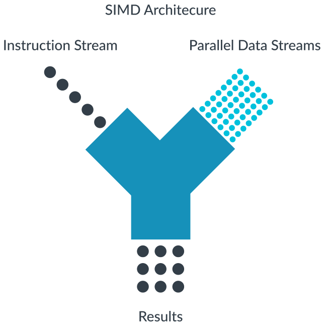
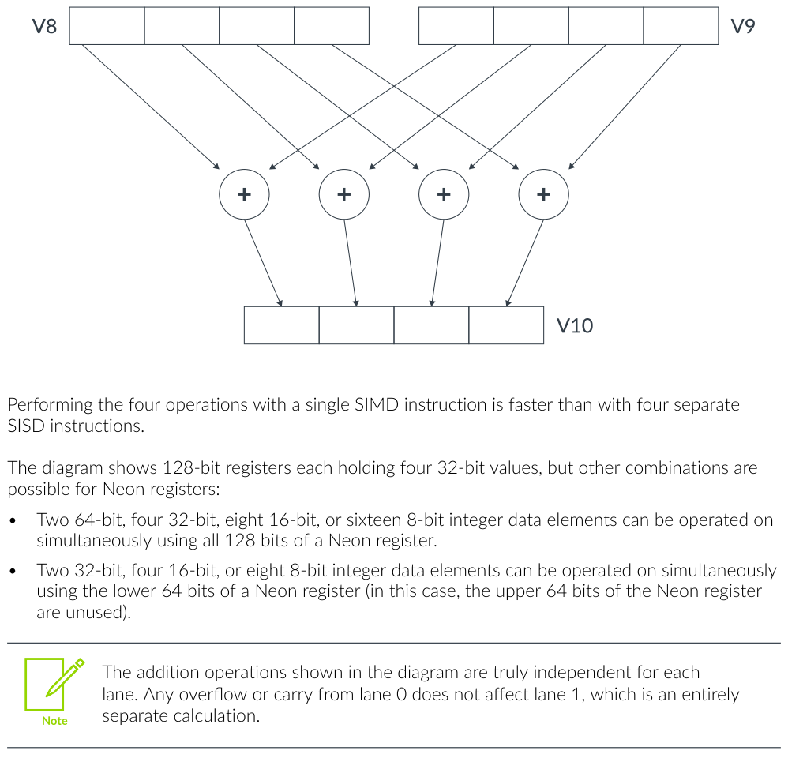
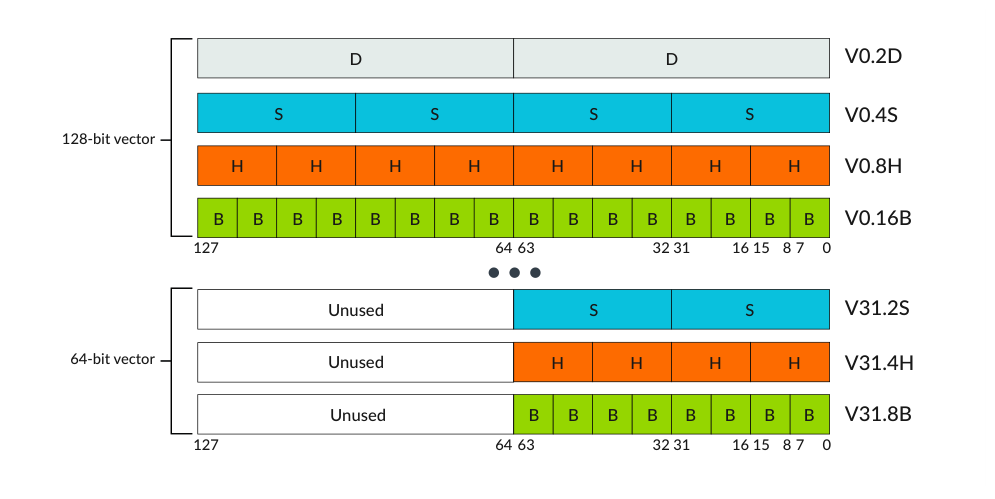
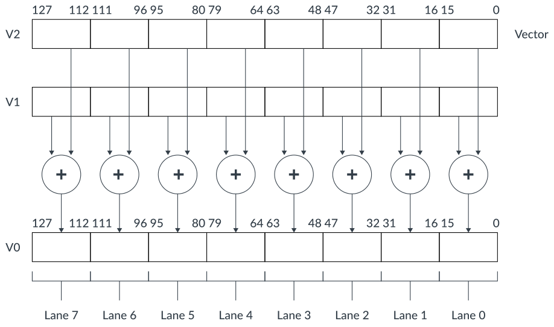
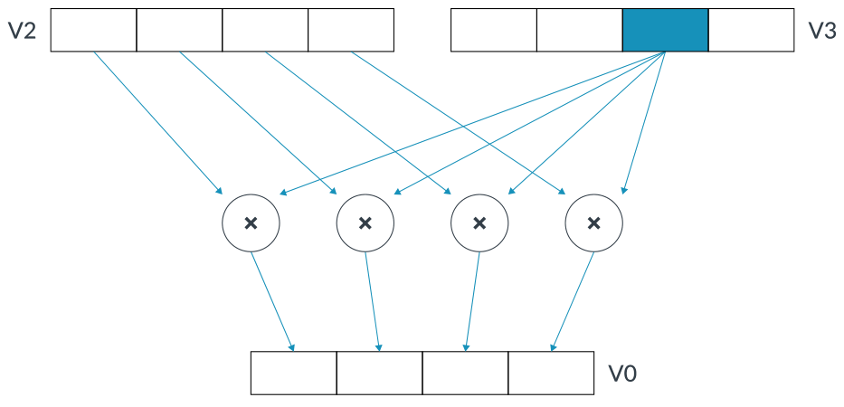

# 读懂 Arm Neon 入门（中文精读版）

> 原文：*Learn the architecture - Introducing Neon*
>
> 版本：Version 1.0　|　文档 ID：102474_0100_02_en　|　Issue 02（2020-01-01）
>
> 版权 © 2020 Arm Limited（或其关联公司）。保留所有权利。非保密。
>
> 说明：本文在原中文翻译的基础上重新组织了叙述逻辑与表达方式，技术内容、表格与图表保持原意；个别明显笔误已按 Arm 架构规范订正。

---

## 导读：这篇文章讲什么

Neon 是 Arm 对 **Advanced SIMD（单指令多数据）** 架构扩展的实现——一句话，就是让处理器"一条指令同时算多个数"。它能加速音频视频编解码、2D/3D 图形、图像处理，以及语音/人脸识别、计算机视觉、深度学习这类信号处理负载。

这篇文章只讲三件事：**为什么 SIMD 比 SISD 快**（数据怎么打包、怎么并行）、**Neon 的寄存器/向量/通道长什么样**（128 位寄存器怎么切成 8/16/32/64 位的通道）、以及**你有哪些用法可选**（开源库、编译器自动向量化、内建函数、手写汇编）。

先澄清一个术语坑：**Neon 是品牌名，Advanced SIMD 才是架构特性**。查 ARM（架构参考手册）或 Cortex-A TRM 时，要搜 Advanced SIMD，不是 Neon。

## 1. 从 SISD 到 SIMD：一次算一个 vs 一次算一串

处理大数据集时，瓶颈是执行数据处理指令花掉的 CPU 时间。这个时间 = 指令条数 × 每条耗时，而指令条数取决于"一条指令能处理几个数据"。

**SISD（单指令单数据）**：大多数 Arm 指令每次只对单个数据源操作。做四次加法就得写四条指令：

```asm
ADD w0, w0, w5
ADD w1, w1, w6
ADD w2, w2, w7
ADD w3, w3, w8
```

慢，而且看不出寄存器之间的关联。更浪费的是：处理器、寄存器、数据通路都是按 64 位设计的，你却在用 64 位寄存器装一个 8 位的值——多余的位宽全浪费了。

**SIMD（单指令多数据）**：一条指令同时对多个数据项做同一操作，这些数据项作为 **通道（lane）** 打包进大寄存器。比如：

```asm
ADD V10.4S, V8.4S, V9.4S
// 该操作把两个 128 位（四字）寄存器 V8 和 V9 相加，
// 并把结果存储到 V10。
// 每个寄存器中的四个 32 位通道分别相加。
// 通道之间没有进位。
```



*图 1-1：单指令多数据架构*

一条指令顶四条：



*图 2-1：单指令多数据*

**关键点：通道之间是完全独立的**。通道 0 的进位或溢出绝不会影响到通道 1。所以 SIMD 适合"简单、重复、可并行"的运算——音频视频编解码、按矩形像素块做的 2D 图形、3D 图形、色彩空间转换、物理模拟。

寄存器怎么切分，取决于数据宽度：全 128 位能装 2×64 位 / 4×32 位 / 8×16 位 / 16×8 位；只用低 64 位（高 64 位闲置）则装 2×32 位 / 4×16 位 / 8×8 位。

## 2. Neon 基础：寄存器、向量、通道和元素

一个容易误解的点：Armv8 内核在 AArch64 下是 64 位架构、用 64 位寄存器，但 **Neon 单元用 128 位寄存器**做 SIMD。这是因为它有自己独立的 128 位寄存器组。

Neon 单元完全集成进处理器，和处理器共享整数运算、循环控制、缓存的资源——所以比独立硬件加速器更省面积和功耗，而且编程模型简单（和应用程序用同一地址空间）。

几个概念：

- **向量（vector）**：Neon 寄存器里装的一串**同类型**元素。
- **通道（lane）**：输入和输出寄存器里位置相同的那个元素。每条 Neon 指令产生 n 个并行操作，n 就是通道数，每个操作都局限在自己的通道里。
- **元素（element）**：向量里的一个数据项。128 位向量可装 16×8 位（`.16B`）/ 8×16 位（`.8H`）/ 4×32 位（`.4S`）/ 2×64 位（`.2D`）。



*图 3-1：64 位和 128 位向量*

**元素顺序从最低有效位开始**：元素 0 用的是寄存器的最低有效位。`ADD V0.8H, V1.8H, V2.8H` 就是把 V1、V2 各八个 16 位通道对应相加，结果放回 V0：



*图 3-2：向量中元素的顺序*

有些 Neon 指令还会用到**标量**——用通道索引（如 `V3.S[2]`）指认寄存器里某个特定元素。`MUL V0.4S, V2.4S, V3.S[2]` 就是把 V2 的四个 32 位元素分别乘以 V3 通道 2 里的标量：



*图 3-3：使用标量的指令*

## 3. 知识自测

- **Neon 和 Advanced SIMD 架构的区别？** Neon 是品牌名，指 Arm 对 Advanced SIMD 架构的实现；查 ARM 和 TRM 要搜 Advanced SIMD。
- **SIMD 是什么、怎么加速 SISD 程序？** 单指令多数据；同样的执行时间里每条指令处理更多数据，整体就加速。
- **用 Neon 的四种方式？** 用支持 Neon 的库（Arm Compute Library / Performance Libraries）；用支持 Neon 的编译器（Arm Compiler / GCC）自动向量化；写 C/C++ Neon 内建函数；手写 Advanced SIMD 汇编。
- **AArch64 下有多少 Neon 寄存器、怎么切通道？** 32 个 128 位寄存器，可切成 8/16/32/64 位宽的通道，也可当 64 位寄存器用（高位闲置）。

## 4. 怎么用 Neon 与下一步

四个层次的用法，按"省事程度"从高到低：

1. **开源库**：Arm Compute Library 等，最省事。
2. **编译器自动向量化**：让编译器替你优化。
3. **Neon 内建函数**：C/C++ 里直接调，精确控制用哪条指令，不用写汇编。
4. **手写汇编**：极致性能，适合有经验的程序员。

新手想上手，看《用 Neon 内建函数优化 C 代码》教程——它用一个处理 24 位 RGB 交错像素图像的实例讲内建函数。权威信息查 Armv8-A 架构档案的 ARM；指令描述看 ISA 探索工具的 XML/HTML；内建函数查《Neon 内建函数参考》。如果做的是 Armv7 或 AArch32 状态，则应改看《Neon 程序员指南》1.0 版。
