# 读懂用 Neon 内建函数优化 C 代码（中文精读版）

> 原文：*Learn the architecture - Optimizing C code with Neon intrinsics*
>
> 版本：Version 2.1　|　文档 ID：102467_0201_03_en　|　Issue 03（2025-02-05）
>
> 版权 © 2022–2025 Arm Limited（或其关联公司）。保留所有权利。非保密。
>
> 说明：本文在原中文翻译的基础上重新组织了叙述逻辑与表达方式，技术内容、表格与图表保持原意；个别明显笔误已按 Arm 架构规范订正。

---

## 导读：这篇文章讲什么

这篇文章手把手教你用 **Neon 内建函数（intrinsic）** 在 C/C++ 里榨取 Advanced SIMD 的性能。内建函数就是编译器认识、会用对应的 Neon 指令替换的函数——你能在 C 里精确控制用哪条 SIMD 指令，又不用写汇编。

全文用三个逐步进阶的例子来讲：**RGB 去交错**（认识最常用的加载/存储内建函数）、**矩阵乘法**（用融合乘加和 4×4 分块）、**碰撞检测**（核心结论：**光换指令不够，数据布局决定向量化能榨出多少性能**——去交错后提速近 3 倍）。

读完你要能：知道 Neon 是什么、会用基本的内建函数、能看懂 `arm_neon.h` 里那一长串类型和函数名的命名规则，并知道去哪查权威参考（ACLE、Neon Intrinsics Reference、ARM）。

## 1. Neon 内建函数：为什么用、什么时候别用

**Neon** 是 Arm Advanced SIMD 架构的实现，提供 32 个 128 位向量寄存器（每个可装多个数据通道）和同时操作这些通道的 SIMD 指令。用它的四种方式：开源库（Arm Compute Library）、编译器自动向量化、**内建函数**、手写汇编。本文聚焦内建函数。

**内建函数**定义在 `arm_neon.h`，Arm 编译器和 GCC 都支持。函数内部是简短的汇编内核，会被内联进调用处；寄存器分配和流水线优化交给编译器。它的三个卖点：

- **强大**：不用写汇编就能直接控制 Neon 指令。
- **可移植**：同一份 C/C++ 代码，几乎不改就能迁到新目标或新执行状态（如 AArch32→AArch64）。
- **灵活**：想用 Neon 的地方用，不想用的地方退回 C/C++。

代价也有：学习曲线比导库或靠编译器陡；真要榨到极致，手写汇编空间更大。

## 2. 示例一：RGB 去交错

24 位 RGB 图像在内存里是**交错**的（每像素 R、G、B 三个字节交替排列）：

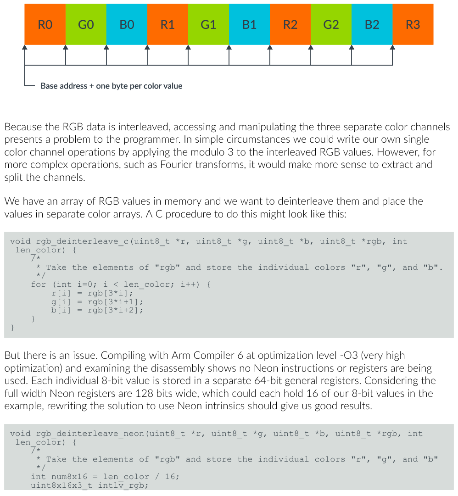

*图 4-1：RGB 图像像素数组*

要把三个颜色通道拆成三个独立数组，朴素的 C 写法是：

```c
void rgb_deinterleave_c(uint8_t *r, uint8_t *g, uint8_t *b, uint8_t *rgb, int len_color) {
    for (int i=0; i < len_color; i++) {
        r[i] = rgb[3*i];
        g[i] = rgb[3*i+1];
        b[i] = rgb[3*i+2];
    }
}
```

用 Arm Compiler 6 在 -O3 下编译，反汇编一看：**没有任何 Neon 指令**，每个 8 位值都塞进一个 64 位通用寄存器。128 位的 Neon 寄存器本该一次装 16 个 8 位值，结果全浪费了。

换成 Neon 内建函数，核心就两句：

```c
int num8x16 = len_color / 16;
uint8x16x3_t intlv_rgb;
for (int i=0; i < num8x16; i++) {
    intlv_rgb = vld3q_u8(rgb+3*16*i);      // 一次交错加载 3×16 字节
    vst1q_u8(r+16*i, intlv_rgb.val[0]);    // 拆开的 R 存走
    vst1q_u8(g+16*i, intlv_rgb.val[1]);    // G
    vst1q_u8(b+16*i, intlv_rgb.val[2]);    // B
}
```

关键内建函数和类型：

| 代码元素 | 作用 |
| --- | --- |
| `uint8x16_t` | 16 个 8 位无符号整数，恰好一个 128 位寄存器 |
| `uint8x16x3_t` | 三个 `uint8x16_t` 的结构体（临时保存当前颜色） |
| `vld3q_u8(...)` | 交错加载 3×16 字节，交替放入三个数组 → 底层生成 **LD3** 指令 |
| `vst1q_u8(...)` | 把满 128 位寄存器的字节值存到给定地址 |

编译反汇编命令：

```shell
gcc -g -o3 rgb.c -o exe_rgb_o3
objdump -d exe_rgb_o3 > disasm_rgb_o3
```

## 3. 示例二：矩阵乘法

矩阵乘法 = 第一矩阵的行 × 第二矩阵的列，做点积：

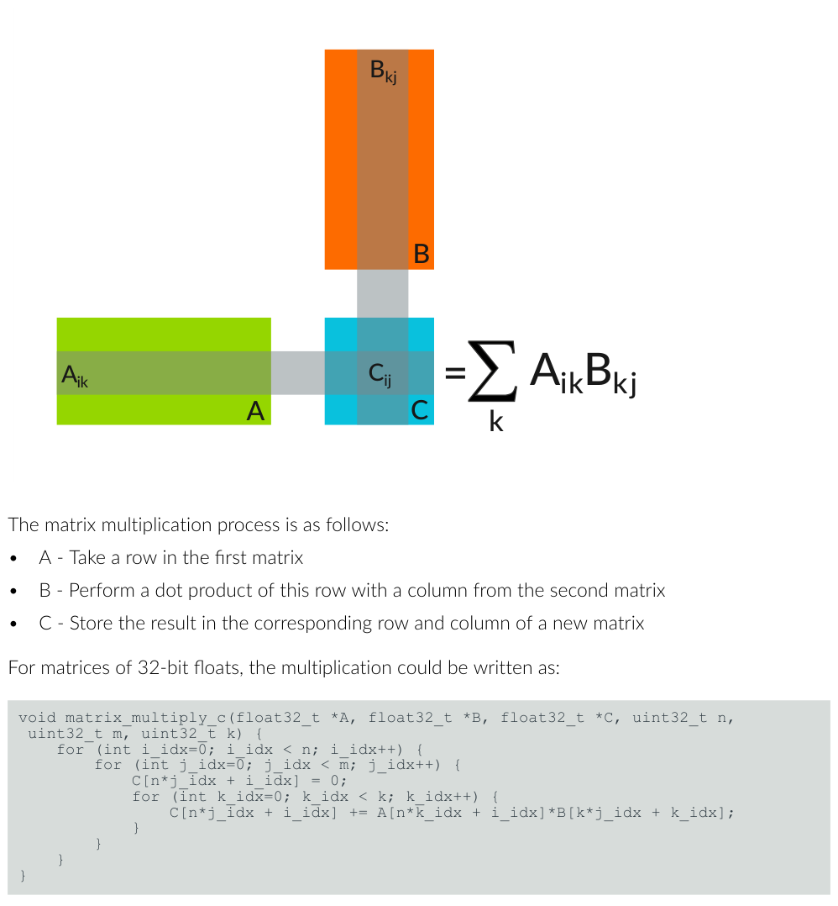

*图 5-1：矩阵乘法*

按列主序（Mij = M_array[n*j+i]），朴素的 C 三重循环是：

```c
for (int i_idx=0; i_idx < n; i_idx++)
    for (int j_idx=0; j_idx < m; j_idx++) {
        C[n*j_idx + i_idx] = 0;
        for (int k_idx=0; k_idx < k; k_idx++)
            C[n*j_idx + i_idx] += A[n*k_idx + i_idx]*B[k*j_idx + k_idx];
    }
```

改进分两步。先做**固定 4×4 矩阵**——4 个 32 位浮点正好塞进一个 Neon 寄存器，循环可以完全展开：

```c
// 加载 A 的四列、B 的四列
A0 = vld1q_f32(A); A1 = vld1q_f32(A+4); A2 = vld1q_f32(A+8); A3 = vld1q_f32(A+12);
// 清零累加器
C0 = vmovq_n_f32(0); /* ... C1 C2 C3 同理 ... */
// 乘加：C 的每一列
B0 = vld1q_f32(B);
C0 = vfmaq_laneq_f32(C0, A0, B0, 0);
C0 = vfmaq_laneq_f32(C0, A1, B0, 1);
C0 = vfmaq_laneq_f32(C0, A2, B0, 2);
C0 = vfmaq_laneq_f32(C0, A3, B0, 3);
vst1q_f32(C, C0);
/* B1..B3 同理 */
```

关键内建函数：

| 代码元素 | 作用 |
| --- | --- |
| `float32x4_t` | 四个 32 位浮点，一个 128 位寄存器 |
| `vld1q_f32(...)` | 加载四个 32 位浮点 |
| `vfmaq_lane_f32(...)` | **融合乘加**：向量 × 另一向量的单个元素，再加到第三向量 → FMA 指令 |
| `vst1q_f32(...)` | 存储结果 |

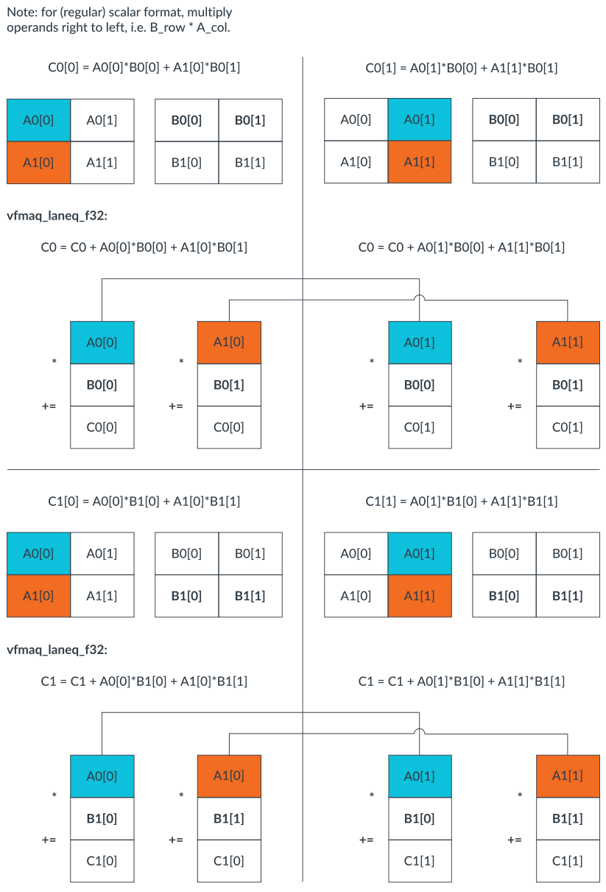

*图 5-2：使用 Neon 的矩阵 A 乘以矩阵 B*

然后把大矩阵**当 4×4 块**处理，套上循环和地址计算，4×4 内核基本不变。要点：给 B 的每列用**不同的变量名**，是给编译器的提示——让它给不同列分配不同寄存器，这样等某一列加载时，处理器能先算完另一列的算术。与原 C 相比：算术指令更少（SIMD 满寄存器打包）、FMLA 取代 FMUL、循环迭代更少；代价是 `float32x4_t` 的分配/初始化带来一些多余的加载存储。

## 4. 示例三：碰撞检测（重点在数据布局）

判断两个圆是否碰撞：圆心距离 d 小于等于两半径之和就撞。先从单轴看起——两圆重叠即碰撞：

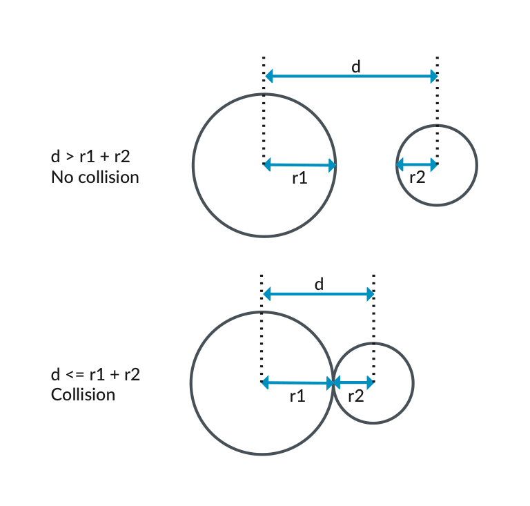

*图 6-1：单轴上的碰撞检测*

推广到二维，每个圆用一对 (x,y) 坐标表示圆心：

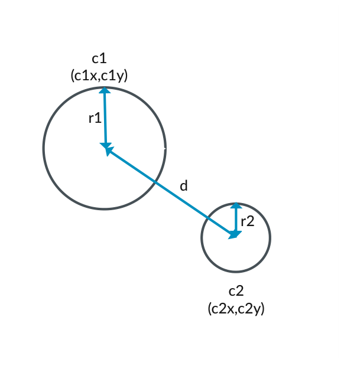

*图 6-2：二维中的碰撞检测*

二维和单轴的判定规则相同，区别在于要用勾股定理把圆心距转成平方和（免开方，还能省掉求绝对值，因为平方恒正）：

```
d² = (c1y - c2y)² + (c1x - c2x)²
```

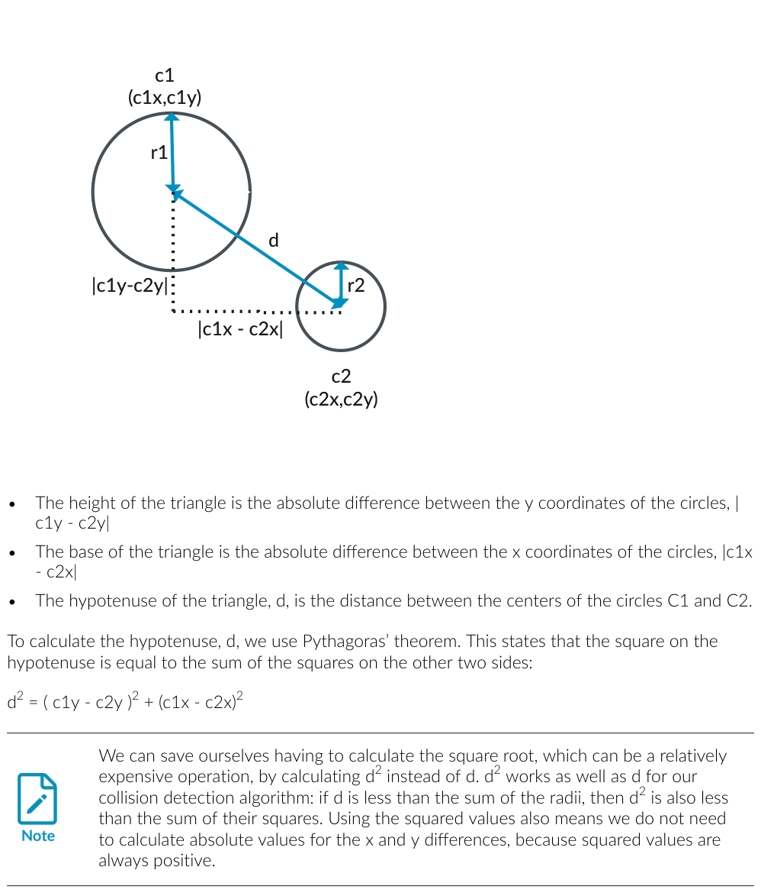

*图 6-3：用勾股定理计算圆之间的距离*

**不做向量化**的版本，编译出的汇编全是标量操作（ldr/fsub/fmul/fadd 一串）。以 c1(2,4) 半径 2、c2(6,1) 半径 1 为例，圆心距 5（3²+4²=5²）大于半径和 3，所以不碰撞：

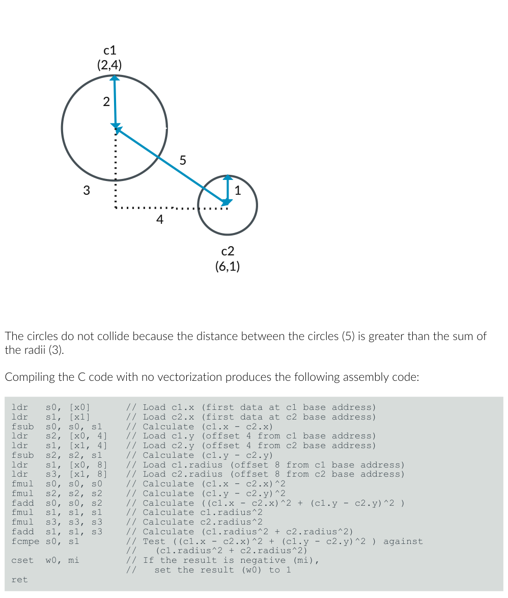

*图 6-4：碰撞检测示例*

碰撞判断里有两组可并行的运算：x、y 各做一次减法，两个半径各做一次平方乘法。

**基本向量化**：用 2 通道 64 位寄存器（`float32x2_t`）把 x、y 的减法和平方并行起来：

```c
float32x2_t c1_coords = vld1_f32(&c1.x);
float32x2_t c2_coords = vld1_f32(&c2.x);
float32x2_t deltas = vsub_f32(c1_coords, c2_coords);
float32x2_t deltas_squared = vmul_f32(deltas, deltas);
float sum_deltas_squared = vpadds_f32(deltas_squared);   // 跨通道求和
float radius_sum = c1.radius + c2.radius;
float radius_sum_squared = radius_sum * radius_sum;
return sum_deltas_squared <= radius_sum_squared;
```

结果：汇编里减法、乘法都变成了向量指令（fsub/fmul 的 `v0.2s` 形式），再用 `faddp` 跨通道求和。`vld1_f32` 把 c1、c2 的 x、y 各加载进一个 2 通道寄存器：

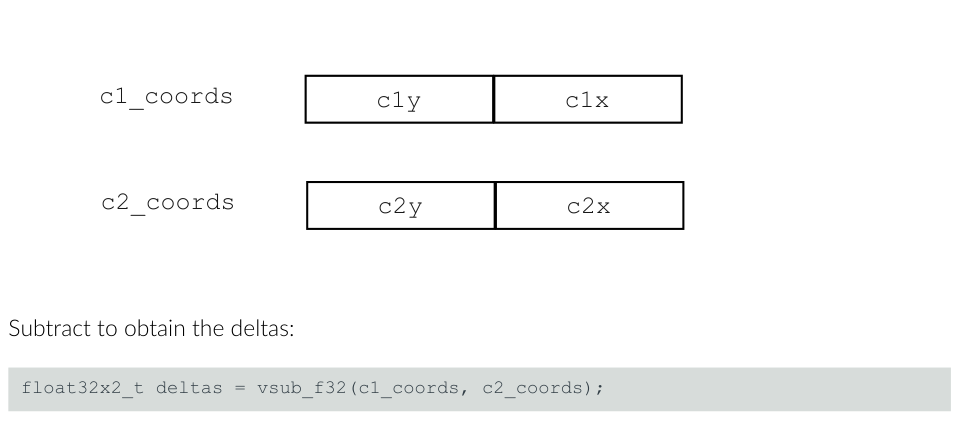

*图 6-5：vld1_f32*

`vsub_f32` 逐通道相减得到差值，`vmul_f32` 逐通道平方：

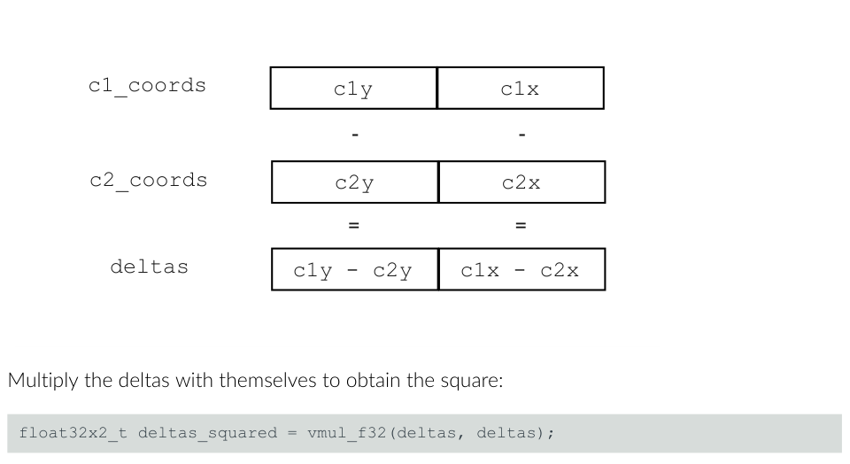

*图 6-6：vsub_f32*

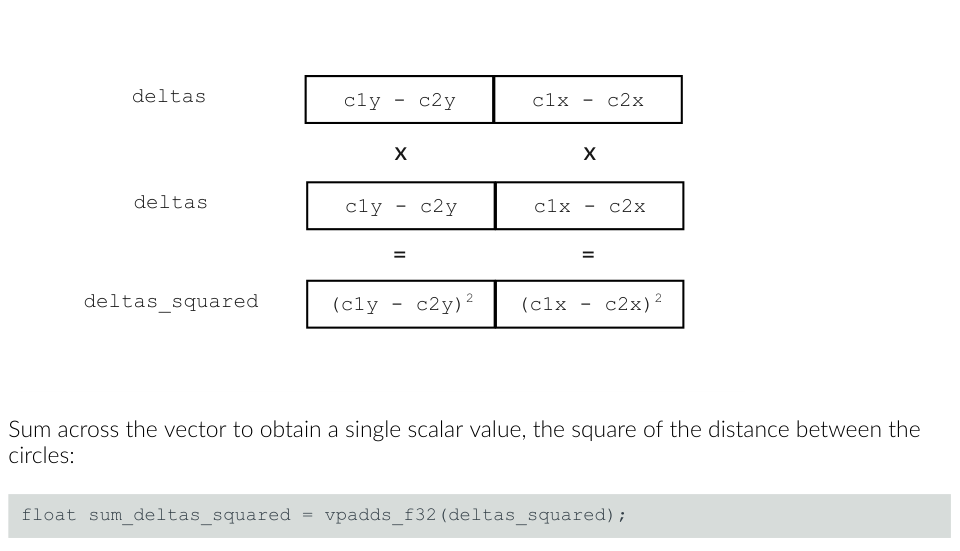

*图 6-7：vmul_f32*

**但基本向量化几乎不快**（见下面性能表）。原因是：`circle` 结构体里 x、y、radius **交错存放**，从这种布局加载向量要额外指令；而且只并行了减、乘两个运算，紧接着就得做跨通道加法，把并行的收益又抵消了。

**高级向量化——改数据布局**：把多个圆的 x、y、radius 各放进独立数组（去交错），一次就能对**四个圆**做碰撞测试：

```c
float32x4_t c1_x = vdupq_n_f32(collider.x);   // 碰撞圆属性广播到 4 通道
float32x4_t c1_y = vdupq_n_f32(collider.y);
float32x4_t c1_r = vdupq_n_f32(collider.radius);
for (size_t offset = 0; offset != input.size; offset += 4) {
    float32x4_t x = vld1q_f32(input.xs + offset);
    float32x4_t y = vld1q_f32(input.ys + offset);
    float32x4_t delta_x = vsubq_f32(c1_x, x);
    float32x4_t delta_y = vsubq_f32(c1_y, y);
    float32x4_t sum_deltas_squared = vaddq_f32(vmulq_f32(delta_x, delta_x), vmulq_f32(delta_y, delta_y));
    float32x4_t r = vld1q_f32(input.radii + offset);
    float32x4_t radius_sum_squared = vmulq_f32(vaddq_f32(c1_r, r), vaddq_f32(c1_r, r));
    uint32x4_t mask = vcltq_f32(sum_deltas_squared, radius_sum_squared);
    out[offset]     = 1 & vgetq_lane_u32(mask, 0);
    out[offset + 1] = 1 & vgetq_lane_u32(mask, 1);
    out[offset + 2] = 1 & vgetq_lane_u32(mask, 2);
    out[offset + 3] = 1 & vgetq_lane_u32(mask, 3);
}
```

这里新增的内建函数：`vdupq_n_f32`（标量广播到全部通道）、`vld1q_f32`（连续加载 4 个值）、`vsubq_f32`、`vmulq_f32`、`vaddq_f32`、`vcltq_f32`（逐通道小于比较，成立则通道全 1 否则全 0）、`vgetq_lane_u32`（提取单个通道）。

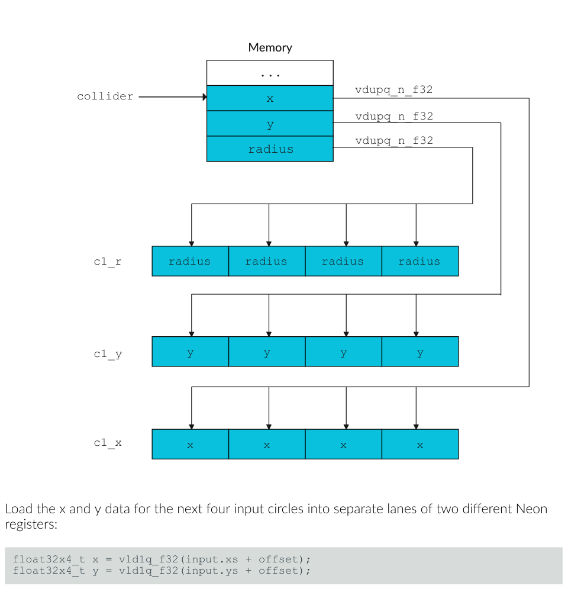

*图 6-8：vdupq_n_f32*

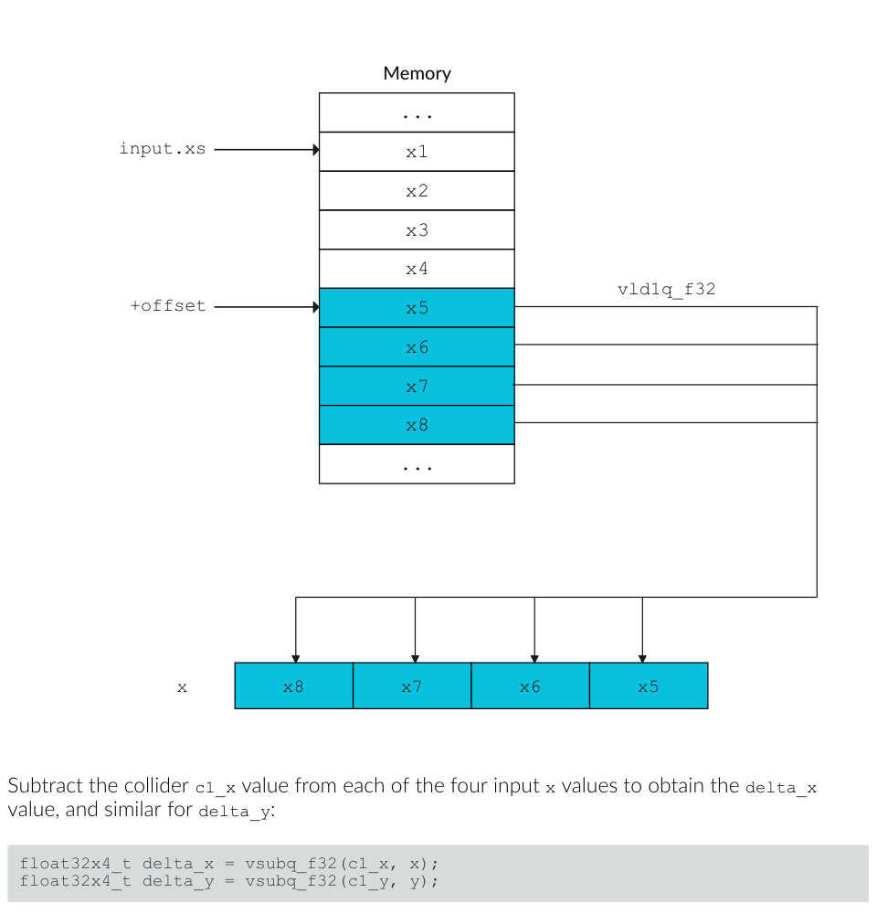

*图 6-9：vld1q_f32*

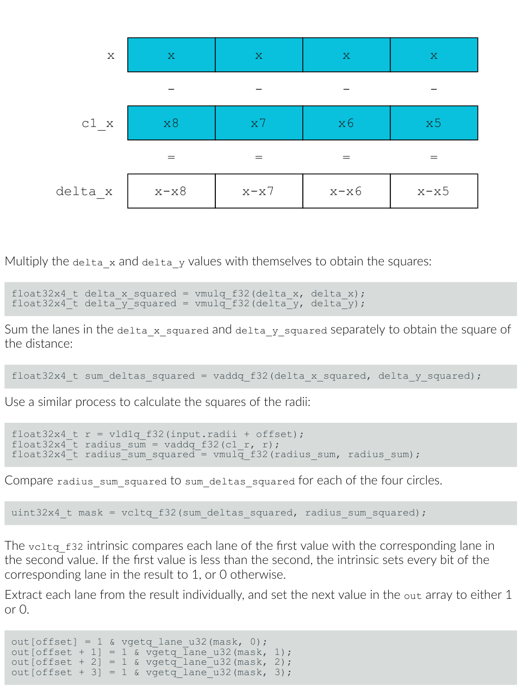

*图 6-10：vsubq_f32*

**性能结果**（-O3，Samsung S20，函数加 noinline 防自动向量化）：

| 函数 | 每次调用耗时 | 加速比 |
| --- | --- | --- |
| does_collide | 2.724 ns | 1x |
| does_collide_neon | 2.717 ns | 1.003x |
| does_collide_neon_deinterleaved | 0.925 ns | 2.945x |

> 结论很清晰：**只换指令（基本向量化）几乎没用，重构数据布局（去交错）才是近 3 倍提速的来源**。

## 5. 编程约定：宏、类型、函数命名

**宏**（定义且等于 1 时对应特性可用）：`__ARM_NEON`（支持 Advanced SIMD，AArch64 恒 1）、`__ARM_NEON_FP`（支持 Neon 浮点，恒 1）、`__ARM_FEATURE_CRYPTO`（加密指令）、`__ARM_FEATURE_FMA`（融合乘加）。

**类型**三大家族，模式 `baseW_t` / `baseWxL_t` / `baseWxLxN_t`：base 基础类型、W 宽度、L 标量实例数、N 向量实例数。W×L 通常凑成 64 或 128 位。例如 `uint8_t`（标量）、`uint8x16_t`（向量）、`uint8x16x3_t`（向量数组）。

**函数命名**通用模式：

```
ret v[p][q][r]name[u][n][q][x][_high][_lane | laneq][_n][_result]_type(args)
```

- `v` = vector；`p` 成对；`q` 饱和；`r` 舍入；`name` 操作名（常是 SIMD 指令）；`u` 有符号→无符号饱和；`n` 收窄；后缀 `q` 128 位向量；`x` AArch64 标量（b/h/s/d）；`_high` 加宽/收窄时取 128 位操作数的高 64 位；`_n` 标量参数；`_lane`/`_laneq` 从向量通道取标量；`type` 主操作数类型；`args` 参数。

## 6. 知识自测

- **什么是 Neon？** Arm 架构 Advanced SIMD 扩展的实现，提供额外 32 个 128 位寄存器，以及对 8/16/32/64 位通道操作的指令。
- **用内建函数要 include 哪个头？** `#include <arm_neon.h>`，且须在任何内建函数使用之前。
- **`int8x16_t vmulq_s8(int8x16_t a, int8x16_t b)` 做什么？** 名字里 mul 提示用 MUL 指令，参数是十六个字节的有符号整数 → 映射到 `MUL Vd.16B, Vn.16B, Vm.16B`，把 a、b 对应元素相乘。
- **去交错函数只能处理 16 的整数倍，长度不是 16 倍怎么办？** 改数组就补零（简单，但要他处处理填充）；改函数就对 16 的整数倍用 Neon 去交错、余数用 C 处理。
- **`float64_t` / `poly64x2_t` / `int8x8x3_t` 各是什么？** 分别是 64 位浮点标量；两个 64 位多项式标量的向量；三个 8 位有符号整数向量的向量数组。

## 7. 相关资源

权威参考按顺序：ACLE（内建函数工程规范）、Neon Intrinsics Reference（可搜索的函数参考）、Architecture Exploration Tools（研究 SIMD 指令集）、ARM（Advanced SIMD 指令集完整规范）。想上手实战，本文三个例子是很好的起点。
