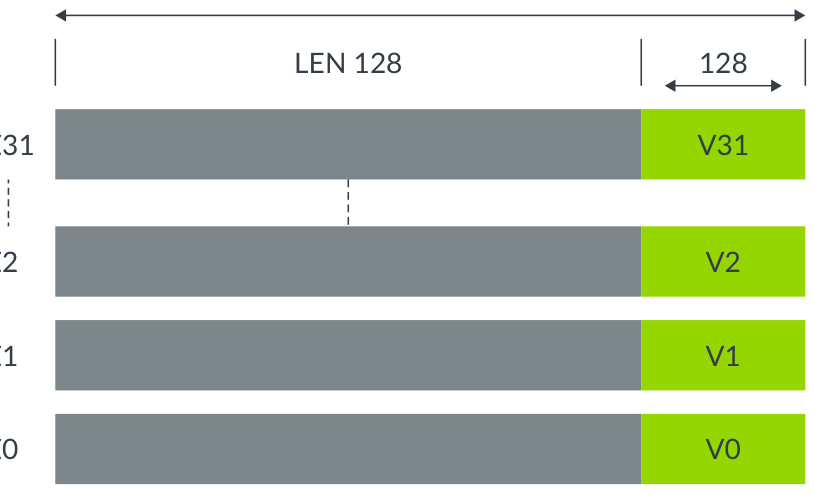
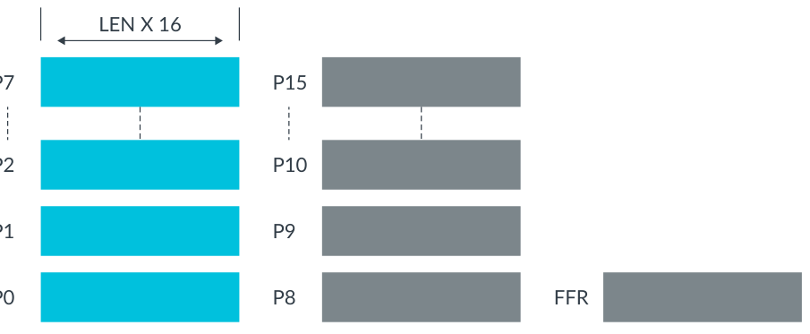
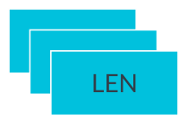
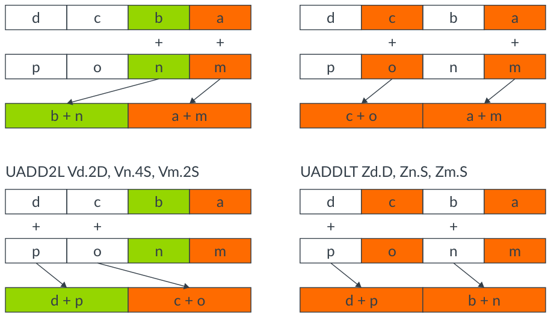

# 读懂 SVE2 入门（中文精读版）

> 原文：*Learn the architecture - Introducing SVE2 guide*
>
> 版本：Version 1.0　|　文档 ID：102340_0100_08_en　|　Issue 08（2024-09-04）
>
> 版权 © 2020–2021, 2023–2024 Arm Limited（或其关联公司）。保留所有权利。非保密。
>
> 说明：本文在原中文翻译的基础上重新组织了叙述逻辑与表达方式，技术内容、表格与图表保持原意；个别明显笔误已按 Arm 架构规范订正。

---

## 导读：这篇文章讲什么

SVE2 是 Arm AArch64 的**可扩展向量扩展第二版**。一句话概括它和 Neon 的本质区别：Neon 的向量长度**固定 128 位**，SVE/SVE2 的向量长度**可变（128～2048 位，按 128 位步进）**——所以代码"编译一次，到处能跑"，不用为每种硬件长度重新编译。

这篇文章讲四件事：**SVE2 是什么**（SVE+Neon 的超集，覆盖 HPC/ML 之外的通用领域）、**架构基础**（Z 向量 / P 谓词 / FFR / 系统控制寄存器）、**新增了什么**（把 Neon 指令"可扩展化"、复数/多精度算术等）、**怎么编程**（汇编 / 内建函数 / 自动向量化 / 库）。

前置要求：先懂 SIMD、Neon、SVE。读完你要能说清 SVE2 相比 Neon 的三个优势（一次构建到处跑、向量化更灵活、指令集覆盖更多领域）。

## 1. SVE2 是什么：从 Neon 到 SVE 到 SVE2

Neon 的指令集把向量长度**固定死了**在 128 位。Arm 接着设计了 **SVE**——一种新的 SIMD 指令集，作为 AArch64 扩展，让向量长度**可灵活实现**，主要服务高性能计算（HPC）这种要海量数据处理的场景。

**SVE2 是 SVE 和 Neon 的超集**，继承 SVE 的概念、向量寄存器和操作原理，把指令集覆盖范围从 HPC/ML 扩展到：计算机视觉、多媒体、LTE 基带、基因组学、内存数据库、Web 服务、通用软件。做法是给**大多数整数 DSP 和媒体处理功能**加一套"与向量宽度无关"的 Neon 指令版本。

几个核心概念：

- **32 个可扩展向量寄存器 Z0-Z31**，向量长度 128～2048 位（步进 128 位），由芯片厂商选择。
- 一次构建的二进制，能在**不同向量长度**的 AArch64 硬件上跑——开发者不用知道自己系统的向量长度。
- 还带**逐通道谓词、收集加载/分散存储、推测向量化**。

> 关键澄清：**SVE/SVE2 不是 Neon 的扩展**，而是为更强数据并行性重新设计的。但它们的硬件逻辑**叠加在 Neon 硬件之上**——支持 SVE/SVE2 的微架构必然也支持 Neon。

## 2. 架构基础：Z 向量、P 谓词、FFR、ZCR

在 Neon 的寄存器组之外，SVE/SVE2 新增了：

| 寄存器 | 说明 |
| --- | --- |
| Z0-Z31 | 32 个可扩展向量寄存器，128～2048 位；低 128 位与 Neon 的 V0-V31 共享 |
| P0-P15 | 16 个可扩展谓词寄存器，每个是 Z 长度的 1/8；P0-P7 管加载/存储/算术，P8-P15 管循环 |
| FFR | 首故障谓词寄存器，用于推测性内存访问 |
| ZCR_Elx | 系统控制寄存器，LEN 字段设置当前及更低 EL 的向量长度 |



*图 3-1：可扩展向量寄存器 Z0-Z31*



*图 3-2：可扩展谓词寄存器 P0-P15*



*图 3-3：可扩展向量系统控制寄存器 ZCR_Elx*

**汇编语法**沿用 SVE 的格式，要点是 `/Z` 与 `/M` 两个谓词修饰：

```asm
ADD <Zdn>.<T>, <Pg>/M, <Zdn>.<T>, <Zm>.<T>   ; /M 合并：不活动元素保持原值
LDFF1D {<Zt>.D}, <Pg>/Z, [...]                ; /Z 清零：不活动元素清零
```

### 2.1 继承自 SVE 的关键特性

**收集加载 / 分散存储**：用向量基址或向量偏移，从非连续地址一次加载进一个向量：

```asm
LD1SB  Z0.S, P0/Z, [Z1.S, #4]    // 向量基址 Z1 + 立即数 #4
LD1SB  Z0.D, P0/Z, [X0, Z1.D]   // 标量基址 X0 + 向量索引 Z1.D
```

**逐通道谓词**：P0-P15 当位掩码，指示哪些通道是"活动"的，只对活动通道操作：

```asm
ADD Z0.D, P0/M, Z1.D, Z2.D
```

**谓词驱动的循环控制**：用谓词登记活动/不活动元素，消除处理"部分向量"的循环头尾开销：

```asm
WHILEL0 P0.S, x8, x9   // x8 递增 < x9 时为真，生成谓词
```

**软件管理的推测向量分区**：SVE 放松了 Neon 对推测加载的限制，引入首故障加载（LDFF1D）和 FFR，让向量访问能跨进无效页——成功加载置真 FFR，首个故障元素及之后的元素置假：

```asm
LDFF1D Z0.D, P0/Z, [Z1.D, #0]
RDFFR P0.B              // 读 FFR 到谓词
```

**扩展的水平归约**：按序或树状浮点求和（FADDP），在可重复性与性能之间权衡。

## 3. SVE2 新增了什么

SVE2 把大量 Neon 指令"可扩展化"，并加新运算：

- **变换后的 Neon 整数操作**：如 SAB（有符号绝对差累加）、SHADD（有符号减半加）。
- **变换后的加宽/收窄/成对操作**：如 UADDLB（无符号加长-底部）、UADDLT（无符号加长-顶部）。
- **复数算术**：如 CMLA（带旋转的复数整数乘加）。
- **多精度算术**：如 ADCLB/ADCLT（带进位加长）、SM4E（SM4 加解密）。

一个关键区别在**元素处理顺序**：SVE2 按**交错奇偶元素**处理，Neon 按**低半/高半元素**处理：



*图 4-1：Neon 与 SVE2 处理方式的区别*

各应用领域的代表性新指令：ML 的 UDOT、计算机视觉的 TBL/TBX、基带网络的 CADD/CMLA、基因组学的 BDEP/BEXT、服务器的 MATCH/NMATCH。

> 向后兼容上，最新架构仍**要求 Neon 和 VFP**——SVE2 不取代 Neon，两者并存。

## 4. 怎么编程、怎么跑

**编译器支持**：GNU 工具 8.0+ 支持 SVE；Arm Compiler for Linux 18.0+ 支持 SVE、20.0+ 支持 SVE2；LLVM/Clang 5+ 支持 SVE、9+ 支持 SVE2。库方面 Arm Performance Libraries 19.3+ 支持 SVE 数学库。

**四种写 SVE2 代码的方式**：

1. **汇编**（或 GNU 内联汇编）。注意 AAPCS 的寄存器约定：Z0-Z7/P0-P3 传参和返回值，Z8-Z15/P4-P15 被调用方保存，Z16-Z31 可破坏。

```asm
whilelo p0.s, xzr, x9      ; 生成谓词
ld1w   { z0.s }, p0/z, [x1, x8, lsl #2]
sub    z0.s, z0.s, z1.s
st1w   { z0.s }, p0, [x0, x8, lsl #2]
```

2. **内建函数**：`#include <arm_sve.h>`，直接调 `svaddlb` 这类函数，编译成对应 SVE2 指令：

```c
svuint64_t uaddlb_array(svuint32_t Zs1, svuint32_t Zs2) {
    svuint64_t result = svaddlb(Zs1, Zs2);   // → uaddlb z0.d, z0.s, z1.s
    return result;
}
// 编译：armclang -O3 -S -march=armv8-a+sve2 ...
```

3. **自动向量化**：让编译器从普通 C/C++/Fortran 循环生成 SVE2，用 `-march=armv8-a+sve2`（配 `-armpl=sve` 用 SVE 库）。

4. **优化库**：Arm Performance Libraries（BLAS/LAPACK/FFT 等）、Arm Compute Library。

**没有 SVE 硬件怎么跑**：QEMU（跨/本机建模）、Fast Models（AEM 带 SVE2）、ArmIE（19.2+ 支持 SVE2，直接在 Arm 平台跑）。

## 5. 知识自测

- **SVE2 继承 SVE 的什么？** 基础架构特性：向量、系统控制寄存器、指令。
- **SVE2 的向量是哪些？** Z0-Z31 向量、P0-P15 谓词、FFR。
- **SVE2 向量多少位？** 128～2048 位，128 位步进。
- **SVE2 比 SVE 多了什么领域？** 通用软件、Web 服务器、计算机视觉、多媒体、LTE 基带、基因组学、内存数据库。
- **SVE2 比 Neon 的优势？** 一次构建到处跑（向量长度无关）、向量化更灵活、指令集覆盖更多应用领域。

## 6. 相关资源

架构探索工具、SVE 的 ARM 补充、Arm Community、ArmIE、SVE intrinsics、ACLE for SVE、Fast Models、QEMU、AAPCS，以及 HPC 应用移植指南。
