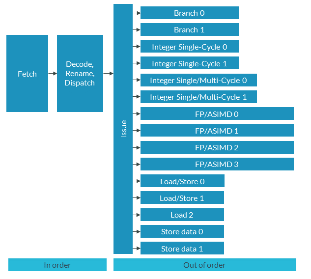

# 读懂 SVE 优化指南（中文精读版）

> 原文：*SVE Optimization Guide*（文档 ID：102699，Issue 01，2021-10-14）
>
> 版权 © 2021 Arm Limited（或其关联公司）。保留所有权利。非保密。
>
> 说明：本文在原中文翻译的基础上重新组织了叙述逻辑与表达方式，技术内容、表格与图表保持原意；个别明显笔误已按 Arm 架构规范订正。

---

## 导读：这篇文章讲什么

SVE 的核心卖点是**向量长度可扩展**（128～2048 位），寄存器大小**编译时不用知道**——一份二进制跑遍所有 SVE 硬件。这篇文章用一个最小的数值例程 **SAXPY**（`y[i] ← a*x[i] + y[i]`，L1 BLAS 的向量加法），手把手演示**三条优化路线**，并给出实测性能结论。

三条路线，从省事到极致：

1. **自动向量化**（改编译器选项就行）：`-O2` 以上编译器自动生成 SVE 代码。
2. **内建函数**（`#include <arm_sve.h>`）：用 `svld1`/`svmla`/`svst1` 这些函数精确控制指令。
3. **汇编**（`.S` 文件）：完全手工指定 `whilelo`/`ld1w`/`fmla`/`st1w`。

读完你要能：说出 SVE 的四种用法；会用内建函数写向量长度无关的循环；知道 `svlen`/`svwhilelt`/`svmla` 等关键内建函数对应哪条指令；理解为什么"自动向量化最省事、汇编最快但最难维护"。

## 1. 先记住 SVE 的几个优化特性

- **可配置向量长度**：128～2048 位，128 位为增量。
- **谓词（predication）**：控制向量里哪些通道"活动"——这是向量长度无关循环的关键。
- **专用 SIMD 指令集**：支持谓词和不同向量长度。
- **收集/分散加载存储**、**软件管理推测向量化**。

写 SVE 代码的四种方式：SVE 库（Arm Performance Libraries）、编译器自动向量化、内建函数、汇编。

## 2. 路线一：自动向量化——改个编译选项就完事

基于 LLVM Clang 的 Arm Compiler for Linux 有两个自动向量化器：**循环向量化**和 **SLP（超字级并行）向量化**。

- **循环向量化**：算出最优的展开和向量化程度；展开增加每轮迭代的操作数，也顺便启用 SIMD。
- **SLP 向量化**：把相邻的独立标量操作合成一条向量指令。

优点：易用（只改 flag 和 `#pragma`）、可移植（`-mcpu` 重新编译即可）。缺点：控制力弱、向量化器漏掉机会时还得手动。

关键编译器选项（表 1 摘要）：

| 选项 | 作用 |
| --- | --- |
| `-fvectorize` / `-no-fvectorize` | 开/关循环向量化（-O2 以上默认开） |
| `-mllvm -force-vector-width=<v>` | 强制 SIMD 向量宽度 |
| `-mllvm -force-vector-interleave=<v>` | 强制循环展开因子 |
| `-fno-slp-vectorize` | 关 SLP 向量化 |
| `-Rpass[-missed|-analysis]=loop-vectorize` | 诊断哪些循环（未）向量化、为什么失败 |

单个循环用 `#pragma clang loop vectorize(enable/disable)`、`interleave(...)`、`vectorize_width(...)`、`vectorize(assume_safety)` 控制（表 2）。

**提高向量化机会的几条**：避免迭代间依赖、避免 switch、开 `-O2`、用 `-Rpass-analysis` 排查、必要时上 pragma。

### 用 SAXPY 看效果

朴素 C 循环 `y[i] = a*x[i] + y[i]` 编译对比：

- **`-O1`（无向量化）**：标量 `fmul s1, s1, s0` + `fadd s1, s1, s2`，操作标量寄存器 s0/s1。
- **`-O2`（自动向量化）**：出现 SVE 循环核心：

```asm
whilelo p0.s, xzr, x8            ; 谓词
ld1w    { z1.s }, p0/z, [x0, x9, lsl #2]   ; 谓词加载 x
ld1w    { z2.s }, p0/z, [x1, x9, lsl #2]   ; 谓词加载 y
fmul    z1.s, z1.s, z0.s                    ; a*x
fadd    z1.s, z1.s, z2.s                    ; + y
st1w    { z1.s }, p0, [x1, x9, lsl #2]      ; 谓词存储
incw    x9                                  ; 按向量长度递增
```

- **`-Ofast`**：进一步把 `fmul`+`fadd` 合成一条 **FMAD**（融合乘加），循环又少一条指令。

这就是自动向量化的完整效果：`-O1` 标量 → `-O2` SVE 向量 → `-Ofast` SVE 向量 + 融合乘加。

## 3. 路线二：内建函数——精确控制又不用写汇编

内建函数是 `arm_sve.h` 里的一组函数/宏，与 ISA 指令**一一对应**（`svld1` ↔ LD1、`svmla` ↔ MLA）。优点是强大、可移植、灵活；缺点是学习曲线陡、性能可移植性差。Arm 建议**优先用内建函数而不是汇编**。

三个关键概念：

- **宏**（表 3）：`__ARM_FEATURE_SVE==1` 表示 SVE 可用，`__ARM_FEATURE_SVE2==1` 表示 SVE2，`__ARM_FEATURE_SVE_BITS==N` 表示已知向量长度。
- **无大小类型**：`svint16_t`、`svfloat32_t`、`svbool_t`——因为向量长度编译时未知，需要"sizeless"类型。
- **函数命名**：`svbase[_disambiguator][_type0][_type1]…[_predication]`。末尾 `_z`（清零）或 `_m`（合并）指定不活动元素处理方式。

### 用内建函数重写 SAXPY

核心思路（六步，对应文档代码里的 (1)-(6)）：

```c
uint64_t numVals = svlen_f32(xseg);        // (1) 运行时拿向量长度 → CNTW
for (i=0; i<n; i+=numVals) {               // (2) 按向量长度递增
    predicate = svwhilelt_b32_s32(i, n);   // (3) 谓词防越界 → WHILELO
    xseg = svld1_f32(predicate, x+i);      // (4) 谓词加载 → LD1W
    yseg = svld1_f32(predicate, y+i);
    yseg = svmla_n_f32_m(predicate, yseg, xseg, a);  // (5) y+a*x → MLA
    svst1_f32(predicate, y+i, yseg);       // (6) 谓词存储 → ST1W
}
```

内建函数 ↔ 指令对照：`svlen_f32`→CNTW、`svwhilelt_b32_s32`→WHILELO、`svld1_f32`→LD1、`svmla_n_f32_m`→MLA、`svst1_f32`→ST1。反汇编确认生成了 `whilelt / ld1w / fmla / st1w`。

程序员要自己负责的：选对内建函数（懂指令时序）、手动展开循环和写循环尾、选对加载/存储/算术操作。

## 4. 路线三：汇编——完全手工

汇编 = 显式指定每一条指令。优点：完全控制、性能上限最高（前提是你比编译器强）。缺点：不可移植（Cortex-X2 的 SVE 代码跑不了 Cortex-A72）、难写、难维护、硬件细节全靠自己。

四条提示：

- **指令选择**：不同微架构指令耗时不同；收集/分散有性能-便利权衡；不可预测分支用 CSEL、可预测分支用正常分支更好。
- **寄存器使用**：守 PCS、尽早加载、值尽量留在寄存器、目标寄存器立即复用、必要时溢出到栈。
- **循环展开**：充分利用流水线。Cortex-X2 有 4 整数 + 4 浮点流水线，至少展开 4 次：



*图 1：Cortex-X2 流水线图*

- **缓存**：加载/存储顺序影响缓存；预取可能有用，误用会反而丢数据。

### SAXPY 汇编内核

C 侧声明 `extern void saxpy_asm(float32_t *x, float32_t *y, float32_t a, uint32_t n);`，按 PCS 参数落在 x0/x1/s0/w2（表 5）。汇编核心循环：

```asm
whilelo p_op.s, i_idx, n                 ; 谓词
ld1w x_vals.s, p_op/z, [x_base_addr, i_idx, lsl 2]
ld1w y_vals.s, p_op/z, [y_base_addr, i_idx, lsl 2]
fmla y_vals.s, p_op/m, a_vals.s, x_vals.s  ; y = a*x + y
st1w y_vals.s, p_op, [y_base_addr, i_idx, lsl 2]
incw i_idx                                ; 按向量长度递增
b.first .L_loop
```

## 5. 结论：三条路线的性能对比

在 SVE 机器上用 Linux perf 实测（表 6）：

| 方法 | 速度提升 | 备注 |
| --- | --- | --- |
| C，无向量化 | 基准 | -O1 |
| C，带向量化 | 27.5% | -O3 |
| SVE 内建函数 | 33.2% | — |
| SVE 汇编 | 34.7% | — |

一句话结论：**自动向量化最省事且收益显著（27.5%）；内建函数更好（33.2%）但更难；汇编最好（34.7%）但最难写难维护**。多数项目用自动向量化或内建函数就够，只有极致追求才上汇编。

## 6. 知识自测

- **SVE 四种用法？** 汇编 / 内建函数 / 支持 SVE 的编译器（自动向量化）/ SVE 库。
- **用内建函数要 include 什么？** `#include <arm_sve.h>`。
- **`svst1_f32(p, y, z)` 做什么？** 对应 32 位 ST1 指令，把 z 存到地址 y，用谓词 p 掩码。
- **`float32_t` vs `svfloat32_t`？** 前者是固定宽度 32 位浮点；后者是 32 位浮点的无大小类型（表示可扩展向量寄存器所必需）。
- **SVE 编程工程资源？** SVE ACLE 规范、架构规范、Arm 开发者指南、过程调用标准（PCS）。

## 7. 相关资源与下一步

SVE 的 ARM 补充（ISA）、SVE 的 ACLE、架构探索工具、ARM；下一步看《SVE and SVE2 Programmer's Guide》。
