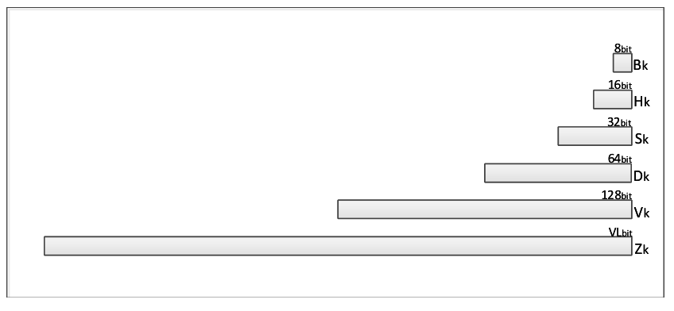
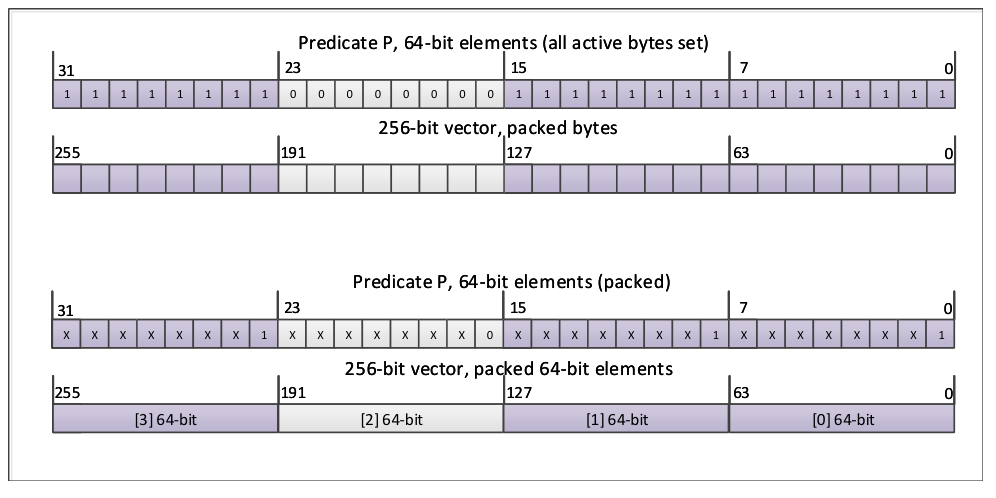
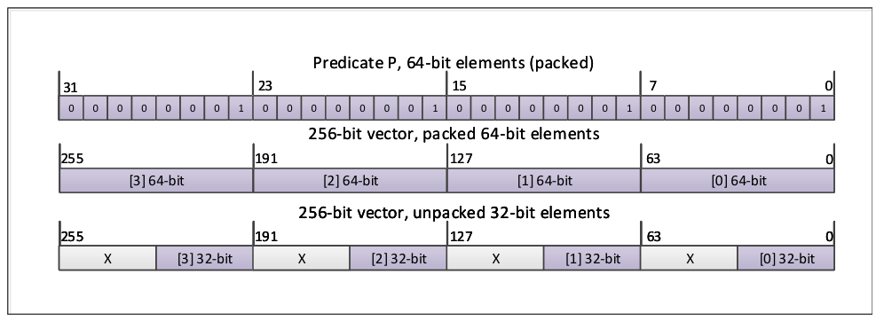
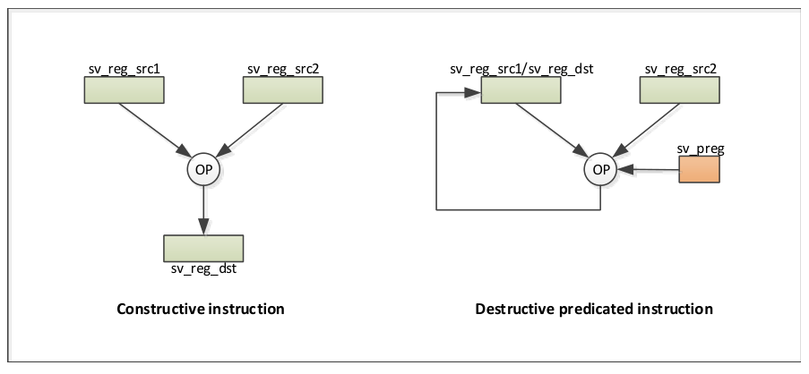
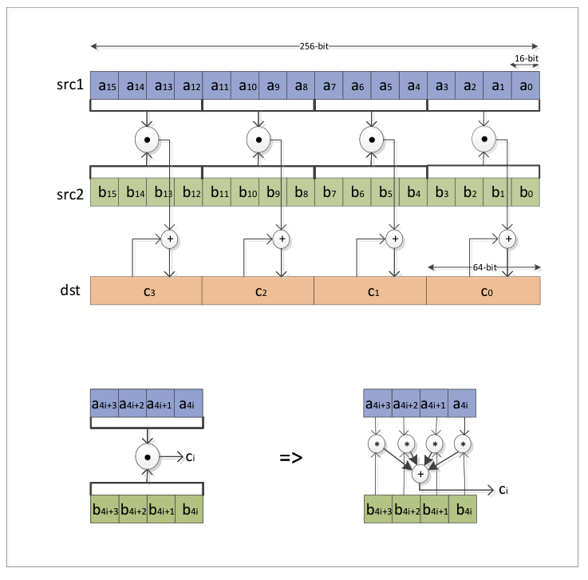
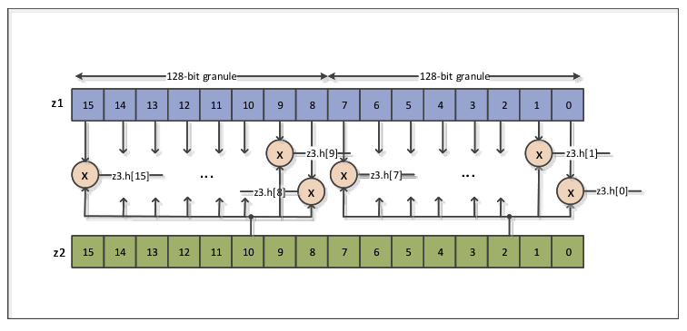
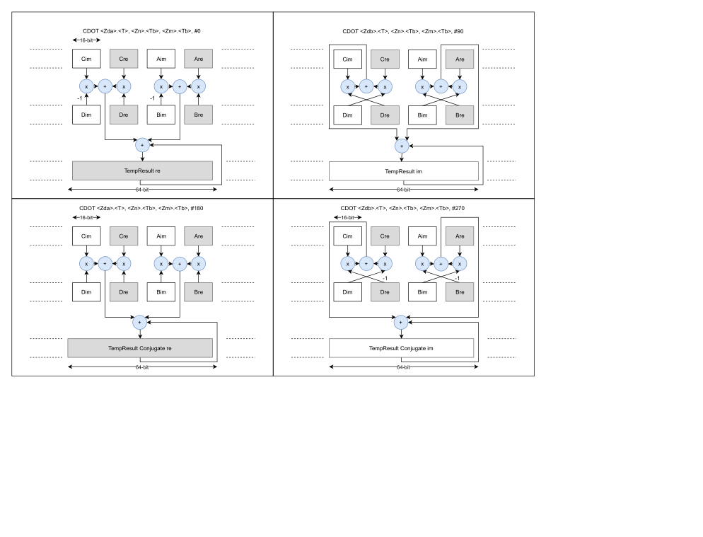
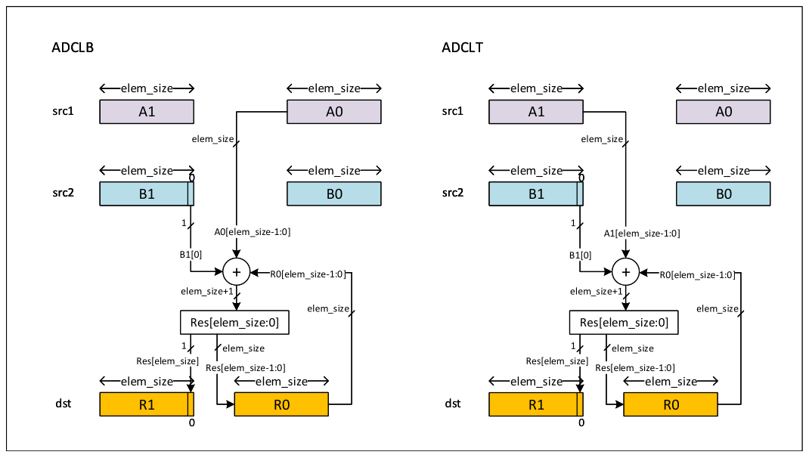

# 读懂 SVE/SVE2 编程示例（中文精读版）

> 原文：*SVE Programming Examples*（ARM-DAI-0548 REL-01.2）
>
> 版权 © 2019-2024 Arm Limited（或其关联公司）。保留所有权利。非保密。
>
> 说明：本文在原中文翻译的基础上重新组织了叙述逻辑与表达方式，技术内容、表格与图表保持原意；个别明显笔误已按 Arm 架构规范订正。

---

## 导读：这本书讲什么

这本书是 SVE / SVE2 的**编程实战手册**：前半部分（Part A）讲架构概念和"怎么写对"，后半部分（Part B/C/D）给出一批可落地的代码示例。

核心思想一句话：Neon 的向量长度**固定 128 位**，代码要迁到不同向量长度的硬件就得重编译；SVE 把向量长度做成**可扩展（128～2048 位）**，同一份二进制"编译一次，到处能跑"。这是**向量长度无关（vector length agnostic）编程**——代码里用 `svcntw()`/`WHILELT` 这类"运行时才知道长度"的机制，而不是硬编码 128 位。

全书分四部分：

- **Part A（A1–A6）**：SVE 架构基础（寄存器、谓词、条件标志）、编译器支持、指令集、向量长度无关编程方法、SVE2 指令创新、向量化示例。这是"读"的重点。
- **Part B（B1–B5）**：通用向量/矩阵运算示例——向量最大值、向量乘法、点积、FIR 滤波器、矩阵乘法。
- **Part C（C1–C3）**：计算机视觉示例——Sobel 滤波器、积分图、直方图。
- **Part D（D1–D3）**：字符串处理示例——跳过空白、跳过单词、字符串比较。

每个代码示例通常给三样东西：**C 参考实现**（朴素标量版，用来对答案）、**ACLE 内建函数实现**（向量长度无关的 C 代码）、以及**汇编清单**（展示编译器/SVE 指令的实际形态）。读代码时先看 C 参考实现理解算法，再看 ACLE 版理解"怎么用谓词 + 运行时长度"，最后看汇编验证指令。

## 1. 为什么要有 SVE：从固定向量到可扩展向量

Armv8-A 的 Advanced SIMD（Neon）只能操作 64 位或 128 位的**固定长度**向量。计算机视觉、机器学习、服务器、数据分析这些要海量数据处理的应用，显然想要更长的向量——但**没有一种向量长度适合所有应用**。

而且每次要新向量长度就重新定义一套指令集，编码成本太高。Arm 于是设计了一套**能在不同向量长度上扩展的单一指令集**，这就是 SVE（Scalable Vector Extension）。它的核心：

- 向量长度**运行时才知道**（最多 2048 位，必须是 128 位的倍数），代码动态适应，不用重写也不用重编译。
- 也支持为固定长度写的代码（向后兼容）。

Neon 向量化有个痛点：循环次数不是向量长度的整数倍时，得**向量循环 + 标量尾循环**两段。SVE 用**向量分区机制**解决——谓词控制"这个向量里哪些元素要参与运算"，把条件判断和控制流都转成**谓词化的向量操作**，循环收尾变得无缝，复杂嵌套循环也能向量化。

SVE 还提供**归约指令**：各向量通道先算部分结果，循环结束后用归约指令合成最终结果。

SVE2 是 SVE 的超集，主要补充了**完整的整数算术**支持（SVE 只有基本整数算术）。

## 2. 寄存器与谓词

SVE 寄存器组 = 向量寄存器 + 谓词寄存器。

**向量寄存器 Z0-Z31**：32 个，大小 VL 是 128 位的整数倍。低 128 位与 Neon 的 SIMD/浮点寄存器**重叠**——同一个寄存器 SVE 写、Neon 读，反之亦然：

*图 A1.1：SIMD/浮点寄存器与 SVE 寄存器*

向量元素可以是 8/16/32/64 位。注意：Advanced SIMD 或浮点指令写 SIMD/浮点寄存器时，对应 SVE 寄存器的 `bits[VL-1:128]`（高位）会被**清零**。

**谓词寄存器 P0-P15**：16 个，大小是向量寄存器的 1/8。每个 bit 对应向量寄存器的一个字节，决定对应的向量通道是否"活动"。谓词元素可以是 1/2/4/8 位，但只有**最低位**决定活动与否（bit[0]=1 活动），高位忽略。

谓词可以跨不同元素大小**复用**——只要"活动元素全 1、不活动元素全 0"地初始化：

*图 A1.2：打包元素的谓词复用示例*

*图 A1.3：非打包元素的谓词复用示例*

**首故障寄存器 FFR**：专用的类谓词寄存器，累积一串首故障/无故障加载的故障状态。加载完成后，FFR 里活动的元素表示"哪些连续向量元素装的是有效内存数据"。

**谓词条件标志**：SVE 不新增条件分支指令，而是**复用 AArch64 的 N/Z/C/V 标志**，赋予新含义。记住四个关键映射：

| AArch64 标志 | SVE 解释 |
| --- | --- |
| N | First：第一个活动元素是否为真 |
| Z | None：是否没有任何活动元素为真 |
| C | !Last：最后一个活动元素是否为假 |
| V | 仅用于序列化向量循环的终止检测 |

对应条件码也重载了：`EQ`→NONE（无活动元素为真）、`NE`→ANY、`HS/CS`→NLAST、`LO/CC`→LAST、`MI`→FIRST、`PL`→NFRST、`HI`→PMORE、`LS`→PLAST、`GE`→TCONT、`LT`→TSTOP。标志由 `PTEST` 或生成谓词的指令（CMP*、WHILE*、MOVS、NOTS 等）设置。

## 3. SVE 指令集概览

SVE 指令集由：加载/存储、浮点算术、整数算术、归约、类型/元素大小转换、位/逻辑运算、置换、谓词操作、循环控制组成。

**构造式 vs 破坏式**（一个关键概念）：

- **构造式**：目标寄存器与所有源寄存器都不同，源内容全保留。
- **破坏式**：某个源寄存器也是目标寄存器，内容被覆盖。

*图 A3.1：构造式与破坏式指令*

某些非交换运算的破坏式指令有**两种形态**：破坏第一个源寄存器的，和破坏第二个源寄存器的"反向"指令（助记符以 `R` 结尾）。还有 **MOVPRFX** 前缀指令，配合后面的破坏式指令合成一条构造式操作，还能把合并谓词转成清零谓词。

**加载/存储**（A3.3）是 SVE 的强项：

- **连续** LD1B/H/W/D、ST1B/H/W/D；结构式 LD[N]/ST[N]（N=2/3/4）。
- **广播** LD1RB/H/W/D（单元素）、LD1RQB/H/W/D（128 位组）。
- **收集/分散**（gather/scatter）：标量基址 + 向量偏移，或向量基址 + 立即数偏移。注意只有 32/64 位元素大小，且可能代价高（延迟大）。
- **无谓词** LDR/STR（整寄存器，不管端序）。
- **非临时** LDNT1*/STNT1*（提示不久不会再用，不必留缓存）。
- **首故障** LDFF1*（只对第一个活动元素的故障报异常，其余记入 FFR）；**无故障**加载（忽略所有活动元素故障）。
- **预取** PRFB/H/W/D。

**控制流**（A3.4）：谓词初始化（PTRUE/PFALSE、向量比较、WHILELT/WHILELS、逻辑运算、从内存加载）；索引初始化（INDEX）；谓词计数（CNTB/H/W/D 统计活动元素数，INC*/DEC* 按活动元素数增减）；条件跳出（BRKA/BRKB/BRKN 等，把向量比较结果转成截断当前迭代的分区谓词）。

**点积**（A3.5）：SDOT/UDOT，把每 4 个连续元素相乘求和，加到目标。

**复数浮点**（A3.6）：FCADD（复数加）、FCMLA（复数乘累加）。

*图 A3.2：实数点积指令*

*图 A3.3：按索引元素的向量指令*

## 4. 向量长度无关编程方法

这是全书最重要的方法论（A4）。核心：**代码里不要假设向量长度是 128 位**，用运行时长度机制来写循环。

**For/While 循环向量化**：Neon 的做法是"向量化主循环 + 标量尾循环"两段；SVE 用 `WHILELT` 生成谓词，一次循环处理"当前向量长度能装下"的元素，循环体完全一样，没有标量尾：

- 谓词 `WHILELT p.s, x, n` 表示"x 到 x+VL 中 < n 的通道为真"。
- 用 `svld1(p, ptr)` 谓词加载、`svadd(p, ...)` 谓词运算、`svst1(p, ...)` 谓词存储。
- 循环计数器用 `INCD x` 按"实际处理的元素数"递增。

**Do-while 循环**：适合"至少执行一次"的循环，结构更紧。

**带宽利用技巧**（A4.3）：有效向量长度带宽 = 实际处理元素数 / 向量长度。要点是让每次迭代尽量装满整个向量、减少部分向量（尾循环）的出现频率。

## 5. SVE2 的指令集创新

SVE2（A5）在 SVE 基础上加的内容：

**加宽/收窄**：SVE2 用"顶部-底部"（Top-Bottom）处理方式，把 Neon 的加宽/收窄指令可扩展化。UADDLB/UADDLT（底部/顶部加长）、SADDLB/SADDLT 等，对应 Neon 的 UADDL/UADD2L。

**复数整数运算**：CADD（复数加）、CMLA（复数乘累加）、CDOT（复数点积）。

*图 A5.1：复数点积与旋转参数*

**其他**：元素大小转换、成对指令、位置换（BDEP/BEXT/...）、直方图加速、字符串处理加速（MATCH/NMATCH）、多精度算术（ADCLB/ADCLT）、密码学（SM4E 等）。

*图 A5.2：多精度算术指令 ADCLB 与 ADCLT*

## 6. 代码示例索引

Part B/C/D 的每个示例都遵循同一模式：**C 参考实现 → ACLE 向量长度无关实现 → 汇编清单**。读代码时先看 C 参考版理解算法，再看 ACLE 版学"谓词 + 运行时长度"的写法，最后看汇编验证生成的 SVE/SVE2 指令。完整代码见翻译版与 `code/16-sve-examples/`。

| 章节 | 示例 | 数据类型 | 关键技术 |
| --- | --- | --- | --- |
| B1 | 向量最大值 | 实数 16 位整数 | UMAXV 归约 + 部分结果 |
| B2 | 向量乘法 | 复数 16 位整数 | FCMLA / 复数乘累加 |
| B3 | 向量点积 | 复数 SP / 实数 HP / 复数 16 位整数 | SDOT/UDOT/CDOT 点积 |
| B4 | FIR 滤波器 | 实数 SP / 16 位整数 | 滑动窗口 + 乘累加 |
| B5 | 矩阵乘法 | DP / HP / 8 位整数→32 位 | 分块 + 点积/乘累加 |
| C1 | Sobel 滤波器 | 实数 SP | 3×3 二维卷积 |
| C2 | 积分图 | 实数 SP | 前缀和 / 垂直和 |
| C3 | 直方图 | 8 位像素 | 直方图加速指令 |
| D1 | 跳过空白 | 字符 | MATCH/NMATCH |
| D2 | 跳过单词 | 字符 | MATCH + 归约 |
| D3 | 字符串比较 | 字符 | MATCH + 首故障 |

## 7. 相关资源

《SVE》ARM 补充、《Armv8-A 架构参考手册》、Arm HPC 工具与库、带 SVE 支持的 AAPCS、SVE 的 ACLE，以及 Arm Developer 站点。
