# 读懂 Arm GICv3/v4 中断控制器（中文精读版）

> 原文：*Learn the architecture - Generic Interrupt Controller v3 and v4, Overview*
>
> 版本：Version 3.2　|　文档 ID：198123_0302_03_en　|　Issue 03（2025-04-22）
>
> 版权 © 2021, 2025 Arm Limited（或其关联公司）。保留所有权利。非保密。
>
> 说明：本文在原中文翻译的基础上重新组织了叙述逻辑与表达方式，技术内容、表格与图表保持原意；个别明显笔误已按 GIC 架构规范订正。

---

## 导读：这篇文章讲什么

**中断**是发给处理器、表示"有事件发生、需要处理"的信号。当外设（比如 UART 收到一字节数据）需要 CPU 介入时，它就用中断来通知处理器。

小系统可能只有几个中断源和一颗核；大型 SoC 则可能有成百上千个中断源和几十颗核。谁来把这么多中断「收集起来 → 划分优先级 → 送到正确的核」？答案就是**通用中断控制器（Generic Interrupt Controller，GIC）**。

本文介绍 Arm GICv3 和 GICv4 的核心机制，并一步步说明如何在**裸机**下把 GIC 配置起来、写中断处理器。读完你应当能：

- 说出四种中断类型（SGI / PPI / SPI / LPI）以及它们如何按 INTID 区分；
- 画出中断状态机，理解 level-sensitive 与 edge-triggered 的差别；
- 讲清三种安全分组（Group 0 / Secure Group 1 / Non-secure Group 1）和 FIQ/IRQ 的路由规则；
- 照着步骤初始化 GIC（GICD → GICR → ICC_*），并写出 ac​knowledge/EOI 的中断处理流程；
- 知道运行优先级（running priority）、二进制点（Binary Point）如何控制抢占，EOImode 如何区分优先级下降与撤销激活。

**前置知识**：本文假设你熟悉 Arm 异常模型（不熟先读《AArch64 Exception model》）。文中只讲 AArch64、双安全状态、亲和性路由开启、各 EL 都用系统寄存器访问的场景；不涉及传统操作（Legacy operation）和 AArch32。

> 本文是 GIC 系列第一篇，后续还有《局域性外设中断（LPI）》和《虚拟化》两篇。

## 1. 为什么需要 GIC，以及它的演进

GIC 从外设接收中断，划分优先级，再投递给合适的核。下图是一个 GIC 接收 n 个外设中断、分发到两个处理器的例子：

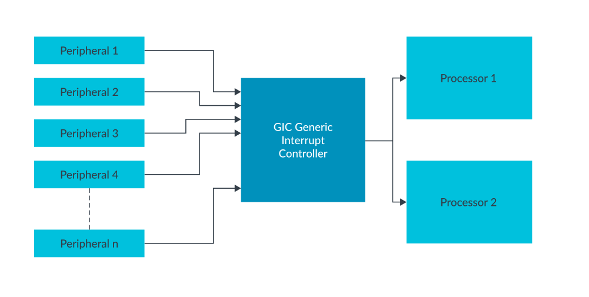

*图 3-1：GIC 示例*

GIC 是 Arm Cortex-A / Cortex-R 系列的标准中断控制器，从单核一路扩展到数百核的多芯片设计都适用。它的架构与 Arm 架构同步演进：

| GIC 版本 | 关键特性 | 典型搭配 |
| --- | --- | --- |
| GICv1 | 最多 8 个 PE；最多 1020 个中断 ID；两种安全状态 | Cortex-A5/A9 MPCore、Cortex-R4/R5/R7/R8 MPCore |
| GICv2 | GICv1 全部特性 + 虚拟化 | Cortex-A7/A15/A17 MPCore |
| GICv3 | GICv2 全部特性 + 超过 8 个 PE + 消息信号中断（MSI）+ 超过 1020 个中断 ID + **CPU 接口改为系统寄存器访问** + 分离 Secure 与 Non-secure Group 1 的增强安全模型 | Cortex-A3x/A5x/A7x MPCore |
| GICv4 | GICv3 全部特性 + 虚拟中断直接注入 | Cortex-A3x/A5x/A7x MPCore |

GICv3/v4 后来还有几个小版本：**GICv3.1**（更多接线下中断、安全虚拟化、MPAM）、**GICv3.2**（Armv8-R AArch64）、**GICv3.3**（不可屏蔽中断 NMI）、**GICv4.1**（虚拟 SGI 直接注入）、**GICv4.2**（直接注入不可屏蔽虚拟中断）。GICv2m 是 GICv2 加 MSI 的扩展。

## 2. 四种中断类型

GIC 处理四类中断源，每类都由 INTID（中断 ID 号）范围定义：

| INTID | 类型 | 说明 |
| --- | --- | --- |
| 0 – 15 | **SGI**（软件生成中断） | 按 PE 分组存放（banked per PE）；用于处理器间通信，靠写 GIC 的 SGI 寄存器触发 |
| 16 – 31；1056 – 1119（GICv3.1） | **PPI**（私有外设中断） | 按 PE 分组存放；只属于一个核。典型例子是通用定时器中断 |
| 32 – 1019；4096 – 5119（GICv3.1） | **SPI**（共享外设中断） | 可投递给任意已连接核 |
| 1020 – 1023 | 特殊中断号 | 表示特殊情况（如伪中断），见 §7.2 |
| 1024 – 8191 | 保留 | – |
| 8192 及以上 | **LPI**（局域性外设中断） | GICv3 引入，编程模型完全不同；上界为实现定义 |

一句话记忆：**SGI 是"软件之间"、PPI 是"一个核自己的外设"、SPI 是"大家共享的外设"、LPI 是"只能发包（MSI）且模型特殊的"**。

## 3. 中断怎么传到 GIC：专用信号 vs 消息信号

传统做法是每个中断源拉一条专用硬件信号线到中断控制器：

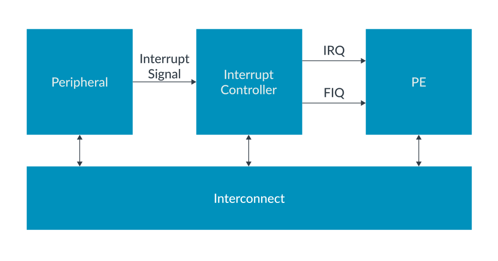

*图 4-1：专用中断信号*

GICv3 在此基础上多给了一种机制——**消息信号中断（MSI）**：外设通过写中断控制器里的一个寄存器来"发消息"，不再需要专用信号线：

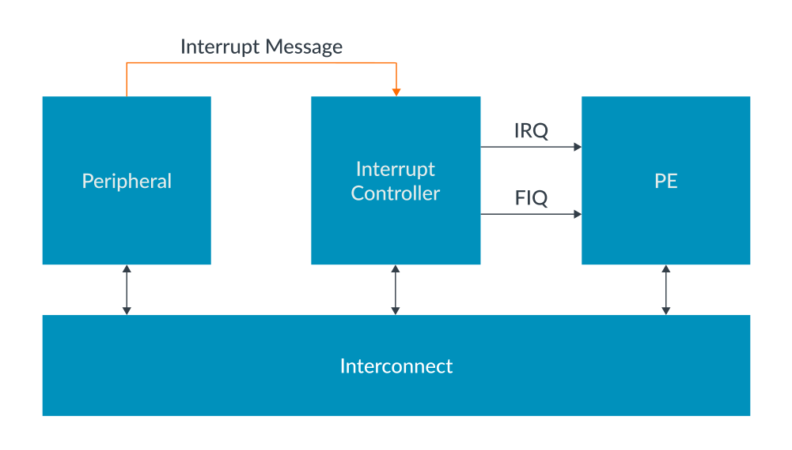

*图 4-2：消息信号中断*

对大型 SoC 来说，省掉成百上千条横跨芯片的信号线是巨大优势。两种方式对**中断处理代码几乎无差别**，只是外设侧可能要配置目标地址。具体哪类中断用什么寄存器：

| 中断类型 | 寄存器 |
| --- | --- |
| SPI（作为 MSI） | `GICD_SETSPI_NSR` 断言一个中断 |
| LPI（始终是 MSI） | `GITS_TRANSLATER`（经 ITS 转译） |

> 注意：**LPI 永远是消息信号中断**；SPI 可以是消息信号中断，也可以走专用信号线。

## 4. 中断状态机

GIC 为每个 SPI/PPI/SGI 维护一个四状态状态机：

- **非激活 Inactive**：中断源当前未被断言；
- **挂起 Pending**：已被断言，但还没被任何 PE 确认；
- **激活 Active**：已被断言，且被某个 PE 确认；
- **激活并挂起 Active and Pending**：一个实例已被确认，又有一个新实例挂起。

（LPI 的状态机更简单，见 §7.2。）

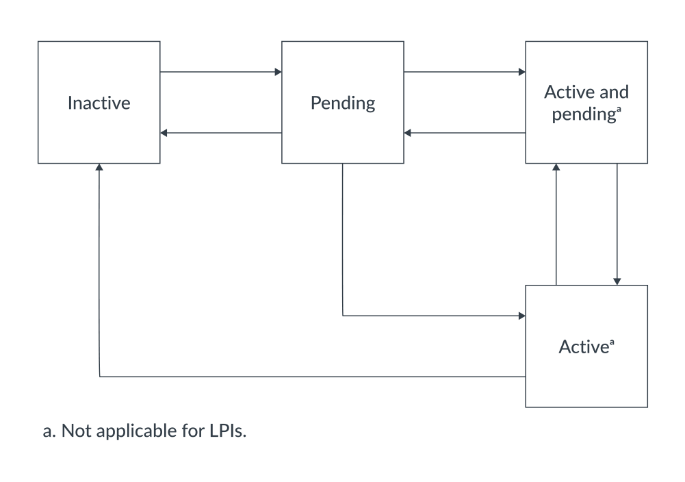

*图 4-3：中断状态机*

状态如何流转，取决于中断被配成**电平敏感（level-sensitive）**还是**边沿触发（edge-triggered）**，以及软件在 IAR/EOIR 上的动作。

### 4.1 电平敏感中断

电平敏感中断：输入上升沿让它变挂起，并且**一直保持断言**，直到外设把信号拉低。流程：

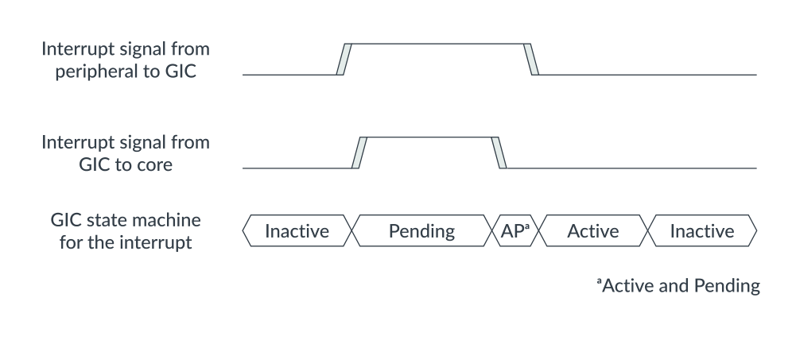

*图 4-4：电平敏感时序*

1. **非激活 → 挂起**：外设断言。若中断已使能且优先级够，GIC 向 PE 发中断信号；
2. **挂起 → 激活并挂起**：PE 读 IAR 确认。GIC 撤销给 PE 的中断信号；
3. **激活并挂起 → 激活**：外设**撤销**信号（通常是软件清外设状态寄存器的响应）；
4. **激活 → 非激活**：PE 写 EOIR，表示处理完毕。

关键点：电平敏感中断在 IAR 之后还停在"激活并挂起"，必须等**外设侧**把电平拉低才能走到"激活"，否则写 EOI 后会再次被当成新中断。

### 4.2 边沿触发中断

边沿触发中断：输入上升沿让它变挂起，但**不会一直保持**。流程：

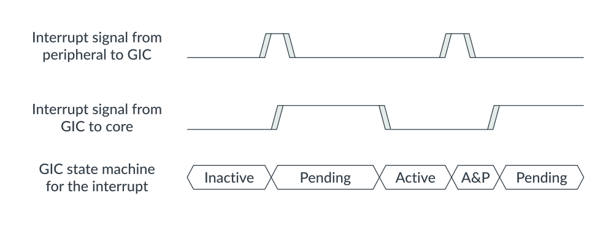

*图 4-5：边沿触发时序*

1. **非激活 → 挂起**：外设断言，GIC 发信号；
2. **挂起 → 激活**：PE 读 IAR（也可用轮询）；
3. **激活 → 激活并挂起**：外设**再次**断言；
4. **激活并挂起 → 挂起**：PE 写 EOIR，GIC 重新向 PE 发信号。

与电平敏感的差别：边沿触发在 IAR 时直接从"挂起"落到"激活"，中间那一格"激活并挂起"只会在处理期间又有新边沿到来时出现。**SGI 永远被当作边沿触发**。

## 5. 亲和性：中断如何找到目标核

Arm 给每个 PE 一个分层标识叫**亲和性（affinity）**，32 位，四段：

```text
<affinity level 3>.<affinity level 2>.<affinity level 1>.<affinity level 0>
```

PE 的亲和性由 `MPIDR_EL1` 报告。每个 level 的具体含义由处理器/SoC 定义，例如 A53/A57 用「组套组 / 处理器组 / 处理器 / 核」，A55/A76 用「处理器组 / 处理器 / 核 / 线程」。一个移动 SoC 可能长这样：

```text
0.0.0.[0:3]   Cortex-A53 的 0–3 号核
0.0.1.[0:1]   Cortex-A57 的 0–1 号核
```

> AArch32（及 Armv7-A）只支持三级亲和性，会退化成 level 3 只有一个节点（0.x.y.z）；`GICD_TYPER.A3V` 说明控制器是否支持多 level-3 节点。

SPI 的目标靠 `GICD_IROUTERn` 指定，有两种模式（见 §8.5）：定点投递给某个 PE，或「1-of-N」由分发器任选一个核。

## 6. 安全模型：三个分组与 FIQ/IRQ 路由

GICv3 支持 TrustZone，每个 INTID 都必须被软件分配一个分组：

| 分组 | 典型用途 |
| --- | --- |
| **Secure Group 0** | 面向 EL3（安全固件） |
| **Secure Group 1** | 面向 Secure EL1（可信 OS） |
| **Non-secure Group 1** | 面向非安全态（OS / Hypervisor） |

基本规则：**Group 0 永远以 FIQ 发出**；Group 1 则依 PE 当前安全状态与 EL 以 IRQ 或 FIQ 发出：

| PE 的 EL 与安全状态 | Group 0 | Group 1（Secure） | Group 1（Non-secure） |
| --- | --- | --- | --- |
| Secure EL0/1 | FIQ | IRQ | FIQ |
| Non-secure EL0/1/2 | FIQ | FIQ | IRQ |
| EL3 | FIQ | FIQ | FIQ |

记忆：**"自己人"走 IRQ，"外人"走 FIQ**——在当前安全状态下，本态 Group 1 是 IRQ，对侧 Group 1 是 FIQ（送到 EL3 让安全监视器做上下文切换），Group 0 永远 FIQ。下图是路由示例（`SCR_EL3` 把 IRQ 路由到 EL1、FIQ 路由到 EL3）：

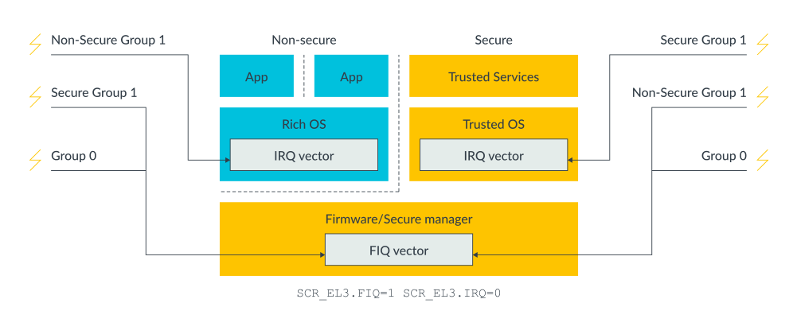

*图 4-6：中断路由示例*

要点补充：

- 只有 Secure 态软件能分配分组、访问安全中断的设置与状态；非安全访问可用 `GICD_NSACRn`/`GICR_NSACR` 逐 INTID 打开；
- **LPI 永远是 Non-secure Group 1**；
- 实现 Armv9-A Realm 管理扩展时，GIC 把 Realm 态当作非安全态的扩展；
- GIC 可配成单安全状态（`GICD_CTLR.DS==1`，常见于 Cortex-R 搭配），此时只有一种 Group 语义。

## 7. 三块编程接口，以及各自管什么

GICv3 的寄存器接口分三块：

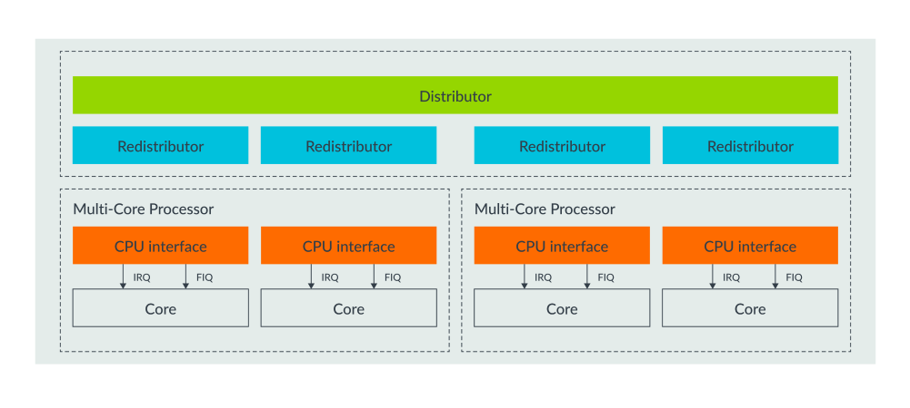

*图 4-7：编程接口*

| 接口 | 访问方式 | 职责 |
| --- | --- | --- |
| **分发器 Distributor** | 内存映射 `GICD_*` | 配置 **SPI**：优先级、分发、使能/禁用、触发方式、路由、激活/挂起状态、生成 MSI SPI、选亲和性/传统模式 |
| **再分发器 Redistributor** | 内存映射 `GICR_*`，每核一份 | 配置 **SGI/PPI**：使能/禁用、优先级、触发方式、分组、状态，以及 LPI 数据结构的基址、PE 电源管理 |
| **CPU 接口 CPU interface** | **系统寄存器** `ICC_*_ELn` | 中断**处理**：通用控制、确认中断、优先级下降/撤销激活、优先级掩码、抢占策略、最高优先级挂起中断 |

> GICv3 与 GICv2 最大的差异之一：**CPU 接口从内存映射寄存器变成了 `ICC_*_ELn` 系统寄存器**，用 `MRS`/`MSR` 访问。用之前先置 `ICC_SRE_ELn.SRE`（很多新 Cortex 该位固定为 1，可跳过）。

## 8. 如何配置 GIC

配置分三档：**全局**、**每个 PE**、**每个 INTID**。裸机下的标准顺序如下。

### 8.1 全局：GICD_CTLR

`GICD_CTLR` 要开亲和性路由 + 各分组使能：

- `ARE` 位：置 1 用 GICv3 模式（置 0 是传统模式，兼容 GICv2，已废弃）；
- `EnableGrp0` / `EnableGrp1S` / `EnableGrp1NS`：分别使能 Group 0 / Secure Group 1 / Non-secure Group 1 的分发。

> Arm GIC-600 不支持传统操作，ARE 永久为 1。

### 8.2 每个 PE：唤醒再分发器 + CPU 接口

**① 把 PE 标记为在线**（复位后所有 PE 都算离线，离线时中断只会变成唤醒信号而非真正投递）：

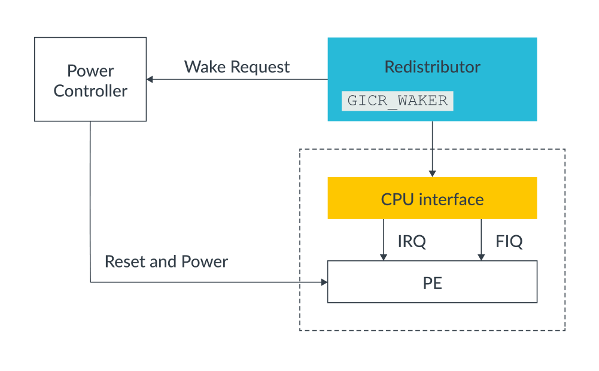

*图 5-1：PE 与再分发器相连*

```text
清 GICR_WAKER.ProcessorSleep = 0   →   轮询 GICR_WAKER.ChildrenAsleep 直到 = 0
```

必须先做这两步再配 CPU 接口，否则行为 UNPREDICTABLE。

**② 配置 CPU 接口**：

- 置 `ICC_SRE_ELn.SRE` 使能系统寄存器访问（新内核可略）；
- 设 `ICC_PMR_EL1`（优先级掩码，低于它就不投递）与 `ICC_BPRn_EL1`（二进制点，控制抢占，见 §9.4）；
- 设 `ICC_CTLR_EL1.EOImode`（决定"优先级下降 + 撤销激活"是否合并，见 §9.5）；
- 写 `ICC_IGRPEN1_EL1`/`ICC_IGRPEN0_EL1` 使能各分组信号。

**③ 配置 PE 本身**：`SCR_EL3` / `HCR_EL2` 路由位（复位值未知，必须初始化）、清 PSTATE 屏蔽位、设 `VBAR_ELn` 指向向量表。

### 8.3 每个 INTID：五个属性

SPI 用 `GICD_*`、PPI/SGI 用 `GICR_*`，配置五个属性：

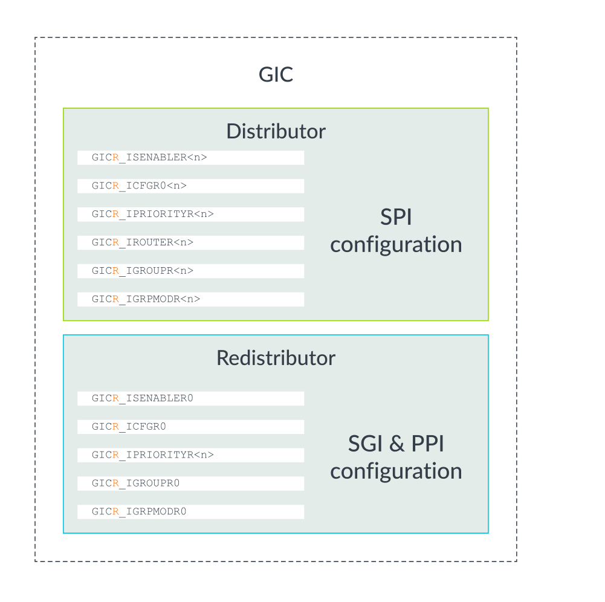

*图 5-2：配置寄存器*

| 属性 | 寄存器 | 说明 |
| --- | --- | --- |
| 优先级 | `GICD_IPRIORITYn` / `GICR_IPRIORITYn` | 8 位无符号，**0x00 最高、0xFF 最低**。实现可只做 5 位（双安全态）或 4 位（单安全态） |
| 分组 | `GICD_IGROUPn`/`IGRPMODn` / `GICR_IGROUPn`/`IGRPMODn` | 三个分组三选一 |
| 触发方式 | `GICD_ICFGRn` / `GICR_ICFGRn` | 边沿触发或电平敏感；SGI 恒为边沿（寄存器表现 RAO/WI） |
| 使能 | `GICD_ISENABLERn`/`ICENABLERn` 等 | 每 INTID 一位；用置位/清零寄存器避免读-改-写 |
| 不可屏蔽（GICv3.3+） | – | 该中断高于同组其它中断；仅 Secure/Non-secure Group 1 可标 |

> 建议先配好这些再使能 INTID。要改配置（尤其改分组）时，先禁用该中断。大多数配置寄存器复位值是实现定义的。

### 8.4 GICv3.1 的扩展 INTID

GICv3.1 新增的 SPI/PPI 用同款寄存器 + 「E」后缀，例如 `GICR_ISENABLERnE` 对应新增 PPI 的使能位。

### 8.5 给 SPI 指定目标：GICD_IROUTERn

每个 SPI 都有一个 `GICD_IROUTERn`（扩展 SPI 是 `GICD_IROUTERnE`），`Interrupt_Routing_Mode` 决定路由：

- `0`：投给寄存器里指定的亲和性坐标 A.B.C.D；
- `1`：**1-of-N**，由分发器任选一个参与该分组的 PE，目标可每次不同。

PE 可用 `GICR_CTLR` 的 `DPG1S`/`DPG1NS`/`DPG0` 选择不接收 1-of-N 中断。

## 9. 处理中断的完整流程

### 9.1 五个检查：决定中断送往哪个 PE

一个中断转为挂起后，GIC 依次检查是否投递、投给谁：

1. **分组已使能**？（对应分组的分发器 + CPU 接口使能位都置位，否则停在挂起态）
2. **该中断已使能**？
3. **路由控制**：SPI 看 `GICD_IROUTERn`、LPI 看 ITS、PPI 只能本核、SGI 由发送方定目标列表。
4. **优先级 ≥ 优先级掩码**？（`ICC_PMR_EL1`，低于掩码不投）
5. **优先级 > 运行优先级**？（`ICC_RPR_EL1`；空闲时运行优先级为 0xFF）

全通过就以 IRQ 或 FIQ 投递给目标核。

### 9.2 接受中断：读 IAR

进异常处理器时软件并不知道来的是哪个中断，必须读 IAR 拿 INTID：

| 寄存器 | 用途 |
| --- | --- |
| `ICC_IAR0_EL1` | 确认 Group 0（通常在 FIQ 处理里读） |
| `ICC_IAR1_EL1` | 确认 Group 1（通常在 IRQ 处理里读） |
| `ICC_NMIAR1_EL1` | 确认不可屏蔽 Group 1（仅 GICv3.3） |

读 IAR 返回 INTID 并推进状态机（IAR 一般进处理函数就读，也允许轮询）。可能返回保留 ID：

| ID | 什么情况下返回 | 场景 |
| --- | --- | --- |
| 1020 | 读 `ICC_IAR0_EL1`，最高挂起是 **Secure Group 1**（仅 EL3 可见） | 非安全态执行时有可信 OS 中断，FIQ 进 EL3，监视器要做上下文切换 |
| 1021 | 读 `ICC_IAR0_EL1`，最高挂起是 **Non-secure Group 1**（仅 EL3 可见） | 安全态执行时有富 OS 中断，FIQ 进 EL3 切到富 OS |
| 1022 | 读 `ICC_IAR1_EL1`，最高挂起是**不可屏蔽** Non-secure Group 1 | 不可屏蔽中断用专门寄存器确认 |
| 1023 | **伪中断**：没有够优先级的挂起 INTID | 轮询时表示"没活可干" |

返回保留值意味着**没有真正确认**任何中断。

### 9.3 一个走 FIQ 到 EL3 的例子

来电（调制解调器）中断是 Non-secure Group 1，预期由富 OS 处理：

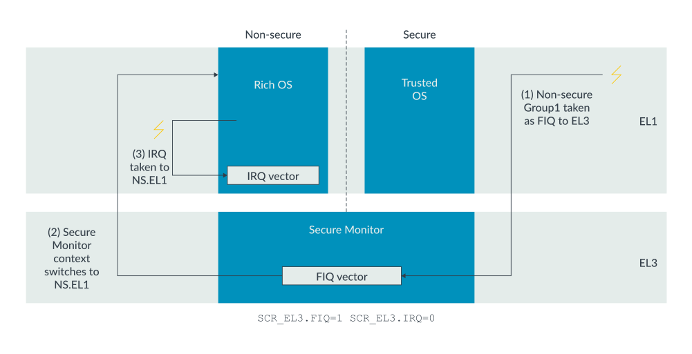

*图 6-1：处理中断*

1. PE 在 Secure EL1 跑可信 OS 时，调制解调器中断挂起 → 因为是 Non-secure Group 1，走 FIQ；`SCR_EL3.FIQ==1` → 异常进 EL3；
2. EL3 的监视器读 IAR，得到 **1021**（"该中断应在非安全态处理"），做上下文切换；
3. PE 进非安全态后，中断改走 IRQ，送到 Non-secure EL1 给富 OS。

如果希望先让可信 OS「收拾干净」再让出，可把 `SCR_EL3.FIQ` 设为 0，让 FIQ 先落 Secure EL1：

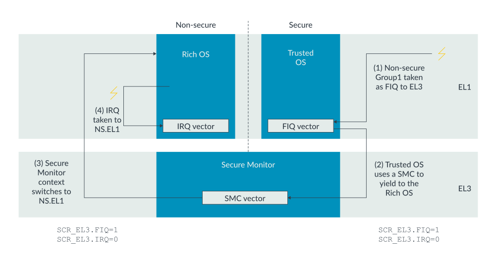

*图 6-2：另一种路由模型*

此时可信 OS 处理完内部状态后用 `SMC` 让出，SMC 异常进 EL3，监视器切到非安全态，中断再以 IRQ 投给富 OS。两种模型的核心差别只在「FIQ 谁先接」。

### 9.4 运行优先级与抢占

确认一个中断后，PE 的**运行优先级**就变成该中断的优先级，写 EOI 后再恢复原值。运行优先级由 `ICC_RPR_EL1` 报告：

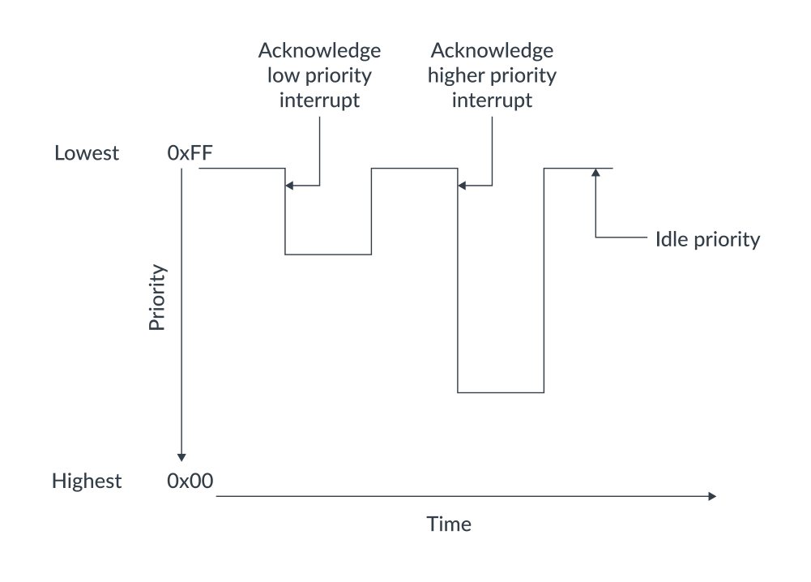

*图 6-3：运行优先级随时间变化*

**抢占**：PE 正在处理低优先级中断时，来了个更高优先级中断，后者抢占前者。不开抢占，高优先级中断会被低优先级的阻塞：

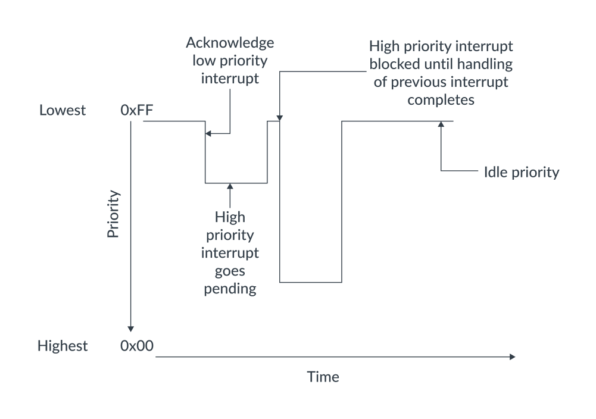

*图 6-4：无抢占的情况*

开抢占后，高优先级中断一到就切过去（可多层嵌套）：

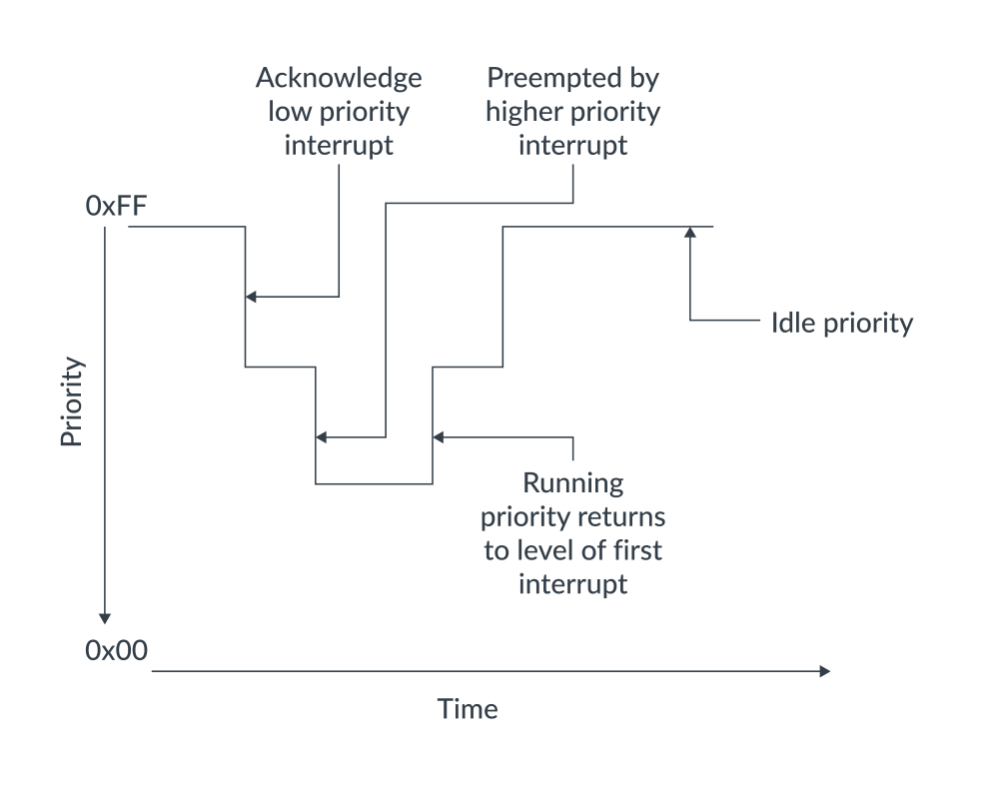

*图 6-5：有抢占的情况*

抢占的阈值由 **`ICC_BPRn_EL1`（二进制点）**控制：它把 8 位优先级切成「组优先级 + 子优先级」两段，抢占只比**组优先级**：


*图 6-6：8 位优先级值*

例：A=0x10、B=0x20、C=0x21，想让「A 能抢 B/C，但 B 不能抢 C」。把切分点放在 N=4，B 与 C 的组优先级相同（0x2），互不抢占；A 组优先级 0x1，更高，能抢谁：


*图 6-7：组优先级*

> 二进制点只影响「抢占是否发生」，不影响「多个挂起中断之间选谁」——后者始终按完整优先级比。

### 9.5 中断结束：优先级下降 vs 撤销激活

处理完要通知 GIC，让它把状态机推进。GICv3 把 EOI 拆成两件事：

- **优先级下降（priority drop）**：运行优先级退回中断前的值；
- **撤销激活（deactivation）**：把该中断状态机从 Active 拉回 Inactive。

两者是一起做还是分开做，看 `ICC_CTLR_ELn.EOImode`：

| EOImode | 写 EOI | 再写 `ICC_DIR_EL1` | 适用 |
| --- | --- | --- | --- |
| `0` | 一步完成下降 + 撤销激活 | 不需要 | 简单裸机，最常用 |
| `1` | 只做优先级下降 | 需要，才能撤销激活 | 虚拟化（hypervisor） |

> 「优先级下降」和「撤销激活」分开，是 hypervisor 做中断虚拟化/抢占控制的关键：可以让 VM 先下降优先级（允许更高优先级中断进来），再在别处延迟撤销激活。

### 9.6 查询中断状态

- `ICC_HPPIR0_EL1`/`ICC_HPPIR1_EL1`：报告本 PE 最高优先级挂起中断的 INTID；
- `ICC_RPR_EL1`：报告当前运行优先级；
- `GICD_ISACTIVERn`/`ICACTIVERn`（SPI）与 `GICR_ISACTIVERn`/`ICACTIVERn`（SGI/PPI）：读/写各 INTID 的激活/挂起状态——写 1 置位、写 0 无效，可用于**不接外设直接摆弄状态测试配置**。

（非安全态看不到 Group 0 / Secure Group 1 的状态，除非 `GICD_NSACRn`/`GICR_NSACRn` 放行。）

## 10. 软件生成中断（SGI）

SGI 是软件写寄存器制造的中断，用于核间通信。写 CPU 接口的寄存器生成：

| 寄存器 | 产生什么 |
| --- | --- |
| `ICC_SGI0R_EL1` | Secure Group 0 中断 |
| `ICC_SGI1R_EL1` | 本安全态的 Group 1 中断 |
| `ICC_ASGI1R_EL1` | 对侧安全态的 Group 1 中断 |

寄存器格式（`ICC_SGI1R_EL1`）：

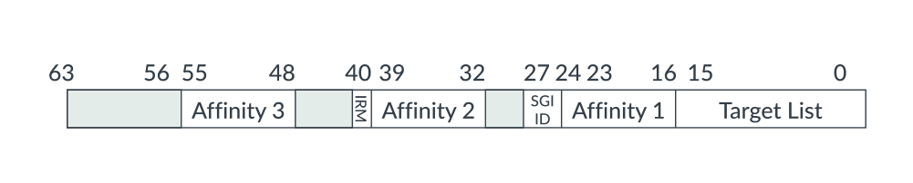

*图 7-1：SGI 寄存器*

- **SGI ID**：选 INTID 0–15；
- **IRM（路由模式）**：`0` 按 `aff3.aff2.aff1.<TargetList>` 定向（每 aff0 一位，最多 16 个 PE，可含自己）；`1` 发给所有 PE **除自己**；
- **转发判定**：结合「源 PE 安全态 + 写入的寄存器 + 接收方 `GICR_IGROUPR0`/`IGRPMODR0` 配置」决定是否转发（Secure 态软件可发任意 SGI；非安全态能否发安全 SGI 由 `GICR_NSACR` 控制）。完整判定表见翻译版 §7.4。

### GICv3 vs GICv2：SGI 的存放差异

- **GICv2**：SGI 按「源 PE + 目标 PE」双重 banked，同一 INTID 最多可同时挂起 8 份（每个源一次）；
- **GICv3**：SGI 只按目标 PE banked，同一 INTID 只挂起一份。

例：A、B 同时给 C 发 SGI INTID 5：

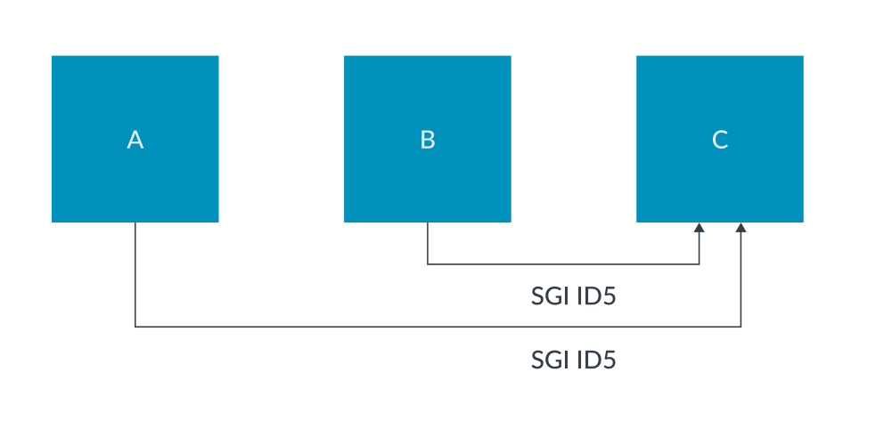

*图 7-2：多个发送者示例*

GICv2 下 C 收两个中断（靠 `GICC_IAR` 返回 INTID 前带源 PE ID 前缀区分）；GICv3 下 C 只收一个（ID=5 无前缀）——除非 C 在第二个到达前就确认了第一个。

## 11. 知识自测

**Q1：GICv3 的四种中断类型？怎么区分？**
A：SGI（0–15）、PPI（16–31）、SPI（32–1019）、LPI（≥8192）——看 INTID 即可分辨类型。

**Q2：三个中断分组分别给谁用？**
A：Group 0 → EL3 固件；Secure Group 1 → 安全态软件；Non-secure Group 1 → 非安全内核/hypervisor。LPI 恒为 Non-secure Group 1。

**Q3：中断处理器读哪个寄存器得知接受了哪个中断？**
A：`ICC_IAR0_EL1` 或 `ICC_IAR1_EL1`。

**Q4：复位后所有 PE 都算离线，怎么把 PE 标成在线？**
A：清该 PE 再分发器的 `GICR_WAKER.ProcessorSleep=0`，再轮询 `ChildrenAsleep` 到 0。

**Q5：GIC 为每个中断源存哪些配置？**
A：使能、优先级、触发方式（边沿/电平）、分组、目标（仅 SPI）。

**Q6：PE 能给自己发 SGI 吗？**
A：能（IRM=0 且目标列表含自己）。

**Q7：PE 已在处理中断时，什么决定别的中断能否抢占它？**
A：新中断的优先级 + `ICC_BPRn_EL1` 二进制点值（抢占只比组优先级）。

## 12. 附录：传统操作（Legacy operation）

GICv3 可选支持「传统操作」以兼容 GICv2 软件，但**已废弃，最新 GIC 多不再支持**。开关是 `GICD_CTLR.ARE`：

- `ARE==0`：传统操作（兼容 GICv2）；
- `ARE==1`：GICv3 操作（亲和性路由）。

双安全态系统可对两种安全态分别开关，但只允许特定组合（图 12-1）。传统操作下 SGI 行为退回 GICv2（按源+目标双重 banked）。

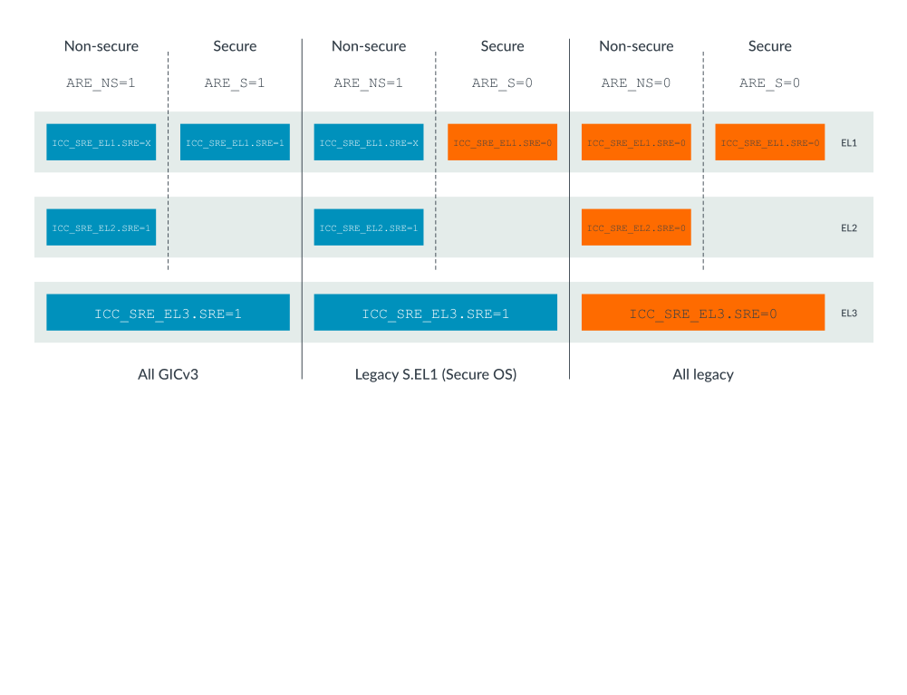

*图 12-1：支持的组合*