# 读懂 Arm SMMUv3 系统内存管理单元（中文精读版）

> 原文：*Learn the Architecture - SMMU Software Guide*
>
> 版本：Version 1.0　|　文档 ID：109242_0100_01_en　|　Issue 01（2023-09-04）
>
> 版权 © 2023 Arm Limited（或其关联公司）。保留所有权利。非保密。
>
> 说明：本文在原中文翻译的基础上重新组织了叙述逻辑与表达方式，技术内容、表格与图表保持原意。

---

## 导读：这篇文章讲什么

CPU 里有个 MMU 负责把虚拟地址（VA）转成物理地址（PA），那**外设做 DMA 时谁来管地址**？答案就是 **SMMU（System Memory Management Unit，系统内存管理单元）**——一个给 I/O 设备用的 MMU。

本文介绍 SMMUv3 的架构概念、操作与典型使用场景。读完你应当能：

- 说清 SMMU 的三大能力：**转换**（VA→PA）、**保护**（权限）、**隔离**（不同设备互不相干）；
- 理解 StreamID / SubstreamID 如何区分设备和子流，以及 STE / CD 两级配置结构；
- 讲清 Stage 1 / Stage 2 两阶段转换，以及旁路（bypass）的三种形式；
- 照着 §4.11 的「最小配置」步骤，在裸机下把 SMMU 初始化起来；
- 知道命令队列 / 事件队列如何协同（PROD/CONS + CMD_SYNC）；
- 了解 SMMU 的经典使用场景（分散-聚集、32 位设备、设备隔离、SVA、VM 设备分配等）。

**前置知识**：熟悉 AArch64 VMSA（先读《AArch64 内存管理》和《AArch64 内存属性与特性》）。本指南是《SMMUv3 架构规范》的补充而非替代。

## 1. SMMU 是什么：给 DMA 用的 MMU

SMMU 做的事和 PE 里的 MMU 一样——**转换地址**，只不过对象是**来自外设的 DMA 请求**，在这些请求进入系统互连之前把地址转好：

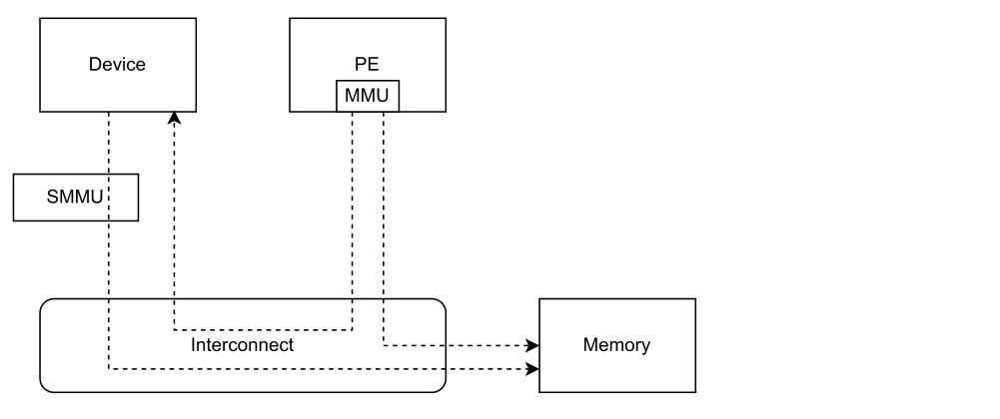

*图 2-1：SMMU 的作用*

注意方向：SMMU 只管「从设备出发」的传输（DMA），不管「发给设备」的传输（那由 PE 的 MMU 管）。

SMMU 提供三样能力：

| 能力 | 含义 |
| --- | --- |
| **转换 Translation** | 把设备给的地址从 VA 空间转换到系统 PA 空间 |
| **保护 Protection** | 用转换表权限阻止设备对特定区域的读/写/执行 |
| **隔离 Isolation** | 即使多个设备共连一个 SMMU，也能按设备区分，各自用不同的转换表和权限 |

区分设备的钥匙是 **StreamID**——它唯一标识一条「传输流」，SMMU 据此对每个流做不同转换/检查。

下图是一个 SMMU 连了两个设备（GPU + DMA 引擎）的例子，可各自配置独立的转换表：

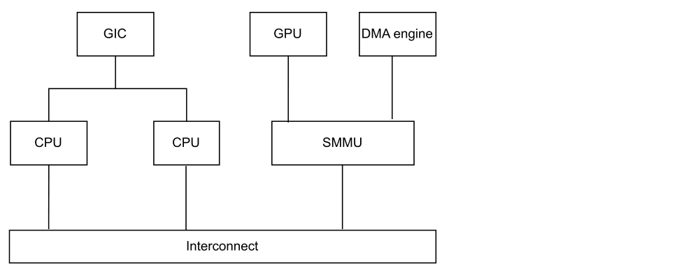

*图 2-2：包含 SMMU 的系统拓扑简化示例*

**两阶段转换**（类似 PE 虚拟化扩展，可各自独立启用）：

```text
VA --(Stage 1)--> IPA --(Stage 2)--> PA
```

- **Stage 1** 给软件实体（OS / 用户空间应用）用，在其地址空间内做隔离；
- **Stage 2** 给虚拟化系统用，把设备 DMA 虚拟化到客户机 VM 地址空间。

## 2. 一次传输怎么走：转换流程

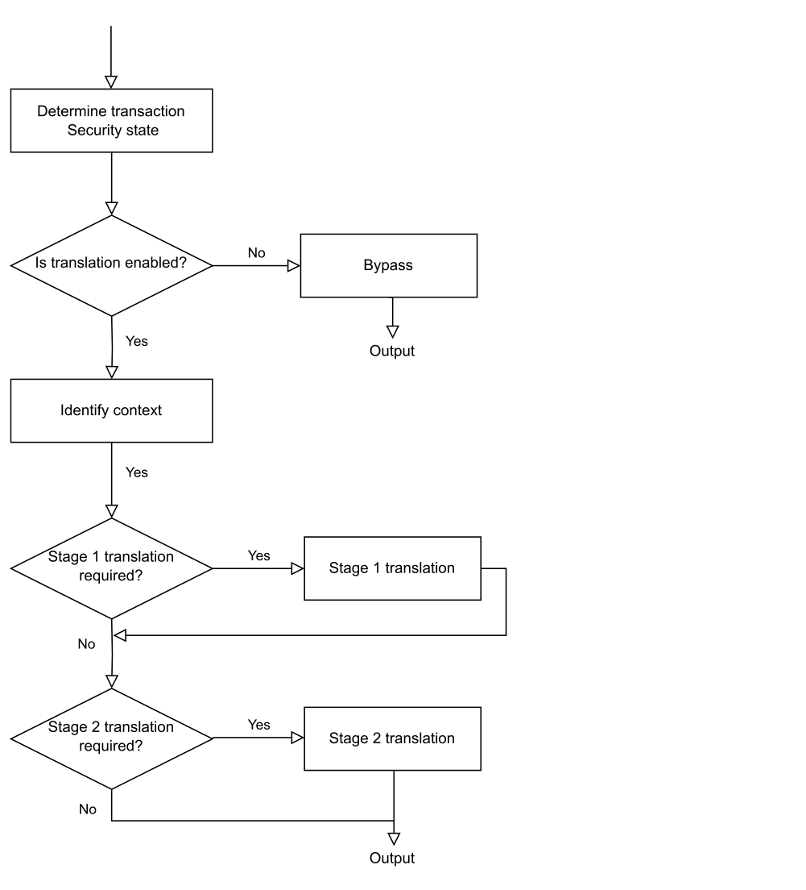

*图 3-1：简化的 SMMU 转换过程*

一个进来的传输（Non-secure 流）经过：

1. **全局禁用？** SMMU 全局禁用时，传输原样穿过（地址不改），`SMMU_GBPA` 可覆盖属性或中止所有传输。
2. **定位配置**：由 StreamID 找到 **STE（Stream Table Entry）**；STE 若启用 Stage 2 则含 Stage 2 表基址；若启用 Stage 1 还要再定位 **CD（Context Descriptor）**（Stage 2 启用时从 IPA 取 CD，否则从 PA 取）。
3. **执行转换**：Stage 1 翻译 VA→IPA（或旁路直传），Stage 2 翻译 Stage 1 输出（或旁路）。
4. **转发**：转换后的地址 + 内存属性送入系统。

> 带 RME 的 SMMU，访问物理地址还要过 **GPC（粒度保护检查）**，对应 A-profile 的 FEAT_RME。安全流 / Realm 流的路径类似，只是控制寄存器换成 `SMMU_S_*` / `SMMU_R_*`。

### 2.1 流安全：SEC_SID

每个流分安全 / 非安全 / Realm 三态，由输入信号 `SEC_SID` 决定，各自用独立的寄存器和流表：

| SEC_SID | 流状态 | 使用的寄存器和流表 |
| --- | --- | --- |
| 0b00 | 非安全流 | 非安全 `SMMU_*` / 非安全流表 |
| 0b01 | 安全流 | 安全 `SMMU_S_*` / 安全流表 |
| 0b10 | Realm 流 | Realm `SMMU_R_*` / Realm 流表 |

两个容易混淆的概念：**安全传输** = 访问安全 PA 空间；**安全流** = 设备处于安全态的编程接口。非安全流只能产生非安全下游传输；安全流能产生安全 + 非安全下游传输；Realm 流能产生 Realm + 非安全下游传输。

### 2.2 StreamID 与 SubstreamID

**StreamID** 区分设备。最简一设备一 StreamID；支持多通道的 DMA 引擎可为不同通道用不同 StreamID。StreamID 的形成是实现定义的（通常组合边带信号），由 StreamID 在流表里选 STE。每种安全态有独立 StreamID 命名空间（但 Realm 与非安全共享）。

**SubstreamID**（可选）区分同一设备内的「子流」：同一设备共享 Stage 2 转换，但每个子流有自己的 Stage 1 转换——一个 VM 里的多个应用各用一个 DMA 通道，就是典型例子：

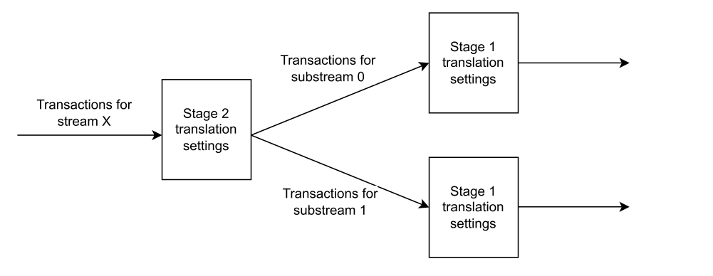

*图 3-2：SubstreamID 的作用*

SubstreamID 索引 CD 表，选一个 Stage 1 转换上下文。

## 3. 故障模型与旁路

### 3.1 出错了怎么办：终止 vs 停顿

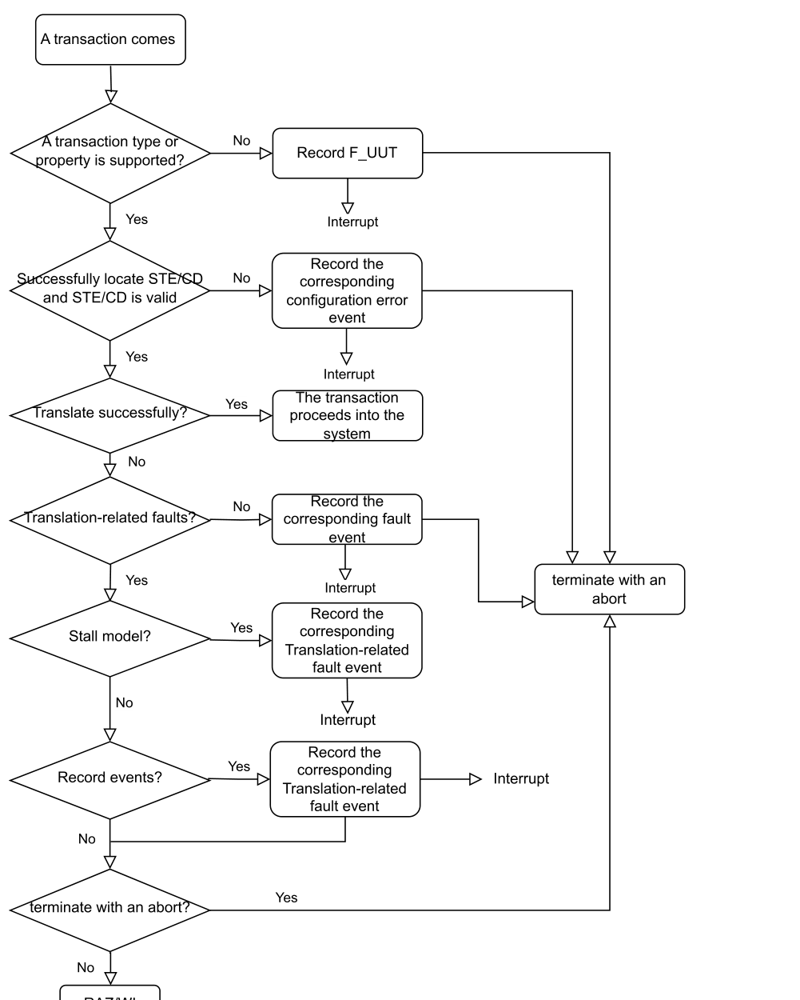

*图 3-3：SMMU 故障的记录与上报*

传输先要定位到有效 STE/CD，定位不到就记**配置错误**并 abort。进入转换后，转换相关故障（F_TRANSLATION / F_ADDR_SIZE / F_ACCESS / F_PERMISSION，对应 VMSA 的转换/地址大小/访问标志/权限故障）的处置可配置为两种模型（由 `CD.{A,R,S}` / `STE.{S2R,S2S}`）：

- **终止（Terminate）模型**：出错即 abort（或 RAZ/WI），设备自行处理。PCIe 端点必须用这个（停顿会超时/死锁，见 §5.3）。
- **停顿（Stall）模型**：记录故障 + 发中断，软件分页进来后发 `Resume` 命令重试（或 `Terminate`）——支撑**按需分页**。

### 3.2 旁路 bypass

旁路 = 不转换，输出地址 = 输入地址（但属性仍可覆盖）。三种：

| 类型 | 触发条件 | 属性来源 |
| --- | --- | --- |
| 全局旁路 | `SMMU_(*_)CR0.SMMUEN=0` | `SMMU_(*_)GBPA` |
| 流旁路 | `STE.Config==0b100` | STE 字段 |
| 阶段旁路 | `STE.Config[0]==0`(S1) / `[1]==0`(S2) | 相应阶段 |

### 3.3 ATS 与 PRI

**ATS（地址转换服务）**：让 SMMU 提前翻译 DMA 地址，设备把结果缓存进本地 **ATC**，降低延迟、分布式缓存提升 I/O 性能。

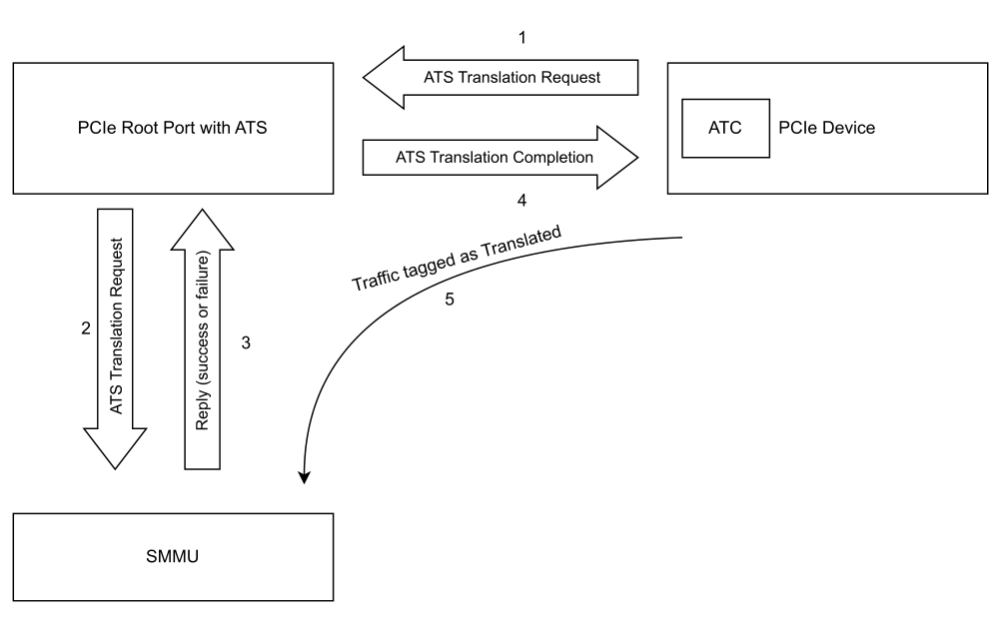

*图 3-4：ATS 机制*

**PRI（页请求接口）**：配合 ATS 做「DMA 缺页」——设备请求软件把缺的页弄回来，避免固定（pin）内存。PPR 存入 PRI 队列，软件处理后用 `CMD_PRI_RESP` 回应。

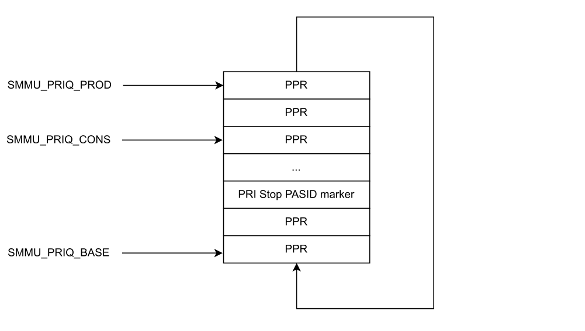

*图 3-5：PRI 队列*

## 4. 编程模型：寄存器 + 内存结构

SMMUv3 的配置**大部分在内存结构里，少部分在寄存器里**。寄存器只存「结构在哪、多大」。

### 4.1 寄存器

两个连续的 64K 页（Page 0 / Page 1）：非安全 `SMMU_*`（偏移 0x0 起）+ 安全 `SMMU_S_*`（偏移 0x8000 起）；带 RME 再加 Root 控制页和 Realm 页。同一寄存器在不同安全态偏移不同，如 `SMMU_CMDQ_BASE` 在 0x90，`SMMU_S_CMDQ_BASE` 在 0x8090。

### 4.2 流表：StreamID → STE

`SMMU_(*_)STRTAB_BASE` 存流表基址，StreamID 索引出 STE（每 STE 64 字节）。两种格式：

- **线性流表**：连续 STE 数组，`STE_addr = STRTAB_BASE + StreamID × 64`。

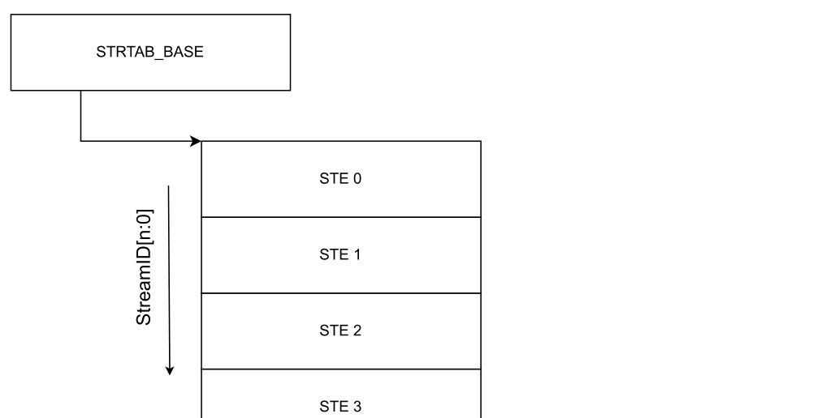

*图 4-2：线性流表*

- **二级流表**：顶层 L1STD 表 + 按需分配的 L2 STE 表，省内存、避免大块连续分配，适合 StreamID 稀疏（如 PCIe：16 位 StreamID，有效 ID 每 256 才出现一次）。

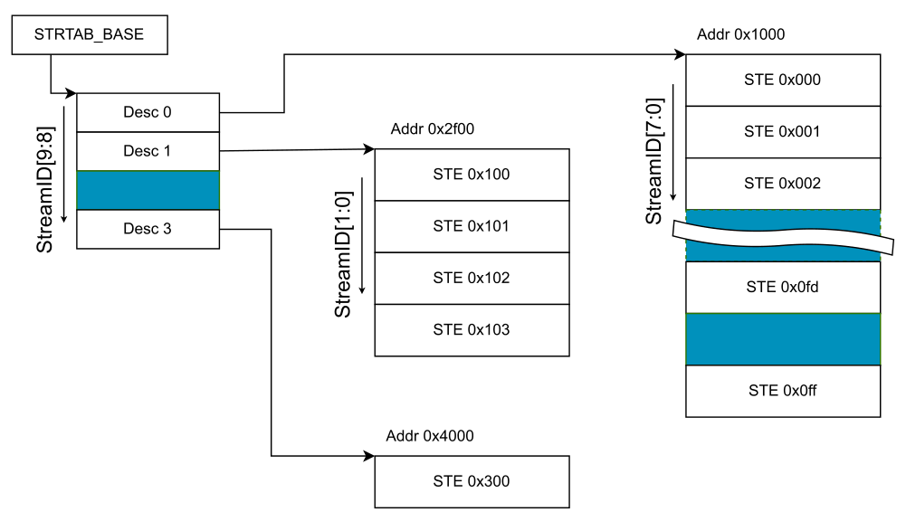

*图 4-3：SPLIT==8 的二级流表示例*

```text
L1STD_addr = STRTAB_BASE + StreamID[n:x] × sizeof(L1STD)
STE_addr   = L1STD.L2Ptr + StreamID[(x-1):0] × sizeof(STE)
```

L1STD 字段（L2Ptr 指向 L2 表，Span 决定 L2 表大小 `2^(Span-1)` 个 STE）：

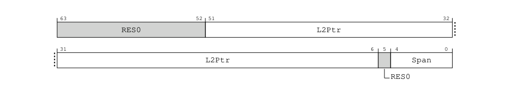

*图 4-4：L1 流表描述符*

### 4.3 STE 与 CD

**STE（64 字节）**存一个流的上下文：`Valid`/`Config`（S1/S2 转换或旁路）、S1 字段（`S1ContextPtr`/`S1Fmt`/`S1CDMax` 等）、S2 字段（`S2TTB`/`S2T0SZ`/`S2PS` 等）。

**CD（64 字节）**存 Stage 1 转换的设置（含 Stage 1 转换表基址），**指针来自 STE 而非寄存器**。只有 Stage 1 转换才需要 CD；纯 Stage 2 或旁路只需 STE。

CD 的组织（由 `STE.S1Fmt`/`S1CDMax` 决定）：单个 CD、单级 CD 表、二级 CD 表：

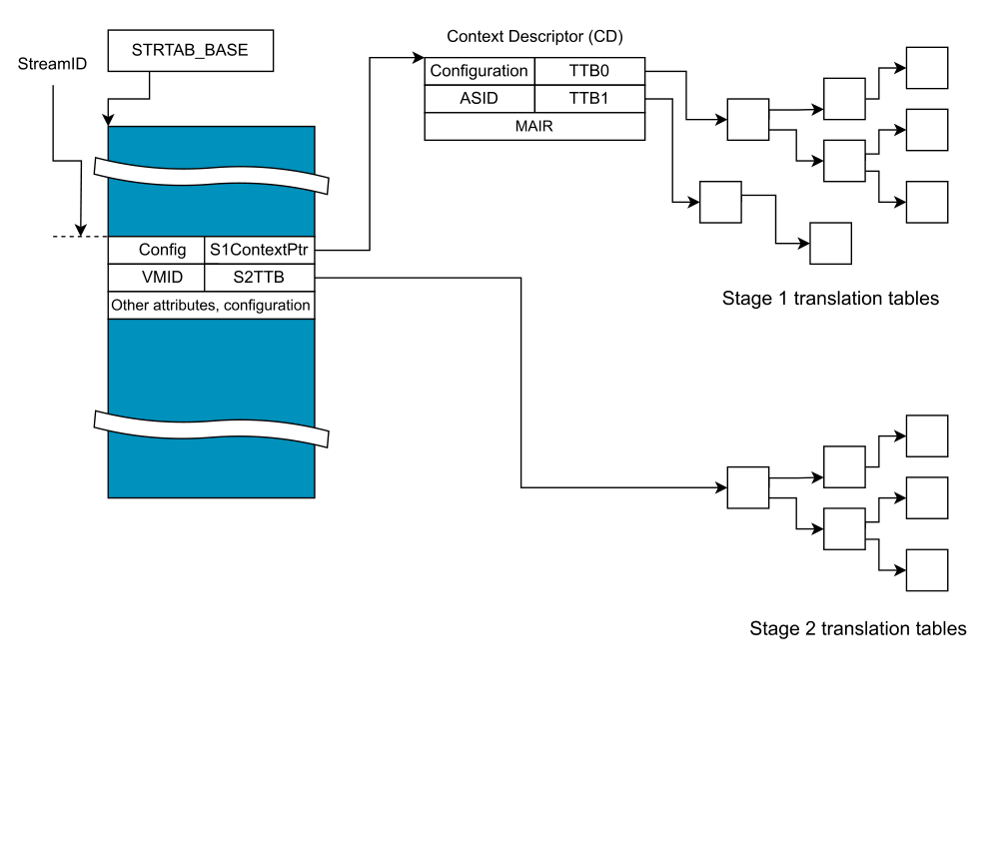

*图 4-5：配置结构示例（STE 指向单个 CD）*

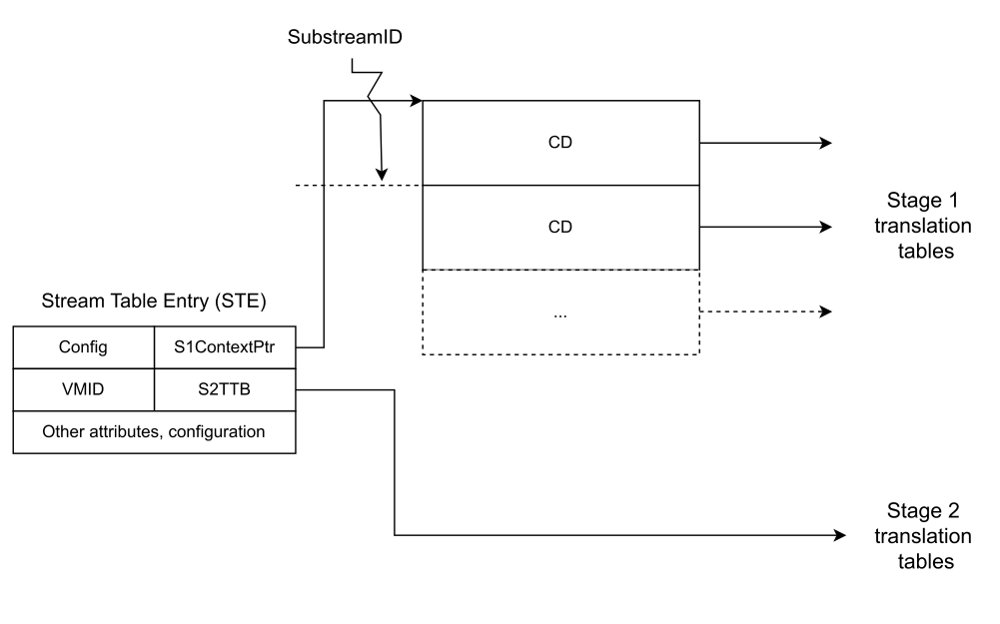

*图 4-6：子流的多个上下文描述符（STE 指向 CD 数组，SubstreamID 选一个）*

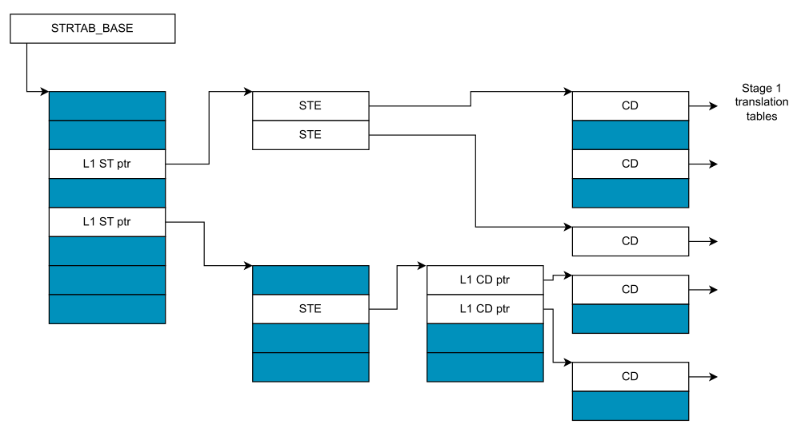

*图 4-7：配置结构示例（二级流表 + 二级 CD 表）*

分工上：**hypervisor 管流表和 Stage 2 转换表；客户机 OS 管 CD 表和 Stage 1 转换表**。

## 5. 两个队列：命令队列与事件队列

SMMU 靠内存里的**循环队列**驱动。

### 5.1 命令队列

软件写命令、更新 `SMMU_CMDQ_PROD`；SMMU 消费命令、更新 `SMMU_CMDQ_CONS`：

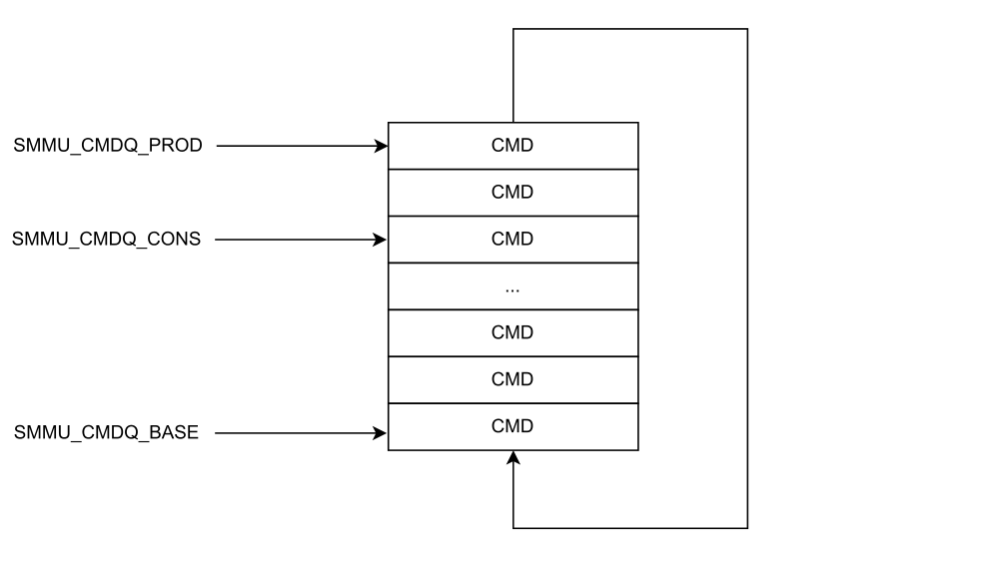

*图 4-8：命令队列*

满条件：`PROD.WR == CONS.RD` 且 `PROD.WR_WRAP != CONS.RD_WRAP`。

**关键点**：`CONS` 前进只说明命令被「消费」，不保证效果可见。要同步就发 `CMD_SYNC`——它只有在前面命令效果可见时才被消费。

命令类别（每项 16 字节，小端，首字节是操作码）：预取、TLB 失效、配置缓存失效、同步、PRI 响应、ATC 失效、停顿恢复/终止、DPT 失效。

### 5.2 事件队列

配置错误和故障记进事件队列（每事件记录 32 字节）。与命令队列相反：**SMMU 是生产者**。事件队列从空变非空时 SMMU 发中断：

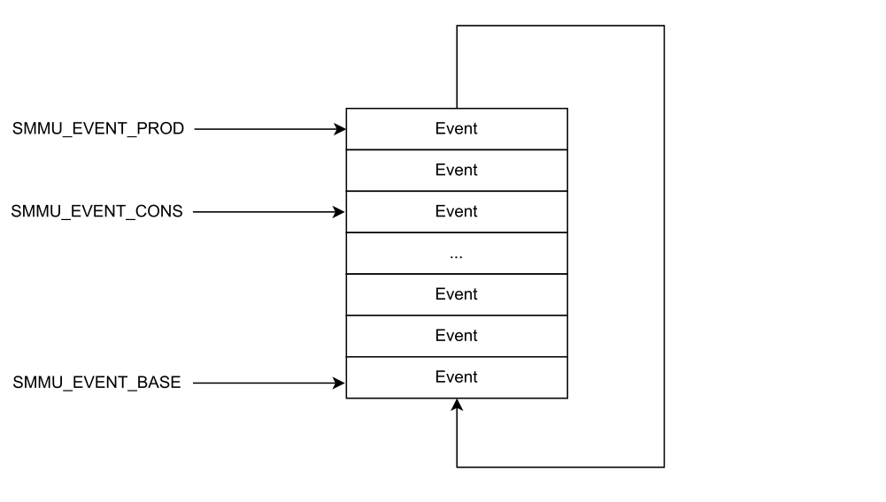

*图 4-9：事件队列*

满时：停顿故障产生的事件**永不丢弃**（等有空间再记），其他事件丢弃。软件要快消费防溢出。示例事件：`CERROR_ILL`、`C_BAD_STREAMID`、`C_BAD_STE`、`F_TRANSLATION`。

**全局错误**（严重，如外部中止）则直接进 `SMMU_(*_)GERROR` 寄存器，不进事件队列。

## 6. 最小配置：七步初始化

裸机下初始化 SMMU 的最小序列（§4.11），这七步是本文最有操作价值的部分：

```text
1. 分配流表       写 STRTAB_BASE_CFG(格式/大小) + STRTAB_BASE(基址)，STE.V=0，DSB
2. 分配命令/事件队列  写 CMDQ_BASE/PROD/CONS + EVENTQ_BASE/PROD/CONS
3. 设内存属性     写 SMMU_CR1
4. 使能 IRQ       写 SMMU_IRQ_CTRL
5. 使能队列       置 CR0.CMDQEN/EVENTQEN，轮询 CR0ACK
6. 使缓存/TLB 失效  发 CMD_TLBI_* + CMD_CFGI_ALL + CMD_SYNC
7. 使能转换       置 CR0.SMMUEN，轮询 CR0ACK
```

> 若 `SMMU_IDR0.COHACC=0`（SMMU 无一致内存访问），第 1 步还要加数据缓存维护。RME 且 GPC 开启时，Root world 先初始化 GPT。

## 7. 系统架构考量

- **I/O 一致性（§5.1）**：设备若 I/O 一致（窥探 PE 缓存），共享内存无需 CMO（缓存维护操作），性能更好。`SMMU_IDR0.COHACC` 指示 SMMU 能否发一致访问（Arm BSA 要求转换表/配置结构访问 I/O 一致，需 ACE-Lite 之类端口）。
- **设备缓存（§5.2.2）**：SMMU 之后的设备缓存**不能**与系统全一致（SMMU 无法做 PA→VA 反向转换）；但用 ATS 填 TLB 的设备可维护「物理寻址」的一致缓存。
- **PCIe（§5.3）**：至少支持 16 位 RequesterID；StreamID 由 RequesterID 一比一/线性生成。PCIe 流**只能终止、不能停顿**（否则超时/死锁）。P2P 要经 ACS 由 SMMU 做访问控制；`No_snoop` 把属性换成 Normal-iNC-oNC-OSH。
- **StreamID 分配（§5.4）**：每 SMMU 唯一；通过 ACPI/devicetree 呈现给 OS。Linux SMMUv3 驱动不支持同一 SMMU 后多个设备共用同一 StreamID。
- **MSI（§5.5）**：GIC ITS 用 DeviceID 隔离 MSI，DeviceID 最好从 SMMU StreamID 派生；ITS 的 MSI 目标页可经 SMMU Stage 1/Stage 2 映射给用户空间驱动 / VM。

## 8. 使用场景一览

| 场景 | 用哪个阶段 | 解决什么问题 |
| --- | --- | --- |
| 分散-聚集（§6.1.1） | S1 | 让不支持 scatter-gather 的设备看到「连续」缓冲（OS 用连续 VA 映射散页） |
| 32 位设备（§6.1.2） | S1 | 把 <4GB 的 IOVA 映射到 >4GB 的物理页，替代 bounce buffer |
| OS 设备隔离（§6.1.3） | S1 | 设备只能访问 DMA API 映射的页，挡住恶意设备 |
| 用户空间驱动（§6.1.4） | S1 | 用户态直接 DMA，SMMU 限制其只能访问本进程允许区域 |
| SVA（§6.1.5） | S1 | 与进程共享整个地址空间 + 公共 ASID，可用广播 TLB 失效；需缺页支持（PRI/Stall） |
| VM 设备分配（§6.2.1） | S2 | 把设备分配给 VM，S2 保护宿主；客户机直接用 IPA 编程设备 |
| vSMMU（§6.2.2） | S1+S2 | 给 VM 一个虚拟 SMMU，享受 Stage 1 好处；嵌套或影子表实现 |
| 媒体保护（§6.2.3） | S2 | 保护媒体缓冲区（恒等映射 + 更严 S2 权限） |
| 宿主隔离（§6.2.4） | S2 | pKVM 用 SMMU 阻止宿主 DMA 访问客户机内存；需 FEAT_BBM 原子替换块映射 |

## 9. 相关文档

SMMUv3 架构规范、ARM ARM（VMSA）、AArch64 内存管理 / 内存属性、RME、PCIe 基础规范、MPAM、Arm BSA、GICv3 LPI/ITS（见 22 号文档）。
