# 读懂 AArch64 内存管理（中文精读版）

> 原文：*Learn the architecture - AArch64 Memory Management Guide*
>
> 版本：Version 1.6　|　文档 ID：101811_0106_00_en　|　Issue 00（2026-10-06）
>
> 版权 © 2019, 2021, 2023–2026 Arm Limited（或其关联公司）。保留所有权利。非保密。
>
> 说明：本文在原中文翻译的基础上重新组织了叙述逻辑与表达方式，技术内容、表格与图表保持原意；个别明显笔误已按 Arm 架构规范订正。

---

## 导读：这篇文章讲什么

本指南围绕 AArch64 中的**内存翻译（memory translation）**展开——这是内存管理的核心。它会解释虚拟地址如何翻译成物理地址、翻译表的格式，以及软件如何管理翻译后备缓冲器（TLB）。

如果你在编写启动代码、驱动程序等低层代码，尤其是要设置或管理内存管理单元（MMU）的代码，这些内容是基础中的基础。

读完你应当能：说清虚拟地址到物理地址的翻译过程；区分不同的地址空间，并理解它们如何对应到翻译的各个阶段；知道软件何时必须执行 TLB 维护，以及 TLB 维护指令的语法。

## 1. 内存管理解决什么问题

内存管理描述系统如何控制对内存的访问。无论操作系统还是应用程序，每次访问内存，硬件都在执行内存管理。它本质上是一种**动态地把内存区域分配给应用程序**的方式。

应用处理器面向 Linux 这类富操作系统设计，支持虚拟内存系统。在处理器上执行的软件只看到**虚拟地址**，处理器把它翻译为**物理地址**，物理地址再被呈现给内存系统，指向真实物理位置。

## 2. 虚拟地址与物理地址

使用虚拟地址的第一个好处，是让操作系统能控制应用看到的“内存视图”：决定什么内存可见、出现在哪个虚拟地址、允许怎样的访问。这样操作系统就能对应用做**沙箱化**（把一个应用的资源对另一个应用隐藏），并对底层硬件做抽象。

第二个好处是，操作系统能把多个碎片化的物理内存区域，呈现为一整块连续虚拟地址空间给应用。

对软件开发者也有好处：写应用时不必关心系统的具体内存地址。应用知道“操作系统和硬件会共同完成地址翻译”就够了。

实践中，每个应用可以用自己的一套虚拟地址，映射到物理内存的不同位置。操作系统切换应用时重新编程映射，保证当前应用的虚拟地址落到正确的物理位置。

虚拟地址通过映射翻译成物理地址，映射关系存放在**翻译表（translation table，也叫页表）**中：

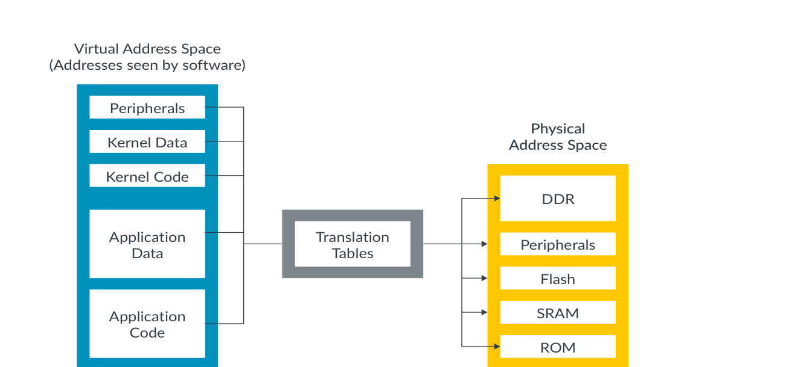

*图 3-1：显示虚拟地址和物理地址的图*

翻译表位于内存中，由软件（通常是操作系统或 hypervisor）管理。表不是静态的，会随软件需求变化而更新，从而改变虚拟地址与物理地址的映射。

## 3. MMU：表遍历与 TLB

内存管理单元（MMU）负责把软件使用的虚拟地址，翻译成内存系统使用的物理地址。它包含两个关键部件：

- **表遍历单元（table walk unit）**：内含从内存读取翻译表的逻辑；
- **翻译后备缓冲器（TLB）**：缓存最近使用过的翻译。

软件发出的所有内存地址都是虚拟地址，交给 MMU。MMU 先查 TLB 有没有最近缓存的翻译；若没有，表遍历单元就从内存读取相应表项：

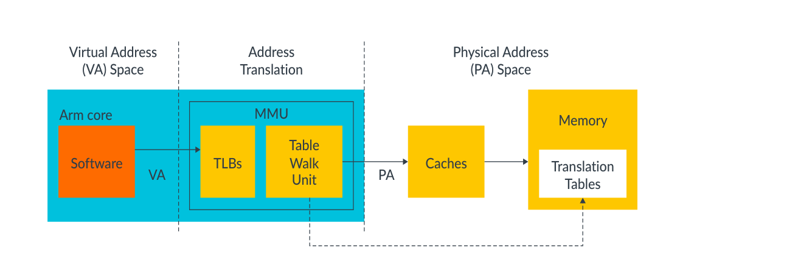

*图 4-1：显示 MMU 的图*

虚拟地址必须先翻译成物理地址，内存访问才能发生——因为得先知道要访问哪个物理位置。这个要求同样适用于缓存数据：Armv6 及之后的处理器上，数据缓存用物理地址存数据（物理标记），所以地址必须先于缓存查找完成翻译。

> 架构是行为规格说明。缓存必须表现得“如同”物理标记；实现内部怎么做都行，只要对软件不可见。

### 3.1 表项

翻译表把虚拟地址空间划分成大小相等的块，每个块在表里有一个表项。项 0 提供块 0 的映射，项 1 提供块 1 的映射，依此类推。每个表项包含对应物理内存块的地址，以及访问该地址时使用的属性。

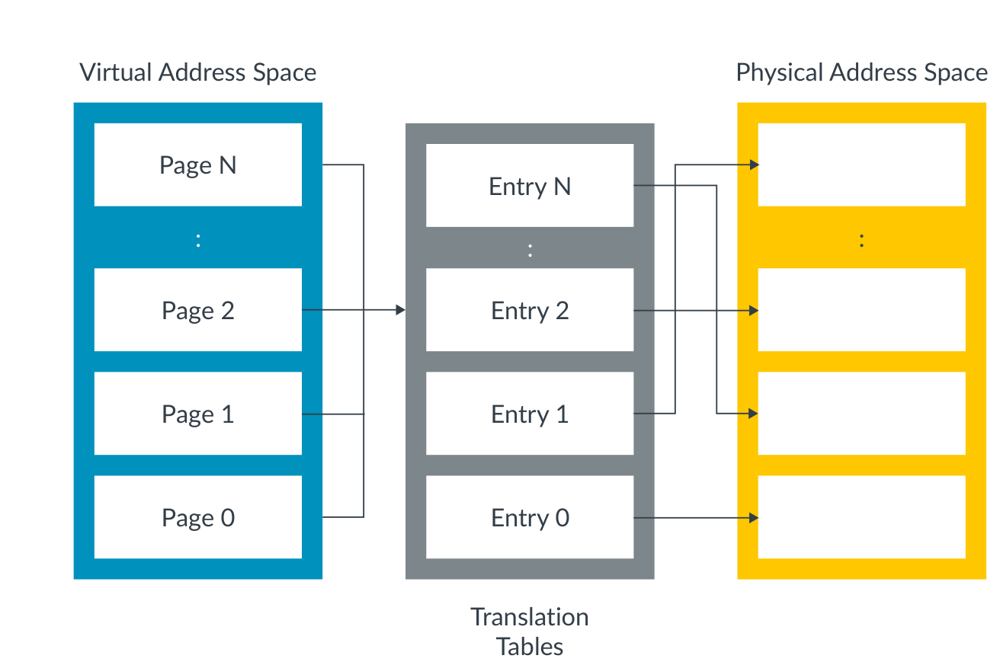

*图 4-2：显示表项的图*

### 3.2 表查找

翻译发生时，软件发出的虚拟地址被一分为二：

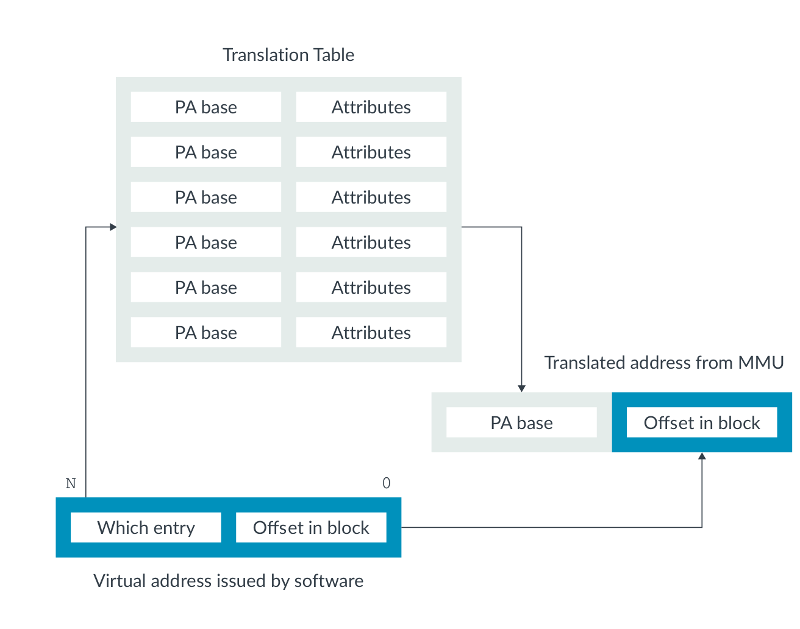

*图 4-3：显示表查找的图*

这是一次单级查找：

- 高位（图中“Which entry”）作为表的索引，告诉你用哪个块项；该块项里是这个虚拟地址对应的物理地址。
- 低位（图中“Offset in block”）是块内偏移，翻译不会改变它。

### 3.3 多级翻译

单级查找把虚拟地址空间切成大小相等的块。实际上，翻译表采用**层次结构**。

第一张表（Level 1 表）把空间切成大块。它的每个表项要么指向一块等大的物理内存，要么指向另一张表，把该块再细分。这就是“多级表”：

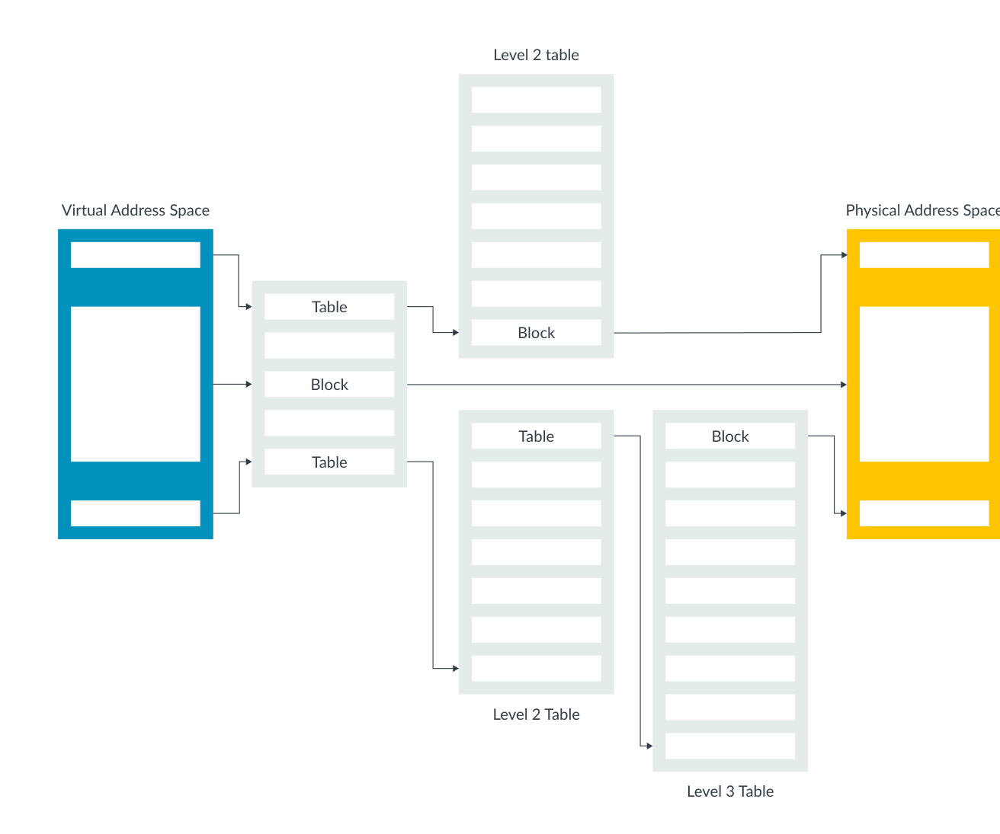

*图 4-4：显示多级翻译的图*

在 Armv8-A 中，级别最多六级，编号从 -2 到 3。

多级方法能同时描述大块和小块，各有取舍：

- **大块**：翻译所需的读取级别更少，在 TLB 里缓存效率更高；
- **小块**：给软件更细粒度的内存分配控制，但缓存效率较低——因为翻译要跨多个级别读多次。

操作系统必须在“大映射的效率”与“小映射的灵活性”之间平衡，以获得最佳性能。

> 处理器开始遍历时并不知道翻译的大小，它靠执行表遍历来算出正在翻译的块有多大。

## 4. 地址空间

AArch64 中有多个相互独立的虚拟地址空间：

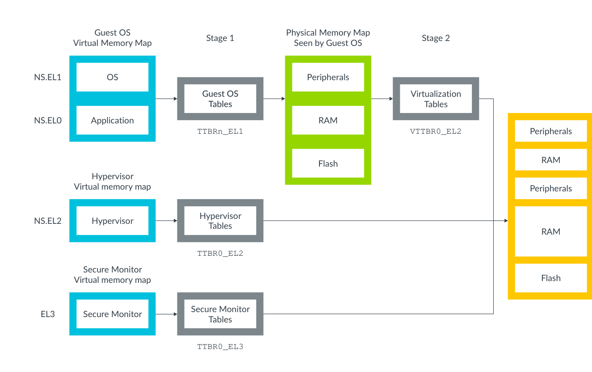

*图 5-1：Armv8-A 中的地址空间*

图中展示了三个虚拟地址空间：

- 非安全 EL0 和 EL1；
- 非安全 EL2；
- EL3。

每个都独立，有自己的设置和表，统称为“翻译机制（translation regime）”。安全 EL0、安全 EL1、安全 EL2 也有自己的虚拟地址空间，图中未画。

> 安全 EL2（FEAT_SEL2）的支持在 Armv8.4-A 中加入。

因为虚拟地址空间不止一个，指明地址在哪个空间就很重要。例如 `NS.EL2:0x8000` 指非安全 EL2 虚拟地址空间里的 0x8000。

图中还能看到，非安全 EL0/EL1 的虚拟地址要经过**两阶段翻译**。这为虚拟化服务：hypervisor 可以虚拟化 VM 所看到的物理内存视图。

Armv9-A 支持 Armv8-A 全部的虚拟地址空间，还引入了可选的 Realm Management Extension（RME）。实现 RME 后，会多出这些翻译机制：

- Realm EL1 和 EL0；
- Realm EL2 和 EL0；
- Realm EL2。

### 4.1 Stage 1 与 Stage 2

在虚拟化语境里，操作系统控制的那组翻译叫 **Stage 1**：把虚拟地址翻译成**中间物理地址（IPA）**。操作系统以为 IPA 就是物理地址空间。而 hypervisor 控制第二组翻译 **Stage 2**，把 IPA 翻译成真正的物理地址：

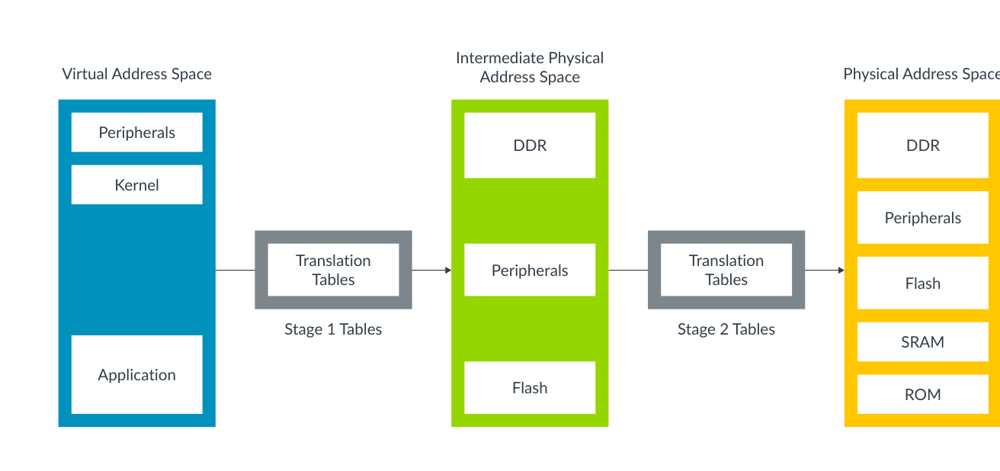

*图 5-2：Stage 2 将 IPA 翻译为物理地址*

虽然表格式有细微差别，Stage 1 和 Stage 2 的翻译过程本质相同。

> Arm 常拿 0x8000 举例。它也是用 armlink 链接时的默认地址。这个地址源自早期微机 BBC Micro Model B，它在 0x8000 有 ROM（和横向 RAM）。该机器由 Acorn 公司制造，正是 Acorn 开发了 Acorn RISC Machine（ARM），后来演变为 Arm。

### 4.2 物理地址空间与安全状态

除了多个虚拟地址空间，AArch64 也有多个**物理地址空间（PAS）**：

- 非安全 PAS；
- 安全 PAS；
- Realm PAS（仅 Armv9-A）；
- Root PAS（仅 Armv9-A）。

一个虚拟地址能映射到哪些 PAS，取决于处理器当前的安全状态：

- **非安全状态**：只能映射到非安全物理地址；
- **安全状态**：可映射到安全或非安全物理地址；
- **Realm 状态**：可映射到 Realm 或非安全物理地址；
- **Root 状态**：可映射到任何物理地址空间。

当 PE 处于能访问多个 PAS 的安全状态时，由翻译表项控制使用哪个输出 PAS：

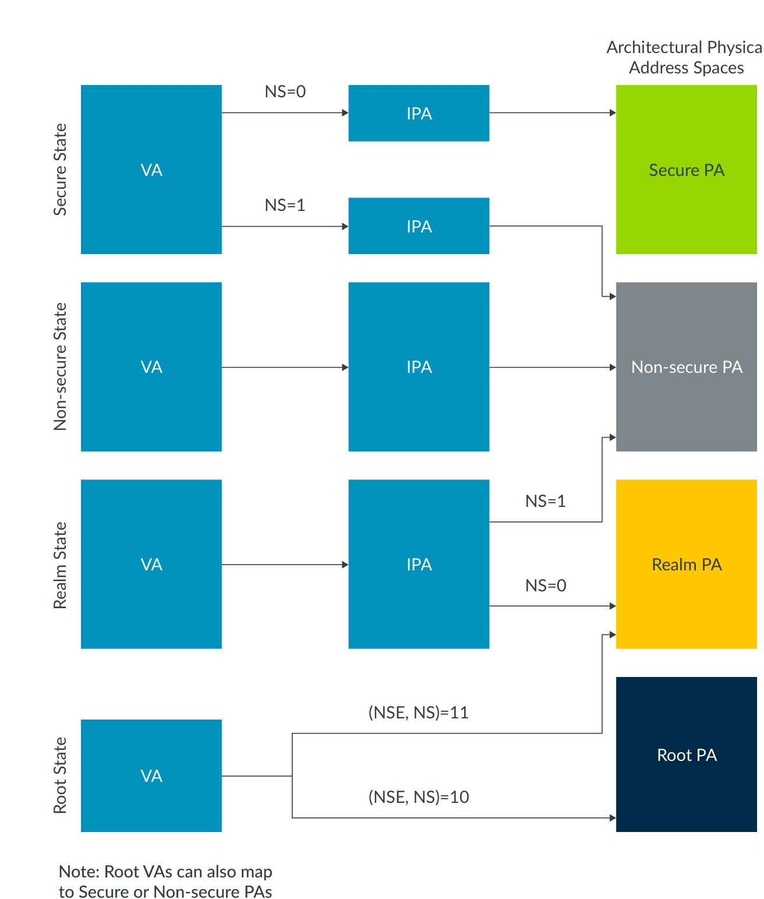

*图 5-3：多个物理地址空间的映射*

### 4.3 地址的大小

AArch64 是 64 位架构，不代表所有地址都是 64 位的。

**虚拟地址的大小**

虚拟地址以 64 位格式存储，因此 LDR/STR 指令里的地址总是在 X 寄存器中指定；但 X 寄存器里的地址并非都有效。

虚拟地址空间布局如下：

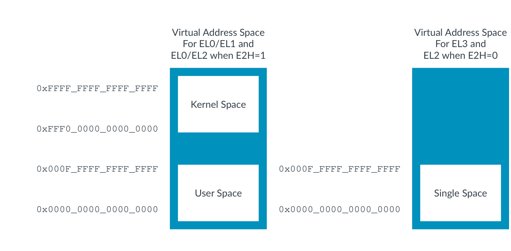

*图 5-4：虚拟地址的大小*

EL0/EL1 虚拟地址空间有两个区域：按惯例分别是内核空间（顶部）和应用程序空间（底部，标为“User space”）。内两者各有独立的翻译表，映射得以彼此分开。

其他异常级别的地址空间底部只有单一区域（图右侧那个单独空间框）。

> 置 `HCR_EL2.E2H=1` 会启用一种配置：Host OS 跑在 EL2，其应用跑在 EL0。此时 EL2 也有上部区域和下部区域。

每个区域最多 55 位，但可各自缩小。`TCR_ELx` 的 TnSZ 字段控制虚拟地址空间大小。例如 `TCR_EL1` 控制 EL0/EL1 的虚拟地址空间：

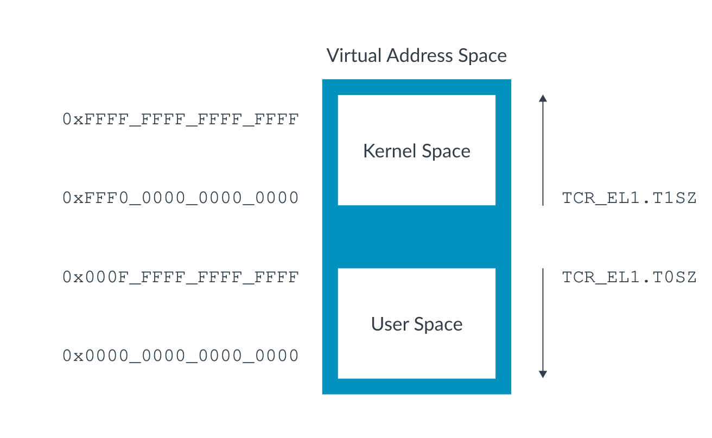

*图 5-5：虚拟地址空间*

虚拟地址大小编码为：

```text
虚拟地址大小（字节） = 2^(64 - TCR_ELx.TnSZ)
```

也可写成地址位数：

```text
地址位数 = 64 - TnSZ
```

例如 `TCR_EL1.T1SZ` 设为 32，内核区域大小就是 2^32 字节（0xFFFF_FFFF_0000_0000 到 0xFFFF_FFFF_FFFF_FFFF）。访问配置范围之外的地址会触发翻译故障（translation fault）异常。这种配置的优点是只需描述用得到的地址空间，省时又省空间：假如内核空间只要 1GB（30 位地址），把 T1SZ 设为 34 即可，因为 64-34=30。

> 所有 Armv8-A 实现都支持 48 位虚拟地址；52 位或 56 位是可选实现，由 `ID_AA64MMFR2_EL1` 报告。截至撰文时，没有任何 Arm Cortex-A 处理器支持 52 位虚拟地址。

**物理地址的大小**

物理地址大小是实现定义的，最大 56 位，由 `ID_AA64MMFR0_EL1` 报告。Arm Cortex-A 处理器通常为 40 位或 44 位。

> Armv8.0-A 中物理地址最大 48 位，Armv9.3-A 扩展到 56 位。

如果你在翻译表项里指定的输出地址超过实现的最大值，MMU 会生成地址大小故障异常。

**中间物理地址的大小**

IPA 空间大小可像虚拟地址空间一样配置，由 `VTCR_EL2.T0SZ` 控制。可配置的最大值与处理器支持的物理地址大小相同——不能配置出比受支持物理地址空间更大的 IPA 空间。

### 4.4 ASID：用所属进程标记翻译

许多现代操作系统的应用看似都从同一地址区域（用户空间）运行，但不同应用需要不同映射。也就是说，同一 VA（如 0x8000）的翻译取决于当前运行的应用。

理想情况下，我们想让不同应用的翻译共存于 TLB，避免上下文切换时做 TLB 失效。可处理器怎么知道该用哪个版本的 0x8000 翻译？答案是**地址空间标识符（ASID）**。

对 EL0/EL1 虚拟地址空间，可用表项属性字段里的 **nG 位**把翻译标记为全局（G）或非全局（nG）。内核映射是全局翻译，应用映射是非全局翻译。全局翻译对所有应用有效；非全局翻译只对特定应用有效。

非全局映射在 TLB 中用 ASID 标记。TLB 查找时，把表项里的 ASID 与当前选择的 ASID 比较，不匹配就不用这个表项。图中内核空间是全局映射（不带 ASID），用户空间是非全局映射（带 ASID）：

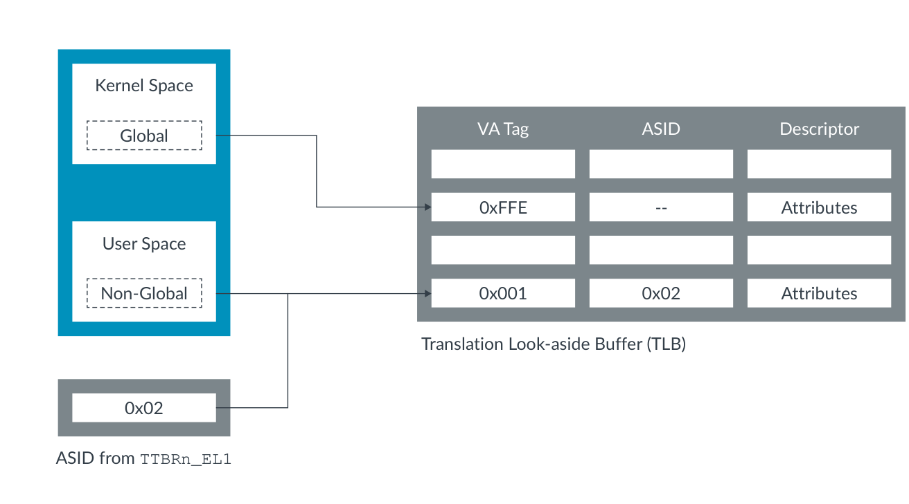

*图 5-6：翻译后备缓冲器*

可以看到多个应用的 TLB 项在缓存中共存，由 ASID 决定用哪个。

ASID 存放在两个 `TTBRn_EL1` 寄存器之一（通常 `TTBR0_EL1` 用于用户空间）。因此更新一个寄存器，就能同时切换 ASID 和它指向的翻译表。

> 2023 年，Arm 引入同时指定两个 ASID 的能力。从 Armv9.5-A 起，软件可同时用两个 `TTBRn_EL1` 的 ASID 字段：`TTBR0_EL1.ASID` 用于地址空间下部，`TTBR1_EL1.ASID` 用于上部。

`HCR_EL2.E2H==1` 时，EL2 也能用 ASID 标记。

### 4.5 VMID：用所属 VM 标记翻译

EL0/EL1 翻译还能用**虚拟机标识符（VMID）**标记，让不同 VM 的翻译共存于缓存，原理与 ASID 类似。实践中，一些翻译会同时带 VMID 和 ASID，两者都匹配才能用这个 TLB 项。

> 当某个安全状态支持虚拟化时，EL0/EL1 翻译总是用 VMID 标记——即使没有启用 Stage 2 翻译。这意味着，如果你在写初始化代码且不用 hypervisor，在设置 Stage 1 MMU 之前，先设一个已知的 VMID 值很重要。

### 4.6 Common not Private

如果系统有多个处理器，一个处理器上的 ASID 和 VMID，在其他处理器上含义相同吗？

Armv8.0-A 的答案是：不必相同。没有要求软件在多个处理器上以同样方式使用同一个 ASID。比如 ASID 5 在一个处理器上属于计算器应用，在另一个上属于浏览器。结果就是一个处理器创建的 TLB 项，另一个处理器不能复用。

实践中，软件一般不会在不同处理器上给 ASID 赋予不同含义。于是 Armv8.2-A 在翻译表基址寄存器（TTBR）里引入 **Common not Private（CnP）位**：置位后，软件承诺在所有处理器上以相同方式使用 ASID 和 VMID，从而允许跨处理器共享 TLB 项。

> 我们一直在说“处理器”，严格讲应是处理单元（PE）——实现 Arm 架构的机器的通用术语。区分它很有意义：处理器之间共享 TLB 在微架构上并不容易，而多线程处理器里每个硬件线程是一个 PE，此时共享 TLB 项反而更可取。

## 5. 翻译表格式

翻译表项支持不同格式：

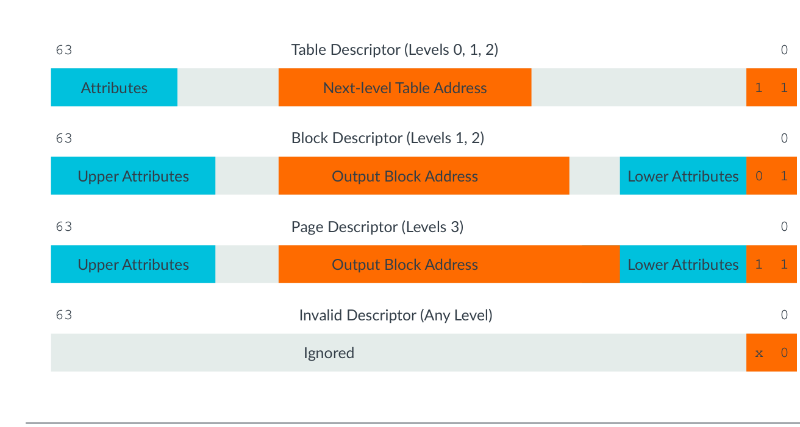

*图 6-1：翻译表格式*

> 为清晰起见，图中未标位字段宽度；具体见《Arm Architecture Reference Manual Armv8, for Armv8-A architecture profile》中 VMSAv8-64 翻译表格式描述符部分。

每个表项 64 位，底部两位决定表项类型。

注意，有些表项只在特定级别有效。表的最大级别数是四，所以没有比第 3 级（第四级）更深的表描述符；第 0 级也没有块/页描述符——它覆盖的虚拟地址区域太大，设块没意义。

> 第 0–2 级表描述符与第 3 级页描述符编码相同，这造就了“递归表”（指向自身）的可能，方便软件算出某个页表项对应的虚拟地址来更新它。

## 6. 翻译颗粒

**翻译颗粒（translation granule）**是能描述的最小内存块：不能描述比它更小的东西，只能描述更大的块（颗粒的倍数）。

AArch64 支持三种颗粒：4KB、16KB、64KB。

处理器支持哪种颗粒是实现定义的，由 `ID_AA64MMFR0_EL1` 报告。所有 Arm Cortex-A 处理器都支持 4KB 和 64KB。所选颗粒是最后一级表能描述的最小块。各级表的块大小如下：

| 表的级别 | 4KB 颗粒（每项大小） | 4KB（索引位） | 16KB 颗粒（每项大小） | 16KB（索引位） | 64KB 颗粒（每项大小） | 64KB（索引位） |
| --- | --- | --- | --- | --- | --- | --- |
| 0 | 512GB | 47:39 | 128TB | 47 | – | – |
| 1 | 1GB | 38:30 | 64GB | 46:36 | 4TB | 51:42 |
| 2 | 2MB | 29:21 | 32MB | 35:25 | 512MB | 41:29 |
| 3 | 4KB | 20:12 | 16KB | 24:14 | 64KB | 28:16 |

> 在 Armv9.2-A 和 Armv8.7-A 之前，52 位地址存在限制：4KB 或 16KB 颗粒时最大虚拟地址区域为 48 位，输出物理地址也限制在 48 位；只有 64KB 颗粒才能用满 52 位。

> `TCR_EL1` 有两个独立字段分别控制内核空间（TG1）和用户空间（TG0）的颗粒大小。要注意这两个字段的编码不同。

### 6.1 翻译的起始级别

颗粒大小与虚拟地址空间大小共同决定翻译的起始级别。

上一张表概括了各级表中每种颗粒的块大小（单个表项覆盖的虚拟地址范围）。由块大小就能反推哪些位用于索引各级表。

以 4KB 颗粒为例：

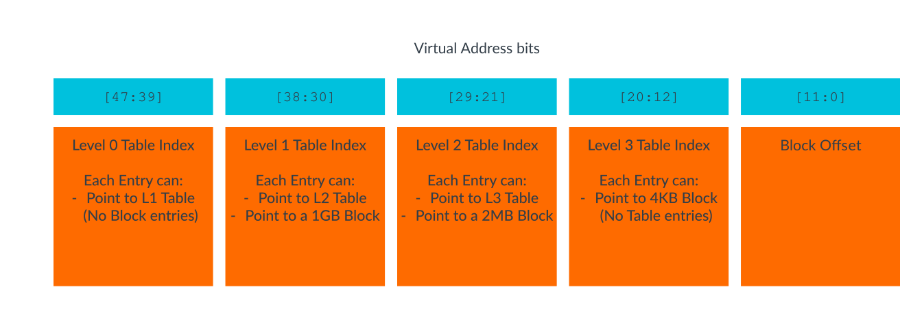

*图 7-1：翻译的起始级别*

假设 `TCR_ELx.T0SZ` 设为 32，则地址空间为：

```text
64 - T0SZ = 32 位地址空间（地址位 31:0）
```

再看 4KB 颗粒图，第 0 级由位 47:39 索引。对 32 位地址空间，这些位存在但为 0，所以翻译起始级别是第 1 级。

再看 T0SZ 设为 34：

```text
64 - T0SZ = 30 位地址空间（地址位 29:0）
```

这次没有额外位可索引第 0 级或第 1 级，翻译起始级别是第 2 级。

可见：虚拟地址空间越小，需要描述它的表级别就越少。

> 这些例子基于 4KB 颗粒；16KB、64KB 原理相同，只是地址位不同。

### 6.2 控制翻译的寄存器

地址翻译由一组系统寄存器共同控制：

- **SCTLR_ELx**
  - M：启用 MMU；
  - C：启用数据和统一缓存；
  - EE：翻译表遍历的字节序。
- **TTBR0_ELx 和 TTBR1_ELx**
  - BADDR：翻译表起始的物理地址（PA；EL0/EL1 情况下为 IPA）；
  - ASID：非全局翻译的地址空间标识符。
- **TCR_ELx**
  - PS/IPS：PA 或 IPA 空间大小、最大输出地址大小；
  - TnSZ：表覆盖的地址空间大小；
  - TGn：颗粒大小；
  - SH/IRGN/ORGN：MMU 表遍历使用的可缓存性与可共享性；
  - EPDn：禁用对特定表的表遍历。
- **MAIR_ELx**
  - Attr：控制 Stage 1 表中类型和可缓存性。

### 6.3 MMU 禁用

某翻译阶段的 MMU 被禁用时，所有地址被**平坦映射（flat-mapped）**——输入地址与输出地址相同。

## 7. TLB 与翻译变更

MMU 启用时，所有数据访问和指令取指都要经 MMU 翻译并检查权限。为避免每次访问都重新遍历表，处理器把最近使用的翻译缓存在 TLB 里。

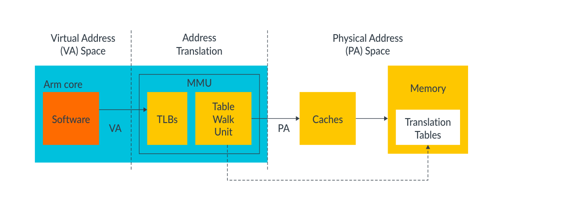

*图 8-1：显示 MMU 的图*

> TLB 是**翻译**的缓存，不是翻译表的缓存，区别很微妙。若干寄存器字段控制如何解释翻译表项；TLB 项里存的是“遍历表时、在给定配置下对表项的解释”。《Arm ARM》把这类寄存器字段描述为“允许被缓存在 TLB 中”。

如果你改动了一个翻译表项，或改变了影响表项解释的控制项，就必须使 TLB 中受影响的项失效；否则处理器可能继续用旧翻译。

### 7.1 更新翻译的规则

处理器不允许把导致以下故障的翻译缓存进 TLB：

- 翻译故障（地址未映射）；
- 地址大小故障（地址越界）；
- 访问标志故障。

这有个重要推论：**把无效翻译变成有效翻译时，通常不需要 TLBI 维护**；只有“取消映射一个有效翻译”或“改变当前有效翻译”时才需要。

取消映射的例子：

```asm
STR X11, [X1]  ; 更新翻译表项，将位置标记为无效
DSB ISH        ; 确保翻译表遍历能看到更新
TLBI VAE1, X10 ; 假设我们在 EL1
DSB ISH        ; 确保 TLB 失效完成
ISB            ; 在此 PE 上同步上下文
; 此时可以依赖新的翻译表项，并且所有由本观察者使用旧映射
; 生成的访问都已完成
```

把一个有效翻译改成另一个有效翻译的例子：

```asm
STR X11, [X1]  ; 移除先前的映射，将位置标记为无效
DSB ISH        ; 确保翻译表遍历能看到更新
TLBI VAE1, X10 ; 假设我们在 EL1
DSB ISH        ; 确保 TLB 失效完成
; 现在内部可共享域中的任何观察者中都不存在旧翻译的缓存副本。
; 此时任何访问虚拟地址的尝试都会导致翻译故障，
; 因为没有有效的映射。
STR X11, [X2]  ; 将新映射写入翻译表项
DSB ISH        ; 确保翻译表遍历能看到更新
; 不需要 TLBI，因为不允许 TLB 缓存导致翻译故障的翻译
```

这种“先取消旧映射、执行 TLBI 维护、再建立新映射”的方法叫**先破坏后建立（Break Before Make，BBM）**。它保证任何时刻都不会有观察者看到旧映射与新映射混杂。

如果软件没正确管理翻译表更新，可能让 TLB 里出现同一地址的多个缓存翻译，或让系统中不同观察者使用不同版本的翻译。

### 7.2 BBMx：免 BBM 改变翻译大小

有些场景不想要 BBM。例如通过系统 MMU（SMMU）连接的设备，对“接受故障并重试”的容忍度较低。

FEAT_BBMx 增加了无需 BBM 就能改变翻译大小的能力，在把多个页融合成单个块映射、或把块拆分成页时很有用。支持分四个级别，由 `ID_AA64MMFR2_EL1` 报告：

- **Level 0**：必须使用先破坏后建立；
- **Level 1**：增加对 nT 属性的支持；
- **Level 2**：额外保证改变表/块大小不会破坏一致性、排序保证或单处理器语义，也不会无法清除独占监视器；
- **Level 3**：同 Level 2，但保证改变块/表大小不会导致 TLBI 被报告。

对 BBM Level 1 及以上，可用 **nT 属性**让融合更高效。以页融合为例：

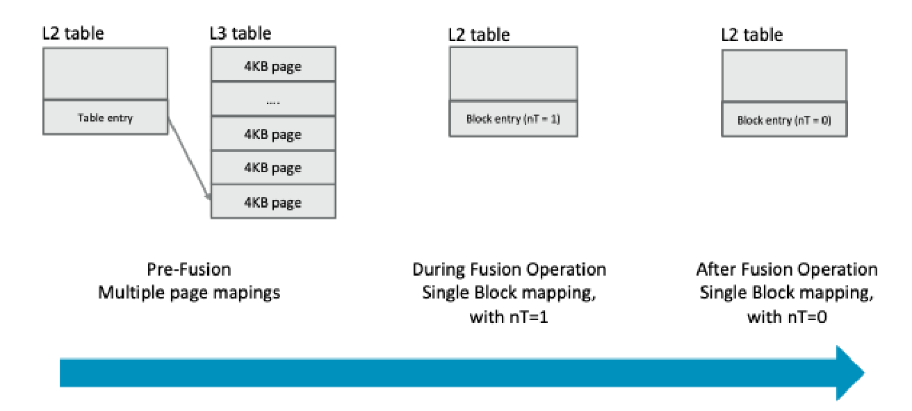

*图 8-2：显示页融合的图*

假设一片虚拟地址区域被映射为一组页，所映射内存在输入与输出地址空间都连续，单个块映射可行且更高效。我们要把这些页融合为单个块映射，步骤如下：

1. 用块描述符覆盖 L2 表中的表描述符，nT=1。
   - a. nT 位告诉处理器：此区域可能出现多个 TLB 项。
2. 使 TLB 失效，清除融合前残留的缓存翻译。
3. 清除 nT 位。
   - a. 此时此区域不再有 TLB 项冲突风险。
4. 使 TLB 失效，清除仍带 nT 位的缓存翻译。

相比传统 BBM，这个流程的好处是翻译区域**在任何时刻都不是无效的**。

BBM Level 2 及以上，无需带 nT 的序列，处理器能自行处理融合或拆分等翻译大小变化。

### 7.3 TLBI 指令的格式

TLBI 指令使 TLB 项失效，语法为：

```text
TLBI{P} {R}<type><level>{IS|OS} {, <Xt>, <Xt2>}
```

各字段含义：

- `{P}`：参数在单个寄存器还是一对寄存器中指定。`Xt2` 仅用于 P 变体。
- `{R}`：操作是否针对地址范围（以基址 + 大小指定）。
- `<type>`：使哪些项失效。
  - All：所有项；
  - VA：匹配 Xt 中 VA 和 ASID 的项；
  - VAA：匹配 Xt 中 VA、任意 ASID 的项；
  - ASID：匹配 Xt 中 ASID 的任意项；
  - 以及更多。
- `<level>`：作用于哪个地址空间。
  - E1：EL0/1 虚拟地址空间；
  - E2：EL2 虚拟地址空间；
  - E3：EL3 虚拟地址空间。
- `<IS|OS>`：内部可共享（IS）还是外部可共享（OS）。
  - IS：广播到内部可共享域的其他内核；
  - OS：广播到外部可共享域的其他内核（Armv8.4-A 加入）。
- `<Xt>`：作用于哪个地址或 ASID，仅用于按地址/ASID 的操作。

例如操作系统更新内核翻译表时，典型的 TLB 失效序列：

```asm
STR  X1, [X5]        // 写入翻译表项
DSB  ISH             // 屏障指令 - 本指南不涵盖
TLBI VAAE1IS  , X0   // 使 X0 指定的 VA 失效，在 EL0/1
                     // 虚拟地址空间中，针对所有 ASID
DSB  ISH             // 屏障指令 - 本指南不涵盖
ISB                  // 在此处理器上同步上下文
```

### 7.4 TLBI 域

TLBI 域（FEAT_TLBID）随 Armv9.7-A 加入。

前面说过，改变现有翻译时，通常要对所有可能缓存了旧翻译的内核或 SMMU 做失效。为高效实现，架构允许把 TLB 失效广播到内部或外部可共享域。

但某个工作负载（如某个应用或 VM）往往只在一组已知内核子集上运行。TLBI 域让软件进一步细化失效广播到哪里：系统设计者把系统划分成若干域，执行 TLBI 时软件指定广播到哪个域，只有该域内的内核会收到失效操作。域的数量与组成由设计者决定，通常可通过固件表发现。

举例：一个由四个 chiplet 组成的系统，每个 chiplet 含 64 个内核：

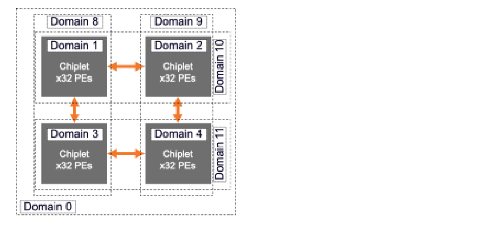

*图 8-3：显示四个 chiplet 系统的图*

该系统被划分成一组域：

- 域 0：所有系统中，表示内部可共享域的全部内核；
- 域 1–4：每个 chiplet 一个域；
- 域 8、9、10、11：一组对 chiplet 分组的域。

这只是示例。这样的细粒度瞄准，能降低 TLB 失效操作的成本和延迟。

> 某些情况下，要使用 TLBI 域必须用操作的 TLBIP 变体；详见《Arm ARM》各指令描述。

## 8. 连续映射

**连续映射（contiguous mappings）**让 MMU 能把一组相邻的页/块描述符，表示成翻译阶段的单个连续区域。实现可以用更少的 TLB 项缓存这组描述符，甚至只用一个 TLB 项，从而提高该范围的 TLB 效率。

连续映射在翻译表每一级都给内核提供了一种额外映射大小，映射时更灵活，还能减少翻译开销。代价是：较大的连续映射若覆盖了不需要的内存，会浪费内存。选择取决于具体内存映射需求——大映射 TLB 效率高，小映射内存控制更细。

### 8.1 Contiguous 位

启用连续映射的方式，是把组内每个块/页描述符的 **Contiguous 位**置 1。Contiguous 位是对 MMU 的提示，实现不保证把整组缓存成单个 TLB 项。它在 Armv8-A 引入。

软件创建组时必须满足：

- 组内每个相邻表项的 Contiguous 位都为 1；
- 输入地址（IA）范围与输出地址（OA）范围都与连续映射总大小对齐；
- 组内每个相邻表项描述同一连续 OA 范围的不同相邻块/页部分；
- 组内各表项使用一致的属性和权限；
- 整组表项在翻译表内，与组描述符的总字节大小对齐。

> 不满足约束就是错误编程的连续映射，可能导致 TLB 冲突中止或翻译结果不一致。

下面两图展示 Contiguous 位对 TLB 项的影响：

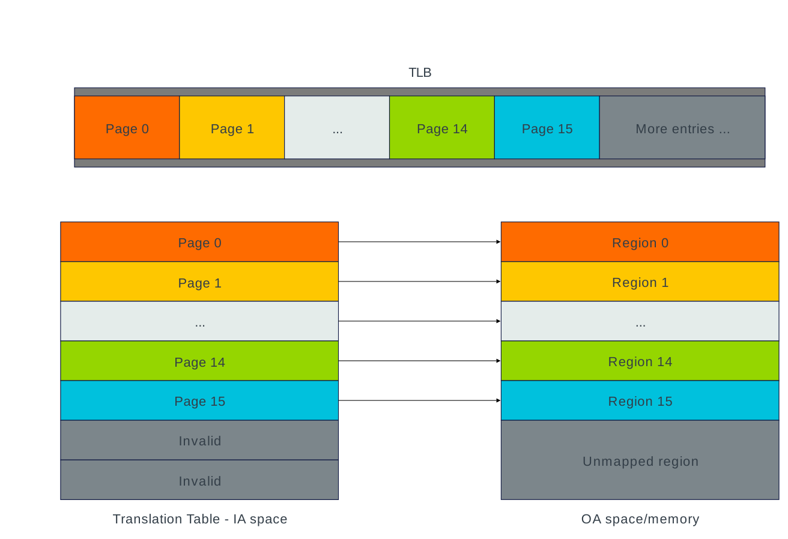

*图 9-1：当 contiguous 位设置为 1 时的翻译表项及其各自 TLB 项*

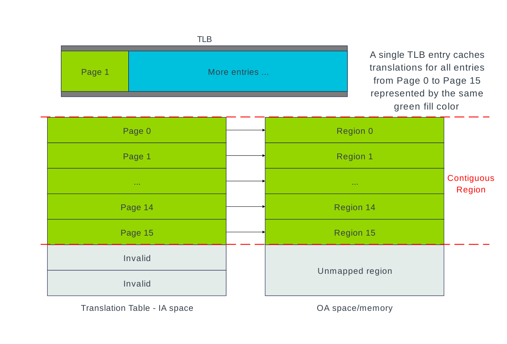

*图 9-2：当 contiguous 位设置为 0 时的翻译表项及其各自 TLB 项*

下面两张表分别给出 VMSAv8-64 与 VMSAv9-128 翻译系统里，Contiguous 位有效值为 1 时，TLB 缓存翻译所允许的属性：

**表 9-1：VMSAv8-64 翻译系统中的连续映射对齐要求**

| 翻译颗粒 | 块或页查找级别 | 相邻翻译表项数量 | 翻译表内相邻翻译表项的对齐边界 | 连续 OA 范围的对齐 |
| --- | --- | --- | --- | --- |
| 4KB | 1 | 16 | 128 字节 | 16GB |
| 4KB | 2 | 16 | 128 字节 | 32MB |
| 4KB | 3 | 16 | 128 字节 | 64KB |
| 16KB | 2 | 32 | 256 字节 | 1GB |
| 16KB | 3 | 128 | 1KB | 2MB |
| 64KB | 2 | 32 | 256 字节 | 16GB |
| 64KB | 3 | 32 | 256 字节 | 2MB |

**表 9-2：VMSAv9-128 翻译系统中的连续映射对齐要求**

| 翻译颗粒 | 块或页查找级别 | 相邻翻译表项数量 | 翻译表内相邻翻译表项的对齐边界 | 连续 OA 范围的对齐 |
| --- | --- | --- | --- | --- |
| 4KB | 1 | 4 | 64 字节 | 1GB |
| 4KB | 2 | 16 | 256 字节 | 16MB |
| 4KB | 3 | 16 | 256 字节 | 64KB |
| 16KB | 1 | 4 | 64 字节 | 64GB |
| 16KB | 2 | 16 | 256 字节 | 256MB |
| 16KB | 3 | 64 | 1KB | 1MB |
| 64KB | 2 | 64 | 1KB | 16GB |
| 64KB | 3 | 16 | 256 字节 | 1MB |

### 8.2 FEAT_CCONT

Linux folios 表明：对物理连续内存分组能提高性能，还能简化内核内存管理、提升 TLB 效率。但前面介绍的 Armv8-A 连续提示只支持固定连续区域大小，限制了内核在不浪费内存的前提下使用连续映射的频率。

**FEAT_CCONT（可配置连续区域大小）**让监管软件（含 Linux）能配置 MMU 使用更广泛的连续区域大小。Linux 可以用这些大小在页表项里描述常见的连续物理内存范围，既降低翻译延迟、提升 TLB 效率，又限制内存浪费。它还允许软件动态改变连续大小而不会导致 TLB 冲突中止。

> FEAT_CCONT 计划随 Future Arm Technologies 发布。

**FEAT_CCONT 的用法**

软件读 `ID_AA64MMFR3_EL1.CCONT` 可判断是否实现了 FEAT_CCONT。

每个翻译机制的每个阶段都有一个新控制字段 `(V)TCR(2)_ELx.CC`，指代以下全部：

- `TCR2_EL1.CC`；
- 若实现 EL2：`TCR2_EL2.CC` 和 `VTCR_EL2.CC`；
- 若实现 EL3：`TCR_EL3.CC`。

为简单起见，下文用 CC 指代相关字段。之前 Armv8-A 引入的连续提示从现在起改称“固定大小连续映射”。

`CC=0` 时，适用固定大小连续映射行为。`CC=1` 时，Contiguous 位含义改变：组内表项数量不再由固定数量决定，而是从描述符 OA 字段的最低有效位推导。

下面两张表给出 CC=1 时用于推导连续区域大小的描述符位索引（每级翻译各不相同）：

**表 9-3：VMSAv8-64 中用于指示区域大小的描述符位**

| 遍历级别 | TGx=4KB | TGx=16KB | TGx=64KB |
| --- | --- | --- | --- |
| 1 | [37:30] | N/A | N/A |
| 2 | [28:21] | [34:25] | [40:29] |
| 3 | [19:12] | [23:14] | [27:16] |

**表 9-4：VMSAv9-128 中用于指示区域大小的描述符位**

| 遍历级别 | TGx=4KB | TGx=16KB | TGx=64KB |
| --- | --- | --- | --- |
| 1 | [34:28] | [42:34] | N/A |
| 2 | [26:20] | [32:24] | [38:28] |
| 3 | [18:12] | [22:14] | [26:16] |

> 每个位范围同时标识 OA 切片和对应的描述符位，即 OA[A:B] == descriptor[A:B]。

连续区域由硬件自然对齐。因此对每组相邻描述符，软件应把每个描述符的 OA 字段编程为**相同的值**（而不是像 CC=0 时那样递增）。

`CC=1` 时，上表相应位决定连续区域大小：从最低有效位开始数切片中为 1 的位，数到第一个 0 停止，得到数量 n；若切片全为 1，则最高位视为 0。连续区域大小 = 该级别块/页描述符大小的 2^(n+1) 倍。

下图说明 n 位如何定位和计数：

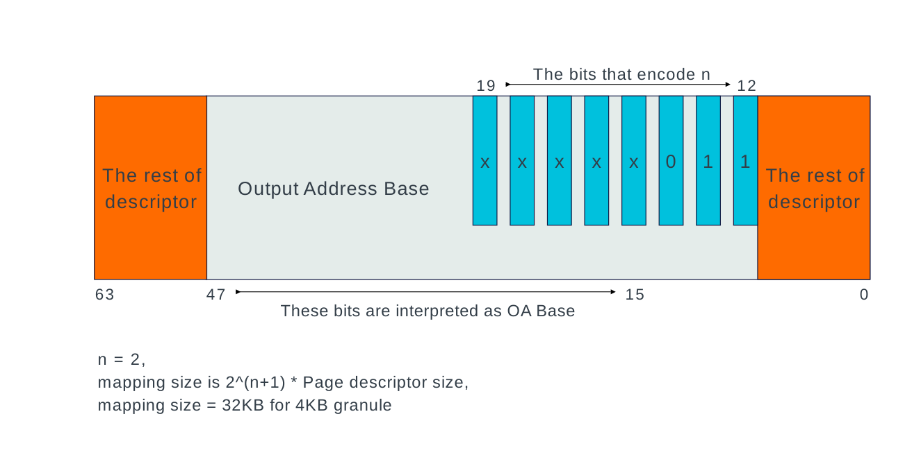

*图 9-3：显示 OA 字段中 n 编码的图*

连续区域在 IA 空间和 OA 空间中都对齐到其总大小。遍历级别 L 处连续区域的最大大小，是级别 L-1 处块映射大小的一半。

例如，4KB 颗粒、第 3 级页表、VMSAv8-64，取 n=0：

```text
2^(n+1) x (页/块大小) = 连续区域大小
2^(0+1) x 4KB = 8KB
```

对第 3 级页遍历，连续区域大小依次为：8KB、16KB、32KB、64KB、128KB、256KB、512KB、1024KB；对应的连续表项数量依次为：2、4、8、16、32、64、128、256。

固定大小连续映射的大部分约束保持不变，唯一区别是相邻表项的 OA 基址现在指向**整个连续区域的基址**，而不是各自那部分。启用 FEAT_CCONT 后，连续映射在翻译表中的结构与 TLB 缓存方式，见配套图所示。

`CC=1` 时，Contiguous 位不再只是对 MMU 的提示：`CC=1` 且 Contiguous 位为 1 时，MMU 行为的改变是有保证的——因为 FEAT_CCONT 改变了翻译期间块/页描述符的解释与处理方式。

**性能指南**

映射大小是“平均翻译延迟”与“内存分配粒度”之间的权衡：大映射降低平均翻译延迟，小映射通过更细粒度减少内存浪费。为帮助软件选择，实现可在 `CCONTIDR_EL1` 中公布首选连续区域大小——首选大小在翻译延迟与内存使用之间取得更好平衡。不过无论首选与否，越大的映射总是带来不高于（即 ≤）较小映射的平均翻译延迟。

例如首选大小 { 32KB, 64KB, 128KB }：

```text
latency(128) <= latency(64) <= latency(32)
latency(512) <= latency(128)
```

## 9. 地址翻译指令

地址翻译（AT）指令让软件查询某个地址的翻译，结果（含属性）写入物理地址寄存器 `PAR_EL1`。

AT 指令的语法允许指定用哪个翻译机制。例如 EL2 能查 EL0/EL1 的翻译机制，但 EL1 不能查 EL2——那属于越权。

如果请求的翻译会导致故障，不会直接抛异常，而是把“本会生成的故障类型”记录在 `PAR_EL1` 里。

## 10. 知识自测

**地址翻译中的“阶段（stage）”和“级别（level）”有什么区别？**

阶段是把输入地址翻译成输出地址的过程：Stage 1 是 VA→IPA，Stage 2 是 IPA→PA。级别指给定翻译阶段中的表，也描述大块如何细分成小块。

**物理地址最大是多少？**

物理地址空间最大是实现定义的，最高 52 位（Armv8.2-A 起）；Armv9.3-A 扩展到 56 位。

**哪个寄存器字段控制虚拟地址空间大小？**

`TCR_ELx.TnSZ`，或 Stage 2 的 `VTCR_EL2.T0SZ`。

**什么是翻译颗粒？支持哪些大小？**

它是能描述的最小内存块，支持 4KB、16KB、64KB。

**TLBI ALLE3 做什么？**

使 EL3 虚拟地址空间的所有 TLB 项失效。

**导致翻译故障的表项能进 TLB 吗？**

不能。

**MMU 禁用时地址如何映射？**

平坦映射：输入地址与输出地址相同。

**什么是 ASID？TLB 项何时包含 ASID？**

ASID 是地址空间标识符，标识翻译属于哪个应用。非全局映射（nG=1）在 TLB 中用 ASID 标记。

## 11. 延伸资料

- **虚拟化**：Armv8-A 和 Armv9-A 的相关话题见 Virtualization 指南。
- **屏障**：Learn the architecture - Memory Systems, Ordering, and Barriers。

培训链接：

- Introduction to Armv8-A
- Memory model overview
- Memory types overview
- What does architecture consist of?

## 12. 小结与下一步

本指南围绕内存管理，解释了虚拟地址到物理地址的映射：翻译表、多级遍历、颗粒、地址空间、TLB 与失效、连续映射等。理解这些，你就能编写自己的裸机页表，也能看懂操作系统分配内存时背后发生了什么。

内存类型与属性（如访问权限）在《AArch64 Memory Attributes and Properties》指南中继续介绍。

处理器之外，为非处理器主机（如 DMA 引擎）提供 MMU 也越来越普遍，Arm 系统里叫 SMMU（系统 MMU），其他系统叫 IOMMU。

要继续学习 Armv8-A 架构，请参阅本系列其他指南。