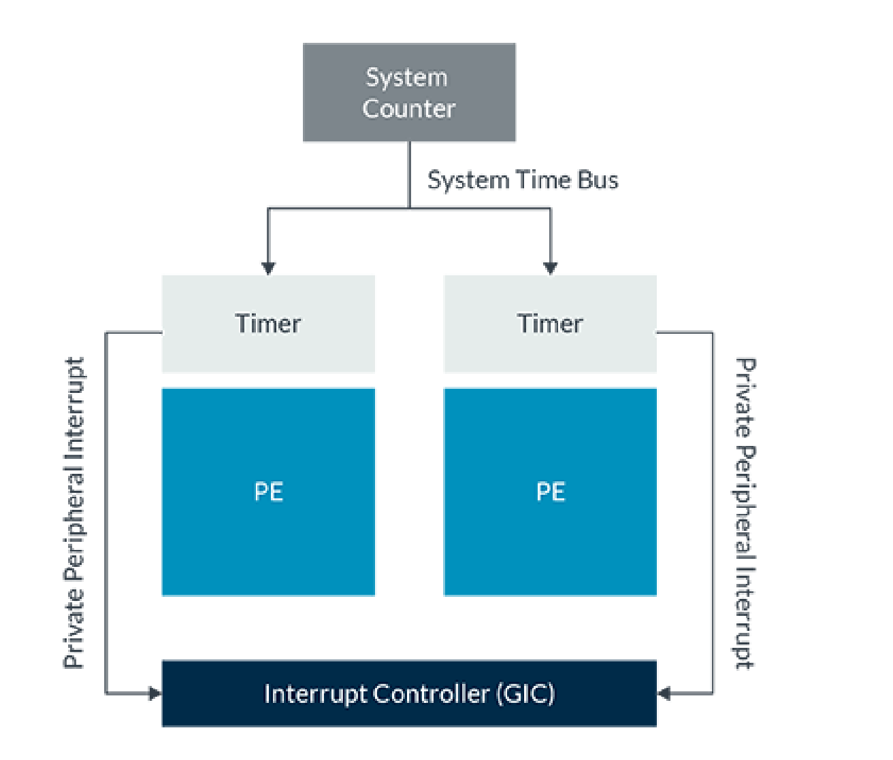
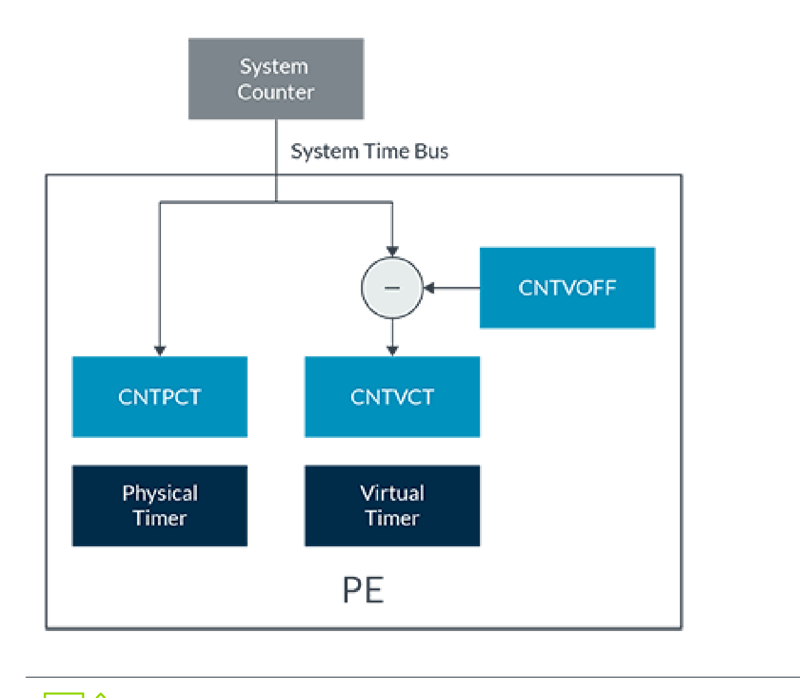
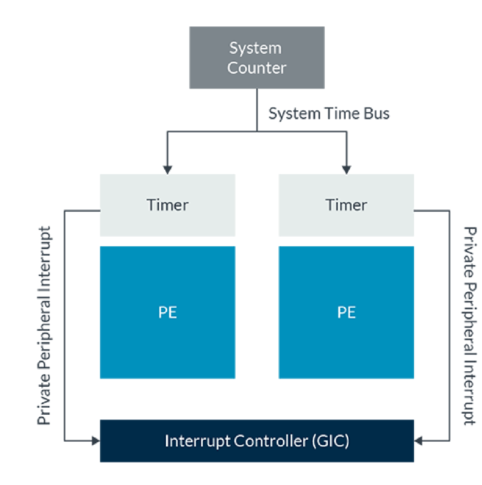
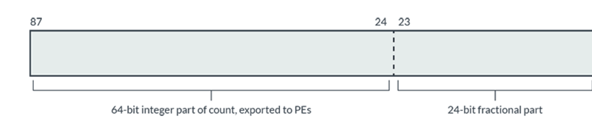
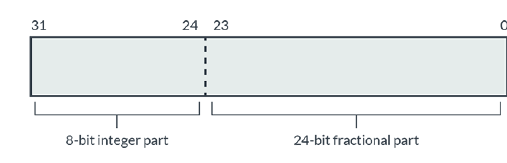
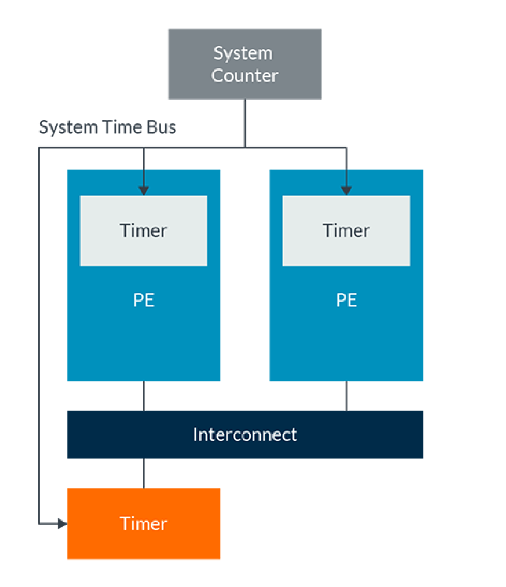

# 读懂 Arm 通用定时器（中文精读版）

> 原文：*Learn the architecture - Generic Timer*
>
> 版本：Version 1.4　|　文档 ID：102379_0104_01_en　|　Issue 01（2024-08-13）
>
> 版权 © 2019, 2022–2024 Arm Limited（或其关联公司）。保留所有权利。非保密。
>
> 说明：本文在原中文翻译的基础上重新组织了叙述逻辑与表达方式，技术内容、表格与图表保持原意；个别明显笔误已按 Arm 架构规范订正。

---

## 导读：这篇文章讲什么

通用定时器（Generic Timer）是面向 A-profile 处理单元（PE）的一套标准化定时器框架。本指南拆解现代 SoC 内定时器框架的各个组成部分，并介绍软件可以使用的编程接口。

读完你应当能：说出定时器子系统各组成部分的名称与用途；在裸机环境中写出配置定时器的代码；根据已实现的架构特性，判断系统里存在哪些定时器。

**开始之前**，假设你熟悉 Arm 异常模型（不熟可先读《AArch64 Exception Model》）。文中含一段 C 与汇编混合的示例，需要 Arm Development Studio（可下载评估版）；汇编语法基础可参考《AArch64 Instruction Set Architecture》指南。

## 1. 通用定时器是什么

通用定时器由两部分组成：一个**系统计数器（System Counter）**，加上**每个核各自的一组定时器**：



*图 3-1：系统计数器*

系统计数器是一个常开（always-on）设备，按固定频率递增，并把计数值广播给系统中的所有内核——于是所有内核共享同一份“时间流逝”视图。系统计数值宽度在 56 到 64 位之间。从 Armv8.6-A 和 Armv9.1-A 起，计数频率固定为 1GHz；更早版本由系统设计决定，通常在 1MHz 到 50MHz 之间。

> 通用定时器只测量时间流逝，不报告时间和日期。时间和日期通常由 SoC 里的实时时钟（Real-Time Clock，RTC）负责。

每个内核的定时器其实是**比较器**：拿自己的设定值与系统计数器广播的计数比较。软件可以配置它们在未来的某个时间点生成中断或事件。系统计数为所有内核提供了共同参照，因此也能用来打时间戳。

## 2. 处理器内置定时器

下表列出了处理器内置的各类定时器：

| 定时器名称 | 何时存在？ |
| --- | --- |
| EL1 物理定时器 | 总是 |
| EL1 虚拟定时器 | 总是 |
| 非安全 EL2 物理定时器 | 实现了 EL2 和非安全状态 |
| 非安全 EL2 虚拟定时器 | 实现了 FEAT_VHE 和非安全状态 |
| EL3 物理定时器 | 实现了 EL3 |
| 安全 EL2 物理定时器 | 实现了 FEAT_SEL2 |
| 安全 EL2 虚拟定时器 | 实现了 FEAT_SEL2 |

### 2.1 计数与频率

`CNTPCT_EL0` 报告当前系统计数值。

对 `CNTPCT_EL0` 的读取可能是**推测性（speculative）**的：读取可能相对程序流乱序发生。这在比较时间戳等场景下很关键。当计数读取顺序重要时，应插入 ISB：

```asm
loop:           // 轮询某些通信，以指示读取定时器的需求
  LDR X1, [X2]
  CBZ X1, loop
  ISB           // 没有这个，CNTPCT 可能在内存位置 [X2] 被写入值 0 之前就被读取
  MRS X1, CNTPCT_EL0
```

> Armv8.6-A 和 Armv9.1-A 增加了一个自同步（self-synchronizing）版本 `CNTPCTSS_EL0`。

`CNTFRQ_EL0` 报告系统计数频率，但这个寄存器不是硬件自动填充的：它在最高已实现 EL 可写、在所有 EL 可读。固件（通常跑在 EL3）在早期初始化时填入正确值，操作系统等高层软件再读取它获取频率。

### 2.2 定时器的寄存器

每个定时器都有三个系统寄存器：

| 寄存器 | 用途 |
| --- | --- |
| `<timer>_CTL_EL<x>` | 控制寄存器 |
| `<timer>_CVAL_EL<x>` | 比较器值 |
| `<timer>_TVAL_EL<x>` | 定时器值 |

寄存器名里的 `<timer>` 标识具体是哪个定时器：

| 定时器 | 寄存器前缀 | EL\<x\> |
| --- | --- | --- |
| EL1 物理定时器 | CNTP | EL0 |
| EL1 虚拟定时器 | CNTV | EL0 |
| 非安全 EL2 物理定时器 | CNTHP | EL2 |
| 非安全 EL2 虚拟定时器 | CNTHV | EL2 |
| EL3 物理定时器 | CNTPS | EL1 |
| 安全 EL2 物理定时器 | CNTHPS | EL2 |
| 安全 EL2 虚拟定时器 | CNTHVS | EL2 |

例如 `CNTP_CVAL_EL0` 就是 EL1 物理定时器的比较器寄存器。

**自测**：EL3 物理定时器和非安全 EL2 虚拟定时器的控制寄存器分别叫什么？

答案：`CNTPS_CTL_EL1` 和 `CNTHV_CTL_EL2`。

### 2.3 谁能访问哪些定时器

某些定时器的访问权限可以配置：

- **EL1 物理和虚拟定时器**：EL0 的访问由 `CNTKCTL_EL1` 控制。
- **EL2 物理和虚拟定时器**：当 `HCR_EL2.{TGE,E2H}=={1,1}` 时，EL0 的访问由 `CNTKCTL_EL2` 控制。这两个定时器是 Armv8.1-A 虚拟化宿主扩展支持的一部分。
- **EL3 物理定时器**：
  - 从 S.EL1 的访问可用 `SCR_EL3.ST` 捕获到 EL3；
  - 从 Armv8.4-A 起，当 `SCR_EL3.EEL2==1`（安全 EL2 启用）时，S.EL1 或 S.EL2 都不可访问该定时器，尝试访问会产生 UNDEF。

### 2.4 两种配置方式：CVAL 与 TVAL

配置定时器有两种方式，对应两个寄存器。

**CVAL（比较器）**是 64 位寄存器。写入一个值，当计数达到或超过它时定时器触发：

```text
定时器条件满足：CVAL <= System Count
```

**TVAL（定时器）**是 32 位寄存器。写入 TVAL 时，处理器内部读取当前系统计数，加上写入值，再填进 CVAL：

```text
CVAL = TVAL + System Counter
定时器条件满足：CVAL <= System Count
```

你可以在软件里观察到这种填充：先读当前系统计数，向 TVAL 写 1000，再读 CVAL，会看到 CVAL 大约等于“系统计数 + 1000”。之所以是“大约”，是因为指令序列执行期间时间仍在流逝。

读回 TVAL 会看到它递减到 0，而系统计数在递增。TVAL 报告有符号值，定时器触发后仍继续递减，软件由此可以判断定时器在多久之前触发的。

两者只是使用模型不同：

- 想要“X 个 tick 之后触发”，把 X 写进 TVAL；
- 想要“系统计数达到 Y 时触发”，把 Y 写进 CVAL。

> 记住：TVAL 和 CVAL 是编程**同一个定时器**的两种方式，不是两个定时器。

### 2.5 生成中断

定时器可以配置为生成中断。内核定时器的中断只能投递给它所在的内核——不能用 A 核的定时器给 B 核发中断。

中断生成由 CTL 寄存器的字段控制：

- `ENABLE`：启用定时器；
- `IMASK`：中断屏蔽，控制是否生成中断；
- `ISTATUS`：当 ENABLE==1 时，报告定时器是否正在触发（CVAL <= System Count）。

要生成中断，软件须把 `ENABLE` 置 1、`IMASK` 清 0。定时器触发（CVAL <= System Count）时，就向中断控制器断言中断信号。Armv8-A 系统中的中断控制器通常是 GIC。

各定时器使用的中断 ID（INTID）由服务器基础系统架构（SBSA）定义：

| 定时器 | SBSA 推荐的 INTID |
| --- | --- |
| EL1 物理定时器 | 30 |
| EL1 虚拟定时器 | 27 |
| 非安全 EL2 物理定时器 | 26 |
| 非安全 EL2 虚拟定时器 | 28 |
| EL3 物理定时器 | 29 |
| 安全 EL2 物理定时器 | 20 |
| 安全 EL2 虚拟定时器 | 19 |

> 这些 INTID 属于私有外设中断（PPI）范围，是每个内核私有的：每个内核都把自己的 EL1 物理定时器视为 INTID 30。详见通用中断控制器指南。

定时器中断是**电平敏感（level-sensitive）**的：一旦触发条件满足，就会持续发出中断信号，直到发生以下任一情况：

- `IMASK` 置 1，屏蔽中断；
- `ENABLE` 清 0，禁用定时器；
- 写入 TVAL 或 CVAL，使触发条件不再满足。

写中断处理器时，务必**先清除中断、再在 GIC 中停用**它，否则 GIC 会再次发出相同中断。

> GIC 的操作与配置超出本指南范围。

### 2.6 定时器虚拟化

前面介绍的定时器可分为两组：物理定时器和虚拟定时器。

物理定时器（如 EL3 物理定时器 CNTPS）与系统计数器提供的**物理计数（physical count）**比较，该值由 `CNTPCT_EL0` 报告。

虚拟定时器（如 EL1 虚拟定时器 CNTV）与**虚拟计数（virtual count）**比较：

```text
Virtual Count = Physical Count - <offset>
```

偏移值在 `CNTVOFF_EL2` 中指定，该寄存器只能在 EL2 或 EL3 访问：



*图 4-1：系统计数器*

> 如果未实现 EL2，偏移固定为 0，虚拟与物理计数值始终相同。

虚拟计数让 hypervisor 能向 VM 呈现“虚拟时间”。例如用偏移隐藏 VM 未被调度期间的时间流逝——于是虚拟计数表示的是 VM 经历的时间，而不是墙上时钟。

### 2.7 事件流

通用定时器还能生成事件流，作为“等待事件（Wait for Event，WFE）”机制的一部分。WFE 指令让内核进入低功耗状态，直到被事件唤醒。

> WFE 机制细节超出本指南范围。

生成事件的方式有多种：

- 在另一个内核上执行 SEV（发送事件）指令；
- 清除内核的全局独占监视器（Global Exclusive Monitor）；
- 使用内核通用定时器的事件流。

通用定时器可以按固定间隔生成事件流。典型用途是生成超时：WFE 常在“等待时间预期不长”时用来等待资源可用，事件流保证了内核处于低功耗状态的最大时间是有限的。

事件流可从物理计数 `CNTPCT_EL0` 或虚拟计数 `CNTVCT_EL0` 生成：

- `CNTKCTL_EL1`：控制来自 `CNTVCT_EL0` 的事件流生成；
- `CNTKCTL_EL2`：控制来自 `CNTPCT_EL0` 的事件流生成。

每个寄存器的控制项有：

- `EVNTEN`：启用/禁用事件生成；
- `EVNTI`：控制事件速率；
- `EVNTDIR`：控制何时生成事件。

`EVNTI` 指定 0 到 15 之间的一个位位置，当该位变化时生成事件。例如 EVNTI=3，则计数的 bit[3] 变化时生成事件。

`EVNTDIR` 控制是该位从 1 变 0、还是从 0 变 1 时生成事件。

### 2.8 汇总表

| 定时器 | 寄存器 | 通常由谁使用 | 可捕获？ | 使用的计数器 | INTID |
| --- | --- | --- | --- | --- | --- |
| EL1 物理定时器 | CNTP\_\<\>\_EL0\*\* | EL0 和 EL1 | 到 EL2 | CNTPCT_EL0 | 30 |
| EL2 非安全物理定时器 | CNTHP\_\<\>\_EL2 | NS.EL2 | | CNTPCT_EL0 | 26 |
| EL2 安全物理定时器 | CNTHPS\_\<\>\_EL2 | S.EL2 | | CNTPCT_EL0 | 20 |
| EL3 物理定时器 | CNTPS\_\<\>\_EL1 | S.EL1 和 EL3 | 到 EL3 | CNTPCT_EL0 | 29 |
| EL1 虚拟定时器 | CNTV\_\<\>\_EL0\*\* | EL0 和 EL1 | | CNTVCT_EL0 | 27 |
| EL2 非安全虚拟定时器 | CNTHV\_\<\>\_EL2 | NS.EL2 | | CNTVCT_EL0 | 28 |
| EL2 安全虚拟定时器 | CNTHVS\_\<\>\_EL2 | S.EL2 | | CNTVCT_EL0\* | 19 |

> \* 对安全 EL2 虚拟定时器，虚拟偏移 `CNTVOFF_EL2` 始终表现为 0。因此它虽然与虚拟计数比较，实际等效于使用物理计数。
>
> \*\* 当 `HCR_EL2.E2H==1` 时受重定向影响。

## 3. 系统计数器

前面已提到，系统计数器生成分发给所有内核的系统计数值：



*图 5-1：系统计数器*

系统计数器由 SoC 实现者设计，通常启动时需要一些初始化。Arm 提供了推荐的寄存器接口，但具体实现细节应咨询你的 SoC 实现者。

一个物理系统计数值广播给所有内核，意味着所有内核共享同一份时间视图。考虑这个例子：

- 设备 A 读当前系统计数，作为时间戳随消息发给设备 B；
- 设备 B 收到后，拿时间戳与自己的当前系统计数比较。

此时设备 B 看到的系统计数值，永远不会早于消息里的时间戳。

### 3.1 有效频率与计数器分辨率

系统计数必须是固定频率，才能呈现一致的时间视图。架构用两个术语描述计数器频率：

**有效频率（Effective frequency）**：计数器每个单位代表的时间量。例如：

- 50MHz 有效频率：每个单位代表 20ns；
- 1GHz 有效频率：每个单位代表 1ns。

`CNTFRQ_EL0` 报告的就是有效频率，且不允许变化。Armv8.0 到 Armv8.5（含）期间，有效频率通常在 1–50MHz；从 Armv8.6/Armv9.1-A 起固定为 1GHz。

**计数器分辨率（Counter resolution）**：计数器实际更新的频率。例如有效频率 1GHz，但真实时钟只跑 100MHz，那么系统计数每 10ns 递增 10。

与有效频率不同，分辨率允许随时间变化——设计者可能根据电源状态调整它。

> Arm 建议正常运行中计数器分辨率不低于 50MHz。

### 3.2 计数器缩放

缩放选项在 Armv8.4-A 引入。计数不再是每个 tick 递增 1，而是递增 X（X 在系统初始化时由软件配置），从而让计数递增速度有效高于或低于计数器频率。

为支持缩放，系统计数器内部把计数值扩展到 88 位：



*图 5-2：计数映像的位整数部分*

计数是一个 88 位定点数：64 位整数部分 + 24 位小数部分。整数部分正是处理器上 `CNTPCT_EL0` 报告的内容，小数部分仅供系统计数器内部使用。

递增量来自 32 位寄存器 CNTSCR：



*图 5-3：位整数部分*

递增值分为 8 位整数部分和 24 位小数部分。

启用缩放后，每个 tick 计数递增 CNTSCR 的值。例如 CNTSCR=0x0180_0000 表示每个 tick 递增 1.5（整数 0x01，小数 0x80_0000）：

| Tick | 内部计数器值（整数 / 小数） | 导出的计数器值（CNTPCT_EL0 可见） |
| --- | --- | --- |
| 0 | 0x0000_0000_0000_0000_0000_00 | 0x0000_0000_0000_0000 |
| 1 | 0x0000_0000_0000_0001_8000_00 | 0x0000_0000_0000_0001 |
| 2 | 0x0000_0000_0000_0003_0000_00 | 0x0000_0000_0000_0003 |
| 3 | 0x0000_0000_0000_0004_8000_00 | 0x0000_0000_0000_0004 |
| 4 | 0x0000_0000_0000_0006_0000_00 | 0x0000_0000_0000_0006 |
| 5 | 0x0000_0000_0000_0007_8000_00 | 0x0000_0000_0000_0007 |
| 6 | 0x0000_0000_0000_0009_0000_00 | 0x0000_0000_0000_0009 |

缩放只能在系统计数器被禁用时配置。在运行中切换缩放或改变缩放因子，可能导致返回未知计数值。

### 3.3 基本编程

下面的指导假设系统计数器实现了推荐的 Arm 寄存器接口。

系统计数器提供两个寄存器帧：`CNTControlBase` 和 `CNTReadBase`。

`CNTControlBase` 用于配置系统计数器，在支持 TrustZone 的系统上仅限安全访问。其中的寄存器：

| 寄存器 | 描述 |
| --- | --- |
| CNTCR | 控制寄存器，包括：计数器使能；缩放使能（Armv8.4-A+）；更新频率选择；调试时停止控制（调试器请求时停止递增） |
| CNTSCR | 缩放时的递增值（Armv8.4-A+） |
| CNTID | ID 寄存器，报告实现了哪些特性 |
| CNTSR | 状态寄存器，报告定时器运行还是停止 |
| CNTCV | 报告当前计数值，只返回整数部分 |
| CNTFID\<n\> | 报告可用的更新频率 |

要启用系统计数器，软件须选择一个更新频率并设置计数器使能。

`CNTReadBase` 是 `CNTControlBase` 的副本，但只含 `CNTCV` 寄存器，因此只能读当前计数值。与 `CNTControlBase` 不同的是，它允许非安全访问——非安全软件能读计数，却不能配置系统计数器。

## 4. 外部定时器

系统还可以包含额外的外部定时器：



*图 6-1：额外外部定时器示例*

它们的编程接口与内部定时器类似，但通过内存映射寄存器访问。寄存器位置由 SoC 实现者决定，并应记录在所用 SoC 的数据手册中。

外部内存映射定时器的中断，通常由 GIC 以共享外设中断（Shared Peripheral Interrupt，SPI）的形式投递。

## 5. 用 Arm Development Studio 动手示例

本指南附有一个简短示例（zip 下载），演示系统计数器的配置，以及用 TVAL 和 CVAL 生成中断。示例需要 Arm Development Studio（可下载评估版），内含 ReadMe.txt 说明文件清单和构建/运行步骤。

`main.c` 中先配置定时器。`main()` 开头：

```c
//
// 配置中断控制器
//
rd = initGIC();
// 安全物理定时器 (INTID 29)
setIntPriority(29, rd, 0);
setIntGroup(29, rd, 0);
enableInt(29);
// 非安全 EL1 物理定时器 (INTID 30)
setIntPriority(30, rd, 0);
setIntGroup(30, rd, 0);
enableInt(30, rd);
```

这段代码配置 GIC。GIC 的操作超出本指南范围，但生成定时器中断必须先配好它。

`initGIC()` 做中断控制器顶层初始化；后续调用配置并启用与安全物理定时器、非安全 EL1 物理定时器相关的中断源。每个中断配置为：

- Group 0：以 FIQ 形式发信号；
- 优先级 0：GIC 架构中的最高优先级；
- 已启用：允许向内核发信号。

接着初始化系统计数器：

```c
//
// 配置并启用系统计数器
//
setSystemCounterBaseAddr(0x2a430000); // 系统计数器的地址
initSystemCounter(SYSTEM_COUNTER_CNTCR_HDBG,
                  SYSTEM_COUNTER_CNTCR_FREQ0,
                  SYSTEM_COUNTER_CNTCR_nSCALE);
```

第一个调用设定系统计数器位置，供驱动函数访问寄存器。地址基于 Arm Base Platform Model，其内存映射见《Fast Models Reference Manual》。

第二个调用写 CNTCR：选择频率更新方案 0、禁用缩放、置使能位。此后系统计数开始递增。

然后是定时器配置：

```c
//
// 配置定时器
//
// 配置安全物理定时器
// 使用 CVAL/比较器设置定时器触发的绝对时间
current_time = getPhysicalCount();
setSEL1PhysicalCompValue(current_time + 10000);
setSEL1PhysicalTimerCtrl(CNTPS_CTL_ENABLE);
// 配置非安全物理定时器
// 使用 TVAL/定时器在 X 个 tick 后触发定时器
setNSEL1PhysicalTimerValue(20000);
setNSEL1PhysicalTimerCtrl(CNTP_CTL_ENABLE);
```

这里配置了两个定时器：

- 用 CVAL 设置安全物理定时器 CNTPS；
- 用 TVAL 设置非安全 EL1 物理定时器 CNTP。

之后 `main()` 等待两个中断都生成后退出。

中断处理器同样在 `main.c`：

```c
void fiqHandler(void)
{
  uint32_t ID;
  // 读取 IAR 以获取被送入中断的 INTID
  ID = readIARGrp0();
  printf("FIQ: Received INTID %d\n", ID);
  switch (ID)
  {
    case 29:
      setSEL1PhysicalTimerCtrl(0); // 禁用定时器以清除中断
      printf("FIQ: Secure Physical Timer\n");
      break;
    case 30:
      setNSEL1PhysicalTimerCtrl(0); // 禁用定时器以清除中断
      printf("FIQ: Non-secure EL1 Physical Timer\n");
      break;
    case 1023:
      printf("FIQ: Interrupt was spurious\n");
      return;
    default:
      printf("FIQ: Panic, unexpected INTID\n");
  }
  // 写入 EOIR 以停用中断
  writeEOIGrp0(ID);
  flag++;
  return;
}
```

中断处理器先读 GIC 的中断确认寄存器（IAR）拿到 INTID，再根据返回的值禁用相应定时器以清除中断。也可以改用“置 IMASK 屏蔽”或“更新比较器”的办法。

最后写 GIC 的中断结束寄存器（EOIR），更新 GIC 中该中断的内部状态机。

## 6. 知识自测

**`CNTFRQ_EL0` 由硬件自动设置以报告系统计数频率。对还是错？**

错。由 EL3 的启动软件负责用正确值填充。

**描述配置给定定时器的两种方式。**

- TVAL：让定时器在 X 个 tick 后触发（X 为写入值）；
- CVAL：把比较器设为绝对值，计数到达该值时触发。

**中断处理器里如何清除定时器中断？**

可置 IMASK（屏蔽）、清 ENABLE（禁用定时器），或更新 CVAL/TVAL。

**通用定时器中断是边沿触发还是电平敏感？**

电平敏感。

**通用定时器生成事件流时，事件速率如何控制？**

EVNTI 通过选择“计数中哪个位变化才生成事件”控制速率；EVNTDIR 控制是该位 0→1 还是 1→0 触发事件。

## 7. 延伸资料

- Arm Community：提问，查找 Arm 专家专题文章与博客。

按主题：

- **中断**：通用定时器生成的中断由 GIC 处理，详见 GIC 指南（开发中）。
- **虚拟化**：Armv8.1-A 虚拟化宿主扩展及一般虚拟化主题，见虚拟化指南。
- **事件流**：作为 WFE 机制一部分，更多等待事件信息见同步指南（开发中）。
- **示例**：Arm Base Platform Model 内存映射，见相关手册。

## 8. 小结与下一步

通用定时器为 Arm 系统提供了一套统一的定时器框架：一个广播式系统计数器，加上每个核各自的比较器定时器；软件可用 CVAL 或 TVAL 两种方式编程，可生成中断或事件流，也能通过虚拟计数支持虚拟化。

这些知识可以直接用于你编写低层系统初始化代码。文中多次提到 GIC——想深入了解可留意我们关于 GIC 的系列指南（开发中）；要继续学习 Armv8-A，可阅读本系列其他指南。
