# Learn the architecture — AArch64 异常模型（中文翻译）

> 原文：*Learn the architecture - AArch64 Exception Model*
>
> 版本：Version 1.3　|　文档 ID：102412_0103_02_en　|　Issue 02（2025-02-06）
>
> 版权 © 2022, 2025 Arm Limited（或其关联公司）。保留所有权利。非保密。

---

## 1. 概述

《AArch64 异常模型》指南介绍 Armv8-A 与 Armv9-A 中的异常（exception）与特权（privilege）模型。它涵盖 Arm 架构中不同类型的异常，以及处理器在异常发生时的行为。

本文内容面向低层代码（如启动代码或内核）的开发者，尤其适合任何编写代码来设置或管理异常的人。

在指南末尾你可以进行知识自测。你将能够列出各异常级别、说明执行是如何在它们之间切换的，并能够说出并描述各执行状态。你还能详述一个简单 AArch64 向量表（vector table）的组成部分，以及异常处理器（exception handler）是如何被使用的。

## 2. 特权与异常级别

在解释 AArch64 异常模型的细节之前，我们需要先引入“特权”这一概念。

现代软件被划分为不同的模块，每个模块对系统与处理器资源具有不同级别的访问能力。操作系统内核与用户应用程序之间的划分就是其中一个例子。操作系统需要执行一些我们不希望用户应用程序能执行的操作。内核需要较高的系统资源访问级别，而用户应用程序配置系统的能力则受到限制。特权决定了某个软件实体能够看到并控制哪些处理器资源。

AArch64 架构通过实现不同级别的特权来支持这种划分。当前特权级别只有在处理器进入异常或从异常返回时才会改变。因此，在 Arm 架构中这些特权级别被称为“异常级别（Exception level）”。

### 2.1 异常级别

AArch64 中特权的名称是“异常级别（Exception level）”，通常缩写为 EL。异常级别用数字编号，通常缩写并表示为 EL\<x\>，其中 \<x\> 是 0 到 3 之间的数字。特权级别越高，数字越大。例如，最低的特权级别被称为 EL0。

如下图所示（图 2-1），共有四个异常级别：EL0、EL1、EL2 和 EL3。

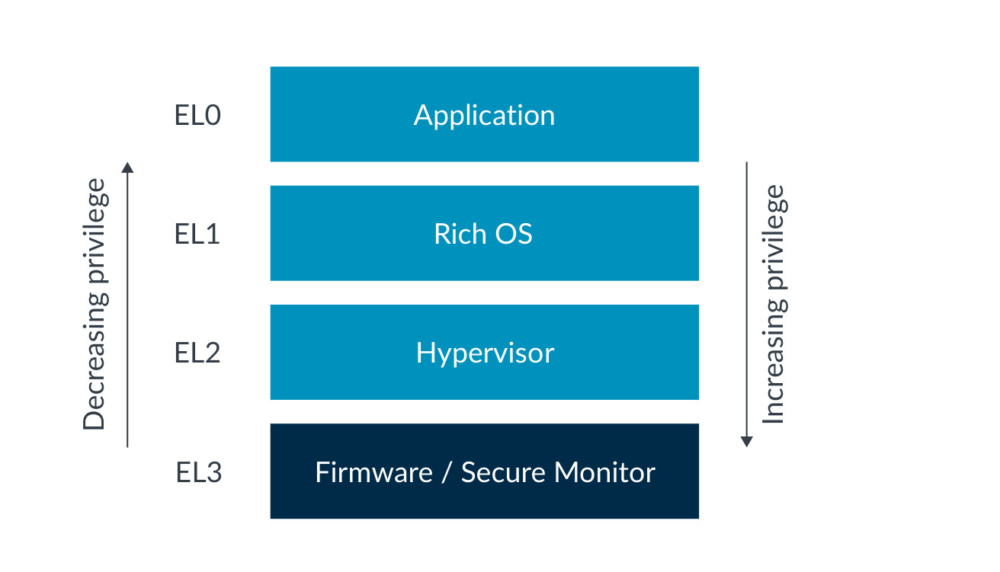

*图 2-1：异常级别*

架构并未规定哪一层软件使用哪个异常级别。一种常见的使用模型是：应用程序代码运行在 EL0，而 Linux 这类富操作系统（Rich OS）运行在 EL1。EL2 可供虚拟机监控器（hypervisor）使用，EL3 则供固件（firmware）和安全网关代码使用。例如，Linux 可以使用软件接口标准来调用 EL3 的固件函数，从而把“上电或下电某个核”这类低层细节抽象为一种意图。这种模型意味着 PE（处理单元）的大部分处理通常发生在 EL0/EL1。

架构并不强制这种软件模型，但标准软件都假设采用这一模型。因此，本指南其余部分均假设使用这种使用模型。

异常级别只有在发生以下任一情况时才能改变：

- 进入异常（taking an exception）
- 从异常返回（returning from an exception）
- 处理器复位（processor reset）
- 进入调试状态（Debug state）
- 退出调试状态（exiting from Debug state）

进入异常时，异常级别可以提高或保持不变。你永远无法通过进入异常来移动到更低的特权级别。从异常返回时，异常级别可以降低或保持不变。你永远无法通过从异常返回来移动到更高的特权级别。我们将在本指南后续章节进一步讨论这一点。

### 2.2 特权类型

与 AArch64 异常模型相关的特权有两种类型：

- 内存系统中的特权
- 从访问处理器资源的角度而言的特权

这两种特权都受到当前所处特权异常级别的影响。

**内存特权**

Arm 架构的 A-Profile 实现了虚拟内存系统，其中内存管理单元（MMU）允许软件为内存区域指定属性。这些属性包括读/写权限，可被配置为对特权访问和非特权访问分别授予不同的访问权限。

处理器在 EL0 执行时发起的内存访问按非特权访问权限进行检查；来自 EL1、EL2 和 EL3 的内存访问则按特权访问权限进行检查。

由于这种内存配置是软件使用 MMU 的转换表（translation table）来编程的，因此你应当考虑编程这些表所需的特权。MMU 配置保存在系统寄存器（System register）中，而访问这些寄存器的能力同样由当前异常级别控制。

**寄存器访问**

AArch64 处理器的配置设置保存在一系列被称为“系统寄存器（System register）”的寄存器中。系统寄存器中设置的组合定义了当前的处理器上下文（processor context）。对系统寄存器的访问由当前异常级别控制。

例如，`VBAR_EL1` 是“向量基址寄存器（Vector Base Address Register）”。我们将在本指南后面说明它的用途。目前重要的是它的 `_EL1` 后缀——它告诉我们软件至少需要 EL1 特权才能访问该寄存器。

架构中有许多功能上概念相似、仅在异常级别后缀上不同的寄存器。它们是相互独立、各自独立的寄存器，在指令集中有各自的编码，并在硬件中分别实现。

这些寄存器名称相似是为了反映它们执行相似的任务，但它们是彼此完全独立的寄存器，各自拥有独立的访问语义。系统寄存器名称的后缀表示可以访问该寄存器的**最低**异常级别。

每个已实现的异常级别都有一个系统控制寄存器（SCTLR）。每个寄存器控制该 EL 的架构特性，例如 MMU、缓存和对齐检查：

| 寄存器 | 说明 |
| --- | --- |
| `SCTLR_EL1` | EL0 和 EL1 的顶层系统控制 |
| `SCTLR_EL2` | EL2 的顶层系统控制 |
| `SCTLR_EL3` | EL3 的顶层系统控制 |

> EL1 和 EL0 共享同一份 MMU 配置，且控制权限仅限于运行在 EL1 的特权代码。因此不存在 `SCTLR_EL0`，所有控制都来自 EL1 可访问的寄存器。这一模型通常也适用于其他控制寄存器。

更高异常级别拥有访问控制更低级别寄存器的特权。例如，EL2 在必要时拥有访问 `SCTLR_EL1` 的特权。该寄存器无法从 EL0 访问，任何尝试都会产生异常。

在系统的一般运行中，各特权异常级别控制各自的配置。不过，更特权的级别有时会访问与更低异常级别相关联的寄存器。例如，这可能是为了实现虚拟化特性和上下文切换。

本指南在讨论 AArch64 异常模型时涉及以下系统寄存器：

**表 2-1：处理异常时的关键系统寄存器**

| 寄存器 | 名称 | 描述 |
| --- | --- | --- |
| ELR_ELx | 异常链接寄存器（Exception Link Register） | 保存触发异常的指令的地址 |
| ESR_ELx | 异常综合寄存器（Exception Syndrome Register） | 包含异常原因的信息 |
| FAR_ELx | 故障地址寄存器（Fault Address Register） | 保存虚拟故障地址 |
| HCR_ELx | 虚拟机监控器配置寄存器（Hypervisor Configuration Register） | 控制虚拟化设置以及把异常捕获（trapping）到 EL2 |
| SCR_ELx | 安全配置寄存器（Secure Configuration Register） | 控制安全状态以及把异常捕获到 EL3 |
| SCTLR_ELx | 系统控制寄存器（System Control Register） | 控制标准内存、系统设施，并提供已实现功能的状态信息 |
| SPSR_ELx | 保存的程序状态寄存器（Saved Program Status Register） | 保存异常被送到该 ELx 时处理器的状态 |
| VBAR_ELx | 向量基址寄存器（Vector Base Address Register） | 保存任何被送到 ELx 的异常的异常基址 |

## 3. 执行状态与安全状态

AArch64 架构提供四个异常级别。此外还有两种执行状态（Execution state）以及最多四种安全状态（Security state）。Armv8-A 或 Armv9-A 处理器的当前状态由异常级别和当前执行状态共同决定。

### 3.1 执行状态

当前执行状态定义了通用寄存器的标准宽度以及可用的指令集。执行状态还会影响内存模型的某些方面以及异常的管理方式。

Armv8-A 和 Armv9-A 支持两种执行状态：

- **AArch32**：32 位执行状态。在此状态下运行与先前的架构向后兼容。它支持 T32 和 A32 指令集。标准寄存器宽度为 32 位。
- **AArch64**：64 位执行状态。它支持 A64 指令集。标准寄存器宽度为 64 位。

本指南后续章节将更深入地关注 AArch64 中异常的处理方式。

**改变执行状态**

处理单元（PE）只能在复位时或异常级别改变时改变执行状态。当 PE 在异常级别之间移动时，可以改变执行状态；不过，在 AArch32 与 AArch64 之间转换还需要遵守额外的规则：

- 从较低异常级别移动到较高异常级别时，执行状态可以保持不变或变为 AArch64。
- 从较高异常级别移动到较低异常级别时，执行状态可以保持不变或变为 AArch32。

把这两条规则放在一起意味着：64 位的层可以承载 32 位的层，但反过来不行。例如，64 位操作系统内核可以同时承载 64 位和 32 位应用程序，而 32 位操作系统内核只能承载 32 位应用程序。

下图说明了这些场景：

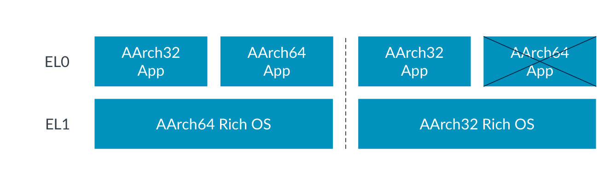

*图 3-1：32 位与 64 位层上的异常级别*

这个例子使用的是操作系统和应用程序，但同样的规则适用于所有异常级别。例如，EL2 上的 32 位虚拟机监控器只能承载 EL1 上的 32 位操作系统。

Armv8-A 架构在所有异常级别上都支持 AArch32 和 AArch64 执行状态。对于每个异常级别，支持其中一种或两种是实现上的选择。

对于 Armv8-A 处理器，复位时的执行状态由“实现定义（IMPLEMENTATION DEFINED）”的机制决定。例如，Cortex-A32 总是复位进入 AArch32 状态。

对于 Armv9-A 处理器，要求在所有 EL 上都支持 AArch64。是否在 EL0 支持 AArch32 是实现上的选择。所有其他异常级别均为 AArch64，并且复位时的执行状态始终是 AArch64。

每个异常级别的执行状态由**下一个更高已实现异常级别**的控制寄存器定义。这利用了 EL2 的虚拟机监控器配置寄存器（`HCR_EL2`）和 EL3 的安全配置寄存器（`SCR_EL3`）。复位时，EL3 的执行状态（如果可切换）由一个外部引脚设置。该主题在“路由与中断控制器”一节中有进一步介绍。

### 3.2 安全状态

AArch64 允许实现多个安全状态。这使得软件可以被进一步划分，从而隔离和分区受信任的软件。

大多数 Cortex-A 处理器支持两种安全状态：

- **安全状态（Secure state）**：在此状态下，处理单元（PE）可以访问安全和非安全物理地址空间，以及寄存器组的“安全”副本。
- **非安全状态（Non-secure state）**：通常也被称为 Normal world。在此状态下，PE 只能访问非安全物理地址空间。PE 只能访问允许非安全访问的系统寄存器。

安全状态定义了可以访问哪些已实现的异常级别、当前可以访问哪些内存区域，以及这些访问如何表示在系统内存总线上。如果处于非安全状态，PE 只能访问非安全物理地址空间。在安全状态下，PE 可以同时访问安全和非安全物理地址空间。

一个例子是：你的操作系统（如 Android）运行在 Normal world，而支付或 DRM 系统运行在 Secure world。我们需要对 Secure world 中的系统有更高的信任度，并且需要将它们隔离开来，以保护诸如支付信息和密钥之类的信息。拥有这两种安全状态就提供了这种隔离。

下图展示了异常级别与安全状态，并使用了不同的执行状态：

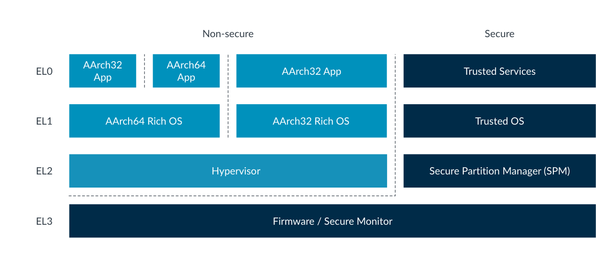

*图 3-2：使用不同执行状态的异常级别与安全状态*

这些安全状态的使用在《TrustZone for AArch64》指南中有更详细的描述。

**改变安全状态**

如果实现了 TrustZone，那么处理器可以处于安全状态或非安全状态。这由 `SCR_EL3.NS` 位选择。

你可能已经注意到上图中 EL3 处于安全状态。EL3 是最具特权的异常级别，并且 EL3 的安全状态是固定的。EL3 能够访问某个被分组（banked）系统寄存器的所有副本。

在 Armv8-A 中，EL3 始终处于安全状态。在 Armv9-A 中，EL3 属于安全状态的一部分，除非实现了 RME（Realm Management Extension）。如果实现了 RME，那么 Root 状态就是将 EL3 与其余安全状态分隔开来的一种隔离。RME 将在下一节中进一步介绍。

每当你想从一个安全状态切换到另一个安全状态时，都必须经过 EL3。EL3 的软件负责管理对不同可用安全状态的访问，并充当“看门人（gatekeeper）”，控制对 EL2、EL1 和 EL0 的安全状态的访问。`SCR_EL3.NS` 位使得在从 EL3 返回时能够改变安全状态。

> 在 EL0、EL1 和 EL2，PE 既可以处于安全状态，也可以处于非安全状态。你经常看到这样的写法：
>
> - `NS_EL1`：非安全状态，异常级别 1
> - `S_EL1`：安全状态，异常级别 1

改变安全状态在《TrustZone for AArch64》和《Realm Management Extension》中有更详细的讨论。

**Realm Management Extension（RME）**

Armv9-A 引入了对 Realm Management Extension（RME）的支持。当实现 RME 时，额外支持两种安全状态：

- **Realm 状态（Realm state）**：在此状态下，PE 可以访问非安全和 Realm 物理地址空间。
- **Root 状态（Root state）**：在此状态下，PE 可以访问所有物理地址空间。Root 状态仅在 EL3 可用。

RME 将 EL3 与所有其他安全状态隔离开来。有了 RME，EL3 脱离安全状态，进入它自己的安全状态——Root。异常级别 3 承载平台和初始启动代码，因此必须受到安全、非安全和 Realm 状态中的软件的信任。

下图展示了启用 RME 的 PE 中的安全状态，以及这些安全状态如何映射到异常级别：

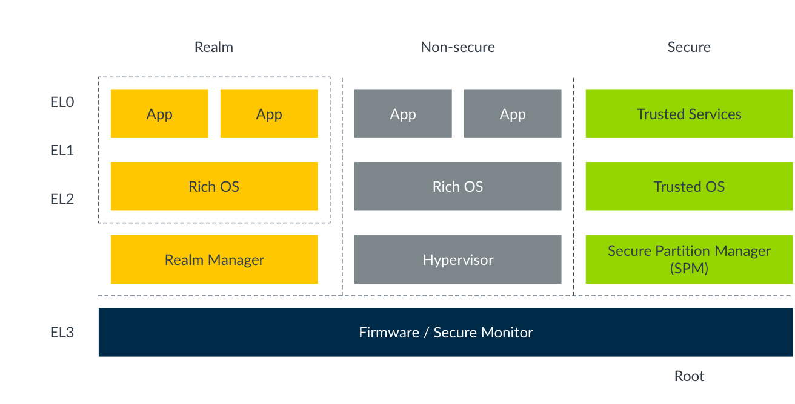

*图 3-3：启用 RME 的 PE 中的安全状态*

有关 RME 的更多信息，请参见《Realm Management Extension》。

### 3.3 已实现异常级别的影响

对于任何特定处理器，是否实现所有异常级别，以及每个已实现异常级别允许哪些执行状态，都是实现上的选择。

EL0 和 EL1 是唯一必须实现、且为强制要求的异常级别。EL2 和 EL3 是可选实现的。

请注意，如果没有实现 EL3 或 EL2，需要考虑以下问题：

- EL2 包含大量虚拟化功能。没有 EL2 的实现无法访问这些特性。有关虚拟化的更多信息，请参见《AArch64 virtualization》指南。
- EL3 是唯一能够改变安全状态的级别。如果某个实现选择不实现 EL3，那么该 PE 将只能访问单一安全状态。因此你所永久处于的状态是“实现定义”的。

有一些已开发出来的软件实现要求平台支持这些异常级别。例如，KVM Linux 需要 EL2、EL1 和 EL0。

> 在 Armv8.0-A 中，EL2 只存在于非安全状态，因为安全状态下没有虚拟化支持。Armv8.4-A 将 S.EL2 作为一个可选特性加入，并使用一个使能位（`SCR_EL3.EEL2`）来提供向后兼容。在 Armv9-A 中，如果你支持 EL2，就必须在两种安全状态中都支持它，不过禁用位仍然存在。

Armv8-A 处理器实现可以自主选择每个异常级别允许哪些执行状态，这是“实现定义”的。如果在某个异常级别允许 AArch32，那么在所有更低的异常级别上也都必须允许 AArch32。例如，如果 EL3 允许 AArch32，那么在所有更低的异常级别上都必须允许它。

许多实现允许所有的执行状态和所有的异常级别，但也存在带有限制的现有实现。例如：

- Cortex-A35 在所有异常级别上都支持 AArch32 和 AArch64
- Cortex-A32 只支持 AArch32
- Neoverse-N2 在 EL0 支持 AArch32。所有其他异常级别仅支持 AArch64

AArch32 提供与旧的 32 位架构的向后兼容，并且从 Armv9-A 起，被限制为仅在 EL0 可选实现。Armv9-A 在所有异常级别都支持 AArch64，仅在 EL0 可选支持 AArch32。这意味着可以运行遗留应用程序，但不能运行内核、虚拟机监控器或固件。

你应当参考你所使用处理器的技术参考手册（TRM）来确认支持哪些异常级别。

## 4. 异常类型

异常是需要特权软件采取补救措施或更新系统状态、以确保系统平稳运行的条件或系统事件。因此，异常是任何可能导致当前正在执行的程序被挂起的事件。进入异常会引起状态改变，从而去执行处理该异常的代码。

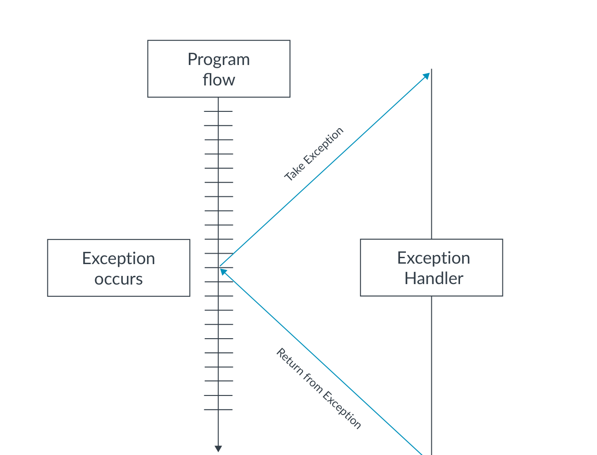

*图 4-1：处理异常*

其他处理器架构可能把这种事件描述为“中断（interrupt）”。在 AArch64 中，中断是一种特定类型的外部产生的异常。

异常用于许多不同的原因，包括：

- 模拟虚拟设备
- 虚拟内存管理
- 处理软件错误
- 处理硬件错误
- 调试
- 执行对不同特权或安全状态的调用
- 处理中断（定时器、设备交互）
- 处理不同执行状态之间的交互（称为 interprocessing）

当进入异常时，处理器不会移动到当前代码中的下一条指令，而是停止当前执行并跳转到一段用于处理该请求的代码。这段代码被称为异常处理器（exception handler）。事件处理完毕后，执行可以返回到原程序。每种异常类型都有自己的异常处理器。如图 4-1 所示。

Arm 架构把异常分为两大类：**同步异常（synchronous exceptions）**和**异步异常（asynchronous exceptions）**。

### 4.1 同步异常

同步异常是可以由当前正在执行的指令引起、或与之相关的异常。同步异常相对于执行流是同步的，因为它们与当前正在执行的指令直接相关。例如，一条指令试图写入 MMU 所定义的只读位置，就会触发同步异常。

如果以下所有条件都成立，则该异常是同步的：

- 该异常是直接执行、或尝试执行某条指令的结果。
- 异常处理完毕后要返回的地址（返回地址）与触发异常的指令之间存在架构上定义的关系。
- 该异常是精确（precise）的，也就是说，进入异常处理器时所呈现的寄存器状态，与违规指令之前的每一条指令都已执行、且之后的指令一条都未执行这一状态保持一致。

同步异常有许多不同的类型，并且某条给定的指令有可能引起多个同步异常。Arm 架构为同步异常提供了一个固定的优先级顺序。

以下各节更深入地讨论了同步异常的一些不同成因：

- 无效指令与陷阱异常
- 内存访问
- 产生异常的指令
- 调试异常

**无效指令与陷阱异常**

同步异常可以由试图执行无效指令引起。无效指令的原因有很多，包括指令是 UNDEFINED（未定义）的、在当前异常级别不允许、或已被禁用。任何试图执行内核无法识别的指令的行为都会产生 UNDEFINED 异常。

架构还允许某个控制实体（如操作系统或虚拟机监控器）设置“陷阱（trap）”来拦截更低异常级别的操作。当某个给定动作（例如读取某个特定寄存器）被执行时，陷阱就会触发异常。

例如，EL1 上的操作系统内核可能禁用 EL0 对浮点指令的使用，以便在应用程序之间进行上下文切换时节省时间。这被称为惰性上下文切换（lazy context-switching）；如果在上下文切换之前没有使用过 SIMD 或浮点（FP）单元，那么压入栈的寄存器数量就可以减少。然后就可以使用陷阱异常来处理边界情况。

在这种情况下，操作系统内核可以通过禁用 SIMD/FP 单元来监视 SIMD/FP 操作的状态。当执行一条 FP 或 SIMD 指令时，就会向 EL1 的操作系统内核送入一个陷阱异常。然后内核可以启用 SIMD/FP 单元、执行那条失败的指令，并设置一个标志以表明 SIMD/FP 单元已被使用。这确保在下次上下文切换时，庞大的 SIMD/FP 寄存器文件被包含进寄存器上下文中。如果下次上下文切换时没有断言该标志，那么就不需要包含 SIMD/FP 寄存器。

捕获异常的能力对虚拟化尤其重要。关于异常如何用于虚拟化的更多信息，请参见《AArch64 virtualization》指南。

**内存访问**

同步异常也可以由内存访问引起。这可能是 MMU 执行的检查结果，也可能是内存系统返回的错误所致。

例如，当 MMU 启用时，加载和存储指令引起的所有内存访问都会被检查。如果你试图从非特权代码访问特权地址，或试图写入只读地址，那么 MMU 会阻止该访问并触发内存管理单元（MMU）故障（fault）。由于 MMU 产生的错误是同步的，异常会在内存访问继续进行之前被送入。

内存访问错误在《AArch64 memory management》指南中有更详细的讨论。

内存访问也可以产生异步异常，这将在本指南后面的 SError 一节中介绍。

> 在 AArch64 中，同步中止（synchronous abort）会导致同步异常。异步中止（asynchronous abort）会导致 SError 中断异常。

**产生异常的指令**

有些指令会故意产生并送入一个异常。这些指令用于实现系统调用接口，使较低特权软件能够向较高特权软件请求服务。这些有时被称为系统调用（system call），常用于基于软件的 API 中。

Arm 架构包含产生异常的指令 `SVC`、`HVC` 和 `SMC`。这些指令的唯一目的就是产生异常并使 PE 能够在异常级别之间移动：

- 超级用户调用（Supervisor Call，`SVC`）指令使 EL0 的用户程序能够请求 EL1 的操作系统服务
- 虚拟机监控器调用（Hypervisor Call，`HVC`）指令（在实现了虚拟化扩展时可用）使操作系统能够请求 EL2 的虚拟机监控器服务
- 安全监控器调用（Secure Monitor Call，`SMC`）指令（在实现了安全扩展时可用）使 Normal world 能够请求 EL3 的固件的 Secure world 服务

当 PE 在 EL0 执行时，它无法直接调用 EL2 的虚拟机监控器或 EL3 的安全监控器，因为这只能从 EL1 及更高层进行。EL0 的应用程序必须使用 `SVC` 调用来请求内核，再由内核执行调用进入更高异常级别的动作。

假设相应的异常级别已经实现，操作系统内核（EL1）可以执行 `HVC` 指令来调用 EL2 的虚拟机监控器，或使用 `SMC` 指令调用 EL3 的安全监控器。类似地，从 EL2 开始，PE 可以使用 `SMC` 指令来调用 EL3 的安全监控器。如下图所示：

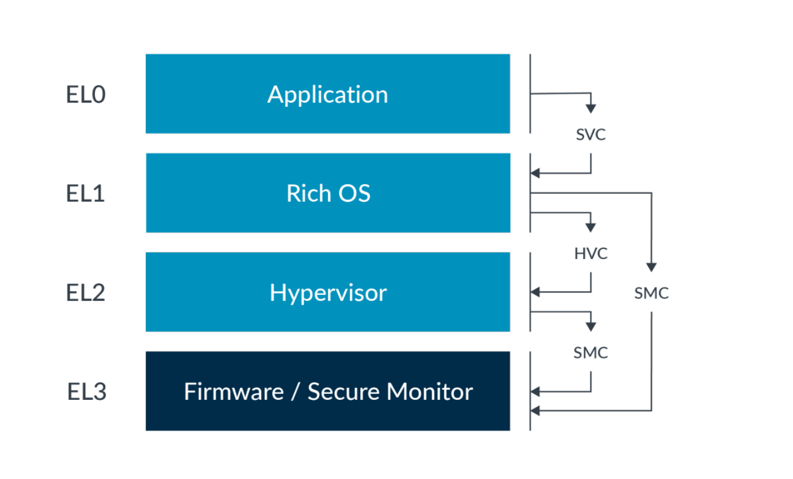

*图 4-2：服务调用路由*

因为异常无法被送入更低的 EL，所以在 EL2 做出的 `SVC` 调用不可能导致进入回到 EL1。

> 正如前面在“无效指令与陷阱异常”中讨论的那样，虚拟机监控器可能正在向 EL1 呈现系统的模拟视图。在这种情况下，客户操作系统（guest OS）将无法使用安全监控器调用直接调用设备固件。相反，这类调用会通过在虚拟机监控器配置寄存器中设置 `HCR_EL2.TSC` 位而被捕获到 EL2。

**调试异常**

调试异常是同步异常，被路由到承载调试器（debugger）的异常级别。调试器代码随后与异常处理器代码非常类似地执行。

有许多特定的同步调试异常，包括：

- 断点指令异常（Breakpoint Instruction exceptions）
- 断点异常（Breakpoint exceptions）
- 观察点异常（Watchpoint exceptions）
- 向量捕获异常（Vector Catch exceptions）
- 软件单步异常（Software Step exceptions）

关于调试异常及其处理方式的更多信息，请参见《AArch64 self-hosted debug》指南。

### 4.2 异步异常

有些类型的异常是从外部产生的，因此与当前指令流不同步。

异步异常与当前正在执行的指令没有直接关联，通常是来自处理器外部的系统事件。这可能是软件需要响应的系统事件，例如定时器的活动或屏幕的触摸。我们不知道它们何时会发生。

根据定义，如果某个异常不是同步的，那它就是异步的。异步异常也被称为中断（interrupt）。

在进入异步异常时，程序流被打断并转去执行专门处理该外部请求的代码。无法保证异步异常究竟何时会被送入，AArch64 架构只要求它在一个有限的时间内发生。

**物理中断**

物理中断是响应 PE 外部信号而产生的，通常由外设产生。系统不是让内核不断轮询外部信号，而是通过产生一个中断来告知内核有事情需要处理。

例如，系统可能使用通用异步收发器（UART）接口与外界通信。当 UART 收到数据时，它需要一种机制来告诉处理器新数据已到达并准备好被处理。UART 可以使用的一种机制就是产生一个中断来向处理器发信号。

复杂系统可以有许多具有不同优先级的中断源，包括支持嵌套中断处理的能力，即较高优先级的中断可以打断较低优先级的中断。内核响应这类事件的速度在系统设计中可能是个关键问题，被称为中断延迟（interrupt latency）。

接下来我们来看不同类型的物理中断。

**SError**

系统错误（System Error，SError）是一种异常类型，旨在由内存系统响应意外事件而产生。我们不期望这些事件发生，但需要知道它们是否已经发生。这些事件被异步报告，因为触发该事件的指令可能已经被提交（retired）。

SError 的一个典型例子是过去被称为“外部异步中止（external asynchronous abort）”的情况。SError 中断的例子包括：

- 内存访问通过了所有 MMU 检查，但在内存总线上遇到错误
- 对某些 RAM 进行奇偶校验或纠错码（ECC）检查，例如内置缓存中的那些 RAM
- 由缓存行将脏数据写回外部内存而触发的中止

SError 被视为单独的一类异步异常，因为你通常会为这些情况准备单独的处理器。SError 的产生是“实现定义”的。

**IRQ 与 FIQ**

Arm 架构有两种异步异常类型：IRQ 和 FIQ，旨在用于支持处理外设中断。它们用于向外发送外部事件信号，例如定时器触发，而并不表示系统错误。它们是预期会发生的、相对处理器指令流异步的事件。

IRQ 和 FIQ 具有独立的路由控制，通常用于实现安全和非安全中断，如《Arm Generic Interrupt Controller v3 and v4》指南中所讨论。如何使用这两种异常类型是“实现定义”的。

> 在 Arm 架构的旧版本中，FIQ 被用作更高优先级的快速中断。这与 AArch64 不同，在 AArch64 中 FIQ 与 IRQ 具有相同的优先级。

在几乎所有情况下，系统中的中断控制器都与 AArch64 处理器配对使用，用于汇总、确定优先级并处理所有中断。所有 Arm 实现都使用 Arm 通用中断控制器（GIC）架构来管理 IRQ 和 FIQ。GIC 执行中断管理、优先级确定和路由等任务，为每种物理中断类型向内核提供单一信号。有关 GIC 架构的更多信息，请参见《Arm Generic Interrupt Controller v3 and v4》指南。

**虚拟中断**

使用虚拟化的系统对中断处理有更复杂的需求。一些中断可能由虚拟机监控器处理，另一些则可能在虚拟机（VM）内处理。VM 看到的中断是虚拟中断。虚拟中断可以由连接到中断控制器的设备从外部产生，也可以由软件产生。因此需要额外的机制来支持这一点，所以在 AArch64 中有对虚拟中断的显式支持：

- vSError，虚拟系统错误
- vIRQ，虚拟 IRQ
- vFIQ，虚拟 FIQ

虚拟中断按中断类型分别控制。这些虚拟中断的功能与其物理对应物相同，但它们只能向 EL1 发信号。

虚拟中断可以由 EL2 的虚拟机监控器产生，也可以使用中断控制器产生。虚拟机监控器必须设置虚拟机监控器配置寄存器（`HCR_EL2`）中相应的路由位。例如，要启用 vIRQ 信号，虚拟机监控器必须设置 `HCR_EL2.IMO`。此设置将物理 IRQ 异常路由到 EL2，并使能向 EL1 发出虚拟异常信号。

`HCR_EL2` 中有三个位控制虚拟中断的产生：

| 位 | 说明 |
| --- | --- |
| VSE | 设置此位即注册一个 vSError |
| VI | 设置此位即注册一个 vIRQ |
| VF | 设置此位即注册一个 vFIQ |

设置其中一个位等效于中断控制器向某个 vCPU 断言一个中断信号。这种方法的一个含义是：虚拟机监控器随后必须在 VM 中模拟中断控制器的操作。当用于频繁操作时，这可能导致显著的开销，因此建议使用中断控制器。

GICv2 及更高版本通过提供物理 CPU 接口和虚拟 CPU 接口，支持物理和虚拟中断的信号发送。有关中断控制器的更多信息，请参见《Arm Generic Interrupt Controller v3 and v4》。安全状态下的虚拟化支持是在 Armv8.4-A 中加入的，并且要求使能并支持安全 EL2。

虚拟中断在《AArch64 virtualization》指南中有进一步讨论。

**屏蔽（Masking）**

物理和虚拟异步异常都可以被暂时屏蔽。这意味着异步异常可以保持在挂起（pending）状态，直到它们被解除屏蔽并且异常被送入。这对处理嵌套异常特别有用。

同步异常不能被屏蔽。这是因为同步异常直接由指令的执行引起，如果将它们留在挂起状态或被忽略，就会阻塞执行。

2021 年的扩展（Armv8.8-A 和 Armv9.3-A）增加了不可屏蔽中断（NMI）支持。当受到支持并启用时，可以通过这种能力将某个中断以“超级优先级（Superpriority）”呈现给处理器。超级优先级允许在那些没有超级优先级的中断本来会被屏蔽的情况下送入该中断。

屏蔽将在本指南后面的“路由与中断控制器”中进一步介绍。屏蔽和 NMI 能力将在“异常屏蔽与不可屏蔽中断（NMI）”一节中更深入地讨论。

## 5. 异常处理

正如我们在“异常类型”一章中所讲，异常发生时当前程序流被打断。本章更深入地讨论异常在实践中是如何被处理的。

在 AArch64 中，谈论进入异常时使用特定的术语：

- 当 PE 响应一个异常时，就是“送入（taken）”了一个异常。
- PE 在进入异常之前的状态是该异常“从之被送入（taken from）”的状态。
- PE 在进入异常之后的状态是该异常“被送入到（taken to）”的状态。

因此，处理器在异常被识别时所处的状态，被称为该异常从之被送入的状态。PE 在异常之后所处的状态，是异常被送入到的状态。例如，可以从 AArch32 EL0 向 AArch64 EL1 送入异常。

异常处理完毕后，系统需要从它被送入到的状态返回。这被称为异常返回（Exception return），Arm 架构有触发异常返回的指令：

- PE 在执行返回指令时所处的状态是该异常“从之返回（returns from）”的状态。
- PE 在异常返回指令执行之后所处的状态是该异常“返回到（returns to）”的状态。

### 5.1 进入异常

当异常发生时，处理器保存 PE 的当前状态以及异常返回地址，然后进入一个特定的模式来处理该异常。

从 PSTATE 中取当前状态的快照（snapshot），这在“保存当前处理器状态”一节中进一步讨论。该快照被写入保存的程序状态寄存器（SPSR），返回地址被写入异常链接寄存器（ELR）。对于同步异常和 SError，另一个寄存器——异常综合寄存器（ESR）也会被更新。它记录异常的原因。

当一个异常被送入使用 AArch64 状态的异常级别（ELx）时，会发生以下所有事情：

- 异常被送入之前 PSTATE 的内容被写入 `SPSR_ELx`。
- 首选的异常返回地址被写入 `ELR_ELx`。

此外：

- 对于同步异常和 SError 中断，异常综合信息（异常原因）被写入 `ESR_ELx`。
- 对于与地址相关的同步异常（如 MMU 故障），触发异常的虚拟地址被写入故障地址寄存器 `FAR_ELx`。

任何给定异常的处理都从一个被称为异常向量（exception vector）的固定内存地址开始。当异常发生时，处理单元（PE）跳转到向量表（vector table）中的某个位置。

> AArch64 中的向量表与许多其他处理器架构不同，因为它包含的是**指令**，而不是地址。每个表项最多包含 32 条指令——刚好足够执行基本压栈并调用特定于异常的处理代码。

向量表的位置通常被配置为包含执行通用动作的处理代码，并根据异常类型跳转到进一步的异常处理代码，如图 5-1 所示。这段向量代码被限制为 32 个字（word）的代码。异常处理器包含用于处理所请求操作并实现从异常状态返回的代码。

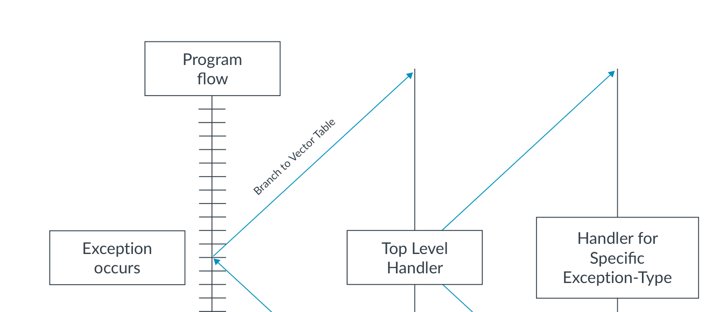

*图 5-1：顶层处理器*

每种异常类型都面向一个异常被送入到的异常级别（EL）。因此，进入异常可以实现路由到不同的 EL。这一点尤其重要，因为获得特权的唯一途径就是进入异常。失去或降低特权的唯一途径是执行异常返回。

这意味着：

- 进入异常时，EL 可以保持不变或提高。
- 异常返回时，EL 可以保持不变或降低。

重要的是要注意，进入异常或执行异常返回并不一定意味着 EL 的改变。异常的目标可能是与当前相同的 EL。目标 EL 要么根据异常类型隐式定义，要么由系统寄存器中的配置位定义。

> 在 AArch64 中，你只能从 EL0 向更高的异常级别送入异常。异常永远不会被送入 EL0，也不存在 EL0 向量表。

正如在“执行状态与安全状态”一章中所讨论的，PE 也只能在复位时或进入异常/从异常返回时改变执行状态。AArch32 和 AArch64 执行状态之间的交互被称为 interprocessing。关于“改变执行状态”，记住以下内容很重要：

- 从较低异常级别移动到较高异常级别时，执行状态可以保持不变或变为 AArch64。
- 从较高异常级别移动到较低异常级别时，执行状态可以保持不变或变为 AArch32。

以下内容由架构定义：

- 如果某个异常级别使用 AArch32，那么所有更低的异常级别都必须使用 AArch32
- 如果某个异常级别使用 AArch64，那么所有更高的异常级别都必须使用 AArch64

在 Armv9-A 架构和一些 v8-A 实现中，AArch32 仅在 EL0 受支持，且异常不能被送入 EL0。这意味着要改变 EL0 的执行状态，需要先移动到一个更特权的 EL，然后再返回。

由于异常可以从 AArch32 被送入 AArch64，AArch64 的处理代码可能需要访问 AArch32 寄存器。AArch32 通用寄存器被直接映射到 AArch64 寄存器，以允许处理代码访问 AArch32 寄存器：

**表 5-1：AArch32 到 AArch64 的寄存器映射**

| AArch32 | AArch64 |
| --- | --- |
| R0–R12 | X0–X12 |
| Banked SP 和 LR | X13–X23 |
| Banked FIQ | X24–X30 |

当从 AArch32 移动到 AArch64 时，AArch32 状态下不可访问的寄存器保留其先前 AArch64 执行时的值。对于在两种执行状态下都可访问的寄存器，在从一个使用 AArch32 的异常级别送入异常时，64 位寄存器的上半部分要么包含 0，要么包含旧值：

- 高 32 位：UNKNOWN
- 低 32 位：所映射的 AArch32 寄存器的值

AArch64 中的寄存器在《AArch64 Instruction Set Architecture》指南中有更深入的讨论。

以下各节讨论从异常被送入，到完成异常返回这一过程中的每一步。

**保存当前处理器状态**

AArch64 有一个处理器状态概念，称为 PSTATE，正是这些信息被存储在 SPSR 中。PSTATE 包含诸如当前异常级别和算术逻辑单元（ALU）标志等信息。在 AArch64 中，这包括：

- 条件标志（Condition flags）
- 执行状态控制（Execution state controls）
- 异常屏蔽位（Exception mask bits）
- 访问控制位（Access control bits）
- 时序控制位（Timing control bits）
- 推测控制位（Speculation control bits）

例如，PSTATE 中的以下异常屏蔽位（DAIF）允许异常事件被屏蔽。当相应位被设置时，异常不会被送入：

- D —— 调试异常屏蔽位
- A —— SError 异步异常屏蔽位，例如异步外部中止
- I —— IRQ 异步异常屏蔽位
- F —— FIQ 异步异常屏蔽位

当进入异常时，必须保存当前状态，以便之后能够返回到正确的状态。PE 自动保存异常返回地址和当前的 PSTATE。正如在“进入异常”中所提到的，PSTATE 作为快照存储在 SPSR（保存的程序状态寄存器）中。

每个异常级别都有一个 SPSR，即 `SPSR_ELx`。在进入异常时，所使用的 `SPSR_ELx` 是异常被送入到的那个异常级别的。例如，如果异常被送入 EL1，那么 `SPSR_EL1` 被更新。

然后，PE 将当前 PSTATE 更新为架构为该异常类型所定义的状态，反映新状态。这包括在受影响的地方更新目标异常级别和安全级别。

> 在 Armv7 及更早版本中，PSTATE 被称为 CPSR，并且被实现为一个寄存器。

PSTATE 更新后，PE 就可以跳转到向量表中的异常处理器。执行从目标异常级别处、由异常类型所定义的异常向量开始。要从异常返回，处理器随后可以将 SPSR 的内容恢复到 PSTATE，并跳转到 ELR 中指定的返回地址。如图 5-2 所示。

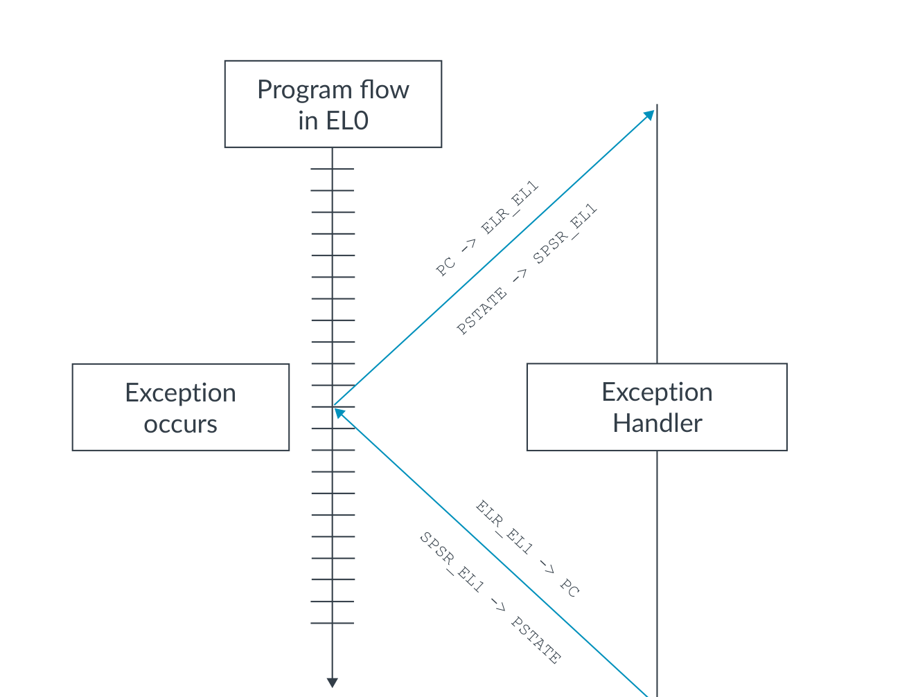

*图 5-2：保存和恢复处理器状态*

**路由与中断控制器**

每种异常类型都有一个目标异常级别，该级别要么是：

- 根据异常类型隐式确定的
- 由系统寄存器中的配置位定义的

异常的目标要么由架构固定，要么由软件使用路由控制来配置。然而，异常永远不能被送入 EL0。

同步异常按照与产生异常的指令 `SVC`、`HVC` 和 `SMC` 相关联的规则进行路由。当实现了相应的级别时，其他类别的异常可以被路由到 EL2（虚拟机监控器）或 EL3（安全监控器）。路由是针对 IRQ、FIQ 和 SError 分别设置的。例如，某个实现可以把所有 IRQ 路由到 EL1，如下图所示：

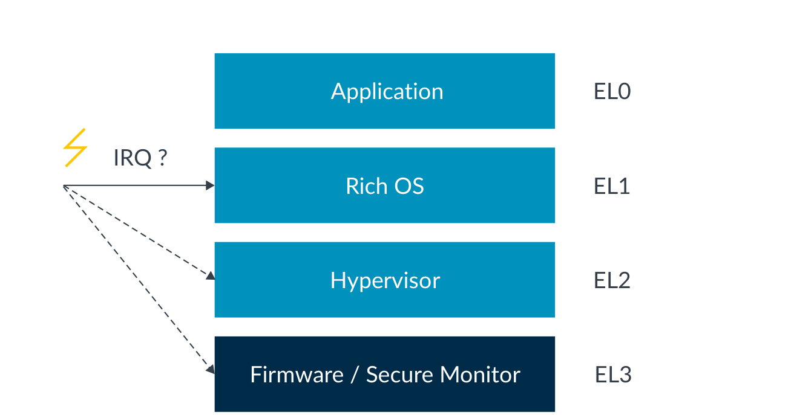

*图 5-3：IRQ 路由示例*

路由使用安全配置寄存器 `SCR_EL3` 和虚拟机监控器配置寄存器 `HCR_EL2` 进行配置。`SCR_EL3` 寄存器指定哪些异常被路由到 EL3，而 `HCR_EL2` 寄存器类似地指定哪些异常被路由到 EL2。

这使得不同的中断类型可以被路由到不同的异常级别。例如，IRQ 可能由 EL1 的操作系统处理，而 SError 更通常由运行在 EL3 的固件处理。

每个控制寄存器中都有单独的位，允许对 IRQ、FIQ 和 SError 中断进行单独控制。此外，使用 `SCR_EL3` 做出的路由配置在发生冲突时，会覆盖使用 `HCR_EL2` 做出的路由配置。这些寄存器中的路由位在复位时具有 UNKNOWN 值，因此必须由软件初始化。

常见做法是使用 Arm 通用中断控制器（GIC）架构（见相关指南）来执行中断管理、优先级确定和路由的任务。这可以减少与虚拟化相关的开销。

> 异常无法被送入一个未实现的异常级别。对未实现异常级别的调用是 UNDEFINED 的。类似地，当 EL2 被禁用或未实现时，试图为给定安全状态返回到 EL2，会在异常返回（ERET）时产生故障。

前面在“屏蔽”一节中提到，异步异常可以被暂时屏蔽并保持在挂起状态，直到异常被解除屏蔽并被送入。路由也会影响屏蔽，因为屏蔽的能力取决于当前和目标异常级别。

- 路由到更高异常级别的异常无法被较低的 EL 屏蔽。例如，如果 EL1 中屏蔽了中断，而某个中断被路由到 EL2，那么 EL1 的屏蔽不会影响 EL2 的操作。但请注意，EL2 中断可能在 PE 上次退出 EL2 执行时已经被屏蔽，这仍可能导致进入 EL2 时该中断被屏蔽。
- 路由到当前异常级别的异常可以被当前级别屏蔽。
- 路由到更低异常级别的异常始终被屏蔽。该异常被挂起，直到 PE 改变到一个等于或低于它所路由到的异常级别。这符合“你永远无法通过进入异常而失去特权”的规则。

**表 5-2：异常级别变化时的屏蔽规则**

| 异常级别变化 | 对屏蔽的影响 |
| --- | --- |
| 目标 EL > 当前 EL | 不可被当前 EL 屏蔽 |
| 目标 EL < 当前 EL | 隐式屏蔽 |
| 目标 EL == 当前 EL | 由 PSTATE 屏蔽位设置 |

异常被送入到的异常级别的执行状态由一个更高的异常级别决定。假设所有异常级别都已实现，下表显示了执行状态是如何确定的：

**表 5-3：根据目标异常级别确定执行状态**

| 被送入到的异常级别 | 执行状态由谁决定 |
| --- | --- |
| EL1 | `HCR_EL2.RW` |
| EL2 | `SCR_EL3.RW` |
| EL3 | EL3 的复位状态 |

**AArch64 向量表**

当向一个使用 AArch64 的异常级别送入异常时，向量表是一块普通内存区域，其中包含用于处理该异常的指令。

当异常发生时，内核需要能够执行与该异常对应的处理器。处理器充当分发（dispatch）代码，识别异常的原因，然后调用相关的处理代码来处理该异常。存储处理器的内存位置被称为异常向量。在 AArch64 中，异常向量存储在异常向量表中。

每个异常级别都有自己的向量表，其基址由各自的向量基址寄存器 `VBAR_EL<x>` 定义，其中 \<x\> 为 1、2 或 3。注意，EL0 没有专用向量表，因为异常永远不会被送入 EL0。

所有向量表使用相同的格式。根据异常的类型以及异常从何处被送入，有不同的异常类别表项。每个异常类别在距离向量基址的固定偏移处都有一个异常向量。

使用哪个表项取决于以下因素：

- 异常的类型（SError、FIQ、IRQ、同步）
- 异常被从之送入和被送入到的异常级别
- 需要支持的执行状态
- 正在使用的栈指针（参见“栈指针选择与栈指针寄存器”一节）

> VBAR 寄存器的值在复位后是未定义的，因此必须在使能中断之前进行配置。

下表描述了向量表内距离向量基址的固定偏移：

**表 5-4：向量表偏移**

| 地址 | 异常类型 | 描述 |
| --- | --- | --- |
| VBAR_ELx + 0x780 | SError/VSError | 来自更低 EL，且所有更低 EL 均为 AArch32 |
| VBAR_ELx + 0x700 | FIQ/vFIQ | 同上 |
| VBAR_ELx + 0x680 | IRQ/vIRQ | 同上 |
| VBAR_ELx + 0x600 | 同步 | 同上 |
| VBAR_ELx + 0x580 | SError/VSError | 来自更低 EL，且至少一个更低 EL 为 AArch64 |
| VBAR_ELx + 0x500 | FIQ/vFIQ | 同上 |
| VBAR_ELx + 0x480 | IRQ/vIRQ | 同上 |
| VBAR_ELx + 0x400 | 同步 | 同上 |
| VBAR_ELx + 0x380 | SError/VSError | 来自当前 EL，且使用 SP_ELx |
| VBAR_ELx + 0x300 | FIQ/vFIQ | 同上 |
| VBAR_ELx + 0x280 | IRQ/vIRQ | 同上 |
| VBAR_ELx + 0x200 | 同步 | 同上 |
| VBAR_ELx + 0x180 | SError/VSError | 来自当前 EL，且使用 SP_EL0 |
| VBAR_ELx + 0x100 | FIQ/vFIQ | 同上 |
| VBAR_ELx + 0x080 | IRQ/vIRQ | 同上 |
| VBAR_ELx + 0x000 | 同步 | 同上 |

这由特权软件记录到系统寄存器中，以便内核在异常发生时能够定位相应的处理器。这些向量被分为两组，每组又分为两个子组：

- 来自更低 EL 的异常
  - 更低 EL 使用 AArch32
  - 更低 EL 使用 AArch64
- 来自当前 EL 的异常
  - 选择 SP_ELx 时的异常
  - 选择 SP_EL0 时的异常

因此，异常到达哪个向量本身就已经提供了异常发生时处理器状态的信息。我们将在“栈指针选择与栈指针寄存器”一节中介绍所选栈指针的意义。

注意，从更低 EL 报告的执行状态，是针对异常被送入到的那个 EL 的**紧邻下方**的那个 EL，而不一定是异常被从之送入的那个 EL。

例如，如果异常从 EL0 被送入 EL1，则基于 EL1 的执行状态来选择向量表项。但是，如果异常从 EL0 被送入 EL2，则所使用的向量取决于 EL1 而非 EL0。这是因为我们通常期望虚拟机监控器或其他虚拟化管理软件运行在 EL2，管理运行在 EL0 和 EL1 的虚拟机（VM）。虚拟机监控器需要知道 VM 内操作系统的执行状态，而通常不需要知道操作系统所承载的应用程序的执行状态。也有一些特殊情况，例如当 `HCR_EL2.TGE` 被设置为 1 时。该主题在《AArch64 virtualization》指南中有更详细的介绍。

一个简单的异常处理器会指示系统压入所有可破坏（corruptible）的寄存器——根据异常类型的不同，这可能是所有寄存器——然后调用特定于异常的处理代码。返回时，这些寄存器会被恢复，并调用异常返回指令（ERET）。

向量表内的 32 个字的空间足以容纳压栈、调用特定异常处理代码、恢复寄存器以及发起 ERET 返回所需的指令。这一流程在图 5-4 中作了总结。

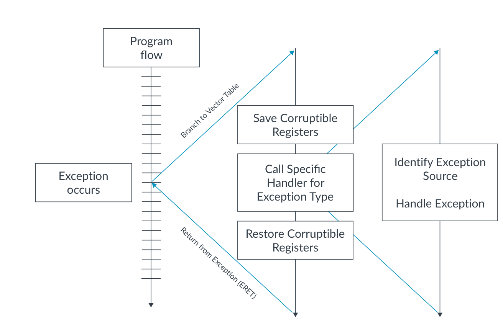

*图 5-4：简单的异常处理器示例*

**栈指针选择与栈指针寄存器**

在 AArch64 中执行时，架构允许在两个栈指针寄存器之间进行选择：SP_EL0 或 SP_EL\<x\>，其中 \<x\> 是当前异常级别。例如，在 EL1 可以选择 SP_EL0 或 SP_EL1。这在“AArch64 向量表”一节的向量表示例中可以看到。

当进入异常时，目标异常级别的栈指针 SP_ELx 会被自动选择。PE 选择的栈指针按照以下规则由 PSTATE 配置：

- 如果在 EL0 执行，那么 PE 使用 EL0 栈指针 SP_EL0。
- 如果在 EL1、EL2 或 EL3 执行，那么 PE 使用由 `PSTATE.SP` 位决定的栈指针：
  - 如果 `PSTATE.SP` 为 0，那么 PE 使用 EL0 栈指针 SP_EL0。
  - 如果 `PSTATE.SP` 为 1，那么 PE 使用当前异常级别的栈指针 ELx。

当我们进入向量表处的第一级处理器时，我们使用的是 SP_ELx。默认情况下应当用它来保存寄存器上下文。不过，我们通常随后会切换到使用 SP_EL0 来进行任何进一步的处理。

ELx 栈可以用于存储那些否则可能被异常处理器影响或破坏的寄存器，这样它们就可以在从异常返回时被恢复。这在处理由栈溢出引起的异常时对于维护有效栈特别有用。返回操作需要反向执行此动作。

例如，如果 PE 在 EL1 执行并且一个 IRQ 中断被发出信号，就会触发 IRQ 异常。如果 IRQ 已被配置为路由到 EL1，那么它将使用 SP_EL1，除非 `PSTATE.SP` 另有配置。在上面提供的示例向量表中，执行将从地址 `VBAR_EL1 + 0x280` 开始。

这种分离意味着我们可以把用于异常进入和高层异常处理的栈，与用于其他线程（例如栈使用量大的 C 代码）的栈隔离开来。SP_EL0 通常分配有更大的栈空间，因此在这种情况下始终是更好的栈选择。这也意味着异常进入不依赖于主栈的状态。如“表 5-4：向量表偏移”中所示，有单独的向量表项支持这种改变。

正如在“AArch64 向量表”一节中提到的，异常到达的向量本身已经提供了异常发生时处理器状态的信息。例如，由于异常进入和退出期间异常应当被屏蔽，向量表中“来自当前 EL 且使用 SP_ELx”区域的代码只会在非常特殊的情况下被触发。该向量分组内的异步异常表明发生了严重的系统错误，需要处理，例如内核恐慌（kernel panic）。

### 5.2 从异常返回

一旦异常处理器完成对异常的处理，处理器就会返回到异常发生前正在运行的代码。

它通过执行以下操作来实现：

1. 恢复所有先前压栈的可破坏寄存器
2. 发起异常返回指令（ERET）

ERET 指令从相关联的 SPSR 恢复先前的处理器状态，并跳转到 ELR 中记录的异常返回地址。返回到的异常级别根据 `SPSR_EL<x>` 中的值来配置，其中 \<x\> 是所从之返回的级别。`SPSR_ELx` 还包含目标执行状态。

> `SPSR_ELx` 中指定的执行状态必须与 `SCR_EL3.RW` 或 `HCR_EL2.RW` 中的配置相匹配，否则会产生非法异常返回。

在执行 ERET 指令时，PSTATE 从 `SPSR_ELx` 恢复，程序计数器更新为 `ELR_ELx` 中的值。这两个更新是原子地、不可分割地执行的，这样 PE 就不会被置于未定义状态。

正如在“保存当前处理器状态”一节中所介绍的，每个 EL 的异常链接寄存器（ELR）保存首选的异常返回地址。这由异常的类型决定。

对于同步服务调用（如 `SVC`），这是异常调用之后紧邻的那条指令。对于其他同步异常，这是产生异常的那条指令的地址。对于异步异常，首选的异常返回地址是异常被送入时尚未完全执行完的第一条指令。处理器可以在需要时根据异常类型修改 `ELR_ELx` 的内容。

### 5.3 异常处理示例

本节从端到端的视角提供同步和异步异常处理的简要示例。

**同步异常处理**

正如在“同步异常”一节中所讨论的，如果某个异常是由指令的直接执行产生的，并且返回地址指向引起它的那条指令，那么该异常就可以被视为同步异常。以下寄存器为处理同步异常以及 SError 提供关键信息：

- 异常综合寄存器（`ESR_ELx`）提供关于同步异常的原因和类型的信息。
- 故障地址寄存器（`FAR_ELx`）保存与地址相关的同步异常（如 MMU 故障）的故障虚拟地址。
- 异常链接寄存器（`ELR_ELx`）保存触发指令的地址，提供异常的返回地址。

下面是一个使用系统调用的 AArch64 异常模型的简单示例。

如果在较低异常级别运行的代码必须执行特权操作，它需要调用较高异常级别。例如，运行在 EL0 的 AArch32 应用程序代码可能需要从 EL1 的 AArch64 操作系统/内核请求堆内存分配。为此，它通过执行 `SVC` 指令产生一个超级用户系统调用，触发以下过程：

- 当前 PSTATE 作为快照保存在 `SPSR_EL1` 中
- 首选的异常返回地址（下一条指令）被写入 `ELR_EL1`
- 异常综合信息（异常原因）被写入 `ESR_EL1`
- 通过读取虚拟机监控器配置寄存器 `HCR_EL2.RW` 的 RW 位来确定目标执行状态
- 当前 PSTATE 被更新，异常级别改变为 EL1，执行状态变为 AArch64
- 内核跳转到 `VBAR_EL1` 所指向的向量表，偏移为 0x600（`VBAR_EL1 + 0x600`），因为这是一个同步异常，其中异常来自更低 EL 且所有更低 EL 均为 AArch32
- 定义好的寄存器被压栈以维护寄存器上下文
- 从 `ESR_EL1` 中识别出同步异常的类型，本例中为 SVC
- 随后执行特定的 SVC 处理代码
- 一旦 SVC 特定的处理代码完成，控制返回到高层处理器
- 处理器恢复所有先前压栈的寄存器并执行 ERET 指令
- PSTATE 从 `SPSR_EL1` 恢复（包括返回到异常级别 EL0 和目标执行状态 AArch32），程序计数器更新为 `ELR_EL1` 中包含的值

请注意，在本例中，AArch64 处理代码可能需要访问 AArch32 寄存器。

一个涉及系统调用的更复杂示例是：运行在 EL0 的非安全（NS）状态下的 AArch64 应用程序代码需要调用运行在 EL1 的安全、受信任操作系统。要切换安全状态，你必须经过 EL3。然而，正如在“产生异常的指令”一节中所讲的，EL0 无法直接发起对 EL3 的 SMC 调用。在本例中，将从 NS.EL0 向 NS.EL1 发起 SVC 指令。然后 NS.EL1 需要通过向 EL3 发出 SMC 调用来处理安全状态的改变，从而转换到 S.EL1。这在《TrustZone for AArch64》指南中有介绍。

**异步异常处理**

异步异常（称为中断）对 PE 和当前正在执行的指令来说是外部的。Arm 架构没有定义异步异常何时被送入。因此，异步异常相对于其他异常（同步和异步）的优先级是“实现定义”的。

一个简单的匹配示例是：PE 在 AArch32 的 EL0 执行应用程序代码时发生 IRQ 中断。在本例中，`HCR_EL2` 和 `SCR_EL3` 已被配置为将 IRQ 异常路由到 AArch64 的 EL1。下图对此作了总结：

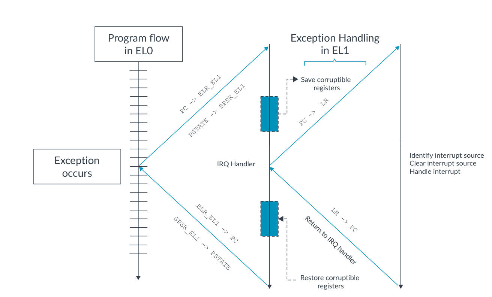

*图 5-5：简单的异常处理器示例*

- 当前 PSTATE 作为快照保存在 `SPSR_EL1` 中
- 首选的异常返回地址（尚未完成的第一条指令）被写入 `ELR_EL1`
- 通过读取虚拟机监控器配置寄存器 `HCR_EL2.RW` 的 RW 位来确定目标执行状态
- 当前 PSTATE 被更新，异常级别改变为 EL1，执行状态变为 AArch64
- 内核跳转到向量表 `VBAR_EL1`，偏移为 `VBAR_EL1 + 0x680`，因为这是一个 IRQ 异常，其中异常来自更低 EL 且所有更低 EL 均为 AArch32
- 定义好的寄存器被压栈以维护寄存器上下文
- 执行特定的 IRQ 处理代码
- 一旦 IRQ 特定的处理代码完成，控制返回到高层处理器
- 处理器恢复所有寄存器并执行 ERET 指令
- PSTATE 从 `SPSR_EL1` 恢复（包括返回到异常级别 EL0 和目标执行状态 AArch32），程序计数器更新为 `ELR_EL1` 中包含的值

请注意，IRQ 异常本身并不区分中断的不同原因（例如，定时器或 UART）。假设使用了 GIC，可以通过读取 GIC 的中断确认寄存器（IAR）来识别。该读取返回中断的 ID，并在 GIC 中将该中断标记为活动（active）。中断处理完毕后，需要通过写入 GIC 的中断结束寄存器（EOIR）将 GIC 状态清除回非活动（inactive）。

**异常屏蔽与不可屏蔽中断（NMI）**

前面的示例是一个非常简单的中断情形。有时需要能够禁用或屏蔽其他中断，以免其覆盖当前正在完成的异常。物理和虚拟异步异常都可以被暂时屏蔽并保持在挂起状态，直到解除屏蔽并且异常被送入。这是通过屏蔽相同类型的中断、直到稍后显式使能来实现的。

当处理器向 AArch64 执行状态送入异常时，PSTATE 中断屏蔽位（`PSTATE.DAIF`）会被自动设置。DAIF 代表 debug（调试）、abort（中止，即 SError）、IRQ 和 FIQ。DAIF 字段为 4 位，每一位对应上述异常类型之一。通过向字段中的某位写入 1，我们屏蔽或忽略该异常类型。它可以进入挂起状态，但不会被处理。换句话说，PE 在解除该位的屏蔽之前不会跳转到异常处理器，从而有效地禁用了该类型进一步异常的送入。

中断总是在中断被送入的异常级别处被屏蔽。同步异常不能被屏蔽。这是因为同步异常直接由指令的执行引起，如果将它留在挂起状态或被忽略，就会阻塞执行。

你无法屏蔽路由到更高异常级别的异步异常。软件仍然可以在较低的 EL 设置 PSTATE 屏蔽位，但这不会阻止异常被送入。例如，如果你把 FIQ 路由到 EL3（`SCR_EL3.FIQ=1`），那么在 EL1 或 EL2 中把 `PSTATE.F` 设置为 1 并不会阻止该中断被送入。

路由到更低异常级别的异常无论 PSTATE 如何都始终被屏蔽。例如，如果 IRQ 被路由到 EL2 或 EL1（`SCR_EL1.IRQ=0`），那么当 PE 处于 EL3 时，IRQ 总是被隐式屏蔽。

如果软件要支持嵌套异常——例如，允许较高优先级的异常打断较低优先级异常的处理——那么软件需要显式地重新使能中断。在可破坏寄存器被压栈之后，异常就可以嵌套了。

不可屏蔽中断（NMI）支持是在 2021 年的扩展 Armv8.8-A 和 Armv9.3-A 中加入的。具有超级优先级的中断被归类为 NMI，即使在 PSTATE 异常屏蔽本来会阻止其送入的情况下，也可以被送入。

对 NMI 有一些限制。在首次送入中断异常时，所有中断（包括 NMI）都会被屏蔽。这是为了让软件能够在被后续中断覆盖之前保存所需状态。

有些时间点软件无法处理任何中断，包括 NMI。为了解决这个问题，增加了一个新的 PSTATE 屏蔽位 ALLINT。它允许软件在“不屏蔽任何中断”“屏蔽大多数中断（不包括 NMI）”和“屏蔽所有中断（包括 NMI）”之间进行选择。

可以使用系统控制寄存器选择三种 NMI 支持模型：

- `SCTLR_ELx.NMI = 0`：禁用 NMI 支持。中断可以使用 `PSTATE.I` 和 `PSTATE.F` 屏蔽。
- `SCTLR_ELx.NMI = 1`：启用 NMI 支持。
  - `SCTLR_ELx.SPINTMASK = 0`：NMI 由 `PSTATE.ALLINT` 屏蔽位屏蔽。
  - `SCTLR_ELx.SPINTMASK = 1`：NMI 由 `PSTATE.ALLINT` 屏蔽位屏蔽，或当目标异常级别使用 SP_ELx 时被屏蔽。

NMI 支持要求系统的中断控制器能够呈现具有超级优先级的中断。如果使用 Arm 的通用中断控制器，对 NMI 的支持是在 GICv3.3 和 GICv4.2 中加入的。

你可以在 Arm 的相关博客文章中了解更多关于 Arm A-Profile 对 NMI 的支持。

## 6. 知识自测

以下问题帮助你检验所学知识。

**Armv8-A 中实现了哪些异常级别？**

EL0 和 EL1 是强制要求的。EL2 和 EL3 是可选的，但大多数设计都实现了它们。

**有哪些执行状态？**

AArch32 和 AArch64。

**异常进入时使用哪个栈？**

自动选择 SP_ELx 以提供一个安全的异常栈。

**AArch64 中的向量表是如何实现的？**

PE 将表的基址保存在 `VBAR_ELx` 中。表本身是指令内存。

## 7. 相关资料

以下是与本指南内容相关的一些资源：

- Arm 架构与参考手册
- Arm Community：提出开发问题，并查找 Arm 专家针对特定主题的文章和博客

以下《Learn the Architecture》指南与本指南内容相关：

- TrustZone for AArch64
- Realm Management Extension
- Arm Generic Interrupt Controller v3 and v4
- AArch64 self-hosted debug
- AArch64 memory management
- AArch64 virtualization
- AArch64 Instruction Set Architecture

以下培训课程与本指南内容相关：

- Introduction to Armv8-A

## 8. 下一步

本指南已经介绍了 AArch64 异常模型以及使用 AArch64 的异常处理。我们了解了执行状态与安全状态、异常类型，以及包括 AArch64 向量表在内的异常处理。

这些知识将在你开始进一步了解架构、中断的工作原理以及处理器行为流程时派上用场。你可以将所学知识付诸实践，编写嵌入式代码、创建向量表和异常处理器。
