# Learn the architecture — AArch64 内存属性与特性（中文翻译）

> 原文：*Learn the architecture - AArch64 memory attributes and properties*
>
> 版本：Version 2.0　|　文档 ID：102376_0200_01_en　|　Issue 01（2022-11-14）
>
> 版权 © 2019, 2022 Arm Limited（或其关联公司）。保留所有权利。非保密。

---

## 1. 概述

本指南介绍 Armv8-A 与 Armv9-A 中的内存属性（attribute）与特性（property）。它首先解释描述内存的属性从何而来、如何被分配给内存区域，然后介绍各种可用的属性，并讲解内存排序的基础知识。

这些信息对任何编写底层代码（如启动代码或驱动程序）的开发者都有用，尤其与编写代码来设置或管理内存管理单元（MMU）的人员密切相关。

在本指南末尾，你可以进行“知识自测”。你将了解不同的内存类型及其关键区别，并能够列出可以应用于给定地址的内存属性。

## 2. 什么是内存属性与特性，为什么需要它们

内存属性与特性是一种定义内存行为的方式。当你配置系统如何访问和使用内存地址（或内存地址区域）时，它们为你提供了一套结构和规则。

内存属性与特性可以应用于某个地址，并定义与内存访问相关的规则。

考虑一个简单的系统，其地址空间如下图所示：

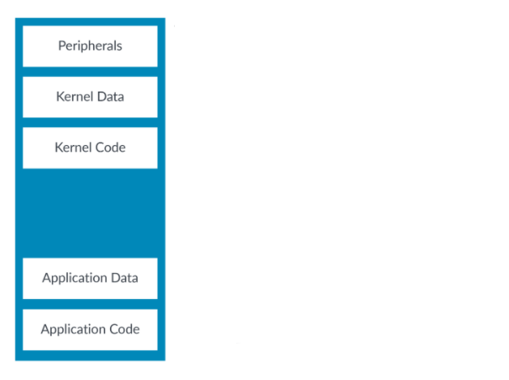

*图 2-1：展示简单地址空间的示意图*

地址空间中内存区域的排布称为地址映射（address map）。在本例中，地址映射包含：

- 内存与外设
- 内存中的代码和数据
- 属于操作系统的资源与属于用户应用的资源

处理器与外设交互的方式，与它和内存交互的方式是不同的。例如，你通常希望缓存内存，而不希望缓存外设。缓存（caching）是将内存中信息的副本存储到一种称为缓存（cache）的硬件结构中的行为。缓存离内核更近，内核访问起来更快。

类似地，你通常希望处理器阻止用户访问内核资源（例如外设）。

下图展示了地址映射，以及你可能想要应用于各内存区域的一些不同内存属性：

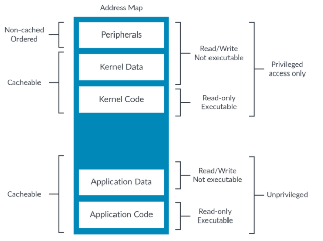

*图 2-2：展示内存区域地址映射的示意图*

你需要能够向处理器描述这些不同的属性，这样处理器才能恰当地访问每个位置。

## 3. 在 AArch64 中描述内存

虚拟地址空间与物理地址空间之间的映射定义在一组转换表（translation table，有时也称为页表）中。对于每个虚拟地址块或页，转换表提供相应的物理地址以及访问该页的属性。

每个转换表条目称为块描述符（block descriptor）或页描述符（page descriptor）。在大多数情况下，属性就来自这个描述符。

下图展示了一个示例块描述符及其中的属性字段：

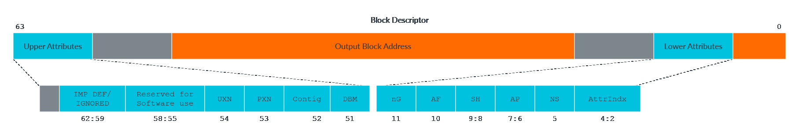

*图 3-1：展示块描述符的示意图*

本指南讨论的重要属性包括：

- UXN 与 PXN —— 执行权限
- DBM —— 脏位修饰符
- AF —— 访问标志
- AP —— 访问权限
- AttrIndx —— 内存类型与属性的选择器

我们将在本指南后面更详细地讨论这些属性。

### 3.1 层次化属性

某些内存属性可以在更高层级表的表描述符（Table descriptor）中指定。这些是层次化属性（hierarchical attributes）。这适用于访问权限、执行权限和物理地址空间。

如果这些位被设置，则它们覆盖较低层级的条目；如果这些位被清除，则较低层级的条目原样使用。下面以 PXNTable（执行权限）为例进行说明：

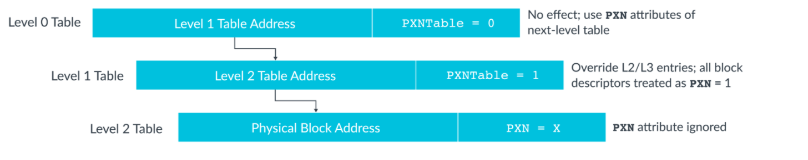

*图 3-2：展示带执行权限的 PXNTable 的示意图*

从 Armv8.1-A 起，你可以禁用使用表描述符中的层次化属性来设置访问权限和执行权限的功能。这由相关 TCR_ELx 寄存器中的层次化权限禁用（Hierarchical Permission Disable，HPD）位控制。禁用后，用于层次化控制的位可供软件用作其他用途。

### 3.2 MMU 被禁用时

总而言之，地址的属性来自转换表。转换表位于内存中，用于存储虚拟地址与物理地址之间的映射。这些表还包含物理内存位置的属性。

转换表由内存管理单元（MMU）访问。

如果 MMU 被禁用会发生什么？这是编写复位后立即运行的代码时需要解决的一个重要问题。

当第 1 级（stage 1）MMU 被禁用时：

- 所有数据访问都按 Device-nGnRnE 处理。这在本指南后面的“设备内存”一节中解释。
- 所有指令取指都按不可缓存或可缓存处理，取决于 SCTLR_ELx.I（指令可缓存性控制）字段的值。
- 所有地址都具有读写访问权限，并且可执行。

对于受虚拟化覆盖的异常级别，当第 2 级（stage 2）被禁用时，来自第 1 级的属性原样使用。

## 4. 内存类型

系统中所有未被标记为故障（faulting）的地址都被分配一个内存类型。内存类型是对处理器应如何与地址区域交互的高层描述。Armv8-A 和 Armv9-A 中有两种内存类型：普通内存（Normal）和设备内存（Device）。

Armv6 和 Armv7 包含第三种内存类型：强排序（Strongly Ordered）。在 Armv8 中，它映射为 Device-nGnRnE。

## 5. 普通内存

普通（Normal）内存类型用于任何行为像内存的东西，包括 RAM、Flash 或 ROM。代码只应放置在标记为普通的位置。

在系统中，普通通常是最常见的内存类型，如下图所示：

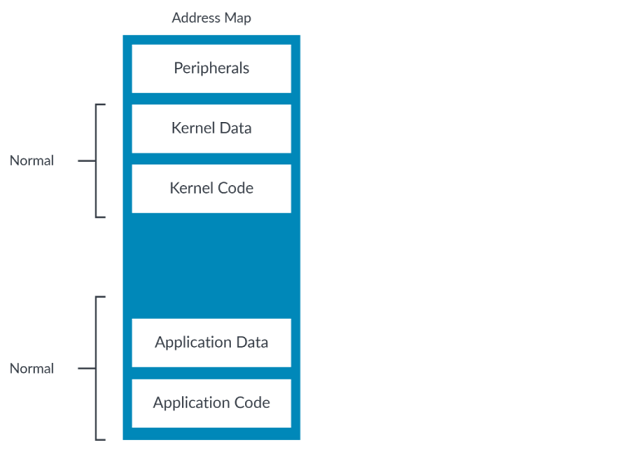

*图 5-1：展示普通类型的示意图*

### 5.1 内存访问排序

传统上，计算机处理器按程序中指定的顺序执行指令。事情按程序指定的次数发生，并且一次只发生一件。这称为简单顺序执行（Simple Sequential Execution，SSE）模型。大多数现代处理器表面上可能遵循这个模型，但实际上，为了帮助提升性能，会应用并向你提供多种优化。

标记为普通的内存位置，假定在被访问时没有直接副作用。这意味着读取该位置只是返回数据，而不会导致数据改变，也不会直接触发另一个进程。因此，对于标记为普通的内存位置，处理器可以合并访问、推测性地执行访问或重排序访问。

有关内存访问重排序的更多细节，请参见《内存系统、排序与屏障》（Memory system, ordering, and barriers）指南。

## 6. 设备内存

设备（Device）内存类型用于描述外设。外设寄存器通常被称为内存映射 I/O（Memory-Mapped I/O，MMIO）。在这里我们可以看到示例地址映射中通常被标记为设备的部分：

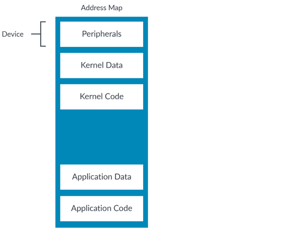

*图 6-1：展示内存映射设备类型的示意图*

回顾一下：普通内存类型意味着访问没有副作用。对于设备类型内存，情况恰恰相反。设备内存类型用于可能产生副作用的位置。

例如，读取一个 FIFO 通常会导致它前进到下一段数据。这意味着对 FIFO 的访问次数很重要，因此处理器必须遵循程序所指定的内容。

设备区域永远不可缓存。这是因为你几乎不可能想要缓存对外设的访问。

不允许对标记为设备的区域进行推测性数据访问。处理器只有在架构上访问该位置时才能访问它。也就是说，一条已被架构执行的指令已经访问了该位置。

指令不应放置在标记为设备的区域中。我们建议设备区域始终标记为不可执行。否则，处理器可能会从中推测性地取指，这可能对 FIFO 这类读敏感设备造成问题。

> 这里有一个容易忽略的微妙区别。将区域标记为设备**仅**阻止推测性数据访问。将区域标记为不可执行**仅**阻止推测性指令访问。这意味着，为了阻止任何推测性访问，一个区域必须同时标记为设备和不可执行。

### 6.1 设备的子类型

设备有四种子类型，限制程度各不相同。这些子类型中最宽松的是：

- Device-GRE
- Device-nGRE
- Device-nGnRE

限制最严格的是：

- Device-nGnRnE

Device 后面的字母代表属性的组合：

- 聚合（Gathering，G/nG）。这指定访问可以被合并（G）或不可以（nG）。这可能是将多次对同一位置的访问合并为一次访问，或将多次较小访问合并为一次较大访问。
- 重排序（Re-ordering，R/nR）。这指定对同一外设的访问可以被重排序（R）或不可以（nR）。当允许重排序时，限制的适用方式与普通类型相同。你可以在《内存系统、排序与屏障》指南中找到更多关于普通内存访问重排序的细节。
- 提前写确认（Early Write Acknowledgement，E/nE）。这决定了一次写何时被认为完成。如果允许提前确认（E），一次访问在它对其他观察者可见之后、但在到达其目的地之前，就可以显示为完成。例如，一次写可能在到达互连中的写缓冲后就对其他处理单元（PE）可见。当不允许提前确认（nE）时，写必须已经到达目的地。

这里有两个例子：

- Device-GRE。允许聚合、重排序和提前写确认。
- Device-nGnRnE。不允许聚合、重排序和提前写确认。

我们已经看过重排序是如何工作的，但还没有介绍聚合和提前写确认。聚合允许将对相似位置的内存访问合并为一次总线事务，从而优化访问。提前写确认告诉内存系统，缓冲区是否可以在内核与外设之间总线上的某个点发送写确认，使得所有 PE 都能观察到这次写，即使外设尚未收到这次写。

> 普通不可缓存和 Device-GRE 表面上可能看起来相同，但它们并不相同。普通不可缓存仍然允许推测性数据访问，而 Device-GRE 不允许。

### 6.2 处理器真的对每种类型做不同的事情吗？

内存类型描述了某个位置允许的行为集合。仅看设备类型，这张图表示了允许的行为：

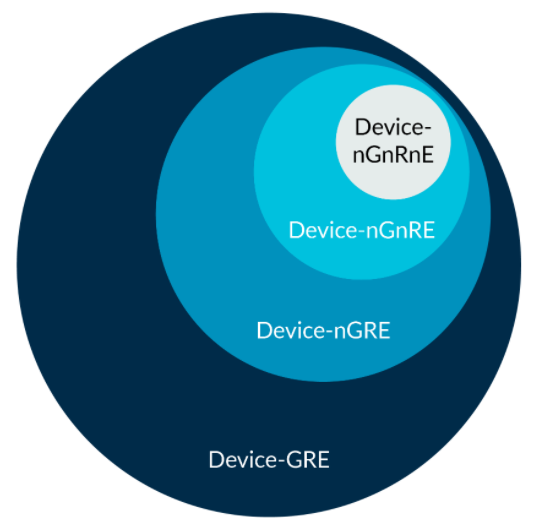

*图 6-2：展示设备类型的示意图*

你可以看到 Device-nGnRnE 是最严格的子类型，允许的行为最少。Device-GRE 最不严格，因此允许的行为最多。

重要的是，Device-nGnRnE 允许的所有行为，Device-GRE 也都允许。例如，并不要求 Device-GRE 内存必须使用聚合——它只是被允许。因此，处理器把 Device-GRE 当作 Device-nGnRnE 处理是允许的。

这个例子比较极端，在 Arm Cortex-A 处理器上不太可能发生。不过，处理器不区分所有类型和子类型是很常见的，例如把 Device-GRE 和 Device-nGRE 同等对待。只有在类型或子类型总是被变得更严格时才允许这样做。

某些互连无法完全支持 Device-nGnRnE 的要求。例如，对 PCIe 基地址寄存器（BAR）空间的 Device-nGnRnE 写，一旦到达 PCIe 拓扑，就会变成 posted write（不期望写完成响应的写）。在这种情况下，这次写访问只会具有 Device-nGnRE 的属性，因为写响应无法由目标端点提供，而会由某个中间组件（如 PCIe 根端口）提供。然而，对 PCIe 配置空间的 Device-nGnRnE 写是非 posted write（期望完成响应的写），因此这些类型的访问满足 Device-nGnRnE 的要求。

## 7. 描述内存类型

内存类型并不直接编码到转换表条目中。相反，转换表条目中的 AttrIndx 字段用于从 MAIR_ELx（内存属性间接寄存器，Memory Attribute Indirection Register）中选择一个条目。

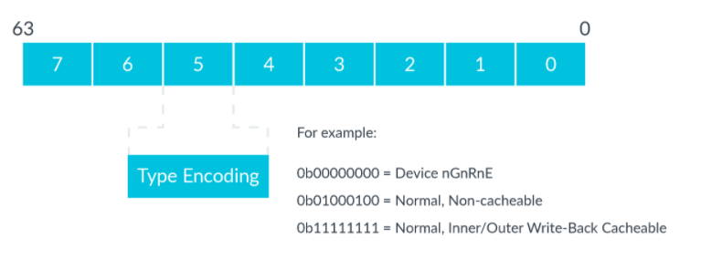

*图 7-1：展示内存属性间接寄存器的示意图*

所选字段决定了内存类型和可缓存性信息。

为什么不把内存类型直接编码到转换表条目中，而是使用指向寄存器的索引？因为转换表条目中的位数是有限的。编码内存类型需要八位，而编码 MAIR_ELx 的索引只需要三位。这使得架构能够在表条目中高效地使用更少的位。

## 8. 可缓存性与可共享性属性

标记为普通的位置还具有可缓存性（cacheability）和可共享性（shareability）属性。可缓存性属性控制一个位置是否可以被缓存。如果一个位置可以被缓存，可共享性属性控制哪些其他代理需要看到内存的一致副本。这允许一些复杂的配置，超出了本指南的范围。不过，Arm 期望操作系统将大多数 DRAM 内存标记为普通、写回可缓存、内部可共享（Normal Write-back cacheable, Inner shareable）。

## 9. 权限

访问权限可以使用直接权限方案（direct permission scheme）或间接权限方案（indirect permission scheme）来编码。本章讨论直接权限方案。间接权限方案的细节请参见本指南的“权限间接与权限覆盖扩展”一节。

在直接权限方案中，访问权限（Access Permissions，AP）属性控制一个位置是否可以读写，以及需要什么特权。下表展示了 AP 位的设置：

| AP | 非特权（EL0） | 特权（EL1/2/3） |
| --- | --- | --- |
| 00 | 无访问权限 | 读/写 |
| 01 | 读/写 | 读/写 |
| 10 | 无访问权限 | 只读 |
| 11 | 只读 | 只读 |

如果一次访问违反了指定权限，例如对只读区域进行写，就会产生一个异常（标记为权限故障，permission fault）。

### 9.1 对非特权数据的特权访问

标准的权限模型是，特权更高的实体可以访问属于特权更低实体的任何东西。例如，操作系统（OS）可以看到分配给应用程序的所有资源，虚拟机管理程序可以看到分配给虚拟机（VM）的所有资源。这是因为在更高的异常级别执行意味着特权级别也更高。

然而，这并不总是可取的。恶意应用程序可能会试图诱骗 OS 代表应用程序访问该应用程序本不应看到的数据。这要求 OS 在系统调用中检查指针。

Arm 架构提供了几个控制位来简化这一点。首先是 PSTATE.PAN（Privileged Access Never，永不特权访问）位。当此位被设置时，从 EL1（或当 E2H==1 时的 EL2）到非特权区域的加载和存储将产生异常（权限故障），如下图所示：

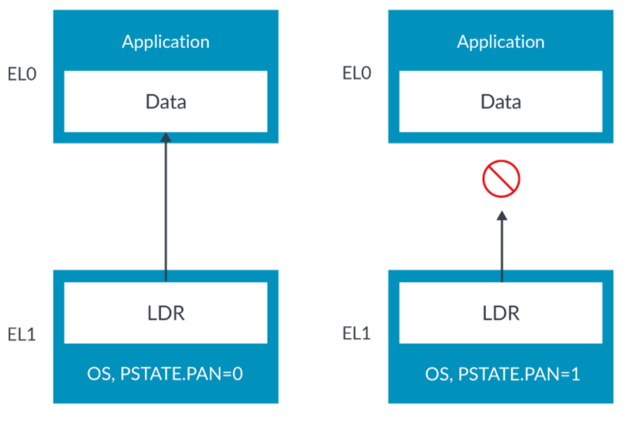

*图 9-1：展示禁止特权访问的示意图*

PAN 是在 Armv8.1-A 中加入的。

PAN 允许将对非特权数据的非预期访问捕获下来。例如，OS 执行一次访问，以为目标是特权数据。实际上，目标是非特权数据。这意味着 OS 的期望（目标是特权数据）与现实（目标是非特权数据）之间存在不匹配。这可能是编程错误导致的，也可能是系统受到攻击的结果。PAN 允许我们在访问发生之前将其捕获，从而发现错误或阻止攻击。

有时 OS 确实需要访问非特权区域，例如写入应用程序拥有的缓冲区。为支持这一点，指令集提供了 LDTR 和 STTR 指令。

LDTR 和 STTR 是非特权加载和存储。即使在 EL1 或 EL2 由 OS 执行，它们也按 EL0 权限检查。因为这些是显式的非特权访问，它们不会被 PAN 阻止，如下图所示：

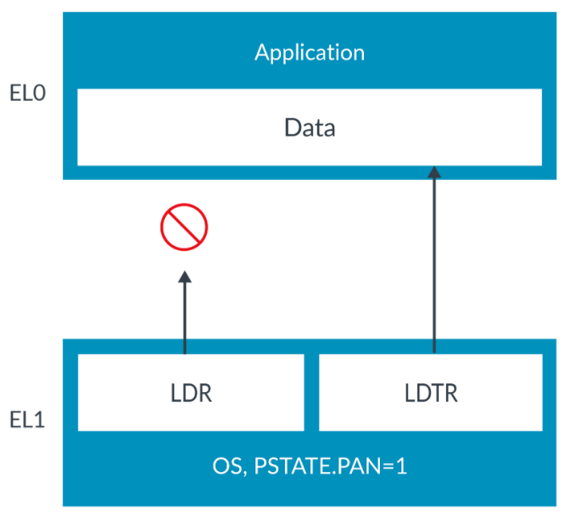

*图 9-2：展示非特权访问的示意图*

这使 OS 能够区分意图访问特权数据的访问和期望访问非特权数据的访问。这也使硬件能够利用这些信息来检查访问。

> LDTR 中的 T 代表转换（translation）。这是因为最早的 Arm 处理器只对用户模式应用程序支持虚拟到物理转换，而不对 OS 支持。OS 要访问应用程序数据，就需要一种特殊的加载——带转换的加载。如今，当然所有软件看到的都是虚拟地址，但这个名字保留了下来。

### 9.2 执行权限

除了数据访问权限之外，还有执行权限。这些属性让你可以指定不能从某个地址执行指令：

- UXN。用户（EL0）禁止执行（在 EL3，或当 HCR_EL2.E2H==0 时的 EL2 不使用）
- PXN。特权禁止执行（在 EL3，或当 HCR_EL2.E2H==0 时的 EL2 称为 XN）

这些是禁止执行（Execute Never）位。这意味着设置该位会使该位置不可执行。特权位和非特权位是分开的，因为应用程序代码需要在用户空间（EL0）中可执行，但永远不应以内核权限（EL1/EL2）执行，如下图所示：

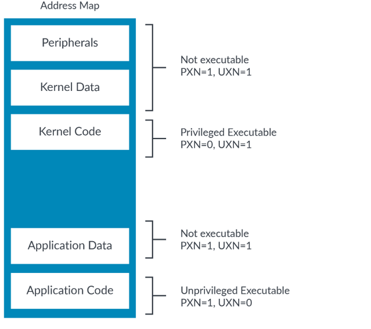

*图 9-3：展示内核权限的示意图*

架构还在系统控制寄存器（SCTLR_ELx）中提供了控制位，使所有可写地址都不可执行。

具有 EL0 写权限的位置在 EL1 永远不可执行。

> 请记住，Arm 建议设备区域始终标记为禁止执行（XN）。

## 10. 权限间接与权限覆盖扩展

访问权限可以使用直接权限方案或间接权限方案来编码。本章讨论间接权限方案。直接权限方案的细节请参见本指南的“权限”一节。

权限间接（Permission indirection）引入了一种设置权限的方式，它允许更高效地使用转换表描述符（TTD）中的权限位，同时提供引入新权限类型的能力。

权限覆盖（Permission overlays）允许由在 EL0 运行的进程逐步收紧权限，同时减少对在更高特权异常级别（如 OS）运行的进程的调用次数，并且不需要昂贵的转换旁路缓存（TLB）维护。

使用权限间接和权限覆盖，可以以更灵活的方式设置内存页的权限，并减少修改访问权限带来的性能影响。

> 权限间接和权限覆盖扩展是在 Armv8.9-A/Armv9.4-A 中引入的。

### 10.1 权限间接

当权限间接被启用时，TTD 中有一个权限间接索引（Permission Indirection Index，PIIndex）字段可用。PIIndex 字段索引到相应异常级别的权限间接寄存器（Permission Indirection Register，PIR），以便 OS（EL1）、虚拟机管理程序（EL2）或固件（EL3）可以设置第 1 级转换的基础权限：

| 寄存器 | 描述 |
| --- | --- |
| PIRE0_EL1 | 设置非特权 EL1&0 基础权限的 PIR |
| PIRE0_EL2 | 设置非特权 EL2&0 基础权限的 PIR |
| PIR_EL1 | 设置特权 EL1 基础权限的 PIR |
| PIR_EL2 | 设置特权 EL2 基础权限的 PIR |
| PIR_EL3 | 设置特权 EL3 基础权限的 PIR |

PIRE0_ELx 或 PIR_ELx 寄存器字段指示要应用于该内存页的基础权限。有关可用权限的细节，请参见各权限间接寄存器的描述。

> PII 中索引到的 PIR 字段还指定是否对该内存页应用权限覆盖。如果 PIR 条目指示不应用权限覆盖，则转换表条目中的 POI 字段被忽略。

### 10.2 权限覆盖

内存页的基础权限可以通过使用转换表条目中的权限覆盖索引（Permission Overlay Index，POIndex）字段进一步收紧。POIndex 字段索引到对应执行级别的权限覆盖寄存器（Permission Overlay Register，POR）：

| 寄存器 | 描述 |
| --- | --- |
| POR_EL0 | 非特权 EL0 第 1 级覆盖权限的 POR |
| POR_EL1 | 特权 EL1 第 1 级覆盖权限的 POR |
| POR_EL2 | 特权 EL2 第 1 级覆盖权限的 POR |
| POR_EL3 | 特权 EL3 第 1 级覆盖权限的 POR |

POR_ELx 寄存器字段指定在基础权限之外，应用于内存页的权限覆盖。有关可配置的额外权限限制的细节，请参见各权限覆盖寄存器的描述。

> 基础权限设置允许缓存在 TLB 中，但覆盖设置不允许。这意味着可以更改覆盖设置，而不需要昂贵的 TLB 无效化（TLBI）。

### 10.3 使用权限间接与权限覆盖特性的示例

在本例中，运行在 EL1 的 OS 想要设置一段内存位置的基础权限和覆盖权限，这段内存将供运行在 EL0 的应用程序使用。

要设置基础权限，OS 执行以下操作：

1. 在权限间接寄存器（PIR_ELx）中分配一个权限索引。本例中 OS 选择索引 3。
2. 将索引 3 在 PIR_ELx 中代表的权限设置为“读写，应用覆盖”，方法是把该索引的位设置为 0b0101。
3. 将该范围内内存位置的 TTD 中的 PIIndex 字段设置为 0b0011（3）。

这会把该范围内内存页的基础权限设置为“读写，应用覆盖”。有关可用权限的细节，请参见各权限间接寄存器的描述。

运行在 EL0 的应用程序可以请求 OS 指定一个权限覆盖，应用程序随后可以请求将该覆盖应用于内存页的一个子集。要指定覆盖，OS 执行以下操作：

1. 在权限覆盖寄存器（POR_ELx）中分配一个权限覆盖索引。本例中 OS 选择索引 6。
2. 将索引 6 在 POR_ELx 中代表的权限设置为“只读”，方法是把索引 6 的位设置为 0b0001。

这会把该内存位置的可用覆盖权限设置为“只读”。运行在 EL0 的应用程序随后可以（通过系统调用）请求 OS 将该覆盖应用于内存范围的子集。OS 通过把这些内存页的 TTD 中的 POIndex 字段设置为 0b110（6）来做到这一点，从而在基础权限之上进一步应用“只读”权限限制。这实际上允许运行在 EL0 的应用程序从这些内存页中减去写权限。有关可配置的额外权限限制的细节，请参见各权限覆盖寄存器的描述。

这个例子展示了如何使用权限间接将更大范围的基础权限应用于内存页。它还展示了运行在 EL0 的进程如何在不带来 TLBI 维护开销、同时尽量少地调用运行在 EL1 的 OS 的情况下收紧权限。权限间接和覆盖扩展为向内存页应用权限提供了更大的灵活性。

下图展示了权限间接和权限覆盖如何结合来设置内存页的权限：

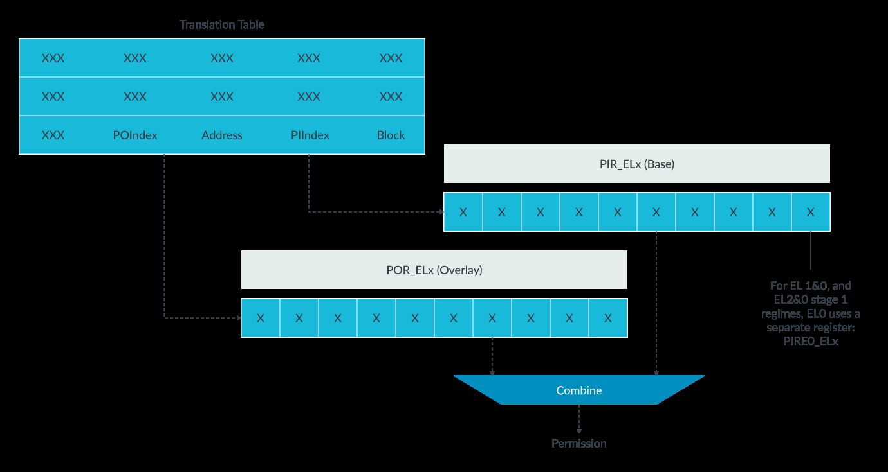

*图 10-1：展示权限间接与权限覆盖如何结合的示意图*

## 11. 访问标志

你可以使用访问标志（Access Flag，AF）位来跟踪转换表条目所覆盖的区域是否已被访问。你可以将 AF 位设置为：

- AF=0。区域未被访问。
- AF=1。区域已被访问。

AF 位对操作系统很有用，因为你可以用它来识别哪些页当前未被使用、可以被换出（从 RAM 中移除）。

> 在裸机环境中通常不使用访问标志，你可以在生成表时把 AF 位预置为已设置。

### 11.1 更新 AF 位

当使用 AF 位时，转换表在创建时 AF 位初始为清除。当某页被访问时，它的 AF 位被设置。软件可以解析这些表来检查 AF 位是设置还是清除。AF==0 的页不可能被访问过，可能是更好的换出候选。

AF 位在访问时被设置有两种方式：

- 软件更新：访问该页会导致同步异常（访问标志故障，Access Flag fault）。在异常处理程序中，软件负责在相关转换表条目中设置 AF 位，然后返回。
- 硬件更新：访问该页会使硬件自动设置 AF 位，而不需要产生异常。这种行为需要使用转换控制寄存器（TCR_ELx.HA）的硬件访问更新位来启用，该位是在 Armv8.1-A 中加入的。

### 11.2 脏状态

Armv8.1-A 引入了处理器管理块或页的脏状态（dirty state）的能力。脏状态记录块或页是否被写过。这很有用，因为如果块或页被换出，脏状态会告诉管理软件 RAM 中的内容是否需要写回到存储。

例如，考虑一个文本文件。该文件最初从磁盘（Flash 或硬盘）加载到 RAM。当它后来从内存中移除时，OS 需要知道 RAM 中的内容是否比磁盘上的内容更新。如果 RAM 中的内容更新，那么磁盘上的副本需要更新。如果不是，那么 RAM 中的副本可以丢弃。

当启用脏状态管理时，软件最初创建转换表条目时将访问权限设置为只读，并设置 DBM（脏位修饰符，Dirty Bit Modifier）位。如果该页被写入，硬件会自动将访问权限更新为读写。

将 DBM 位设置为 1 会改变访问权限位（AP[2] 和 S2AP[1]）的功能，使它们不再记录写权限，而是记录脏状态。这意味着当 DBM 位被设置为 1 时，访问权限位不会导致权限故障。

> 不使用硬件更新选项也可以达到同样的结果。页会被标记为只读，导致第一次写时产生异常（权限故障）。异常处理程序会手动将该页标记为读写，然后返回。如果软件想做写时复制（copy-on-write），仍然可能使用这种方法。

## 12. 对齐与端序

本节解释对齐和端序。

### 12.1 对齐

如果地址是元素大小的倍数，则一次访问被描述为对齐（aligned）。

对于 LDR 和 STR 指令，元素大小就是访问的大小。例如，LDRH 指令加载一个 16 位值，必须来自 2 字节倍数的地址才算对齐。

LDP 和 STP 指令分别加载和存储一对元素。要成为对齐的，地址必须是元素大小的倍数，而不是两个元素合计大小的倍数。例如：

```asm
LDP X0, X1, [X2]
```

这个例子加载两个 64 位值，共 128 位。X2 中的地址需要是 64 位的倍数才算对齐。

同样的原则适用于向量加载和存储。

当地址不是元素大小的倍数时，访问是非对齐（unaligned）的。对标记为普通的地址允许非对齐访问，但对设备区域不允许。对设备区域的非对齐访问会触发异常（对齐故障，alignment fault）。

对标记为普通的区域的非对齐访问可以通过设置 SCTLR_ELx.A 来捕获。如果设置该位，对普通区域的非对齐访问也会产生对齐故障。

### 12.2 端序

在 Armv8-A 中，指令取指始终按小端（little-endian）处理。

对于数据访问，是否同时支持小端和大端是“实现定义”（IMPLEMENTATION DEFINED）的。如果只支持一种，具体支持哪一种也是“实现定义”的。

对于同时支持大端和小端的处理器，端序按异常级别分别配置。

> 如果你不记得“实现定义”的定义，请阅读《Arm 架构入门》（Introducing the Arm Architecture）。

Arm Cortex-A 处理器同时支持大端和小端。

## 13. 内存别名与不匹配的内存类型

当物理地址空间中的某个给定位置有多个虚拟地址时，称为别名（aliasing）。

属性基于虚拟地址。这是因为属性来自转换表。当一个物理位置有多个别名时，所有虚拟别名具有兼容的属性非常重要。我们这样描述“兼容”：

- 相同的内存类型，对于设备类型还要有相同的子类型
- 对于普通位置，相同的可缓存性和可共享性

如果属性不兼容，内存访问可能不会按预期行为。

下图展示了两个别名示例。位置 A 的两个别名具有兼容属性，这是推荐的做法。位置 B 的两个别名具有不兼容属性（普通和设备），这会对一致性和性能产生负面影响：

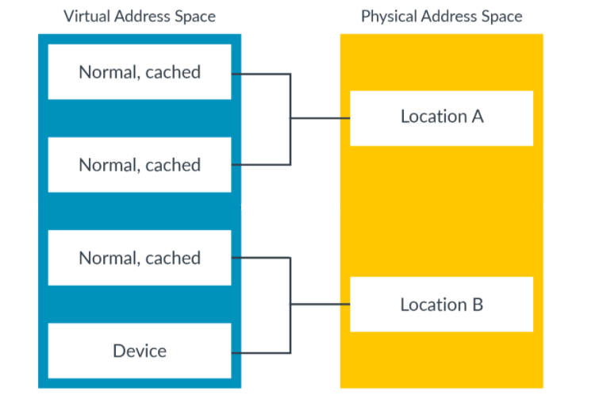

*图 13-1：展示虚拟地址空间的示意图*

> Arm 强烈建议软件不要给同一位置的不同别名分配不兼容的属性。

## 14. 知识自测

以下问题帮助你检验所学知识。

**某个地址位置的属性从何而来？**

来自转换表，通常是块/页描述符，尽管层次化属性可以覆盖它。

**Armv8-A 中的两种内存类型是什么？**

普通（Normal）和设备（Device）。

**Device-nGnRE 中的 -nGnRE 是什么意思？**

不允许聚合和重排序，但允许提前写确认。

**为什么某页可能被标记为 PXN=1、UXN=0？**

应用程序代码需要在用户空间可执行，在内核空间不可执行。

**AF 位通常用于什么？**

跟踪哪些页已被访问。

**指令取指是什么端序？**

小端。

**在启用内存管理单元（MMU）之前，某些启动代码进行了非对齐访问，导致对齐故障。为什么？**

当 MMU 被禁用时，所有访问都按设备处理。对标记为设备的区域的非对齐访问总是会故障。

## 15. 相关信息

以下是与本指南内容相关的一些资源：

- **Arm Community**：提出开发问题，查找 Arm 专家关于特定主题的文章和博客。
- **内存排序与屏障指南**：提供关于内存排序和屏障使用的信息。
- **安全——指针签名与着陆台指南（即将发布）**：Armv8.5-A 引入了对分支目标指令（BTI）的支持。BTI 支持由第 1 级转换表中的 GP 位控制。分支目标指令将在该指南中讨论。
- **Armv8-A 指令集架构**：包含关于简单顺序执行（SSE）的信息。
- **转换过程**：如果你对转换过程的完整细节感兴趣，它在伪代码中有完整描述。转换伪代码与指令集的 XML 一起提供。一个很好的起点是 AArch64.FullTranslate() 函数。

以下是与本指南主题相关的一些资源：

### 15.1 在 Armv8-A 中描述内存

指令取指的可缓存性比你想象的要复杂一些。该主题在《缓存与一致性》指南（即将发布）中介绍。

对于 EL0 和 EL1，该行为可以使用虚拟化控制部分覆盖。该主题在《虚拟化》指南中介绍。

### 15.2 可缓存性与可共享性属性

《缓存与缓存一致性》指南（即将发布）。

### 15.3 结合第 1 级和第 2 级属性

第 1 级和第 2 级转换在《内存管理》指南中有更详细的讨论。背景信息请参见《虚拟化》指南。

### 15.4 培训模块

以下是一些可能有用的相关培训模块链接：

- Introduction to Armv8-A
- Memory model overview
- What does architecture consist of?

## 16. 后续步骤

Armv8-A 内存属性与特性为处理器内核如何与系统中的内存交互提供了基础。当你开始开发底层代码（如启动代码或驱动程序）时，可以应用本指南中学到的原则。你也可以在编写代码来设置或管理内存管理单元（MMU）时将这些学习付诸实践。

本系列的下一本指南讨论了内存管理中的地址转换。

要继续学习 Armv8-A 架构，请参阅我们系列中的更多指南。
