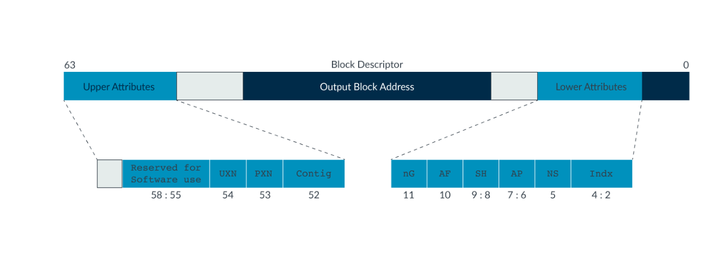
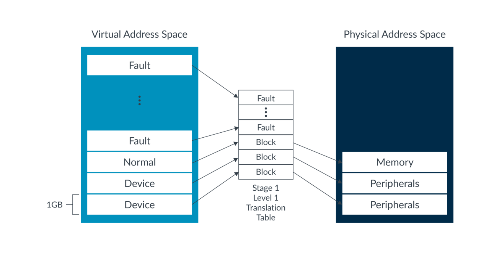
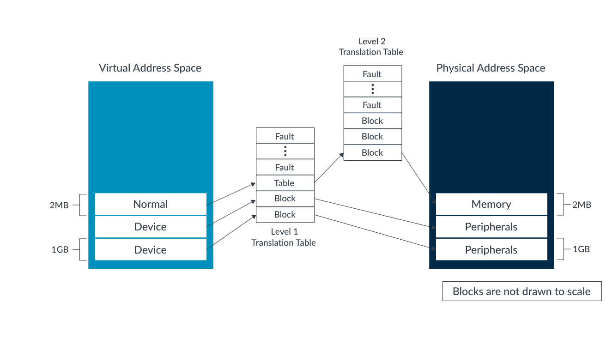
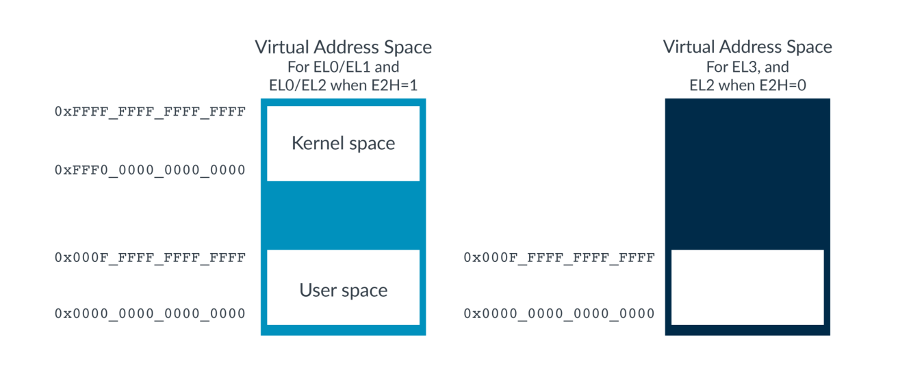
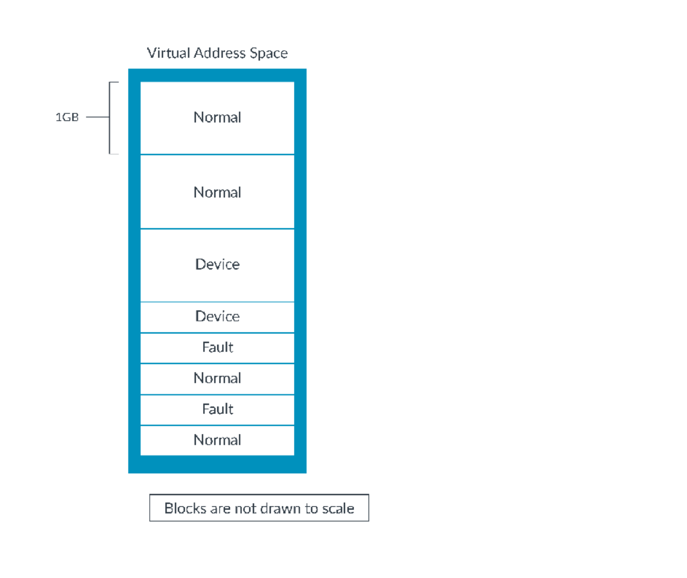

# Learn the architecture — AArch64 内存管理示例（中文翻译）

> 原文：*Learn the architecture - AArch64 memory management examples*
>
> 版本：Version 1.0　|　文档 ID：102416_0100_01_en　|　Issue 01（2019-06-27）
>
> 版权 © 2019 Arm Limited（或其关联公司）。保留所有权利。非保密。

---

## 1. 概述

这组示例展示了如何在裸机环境中设置内存管理单元（MMU）。这些示例逐步讲解若干组代码，建立在《内存管理指南》对 MMU 和翻译过程的整体解释之上。

如果你需要在低层与 MMU 交互（通常是在裸机环境中，如 bring-up 测试代码），这些示例会很有用。这些示例不涵盖操作系统中的 MMU 使用。

这里构建的虚拟地址空间并不旨在真实。相反，这些示例演示了配置 MMU 的不同方式。最后一个示例为一个简单的裸机系统给出了更真实的配置。

在这些示例结束时，你将能够编写或修改一个设置简单虚拟地址空间的序列。

### 1.1 开始之前

这组示例要求你熟悉内存翻译的原理和处理器中的 MMU 控制。这些主题在《内存管理指南》中介绍。

这些示例使用 A64 汇编。对 A64 汇编的基本理解有助于你跟上代码的描述。有关 A64 的介绍，请参见我们的《Armv8-A Instruction Set Architecture guide》。

### 1.2 示例平台

这组示例作为单独的下载提供。

这些示例是为 Base Platform 模型开发的。以下是 Base Platform 模型的物理地址映射详情。

要构建和运行这些示例，你需要 Arm Development Studio。如果你没有 Arm Development Studio 的副本，请下载评估版。

### 1.3 构建和运行示例

示例包包含一个 ReadMe.txt 文件。该文件给出构建和运行示例的说明。启动模拟器的命令行参数对每个示例都不同。请参考 ReadMe.txt 文件了解更多信息。

## 2. EL3 单级表

第一个示例涵盖最简单的场景：EL3 翻译机制中的单级翻译。我们将平坦映射虚拟地址。这意味着对于所有翻译，输入虚拟地址和输出物理地址是相同的。MMU 只被用来控制属性和权限。

在示例包中，文件位于：`<example dir>\el3_stage1_l1only\`

### 2.1 指定翻译表的位置

示例的代码在 startup.S 中。查看此文件，MMU 代码从第 159 行开始。这里你看到第一段有趣的代码：

```asm
// Set the Base address
// ---------------------
LDR   x0, =tt_l1_base  // 获取 TTBR0_EL3 的第 1 级地址
MSR   TTBR0_EL3, x0    // 设置 TTBR0_EL3（注意：EL3 没有 TTBR1）
```

此代码加载为翻译表分配的内存的地址，然后将该地址写入翻译表基址寄存器（TTBR0_ELx）。此寄存器告诉处理器，当需要表遍历时第一级表位于何处。

符号名称表明该寄存器指向第 1 级表。我们在本节后面的“配置翻译机制”中看到翻译的起始级别是如何配置的。

表的内存分配在文件末尾，如下所示：

```asm
.section TT,"ax"
.align 12
.global tt_l1_base
tt_l1_base:
.fill 4096 , 1 , 0
```

代码定义了一个合理的标签（tt_l1_base）来让我们引用分配的内存。然后 fill 指令分配一个预填充为零的 4KB 块。这很有用，因为翻译表项中的值 0 表示 Fault。描述符中的值 0。

翻译表必须大小对齐。在这个例子中，我们有一个完整的第 1 级表。使用 4KB 颗粒，一个完整的第 1 级表包含 512 个表项。每个表项是 8 字节。这意味着表的大小是 4KB，并且必须从 4KB 边界开始。align 指令将对齐设置为 2 的幂。在这种情况下，对齐是 2^12=4096。

### 2.2 初始化 MAIR

回到代码，让我们看看下一步，如下所示：

```asm
// Set up memory attributes
 // -------------------------
 // 这等同于：
 // 0 = b01000100 = Normal, Inner/Outer Non-Cacheable
 // 1 = b11111111 = Normal, Inner/Outer WB/WA/RA
 // 2 = b00000000 = Device-nGnRnE
 MOV   x0, #0x000000000000FF44
 MSR   MAIR_EL3, x0
```

我们在《AArch64 Memory model guide》中学到，类型（Normal 或 Device）并不直接与 stage 1 表的翻译表项一起编码。相反，表项包含一个指向内存属性间接寄存器（MAIR_ELx）的索引。每个 8 位表项由软件设置为指定不同的内存类型。该示例只填充 MAIR 中的前三个表项：

- [0] = Normal，内部和外部不可缓存
- [1] = Normal，内部和外部可缓存，写回和读/写分配
- [2] = Device_nGnRnE

对于这个简单的示例，这三种类型就足够了。我们不使用其他索引值。

哪种类型指定在哪个 MAIR 索引中，在我们稍后创建翻译表项时很重要。

### 2.3 配置翻译机制

下一步是配置翻译机制，如下所示：

```asm
 // Set up TCR_EL3
 // ---------------
 MOV   x0, #0x19            // T0SZ=0b011001 将 VA 空间限制为 39 位，
                            // 翻译从 l1 开始
 ORR   x0, x0, #(0x1 << 8)  // IGRN0=0b01  对 TTBR0 的遍历是 Inner WB/WA
 ORR   x0, x0, #(0x1 << 10) // OGRN0=0b01  对 TTBR0 的遍历是 Outer WB/WA
 ORR   x0, x0, #(0x3 << 12) // SH0=0b11   Inner Shareable
                            // TBI0=0b0   不忽略顶部字节
                            // TG0=0b00   4KB 颗粒
                            // IPS=0      32 位 PA 空间
 MSR   TCR_EL3, x0
```

翻译控制寄存器（TCR_ELx）配置翻译机制的许多方面，包括：

- **TnSZ**：控制正在描述的虚拟地址空间的大小
- **TGn**：设置翻译机制的颗粒，即可描述的最小块
- **IGRNn/ORGNn/SH**：指定 MMU 用于表遍历的可缓存性和可共享性
- **TBIn**：顶部字节忽略。设置此位会使处理器在执行虚拟到物理翻译时忽略虚拟地址的顶部 8 位，允许软件在这些位中存储其他内容。在本练习中，我们不使用此特性，所以我们保持它禁用。

> 关于何时使用 TBI 特性的示例，请参见《Providing protection for complex software guide》中对内存标记的描述。

本指南中所有示例选择的颗粒（TG0）是 4KB。正如《AArch64 Memory management guide》中所描述的，颗粒决定了所使用的不同页和块大小。使用 4KB 颗粒，选项是：

- L0 表：每项 512GB
- L1 表：每张表覆盖 512GB，每项 1GB
- L2 表：每张表覆盖 1GB，每项 2MB
- L3 表：每张表覆盖 2MB，每项 4KB

虚拟地址空间的大小配置为 64 – TnSZ。在这个例子中，64 – 0x19 得到 39 位虚拟地址空间。这相当于 512GB（2^39），这意味着整个虚拟地址空间由单个 L1 表覆盖。因此，我们的翻译起始级别是第 1 级。

示例的下一部分如下所示：

```asm
 // Invalidate TLBs
 // ----------------
 TLBI  ALLE3
 DSB   SY
 ISB
```

翻译后备缓冲器（TLB）的状态在复位时不能保证。因此，示例在启用 MMU 之前使 TLB 失效。该命令（TLBI ALLE3）使 EL3 翻译机制的所有缓存翻译失效，这正是示例正在配置的翻译机制。

### 2.4 生成翻译表

下一步是在内存中生成表。此示例创建一组最小的表项，如下面的代码所示：

```asm
LDR   x1, =tt_l1_base              // L1 表的地址
 // [0]: 0x0000,0000 - 0x3FFF,FFFF
 LDR   x0, =TT_S1_DEVICE_nGnRnE     // 表项模板
                                    // AP=0, RW
                                    // 不需要 OR 入地址，因为它为 0
 STR   x0, [x1]
 
 // [1]: 0x4000,0000 - 0x7FFF,FFFF
 LDR   x0, =TT_S1_DEVICE_nGnRnE     // 表项模板
                                    // AP=0, RW
 ORR   x0, x0, #0x40000000          // 用基物理地址 'OR' 模板
 STR   x0, [x1, #8]
 // [2]: 0x8000,0000 - 0xBFFF,FFFF (VE 和 Base Platform 上的 DRAM)
 LDR   x0, =TT_S1_NORMAL_WBWA       // 表项模板
 ORR   x0, x0, #TT_S1_INNER_SHARED  // 用内部可共享属性 'OR'
                                    // AP=0, RW
 ORR   x0, x0, #0x80000000          // 用基物理地址 'OR' 模板
```

如前一节“配置翻译机制”中所描述的，L1 是此示例中的第一级翻译。使用 4K 颗粒，这意味着表中的每个表项覆盖 1GB 的地址空间。该示例只填充前三个表项，覆盖虚拟地址空间的前 3GB。

在上一节“指定翻译表的位置”中，我们展示了如何为翻译表分配内存。使用 fill 指令分配了一个预填充为零的 4KB 区域。值零对应翻译表中的 Fault。因此，所有未写入的表项都是故障表项。

> 在真实系统中，软件通常会在运行时用零填充表，而不是依赖在源代码中分配它们。然而，预分配零可以加快一些模拟或仿真的速度。

### 2.5 理解表项是如何形成的

代码使用在文件开头定义为模板的符号。例如，TT_S1_NORMAL_WBWA 是一个 Normal、写回、读/写分配表项的模板。此模板的定义如下代码所示：

```asm
.equ TT_S1_NORMAL_WBWA,   0x00000000000000405
```

下图显示了 stage 1 第 1 级表项的格式：



*图 2-1：理解表项是如何形成的图*

解码 TT_S1_NORMAL_WBWA 模板得到：

- Indx= b01，从 MAIR 的表项 [1] 取类型信息
- NS= b0，输出物理地址是安全的
- AP= b00，地址可读可写
- SH= b00，不可共享
- AF= b1，访问标志已预置。访问时不生成访问标志故障。
- nG= 在 EL3 不使用
- Contig = b0，表项不是连续块的一部分
- PXN= b0，块可执行。此属性在 EL3 称为 XN。
- UXN= 在 EL3 不使用

在模板中，我们看到了为什么了解 MAIR 的配置很重要。模板依赖 MAIR 的表项 [1] 预置为 Normal/Cacheable。

我们想要该区域是内部可共享的，而不是模板中定义的不可共享。为了解决这个问题，示例将 TT_S1_NORMAL_WBWA 模板与另一个模板 TT_S1_INNER_SHAREABLE 组合。第二个模板在 SH 字段中设置正确的值。

### 2.6 知识自测

**问题：**查看示例中定义的其他模板。你会如何修改前面的示例以映射到非安全物理地址？

**答案：**要映射到非安全物理地址，需要将 NS 位设置为 1。示例有一个用于此的模板 TT_S1_NS，它可以像我们对可共享性属性所做的那样进行 OR。

### 2.7 配置后的虚拟地址空间概览

有了这组翻译表项，虚拟地址看起来如下图所示：



*图 2-2：MMU 虚拟地址空间*

### 2.8 启用 MMU

此时，MMU 已配置，翻译表已在内存中创建。下一步是启用 MMU，如下面的代码所示：

```asm
 // Enable MMU
 // -----------
 MOV   x0, #(1 << 0)      // M=1  启用 stage 1 MMU
 ORR   x0, x0, #(1 << 2)  // C=1  启用数据和统一缓存
 ORR   x0, x0, #(1 << 12) // I=1  启用指令取指分配到统一缓存
                         // A=0  禁用严格对齐检查
                         // SA=0 禁用栈对齐检查
                         // WXN=0 写权限不隐含 XN
                         // EE=0 EL3 数据访问是小端
 MSR   SCTLR_EL3, x0
 ISB
```

示例设置系统控制寄存器（SCTLR_ELx）中的 M、C 和 I 位。设置这些位可启用 MMU 和缓存。写入 SCTLR 之后的 ISB 确保启用 MMU 的效果对下一条指令可见。

### 2.9 表遍历

本练习中的示例被开发为在 Base Platform Fixed Virtual Platform（FVP）上运行。Base Platform FVP 是 Arm 提供的一个模型。FVP 模型跟踪模拟，并提供关于模拟处理器执行的详细信息。产生的跟踪是 TARMAC 格式的。这里有关 TARMAC 的更多信息。

跟踪整个示例会产生数百行跟踪数据。相反，让我们在 MMU 启用的位置开始跟踪，如下所示：

```
75 clk IT (75) 8000012c d51e1000 O EL3h_s : MSR   SCTLR_EL3,x0
75 clk R SCTLR_EL3 00000000:00001005
75 clk CACHE FVP_Base_AEMv8A_AEMv8A.cluster0.cpu0.l1dcache LINE 0100
 ALLOC 0x000080002000
75 clk CACHE FVP_Base_AEMv8A_AEMv8A.cluster0.l2_cache LINE 0800
 ALLOC 0x000080002000
75 clk TTW ITLB LPAE 1:1 000080002010 0000000080000705 : BLOCK ATTRIDX=1 NS=0 AP=0
 SH=3 AF=1 nG=0 16E=0 PXN=0 XN=0 ADDR=0x0000000080000000
75 clk TLB FILL FVP_Base_AEMv8A_AEMv8A.cluster0.cpu0.UTLB 1G 0x80000000 EL3_s,
 nG asid=0:0x0080000000 Normal InnerShareable Inner=WriteBackWriteAllocate
 Outer=WriteBackWriteAllocate xn=0 pxn=0 ContiguousHint=0
75 clk CACHE FVP_Base_AEMv8A_AEMv8A.cluster0.cpu0.l1icache LINE 0008
 ALLOC 0x000080000100
75 clk CACHE FVP_Base_AEMv8A_AEMv8A.cluster0.l2_cache LINE 0040
 ALLOC 0x000080000100
76 clk IT (76) 80000130 d5033fdf O EL3h_s : ISB
```

跟踪很密集，所以让我们一次看一行。此代码显示第一部分：

```
75 clk IT (75) 8000012c d51e1000 O EL3h_s : MSR   SCTLR_EL3,x0
75 clk R SCTLR_EL3 00000000:00001005
```

此代码显示 MSR 的执行，它启用了 MMU。0x8000_012C 是指令的地址，0xD51E_1000 是操作码。第二行显示指令写入寄存器的值。

> 默认情况下，跟踪显示写入寄存器的值，而不是寄存器的新值。在许多情况下（但并非所有情况），新值就是写入的值。例如，如果寄存器包含只读字段，新值就不是写入的值。

因为这条指令启用了 MMU，处理器需要为包含下一条指令的页实现一次表遍历。首先，跟踪显示此代码：

```
75 clk CACHE FVP_Base_AEMv8A_AEMv8A.cluster0.cpu0.l1dcache LINE 0100
 ALLOC 0x000080002000
75 clk CACHE FVP_Base_AEMv8A_AEMv8A.cluster0.l2_cache LINE 0800
 ALLOC 0x000080002000
```

当我们配置 TCR_EL3 时，我们配置 MMU 对表遍历使用可缓存访问。前面两行显示包含所需表项的缓存行被取入缓存。一旦该行从内存返回，MMU 就可以解释描述符。这种解释显示在下一行代码中，如下所示：

```
75 clk TTW ITLB LPAE 1:1 000080002010 0000000080000705 : BLOCK ATTRIDX=1 NS=0 AP=0
 SH=3 AF=1 nG=0 16E=0 PXN=0 XN=0 ADDR=0x0000000080000000
```

前面的跟踪项显示 MMU 处理表项。此项向我们显示以下内容：

- TTW= 表遍历
- ITLB= 指令接口的表遍历。I 代表指令。
- 1:1= Stage 1、第 1 级表项
- 0x80002010= 表项被取出的地址
- 0x0000000080000705= 从内存系统返回的表项
- BLOCK= 该表项是块表项
- ATTRIDX=1= 使用 MAIR 表项 1。
- NS= 输出物理地址是安全的
- AP= 访问权限位
- SH= 可共享性位

最后，跟踪显示正在生成的 TLB 记录，如下代码所示：

```
75 clk TLB FILL FVP_Base_AEMv8A_AEMv8A.cluster0.cpu0.UTLB 1G 0x80000000 EL3_s,
 nG asid=0:0x0080000000 Normal InnerShareable Inner=WriteBackWriteAllocate
 Outer=WriteBackWriteAllocate xn=0 pxn=0 ContiguousHint=0
```

跟踪显示 TLB 项创建如下：

- 1GB 块
- PA:0x8000_0000
- VA:0x8000_0000，ASID 0，尽管 ASID 在 EL3 不使用
- 翻译机制：EL3
- Normal、内部可共享、写回、写分配
- 可执行

**知识自测：**查看前面的代码，找出跟踪中显示的所有设置来自哪里。

## 3. EL3 多级表

本节指南讲解一个使用两级翻译的示例。“EL3 单级表”示例使用单个第 1 级表。这意味着所有映射都使用 1GB 块。对于简单系统，这种粗粒度映射是合适的。然而，许多系统需要更细粒度的映射，这通过使用多级表来实现。

在示例包中，文件位于：`<example dir>\el3_stage1_l1andl2\`

### 3.1 生成 level 1 表

此示例的前几步与“EL3 单级表”示例相同。与“EL3 单级表”示例一样，MAIR 填充了示例使用的三种类型。TCR 被配置为选择 4KB 颗粒，翻译起始级别为 L1。

此示例与“EL3 单级表”示例的不同之处在于表的生成。以下代码生成 L1 表：

```asm
//
 // 生成 L1 表
 //
 
 LDR   x1, =tt_l1_base           // L1 表的地址
 // [0]: 0x0000,0000 - 0x3FFF,FFFF
 LDR   x0, =TT_S1_DEVICE_nGnRnE  // 表项模板
                                 // AP=0, RW
                                 // 不需要 OR 入地址，因为它为 0
 STR   x0, [x1]
 
 // [1]: 0x4000,0000 - 0x7FFF,FFFF
 LDR   x0, =TT_S1_DEVICE_nGnRnE  // 表项模板
                                 // AP=0, RW
 ORR   x0, x0, #0x40000000       // 用基物理地址 'OR' 模板
 STR   x0, [x1, #8]
 // [2]: 0x8000,0000 - 0xBFFF,FFFF (VE 和 Base Platform 上的 DRAM)
 LDR   x2, =tt_l2_base           // 获取 L2 表的地址
 LDR   x0, =TT_S1_TABLE          // 指向下一级表的表项模板
 ORR   x0, x0, x2                // 用 L2 表基址组合模板
 STR   x0, [x1, #16]             // 将模板写入表项 table[2]
```

与“EL3 单级表”示例一样，此示例使用文件开头定义的模板来创建每个表项。前两个表项与“EL3 单级表”示例相同。这些表项创建两个 Device 类型的 1GB 块映射。

第三个表项不同。这个表项不是映射 1GB 块，而是指向第 2 级表。这个第 2 级表将 1GB 块划分为 512 个 2MB 块。为此，示例使用了另一个模板 TT_S1_TABLE。

第 2 级表的地址（tt_l2_base）从何而来？

与第 1 级表一样，示例使用 fill 指令分配一个 4KB 内存区域来保存表。这里是分配第 1 级和第 2 级表的代码：

```asm
 .align 12 
.global tt_l1_base
tt_l1_base:
 .fill 4096 , 1 , 0
 .global tt_l2_base
tt_l2_base:
 .fill 4096 , 1 , 0
```

示例使用 fill 指令将分配给表的内存预填充为零。值为零表示故障。在真实系统中，代码在运行时写入这些零。然而，预填充零对测试代码很有用，可以减少模拟或仿真时间。

第 2 级表也需要大小对齐，在这个例子中是 4KB 对齐。

> 在这个例子中，表是对齐的，因为它紧跟在另一个大小对齐的 4KB 结构之后。

### 3.2 生成 level 2 表

以下代码生成第 2 级表：

```asm
 //
 // 生成 L2 表
 //
 …
 LDR   x0, =tt_l2_base             // 第一个 L2 表的地址
 // L2 表覆盖的地址范围：
 // 0x8000_0000 - 0xBFFF_FFFF
 //
 // 此示例只填充表项 0，它覆盖：
 // 0x8000_0000 - 0x801F_FFFF
 LDR   x1, =tt_l2_base             // L1 表的地址
 LDR   x0, =TT_S1_NORMAL_WBWA      // 表项模板
 ORR   x0, x0, #TT_S1_INNER_SHARED // 用内部可共享属性 'OR'
                                   // AP=0, RW
 ORR   x0, x0, #0x80000000         // 用基物理地址 'OR' 模板
 STR   x0, [x1]
 DSB   SY
```

此示例中的第 2 级表覆盖虚拟地址范围 0x8000_0000 到 0xBFFF_FFFF，即虚拟地址空间的第三个 GB。该表包含 512 个表项，每个表项描述 2MB 的虚拟地址空间。

示例用 Normal/Cacheable 块的表项填充第 2 级表的第一个表项。此表项对应于 L2 表覆盖的前 2MB 地址空间，即 0x8000_0000 到 0x801F_FFFF。

### 3.3 配置后的虚拟地址空间概览

翻译表的结果如下图所示：



*图 3-1：配置后的虚拟地址空间概览*

### 3.4 表遍历

与“EL3 单级表”示例一样，让我们看看显示 MMU 启用后第一次表遍历的 TARMAC 跟踪：

```
81 clk TTW ITLB LPAE 1:1 000080002010 0000000080003003 : TABLE PXN=0 XN=0 AP=0 NS=0
 ADDR=0x0000000080003000
81 clk TTW ITLB LPAE 1:2 000080003000 0000000080000705 : BLOCK ATTRIDX=1 NS=0 AP=0
 SH=3 AF=1 nG=0 16E=0 PXN=0 XN=0 ADDR=0x0000000080000000
81 clk TLB FILL FVP_Base_AEMv8A_AEMv8A.cluster0.cpu0.UTLB 2M 0x80000000 EL3_s,
 nG asid=0:0x0080000000 Normal InnerShareable Inner=WriteBackWriteAllocate
 Outer=WriteBackWriteAllocate xn=0 pxn=0 ContiguousHint=0
```

在这个例子中，与“EL3 单级表”示例不同，现在有两条 ITLB 行。第一条报告 1:1，它指的是 stage 1 表项。跟踪显示从内存取出的第 1 级表项指向第 2 级表。

跟踪中的下一行报告 1:2，它指的是 stage 1 第 2 级表项。这个表项是一个块描述符，就像我们在“EL3 单级表”示例中看到的那样。

最后一行显示正在记录的 TLB 项。因为翻译来自第 2 级块，这次表项的大小记录为 2MB。

### 3.5 知识自测

**问题：**此示例展示了一个两级表的 stage 1 翻译。对于 stage 2 第 3 级表项，你期望看到什么样的跟踪？

**答案：**2:3

## 4. EL1 单级表

在本节指南中，我们重现“EL3 单级表”示例，这次在非安全状态下的 EL1 运行。“EL3 单级表”和“多级表”示例在 EL3 运行。

在示例包中，文件位于 `\el1_stage1\`

### 4.1 进入 NS.EL1

处理单元（PE）总是从复位进入最高已实现异常级别。对于我们的测试系统，最高已实现异常级别是 EL3。因此，示例需要包含从 EL3 切换到 EL1 的代码。在改变异常级别之前，我们需要在 EL3 进行一些配置。

示例配置的第一个寄存器是安全配置寄存器（SCR_EL3），如下面的代码所示：

```asm
 // 配置 SCR_EL3
 // ------------------
 MOV   x0, #1              // NS=1
 ORR   x0, x0, #(1 << 1)   // IRQ=1 IRQ 路由到 EL3
 ORR   x0, x0, #(1 << 2)   // FIQ=1 FIQ 路由到 EL3
 ORR   x0, x0, #(1 << 3)   // EA=1  SError 路由到 EL3
 ORR   x0, x0, #(1 << 8)   // HCE=1 HVC 指令被启用
 ORR   x0, x0, #(1 << 10)  // RW=1  下一个更低的 EL 使用 AArch64
 ORR   x0, x0, #(1 << 11)  // ST=1  安全 EL1 可以访问定时器
 MSR   SCR_EL3, x0 
```

SCR_EL3 中有许多设置。两个设置对本示例很重要：

- **NS**：控制较低异常级别是安全还是非安全
- **RW**：控制下一个异常级别使用 AArch64 还是 AArch32

示例设置这两个位。这意味着较低异常级别是非安全的，并且 EL2 使用 AArch64。

我们还需要配置虚拟机监控器配置寄存器（HCR_EL2）。在真实软件栈中，运行在 EL2 的代码会这样做。然而，为了保持示例简单，这些寄存器改为从 EL3 编程。配置 HCR_EL2 的代码如下所示：

```asm
 // 配置 HCR_EL2
 // ------------------
 ORR   w0, wzr, #(1 << 3)       // FMO=1
 ORR   x0, x0, #(1 << 4)        // IMO=1
 ORR   x0, x0, #(1 << 31)       // RW=1     NS.EL1 是 AArch64
                                // TGE=0    可以进入 NS.EL1
                                // VM=0     Stage 2 MMU 禁用
 MSR   HCR_EL2, x0
```

与 SCR_EL3 一样，HCR_EL2 包含许多控制。对于此示例，与“EL3 单级表”和“多级表”示例一样，我们最感兴趣两个设置：

- **RW**：控制 EL1 使用 AArch64 还是 AArch32
- **VM**：在 EL1 和 EL0 启用/禁用 stage 2 翻译

示例禁用 stage 2，并设置 EL1 使用 AArch64。

在切换到 EL2 之前，EL2 寄存器中还有其他需要配置的设置。这些显示在以下代码中：

```asm
 // 设置 VMPIDR_EL2/VPIDR_EL1
 // ---------------------------
 MRS   x0, MIDR_EL1
 MSR   VPIDR_EL2, x0
 MRS   x0, MPIDR_EL1
 MSR   VMPIDR_EL2, x0
 
 
 // 设置 VMID
 // ---------
 // 虽然我们不使用 stage 2 翻译，NS.EL1 仍然关心 VMID
 MSR   VTTBR_EL2, xzr
 // 将 EL1/2 的 SCTLR 设置为安全值
 // ------------------------------------
 MSR   SCTLR_EL2, xzr
 MSR   SCTLR_EL1, xzr
```

在 NS.EL1 读取 MPIDR_EL1 和 MIDR_EL2 寄存器返回虚拟值。保存这些虚拟值的寄存器 VMPIDR_EL2 和 VPIDR_EL2 没有定义的复位值。软件应该在首次进入 EL1 之前初始化这些寄存器。对于此示例，我们不使用虚拟化。这意味着我们可以复制物理值。

即使 stage 2 被禁用，EL1 仍然使用虚拟机标识符（VMID）。在进入 EL1 之前将其设置为已知值是一个好习惯。这在多核环境中尤其重要。在同一 NS.EL0/1 翻译机制中运行的所有 PE 都需要使用相同的 VMID。

最后，EL3、EL2 和 EL1 有独立的系统控制寄存器（SCTLR_ELx）。只有最高已实现异常级别的 SCTLR_ELx 有已知的复位值。软件必须在进入较低异常级别之前，将较低异常级别的 SCTLR_ELx 寄存器设置为已知或安全值。此示例将它们设置为 0，这确保该异常级别的 MMU 被禁用。

现在完成了最小配置，控制传递到 NS.EL1，如下面的代码所示：

```asm
 ADR   x0, el1_entry
 MSR   ELR_EL3, x0
 LDR   x0, =AArch64_EL1_SP1
 MSR   spsr_el3, x0
 
 ERET
// ------------------------------------------------------------
// 进入 EL1
// ------------------------------------------------------------
el1_entry:
```

移动到较低异常级别的唯一方法是执行异常返回。通常，异常返回信息是作为进入异常的一部分生成的。因为这是启动的一部分，示例改为创建所需信息并填充寄存器。示例设置保存的处理器状态寄存器（SPSR_ELx）以指示 EL1 使用 AArch64，并设置异常链接寄存器（ELR_ELx）指向 EL1 代码的起始。然后 ERET 指令执行异常返回。

### 4.2 在 EL1 配置 MMU

现在执行已经进入 EL1，下一步是配置 MMU。步骤与第一个示例相同，但这次我们使用 _EL1 寄存器而不是 _EL3 寄存器。例如，让我们看看以下代码：

```asm
 // 设置基址
 // ---------------------
 LDR   x0, =tt_l1_base
 MSR   TTBR0_EL1, x0          
 // 设置内存属性
 // -------------------------
 // 这等同于：
 // 0 = b01000100 = Normal, Inner/Outer Non-Cacheable
 // 1 = b11111111 = Normal, Inner/Outer WB/WA/RA
 // 2 = b00000000 = Device-nGnRnE
 MOV   x0, #0x000000000000FF44
 MSR   MAIR_EL1, x0
```

与 EL3 不同，在 EL1/0 中有两个虚拟地址区域：一个在地址空间底部，另一个在地址空间顶部。这在下图中说明：



*图 4-1：EL1 配置图*

按照惯例，较低地址区域被称为用户空间，较高区域被称为内核空间。然而，这只是一种惯例，你不会在《Architecture Reference Manual》中看到这些名称。

对于此示例，我们只配置较低区域。我们使用翻译控制寄存器（TCR_ELx）中的一个控制来禁用较高区域。此代码如下所示：

```asm
 // 设置 TCR_EL1
 // ---------------
 MOV   x0, #0x19             // T0SZ=0b011001 将 VA 空间限制为 39 位
 ORR   x0, x0, #(0x1 << 8)   // IGRN0=0b01  对 TTBR0 的遍历是 Inner WB/WA
 ORR   x0, x0, #(0x1 << 10)  // OGRN0=0b01  对 TTBR0 的遍历是 Outer WB/WA
 ORR   x0, x0, #(0x3 << 12)  // SH0=0b11   Inner Shareable
 ORR   x0, x0, #(0x1 << 23)  // EPD1=0b1   禁用来自 TTBR1 的表遍历
                             // TBI0=0b0
                             // TG0=0b00   TTBR0 的 4KB 颗粒
                             // A1=0     TTBR0 包含 ASID
                             // AS=0     8 位 ASID
                             // IPS=0     32 位 IPA 空间
 MSR   TCR_EL1, x0
```

EPDn 位启用或禁用来自较低区域（EPD0）和较高区域（EPD1）的遍历。示例只配置较低区域（EPD1==0）。对较高区域的遍历被禁用（EPD1==1）。因为对较高区域的表遍历被禁用，示例不需要在 TTBR1_EL1 中提供表指针。

生成翻译表的代码与“EL3 单级表”示例相同。

### 4.3 非安全翻译机制

本节指南中的示例在 NS.EL1 运行。此示例中的翻译表与“EL3 单级表”示例中 EL3 的翻译表相同。这是否意味着产生的映射是相同的？

答案是否定的。安全和非安全翻译机制之间有一个重要区别。安全翻译机制将虚拟地址映射到由表项中 NS 位控制的安全或非安全物理地址。非安全翻译机制只映射到非安全物理地址。表项中的 NS 位被忽略。

在“EL3 单级表”示例和此示例中，表项中的 NS 位是 b0（安全）。在 EL3，这导致输出地址是安全的。在 NS.EL1，NS 位被忽略，输出地址是非安全的。

> 在真实系统上，你不太可能同时运行这两个示例，因为物理地址 0x8000_0000 处的内存要么是安全的，要么是非安全的。真实系统的内存系统不会允许对内存的两种访问。然而，用于这些示例的 FVP 模型允许我们使用模型参数控制对 DRAM 允许哪些类型的访问。

### 4.4 表遍历

跟踪此示例给出与“EL3 单级表”示例非常相似的结果，如下面的代码所示：

```
93 clk IT (93) 80000174 d5181000 O EL1h_n : MSR   SCTLR_EL1,x0
93 clk R SCTLR_EL1 00000000:00001005
93 clk CACHE FVP_Base_AEMv8A_AEMv8A.cluster0.cpu0.l1dcache LINE 0100
 ALLOC 0x000080002000_NS
93 clk CACHE FVP_Base_AEMv8A_AEMv8A.cluster0.l2_cache LINE 0800
 ALLOC 0x000080002000_NS
93 clk TTW ITLB LPAE 1:1 000080002010 0000000080000705 : BLOCK ATTRIDX=1 NS=0 AP=0
 SH=3 AF=1 nG=0 16E=0 PXN=0 XN=0 ADDR=0x0000000080000000
93 clk TLB FILL FVP_Base_AEMv8A_AEMv8A.cluster0.cpu0.UTLB 1G 0x80000000_NS EL1_n
 vmid=0:0x0080000000_NS Normal InnerShareable Inner=WriteBackWriteAllocate
 Outer=WriteBackWriteAllocate xn=0 pxn=0 ContiguousHint=0
93 clk CACHE FVP_Base_AEMv8A_AEMv8A.cluster0.cpu0.l1icache LINE 000a
 ALLOC 0x000080000140_NS
93 clk CACHE FVP_Base_AEMv8A_AEMv8A.cluster0.l2_cache LINE 0050
 ALLOC 0x000080000140_NS
```

然而，“EL3 单级表”示例与此示例之间有一些重要区别，从 MSR 开始，如以下代码所示：

```
93 clk IT (93) 80000174 d5181000 O EL1h_n : MSR   SCTLR_EL1,x0
```

TARMAC 记录指令执行的异常级别和安全状态。在前面的示例中，这是 EL3h_s，但此示例报告 EL1h_n。这意味着 EL1 处于非安全状态。

创建的 TLB 项也不同，如以下代码所示：

```
93 clk TLB FILL FVP_Base_AEMv8A_AEMv8A.cluster0.cpu0.UTLB 1G 0x80000000_NS EL1_n
 vmid=0:0x0080000000_NS Normal InnerShareable Inner=WriteBackWriteAllocate
 Outer=WriteBackWriteAllocate xn=0 pxn=0 ContiguousHint=0
```

跟踪显示 TLB 项记录了翻译机制（EL1_n）。跟踪还显示了正在存储的 VMID（vmid=0）。如“进入 NS.EL1”中所解释的，即使 stage 2 翻译被禁用，非安全 EL1 翻译机制仍然记录 VMID。

## 5. 更复杂的虚拟地址空间

本节中的示例展示了一组更复杂的映射。与“EL3 单级表”和“多级表”示例一样，此示例在 EL3 运行。

到目前为止，我们看到的示例映射了少量的块。对于一个简单的测试镜像，这可能足够了。然而，在更大的系统中，我们想映射系统的更多资源，并以更细的粒度映射这些资源。

在示例包中，文件位于：`<example dir>\el3_stage1_full_mem_map\`。

### 5.1 系统物理地址映射

该示例面向 Arm 的 Base Platform Model。Base Platform 模型的地址映射是现代基于 Arm 的 SoC 的典型，总结如下表：

| 物理地址 | 组件 | 安全或非安全 | 示例分配的属性 |
| --- | --- | --- | --- |
| 0x0000_0000 到 0x03FF_FFFF | Trusted ROM | Secure | Normal、Cacheable、Shareable、Read-only、Executable |
| 0x0400_0000 到 0x05FF_FFFF | – | – | Fault |
| 0x0600_0000 到 0x07FF_FFFF | Trusted DRAM | Secure | Normal、Cacheable、Shareable、Read/Write、Executable |
| 0x0800_0000 到 0x0FFF_FFFF | Flash | Non-secure | Normal、Cacheable、Shareable、Read-only、XN\* |
| 0x1000_0000 到 0x19FF_FFFF | – | – | Fault |
| 0x1A00_0000 到 0x7FFF_FFFF | Peripherals | Secure | Device-nGnRnE、Read/Write、XN |
| 0x8000_0000 到 0xFFFF_FFFF | DRAM | Non-secure\*\* | Normal、Cacheable、Shareable、Read/Write、XN\* |

> \* 这些是非安全内存。此示例在 EL3 运行，它是安全状态的一部分。通常，我们希望在安全状态下阻止从非安全位置执行。这也可以使用 SCR_EL3.CIF 来阻止。
>
> \*\* 我们使用的 FVP 模型可以配置为 DRAM 要么是非安全的，要么既是安全又是非安全的。在前面的示例中，我们配置模型允许两者。在此示例中，我们配置模型只允许非安全访问，这是更真实的配置。

下图显示了前面的内存映射作为一组 MMU 映射可能是什么样子：



*图 5-1：内存映射图*

### 5.2 设置第一级翻译

我们刚刚描述的地址映射总共是 4GB（0x0..0xFFFF_FFFF），即 32 位。如“配置翻译机制”中所描述的，虚拟地址空间的大小指定为 64-T0SZ。示例将 TCR_EL3.T0SZ 设置为 32，以给出 32 位虚拟地址空间。这显示在以下代码中：

```asm
  // 设置 TCR_EL3
  // ---------------
  MOV      x0, #32                // T0SZ=0b011001 将 VA 空间限制为 32 位
  ORR      x0, x0, #(0x1 << 8)    // IGRN0=0b01    对 TTBR0 的遍历是 Inner WB/WA
  ORR      x0, x0, #(0x1 << 10)   // OGRN0=0b01    对 TTBR0 的遍历是 Outer WB/WA
  ORR      x0, x0, #(0x3 << 12)   // SH0=0b11      Inner Shareable
                                  // TBI0=0b0      不忽略顶部字节
                                  // TG0=0b00      4KB 颗粒
                                  // IPS=0         32 位 PA 空间
  MSR      TCR_EL3, x0
```

使用 4KB 颗粒，4GB 对单个第 2 级表来说太大了。记住每个第 2 级表覆盖 1GB。因此，翻译的起始级别是第 1 级。第 1 级表中的每个表项覆盖 1GB 的虚拟地址空间。因为我们配置了 4GB 地址空间，此示例中的第 1 级表只需要四个表项。我们不需要为其他表项提供内存或值。

在前面的示例中，我们总是有一个完整的（512 表项）第 1 级表。翻译表必须大小对齐。在前面的示例中，这意味着表必须 4KB 对齐，512 表项 * 每表项 8 字节。在此示例中，对齐要求只是 32 字节对齐，4 表项 * 每表项 8 字节。然而，为简单起见，示例仍然分配一个 4KB 对齐的表。

下面的代码显示为第 1 级和第 2 级表保留内存：

```asm
.align 12
  .global tt_l1_base
tt_l1_base:
  .fill 32 , 1 , 0
  .align 12
  .global tt_l2_base
tt_l2_base:
  .fill 4096 , 1 , 0
```

### 5.3 Level 1 表

这是为示例生成的第 1 级表：

```asm
  //
  // 生成 L1 表
  //
  
  LDR      x1, =tt_l1_base             // L1 表的地址
  // [0]: 0x0000,0000 - 0x3FFF,FFFF
  LDR      x2, =tt_l2_base             // 获取 L2 表的地址
  LDR      x0, =TT_S1_TABLE            // 指向下一级表的表项模板
  ORR      x0, x0, x2                  // 用 L2 表基址组合模板
  STR      x0, [x1]
  
  // [1]: 0x4000,0000 - 0x7FFF,FFFF
  LDR      x0, =TT_S1_DEVICE_nGnRnE    // 表项模板
                                       // AP=0, RW
  ORR      x0, x0, #0x40000000         // 用基物理地址 'OR' 模板
  STR      x0, [x1, #8]
  // [2]: 0x8000,0000 - 0xBFFF,FFFF (VE 和 Base Platform 上的 DRAM)
  LDR      x0, =TT_S1_NORMAL_WBWA      // 表项模板
  ORR      x0, x0, #TT_S1_INNER_SHARED // 用内部可共享属性 'OR'
  ORR      x0, x0, #TT_S1_NS           // 用 NS==1 'OR'
  ORR      x0, x0, #TT_S1_PXN          // 用 XN==1 'OR'
                                       // AP=0, RW
  ORR      x0, x0, #0x80000000         // 用基物理地址 'OR' 模板
  STR      x0, [x1, #16]
  
  // [3]: 0xC000,0000 - 0xFFFF,FFFF (VE 和 Base Platform 上的 DRAM)
  LDR      x0, =TT_S1_NORMAL_WBWA      // 表项模板
  ORR      x0, x0, #TT_S1_INNER_SHARED // 用内部可共享属性 'OR'
  ORR      x0, x0, #TT_S1_NS           // 用 NS==1 'OR'
  ORR      x0, x0, #TT_S1_PXN          // 用 XN==1 'OR'
                                       // AP=0, RW
  ORR      x0, x0, #0xC0000000         // 用基物理地址 'OR' 模板
  STR      x0, [x1, #24]
```

第 1 级表只有四个表项。这是因为我们有 4GB 虚拟地址空间，此表中的每个表项覆盖 1GB。

对于虚拟地址空间的第一个 1GB（0x0000_0000 到 0x3FFF_FFFF），我们需要描述多个区域。因此，第 1 级表中的表项必须指向第 2 级表，在那里我们做更细粒度的映射。

对于接下来的三个表项，我们使用 1GB 块。虽然我们可以使用更小的块，但更大的块更高效。这是因为更大的块需要更少的内存用于翻译表，并且意味着 TLB 表项覆盖更多的地址。

### 5.4 Level 2 表

这是为虚拟地址空间的第一个 1GB 创建的第 2 级表：

```asm
//
  // 生成 L2 表
  //
  …
  LDR      x1, =tt_l2_base              // L1 表的地址
  // [0..31]: 0x0000,0000 - 0x03FF,FFFF (Trusted Boot ROM)
  LDR      x0, =TT_S1_NORMAL_WBWA       // 表项模板
  ORR      x0, x0, #TT_S1_INNER_SHARED  // 用内部可共享属性 'OR'
  ORR      x0, x0, #TT_S1_PRIV_RO       // 'OR' 入 Read-only
  ORR      x0, x0, xzr                  // 用基物理地址 'OR' 模板
  MOV      x2, #32
1:
  STR      x0, [x1], #8
  ADD      x0, x0, #0x200000            // 递增物理地址字段
  SUB      x2, x2, #1
  CBNZ     x2, 1b
  
  // [32..47]: 0x0400,0000 - 0x05FF,FFFF (Fault)
  LDR      x0, =TT_S1_FAULT             // 表项模板
  ORR      x0, x0, #0x04000000          // 用基物理地址 'OR' 模板
  MOV      x2, #16
1:
  STR      x0, [x1], #8
  ADD      x0, x0, #0x200000            // 递增物理地址字段
  SUB      x2, x2, #1
  CBNZ     x2, 1b
  
  // [48..63]: 0x0600,0000 - 0x07FF,FFFF (Trusted DRAM)
  LDR      x0, =TT_S1_NORMAL_WBWA       // 表项模板
  ORR      x0, x0, #TT_S1_INNER_SHARED  // 用内部可共享属性 'OR'
                                        // RW
  ORR      x0, x0, #0x06000000          // 用基物理地址 'OR' 模板
  MOV      x2, #16
1:
  STR      x0, [x1], #8
  ADD      x0, x0, #0x200000            // 递增物理地址字段
  SUB      x2, x2, #1
  CBNZ     x2, 1b
  
  // [64..127]: 0x0800,0000 - 0x0FFF,FFFF (Flash)
  LDR      x0, =TT_S1_NORMAL_WBWA       // 表项模板
  ORR      x0, x0, #TT_S1_INNER_SHARED  // 用内部可共享属性 'OR'
  ORR      x0, x0, #TT_S1_PRIV_RO       // 'OR' 入 Read-only
  ORR      x0, x0, #TT_S1_NS            // 用 NS==1 'OR'
  ORR      x0, x0, #TT_S1_PXN           // 用 XN==1 'OR'
  ORR      x0, x0, #0x08000000          // 用基物理地址 'OR' 模板
  MOV      x2, #64
1:
  STR      x0, [x1], #8
  ADD      x0, x0, #0x200000            // 递增物理地址字段
  SUB      x2, x2, #1
  CBNZ     x2, 1b
 
 // [128..511]: 0x1000,0000 - 0x3FFF,FFFF (Fault)
```

此示例中第 2 级表的前 128 个表项覆盖虚拟地址空间第一个 1GB 的前 256MB。剩余表项（[128..511]）保持为 Fault，对应 0x1000_0000 到 0x3FFF_FFFF 的未映射区域。
