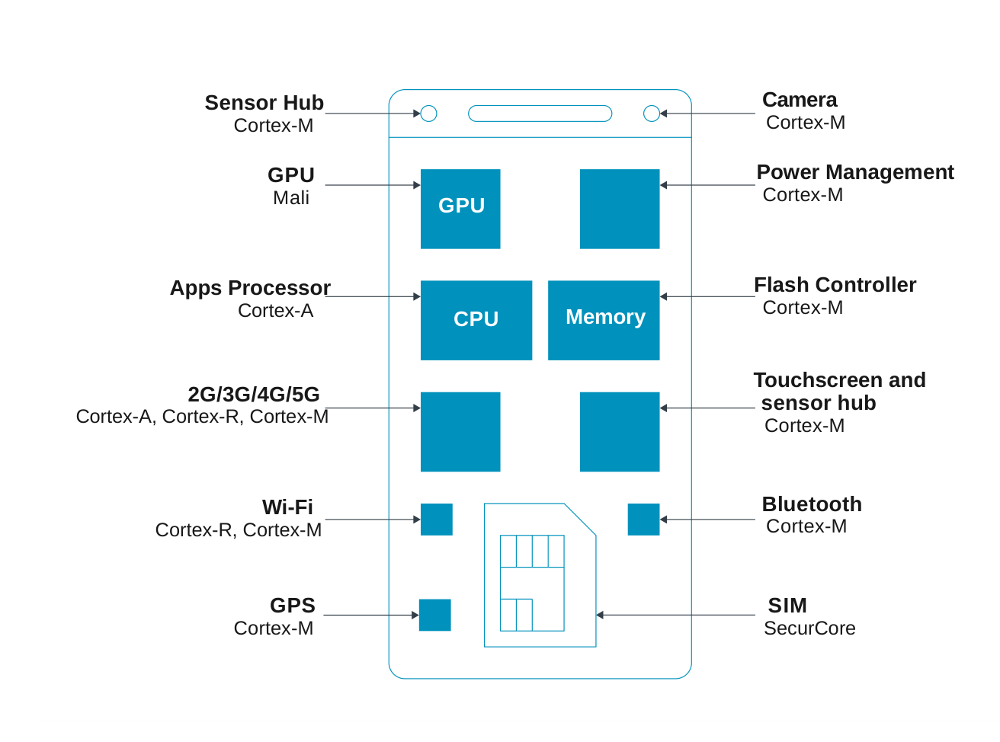
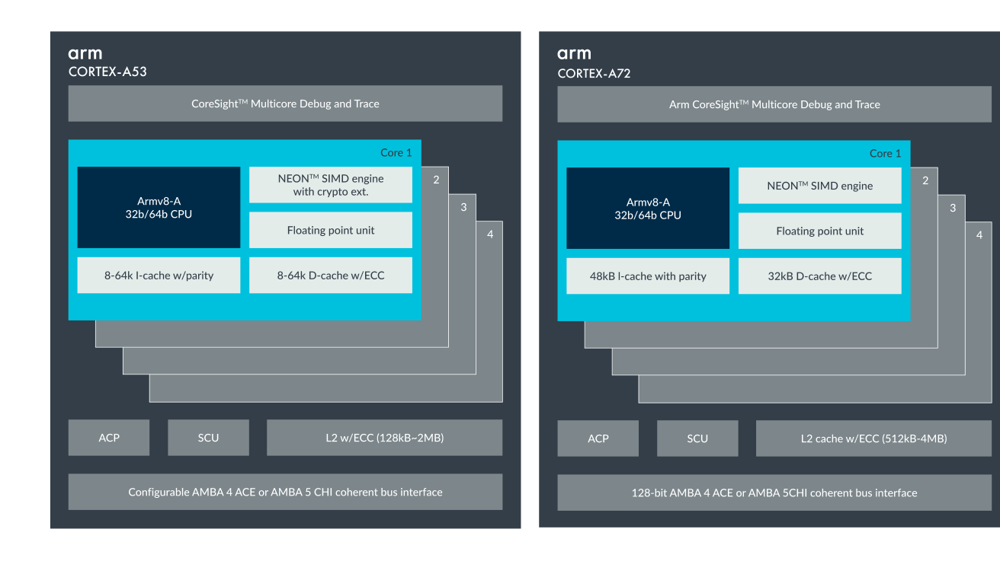
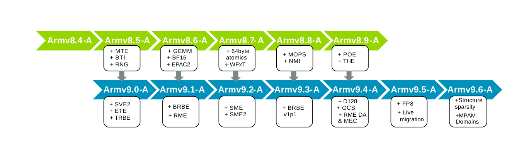
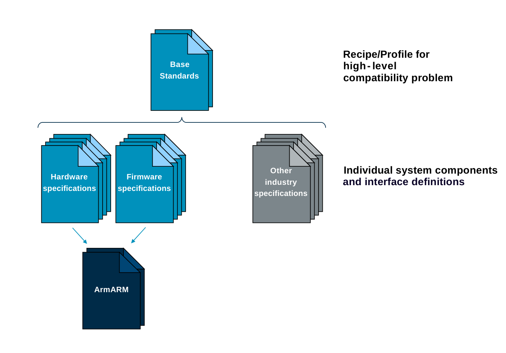
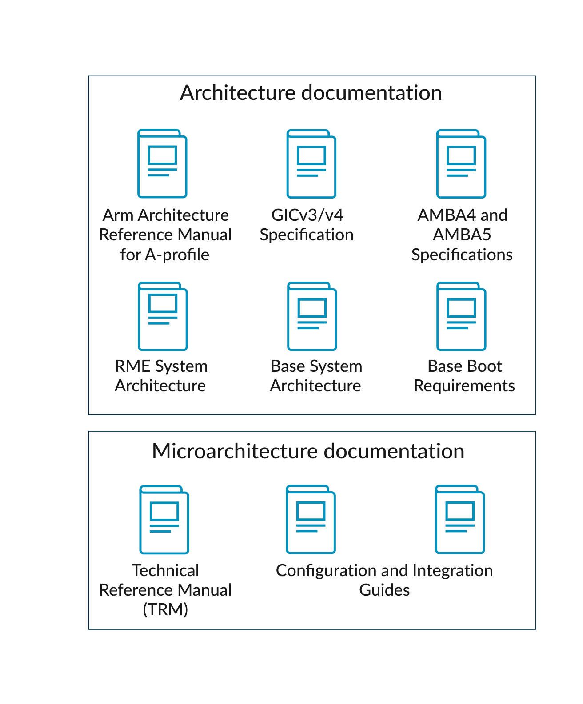

# Learn the architecture — Arm 架构入门（中文翻译）

> 原文：*Learn the architecture - Introducing the Arm architecture*
>
> 版本：Version 2.3　|　文档 ID：102404_0203_02_en　|　Issue 02（2026-01-07）
>
> 版权 © 2019, 2021, 2023–2026 Arm Limited（或其关联公司）。保留所有权利。非保密。

---

## 1. 本指南概述

Arm 架构为处理器或内核的设计奠定了基础，我们将其称为处理单元（Processing Element，PE）。

Arm 架构被用于一系列技术中，包括智能手机、微型计算机、嵌入式设备、服务器乃至超级计算机等片上系统（System-on-Chip，SoC）设备。

该架构为软件开发者暴露了一套通用的指令集和特性，也被称为程序员模型（Programmer's model）。这有助于确保架构的不同实现之间具有互操作性，从而使软件能够运行在不同的 Arm 设备上。

本指南介绍 Arm 架构，无需任何先备知识。不过，我们假设你已经熟悉处理器、编程及其术语。

在指南末尾你可以进行知识自测。本指南描述了 Arm 架构的不同配置文件（profile），以及某些特性究竟是架构级还是微架构级的。

## 2. 关于 Arm 架构

Arm 架构是世界上最流行的处理器架构之一，每年出货数十亿台基于 Arm 的设备。

为了满足不同市场的需求，该架构有三种不同的配置文件：A、R 和 M。表 2-1 描述了这些配置文件。

**表 2-1：Arm 架构配置文件**

| 配置文件 | 定位 | 说明 |
| --- | --- | --- |
| A-Profile（Applications，应用） | 高性能、特性丰富 | 旨在运行复杂操作系统，如 Linux 或 Windows |
| R-Profile（Real-Time，实时） | 面向具有实时或确定性要求的系统 | 常见于网络设备和嵌入式控制系统 |
| M-Profile（Microcontroller，微控制器） | 小型、高能效设备 | 是众多物联网（IoT）设备的核心 |

这三种配置文件使 Arm 架构能够针对不同使用场景的需求进行定制，同时仍共享若干基础特性。

> Arm® Cortex®、Arm® Neoverse™ 和 Arm® SecurCore® 是用于 IP 产品的品牌名称示例。我们的合作伙伴使用 Arm 架构提供其他处理器品牌。

图 2-1 展示了一个基于 Arm 的系统的示例：



*图 2-1：关于 Arm 架构*

这个示例智能手机包含以下处理器类型：

- 一个 A-profile 处理器作为主 CPU，运行 Android 之类的富操作系统
- 一个基于 R-profile 处理器的蜂窝调制解调器，提供连接能力
- 若干 M-profile 处理器处理系统电源管理等操作
- SIM 卡使用 SecurCore，这是一种带有额外安全特性的 M-profile 处理器。SecurCore 处理器常用于智能卡

本指南仅描述 A-profile 架构及其两个最新版本 Armv8-A 和 Armv9-A。

## 3. “架构”是什么意思？

当我们使用“架构（architecture）”这个术语时，指的是功能规格说明（functional specification）。就 Arm 架构而言，指的是针对处理器的功能规格说明。架构规定了处理器如何行为，例如它有哪些指令、这些指令做什么。

你可以把架构视为硬件与软件之间的一份“契约（contract）”。架构描述了软件可以依赖硬件提供的功能。有些特性是可选的，正如我们在“架构与微架构”中所描述的那样。

表 3-1 描述了架构所规定的内容。

**表 3-1：Arm 架构定义的关键要素**

| 特性 | 描述 |
| --- | --- |
| 指令集 | 可用指令的列表；每条指令的功能，包括它可能触发的任何异常；指令在内存中的表示方式，即其编码 |
| 寄存器组 | 可用寄存器的集合；寄存器的大小；寄存器的功能；这些寄存器的复位行为 |
| 异常模型 | 不同级别的特权以及每个特权级别可用的功能；异常的类型以及触发它们的原因；进入异常或从异常返回时会发生什么 |
| 内存模型 | 内存访问如何被排序；缓存如何行为，以及软件何时、如何执行显式维护 |
| 调试、跟踪与性能分析 | 断点如何被设置和触发；跟踪工具可以捕获哪些信息以及以何种格式 |

## 4. 架构与微架构

架构告诉你处理器的操作是什么。微架构（microarchitecture）告诉你处理器如何执行架构所要求的操作。

符合 Arm 架构对于确保与庞大的 Arm 软件和工具生态系统的可操作性、以及所有符合 Arm 的处理器之间的互操作性是至关重要的。

这意味着，每一个按照某种微架构构建和设计的符合 Arm 的处理器，都必须执行 Arm 架构的每一条指令，并且不得执行任何额外的指令。

微架构包括：

- 流水线的长度与布局
- 缓存的数量与大小
- 单条指令的周期数
- 实现了哪些可选特性

例如，Arm® Cortex®-A53 处理器和 Arm® Cortex®-A72 处理器都是 Armv8-A 架构的实现。这意味着它们具有相同的架构，但微架构却截然不同，如图 4-1 和表 4-1 所示。



*图 4-1：Arm Cortex-A53 与 Arm Cortex-A72 内核*

**表 4-1：Arm Cortex-A53 与 Arm Cortex-A72 之间微架构差异示例**

| 项目 | Cortex-A53 | Cortex-A72 |
| --- | --- | --- |
| 目标 | 针对能效优化 | 针对性能优化 |
| 流水线 | 8 级，顺序（in-order） | 15+ 级，乱序（out-of-order） |
| 缓存 | L1 I 缓存：8KB–64KB；L1 D 缓存：8KB–64KB；L2 缓存：可选，最高 2MB | L1 I 缓存：48KB 固定；L1 D 缓存：32KB 固定；L2 缓存：强制，最高 2MB |

架构上合规的软件可以不做修改地在 Cortex-A53 或 Cortex-A72 上运行。这是因为它们实现了相同的架构。

## 5. Arm 架构的发展

Arm 架构随着时间不断发展，每个版本都建立在前一版本之上。

我们以下列方式指称架构：

**Armv9-A**（v9-A）：表示该架构的第 9 版，面向 A-profile。

Arm 架构面向 A-profile 的两个主要版本是 Armv8 和 Armv9。

**Armv8-A**

Armv8-A 于 2011 年发布，是 Arm 架构的第一个 64 位版本。基于 Armv8-A 的设备已部署在从手机到超级计算机的各种设备中。

Armv9-A 也对现有特性做了改变，例如将 AArch32 的支持限制在 EL0。

**Armv9-A**

Armv9-A 是面向 A-profile 的 Arm 架构最新版本。Armv9-A 在 Armv8-A 的基础上构建，并加入了新特性，包括：

- 可扩展向量扩展第 2 版（SVE2）
- 可扩展矩阵扩展（SME、SME2）
- Realm Management Extension（RME）
- 受保护的控制栈（GCS）
- 分支记录缓冲扩展（BRBE）
- 嵌入式跟踪扩展（ETE）
- 跟踪缓冲扩展（TRBE）

Armv9-A 也对 Armv8-A 中的现有特性做了改变，例如将 AArch32 的支持限制在 EL0。

**年度更新**

Arm 每年发布一次架构更新，加入新特性并扩展现有特性。这些年度更新使用次版本号来标识，例如：Armv9.3-A，于 2022 年发布。

当 Armv9-A 被引入时，Armv9.0-A 与 Armv8.5-A 对齐。这意味着 Armv9.0-A 包含 Armv8.5-A 中的所有特性，外加仅属于 Armv9 的特性，如 SVE2。

Armv8-A 和 Armv9-A 并行更新。任何加入 Armv8 的特性都会被对应版本的 Armv9 继承，但有些特性只加入 Armv9-A。图 5-1 展示了 Armv8 与 Armv9 之间的对齐关系，并给出了不同版本中加入的特性示例。



*图 5-1：版本发布*

为方便起见，我们有时会按发布年份统称 Armv8 和 Armv9 的更新。例如，Armv8.9-A 和 Armv9.4-A 统称为 2022 扩展（2022 extensions）。

你可以在《Arm Architecture Reference Manual》中、以及通过 Arm 网站上的博客文章，找到关于每次年度更新所加入特性的更多信息：

- Arm A-Profile Architecture Developments 2024
- Arm A-Profile Architecture Developments 2023
- Arm A-Profile Architecture Developments 2022
- Arm A-Profile Architecture Developments 2021
- Arm A-Profile Architecture Developments 2020
- Developments in the Arm A-Profile Architecture: Armv8.6-A

**标识特性**

在 Arm 文档中，特性使用特定的记法被称为 FEAT：

```
FEAT_<name>
```

通常，一个高层特性由一组 FEAT 表示。例如，Realm Management Extension（RME）由以下组成：

- FEAT_RME
- FEAT_RME_GDI
- FEAT_RME_GPC2
- FEAT_RME_GPC3

对于每个 FEAT，架构定义了：

- 该特性是在哪个架构版本中引入的
- 从哪个架构版本起允许被构建
- 在某些情况下，从哪个架构版本起成为强制要求
- 该特性的任何约束，例如 FEAT_RME_GPC2 要求 FEAT_RME

通常，一个特性可以从其被引入之前的版本开始构建。例如 FEAT_MOPS：

- 在 Armv8.8-A 中引入，属于 2022 扩展的一部分
- 允许从 Armv8.7-A 或 Armv9.2-A 开始构建
- 从 Armv8.8-A 和 Armv9.3-A 起为强制要求

你可以在 Arm 网站上探索完整的特性列表：

- HTML
- JSON

## 6. 系统架构与组件架构

《Arm Architecture Reference Manual》（有时简称为 Arm ARM）是最广为人知的 Arm 规格说明。它为设计者提供了相当大的灵活性，以开发针对从微型嵌入式系统到超级计算机等广泛应用专门优化的处理器。这些系统需要的远不止一个处理器内核。例如，它们还需要内存、输入/输出设备、电源控制、监控工具、调试特性，以及连接所有部件的硬件。此外，还需要操作系统之类的系统软件来管理所有这些组件。

Arm 及其合作伙伴创建了系统架构，以鼓励硬件和软件复用。这些架构为各种组件定义了软件和硬件接口，解决常见问题并促进创新。它们通过适配 Arm 的独特特性来补充其他行业标准。

图 6-1 展示了我们如何对系统架构进行分组。



*图 6-1：系统架构分组*

**Arm ARM**

Arm ARM 是一组规格说明，定义了标准化的系统组件及其接口。

硬件规格说明包括片上系统（SoC）的额外要素，描述了与相邻硬件组件的接口及其由软件进行的管理（例如使用寄存器）。它们包括：

- 支持处理器内核的架构化标准系统组件，特别是通用中断控制器（GIC）、系统内存管理单元（SMMU）以及 CoreSight 调试与跟踪。
- 电源管理：一个专门子系统，带有一个嵌入式系统控制处理器（SCP），用于控制和监控整个 SoC 的电源。它使用系统控制与管理接口（SCMI）与主系统软件对接。
- AMBA 接口家族，包括对内存和内存映射设备（如外设）的高效访问。AMBA 被广泛采用、特性丰富且与架构无关，拥有一个全面且蓬勃发展的第三方合作伙伴生态系统，提供兼容的产品和解决方案。

固件（firmware）是低层软件，通常随 SoC 或开发板提供，用于支持操作系统或虚拟机监控器之类的高层系统软件。固件通常需要与所实现的硬件能力对齐。面向 A-profile 系统的固件接口规格说明包括：

- 使能处理器内核在特权异常级别和安全状态之间的转换。相关规格说明有 SMC 调用约定（SMCCC）、A-profile 固件框架（FF-A）以及 Arm 机密计算架构（CCA）。
- 一组标准的安全与监控接口，例如用于管理系统和 CPU 电源转换的电源状态协调接口（PSCI）。
- 针对行业定义的“高级配置与电源接口（ACPI）”的 Arm 专属补充。

上述硬件和固件规格说明为系统设计者提供了一套独立的构建模块工具箱，可按需用于其使用场景。一些常见的高层兼容性问题要求对一组能力进行标准化，因此某些系统架构规格说明定义了一组基础的硬件和固件功能。这些基础标准定义了 Arm 专属规格和行业规格的配置文件，允许系统设计者在此基础上增加自己的价值。例如，基础启动要求（BBR）、基础系统架构（BSA）及其面向特定市场的补充，使能了对标准现成操作系统的支持。

有关各种系统架构的更全面概述，请参见《Learn the architecture - Arm System Architectures》。

## 7. 理解 Arm 文档

Arm 为开发者提供了大量文档。本节描述在哪里可以找到用于在 Arm 上进行开发的文档和其他信息。

### 7.1 文档在哪里？

你可以从 Arm developer 网站下载 Arm 架构和处理器手册。你可以在 Arm community 中提出开发问题，并查找 Arm 专家针对特定主题的文章和博客。

### 7.2 哪个文档描述什么？

以下是不同类型文档的简要说明：

- **Arm Architecture Reference Manuals** 描述 PE 架构。Arm Architecture Reference Manual 与该架构的任何实现都相关。
  - 一些组件，如通用中断控制器（GIC）和系统 MMU（SMMU），有其自己的架构规格说明。
- 每个 Arm Cortex 或 Arm Neoverse 处理器都有一份**技术参考手册（TRM）**。TRM 描述该处理器特有的特性。一般来说，TRM 不会重复 Arm Architecture Reference Manuals 中已给出的信息。
  - 有些处理器还提供**软件优化指南（Software Optimization Guide）**，包含指令时序和调度信息。
- 每个 Arm Cortex 或 Arm Neoverse 处理器通常还有一份**配置与集成手册（CIM）**。CIM 描述如何将该处理器集成到系统中。一般来说，此信息仅与 SoC 设计者相关。
- 如果适用，**系统架构规格说明**给出系统或软件规则和定义。

> CIM 仅对 IP 授权方（licensee）开放。TRM 可从 Arm Developer 下载。

### 7.3 这对我意味着什么？

如果你在查找某个特定处理器的信息，可能需要参考多份不同的文档。图 7-1 展示了使用 Neoverse V3 处理器时你可能需要用到的文档：



*图 7-1：架构文档*

《Arm® Neoverse™ V3 Core Technical Reference Manual》声明该处理器实现了 Armv9.2-A 以及一些可选特性，如 Realm Management Extension。你需要参考面向 A-profile 架构的《Arm Architecture Reference Manual》来了解细节，包括软件如何检测特性是否已启用。TRM 还提供其他微架构细节，如缓存的数量和大小。

如果你正在使用 Neoverse V3 处理器及相关 Arm IP 设计 SoC，你将需要如下文档：

- TRM 描述可用的硬件接口，如 GICv4.1 CPU 接口和 AMBA CHI Issue E。你需要连接符合相应架构规格说明的 IP 模块。
- 一些可选处理器特性（如 Realm Management Extension，RME）依赖于内核之外组件的能力。如果你想使用 RME，那么必须确保你的系统满足 RME 系统架构规格说明中的要求。否则，你需要查看《Arm® Neoverse™ V3 Core Configuration and Integration Manual》以确保 RME 被禁用。
- 如果你想支持标准的现成操作系统镜像，那么根据你的需求，你可能需要确保整体硬件设计符合基础系统架构（BSA），并可能符合其面向特定市场的某个补充。你还需要确保随 SoC 提供的固件符合基础启动要求（BBR）。

如果你使用的是现有 SoC，你还会使用来自 SoC 制造商的文档。这类文档通常被称为数据手册（datasheet）。数据手册给出该 SoC 特有的信息。

### 7.4 每个文档里能找到什么信息？

表 7-1 展示了在不同类型文档中可以找到的信息类型：

**表 7-1：不同 Arm 文档类型的示例内容**

| 特性 | Arm Architecture Reference Manual | GIC 规格说明 | AMBA 规格说明 | TRM | CIM | SoC 数据手册 |
| --- | --- | --- | --- | --- | --- | --- |
| 指令集 | ✓ | — | — | — | — | — |
| 指令周期时序 | — | — | — | ✓ 或单独文档 | — | — |
| 架构寄存器 | ✓ | ✓ | — | — | — | — |
| 处理器特定寄存器 | — | — | — | ✓ | — | — |
| 内存模型 | ✓ | — | — | — | — | — |
| 异常模型 | ✓ | — | — | — | — | — |
| 对可选特性的支持 | — | — | — | ✓ | ✓（部分可能为综合选项） | — |
| 缓存与 TLB 的大小 | — | — | — | ✓ | ✓（部分可能为综合选项） | — |
| 电源管理 | — | — | — | ✓ | — | — |
| 总线端口 | — | — | — | ✓ | ✓ | — |
| 总线事务描述 | — | — | ✓ | — | — | — |
| 处理器产生的总线事务 | — | — | — | ✓ | — | — |
| 内存映射 | — | — | — | — | — | ✓ |
| 外设 | — | — | — | — | — | ✓ |
| SoC 引脚定义 | — | — | — | — | — | ✓ |

### 7.5 参考手册与用户指南的区别

Arm Architecture Reference Manuals、TRM 和 CIM 都是参考手册。这意味着它们不提供如何使用处理器的指导。例如，《Arm Architecture Reference Manuals》没有关于如何开启 MMU 的章节。

这种结构是有意为之的，旨在在不同类型的信息之间保持清晰的界限。架构所要求的技术细节在参考手册中给出。更通用的指导在其他文档中提供，例如本指南。有些通用指导文档介绍概念，另一些则提供可遵循的操作步骤。

## 8. 常见架构术语

架构使用若干术语（有时用大写、有时用小写书写），它们具有非常特定的含义。《Arm Architecture Reference Manuals》定义了每一个术语。本节描述最常见的术语及其对程序员的意义。

### 8.1 PE（Processing Element，处理单元）

Processing Element（PE）是对 Arm 架构实现的一种通用称谓。你可以把 PE 理解为任何拥有自己的程序计数器（program counter）并能执行程序的实体。例如，面向 A-profile 架构的《Arm Architecture Reference Manual》写道：

> “决定 PE 如何运行的状态，包括当前异常级别和安全状态，以及在 AArch32 状态下的 PE 模式（PE mode）。”

手册使用通用术语 PE，是因为存在许多不同的潜在微架构。例如，在 Arm Cortex-A 处理器中可能存在以下微架构：

- Arm Cortex-A8 是单核、单线程处理器。整个处理器就是一个 PE。
- Arm Cortex-A53 是多核处理器，每个核是单线程。每个核是一个 PE。
- Arm Cortex-A65AE 是多核处理器，每个核有两个线程。每个线程是一个 PE。

通过使用术语 PE，架构得以与不同处理器中做出的具体设计决策保持分离。

### 8.2 IMPLEMENTATION DEFINED（实现定义）

被标记为 IMPLEMENTATION DEFINED（IMP DEF）的特性由具体微架构定义。实现必须呈现一致的行为或值。

例如，缓存的大小就是 IMP DEF。架构为软件查询缓存大小提供了一套已定义的机制，但缓存的大小由处理器设计者决定。

类似地，对密码学指令的支持也是 IMP DEF。有寄存器可以让软件判断这些指令是否存在。

在这两个例子中，选择都是静态的。也就是说，给定处理器要么支持、要么不支持这些特性和指令。特性的存在与否不会在运行时改变。

对于 Cortex 和 Neoverse 处理器，有些 IMP DEF 选项是固定的，有些是综合（synthesis）选项。例如，在 Arm Cortex-A57 处理器上，L1 缓存的大小是固定的，而 L2 缓存的大小是综合选项。不过，关于 L2 缓存大小的决策是在设计阶段做出的，在运行时仍然是静态的。

特定处理器的 TRM 提供 IMP DEF 选项的完整细节。

### 8.3 UNPREDICTABLE 与 CONSTRAINED UNPREDICTABLE

UNPREDICTABLE 和 CONSTRAINED UNPREDICTABLE 描述的是软件**不应该**做的事情。当某事物是 UNPREDICTABLE 或 CONSTRAINED UNPREDICTABLE 时，软件不能依赖处理器的行为。如果软件多次执行了错误动作，处理器甚至可能表现出不同的行为。

例如，提供一个未对齐的转换表是 CONSTRAINED UNPREDICTABLE。这代表不良软件。不良软件是违反了转换表必须遵守的架构规则的软件。

与 IMP DEF 行为不同，技术参考手册（TRM）通常不会描述所有 UNPREDICTABLE 行为。

### 8.4 Deprecated（已弃用）

有时，Arm 会从架构中移除某个特性。这可能是因为该特性不再常用且已无必要。然而，可能仍有一些依赖该特性的遗留软件。因此，在完全移除某个特性之前，我们先将其标记为 DEPRECATED。

DEPRECATED 是对开发者的一种警告：该特性将在未来被移除，我们建议他们开始从代码中移除它。

通常，同时会向架构中加入一个控制位，允许禁用该特性。这个控制位让开发者能够测试遗留代码中对该特性的使用。

### 8.5 RES0 与 RES1

RES0 表示“保留，应为 0（Reserved, should be Zero）”。RES1 表示“保留，应为 1（Reserved, should be One）”。

RES0 和 RES1 用于描述未被使用、对处理器没有功能影响的字段。

某个字段可能是条件保留的，例如，仅当某特性被软件禁用或未实现时它才是 RES0。类似地，当前为 RESx 的字段可能在架构的未来版本中被赋予定义好的用途。

RES0 字段读出来不一定总是 0，RES1 字段读出来也不一定总是 1。RES0 和 RES1 只告诉你该字段未被使用。

有时，RES0 和 RES1 字段必须是有状态（stateful）的。有状态意味着这些字段读回的是最后写入的值。

### 8.6 Future Architecture Technologies（未来架构技术）

Arm 有时会发布关于新特性的预发布信息，这些特性将被包含在尚未公布的架构未来版本中。这些发布旨在支持早期的软件和工具开发。这类发布被标记为 Future Architecture Technologies（FAT）。

## 9. 知识自测

以下问题帮助你检验所学知识：

**如果你在文档中看到 Armv7-R，它指的是哪个版本、哪个配置文件的架构？**

第 7 版，R-Profile。

**64 位支持是在哪个版本的 Arm 架构中加入到 A-Profile 的？**

第 8 版，Armv8-A。

**对于以下各项，你会将它们归类为架构还是微架构：指令编码、缓存大小、内存排序？**

- 指令编码：架构
- 缓存大小：微架构
- 内存排序：架构

**什么是 PE？**

PE 是 Processing Element（处理单元），一种实现 Arm 架构的机器。

## 10. 相关资料

以下是与本指南内容相关的一些资源：

- Learn the Architecture Guides
- Arm Architecture Reference Manual for A-profile architecture
- All Arm Architecture Reference Manuals
- Learn the architecture - Arm System Architectures
- Arm Community：提出开发问题，并查找 Arm 专家针对特定主题的文章和博客

## 11. 下一步

本指南描述了 Arm 架构是什么、它如何演变、以及它的各配置文件及其应用这些基本原理。这些知识为你进一步学习 Arm 技术奠定了基础。

本指南描述了一些关键术语和概念，它们对于理解 Arm 架构以及 Arm 架构的不同配置文件至关重要。我们描述了：

- 架构、系统架构和微架构各自特有的特性
- Arm 架构术语和概念如何在《Arm Architecture Reference Manuals》及其他 Arm 文档和资源中出现

你还学习了 Arm 架构的不同配置文件以及其他 Arm 架构。

本系列中的其他指南详细介绍了 Arm 架构的各个方面，并提供了示例和注释。

要继续学习 Arm 架构，请参见我们的 Learn the Architecture 系列指南。
