# Learn the architecture — GICv3 和 v4 概述（中文翻译）

> 原文：*Learn the architecture - Generic Interrupt Controller v3 and v4, Overview*
>
> 版本：Version 3.2　|　文档 ID：198123_0302_03_en　|　Issue 03（2025-04-22）
>
> 版权 © 2021, 2025 Arm Limited（或其关联公司）。保留所有权利。非保密。

---

## 1. 概述

本指南概述 Arm 通用中断控制器（Generic Interrupt Controller，GIC）v3 和 v4 的特性。本指南介绍符合 GICv3 规范的中断控制器的操作，也介绍如何在裸机环境中配置 GICv3 中断控制器。

本指南是 Arm GIC 相关指南系列的第一篇：

- Arm CoreLink 通用中断控制器 v3 和 v4：概述（本指南）
- Arm CoreLink 通用中断控制器 v3 和 v4：局域性外设中断
- Arm CoreLink 通用中断控制器 v3 和 v4：虚拟化

### 背景

中断是发给处理器、表示某个事件已发生且需要处理的信号。中断通常由外设产生。

例如，系统可能使用通用异步收发器（Universal Asynchronous Receiver/Transmitter，UART）接口与外界通信。当 UART 收到数据时，它需要一种机制来告诉处理器有新数据到达、等着被处理。UART 可以使用的一种机制就是产生一个中断来通知处理器。

小型系统可能只有少数几个中断源和一个处理器。而大型系统则可能有更多的潜在中断源和处理器。GIC 执行中断管理、优先级划分和路由这些关键任务。GIC 汇集来自整个系统的所有中断，对它们划分优先级，并把它们送到某个核去处理。GIC 主要用于提升处理器效率，以及实现中断虚拟化。

GIC 是基于 Arm GIC 架构实现的。这个架构从 GICv1 演化到了最新的 GICv3 和 GICv4 版本。Arm 拥有多款通用中断控制器，为各种类型的 Arm Cortex 多处理器系统提供一系列中断管理解决方案。这些控制器涵盖从适用于小核数系统的最简单 GIC-400，到适用于高性能多芯片系统的 GIC-600。GIC-600AE 增加了额外的安全特性，面向高性能 ASIL B 到 ASIL D 系统。

在本指南末尾，你可以进行知识自测。你将了解不同类型的中断，并能够编写使能 GIC 并配置这些不同中断类型的软件。

## 2. 开始之前

本指南介绍 GICv3 和 v4 的基本操作，以及共享外设中断（Shared Peripheral Interrupt，SPI）、私有外设中断（Private Peripheral Interrupt，PPI）和软件生成中断（Software Generated Interrupt，SGI）的使用。

本指南是《Arm 通用中断控制器架构规范 GIC 架构版本 3.0 和 4.0》的补充，而不是替代品。关于寄存器和行为的详细描述，请参阅《Arm 通用中断控制器架构规范 GIC 架构版本 3.0 和 4.0》。

GICv3 和 GICv4 允许多种不同的配置和用例。为简单起见，本指南集中于其中的一个子集，即满足以下条件的配置和用例：

- 存在两种安全状态（Security state）。
- 两种安全状态都启用了亲和性路由（Affinity routing）。
- 所有异常级别（Exception level）都启用了系统寄存器访问。
- 所连接的处理器符合 Armv8-A 或 Armv9-A，实现了所有异常级别，并在所有异常级别上使用 AArch64。

本指南不涵盖：

- 传统操作（Legacy operation）。
- 在 AArch32 的异常级别中使用。

本指南假设你熟悉 Arm 异常模型。如果想了解 Arm 异常模型，可以阅读《Learn the Architecture: Exception model》指南。

## 3. 什么是通用中断控制器？

通用中断控制器（GIC）接收来自外设的中断，对它们划分优先级，并把它们投递给合适的处理器核。下图展示了一个 GIC 接收来自 n 个不同外设的中断，并把它们分发到两个不同处理器的场景。

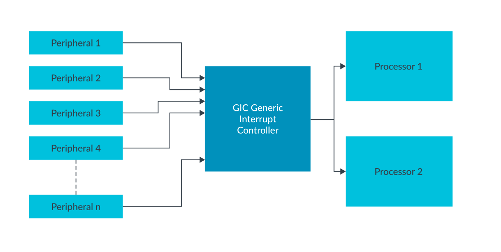

*图 3-1：GIC 示例*

GIC 是 Arm Cortex-A 和 Arm Cortex-R 系列处理器的标准中断控制器。GIC 提供了一种灵活、可扩展的中断管理方式，支持从单核到拥有数百个核的大型多芯片系统。

### Arm CoreLink GIC 简史

与 Arm 架构一样，GIC 架构也随着时间不断演化。下表总结了 GIC 规范的主要版本，以及它们通常搭配的处理器：

| GIC 版本 | 主要特性 | 通常搭配 |
| --- | --- | --- |
| GICv1 | 支持最多 8 个 PE<br>支持最多 1020 个中断 ID<br>支持两种安全状态 | Arm Cortex-A5 MPCore<br>Arm Cortex-A9 MPCore<br>Arm Cortex-R4<br>Arm Cortex-R5 MPCore<br>Arm Cortex-R7 MPCore<br>Arm Cortex-R8 MPCore |
| GICv2 | GICv1 的全部主要特性<br>支持虚拟化 | Arm Cortex-A7 MPCore<br>Arm Cortex-A15 MPCore<br>Arm Cortex-A17 MPCore |
| GICv3 | GICv2 的全部主要特性<br>支持超过 8 个 PE<br>支持消息信号中断<br>支持超过 1020 个中断 ID<br>以系统寄存器方式访问 CPU 接口寄存器<br>增强的安全模型，将 Secure 与非安全 Group 1 中断分离 | Arm Cortex-A3x MPCore<br>Arm Cortex-A5x MPCore<br>Arm Cortex-A7x MPCore |
| GICv4 | GICv3 的全部主要特性<br>虚拟中断直接注入 | Arm Cortex-A3x MPCore<br>Arm Cortex-A5x MPCore<br>Arm Cortex-A7x MPCore |

本指南涵盖 Arm CoreLink GICv3 和 GICv4，它们被大多数 Armv9-A、Armv8-A 和 Armv8-R 设计所使用。

GICv3 和 GICv4 自发布以来也获得了一些小版本更新：

- GICv3.1 增加了额外的接线下中断、安全虚拟化，以及内存系统资源分区与监控（MPAM）。
- GICv3.2 增加了对 Armv8-R AArch64 的支持。
- GICv3.3 增加了对不可屏蔽中断（non-maskable interrupt）的支持。
- GICv4.1 扩展虚拟化支持，涵盖虚拟软件生成中断（SGI）的直接注入。
- GICv4.2 增加了对直接注入不可屏蔽虚拟中断的支持。

GICv2m 是 GICv2 的一个扩展，用于增加对消息信号中断的支持。更多信息请联系 Arm Support。

## 4. Arm GIC 基础

在本节中，我们来看 Arm GICv3 和 v4 中断控制器的基本操作。

### 4.1 中断类型

GIC 可以处理四种不同类型的中断源：

- **共享外设中断（Shared Peripheral Interrupt，SPI）**。可以投递给任何已连接核的外设中断。
- **私有外设中断（Private Peripheral Interrupt，PPI）**。对一个核私有的外设中断。PPI 的一个例子是通用定时器（Generic Timer）产生的中断。
- **软件生成中断（Software Generated Interrupt，SGI）**。SGI 通常用于处理器间通信，通过写 GIC 中的某个 SGI 寄存器来产生。
- **局域性外设中断（Locality-specific Peripheral Interrupt，LPI）**。LPI 最早在 GICv3 中引入，其编程模型与其他三种中断类型差异很大。LPI 的配置在《Arm CoreLink 通用中断控制器 v3 和 v4：局域性外设中断》指南中介绍。

每个中断源都由一个 ID 号标识，称为 INTID。前面列表中介绍的中断类型都按 INTID 范围来定义：

| INTID | 中断类型 | 备注 |
| --- | --- | --- |
| 0 - 15 | SGI | 按 PE 分组存放（banked per PE） |
| 16 - 31<br>1056 - 1119（GICv3.1） | PPI | 按 PE 分组存放 |
| 32 - 1019<br>4096 - 5119（GICv3.1） | SPI | – |
| 1020 - 1023 | 特殊中断号 | 用于表示特殊情况，见"每个 PE 的设置"了解更多 |
| 1024 - 8191 | 保留 | – |
| 8192 及以上 | LPI | 上界为实现定义（IMPLEMENTATION DEFINED） |

### 4.2 中断如何向中断控制器发出信号

传统上，中断通过专用的硬件信号从外设发给中断控制器，如下图所示：

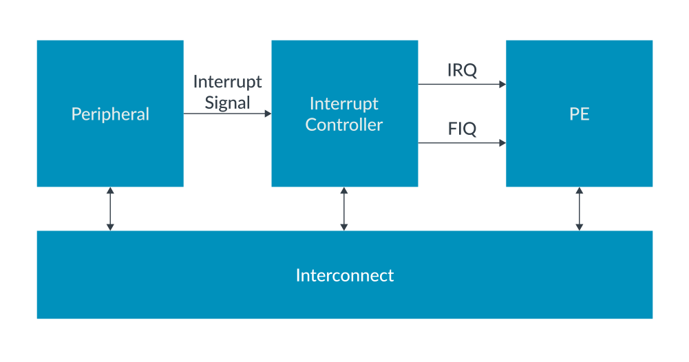

*图 4-1：专用中断信号*

Arm CoreLink GICv3 支持这种模型，但还提供了另一种信号机制：消息信号中断（message-signaled interrupt，MSI）。MSI 通过写中断控制器中的一个寄存器来传输，如下图所示：

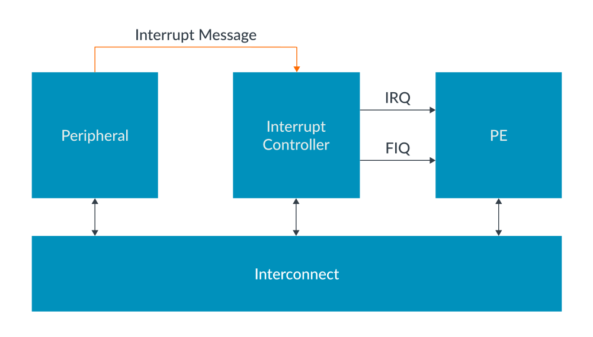

*图 4-2：消息信号中断*

使用消息将中断从外设转发到中断控制器，免去了为每个中断源配一条专用信号线的要求。这对大型系统的设计者来说是一大优势——在大型系统中，可能有成百上千条信号线需要横跨 SoC 并汇聚到中断控制器上。

中断是以消息还是以专用信号发送，对中断处理代码处理该中断的方式几乎没有影响。可能需要对一些外设进行配置，例如，可能需要指定中断控制器的地址。这种外设配置超出了本指南的范围。

在 Arm CoreLink GICv3 中，SPI 可以是消息信号中断。LPI 则始终是消息信号中断。不同的中断类型使用不同的寄存器，如下表所示：

| 中断类型 | 寄存器 |
| --- | --- |
| SPI | GICD_SETSPI_NSR 断言一个中断 |
| LPI | GITS_TRANSLATER |

### 4.3 中断状态机

中断控制器为每个 SPI、PPI 和 SGI 中断源维护一个状态机。这个状态机包含四个状态：

- **非激活（Inactive）**。中断源当前没有被断言。
- **挂起（Pending）**。中断源已被断言，但尚未被某个 PE 确认。
- **激活（Active）**。中断源已被断言，并且中断已被某个 PE 确认。
- **激活并挂起（Active and Pending）**。一个中断实例已被确认，另一个实例现在正处于挂起状态。

LPI 的状态机更简单。见"接受中断"了解更多。

状态机如下图所示：

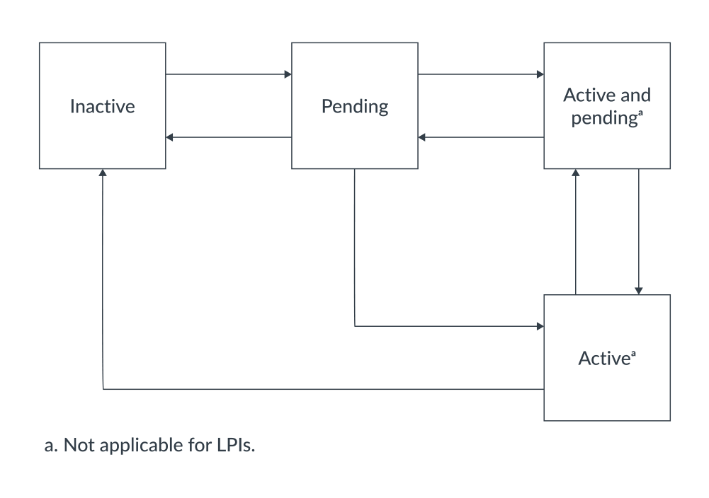

*图 4-3：中断状态机*

中断的生命周期取决于它被配置为**电平敏感（level-sensitive）**还是**边沿触发（edge-triggered）**：

- 对于电平敏感中断，中断输入上的上升沿使中断变为挂起状态，并且中断一直保持断言状态，直到外设撤销（de-assert）中断信号。
- 对于边沿触发中断，中断输入上的上升沿使中断变为挂起状态，但中断不会被一直保持断言。

#### 电平敏感中断

下图展示了中断状态转换如何对应中断信号：

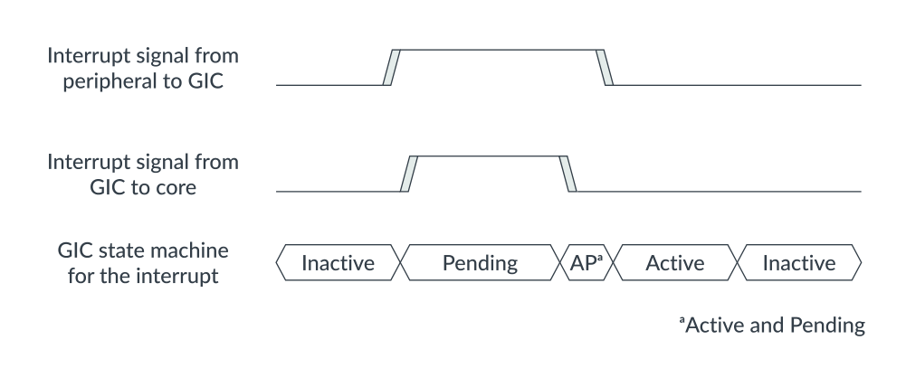

*图 4-4：电平敏感时序*

依次考虑每个状态转换：

- **非激活到挂起**。当中断源被断言时，中断从非激活转换为挂起。此时，如果中断已使能且优先级足够，GIC 会向 PE 断言中断信号。
- **挂起到激活并挂起**。当一个处理单元（Processor Element，PE）通过读取 CPU 接口中的某个中断确认寄存器（Interrupt Acknowledge Register，IAR）来确认该中断时，中断从挂起转换为激活并挂起。这个读取通常是在中断异常被接受后执行的中断处理例程的一部分。此时 GIC 撤销向 PE 的中断信号。
- **激活并挂起到激活**。当外设撤销中断信号时，中断从激活并挂起转换为激活。这通常是软件向外设中的某个状态寄存器写入的响应。
- **激活到非激活**。当 PE 写 CPU 接口中的某个中断结束寄存器（End of Interrupt Register，EOIR）时，中断从激活转换为非激活。这表示 PE 已经处理完该中断。

#### 边沿触发中断

下图展示了中断状态转换如何对应中断信号：

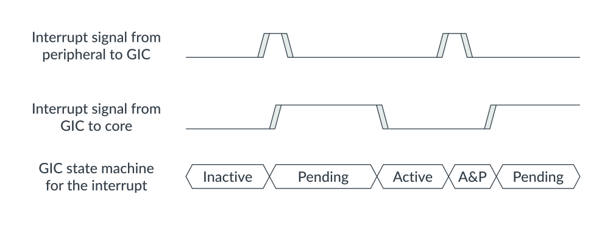

*图 4-5：边沿触发时序*

依次考虑每个状态转换：

- **非激活到挂起**。当中断源被断言时，中断从非激活转换为挂起。此时，如果中断已使能且优先级足够，GIC 会向 PE 断言中断信号。
- **挂起到激活**。当 PE 通过读取 CPU 接口中的某个 IAR 来确认该中断时，中断从挂起转换为激活。这个读取通常是在中断异常被接受后执行的中断处理例程的一部分。不过，软件也可以轮询 IAR。此时 GIC 撤销向 PE 的中断信号。
- **激活到激活并挂起**。如果外设再次断言中断信号，中断从激活转换为激活并挂起。
- **激活并挂起到挂起**。当 PE 写 CPU 接口中的某个 EOIR 时，中断从激活并挂起转换为挂起。这表示 PE 已经处理完中断的第一个实例。此时 GIC 再次向 PE 断言中断信号。

### 4.4 目标中断

Arm 架构为每个 PE 分配了一个分层标识符，称为**亲和性（affinity）**。GIC 使用亲和性值把中断定位到特定的核。

亲和性是一个 32 位值，分成四个字段：

```text
<affinity level 3>.<affinity level 2>.<affinity level 1>.<affinity level 0>
```

PE 的亲和性由 `MPIDR_EL1` 报告。

不同亲和性级别的确切含义由具体的处理器和 SoC 定义。例如，Arm Cortex-A53 和 Arm Cortex-A57 处理器使用：

```text
<group of groups>.<group of processors>.<processor>.<core>
```

而后来的设计，如 Arm Cortex-A55 和 Arm Cortex-A76 中使用的，是：

```text
<group of processors>.<processor>.<core>.<thread>
```

单个实现中不太可能存在所有节点。例如，一个移动设备 SoC 可能有如下布局：

```text
0.0.0.[0:3]   一个 Cortex-A53 处理器的 0 到 3 号核
0.0.1.[0:1]   一个 Cortex-A57 处理器的 0 到 1 号核
```

> AArch32 状态（以及 Armv7-A）只能支持三个亲和性级别。这意味着使用 AArch32 状态的设计被限制为在亲和性级别 3 只能有一个节点（0.x.y.z）。`GICD_TYPER.A3V` 表示中断控制器是否支持多个级别 3 节点。

### 4.5 安全模型

Arm GICv3 架构支持 Arm TrustZone 技术。每个 INTID 必须由软件分配一个分组和安全设置。GICv3 支持三种设置组合，如下表所示：

| 中断类型 | 示例用途 |
| --- | --- |
| Secure Group 0 | 面向 EL3（安全固件）的中断 |
| Secure Group 1 | 面向 Secure EL1（可信 OS）的中断 |
| Non-secure Group 1 | 面向非安全状态（OS 或 Hypervisor）的中断 |

Group 0 中断始终以 FIQ 发出信号。Group 1 中断则以 IRQ 或 FIQ 发出信号，具体取决于 PE 当前的安全状态和异常级别，如下表所示：

| PE 的 EL 和安全状态 | Group 0 | Group 1（Secure） | Group 1（Non-secure） |
| --- | --- | --- | --- |
| Secure EL0/1 | FIQ | IRQ | FIQ |
| Non-secure EL0/1/2 | FIQ | FIQ | IRQ |
| EL3 | FIQ | FIQ | FIQ |

这些规则旨在配合 AArch64 的安全状态和异常级别路由控制。下图展示了简化后的软件栈，以及在 EL0 执行时发出不同类型中断所发生的情况：

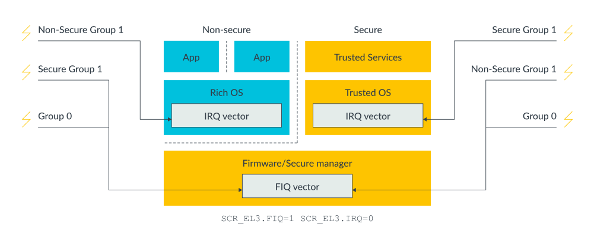

*图 4-6：中断路由示例*

在这个示例中，IRQ 被路由到 EL1（`SCR_EL3.IRQ==0`），FIQ 被路由到 EL3（`SCR_EL3.FIQ==1`）。根据上面描述的规则，在 EL1 或 EL0 执行时，属于当前安全状态的 Group 1 中断会被作为 IRQ 接受。

属于另一个安全状态的中断会触发 FIQ，异常被送到 EL3。这使得在 EL3 执行的软件能够执行必要的上下文切换。

#### 对软件的影响

当实现了 Armv9-A Realm 管理扩展（Realm Management Extensions）时，GIC 将 Realm 状态视为非安全状态的扩展。

软件在配置中断控制器时控制 INTID 到中断分组的分配。只有处于安全状态执行的软件才能把 INTID 分配到中断分组。

通常，只有处于安全状态执行的软件才应该能够访问安全中断（Group 0 和 Secure Group 1）的设置和状态。

可以启用非安全状态对安全中断设置和状态的访问。这由 `GICD_NSACRn` 和 `GICR_NSACR` 寄存器针对每个 INTID 单独控制。

LPI 始终被视为 Non-secure Group 1 中断。

### 4.6 单一安全状态的支持

GICv3 支持 Arm TrustZone 技术，但 TrustZone 的使用是可选的（OPTIONAL）。这意味着你可以把实现配置为单一安全状态或两种安全状态：

- `GICD_CTLR.DS == 0`：支持两种安全状态（Secure 和 Non-secure）。
- `GICD_CTLR.DS == 1`：只支持单一安全状态。

把 GIC 配置为与所连接 PE 相同数量的安全状态。通常这意味着，连接到 Arm Cortex-A 系列处理器时 GIC 支持两种安全状态，连接到 Arm Cortex-R 系列处理器时支持一种安全状态。

### 4.7 编程模型

GICv3 中断控制器的寄存器接口分为三组：

- 分发器接口（Distributor interface）
- 再分发器接口（Redistributor interface）
- CPU 接口（CPU interface）

这些接口如下图所示：

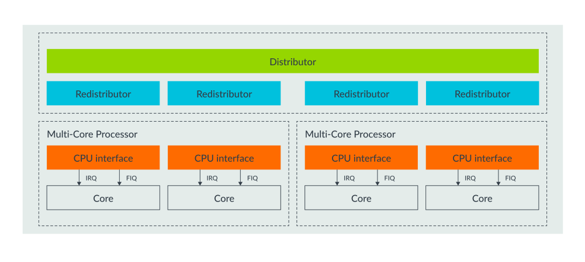

*图 4-7：编程接口*

一般来说，分发器和再分发器用于配置中断，CPU 接口用于处理中断。

#### 分发器

分发器寄存器是内存映射的，用于配置 SPI。分发器提供以下编程接口：

- SPI 的优先级划分与分发
- 使能和禁用 SPI
- 设置每个 SPI 的优先级
- 每个 SPI 的路由信息
- 把每个 SPI 设为电平敏感或边沿触发
- 生成消息信号 SPI
- 控制 SPI 的激活和挂起状态
- 确定每种安全状态下使用的编程模型：亲和性路由还是传统

#### 再分发器

每个已连接核对应一个再分发器。再分发器提供以下编程接口：

- 使能和禁用 SGI 和 PPI
- 设置 SGI 和 PPI 的优先级
- 把每个 PPI 设为电平敏感或边沿触发
- 把每个 SGI 和 PPI 分配到某个中断分组
- 控制 SGI 和 PPI 的状态
- 控制内存中支持 LPI 中断属性和挂起状态的数据结构的基地址
- 为所连接的 PE 提供电源管理支持

#### CPU 接口

每个核都包含一个 CPU 接口，这些是中断处理期间使用的系统寄存器。CPU 接口提供以下编程接口：

- 提供通用控制和配置，以启用中断处理
- 确认一个中断
- 执行中断的优先级下降和撤销激活
- 为 PE 设置中断优先级掩码
- 定义 PE 的抢占策略
- 确定 PE 的最高优先级挂起中断

在 Arm CoreLink GICv3 中，CPU 接口寄存器以系统寄存器方式访问：`ICC_*_ELn`。软件必须在使用这些寄存器之前启用系统寄存器接口。这由 `ICC_SRE_ELn` 寄存器中的 SRE 位控制，其中 n 指定异常级别：EL1–EL3。

## 5. 配置 Arm GIC

本节介绍如何在裸机环境中启用和配置符合 GICv3 规范的中断控制器。详细的寄存器描述见《Arm 通用中断控制器架构规范 GIC 架构版本 3.0 和 4》。

局域性外设中断（LPI）的配置与共享外设中断（SPI）、私有外设中断（PPI）和软件生成中断（SGI）的配置差异很大，超出本指南范围。要了解更多，请参阅我们的指南《Arm CoreLink 通用中断控制器 v3 和 v4：局域性外设中断》。

大多数使用 GICv3 中断控制器的系统都是多核系统，也可能是多处理器系统。有些设置是全局的，即会影响所有已连接的 PE。另一些设置则只针对单个 PE。

我们先看全局设置，再看每个 PE 的设置。

### 5.1 全局设置

分发器控制寄存器（`GICD_CTLR`）必须被配置为启用中断分组并设置路由模式，如下：

- **启用亲和性路由（ARE 位）**：`GICD_CTLR` 中的 ARE 位控制 GIC 是运行在 GICv3 模式还是传统模式。传统模式提供对 GICv2 的向后兼容。本指南假设 ARE 位被设为 1，即使用 GICv3 模式。
- **使能位**：`GICD_CTLR` 包含 Group 0、Secure Group 1 和 Non-secure Group 1 各自独立的使能位：
  - `EnableGrp1S` 使能 Secure Group 1 中断的分发。
  - `EnableGrp1NS` 使能 Non-secure Group 1 中断的分发。
  - `EnableGrp0` 使能 Group 0 中断的分发。

> Arm CoreLink GIC-600 不支持传统操作，其 ARE 位永久置 1。

### 5.2 每个 PE 的设置

本节介绍针对单个核或 PE 的设置。

#### 再分发器配置

每个核都有自己的再分发器，如下图所示：

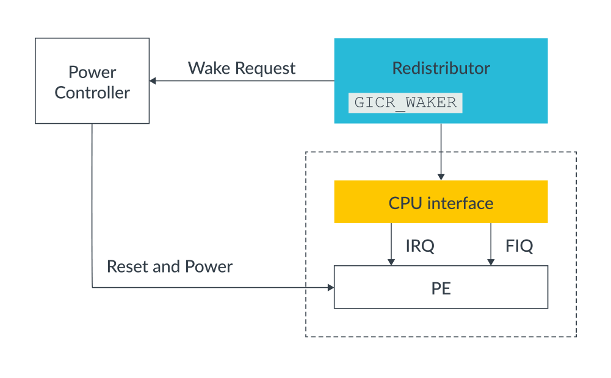

*图 5-1：PE 与再分发器相连*

再分发器包含一个名为 `GICR_WAKER` 的寄存器，用于记录所连接的 PE 是在线（online）还是离线（offline）。中断只会被转发给 GIC 认为处于在线状态的 PE。复位时，所有 PE 都被当作离线。

要把所连接的 PE 标记为在线，软件必须：

- 把 `GICR_WAKER.ProcessorSleep` 清为 0。
- 轮询 `GICR_WAKER.ChildrenAsleep`，直到它读到 0。

软件必须在配置 CPU 接口之前执行这些步骤，这一点很重要，否则行为可能是不可预测的（UNPREDICTABLE）。

当 PE 离线（`GICR_WAKER.ProcessorSleep==1`）时，一个以该 PE 为目标的中断会导致 wake-request（唤醒请求）信号被断言。通常，这个信号会送到系统的电源控制器。电源控制器随后把 PE 打开。在唤醒时，该 PE 上的软件会清除 ProcessorSleep 位，从而允许唤醒 PE 的那个中断被转发。

#### CPU 接口配置

CPU 接口负责把中断异常投递给它所连接的 PE。要启用 CPU 接口，软件必须配置以下内容：

- **启用系统寄存器访问**：CPU 接口（`ICC_*_ELn`）小节介绍了 CPU 接口寄存器，以及它们在 GICv3 中如何以系统寄存器方式访问。软件必须通过设置 `ICC_SRE_ELn` 寄存器中的 SRE 位来启用对 CPU 接口寄存器的访问。

> 许多较新的 Arm Cortex 处理器不支持传统操作，其 SRE 位被固定为置位状态。在这些处理器上可以跳过此步骤。

- **设置优先级掩码和二进制点寄存器**：CPU 接口包含优先级掩码寄存器（`ICC_PMR_EL1`）和二进制点寄存器（`ICC_BPRn_EL1`）。优先级掩码设置中断要被转发到 PE 所必须满足的最小优先级。二进制点寄存器用于优先级分组和抢占。这两个寄存器的用法在"处理中断"中有更详细的介绍。
- **设置 EOI 模式**：CPU 接口中 `ICC_CTLR_EL1` 和 `ICC_CTLR_EL3` 的 EOImode 位控制中断完成（completion）的处理方式。这会在"中断结束"中更详细地介绍。
- **启用每个中断分组的信号**：必须启用每个中断分组的信号，CPU 接口才会把该分组的中断转发给 PE。要启用信号，软件必须向 `ICC_IGRPEN1_EL1` 寄存器写入以启用 Group 1 中断，向 `ICC_IGRPEN0_EL1` 寄存器写入以启用 Group 0 中断。`ICC_IGRPEN1_EL1` 按安全状态分组（banked）。这意味着 `ICC_IGRPEN1_EL1` 控制当前安全状态的 Group 1。在 EL3，软件可以用 `ICC_IGRPEN1_EL3` 访问两种 Group 1 使能。

#### PE 配置

还需要对 PE 进行一些配置，才能让它接收和处理中断。对此的详细描述超出本指南范围。在本指南中，我们介绍 Armv8-A 合规 PE 在 AArch64 状态下所需的基本步骤：

- **路由控制**：PE 中中断的路由控制在 `SCR_EL3` 和 `HCR_EL2` 里。路由控制位决定中断被送到哪个异常级别。这些寄存器中的路由位在复位时为未知（UNKNOWN）值，所以必须由软件初始化。
- **中断屏蔽**：PE 还在 PSTATE 中有异常屏蔽位。当这些位置位时，中断被屏蔽。这些位在复位时被置位。
- **向量表**：PE 向量表的位置由 `VBAR_ELn` 寄存器设置。与 `SCR_EL3` 和 `HCR_EL2` 一样，`VBAR_ELn` 寄存器在复位时为未知值。软件必须把 `VBAR_ELn` 寄存器设置为指向内存中合适的向量表。

要了解更多这些步骤，请参阅《Learn the Architecture: Exception model》指南。

### 5.3 SPI、PPI 和 SGI 的配置

到目前为止，我们研究了中断控制器本身的配置。现在讨论各个中断源的配置。

用哪些寄存器来配置一个中断取决于中断类型：

- SPI 通过分发器配置，使用 `GICD_*` 寄存器。
- PPI 和 SGI 通过各自的再分发器配置，使用 `GICR_*` 寄存器。

这些不同的配置机制如下图所示：

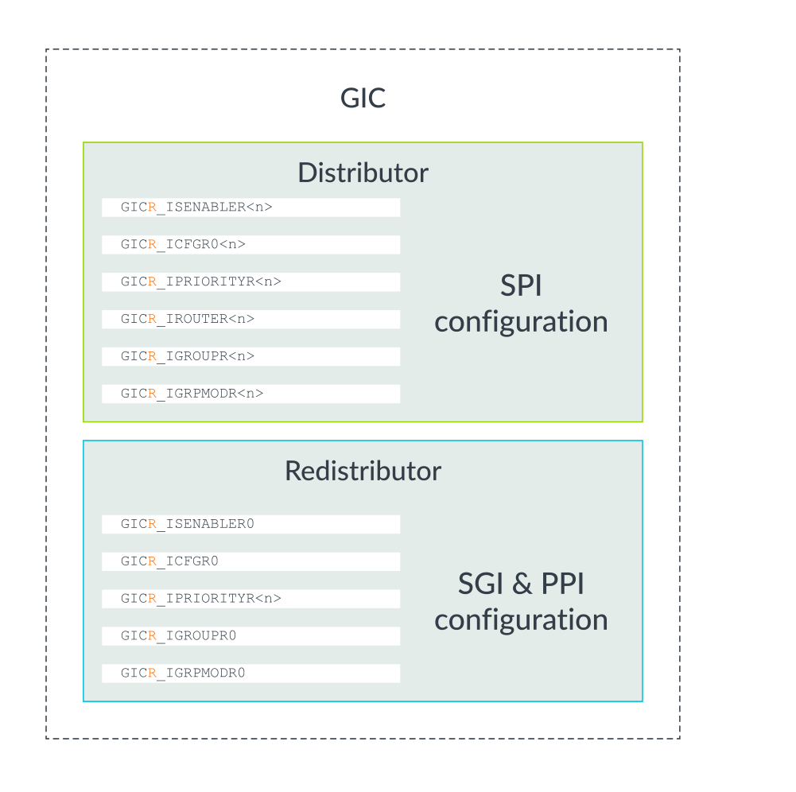

*图 5-2：配置寄存器*

对于每个 INTID，软件必须配置以下内容：

- **优先级**：`GICD_IPRIORITYn`、`GICR_IPRIORITYn`。每个 INTID 都有一个关联的优先级，表示为 8 位无符号值。0x00 是可能的最高优先级，0xFF 是可能的最低优先级。"运行优先级与抢占"介绍了 `GICD_IPRIORITYn` 和 `GICR_IPRIORITYn` 中的优先级值如何屏蔽低优先级中断，以及它如何控制抢占。中断控制器不要求实现全部 8 个优先级位。如果 GIC 支持两种安全状态，必须至少实现 5 位；如果 GIC 只支持单一安全状态，必须至少实现 4 位。

- **分组**：`GICD_IGROUPn`、`GICD_IGRPMODn`、`GICR_IGROUPn`、`GICR_IGRPMODn`。如"安全模型"所述，一个中断可以被配置为属于三个中断分组之一。这三个中断分组是 Group 0、Secure Group 1 和 Non-secure Group 1。

- **边沿触发或电平敏感**：`GICD_ICFGRn`、`GICR_ICFGRn`。对于 PPI 和 SPI，软件必须指定中断是边沿触发还是电平敏感。SGI 始终被视为边沿触发，因此对于这些中断，`GICR_ICFGR0` 表现为读为 1、写被忽略（RAO/WI）。

- **使能**：`GICD_ISENABLERn`、`GICD_ICENABLER`、`GICR_ISENABLERn`、`GICR_ICENABLERn`。每个 INTID 都有一个使能位。置位类寄存器和清零类寄存器免除了执行读-改-写例程的需要。Arm 建议在使能 INTID 之前配置好本节所述的各种设置。

- **不可屏蔽**：被配置为不可屏蔽的中断被视为高于同一分组的其他所有中断。也就是说，一个不可屏蔽的 Non-secure Group 1 中断被视为高于其他所有 Non-secure Group 1 中断。
  - 不可屏蔽属性是在 GICv3.3 中加入的，需要 PE 提供匹配的支持。
  - 只有 Secure Group 1 和 Non-secure Group 1 中断可以被标记为不可屏蔽。

对于裸机环境，通常不需要在初始配置后更改设置。但是，如果必须重新配置某个中断（例如更改分组设置），你应该先禁用该中断，再更改其配置。

大多数配置寄存器的复位值是实现定义的（IMPLEMENTATION DEFINED）。这意味着中断控制器的设计者决定这些值，而它们可能因系统而异。

### 5.4 Arm GICv3.1 与扩展 INTID 范围

Arm GICv3.1 增加了对额外 SPI 和 PPI INTID 的支持。配置这些中断的寄存器与原始中断范围相同，只是带有一个 E 后缀。例如：

- `GICR_ISENABLERn`：原始 PPI 范围的使能位
- `GICR_ISENABLERnE`：GICv3.1 中引入的额外 PPI 的使能位

### 5.5 为 SPI 设置目标 PE

对于 SPI，必须配置中断的目标。这由 `GICD_IROUTERn` 控制，对 GICv3.1 扩展的 SPI 则用 `GICD_IROUTERnE`。每个 SPI 都有一个 `GICD_IROUTERn` 寄存器，`Interrupt_Routing_Mode` 位控制路由策略。选项有：

- `GICD_IROUTERn.Interrupt_Routing_Mode == 0`：SPI 被投递给 PE A.B.C.D，即寄存器中指定的亲和性坐标。
- `GICD_IROUTERn.Interrupt_Routing_Mode == 1`：SPI 可以被投递给任何参与该中断分组分发的已连接 PE。由分发器（而不是软件）选择目标 PE。因此目标可能在每次中断发出信号时都不同。这种路由被称为 1-of-N。

PE 可以选择不接收 1-of-N 中断。这由 `GICR_CTLR` 中的 DPG1S、DPG1NS 和 DPG0 位控制。

## 6. 处理中断

本节介绍中断发生时会发生什么：例如，中断如何被路由到 PE，中断彼此之间如何划分优先级，以及中断结束时会发生什么。

### 6.1 将挂起的中断路由到 PE

"中断状态机"小节介绍了当中断源被断言时，中断如何从非激活状态转换到挂起状态。当中断变为挂起时，中断控制器根据以下测试来决定是否把中断发送给某个已连接的 PE。这些测试决定把中断发送给哪个 PE（如果有的话）：

- **检查与该中断关联的分组是否已使能。** "安全模型"小节介绍了每个 INTID 如何被分配到某个分组：Group 0、Secure Group 1 或 Non-secure Group 1。对于每个分组，分发器和每个 CPU 接口中都有一个分组使能位。中断控制器检查与该中断的 INTID 关联的分组的分组使能位是否已置位。属于已禁用分组的中断不能向 PE 发出信号。这些中断会一直保持在挂起状态，直到该分组被使能。
- **检查该中断是否已使能。** 被单独禁用的中断可以变为挂起，但不会被转发给 PE。
- **检查路由控制以决定哪些 PE 可以接收该中断。** 哪些 PE 可以接收一个中断取决于所发送中断的类型：
  - 对于共享外设中断（SPI），路由由 `GICD_IROUTERn` 控制。一个 SPI 可以针对一个特定 PE，或任何已连接的 PE 之一。
  - 对于局域性外设中断（LPI），路由信息来自 ITS。
  - 私有外设中断（PPI）只属于某个 PE，只能由该 PE 处理。
  - 对于软件生成中断（SGI），源 PE 定义目标 PE 列表。这在"发送和接收软件生成中断"中有进一步介绍。
- **检查中断优先级和优先级掩码以决定哪些 PE 适合处理该中断。** 每个 PE 在其 CPU 接口中有一个优先级掩码寄存器 `ICC_PMR_EL1`。这个寄存器设置中断要被转发到该 PE 所必须满足的最小优先级。只有优先级高于掩码的中断才向 PE 发出信号。
- **检查运行优先级以决定哪些 PE 可用来处理该中断。** "运行优先级与抢占"涵盖运行优先级，以及它如何影响抢占。如果 PE 当前没有处理中断，运行优先级就是空闲优先级：0xFF。只有优先级高于运行优先级的中断才能抢占当前中断。

如果中断通过了所有测试，它就以 IRQ 或 FIQ 异常的形式被转发给对应的核。要了解更多，请参阅"为 SPI 设置目标 PE"。

### 6.2 接受中断

进入异常处理器时，软件并不知道它接受了哪个中断。处理器必须读取某个中断确认寄存器（IAR）来获取该中断的 INTID。

有两个 IAR：

| 寄存器 | 用途 |
| --- | --- |
| `ICC_IAR0_EL1` | 用于确认 Group 0 中断。通常在 FIQ 处理器中读取。 |
| `ICC_IAR1_EL1` | 用于确认 Group 1 中断。通常在 IRQ 处理器中使用。 |
| `ICC_NMIAR1_EL1` | 用于确认不可屏蔽的 Group 1 中断（仅 GICv3.3）。 |

读取一个 IAR 会返回所接受中断的 INTID，并使该中断的状态机前进。通常，IAR 是在进入中断处理器时读取的。不过，软件可以随时读取这些寄存器。

有时，IAR 无法返回有效的 INTID。例如，软件读取 `ICC_IAR0_EL1` 来确认 Group 0 中断，但挂起的中断属于 Group 1。在这种情况下，读取会返回保留 INTID 之一，如下表所示：

| ID | 含义 | 示例场景 |
| --- | --- | --- |
| 1020 | 仅由读取 `ICC_IAR0_EL1` 返回。<br>最高优先级挂起中断是 Secure Group 1。<br>只能在 EL3 中看到。 | 当 PE 在非安全状态执行时，有一个面向可信 OS 的中断被发出信号。这被作为 FIQ 送到 EL3，以便安全监视器（Secure Monitor）能上下文切换到可信 OS。 |
| 1021 | 仅由读取 `ICC_IAR0_EL1` 返回。<br>最高优先级挂起中断是 Non-secure Group 1。<br>只能在 EL3 中看到。 | 当 PE 在安全状态执行时，有一个面向富 OS 的中断被发出信号。这被作为 FIQ 送到 EL3，以便安全监视器能上下文切换到富 OS。 |
| 1022 | 在读取 `ICC_IAR1_EL1` 时返回。<br>最高优先级挂起中断是 Non-secure Group 1，具有不可屏蔽属性。 | 具有不可屏蔽属性的中断用另一个寄存器来确认。 |
| 1023 | 伪中断（Spurious interrupt）。<br>没有处于挂起状态的已使能 INTID，或所有处于挂起状态的 INTID 优先级都不足以被接受。 | 当轮询 IAR 时，这个值表示没有可确认的中断可用。 |

读取 IAR 时若返回这些保留值之一，即使存在中断，也不会确认中断。

### 6.3 中断处理示例

下图展示了一个移动系统的示例，其中有一个调制解调器（modem）中断，表示有来电。这个中断预期由非安全状态下的富 OS 处理。

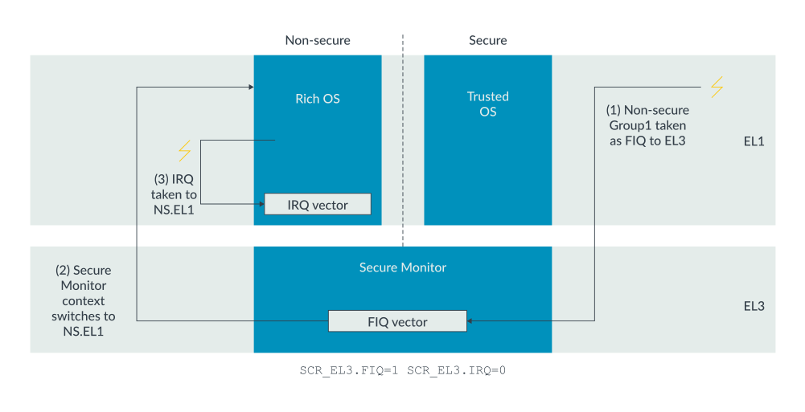

*图 6-1：处理中断*

处理该中断涉及的步骤如下：

1. 当 PE 在 Secure EL1 执行可信 OS 时，调制解调器中断变为挂起。由于调制解调器中断被配置为 Non-secure Group 1，它会以 FIQ 发出信号。当 `SCR_EL3.FIQ==1` 时，异常被送到 EL3。
2. 在 EL3 执行的安全监视器软件读取 IAR，返回 1021。这个值表示该中断预期在非安全状态处理。安全监视器随后执行必要的上下文切换操作。
3. 现在 PE 处于非安全状态，中断被重新作为 IRQ 发出信号，并被送到 Non-secure EL1 由富 OS 处理。

在这个示例中，Non-secure Group 1 中断导致了从安全 OS 的立即退出。这并不总是必需或期望的。下图展示了这个示例的另一种模型，其中中断最初被送到 Secure EL1：

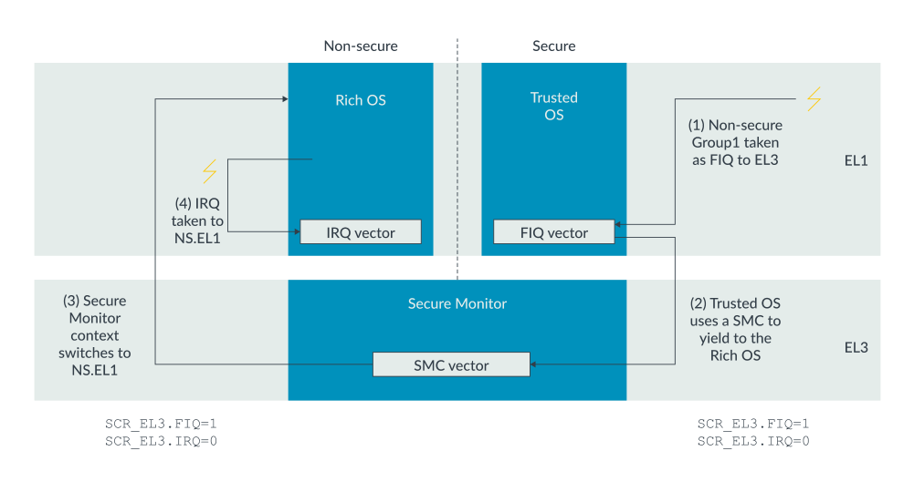

*图 6-2：另一种路由模型*

现在处理该中断涉及的步骤如下：

1. 当 PE 在 Secure EL1 执行可信 OS 时，调制解调器中断变为挂起。由于调制解调器中断被配置为 Non-secure Group 1，它会被以 FIQ 发出信号。当 `SCR_EL3.FIQ==0` 时，异常被送到 Secure EL1。
2. 可信 OS 执行一些操作来整理其内部状态。当准备好时，可信 OS 使用 SMC 指令让出到非安全状态。
3. SMC 异常被送到 EL3。在 EL3 执行的安全监视器软件执行必要的上下文切换操作。
4. 现在 PE 处于非安全状态，中断被作为 IRQ 发出信号，并被送到 Non-secure EL1 由富 OS 处理。

### 6.4 运行优先级与抢占

优先级掩码寄存器设置中断要被转发到 PE 所必须满足的最小优先级。GICv3 架构还有运行优先级（running priority）的概念。当 PE 确认一个中断时，其运行优先级变为该中断的优先级。当 PE 写某个中断结束（EOI）寄存器时，运行优先级恢复到之前的值。下图展示了一个 PE 的运行优先级随时间变化的示例：

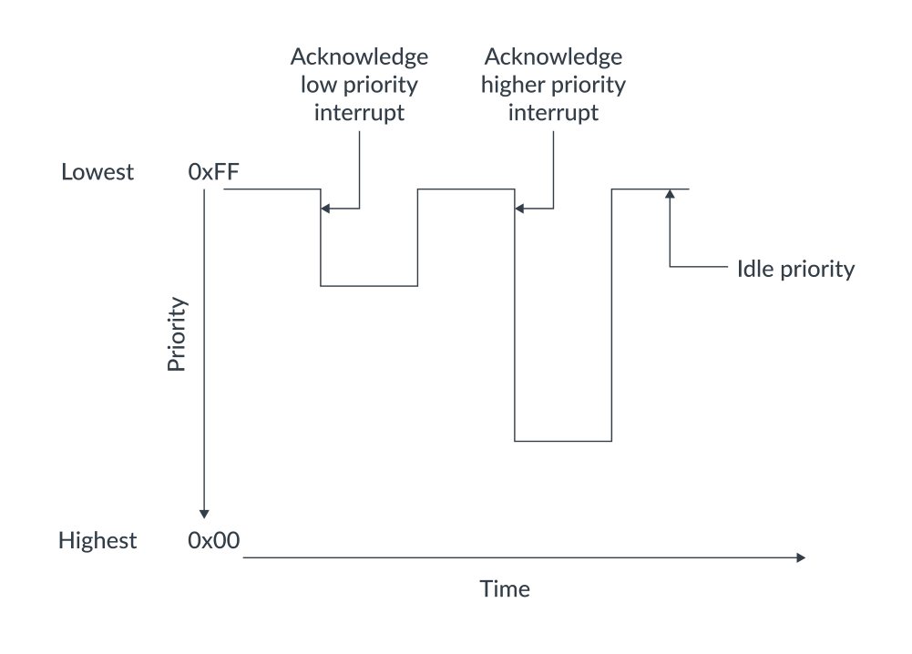

*图 6-3：运行优先级随时间变化*

当前运行优先级由 CPU 接口中的运行优先级寄存器报告：`ICC_RPR_EL1`。

运行优先级的概念在考虑抢占时很重要。当一个高优先级中断被发给一个已经在处理低优先级中断的 PE 时，就发生抢占。抢占会给软件带来一些额外的复杂性，但它能防止低优先级中断阻塞高优先级中断的处理。

下图展示了不允许抢占时会发生什么：

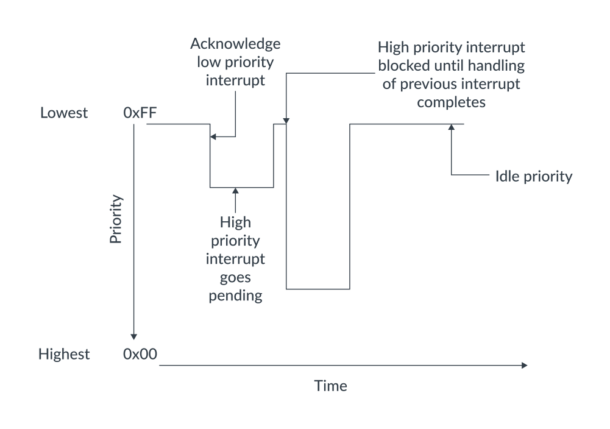

*图 6-4：无抢占的情况*

高优先级中断一直被阻塞，直到先前发出信号的低优先级中断被接受为止。现在考虑同样的情况，但启用了抢占：

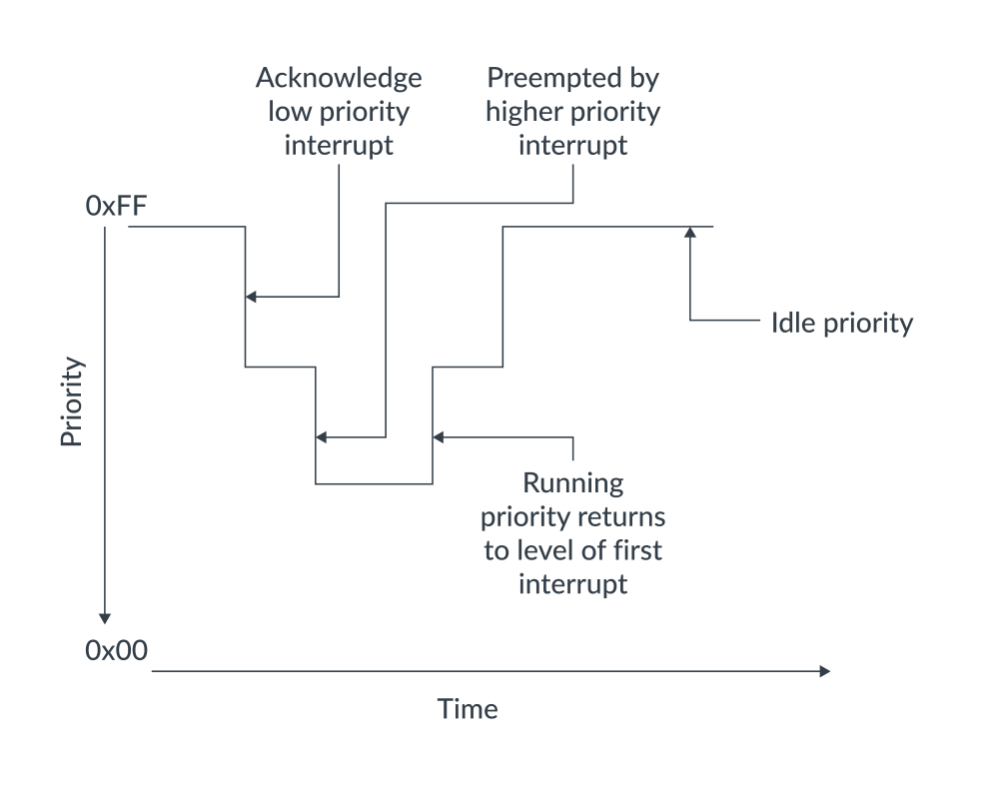

*图 6-5：有抢占的情况*

当更高优先级的中断变为挂起时，它会抢占先前发出信号的低优先级中断。前面的图展示了一层抢占。不过，可以有多个级别的抢占。

Arm CoreLink GICv3 架构允许软件通过指定发生抢占所需的优先级差异来控制抢占。这通过二进制点寄存器控制：`ICC_BPRn_EL1`。

二进制点寄存器把优先级分成两个字段，组优先级（group priority）和子优先级（sub-priority），如下图所示：


*图 6-6：8 位优先级值*

对于抢占，只考虑组优先级位。子优先级位被忽略。

例如，考虑以下三个中断：

- INTID A 的优先级为 0x10。
- INTID B 的优先级为 0x20。
- INTID C 的优先级为 0x21。

在这个示例中，我们决定：

- A 可以抢占 B 或 C。
- B 不能抢占 C，因为 B 和 C 的优先级相近。

要实现这一点，Group 和子优先级的切分点可以设在 N=4，如下图所示：


*图 6-7：组优先级*

采用这个切分点后，B 和 C 对于抢占而言具有相同的优先级。不过，A 仍然具有更高的优先级，这意味着它可以抢占 B 或 C 中的任何一个。

二进制点寄存器只影响抢占，也就是"是否在已经处理另一个中断时仍对该中断发出信号"。在选择挂起中断时，二进制点寄存器不被使用。

> 抢占要求中断处理器（一个或多个）被编写为支持嵌套。如何编写这样的中断处理器的细节超出了本指南的范围。

### 6.5 中断结束

一旦中断被处理完，软件必须通知中断控制器该中断已被处理，以便状态机能转换到下一个状态。Arm CoreLink GICv3 架构把这当作两个任务：

- **优先级下降（Priority drop）**：这意味着把运行优先级降回接受该中断之前的那个值。
- **撤销激活（Deactivation）**：这意味着更新当前正在处理的中断的状态机。通常，这会是从激活状态到非激活状态的转换。

在 GICv3 架构中，优先级下降和撤销激活可以一起发生，也可以分开发生。这由 `ICC_CTLR_ELn.EOImode` 的设置决定：

- `EOImode = 0`：对 Group 0 中断写 `ICC_EOIR0_EL1`（对 Group 1 中断写 `ICC_EOIR1_EL1`）会同时执行优先级下降和撤销激活。这种模式常用于简单的裸机环境。
- `EOImode = 1`：对 Group 0 中断写 `ICC_EOIR0_EL1`（对 Group 1 中断写 `ICC_EOIR1_EL1`）只执行优先级下降。需要另外写 `ICC_DIR_EL1` 来撤销激活。这种模式常用于虚拟化目的。

大多数软件会使用 `EOIMode==0`。`EOIMode==1` 最常被 hypervisor 使用。

### 6.6 检查最高优先级挂起中断与运行优先级

顾名思义，最高优先级挂起中断寄存器 `ICC_HPPIR0_EL1` 和 `ICC_HPPIR1_EL1` 报告一个 PE 的最高优先级挂起中断的 INTID。

运行优先级在"运行优先级与抢占"中介绍过，由运行优先级寄存器（`ICC_RPR_EL1`）报告。

### 6.7 检查单个 INTID 的状态

分发器提供表示每个 SPI 当前状态的寄存器。类似地，再分发器提供表示其连接 PE 的 PPI 和 SGI 状态的寄存器。这些寄存器也可以把一个中断移动到特定状态。例如，这在不需要外设断言中断的情况下测试配置是否正确很有用。

有单独的寄存器报告激活状态和挂起状态。下表列出了激活状态寄存器。挂起状态寄存器具有相同的格式：

| 寄存器 | 描述 |
| --- | --- |
| `GICD_ISACTIVERn` | 设置 SPI 的激活状态。<br>每个 INTID 一个位。<br>读一个位返回该 INTID 的当前状态：<br>1 - 该 INTID 是激活的。<br>0 - 该 INTID 不是激活的。<br>写 1 到一个位会激活对应的 INTID。<br>写 0 到一个位没有效果。 |
| `GICD_ICACTIVERn` | 清除 SPI 的激活状态。<br>每个 INTID 一个位。<br>读一个位返回该中断的当前状态：<br>1 - 该 INTID 是激活的。<br>0 - 该 INTID 不是激活的。<br>写 1 到一个位会激活对应的 INTID。<br>写 0 到一个位没有效果。 |
| `GICR_ISACTIVERn` | 设置 SGI 和 PPI 的激活状态。<br>每个 INTID 一个位。此寄存器覆盖 INTID 0 到 31，它们对每个 PE 是私有的。<br>读一个位返回该中断的当前状态：<br>1 - 该 INTID 是激活的。<br>0 - 该 INTID 不是激活的。<br>写 1 到一个位会激活对应的 INTID。<br>写 0 到一个位没有效果。 |
| `GICR_ICACTIVERn` | 清除 SGI 和 PPI 的激活状态。<br>每个 INTID 一个位。此寄存器覆盖 INTID 0 到 31，它们对每个 PE 是私有的。<br>读一个位返回该中断的当前状态：<br>1 - 该 INTID 是激活的。<br>0 - 该 INTID 不是激活的。<br>写 1 到一个位会激活对应的 INTID。<br>写 0 到一个位没有效果。 |

> 非安全状态执行的软件看不到 Group 0 或 Secure Group 1 中断的状态，除非 `GICD_NASCRn` 或 `GICR_NASCRn` 允许访问。

## 7. 发送和接收软件生成中断

软件生成中断（SGI）是软件可以通过写中断控制器中的寄存器来触发的中断。

### 7.1 生成 SGI

一个 SGI 通过写 CPU 接口中的以下某个 SGI 寄存器来生成：

| 系统寄存器接口 | 描述 |
| --- | --- |
| `ICC_SGI0R_EL1` | 生成一个 Secure Group 0 中断。 |
| `ICC_SGI1R_EL1` | 为 PE 的当前安全状态生成一个 Group 1 中断。 |
| `ICC_ASGI1R_EL1` | 为 PE 的另一个安全状态生成一个 Group 1 中断。 |

你可以从下图中看到 SGI 寄存器的基本格式：


*图 7-1：SGI 寄存器*

### 7.2 控制 SGI ID

SGI ID 字段控制生成哪个 INTID。如"中断类型"所述，INTID 0–15 用于 SGI。

### 7.3 控制目标

SGI 寄存器中的 IRM（Interrupt Routing Mode）字段控制 SGI 发送给哪个或哪些 PE。有两个选项：

- `IRM = 0`：中断发送到 `<aff3>.<aff2>.<aff1>.<Target List>`，其中 `<target list>` 为 `<aff1>` 下的每个 affinity 0 节点编码 1 个位。这意味着中断最多可以发送给 16 个 PE，其中可能包括源 PE。
- `IRM = 1`：中断发送给所有已连接 PE，源 PE（自身）除外。

### 7.4 控制安全状态和分组

SGI 的安全状态和分组由以下控制：

- 源 PE 上软件写入的 SGI 寄存器，`ICC_SGI0R_EL1`、`ICC_SGI1R_EL1` 或 `ICC_ASGIR_EL1`。
- 目标 PE 的 `GICR_IGROUPR0` 和 `GICR_IGRPMODR0` 寄存器。

安全状态执行的软件可以发送安全和非安全 SGI。非安全状态执行的软件能否生成安全 SGI 由 `GICR_NSACR` 控制。

这个寄存器只能由安全状态执行的软件访问。下表展示了 GIC 通过检查以下内容来确定中断是否被转发：

- 源 PE 的安全状态。
- 中断所针对的 PE 的中断处理配置。
- SGI 寄存器。

| 发送 PE 的安全状态 | 写入的 SGI 寄存器 | 接收 PE 的配置 | 是否转发？ |
| --- | --- | --- | --- |
| Secure EL3/EL1 | `ICC_SGI0R_EL1` | Secure Group 0<br>Secure Group 1<br>Non-secure Group 1 | 是<br>否<br>否 |
| Secure EL3/EL1 | `ICC_SGI1R_EL1` | Secure Group 0<br>Secure Group 1<br>Non-secure Group 1 | 否（*）<br>是<br>否 |
| Secure EL3/EL1 | `ICC_ASGI1R_EL1` | Secure Group 0<br>Secure Group 1<br>Non-secure Group 1 | 否<br>否<br>是 |
| Non-secure EL2/EL1 | `ICC_SGI0R_EL1` | Secure Group 0<br>Secure Group 1<br>Non-secure Group 1 | 由 `GICR_NSACR` 配置（*）<br>否<br>否 |
| Non-secure EL2/EL1 | `ICC_SGI1R_EL1` | Secure Group 0<br>Secure Group 1<br>Non-secure Group 1 | 由 `GICR_NSACR` 配置（*）<br>由 `GICR_NSACR` 配置<br>是 |
| Non-secure EL2/EL1 | `ICC_ASGI1R_EL1` | Secure Group 0<br>Secure Group 1<br>Non-secure Group 1 | 由 `GICR_NSACR` 配置（*）<br>由 `GICR_NSACR` 配置<br>否 |

> 此表假设 `GICD_CTLR.DS==0`。当 `GICD_CTLR.DS==1` 时，标有（*）的 SGI 也会被转发。

### 7.5 GICv3 与 GICv2 的对比

在 Arm GICv2 中，SGI INTID 由源 PE 和目标 PE 分组存放（banked）。这意味着一个给定 PE 可以让同一个 SGI INTID 最多挂起 8 次，系统中的每个 PE 各一次。

在 Arm GICv3 中，SGI 只按目标 PE 分组存放。这意味着一个给定 PE 只能有一个 SGI INTID 实例处于挂起状态。

让我们用一个示例来说明这种差异。PE A 和 B 同时向 PE C 发送 SGI INTID 5，如下图所示：

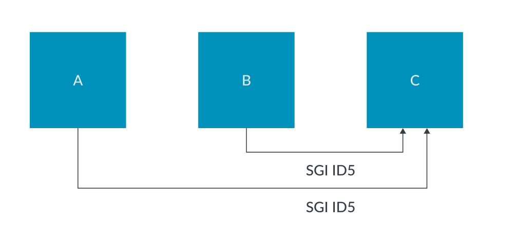

*图 7-2：多个发送者示例*

C 会收到多少个中断？

- **对于 GICv2：两个中断。** GIC 会收到来自 A 和 B 的两个中断。两个中断的顺序取决于具体设计和精确时序。这两个中断可以通过以下事实区分：源 PE 的 ID 被前缀到 `GICC_IAR` 返回的 INTID 之前。
- **对于 GICv3：一个中断。** 由于源 PE 不分组存放 SGI，同一个中断不可能在两个 PE 上挂起。因此 C 只收到一个中断，ID 为 5，没有前缀。

> 此示例假设两个中断同时或几乎同时发送。如果 C 能够在第二个 SGI 到达之前确认第一个 SGI，那么在 GICv3 中 C 会看到两个中断。

> 在传统操作期间，即 `GICD_CTLR.ARE=0` 时，SGI 的行为与 Arm CoreLink GICv2 相同。

## 8. 示例

有一个与本指南配套的简短示例，可以以 zip 文件形式下载。

该示例配置系统计数器以生成系统计数，然后使用两个定时器基于系统计数生成中断。每当某个定时器触发时，中断处理器就禁用对应的定时器以清除该中断。

该示例需要 Arm Development Studio。如果你还没有副本，可以下载评估版。

关于构建和运行该示例的完整说明，请参阅 zip 文件中的 ReadMe.txt 文件。

## 9. 知识自测

**问：Arm GICv3 中的四种中断类型是什么，它们如何标识？**

答：四种类型是局域性外设中断（LPI）、共享外设中断（SPI）、私有外设中断（PPI）和软件生成中断（SGI）。类型可以通过 INTID（中断源 ID 号）来识别。

**问：一个中断可以被分配到哪些不同的分组，每个分组通常用于什么？**

答：Group 0 通常用于面向 EL3 固件的中断。Secure Group 1 通常用于面向安全状态软件的中断。Non-secure Group 1 通常用于面向非安全内核或 hypervisor 的中断。

**问：中断处理器读取哪些寄存器来得知它接受了哪个中断？**

答：某个 `ICC_IARn_EL1` 寄存器之一。

**问：复位后，GIC 把所有已连接 PE 都当作离线或睡眠。软件如何把一个 PE 标记为在线？**

答：清除该 PE 的再分发器中的 `GICR_WAKER.ProcessorSleep`，然后轮询直到 `ChildrenAsleep` 读到 0。

**问：GIC 为每个中断源存储哪些配置？**

答：

- 使能
- 优先级
- 边沿触发 vs 电平敏感
- 分组
- 目标（仅 SPI）

**问：一个 PE 能给自己发送 SGI 吗？**

答：能。

**问：如果一个 PE 已经在处理一个中断，什么控制着另一个中断能否抢占它？**

答：第二个中断的优先级，以及二进制点寄存器 `ICC_BPRn_EL1` 的值。

## 10. 相关信息

以下是与本指南内容相关的一些资源：

- GIC 规范
- developer.arm.com 上的 GIC 主页
- GIC 流协议接口版本 B
- Arm 社区
- 《Learn the Architecture: Exception model》指南

## 11. 下一步

本指南介绍了 Arm CoreLink GICv3 和 v4 架构，以及如何在裸机环境中初始化 GIC。本指南简要介绍了局域性外设中断（LPI）这种中断类型。LPI 的处理与初始化方式在我们的指南《Arm CoreLink 通用中断控制器 v3 和 v4：局域性外设中断》中介绍。

Arm CoreLink GIC 架构支持虚拟化。要了解更多关于 GICv3 和 GICv4 中虚拟化特性的信息，请阅读我们的指南《Arm CoreLink 通用中断控制器 v3 和 v4：虚拟化》。

## 12. 附录：传统操作

与 GICv2 相比，GICv3 对编程模型做了若干更改。为了支持为 GICv2 系统编写的传统软件，GICv3 可选地支持传统操作。

> 对传统操作的支持是可选的，并且已废弃（DEPRECATED）。Arm 的若干最新 GIC 实现已不再支持它。

使用的编程模型由 `GICD_CTRL` 中的亲和性路由使能（Affinity Routing Enable，ARE）位控制：

- 当 `ARE==0` 时，亲和性路由禁用（传统操作）。
- 当 `ARE==1` 时，亲和性路由启用（GICv3 操作）。

在具有两种安全状态的系统中，亲和性路由可以为每种安全状态分别控制。只允许以下特定组合：

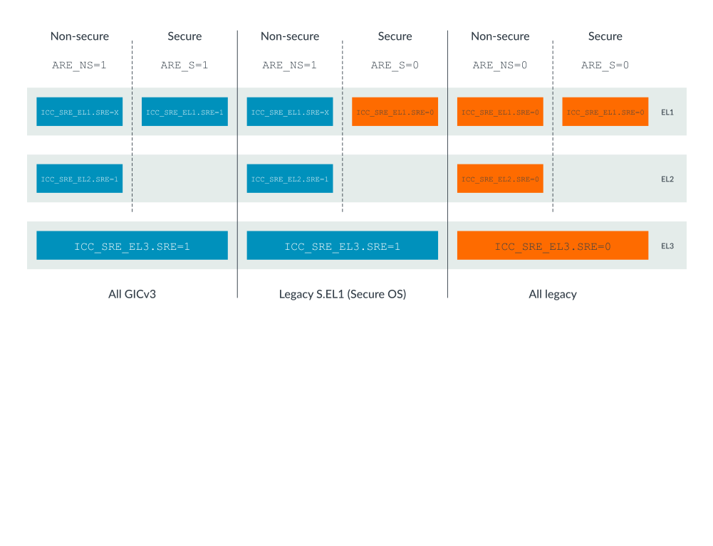

*图 12-1：支持的组合*