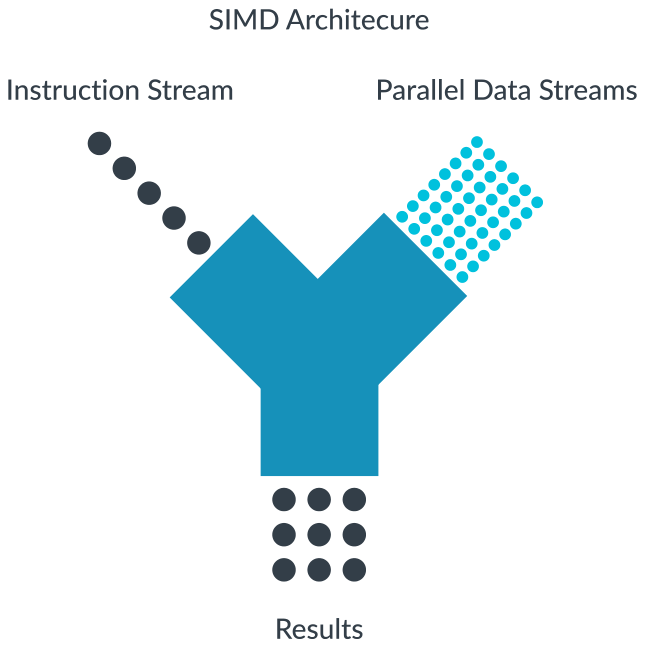
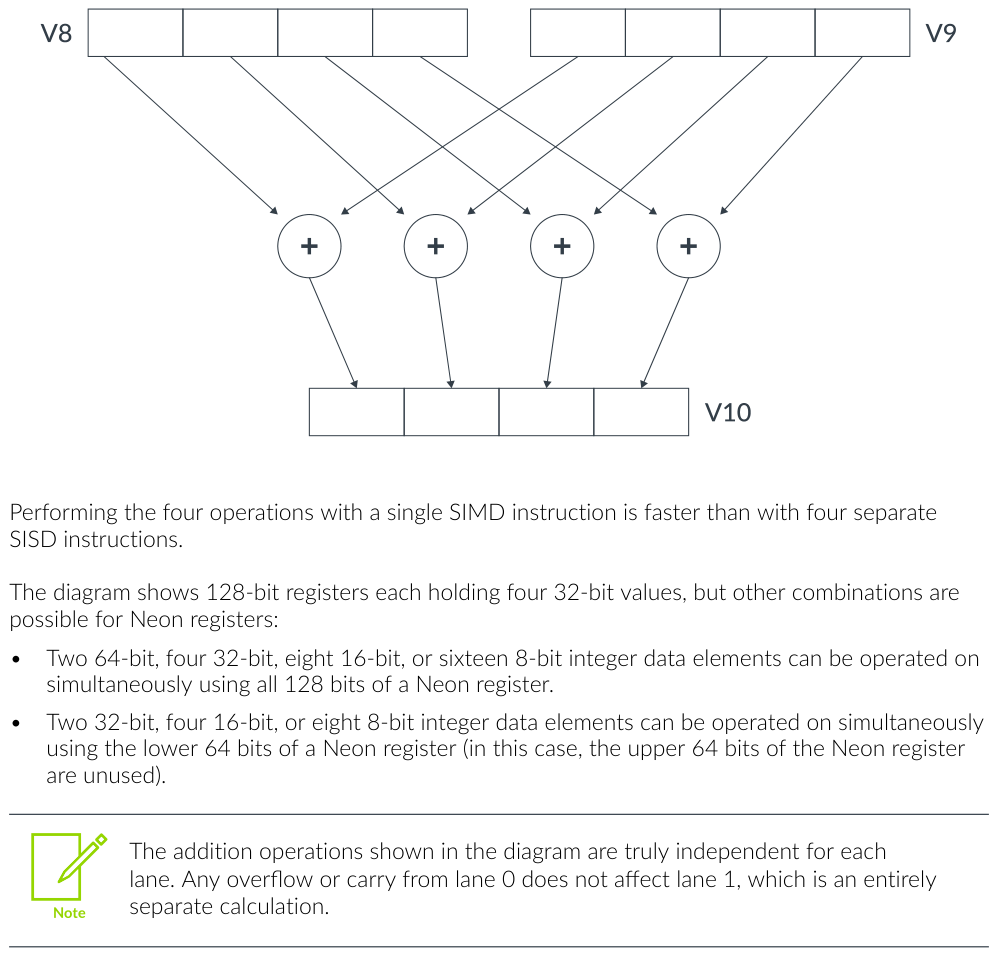
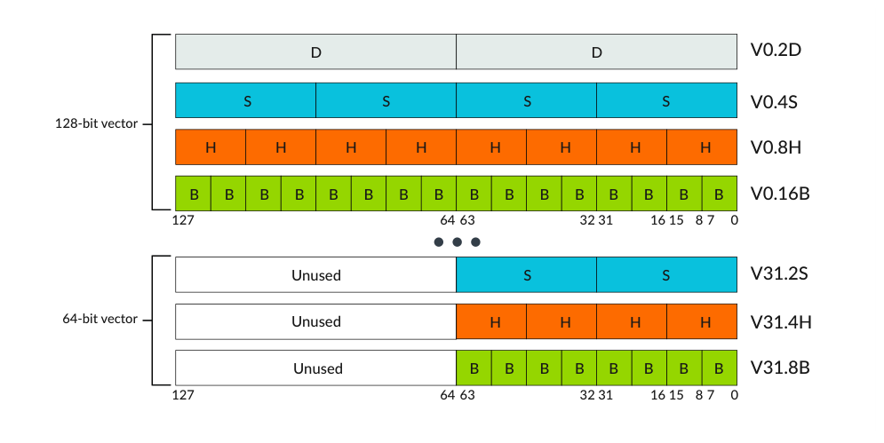
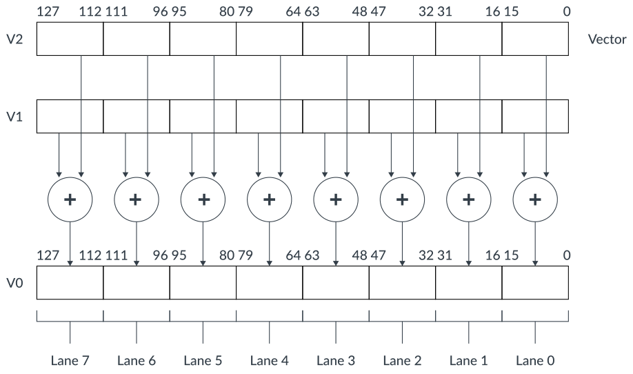
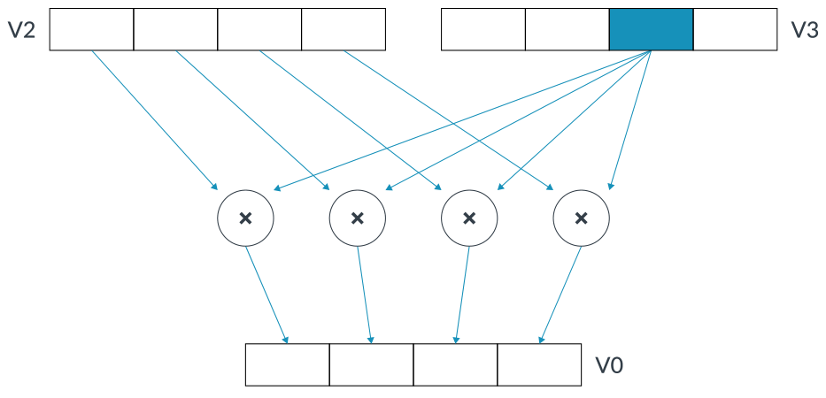

# Learn the architecture — Neon 入门（中文翻译）

> 原文：*Learn the architecture - Introducing Neon*
>
> 版本：Version 1.0　|　文档 ID：102474_0100_02_en　|　Issue 02（2020-01-01）
>
> 版权 © 2020 Arm Limited（或其关联公司）。保留所有权利。非保密。

---

## 1. 概述

本指南介绍 Arm Neon 技术，它是面向 Armv8-A 或 Armv8-R 架构档案实现的 Advanced SIMD（单指令多数据，Single Instruction Multiple Data）架构扩展。

Neon 技术提供了指令集架构的专用扩展，提供额外的指令，可以对多个数据流并行执行数学运算。



*图 1-1：单指令多数据架构*

这可以通过加速音频和视频编解码、用户界面、2D/3D 图形或游戏来改善多媒体用户体验。Neon 还可以加速信号处理算法和函数，从而加速音频和视频处理、语音和人脸识别、计算机视觉以及深度学习等应用。

作为程序员，你有多种方式可以利用 Neon 技术：

- 支持 Neon 的开源库（如 Arm Compute Library）是利用 Neon 最简单的方式之一。
- 编译器中的自动向量化（auto-vectorization）特性可以自动优化你的代码以利用 Neon。
- Neon 内建函数（intrinsic）是编译器会用相应 Neon 指令替换的函数调用。这让你可以直接、底层地访问你想要的精确 Neon 指令，而且全部通过 C/C++ 代码完成。
- 对于追求极高性能的场景，对于经验丰富的程序员，手写 Neon 汇编也可以是一种备选方法。

### 1.1 开始之前

如果你完全不了解 Arm 技术，可以先阅读《Cortex-A 系列程序员指南》，了解 Arm 架构的一般信息和编程指南。

本指南的信息与 Armv8 的 Neon 相关。如果你在为 Armv7 设备开发，你可能会发现《Neon 程序员指南》1.0 版更适合你的需求。

如果你在为特定设备手写汇编，请参考该处理器的《技术参考手册》，了解有助于最大化性能的微架构细节。对于某些处理器，Arm 还发布了《软件优化指南》，也可能有用。例如，参见《Arm Cortex-A75 技术参考手册》和《Arm Cortex-A75 软件优化指南》。

## 2. 数据处理方法

处理大型数据集时，一个主要的性能限制因素是执行数据处理指令所花费的 CPU 时间。这个 CPU 时间取决于处理整个数据集所需的指令数量。而指令数量取决于每条指令能处理多少个数据项。

### 2.1 单指令单数据

大多数 Arm 指令是单指令单数据（Single Instruction Single Data，SISD）。每条指令对单个数据源执行其指定的操作。因此，处理多个数据项需要多条指令。例如，执行四次加法运算需要四条指令来对四对寄存器的值做加法：

```asm
ADD w0, w0, w5
ADD w1, w1, w6
ADD w2, w2, w7
ADD w3, w3, w8
```

这种方法相对较慢，而且很难看出不同寄存器之间的关联。为了提高性能和效率，媒体处理通常被卸载到专用处理器（如 GPU 或媒体处理单元），它们能用单条指令处理多个数据值。

如果你处理的值小于最大位宽，那么使用 SISD 指令会浪费额外的潜在带宽。例如，当把 8 位值相加时，每个 8 位值需要加载到单独的 64 位寄存器中。对小数据量执行大量单独的操作，无法高效利用机器资源，因为处理器、寄存器和数据通路都是为 64 位计算设计的。

### 2.2 单指令多数据

单指令多数据（Single Instruction Multiple Data，SIMD）指令同时对多个数据项执行相同的操作。这些数据项作为单独的通道（lane）打包在更大的寄存器中。

例如，下面的指令把四对单精度（32 位）值相加。不过，在这种情况下，这些值被打包到两对 128 位寄存器的单独通道中。然后，第一个源寄存器的每个通道与第二个源寄存器中相应的通道相加，结果存储到目标寄存器的相同通道中：

```asm
ADD V10.4S, V8.4S, V9.4S
// 该操作把两个 128 位（四字）寄存器 V8 和 V9 相加，
// 并把结果存储到 V10。
// 每个寄存器中的四个 32 位通道分别相加。
// 通道之间没有进位。
```

这条单指令同时对大寄存器中的所有数据值进行操作：



*图 2-1：单指令多数据*

用一条 SIMD 指令执行四次操作，比用四条单独的 SISD 指令更快。

图中展示了各保存四个 32 位值的 128 位寄存器，但 Neon 寄存器还支持其他组合：

- 使用 Neon 寄存器的全部 128 位，可以同时操作两个 64 位、四个 32 位、八个 16 位或十六个 8 位整数数据元素。
- 使用 Neon 寄存器的低 64 位，可以同时操作两个 32 位、四个 16 位或八个 8 位整数数据元素（此时 Neon 寄存器的高 64 位未使用）。

> 图中展示的加法运算在各个通道之间是真正独立的。通道 0 的任何溢出或进位都不会影响通道 1——通道 1 是完全独立的计算。

移动设备中使用的媒体处理器，通常把每个完整数据寄存器拆分成多个子寄存器，并对这些子寄存器并行执行计算。如果数据集的处理简单且重复多次，SIMD 可以带来可观的性能提升。它对数字信号处理或多媒体算法特别有益，例如：

- 音频、视频和图像处理编解码器。
- 基于矩形像素块的 2D 图形。
- 3D 图形
- 色彩空间转换。
- 物理模拟。

## 3. Armv8 Neon 技术基础

Armv8-A 同时包含 32 位和 64 位执行状态，各自有各自的指令集：

- AArch64 是描述 Armv8-A 架构 64 位执行状态的名称。在 AArch64 状态下，处理器执行 A64 指令集，其中包含 Neon 指令（也称为 SIMD 指令）。GNU 和 Linux 文档有时把 AArch64 称为 ARM64。
- AArch32 描述 Armv8-A 架构的 32 位执行状态，它与 Armv7 几乎相同。在 AArch32 状态下，处理器可以执行 A32（在早期架构版本中称为 ARM）或 T32（Thumb）指令集。A32 和 T32 指令集与 Armv7 向后兼容，包括 Neon 指令。

本指南将重点介绍在 Armv8-A 架构的 AArch64 执行状态下使用 A64 指令进行 Neon 编程。

如果你想编写在 Armv8-A 架构的 AArch32 执行状态下运行的 Neon 代码，应参考《Neon 程序员指南》1.0 版。

### 3.1 寄存器、向量、通道和元素

如果你熟悉 Armv8-A 架构档案，你会注意到在 AArch64 状态下，Armv8 内核是 64 位架构，使用 64 位寄存器，但 Neon 单元使用 128 位寄存器进行 SIMD 处理。

这是可能的，因为 Neon 单元在独立的 128 位寄存器组上操作。Neon 单元完全集成到处理器中，与处理器共享整数运算、循环控制和缓存的资源。与硬件加速器相比，这显著降低了面积和功耗成本。它还使用了更简单的编程模型，因为 Neon 单元使用与应用程序相同的地址空间。

Neon 寄存器组是一组寄存器，可以作为 8 位、16 位、32 位、64 位或 128 位寄存器来访问。

Neon 寄存器包含相同数据类型的元素组成的向量。输入和输出寄存器中相同的元素位置称为通道（lane）。

通常，每条 Neon 指令产生 n 个并行执行的操作，其中 n 是输入向量被划分成的通道数。每个操作都包含在通道内。一个通道不能有到另一个通道的进位或溢出。

Neon 向量中通道的数量取决于向量的大小和向量中的数据元素。

128 位 Neon 向量可以包含以下元素大小：

- 十六个 8 位元素（操作数后缀 .16B，其中 B 表示字节，byte）
- 八个 16 位元素（操作数后缀 .8H，其中 H 表示半字，halfword）
- 四个 32 位元素（操作数后缀 .4S，其中 S 表示字，word）
- 两个 64 位元素（操作数后缀 .2D，其中 D 表示双字，doubleword）

64 位 Neon 向量可以包含以下元素大小（128 位寄存器的高 64 位清零）：

- 八个 8 位元素（操作数后缀 .8B）
- 四个 16 位元素（操作数后缀 .4H）
- 两个 32 位元素（操作数后缀 .2S）



*图 3-1：64 位和 128 位向量*

向量中的元素从最低有效位开始排序。也就是说，元素 0 使用寄存器的最低有效位。让我们看一个 Neon 指令的例子。指令 `ADD V0.8H, V1.8H, V2.8H` 对来自向量 V1 和 V2 的八个 16 位（8 × 16 = 128）整数元素通道执行并行加法，把结果存储到 V0：



*图 3-2：向量中元素的顺序*

一些 Neon 指令对标量和向量一起操作。使用标量的指令通过指定通道索引来引用寄存器中的特定元素。例如，指令 `MUL V0.4S, V2.4S, V3.S[2]` 把 V2 中四个 32 位元素中的每一个乘以 V3 通道 2 中的 32 位标量值，把结果向量存储到 V0。



*图 3-3：使用标量的指令*

## 4. 知识自测

以下问题将帮助你检验所学知识。

**Neon 和 Advanced SIMD 架构有什么区别？**

Neon 是一个品牌名，指 Arm 对 Advanced SIMD 架构的实现。虽然这两个术语经常互换使用，但严格来说 Neon 并不是 Arm 架构的特性。那些想从《架构参考手册》或《Cortex-A 技术参考手册》了解更多 Neon 的人，应该搜索 Advanced SIMD 而不是 Neon。

**SIMD 代表什么？SIMD 指令如何加速使用 SISD 指令的程序？**

SIMD 代表单指令多数据。由于 SIMD 指令比等价的 SISD（单指令单数据）指令能执行更多操作，使用 SIMD 指令的程序平均每条指令能处理更多数据。如果 SIMD 和 SISD 指令的执行时间相同，程序就会加速。

**使用 Neon 的四种基本方式是什么？**

导入使用 Neon 的库，例如 Arm Compute Library 或 Arm Performance Libraries。使用支持 Neon 代码生成的编译器，例如 Arm Compiler 或 GCC。在 C 或 C++ 代码中使用 Neon 内建函数。编写使用 Advanced SIMD 指令集的 Arm 汇编。

**AArch64 执行状态中有多少个 Neon 寄存器，它们如何划分成不同的通道？**

有 32 个 128 位寄存器，可以划分成 8、16、32 或 64 位宽的通道。这些寄存器也可以当作 64 位寄存器处理，高位数位不使用。

## 5. 相关信息

以下是与本指南内容相关的一些资源：

关于 SIMD 指令和寄存器的权威信息，请参考 Armv8-A 架构档案的《Arm 架构参考手册》。

ISA 探索工具以 XML 和 HTML 格式提供 A64 指令集架构的描述，包括 SIMD 指令。

《Neon 内建函数参考》提供关于 Neon 内建函数的信息——这些函数调用让 C 和 C++ 程序员无需编写汇编即可直接为 Neon 编程。

Arm Community 有一篇介绍 Neon 的有用文章：*Arm Neon Programming Quick Reference*。

### 5.1 有用的培训链接

查看这些培训需要 Arm access。

- Introduction to Armv8-A
- Overview ISA
- Arm's other architectures

## 6. 下一步

《用 Neon 内建函数优化 C 代码》教程是 Neon 编程新手入门的最佳起点。该教程通过一个处理 24 位 RGB 交错像素数据图像的示例，描述如何使用 Neon 内建函数。
