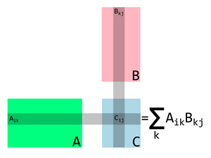

# Learn the architecture — Neon 迁移到 SVE（中文翻译）

> 原文：*Learn the architecture - Migrate Neon to SVE*（文档 ID：102131_0100_04_en，Issue 04，2022-04-20）
>
> 版权 © 2022 Arm Limited（或其关联公司）。保留所有权利。非保密。

---

## 1. 概述

本指南总结了为可扩展向量扩展（SVE）编码和为 Neon 编码之间的重要区别。对于已经把应用移植到 Armv8-A Neon 硬件的用户，本指南还重点说明把应用移植到 SVE 时需要考虑的关键差异。

Arm Neon 技术是 Armv8-A 架构档案的 Advanced 单指令多数据（SIMD）特性。Neon 是指令集架构（ISA）的一个特性，提供能在多个数据流上并行执行数学运算的指令。

SVE 是 Armv8-A 指令集的下一代 SIMD 扩展。它不是 Neon 的扩展，而是一套为高性能计算（HPC）工作负载开发的新向量指令。简言之，SVE 能对 Neon 无法向量化（或向量化无益）的循环进行向量化。重要的是，与其他 SIMD 架构不同，SVE 代码可以做到向量长度无关（VLA）：SVE 不固定向量寄存器的大小，而是让硬件实现者选择最适合其目标工作负载的向量大小。

在本指南末尾，你可以进行"知识自测"。你将学到 SVE 与 Neon 的基本区别，包括寄存器类型、谓词指令和向量长度无关编程。

本主题的第一部分总结了使用 Neon 扩展开发代码和使用 SVE 开发代码之间的重要区别。本教程的第二部分及后续部分描述在准备把 Neon 代码迁移到 SVE 时、以及在迁移 Neon 代码时需要考虑的内容，并附有一些示例。

## 2. 开始之前

如果你对 Arm® Neon® 技术陌生，请阅读《Neon Programmer's Guide for Armv8-A》作为该主题的一般性介绍。

如果你对可扩展向量扩展（SVE）陌生，请阅读我们的 Introduction to SVE 教程。该教程提供 SVE 的背景信息。

## 3. 第一部分 —— Neon 与 SVE 基础

Arm Neon 技术是 Armv8-A 架构档案的 Advanced SIMD（单指令多数据）特性。Neon 是 ISA 的一个特性，提供能在多个数据流上并行执行数学运算的指令。

SVE 是 Armv8-A 指令集的下一代 SIMD 扩展。它不是 Neon 的扩展，而是一套为 HPC 工作负载开发的新向量指令。简言之，SVE 能对 Neon 无法向量化（或向量化无益）的循环进行向量化。重要的是，与其他 SIMD 架构不同，SVE 代码可以做到向量长度无关（VLA）：SVE 不固定向量寄存器的大小，而是让硬件实现者选择最适合其目标工作负载的向量大小。

**指令集**

AArch64 是指 Armv8 架构 64 位执行状态的名称。在 AArch64 中，处理器执行 A64 指令集，其中包含 Neon 指令（也称为 Advanced SIMD 指令）。SVE 扩展在架构的 Armv8.2-A 版本中引入，为现有的 Armv8-A A64 指令集添加了一个新的指令子集。

下表对比 Neon 和 SVE 指令提供的特性：

| 扩展 | 关键特性 |
| --- | --- |
| Neon | 提供能在多个数据流上并行执行数学运算的指令；支持双精度浮点，从而支持使用 double 的 C 代码 |
| SVE | 支持可变长度向量和谓词寄存器（产生两大类指令：谓词化和非谓词化）；一组操作可变长度向量的指令；对配置和标识寄存器的一些小补充 |

**寄存器、向量、通道和元素**

Neon 指令在独立的 128 位寄存器组上操作，完全集成到 Armv8-A 处理器中。Neon 使用简单的编程模型。

Neon 寄存器组是一组标量寄存器。标量寄存器可以被视为 8 位、16 位、32 位、64 位或 128 位值（称为元素）的向量。向量还被划分为通道（lane），每个通道包含元素数据值。向量中的所有元素都有相同的数据类型。

Neon 向量中通道的数量取决于向量的大小和向量中的数据元素。128 位 Neon 向量可以包含以下元素布局：

- 十六个 8 位元素
- 八个 16 位元素
- 四个 32 位元素
- 两个 64 位元素

然而，Neon 指令总是操作 64 位或 128 位向量。

在 SVE 中，指令集操作一组新的向量和谓词寄存器：32 个 Z 寄存器、16 个 P 寄存器和一个首故障寄存器（FFR）：

- Z 寄存器是数据寄存器。Z 寄存器的位是实现定义的 128 的倍数，架构上限为 2048 位。这些寄存器中的数据可以解释为 8 位、16 位、32 位、64 位或 128 位元素。每个 Z 寄存器的低 128 位与对应的 Neon 寄存器重叠，因此也与标量浮点寄存器重叠。
- P 寄存器为 Z 寄存器中的每个字节保存一位。换句话说，P 寄存器始终是 Z 寄存器的 1/8。谓词化指令使用 P 寄存器来确定处理哪些向量元素。P 寄存器中的每个位指定 Z 寄存器中对应的字节是活动还是不活动。
- FFR 寄存器是一个专用谓词寄存器，捕获一串 SVE 向量加载指令的累积故障状态。SVE 为某些 SVE 向量加载指令提供首故障选项。这个选项会抑制那些不是由向量第一个活动元素引起的内存访问故障。相反，FFR 被更新以指示哪些活动向量元素没有被成功加载。

P 寄存器和 FFR 寄存器都是 SVE 独有的。

**VLA 编程**

SVE 引入了 VLA 编程的概念。

与传统 SIMD 架构定义固定的向量寄存器大小不同，SVE 支持可变大小。这种选择自由使不同的 Arm 架构授权方能够开发自己的实现，针对特定工作负载和技术，在性能和成本之间权衡。简言之，硬件实现者可以为自己的硬件选择向量大小。

SVE 的一个目标是允许同一应用镜像运行在任何支持 SVE 的架构实现上。为此，SVE 包含允许向量代码在运行时自动适应当前向量长度的指令。

在不知道向量长度的情况下编译应用意味着：

- 向量不能从内存中的编译期常量初始化
- 谓词不能初始化
- 向量循环增量和行程计数未知
- 向量寄存器的溢出和填充必须适应向量长度

在运行时，SVE 指令允许分配长度。用这种方式编码称为 VLA 编程。VLA 编程允许你为通用 SVE 架构编译代码，并在任何 SVE 硬件上运行。

## 4. 第二部分 —— 准备把优化的 Neon 代码迁移到 SVE

作为程序员，你有多种方式可以使用 Neon 和 SVE 技术。用任何高级语言编程，都是在编写代码的便利性与对编译器输出的底层指令的控制力之间做权衡。

到现在为止，你可能已经用自动向量化、内建函数、数学库或手写 Neon 汇编来为 Neon 优化代码。这些方法中的每一种，在你编写 SVE 代码时也都可以用：

- **编译器自动向量化**：编译器中的自动向量化特性允许编译器自动优化 SVE 代码。
- **内建函数**：内建函数是编译器会用相应指令替换的函数调用。SVE 内建函数可用，让你直接访问你想要的精确指令。
- **库**：数学库是特定架构或目标的一组优化数学例程。数学库有 SVE 变体，包含优化的 SVE 例程。例如 Arm Performance Libraries。
- **汇编**：为了精细调优代码、对性能有尽可能高的控制，有经验的程序员可以用 SVE 汇编编码。

**编译器自动向量化**

Arm Compiler for Linux 和 GCC 编译器可以自动生成包含 Armv8 Neon 或 SVE 指令的代码。你在编译命令中传入的选项决定编译后的代码中使用 Neon 还是 SVE 指令。

自动向量化包括：

- 循环向量化：展开循环以减少迭代次数，同时每次迭代执行更多操作。
- 超字级并行（SLP）向量化：把标量操作捆绑在一起，以使用完整宽度的 Advanced SIMD 指令。

依赖编译器自动向量化的好处是：高级语言程序可移植（只要没有内联汇编或内建函数等架构特定元素）；现代编译器能自动执行高级优化；针对给定微架构可以像设置单个编译器选项一样简单。

要启用自动向量化：

- 用编译器选项（-O<level>、-fvectorize）启用自动向量化
- 组织代码给编译器提示，包括使用 pragma
- 包含相关的 Neon 或 SVE 头文件，并告诉编译器你将在哪个处理器上运行代码（-mcpu=<target> 选项）

**自动向量化编译器选项**

下表展示 Neon 和 SVE 代码都支持的 -O<level> 优化级别：

| 选项 | 描述 | 自动向量化 |
| --- | --- | --- |
| -O0 | 最小优化，关闭大多数优化。默认级别。 | 从不 |
| -O1 | 受限优化。 | 默认禁用 |
| -O2 | 高优化。 | 默认启用 |
| -O3 | 极高优化。 | 默认启用 |
| -Ofast | 级别 3 的全部优化 + -ffp-mode=fast，可能违反严格语言标准。 | 默认启用 |

自动向量化在使用 -O2、-O3 或 -Ofast 时启用。-fno-vectorize 可以禁用。在 -O0 自动向量化始终禁用（-fvectorize 被忽略）；在 -O1 默认禁用（-fvectorize 可启用）。

此外还有一些数学和例程相关的优化选项，例如 Arm Compiler for Linux 中的 -fassociative-math、-fno-signed-zeroes、-fno-trapping-math、-ffast-math。

**使用 restrict 关键字**

如果合适，在编写 C 代码时使用 restrict 关键字。C99 的 restrict 关键字（或非标准的 __restrict__）告诉编译器，指定指针在其生命周期内不与任何其他指针别名。因此，restrict 允许编译器更激进地向量化循环，因为编译器知道循环迭代是独立的、可以并行执行。

**给编译器提示**

与 Neon 代码一样，你可以组织代码给编译器提示。结构良好、带提示的应用代码，让编译器能检测到它本来检测不到的行为。编译器检测到的行为越多，输出代码的向量化就越好。

随着算法变得更复杂，编译器能自动向量化的可能性降低。特别难或不可能向量化的循环：迭代间有依赖的循环、带 break 子句的循环、带复杂条件的循环。

Neon 和 SVE 有不同的自动向量化条件。例如，自动向量化 Neon 代码的一个必要条件是，循环大小的迭代次数必须在循环开始时、在编译时已知。然而，自动向量化 SVE 代码不要求知道循环迭代次数。

break 条件意味着循环迭代次数可能在循环开始时无法得知，这会阻止 Neon 代码的自动向量化。如果无法完全避免 break 条件，把循环拆分成多个可向量化和不可向量化的部分。

两个最重要的指令：

- `#pragma clang loop vectorize(enable)`
- `#pragma clang loop interleave(enable)`

**头文件和处理器优化**

下表是编译 Neon 和 SVE 代码应使用的不同头文件的快速参考：

| 扩展 | 头文件形式 | 推荐的编译选项 | 备注 |
| --- | --- | --- | --- |
| Neon | `#include <arm_neon.h>` | `armclang -O<2\|3\|fast> -mcpu={native\|<target>} -o <binary> <file>.c` | -mcpu 启用微架构优化 |
| SVE | `#ifdef __ARM_FEATURE_SVE #include <arm_sve.h> #endif` | 在 SVE 硬件上运行：`armclang -O<2\|3\|fast> -mcpu={native\|<target>} -o <binary> <file>.c`；在非 SVE 硬件上仿真：`armclang -O<2\|3\|fast> -march=armv8-a+sve -o <binary> <file>.c` | -mcpu 启用微架构优化；-march=armv8-a+sve 让编译器为 SVE 优化但不含微架构优化，可用 ArmIE 仿真 |

当 SVE 硬件可用且你在该目标 SVE 硬件上编译时，Arm 推荐使用 -mcpu=native 以利用微架构优化。

**内建函数**

内建函数是编译器知道其精确实现的函数。内建函数让你无需编写汇编代码就能使用 Neon 或 SVE。好处：

- 强大：开发期间直接访问 Neon 和 SVE 指令集，无需手写汇编。
- 可移植：包含 Neon 内建函数的 C/C++ 代码，可以以极少改动为新 AArch64 目标或新执行状态编译。但包含 SVE 内建函数的代码只能在 SVE 硬件上运行（除非在另一个 Armv8-A 目标上仿真）。
- 灵活：需要时用 Neon，不需要时用 C/C++。

但内建函数并非总合适：比导入库或依赖编译器需要更多学习；手写优化汇编虽难写但性能提升空间最大。

**编程约定：宏、类型和函数**

ACLE 让 C/C++ 程序员能在对源代码可移植性限制最小的情况下利用 Arm 架构。

**宏**：特性测试宏确定目标架构特性的可用性。

Neon 支持的宏（部分）：

| 宏 | 描述 |
| --- | --- |
| __aarch64__ | 编译时选择架构相关源码 |
| __ARM_ACLE | ACLE 版本 |
| _ARM_NEON | 编译器支持 Advanced SIMD 时为 1 |
| _ARM_NEON_FP | 支持 Neon 浮点运算时为 1 |
| _ARM_FEATURE_CRYPTO | 支持 Crypto 指令时为 1 |
| _ARM_FEATURE_FMA | 支持融合浮点乘累加时为 1 |
| __ARM_FEATURE_COMPLEX | 支持复数加法和复数乘累加向量指令时为 1 |
| __ARM_FEATURE_DOTPROD | 支持点积数据操作指令时为 1 |
| __FP_FAST_FMA | fma() 比 (x*y)+z 更快时为 1 |

SVE 支持的宏（部分）：

| 宏 | 描述 |
| --- | --- |
| __ARM_FEATURE_SVE | 支持 SVE 时为 1 |
| __ARM_FEATURE_SVE_BF16 | 支持 BFloat16 扩展时为 1 |
| __ARM_FEATURE_SVE_BITS | 为已知向量长度的 SVE 目标生成代码时为非零值 N |
| __ARM_FEATURE_SVE_MATMUL_FP32 | 支持 FP32 矩阵乘法扩展时为 1 |
| __ARM_FEATURE_SVE_MATMUL_FP64 | 支持 FP64 矩阵乘法扩展时为 1 |
| __ARM_FEATURE_SVE_MATMUL_INT8 | 支持 INT8 矩阵乘法扩展时为 1 |
| __ARM_FEATURE_SVE_NONMEMBER_OPERATORS | C++ 可为 SVE 类型定义非成员运算符时为 1 |
| __ARM_FEATURE_SVE_PREDICATE_OPERATORS | svbool_t 支持向量操作时为 1 |
| __ARM_FEATURE_SVE_VECTOR_OPERATORS | SVE 向量类型支持 GNU 向量扩展时为 1 |

**数据类型**：

- Neon（arm_neon.h）：`baseW_t`（标量）、`baseWxL_t`（向量，如 int32x2_t）、`baseWxLxN_t`（向量数组，如 int16x4x2_t）。W 和 L 使向量为 64 或 128 位长。
- SVE（arm_sve.h）：无大小（sizeless）类型——`svbaseW_t`（如 svint64_t）、`svbaseWxN_t`（如 svint64x2_t）、`svbool_t`（谓词）。无大小是因为编译时不知道向量长度。

**函数**：

- Neon：`ret_type v[p][q][r]name[u][n][q][x][_high][_lane | laneq][_n][_result]_type(args)`，如 `int8x16_t vmulq_s8(...)` → `MUL Vd.16B, Vn.16B, Vm.16B`。
- SVE：`svbase[_disambiguator][_type0][_type1]…[_predication]`，如 `svclz[_u16]_m`。`_predication` 是 z（清零）/m（合并）/x（不关心）。

**库**

Arm Performance Libraries 为 Neon 和 SVE 处理器都提供优化的数学库。链接时用 SVE 变体而非 Neon 变体，用 Arm Compiler for Linux 的 -armpl 和 -mcpu=<target> 选项（GCC 用 -larmpl[_lp64|_ilp64]{_mp}）。Arm Performance Libraries v21.0.0+ 用编译器传入的信息确定用 Neon 还是 SVE 变体，因此链接时也要 -mcpu=<target>。

**汇编**

如果你熟悉 Neon 汇编，可以用 SVE 的 ACLE 规范了解 SVE 提供的指令，用带 SVE 支持的过程调用标准（PCS）了解 SVE 寄存器分配。理解这些文档后，你可以分析你的 Neon 汇编并尽可能改用 SVE 指令。

SVE 汇编性能技巧：

- 尽早加载寄存器，避免流水线停顿
- 尽可能长时间地保留寄存器中的值
- 避免把目标寄存器用作下一条指令的源寄存器
- 避免把寄存器溢出到栈
- 确保编写 VLA 兼容的汇编（避免硬编码循环增量）
- 目标有多个 SVE 流水线时，展开循环
- 用预取指令预加载数据到缓存（注意缓存大小和驱逐）

汇编的替代方案是内联汇编。内联汇编把汇编指令写入高级 C/C++ 代码，手动向量化函数的某些部分。写内联汇编假设你熟悉 SVE 架构细节（向量长度无关寄存器、谓词、WHILE 操作）。内联汇编的优势：把 PCS 处理（栈帧分配、被调用方保存寄存器）交给编译器；给编译器更多信息；编译器可以内联该函数；可以接受依赖 C 层结构的立即数操作数。

Arm 推荐只有经验丰富的汇编程序员才用这种方法优化代码，因为针对特定处理器流水线调优指令序列并非易事，编译器通常能更高效地完成。

## 5. 第三部分 —— 什么时候保留优化的 Neon 代码有用

教程至今聚焦于迁移到 SVE 的众多好处。为完整起见，本节讨论几个保留一些 Neon 优化代码仍有优势的边角情况（而非为 SVE 重写成 VLA）：1）稀疏谓词开销，2）一般 VLA 开销。

1. **稀疏谓词开销**：有时，用完整的标量 Neon 寄存器的成本，可能低于用谓词化的全长 SVE 寄存器计算部分向量。例如，当 `inner <= 0.5*VL` 时：

```c
void foo (float * __restrict__ x, float* __restrict__ y, int outer, int inner)
{
  for (int j = 0; j < outer; j++)
    for (int i = 0 ; i < inner; i++)
      x[i + (j * inner)] = y[i + (j*inner)] * y[i + (j * inner)];
}
```

在 SVE 中使用谓词相比标量或 Neon 指令有少量开销。如果谓词大多为假，每次向量操作完成的工作量相对较小，不太可能提升性能。

2. **一般 VLA 开销**：有时 VLA 代码的开销可能不优于高度优化的 Neon 代码。例如，循环行程计数可以用 Neon 显式计算，但用 VLA 写时不能。因此编译器可能完全展开 Neon 循环，产生比写成 SVE 循环更省寄存器的代码。例如：

```c
void foo (float * __restrict__ x, float* __restrict__ y)
{
  for (unsigned i = 0; i < 8; i++)
      x[i] = y[i] * y[i];
}
```

这里所需的谓词在 SVE 中需要更多工作，相比只用 Neon。

## 6. 第四部分 —— 把 Neon 代码迁移到 SVE

迁移代码的步骤略有不同，取决于代码是高级语言（C/C++ 或 Fortran）还是汇编：

- **高级语言迁移到 SVE VLA 代码**，应该：
  1. 更新编译器选项（包括自动向量化选项）。
  2. 参考 SVE 规范，尽可能把代码改写为用 SVE 内建函数代替 Neon 内建函数。
  3. 用数学库的 SVE 变体链接。
- **编写 VLA 汇编**，应该：
  1. 更新编译器选项。
  2. 参考 SVE 规范，把代码改写为用 SVE 指令代替 Neon 指令。
  3. 用数学库的 SVE 变体链接。

下面的示例演示如何把优化的 Neon 代码（C）用 ACLE SVE 内建函数改写为优化的 SVE 代码。

**示例一 —— 用内建函数改写简单的矩阵乘法**

矩阵乘法是许多数据密集型应用中执行的操作：



*图 6-1：矩阵乘法图*

矩阵乘法的过程：取矩阵 A 的一行；用矩阵 B 的一列对该行做点积；把结果存储到新矩阵 C 的相应行和列。

对于 32 位浮点矩阵，乘法可写成：

```c
void matrix_multiply_c(float32_t *A, float32_t *B, float32_t *C, uint32_t n, uint32_t m, uint32_t k) {
    for (int i_idx=0; i_idx < n; i_idx++) {
        for (int j_idx=0; j_idx < m; j_idx++) {
            C[n*j_idx + i_idx] = 0;
            for (int k_idx=0; k_idx < k; k_idx++) {
                C[n*j_idx + i_idx] += A[n*k_idx + i_idx]*B[k*j_idx + k_idx];
            }
        }
    }
}
```

假设矩阵在内存中按列主序布局（Mij = M_array[n*j + i]）。这段代码次优，因为没充分利用 Neon。

下面的代码用 Neon 内建函数乘两个 4×4 矩阵（循环可完全展开）：

```c
void matrix_multiply_4x4_neon(const float32_t *A, const float32_t *B, float32_t *C) {
    float32x4_t A0, A1, A2, A3;
    float32x4_t B0, B1, B2, B3;
    float32x4_t C0, C1, C2, C3;
    A0 = vld1q_f32(A);  A1 = vld1q_f32(A+4);  A2 = vld1q_f32(A+8);  A3 = vld1q_f32(A+12);
    C0 = vmovq_n_f32(0);  C1 = vmovq_n_f32(0);  C2 = vmovq_n_f32(0);  C3 = vmovq_n_f32(0);
    B0 = vld1q_f32(B);
    C0 = vfmaq_laneq_f32(C0, A0, B0, 0);  C0 = vfmaq_laneq_f32(C0, A1, B0, 1);
    C0 = vfmaq_laneq_f32(C0, A2, B0, 2);  C0 = vfmaq_laneq_f32(C0, A3, B0, 3);
    vst1q_f32(C, C0);
    /* B1/B2/B3 类似 */
}
```

改写为 SVE 内建函数：

```c
void matrix_multiply_nx4_sve(const float32_t *A, const float32_t *B, float32_t *C, uint32_t n) {
    svfloat32_t A0, A1, A2, A3;
    svfloat32_t B0, B1, B2, B3;
    svfloat32_t C0, C1, C2, C3;
    svbool_t pred = svwhilelt_b32_u32(0, n);
    A0 = svld1_f32(pred, A);  A1 = svld1_f32(pred, A+n);
    A2 = svld1_f32(pred, A+2*n);  A3 = svld1_f32(pred, A+3*n);
    C0 = svdup_n_f32(0);  C1 = svdup_n_f32(0);  C2 = svdup_n_f32(0);  C3 = svdup_n_f32(0);
    B0 = svld1rq_f32(svptrue_b32(), B);
    C0 = svmla_lane_f32(C0, A0, B0, 0);  C0 = svmla_lane_f32(C0, A1, B0, 1);
    C0 = svmla_lane_f32(C0, A2, B0, 2);  C0 = svmla_lane_f32(C0, A3, B0, 3);
    svst1_f32(pred, C, C0);
    /* B1/B2/B3 类似 */
}
```

重要的区别是，由于 SVE 的可变长度向量，可以忽略矩阵的一个维度。你可以显式传递 n 维度的长度，并用谓词确保不超过它。

**示例二 —— 用内建函数改写更大的矩阵乘法**

要乘更大的矩阵，把它们当作 4×4 矩阵的块处理（只适用于两维都是 4 的倍数的矩阵大小，否则补零）。Neon 版和 SVE 版的通用矩阵乘法代码（matrix_multiply_neon / matrix_multiply_sve）与《SVE 与 Neon 编码对比》一文中的完全相同，此处不再重复，其核心结构为 4×4 分块 + 融合乘加，SVE 版用 `i_idx += svcntw()` 和 `svwhilelt` 谓词使 n 维度不必是 4 的倍数。

SVE 例子与 C/Neon 对比：用 WHILELT 为外层循环每次迭代确定谓词（保证循环条件至少有一个元素要处理）；用 CNTW 递增 i_idx，避免硬编码外层循环一次迭代处理的元素数量。

## 7. 知识自测

- **哪些头文件定义 Neon 和 SVE 内建函数？** arm_neon.h（Neon）和 arm_sve.h（SVE）。
- **Neon 和 SVE 向量数据寄存器多大？** Neon 寄存器是 128 位。SVE 不定义固定大小，其向量寄存器是实现定义的 128 的倍数，架构上限 2048 位。
- **描述"让编译器自动识别代码中使用 Neon 或 SVE 指令机会"的术语？** 自动向量化。

## 8. 相关信息

Neon 资源：Arm Neon technology、ACLE、Neon Programmer's Guide、架构探索工具、Armv8-A 的 ARM、Neon Intrinsics Reference。

SVE 资源：SVE 的 ARM 补充、Arm 指令仿真器、SVE 的 ACLE、SVE Vector Length Agnostic programming、Arm HPC tools for SVE、What is the Scalable Vector Extension?

其他资源：Arm C/C++ Compiler Reference、Arm Fortran Compiler Reference、Arm Performance Libraries、编译器标志博客、LLVM-Clang 文档。
