# Learn the Architecture — SMMU 软件指南（中文翻译）

> 原文：*Learn the Architecture - SMMU Software Guide*
>
> 版本：Version 1.0　|　文档 ID：109242_0100_01_en　|　Issue 01（2023-09-04）
>
> 版权 © 2023 Arm Limited（或其关联公司）。保留所有权利。非保密。

---

## 1. 概述

本指南介绍 Arm 系统内存管理单元（System Memory Management Unit）版本 3（SMMUv3）的基本操作与使用场景。内容包括：

- SMMU 的架构概念、术语和操作
- 与 SMMU 功能相关的系统级考量
- 典型 SMMU 使用场景的知识

### 1.1 开始之前

本指南是《Arm 系统内存管理单元架构规范版本 3》的补充，而不是替代品。关于寄存器、数据结构和行为的详细描述，请参阅《Arm 系统内存管理单元架构规范版本 3》。

本指南假设你熟悉 AArch64 虚拟内存系统架构（Virtual Memory System Architecture，VMSA）。如果想了解 AArch64 VMSA，请参阅《Learn the architecture - AArch64 memory management guide》和《Learn the architecture - AArch64 memory attributes and properties guide》。

## 2. SMMU 做什么

SMMU 执行的任务类似于 PE 中的 MMU。它在来自系统 I/O 设备的 DMA 请求进入系统互连之前，为这些请求转换地址。SMMU 只为来自客户端设备的传输提供转换服务，而不为发往客户端设备的传输提供。从系统或 PE 发往客户端设备的传输由其他方式管理，例如 PE 的 MMU。图 2-1 展示了 SMMU 在系统中的作用。

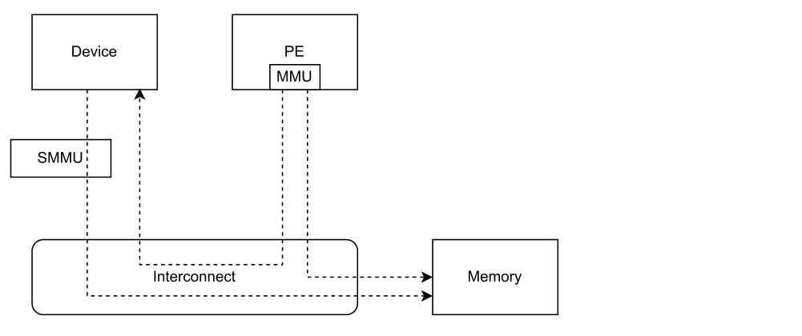

*图 2-1：SMMU 的作用*

Arm SMMU 提供：

- **转换（Translation）**：把客户端设备提供的地址从虚拟地址空间转换到系统的物理地址空间。
- **保护（Protection）**：来自客户端设备的操作可能被转换表中持有的权限阻止。你可以禁止某个设备对特定内存区域进行读、写、执行或任何访问。
- **隔离（Isolation）**：来自一个设备的传输可以和来自另一个设备的传输区分开，即使两个设备共享到 SMMU 的同一条连接。这意味着转换和保护属性可以针对每个设备应用不同的设置。每个设备可以拥有自己的私有转换表，也可以视应用情况与其他设备共享转换表。

为了把设备传输与转换关联起来、并区分连接到 SMMU 的不同设备，来自客户端设备的 DMA 请求带有一个额外的属性。**StreamID** 唯一标识一个传输流。SMMU 可以对每个流执行不同的转换或检查。参见"什么是 StreamID？"。

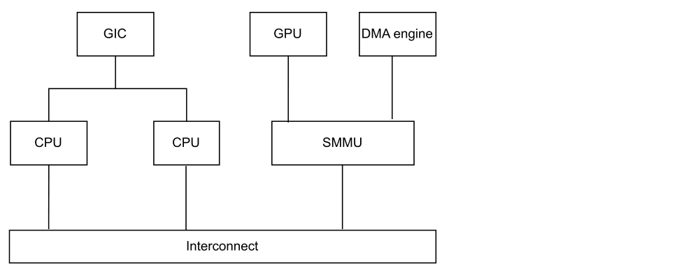

*图 2-2：包含 SMMU 的系统拓扑简化示例*

SMMU 为 I/O 设备提供了一种灵活、可扩展的内存管理方式，支持从只有一个设备到拥有许多设备的大型系统。图 2-2 展示了一个 SMMU 连接了两个设备（一个 GPU 和一个 DMA 引擎）的场景。你可以把每个设备配置为拥有自己的一套转换表。

SMMU 可以可选地支持两阶段转换，方式与支持虚拟化扩展的 PE 类似。你可以独立启用每一阶段的转换。一个进来的地址逻辑上先经第 1 阶段从虚拟地址（VA）转换为中间物理地址（IPA），然后 IPA 作为第 2 阶段的输入，把 IPA 转换为输出物理地址（PA）。第 1 阶段供软件实体使用，例如 OS 或用户空间应用程序。它在实体的物理地址空间内为缓冲区提供隔离或转换，例如 OS 物理地址空间内的 DMA 隔离。第 2 阶段面向支持虚拟化扩展的系统，旨在把设备 DMA 虚拟化到客户机 VM 的地址空间。

## 3. SMMU 的操作

本章介绍 SMMU 的操作，包含以下小节：

- 转换过程概述
- 流安全
- 流标识
- 故障模型
- 旁路
- 地址转换服务
- 页请求接口

### 3.1 转换过程概述

图 3-1 展示了每个进来的传输所经历的简化过程。本节介绍顶层转换过程。

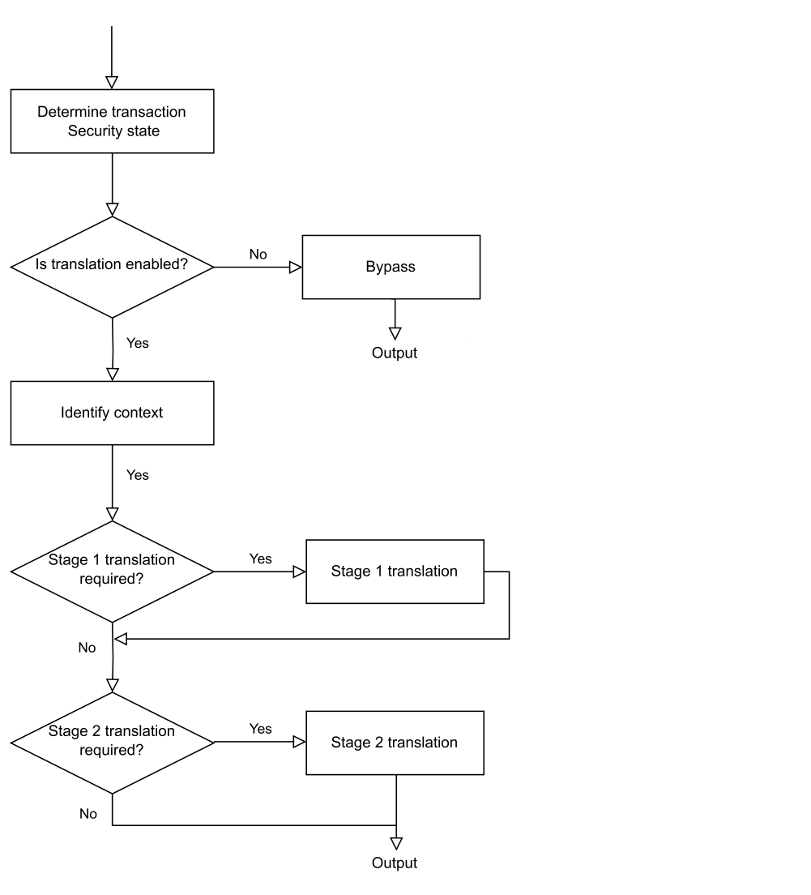

*图 3-1：简化的 SMMU 转换过程*

进来的传输遵循以下步骤：

1. 如果 SMMU 被全局禁用，传输在没有任何地址修改的情况下穿过 SMMU。全局属性（如内存类型或可共享性）可能从 SMMU 的 `SMMU_GBPA` 寄存器应用，或者 `SMMU_GBPA` 寄存器可能被配置为中止所有传输。
2. 如果全局旁路不适用，则确定配置：
   a. 定位一个流表项（Stream Table Entry，STE）。
   b. 如果 STE 启用了第 2 阶段转换，则 STE 包含第 2 阶段转换表基地址。
   c. 如果 STE 启用了第 1 阶段转换，则定位一个上下文描述符（Context Descriptor，CD）。如果 STE 也启用了第 2 阶段转换，则从使用第 2 阶段转换的 IPA 空间获取 CD。否则，从 PA 空间获取 CD。
3. 如果配置有效，则执行转换。
   a. 如果第 1 阶段配置为执行转换，则 CD 包含一个指向第 1 阶段转换表基地址的指针，对该表进行遍历。如果为 STE 启用了第 2 阶段，这可能需要第 2 阶段转换。如果第 1 阶段配置为旁路，则输入地址直接提供给第 2 阶段。
   b. 如果第 2 阶段配置为执行转换，则 STE 包含一个用于执行第 2 阶段转换的第 2 阶段转换表基地址。如果第 1 阶段启用，第 2 阶段转换第 1 阶段的输出；如果第 1 阶段旁路，则转换输入地址。如果第 2 阶段配置为旁路，则第 2 阶段的输入地址作为输出地址提供。
4. 当传输通过所有转换阶段后，转换后的地址连同相关内存属性被转发到系统中。

实现 Realm 管理扩展（Realm Management Extension，RME）的 SMMU 在访问所有物理地址时（如果 GPC 已启用），受粒度保护检查（Granule Protection Checks，GPC）约束。不过，获取粒度保护表（Granule Protection Table，GPT）信息不受 GPC 约束。所有客户端设备对物理地址的访问都必须对照 GPT 检查。SMMU 的这种行为对应 A-profile 架构的 FEAT_RME。关于 RME 的更多细节，参见《Learn the architecture - Realm Management Extension》。

> 此序列展示的是非安全（Non-secure）流上的传输路径。如果支持安全状态或 Realm 状态，安全流或 Realm 流上的传输路径类似，只是 `SMMU_S_CR0.SMMUEN` 和 `SMMU_S_GBPA` 控制旁路，或 `SMMU_R_CR0.SMMUEN` 和 `SMMU_R_GBPA` 控制旁路。

### 3.2 流安全

如果没有实现 RME 设备分配（RME Device Assignment），SMMUv3 架构可选支持两种安全状态，这由 `SMMU_S_IDR1.SECURE_IMPL` 报告。如果实现了 RME 设备分配，由 `SMMU_ROOT_IDR0.REALM_IMPL` 报告，则额外支持 Realm 状态。对于每种安全状态，都有单独的寄存器和流表。一个流可以是安全、非安全或 Realm，由输入信号 SEC_SID 决定。表 3-1 展示了输入信号 SEC_SID 如何决定流的安全状态。

| SEC_SID 值 | 描述 |
| --- | --- |
| 0b00 | 该流是非安全流，使用非安全寄存器和非安全流表 |
| 0b01 | 该流是安全流，使用安全寄存器和安全流表 |
| 0b10 | 该流是 Realm 流，使用 Realm 寄存器和 Realm 流表 |

SEC_SID 的信号方式是实现定义的（IMPLEMENTATION DEFINED）。可以是（但不限于）边带信号，或针对特定设备固定接死。

非安全流只能生成非安全的下游传输。进来的 NS 属性和页表中的 NS 属性被忽略。安全流既能生成安全的也能生成非安全的下游传输。Realm 流既能生成 Realm 也能生成非安全的下游传输。

安全流和安全传输之间存在区别：

- **安全传输**指对安全物理地址空间的访问。
- **安全流**是处于安全状态的设备的编程接口。

### 3.3 流标识

一个系统可能有多个设备共享一个 SMMU。通常对不同的设备应用不同的转换。例如，在图 2-2 所示的系统中，虚拟机 A 可以使用 DMA 引擎，虚拟机 B 可以使用 GPU。SMMU 需要识别连接到它的不同设备，并把设备流量与转换关联起来。

#### 3.3.1 什么是 StreamID？

StreamID 是 SMMU 区分不同客户端设备的方式。最简单的情况是，一个设备可以有一个 StreamID。不过，一个设备可能能够生成多个 StreamID，并根据 StreamID 应用不同的转换。例如，对于支持多个通道的 DMA 引擎，可以对不同的通道应用不同的 StreamID。

StreamID 如何形成是实现定义的。通常是边带信号的组合。

每种安全状态有独立的 StreamID 命名空间，即：

- Secure StreamID 0 是与 Non-secure StreamID 0 不同的 StreamID。
- Realm StreamID 0 是与 Secure StreamID 0 不同的 StreamID。

然而，Realm 和 Non-secure StreamID 命名空间是共享的。既能工作在非安全状态又能工作在 Realm 状态的设备，必须在两种状态下使用相同的 StreamID。

StreamID 在流表中选择一个 STE，STE 包含每设备的配置设置。参见"流表"。

RME 扩展了 SMMU 架构以支持不带 StreamID 的传输。这些传输受 GPC 约束，但不做第 1 阶段或第 2 阶段转换。Arm 期望这种支持用于 GIC、调试访问端口（Debug Access Port）之类的设备。也就是说，这种支持用于传统上不会连接到 SMMU、但其访问需要粒度保护检查的设备。

#### 3.3.2 SubstreamID 的作用

SubstreamID 可以可选地提供给实现了第 1 阶段转换的 SMMU。子流使来自同一设备的传输能够共享相同的第 2 阶段转换，但拥有不同的第 1 阶段转换。

考虑一个运行多个应用程序的 VM。你可能希望一个 DMA 通道被一个应用程序使用，另一个 DMA 通道被另一个应用程序使用。这些应用程序在同一个 VM 内，所以它们的第 2 阶段转换相同。但它们的第 1 阶段转换不同。SMMUv3 使每个流能够拥有多个子流。所有子流共享相同的第 2 阶段转换，但每个子流拥有自己的第 1 阶段转换。例如，如果一个具有固定 StreamID 的 DMA 引擎有多个通道，可以对不同的通道应用不同的 SubstreamID。

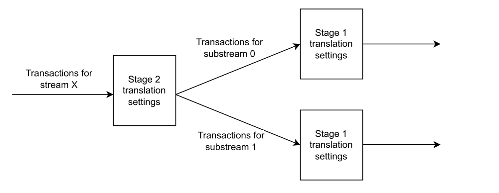

*图 3-2：SubstreamID 的作用*

当一个传输带有 SubstreamID 且配置启用了子流时，SubstreamID 对 CD 表建立索引以选择一个第 1 阶段转换上下文。参见"CD"。

### 3.4 故障模型

图 3-3 展示了 SMMU 记录和上报故障的流程。

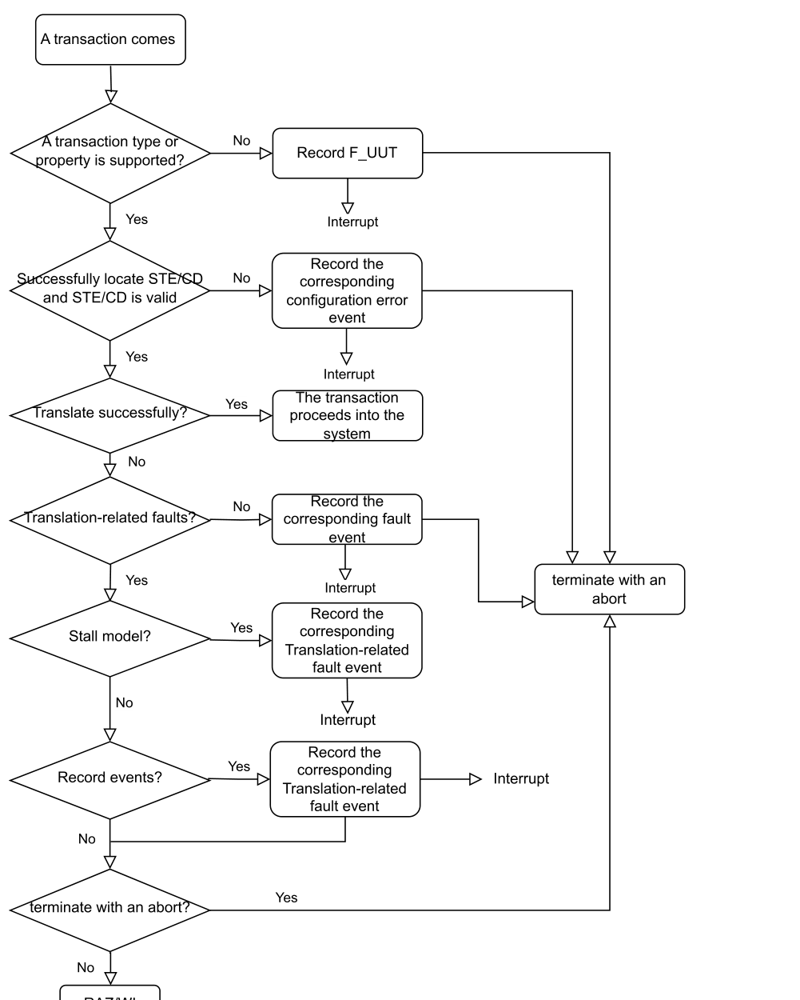

*图 3-3：SMMU 故障的记录与上报*

一个进来的传输在进入系统之前要经过几个逻辑阶段。如果一种传输类型或属性因实现定义的原因而不受 SMMU 支持，则记录一个不支持的上游传输故障（Unsupported Upstream Transaction fault，F_UUT）事件，传输以中止（abort）终止。参见"事件队列"。

否则，StreamID 和 SubstreamID（如果提供）用来定位该传输的配置。如果所需的任何 STE 和 CD 无法定位，或者是无效的，则记录一个配置错误事件，传输以中止终止。

如果定位到了有效配置，使得可以访问转换表，转换过程就开始了。在这一阶段可能会发生其他故障。当传输推进到转换时，遇到故障的行为就变得可配置。以下是当故障在第 1 阶段或第 2 阶段生成时构成转换相关故障（Translation-related faults）的故障类型：

- F_TRANSLATION
- F_ADDR_SIZE
- F_ACCESS
- F_PERMISSION

这些故障类型对应 VMSA 中的故障类型：

- 转换故障（Translation fault）
- 地址大小故障（Address Size fault）
- 访问标志故障（Access Flag fault）
- 权限故障（Permission fault）

你可以为转换相关故障在终止（Terminate）和停顿（Stall）模型之间切换，这由第 1 阶段的 `CD.{A,R,S}` 标志和第 2 阶段的 `STE.{S2R,S2S}` 标志决定。

#### 3.4.1 终止模型

当第 1 阶段配置为终止故障时，在第 1 阶段出故障的传输会：

- 当 `SMMU_IDR0.TERM_MODEL = 1` 或 `CD.A = 1` 时，以基于中止终止，并向发出访问的客户端设备报告中止。
- 当 `SMMU_IDR0.TERM_MODEL = 0` 且 `CD.A = 0` 时，表现为 RAZ/WI。

当第 2 阶段配置为终止故障时，在第 2 阶段出故障的传输以中止终止。

客户端设备在终止后的行为是设备特定的。

如果配置为终止故障的阶段还配置为 `CD.R == 1` 或 `STE.S2R == 1`（视故障阶段而定），SMMU 会把失败访问的详情记录进事件队列中的一个事件记录。

#### 3.4.2 停顿模型

停顿模型允许一种按需分页（demand-paging）类型的模型。如果启用了停顿模型，SMMU 记录停顿传输的详情并产生一个中断，以便软件知晓。收到中断后，软件把内存分页进来，更新转换表，然后发送一个 Resume 命令告诉 SMMU 重试转换。上游设备会经历较长延迟。

或者，软件可以选择终止传输而不是重启它。例如，当设备访问因安全原因而不允许访问的地址范围时。

重试或终止命令通过 SMMU 的命令队列发出。参见"命令队列"。

### 3.5 旁路

在旁路模式下，SMMU 不必转换进来的传输地址。可以把一个流或整个安全状态设置为旁路。这意味着输出地址等于输入地址。不过，其他输入传输属性（例如可缓存性）仍然可以可选地被覆盖。旁路有三种类型：

- **全局旁路**：当一个安全状态的转换被旁路时，该安全状态的所有传输都旁路转换。软件可以设 `SMMU_(*_)CR0.SMMUEN` 为 0 来启用全局旁路。软件还可以可选地设置 `SMMU_(*_)GBPA` 来覆盖输入属性。
- **流旁路**：当 `SMMU_(*_)CR0.SMMUEN = 1` 时可使用这种旁路。此时 StreamID 选择了一个配置为旁路的 STE（`STE.Config == 0b100`）。对于基于流的旁路，属性使用 STE 字段配置。`STE.{MTCFG,MemAttr,ALLOCCFG,SHCFG,NSCFG,PRIVCFG,INSTCFG}` 可以在传输传入内存系统之前覆盖任何属性。
- **阶段旁路**：当转换启用时，每个转换阶段的旁路分别配置，也由 `STE.Config` 控制：
  - 第 1 阶段旁路：`STE.Config[0] == 0`
  - 第 2 阶段旁路：`STE.Config[1] == 0`

这几乎等同于在 VMSA 架构中禁用一个转换阶段。

### 3.6 地址转换服务

地址转换服务（Address Translation Services，ATS）扩展了 PCIe 协议，以支持 SMMU 预先转换 DMA 地址。转换后的地址随后缓存在 PCIe 设备本地的 TLB 中。本地 TLB 被称为地址转换缓存（Address Translation Cache，ATC）。在设备中存放转换后的地址旨在降低延迟，并提供一种可扩展的分布式缓存系统，从而提升 I/O 性能。关于 ATS 机制的更多信息，参见《PCI Express Base Specification》。

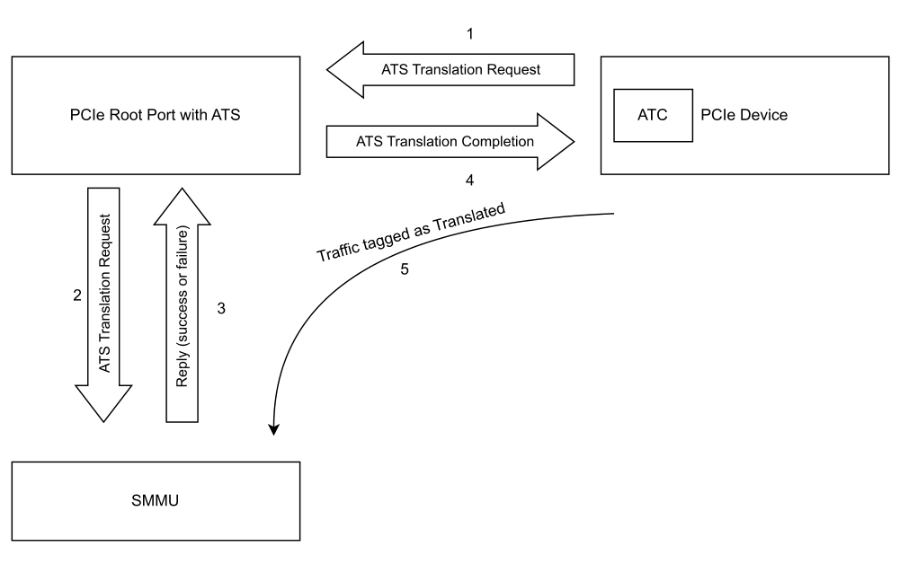

*图 3-4：ATS 机制*

图 3-4 展示了 ATS 的工作流程。一个 PCIe 功能（Function）生成一个 ATS 转换请求，通过 PCIe 层级发送到根端口（Root Port），根端口再把它转发给 SMMU。当收到 ATS 转换请求时，SMMU 执行以下基本步骤：

1. 验证该功能已被配置为启用 ATS 转换。
2. 确定该功能是否可以访问 ATS 转换请求所列出的内存并拥有相关访问权限。
3. 确定能否为该功能提供完整转换或部分转换。如果可以，SMMU 就向该功能发出一个转换。
4. SMMU 把请求的成功或失败传达给根端口，根端口生成一个 ATS 转换完成（ATS Translation Completion），并通过响应 TLP 经由根端口发送给该功能。

当功能收到 ATS 转换完成时，它要么更新其 ATC 以反映该转换，要么记下该转换不存在。功能根据完成（Completion）的结果，使用转换后的地址或未转换的地址生成后续请求。`SMMU_CR0.ATSCHK` 控制 SMMU 是否允许转换过的传输在无进一步检查的情况下旁路。

在具有 RME DA 的 SMMU 中，设备权限表（Device Permission Table，DPT）会对转换过的传输执行检查。

支持 PCIe ATS 的 SMMU 实现可能提供一个可选的额外硬件接口。例如，MMU-600/MMU-700 提供 DTI-ATS 接口，支持 ATS 转换请求和 ATS 转换响应。`SMMU_IDR0.ATS` 显示 SMMU 是否实现了 ATS。

### 3.7 页请求接口

如果只有 ATS 接口，为了提高 DMA 的效率，软件需要固定（pin）DMA 使用的内存。也就是说，内存被锁定在原地，使其不能被系统的动态分页机制换出。固定内存的开销可能不大。然而，把一大块内存从可分页池中移除对系统性能的负面影响可能很显著。与之相关的页请求接口（Page Request Interface，PRI）增加了 PCIe 功能把 DMA 定位到未固定、动态分页内存的能力。关于 PRI 机制的更多信息，参见《PCI Express Base Specification》。

为了支持 PRI，SMMUv3 架构引入了一个可选的 PRI 队列来存储从 PCIe 根端口收到的 PRI 页请求（PRI Page Requests，PPR）。图 3-5 展示了 PRI 队列的数据结构。PPR 包含诸如 StreamID、SubstreamID 和页地址等信息。软件可以使用这些信息来定位目标页。

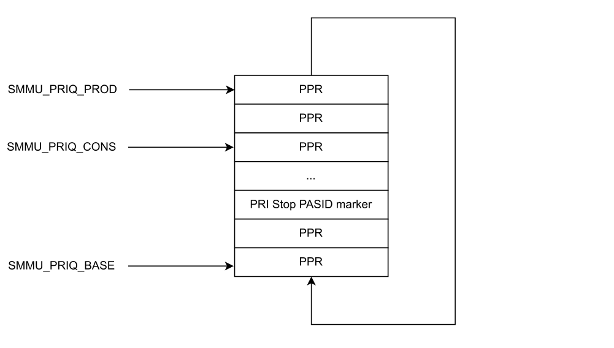

*图 3-5：PRI 队列*

以下过程说明 PRI 如何工作：

1. 当一个 ATS 请求由于页面不存在而失败时，PCIe 功能可以发出 PPR 请求软件让请求的页面可用。
2. SMMU 把 PPR 存入 PRI 队列并递增 `SMMU_PRIQ_PROD`。
3. 软件在 PRI 队列上收到这些 PPR 并递增 `SMMU_PRIQ_CONS`。
4. 软件可以使用命令队列发出 CMD_PRI_RESP，向端点发送 PRI 响应，以表明 PPR 的成功或失败。参见"命令"。
   - 软件在让页面存在之后，向 SMMU 发出正的 PRI 响应命令。如果请求的地址不可用，软件必须发出负的 PRI 响应命令。例如，当编程故障导致设备请求了非法地址时。

## 4. 编程 SMMU

本节介绍 SMMUv3 的编程接口：

- SMMU 寄存器
- 流表
- CD
- 事件队列
- 命令队列

大多数配置存储在内存结构中，所以软件必须为这些结构分配内存。不过，一些配置存储在 SMMU 寄存器中，例如这些结构各自的位置和大小。

### 4.1 SMMU 寄存器

图 4-1 展示了 SMMU 寄存器映射页。

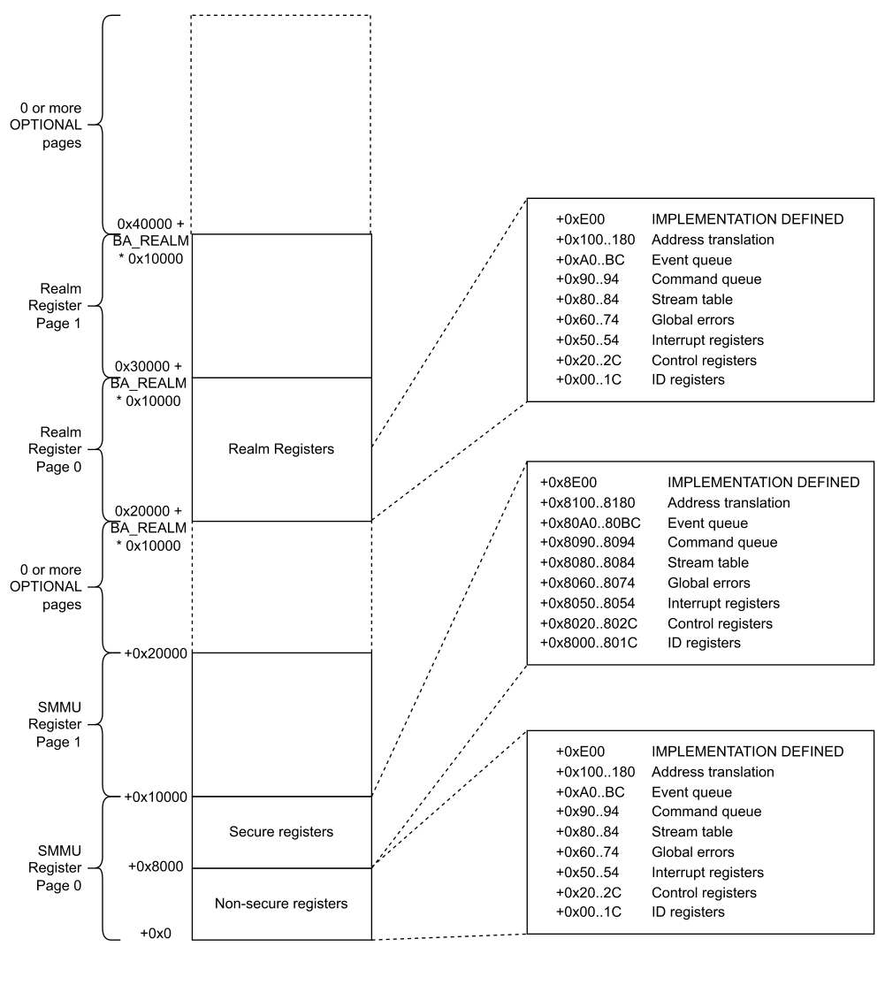

*图 4-1：SMMU 寄存器映射页*

SMMU 寄存器占据两个连续的 64K 页——SMMU 寄存器页 0 和 SMMU 寄存器页 1，这是架构要求的。可选或实现定义的特性可能还有额外的页：

- 如果支持 VATOS 接口，会有一个包含 VATOS 寄存器的 64KB 页。
- 如果支持安全 VATOS 接口，会有一个包含 S_VATOS 寄存器的 64KB 页。
- 如果支持增强命令队列接口，可能有一个或多个命令队列控制页。
- 如果支持安全状态的增强命令队列接口，可能有一个或多个安全命令队列控制页。
- 可能存在任意数量的实现定义页。

带 RME 的 SMMU 增加了一个只能从 Root PA 空间访问的根控制页（Root Control Page）。它的基地址与其他 PA 空间可访问的寄存器地址不同。

带 RME DA 的 SMMU 增加了两个连续的 64K Realm 寄存器页（Realm Register Pages 0 和 Realm Register Pages 1），它们只能在 Realm 和 Root PA 空间访问。Realm 寄存器页 0 的基地址 = SMMU 寄存器页 0 的基地址 + 0x20000 +（`SMMU_ROOT_IDR0.BA_REALM` × 0x10000）。

SMMU 寄存器页 0 中的寄存器分为：

- 非安全寄存器 `SMMU_*`，从偏移 0x0 开始
- 安全寄存器 `SMMU_S_*`，从偏移 0x8000 开始

对应的 Realm 寄存器 `SMMU_R_*` 在 Realm 寄存器页 0 中。

大多数寄存器集合是相同的，但不同安全状态的同一个寄存器可能有不同的地址偏移。例如：

- `SMMU_CMDQ_BASE`：SMMU 寄存器页 0 中的偏移 0x90，设置非安全命令队列的基地址。
- `SMMU_S_CMDQ_BASE`：SMMU 寄存器页 0 中的偏移 0x8090，设置安全命令队列的基地址。
- `SMMU_R_CMDQ_BASE`：Realm 寄存器页 0 中的偏移 0x90，设置 Realm 命令队列的基地址。

除了用于数据结构的寄存器外，还有其他控制 SMMU 其他功能的寄存器：

- 报告已实现特性的标识字段
- 顶层控制，例如启用 SMMU 和队列
- 中断配置
- 全局错误上报
- 地址转换操作

### 4.2 流表

SMMU 使用内存中的一组数据结构来定位转换数据。参见"转换过程概述"。`SMMU_(*_)STRTAB_BASE` 保存初始结构——流表——的基地址。一个流表项（STE）包含第 2 阶段转换表基指针。它还定位第 1 阶段配置结构，这些结构包含转换表基指针。

进来传输的 StreamID，由 SEC_SID 限定，决定使用哪个流表进行查找，并定位 STE。

可以支持两种流表格式：

- 线性流表
- 二级流表

对二级流表格式的支持可以通过 `SMMU_IDR0.ST_LEVEL` 字段发现。软件配置 `SMMU_(*_)STRTAB_BASE_CFG` 来指定所用流表的格式。

#### 4.2.1 线性流表

线性流表是一个由 STE 组成的连续数组，按 StreamID 从 0 开始索引。数组的大小可配置为 STE 大小的 2ⁿ 倍，直到 SMMU 硬件支持的最大 StreamID 位数。

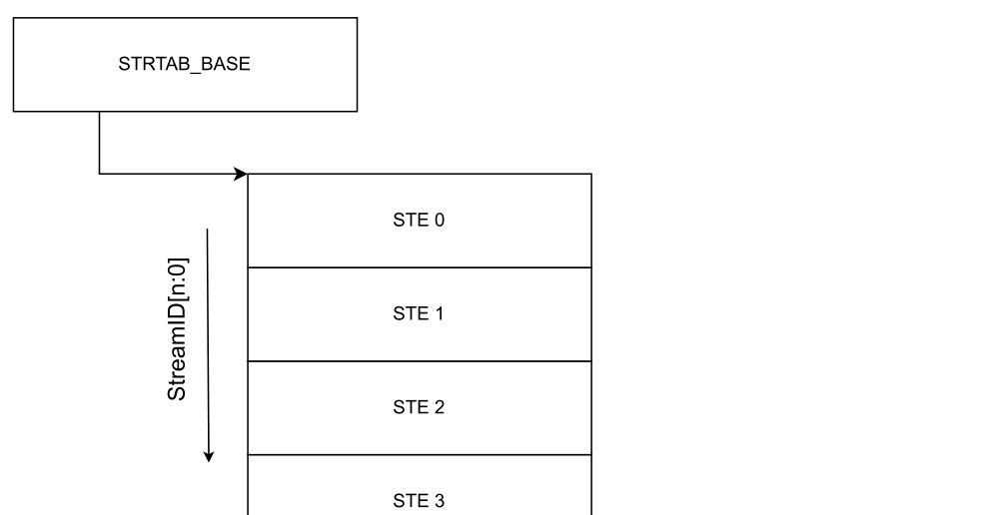

*图 4-2：线性流表*

要为传输定位 STE，流表由传输的 StreamID 索引：

```text
STE 地址 = STRTAB_BASE.ADDR + StreamID × sizeof(STE)
```

#### 4.2.2 二级流表

二级流表由一个顶层表组成，其中包含指向多个第二级表的描述符，第二级表包含 STEs 的线性数组。你可以配置整个结构覆盖的 StreamID 跨度，直到 SMMU 支持的最大 StreamID。不过，第二级表不必完全填满，大小也可以变化。这节省了内存，并避免了为非常大的 StreamID 空间分配大块物理连续内存的要求。

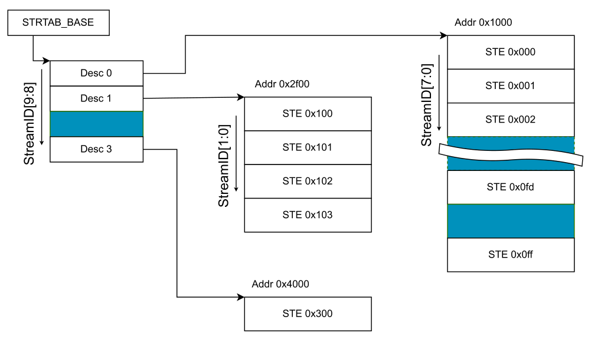

*图 4-3：SPLIT==8 的二级流表示例*

二级流表对 StreamID 宽度较大、且要么难以分配那么多连续内存、要么 StreamID 分布相对稀疏的软件很有用。例如，对于 PCIe 这样的用例，最多支持 256 条总线，RequesterID 或 StreamID 空间至少是 16 位。参见"PCIe 考量"。然而，由于每条 PCIe 链路通常有一条 PCIe 总线、每条总线可能有一个设备，在最坏情况下一个有效 StreamID 可能每 256 个可能的 StreamID 才出现一次。例如，如果 StreamID 位数是 16 位，第一个有效 StreamID 是 0，第二个是 256，第三个是 512，以此类推。

顶层表由 `StreamID[n:x]` 索引，其中 n 是覆盖的最高 StreamID 位，x 是由 `SMMU_(*_)STRTAB_BASE_CFG.SPLIT` 给出的可配置拆分点。第二级表由至多 `StreamID[(x-1):0]` 索引，取决于每张表的跨度。

```text
L1STD 地址 = STRTAB_BASE.ADDR + StreamID[n:x] × sizeof(L1STD)
STE 地址   = L1STD.L2Ptr + StreamID[(x-1):0] × sizeof(STE)
```

图 4-3 展示了一个 SPLIT==8 的二级流表示例。

软件首先分配 L1 流表，它设定 SMMU 被配置为接受的最大 StreamID 宽度。L1 表中的每一项代表一个 StreamID 块，其大小通过 `SMMU_(*_)STRTAB_BASE_CFG.SPLIT` 设置。`SMMU_(*_)STRTAB_BASE_CFG.SPLIT` 设置 L2 流表的最大大小。

然后 L1 流表描述符（L1STD）要么是无效的，要么指向一个 L2 流表。软件可以按需分配这些 L2 流表。

L2 流表不必覆盖 L1STD 所代表的完整 StreamID 范围。L1STD 包含一个 Span 字段，该字段设置所指向表的大小。落在 L1 项内但超出 Span 的任何 StreamID 被视为无效。

### 4.3 L1 流表描述符

图 4-4 展示了 L1STD 的字段。

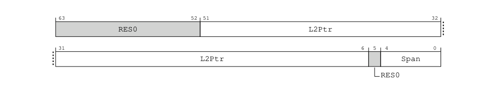

*图 4-4：L1 流表描述符*

| 字段 | 描述 |
| --- | --- |
| L2Ptr | 指向第 2 级数组开头的指针 |
| Span | 第 2 级数组包含 2^(Span-1) 个 STE |

### 4.4 STE

一个 STE 存储该流的上下文信息。每个 STE 是 64 字节。

STE 字段遵循如下约定：

- S1 前缀用于与第 1 阶段转换相关的字段
- S2 前缀用于与第 2 阶段转换相关的字段
- 没有前缀的用于与特定转换阶段无关的字段

以下列出一些常用字段：

- **通用配置**
  - Valid：STE 是否有效
  - Config：第 1 阶段/第 2 阶段转换启用或旁路
  - CONT：连续提示（contiguous Hint）
  - EATS：启用 PCIe ATS 转换和流量
  - STRW：StreamWorld 控制，对应 VMSA 中的转换机制
- **第 1 阶段转换设置**
  - S1Fmt：CD 表的格式
  - S1ContextPtr：第 1 阶段上下文描述符指针
  - S1CDMax：S1ContextPtr 指向的 CD 数量，2^S1CDMax
  - S1DSS：默认子流
  - S1CIR/S1COR/S1CSH：CD 表内存属性
- **第 2 阶段转换设置**
  - S2T0SZ：第 2 阶段转换表覆盖的 IPA 大小
  - S2SL0：第 2 阶段转换表遍历的起始级别
  - S2IR0/S2OR0/S2SH0：第 2 阶段转换表遍历的内存属性
  - S2TG：第 2 阶段转换粒度（Translation Granule）大小
  - S2PS：物理地址大小

### 4.5 CD

一个 CD 存储与第 1 阶段转换相关的所有设置。每个 CD 是 64 字节。指向 CD 的指针来自 STE，而不是寄存器。只有在执行第 1 阶段转换时才需要 CD。对于只有第 2 阶段转换或旁路的流，只需要 STE。

CD 把 StreamID 与第 1 阶段转换表基指针关联，以把 VA 转换为 IPA，针对每种第 2 阶段配置。如果使用了子流，多个 CD 表示多个第 1 阶段转换，每个子流一个。当第 1 阶段转换未启用时，带有 SubstreamID 的传输会被终止。

当使用第 1 阶段转换时，`STE.S1ContextPtr` 字段给出以下之一的地址（由 `STE.S1Fmt` 和 `STE.S1CDMax` 配置）：

- 单个 CD
- 单级 CD 表的起始地址
- 第一级（L1）L1CD 表的起始地址

预计在存在 hypervisor 软件的情况下：

- 流表和第 2 阶段转换表由 hypervisor 管理。
- 与客户机控制下的设备关联的 CD 表和第 1 阶段转换表由客户机 OS 管理。

#### 4.5.1 单个 CD

图 4-6 展示了一个示例配置，其中一个 StreamID 从一个线性流表中选择一个 STE。该 STE 指向第 2 阶段的转换表，并指向用于第 1 阶段配置的单个 CD。CD 指向第 1 阶段的转换表。

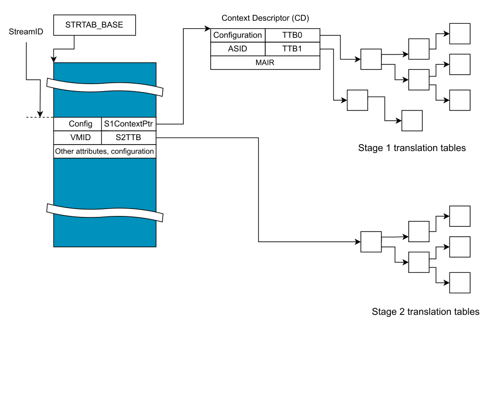

*图 4-5：配置结构示例*

#### 4.5.2 单级 CD 表

图 4-6 展示了一个配置，其中一个 STE 指向一个由多个 CD 组成的数组。一个进来的 SubstreamID 选择其中一个 CD，因此 SubstreamID 决定了传输使用哪个第 1 阶段转换。

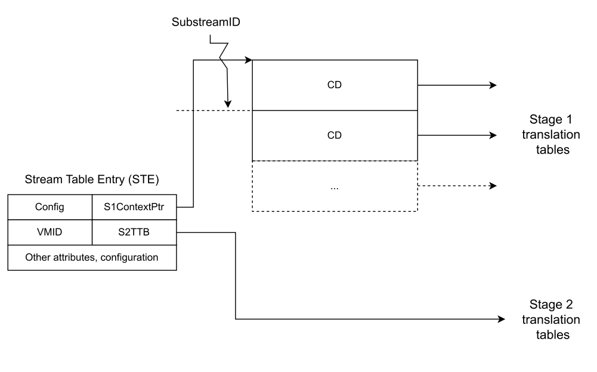

*图 4-6：子流的多个上下文描述符*

#### 4.5.3 二级 CD 表

当使用子流时，CD 数组可以是二级的，方式与流表非常类似。

图 4-7 展示了一个复杂布局，其中使用了二级流表。其中两个 STE 指向单个 CD 或一个平坦的 CD 数组。第三个 STE 指向一个二级 CD 表。使用多个级别，可以在没有大块物理连续表的情况下支持许多流和许多子流。

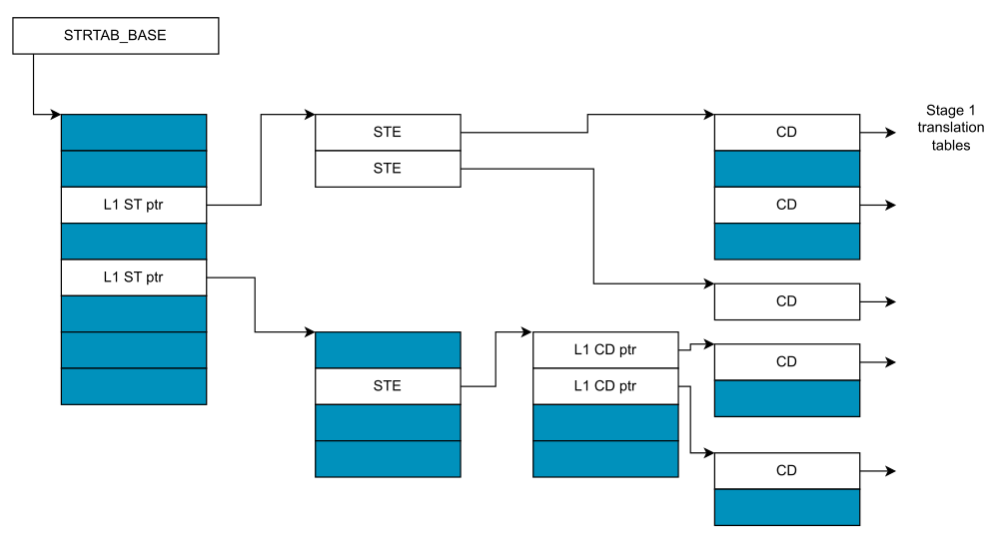

*图 4-7：配置结构示例*

L1 表是一个由 L1CD 组成的连续数组，由 SubstreamID 的高位索引。L1 表中的 `L1CD.L2Ptr` 配置为指向线性第二级（L2）CD 表的地址。L2 表是一个由 CD 组成的连续数组，由 SubstreamID 的低位索引。用于 L1 和 L2 索引的 SubstreamID 位范围由 `STE.S1Fmt` 配置。

### 4.6 虚拟机结构

虚拟机结构（Virtual Machine Structure，VMS）是 SMMU 的一个概念，是从 `STE.VMSPtr` 指针字段定位的结构。VMS 保存每 VM 的配置设置。同一安全状态内具有相同 VMID 的多个 STE 必须指向相同的 VMS。目前 VMS 只支持内存系统资源分区与监控（MPAM）特性。它把客户端 OS 配置的虚拟 `CD.PARTID` 值映射到物理 PARTID 值。关于 MPAM 特性的更多信息，参见《Learn the architecture - Memory System Resource Partitioning and Monitoring (MPAM) Overview》。

### 4.7 缓存

SMMU 实现不要求实现任何类型的缓存。不过，预计性能需求会要求至少缓存一些配置或转换信息。

配置或转换的缓存可能表现为每种结构类型有单独的缓存，也可能是把若干结构组合成更少数量的缓存。

当软件想更改配置时，它需要使 SMMU 中的任何缓存失效。它通过向命令队列发出配置缓存失效命令来做这件事。参见"命令队列"。当软件想更改转换时，它也需要使 SMMU 中的任何缓存失效。它通过向命令队列发出 TLB 失效命令，或通过广播发送 TLB 失效来做这件事。

### 4.8 命令队列

SMMU 通过内存中的一个循环命令队列来控制。例如，当软件更改 STE 或转换时，它需要使 SMMU 中相关的缓存失效。这可以通过向命令队列发出相应的失效命令来完成。关于命令的类别，参见"命令"。

在 SMMUv3.3 之前，每种安全状态有一个命令队列。实现 SMMUv3.3 的 SMMU 可以可选地支持多个命令队列，以减少多个 PE 同时向 SMMU 提交命令时的争用。

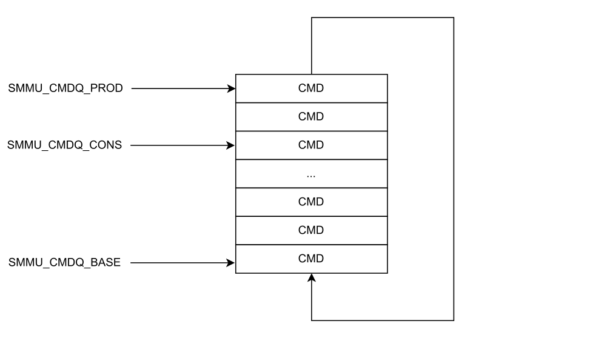

*图 4-8：命令队列*

`SMMU_CMDQ_BASE` 存储命令队列的基地址和大小。软件需要在添加新命令之前检查命令队列上是否有空间。当软件向队列添加一个或多个命令时，它更新 `SMMU_CMDQ_PROD` 指针，以告诉 SMMU 有新命令可用。当 SMMU 处理命令时，它更新 `SMMU_CMDQ_CONS` 指针。软件读取 `SMMU_CMDQ_CONS` 指针来确定命令已被消费、空间已释放。

如果 `SMMU_CMDQ_PROD.WR == SMMU_CMDQ_CONS.RD` 且 `SMMU_CMDQ_PROD.WR_WRAP != SMMU_CMDQ_CONS.RD_WRAP`，则队列是满的。

`SMMU_CMDQ_CONS` 的更新只表明某个命令已被消费。它可能不意味着命令的效果已经可见。可以用 CMD_SYNC 命令来同步。只有当先前命令的效果可见时，它才会被消费。例如：

```text
CMD_TLBI_EL3_ALL
CMD_SYNC
```

当 CMD_SYNC 被消费时，`CMD_TLBI_EL3_ALL` 的效果就被保证可见。

#### 4.8.1 命令

命令队列中的所有项都是 16 字节长。所有命令队列项都是小端序。每个命令以一个 8 位命令操作码开始。以下列出命令的类别：

- **预取命令（Prefetch commands）**：预取转换或配置。
- **TLB 失效命令（TLB invalidation commands）**：使给定异常级别上匹配标签（VMID、ASID、VA 或全部）的所有 TLB 项失效。
- **配置缓存失效命令（Configuration cache invalidation commands）**：使给定 StreamID（STE 的情况下）或同时给定 StreamID 和 SubstreamID（CD 的情况下）在指定范围 <全部，范围> 内的所有配置缓存项失效。
- **同步命令（Synchronization command）**：为先前发到与同步命令相同命令队列的命令提供同步机制。
- **PRI 响应命令（PRI response command）**：通知对应 StreamID 的设备（当 SSV == 1 时还有 SubstreamID），由 PRGIndex 指示的页请求组已用给定响应完成。
- **ATC 失效命令（ATC invalidation command）**：使匹配标签（StreamID、SubstreamID、地址范围）的所有 ATC 项失效。
- **停顿恢复/终止命令（Stall resume/termination command）**：恢复或终止处理由给定 StreamID 和 STAG 参数标识的停顿传输。
- **DPT 失效命令（DPT invalidation commands）**：这些命令从 DPT TLB 中移除缓存的 DPT 信息。

关于命令的完整描述，参见《Arm System Memory Management Unit version 3》。

### 4.9 事件队列

如果发生配置错误和故障，它们会被记录到事件队列中。这些事件包括来自进来的设备流量的事件，例如：

- 收到设备流量时获取配置发现的配置错误
- 来自设备流量地址的页故障

每种安全状态有一个事件队列。当事件队列从空变非空时，SMMU 产生一个中断。队列的结构与命令队列相同，只是生产者和消费者的角色颠倒了。对于命令队列，SMMU 是消费者；而对于事件队列，SMMU 是生产者。

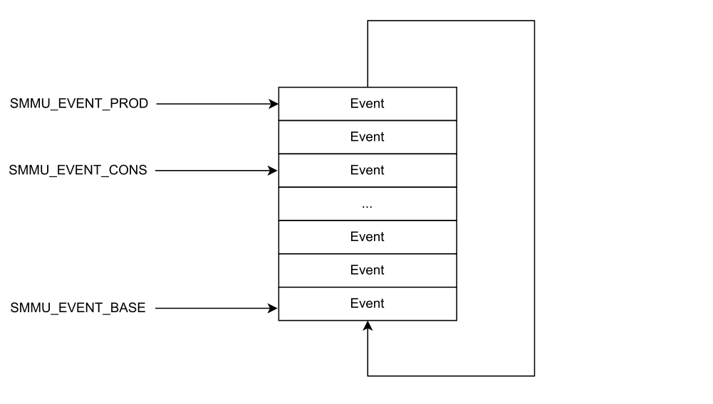

*图 4-9：事件队列*

由进来的传输引起的一系列故障或错误，如果事件不能被足够快地消费，可能会填满事件队列并导致其溢出。由停顿故障传输产生的事件，如果事件队列满了，则永远不会被丢弃。它们在事件队列中的项被消费、空间再次可用时被记录。其他类型的事件在事件队列满时会被丢弃。系统软件预期在正常操作期间快速消费事件队列中的项，以避免溢出。

#### 4.9.1 事件记录

事件记录是 32 字节大小，所有事件记录都是小端序。可能记录进事件队列的事件有三类：

- 配置错误
- 转换过程的故障
- 杂项

以下列出一些示例：

- CERROR_ILL：非法或未识别的命令
- C_BAD_STREAMID：传输 StreamID 超出范围
- C_BAD_STE：所用 STE 无效
- F_TRANSLATION：转换故障

关于事件记录的完整描述，参见《Arm System Memory Management Unit version 3》。

### 4.10 全局错误

与编程接口相关的全局错误被报告到相应的 `SMMU_(*_)GERROR` 寄存器，而不是基于内存的事件队列。这些错误往往是严重的，例如使 SMMU 停止向前推进。例如访问某个配置数据结构时的外部中止。以下列出所有全局错误：

- 命令队列错误
- 事件队列访问中止，当标记中止时向事件队列的投递停止
- PRI 队列访问中止，当标记中止时向 PRI 队列的投递停止
- CMD_SYNC 消息信号中断（MSI）写中止
- 事件队列 MSI 写中止
- PRI 队列 MSI 写中止（仅非安全 GERROR）
- GERROR MSI 写中止
- SMMU 进入服务失败模式

`SMMU_(*_)GERROR` 为每种全局错误提供一个一位标志。当错误条件被触发时，通过翻转 GERROR 中对应的标志来激活该错误。在某些情况下，当错误处于激活状态时 SMMU 的行为会改变。例如，当命令队列错误处于激活状态时，命令不会从命令队列被消费。

当 `SMMU_(*_)IRQ_CTRL.GERROR_IRQEN == 1` 时，如果 SMMU 激活了一个不是 GERROR MSI 写中止的错误，就会触发 GERROR 中断。

### 4.11 最小配置

以下序列展示了 SMMU 初始化的最小配置：

1. **分配流表**
   - 为流表分配内存。
   - 通过写 `SMMU_STRTAB_BASE_CFG` 配置流表的格式和大小。
   - 通过写 `SMMU_STRTAB_BASE` 配置流表的基地址。
   - 把每个 STE 的 `STE.V` 设为 0，把其标记为无效，以防止未初始化的内存被解释为有效配置。
   - 通过执行 DSB 操作确保写入的数据对 SMMU 可观察。
     - 如果 `SMMU_IDR0.COHACC = 0`，系统不支持 SMMU 对内存的一致访问。在这些情况下，你可能需要额外的步骤，包括数据缓存维护，以确保 SMMU 能观察到写入的数据。
2. **分配命令队列和事件队列**
   - 为命令队列和事件队列分配内存。
   - 通过配置 `SMMU_CMDQ_BASE`、`SMMU_CMDQ_PROD`、`SMMU_CMDQ_CONS`、`SMMU_EVENTQ_BASE`、`SMMU_EVENTQ_PROD` 和 `SMMU_EVENTQ_CONS` 指定基地址、大小、生产者指针和消费者指针。
3. **设置访问流表、命令队列和事件队列的内存属性**
   - 配置 `SMMU_CR1`。
4. **为事件队列和 GERROR 启用 IRQ**
   - 配置 `SMMU_IRQ_CTRL`。
5. **启用命令和事件队列**
   - 把 `SMMU_CR0.CMDQEN` 位设为 1 来启用命令队列。
   - 通过轮询 `SMMU_CR0ACK` 直到 CMDQEN 读到 1 来检查启用操作是否完成。
   - 把 `SMMU_CR0.EVENTQEN` 位设为 1 来启用事件队列。
   - 通过轮询 `SMMU_CR0ACK` 直到 EVENTQEN 读到 1 来检查启用操作是否完成。
6. **使 TLB 和配置缓存结构失效**
   - 向命令队列发出命令：
     - 要使 TLB 项失效，确保软件针对转换上下文发出适当的命令。例如，要使非安全 EL1 上下文的 TLB 项失效，发出 `CMD_TLBI_NSNH_ALL`；对 EL2 上下文，发出 `CMD_TLBI_EL2_ALL`。
     - 要使 SMMU 配置缓存失效，发出 `CMD_CFGI_ALL` 命令。
     - 要强制所有先前命令完成，发出 `CMD_SYNC`。
   - 或者，安全软件可以单次写入使所有 TLB 和缓存失效：
     - 把 `SMMU_S_INIT.INV_ALL` 设为 1。
     - 在继续 SMMU 配置之前，轮询 `SMMU_S_INIT.INV_ALL` 检查它被设为 0。
7. **启用转换**
   - 把 `SMMU_CR0.SMMUEN` 位设为 1。
   - 通过轮询 `SMMU_CR0ACK` 直到 SMMUEN 读到 1 来检查启用操作是否完成。

> 此序列展示的是当 SMMU 没有实现 RME 扩展或 GPC 未启用时的非安全 SMMU 编程。安全或 Realm SMMU 的编程类似。如果 SMMU 实现了 RME 扩展且 GPC 已启用，运行在 Root world 的软件需要先初始化 GPT。

## 5. 系统架构考量

本章介绍一些与 SMMU 相关的系统考量。

### 5.1 I/O 一致性

如果一个设备对内存的可缓存区域的传输会窥探（snoop）PE 缓存，则该设备与 PE 缓存是 I/O 一致的。这通过避免缓存维护操作（Cache Maintenance Operation，CMO）来提升性能。设备无需访问外部内存。PE 不会窥探设备缓存。

如果设备与 PE 缓存 I/O 一致，与设备共享的内存不需要 CMO。此内存在 CPU 上映射为 Inner Write-Back（iWB）、Outer Write-Back（oWB）和 Inner Shareable（ISH）。如果设备与 PE 缓存不 I/O 一致，那么与设备共享的内存在 CPU 上映射为 iWB-oWB-ISH 时，需要 CMO。

以下类型的 SMMU 访问可以是 I/O 一致的：

- SMMU 发起的传输
  - 转换表遍历
  - L1STD、STE、L1CD 和 CD 的获取
  - 命令队列、事件队列和 PRI 队列访问
  - MSI 中断写
- 设备发起的传输
  - 如果 SMMU 到系统的接口支持 I/O 一致性，简单非一致设备可以被变为 I/O 一致。来自客户端设备的传输的可缓存性和可共享性属性可以被 SMMU 覆盖，因此输出到互连的传输可以窥探 PE 缓存。

SMMU 是否支持发出一致访问由 `SMMU_IDR0.COHACC` 指示。Arm 基础系统架构（Base System Architecture）要求 I/O 一致的转换表和配置结构访问。

为了支持 I/O 一致访问，SMMU 需要一个提供正确一致性保证的互连端口。例如，AMBA 互连中的 ACE-Lite 端口可以支持 I/O 一致访问。

### 5.2 客户端设备

本节介绍客户端设备的一些需求，例如：

- 地址大小
- 缓存
- PCIe 设备或根端口的需求
- StreamID 分配
- 消息信号中断

#### 5.2.1 地址大小

SMMU 的架构输入地址大小是 64 位。如果发生以下情况之一：

- 客户端设备输出的地址小于 64 位。
- 客户端设备与 SMMU 输入之间的互连支持的地址位数少于 64 位。

较小的地址以系统特定的方式转换为 64 位 SMMU 输入地址。SMMU 对扩展后的 64 位地址执行输入范围检查：

- N 定义为 VA 区域大小，由 `CD.T0SZ` 或 `CD.T1SZ` 控制，例如 40 位。
- 如果使用 Top Byte Ignore（`CD.TBI0` 或 `CD.TBI1`），则 VA[55:N-1] 都相同。
- 如果不使用 Top Byte Ignore，则 VA[63:N-1] 都相同。

#### 5.2.2 缓存

SMMU 之后的设备不能包含与系统其余部分完全一致的缓存，因为窥探与物理缓存行有关，但 SMMU 不能进行从 PA 到 VA 的反向转换。设备可能包含不支持硬件一致性的缓存，这种缓存必须由软件维护。

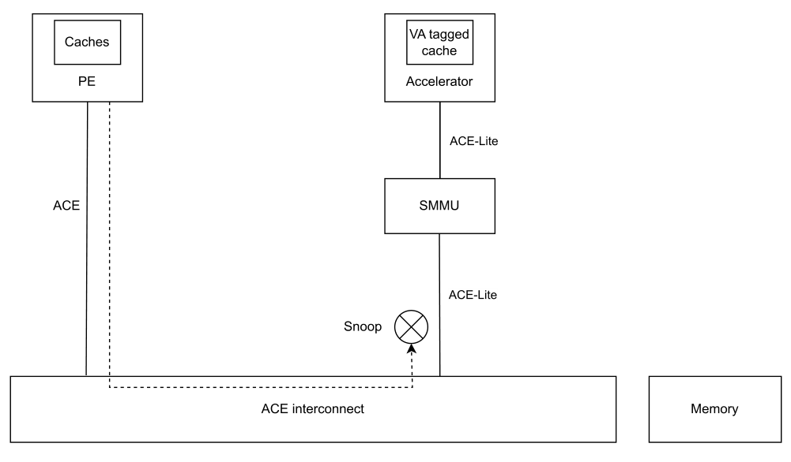

*图 5-1：含非一致缓存的加速器的系统拓扑简化示例*

然而，包含使用 ATS 从 SMMU 填充的 TLB 的客户端设备，可能维护一个完全一致的物理寻址缓存，使用 TLB 在进行缓存访问之前把内部地址转换为物理地址。SMMU 上游的任何物理寻址缓存都必须一致。例如，使用 ATS 转换虚拟地址并拥有一致物理寻址缓存的 CXL.cache 或 CCIX 客户端设备。

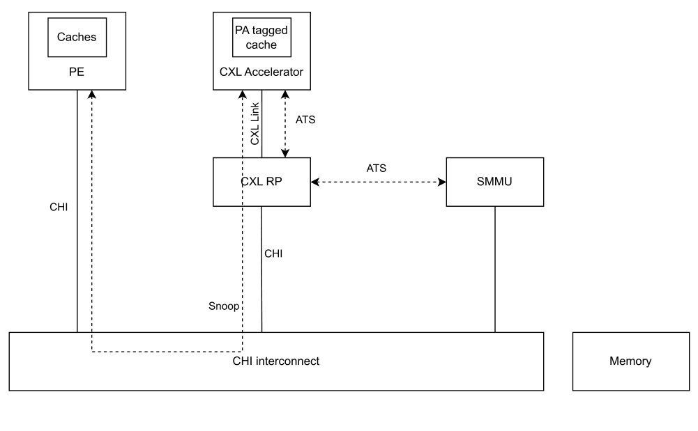

*图 5-2：含一致缓存的 CXL 加速器的系统拓扑简化示例*

### 5.3 PCIe 考量

当与 PCIe 子系统一起使用时，SMMU 实现必须至少支持 PCIe RequesterID 的全部 16 位范围。系统必须确保根端口以一比一或线性的方式从 PCI RequesterID 生成 StreamID，使得 StreamID[15:0] == RequesterID[15:0]。

更大的 StreamID 可以通过拼接多个 PCI 域（或"段"）的 RequesterID 来构造，例如：

```text
StreamID[17:0] == { pci_rp_id[1:0], pci_bus[7:0], pci_dev[4:0], pci_fn[2:0] };
```

即：

```text
StreamID[17:0] == { pci_domain[1:0], RequesterID[15:0] };
```

当与支持 PASID 的 PCIe 系统一起使用时，系统必须确保根端口以一比一的方式从 PCI PASID 生成 SubstreamID。我们建议 SMMU 支持与客户端根端口相同数量或更少的 PASID 位，以便软件能够通过 SMMU 检测端到端的 SubstreamID 能力。其动机是软件随后可以查看 `SMMU_IDR1.SSIDSIZE` 寄存器字段，理解有多少位 PASID 可用。如果根端口支持的位数少于 `SMMU_IDR1.SSIDSIZE`，那么软件需要在其他地方被告知，例如固件表。

Arm 基础系统架构要求，如果系统支持 PCIe PASID，则必须支持至少 16 位 PASID。这种支持必须是全系统的，从根端口一直到需要 PASID 支持的 SMMU。

属于 PCIe 端点的流不能被停顿。终止模型是唯一可行的选项。停顿 PCIe 传输有风险，要么导致 PCIe 端点超时（可能难以恢复），要么在某些场景下导致死锁。系统出于安全原因被允许强制执行终止模型。例如，LTI 协议包括 LAFLOW 信号，AXI/ACE-Lite Issue H 包括 AxMMUFLOW 信号，DTI 协议包括 DTI_TBU_TRANS_REQ.FLOW。这些信号和消息都支持 NoStall 模式，可以强制执行终止模型。如果发生转换故障，那么即使 SMMU 已为该转换上下文启用了停顿故障，也会返回故障响应，而不取决于 SMMU 软件配置。

具体来说，PCIe 流量不能因等待任何 PE 操作而被拦下，包括排空事件队列或重启停顿的事务。PCIe 流量必须始终在不受软件约束的无界延迟下向前推进。

#### 5.3.1 对等通信

PCIe 对等通信（Peer-to-Peer，P2P）使两个 PCIe 设备能够直接相互传输数据，而无需使用主机内存作为临时存储。P2P 流量通过系统是否受支持是系统特定的。在 PCIe 层级支持不经过 SMMU 的 P2P 通信的系统中，SMMU 无法隔离 PCIe 设备。为解决这个问题，PCIe 规范包括对 PCIe 访问控制服务（Access Control Services，ACS）的支持：

- 使用 ACS 时，当交换端口看到发往对等交换端口的请求时，它把 P2P 请求上行转发到根端口以进行请求验证。它检查该传输是否被允许以对等设备为完成器。
- 根端口决定这个请求能否被转发到其预期目标设备。
- PCIe 规范指出，这个决定是在重定向请求验证逻辑的帮助下做出的。
- SMMU 是唯一能强制执行这种隔离的代理，所以它扮演重定向请求验证逻辑的角色。
- 如果 P2P 请求的 SMMU 查找导致错误响应，则该请求有 ACS 违规错误。这可能是由以下一个或多个原因导致的：
  - 请求没有访问目标位置所需的权限。
  - 请求的 VA 在对应请求方设备上下文的转换表结构中没有有效的 VA 到 IPA 或 VA 到 PA 转换。
  - 存在错误配置或某种瞬时错误。

#### 5.3.2 No_snoop

PCIe 传输包含一个 No_snoop 属性。如果 PCIe 传输中设置了 No_snoop 属性，它表明该传输被允许"退出"硬件缓存一致性。软件缓存一致性确保该访问不会命中缓存，所以 I/O 访问被允许避免窥探缓存。与传输关联的内存属性必须替换为 Normal-iNC-oNC-OSH。

No_snoop 的支持取决于系统。如果实现了 No_snoop，它把最终访问属性从 Normal 可缓存类型转换为 SMMU 下游的 Normal-iNC-oNC-OSH。

#### 5.3.3 ATS

PCIe 功能可以确定在其地址转换缓存中缓存转换是否有利。功能或软件可以考虑以下因素，例如：

- 长时间频繁访问的内存地址范围，或其关联缓冲区内容有显著更新率的内存地址范围
- 诸如以下的内存地址范围：
  - 工作和完成队列结构
  - 低延迟通信的数据缓冲区
  - 图形帧缓冲区
  - 用于缓存功能特定内容的主机内存

### 5.4 StreamID 分配

系统设计者给请求方分配一个唯一的 StreamID 输入到 SMMU。StreamID 命名空间是每 SMMU 的，因此 StreamID 在每个 SMMU 中必须是唯一的。

在具有 SMMU 对 RME DA 扩展的机密计算架构（Confidential Compute Architecture，CCA）系统中，设备接口可以工作在可信或不可信模式：

- 在不可信模式下工作时，SEC_SID = 非安全（Non-secure）
- 在可信模式下工作时，SEC_SID = Realm

呈现给 SMMU 的 StreamID 在两种模式下是相同的。例如，RequesterID 为 0x100 的 PCIe 设备以 StreamID 0x100 输入到 SMMU，但 SEC_SID 可能因设备配置的变化而改变。

在 Linux 中，SMMUv3 驱动不支持同一 SMMU 之后的多个设备使用相同的 StreamID。

关于 PCIe 设备的 StreamID 生成，参见"PCIe 考量"。

由于与物理设备关联的 StreamID 是系统特定的，系统软件把 StreamID 作为每个设备固件描述的一部分呈现给 OS。ACPI 表和 devicetree 都可以为每个设备向 OS 呈现 StreamID。

### 5.5 MSI

在 Arm GICv3 架构中，GIC 中断转换服务（Interrupt Translation Service，ITS）隔离 MSI。参见《Locality-Specific Peripheral Interrupts Arm Generic Interrupt Controller v3 and v4》。

ITS 收到一个包含 EventID 和 DeviceID 输入的 MSI 写。它使用这些信息选择正确的 PE（或虚拟 PE）和 IRQ 号来触发中断。

ITS 需要 DeviceID 输入来隔离中断源。Arm 基础系统架构提供了如何从 StreamID（通过 SMMU 传递）生成 DeviceID 的规则。实现相同粒度的中断源区分和 SMMU DMA 区分的最简单方式，是让设备的 DeviceID 从设备的 SMMU StreamID 生成。让高层软件和固件系统描述确保这种关系尽可能简单是有利的。DeviceID 从 StreamID 一比一，或以简单的线性偏移派生。

ITS 寄存器映射提供一页包含一个 MSI 目标寄存器。这页可以安全地使用 SMMU 暴露给设备，例如：

- 当设备分配给用户空间驱动时，该页可以通过第 1 阶段转换映射给设备，以便用户空间驱动用 VA 目的地编程 MSI。
- 当设备分配给 VM 时，该页可以通过第 2 阶段转换映射给设备，以便客户机 OS 用 IPA 目的地编程 MSI。

在非 CCA 系统中，设备总是以 SEC_SID = 非安全向 SMMU 发出 MSI。

在有 SMMU 对 RME DA 的 CCA 系统中，与 TEE 设备接口安全协议（TDISP）兼容的设备可能以两种方式发出 MSI：

- 如果 MSI 通过配置空间中的 MSI capability 配置，它以 T = 0 发送到宿主 SoC，因此以 SEC_SID = 非安全呈现给 SMMU。
- 如果 MSI 通过设备接口受保护 MMIO 区域中的 MSI-X capability 配置，它以 T = 1 发送到宿主 SoC，因此以 SEC_SID = Realm 呈现给 SMMU。

无论使用哪种 MSI 机制，来自单个设备接口的 MSI 都以相同的 DeviceID 呈现给 GIC ITS 接口。MSI 的目标 PA 空间从转换表中的配置确定。

## 6. SMMU 使用场景

本节介绍以下使用场景：

- 第 1 阶段使用场景
- 第 2 阶段使用场景

本节中关于 Linux 的描述基于版本 6.4。一些使用场景尚未在该版本中实现，可能在后续版本中实现，或正在开发中。相关信息在每个使用场景中注明。

### 6.1 第 1 阶段使用场景

本节介绍使用单个第 1 阶段转换。

#### 6.1.1 分散-聚集

一些先进设备可以使用分散-聚集（scatter-gather）列表请求到地址的 DMA，该列表包含形成单个请求的多个非连续缓冲区地址。

然而，简单设备通常不支持分散-聚集。它们只能请求到连续缓冲区的 DMA。当系统运行时，物理内存会变得碎片化，所以连续缓冲区不一定能得到保证。OS 可能不得不把大范围的 DMA 请求拆分成多个较小范围的 DMA 请求。这影响性能。

SMMU 可以解决这个问题。OS 使用 SMMU 向设备呈现一个连续缓冲区，即使该缓冲区在物理上并不是连续的。做法是在转换表中用连续的虚拟地址分配页面，把它们映射到非连续的物理地址。然后 OS 使用虚拟地址编程 DMA 地址。

在 Linux 中，如果设备驱动使用 DMA API 为不支持分散-聚集的设备分配了分散页面，SMMU 驱动会做"聚集"工作。这个工作对设备驱动是透明的。

因为这个地址空间只为设备创建，它与应用程序进程的虚拟内存地址空间无关。广播 TLB 维护不能用于从 PE 使 SMMU TLB 失效。虽然 SMMU 也像 PE 一样使用 ASID 区分不同的地址空间，但 SMMU 的 ASID 命名空间与 PE 的 ASID 命名空间是独立的。为确保它们处在不同的 ASID 命名空间中，OS 需要设置 `CD.ASET = 1`，以便从该上下文创建的 SMMU TLB 项预期不会被某些广播失效所失效。

#### 6.1.2 64 位 OS 中的 32 位设备

一些传统设备只支持 32 位地址的 DMA。由于 OS 可能在超出 32 位范围的物理地址上分配 DMA 缓冲区，需要一个解决方案来确保这些传统设备仍然工作。

SMMU 通过为每个 32 位设备基于其 StreamID 创建一个单独的虚拟内存映射来解决这个问题。即使物理地址超出范围，这种地址转换也能让设备在 32 位范围内发出 DMA 请求地址。

在 Linux 中，如果满足以下两个条件：

- 设备驱动使用 DMA API 为设备分配一个页。
- 页的物理地址超过 4GB。

SMMU 驱动做地址映射工作，把 4GB 以下的 IOVA 映射到超出 4GB 的已分配页。这个工作对设备驱动是透明的。

与前面的分散-聚集使用场景一样，这个地址空间只为设备创建。它与应用程序进程虚拟内存地址空间无关。你不能使用广播 TLB 维护从 PE 使 SMMU TLB 失效。

在 64 位系统上支持 32 位传统设备的替代方案并不理想：OS 在低地址限制内维护一个 DMA"反弹缓冲区"池，并在缓冲区和原始 64 位位置之间复制数据。例如，对于没有 SMMU 或 SMMU 在 Linux 中被禁用的系统，SWIOTLB 做这种工作。对于大传输，使用 SMMU 明显更快。

#### 6.1.3 OS 设备隔离

一个恶意设备可能在互连上发起不恰当的 DMA 传输。DMA 传输可能破坏或检索不属于该恶意设备的数据。在有 SMMU 的系统中，设备只能访问为 DMA 映射的页面。

许多操作系统都有设备驱动在执行 DMA 传输时使用的通用 API。例如，在 Linux 中，这些 DMA API 安排分配、确保适当的地址限制，并在使用非缓存一致 DMA 时执行缓存维护操作。这类 API 可以跟踪任何特定设备访问了哪些页面。

这些 DMA API 配置 SMMU 映射正确引用的地址，但阻止对其他任何地址的访问。任何编程错误都会被检测并包含。故障设备或驱动错误不能影响为 DMA 配置的页面集合之外的数据。与允许设备进行不受限制的 DMA 相比，这可以提高系统可靠性。当可能存在不受信任或恶意设备时，这一点对安全尤为重要。例如它们是通过外部互连连接的。

在这个使用场景中，SMMU 转换表不与 PE 共享。不需要共享 ASID。

#### 6.1.4 用户空间设备驱动

一些系统可能需要用户空间设备驱动。用户空间驱动用于性能、灵活性、健壮性或安全性。例如，应用程序可能需要低延迟访问加速器而不使用系统调用，并避免在用户空间和内核空间内存之间复制数据的开销。

为此，OS 把设备 MMIO 寄存器映射到用户进程虚拟地址空间。如果用户空间控制的设备可以请求 DMA，产生的传输与用户进程处于相同的信任级别。设备必须在 SMMU 之后。SMMU 确保来自设备的 DMA 访问只能正确执行到用户进程地址映射中的允许区域。SMMU 保护系统免受由恶意或错误的用户空间程序控制的 DMA。

当设备分配给应用程序时，软件分配 DMA 目标的特殊内存区域。OS 随后建立一个由 SMMU 为该设备使用的私有转换表，为设备访问映射这些内存区域。我们建议这块内存在进程 VA 空间和设备地址空间中出现的位置相同，以便程序员能以显而易见的方式配置 DMA 指针，但这不是强制性的。

在 Linux 中，VFIO 子系统使应用程序能够使用设备。VFIO 允许应用程序选择一个映射到进程中所选内存区域的 IOVA，应用程序在往设备编程 DMA 指针时使用该 IOVA。SMMU 使支持进程所选区域的内存可由设备的 DMA 访问。设备和 PE 通过该内存共享数据。SMMU 阻止设备访问进程地址空间的其他任何部分，或其他进程的地址空间。

因为用户空间内存通常是按需分配和换出的，所以必须考虑 DMA 上的缺页。在许多系统中，转换相关故障对 DMA 传输是致命的。许多设备驱动通过固定 DMA 目标页来避免转换相关故障。因为 DMA 只发生在特定内存区域，而且这些区域通常很小，固定内存是合理的要求。

#### 6.1.5 用户空间共享虚拟寻址（SVA）

使用场景"用户空间设备驱动"介绍了一个用户空间设备驱动，有一些限制：SMMU 转换表必须映射用户空间设备驱动地址空间中的特殊 DMA 区域。

本使用场景考虑的是与设备共享整个用户进程地址空间（而不是特定区域）的替代方案。与设备共享进程地址空间依赖 CPU 内核内存管理进行 DMA。它消除了应用程序和设备驱动的一些复杂性。设备 MMIO 寄存器由 PE 以与"用户空间设备驱动"相同的方式进行虚拟映射。然而，现在 SMMU 把设备与整个进程地址空间关联起来，而不是一个子集。设备需要在物理上能够访问任何用户空间虚拟地址。例如，一个只能使用 32 位地址的设备和一个使用 48 位虚拟地址的进程是无法实现 SVA 的。

为了实现公共地址空间，SMMU 可以直接使用进程转换表和 ASID。因为使用了公共 ASID，且虚拟地址在 PE 和 SMMU 上具有相同的含义，广播 TLB 维护可以用于从 PE 使 SMMU 转换失效。我们推荐广播失效，因为可以避免手动 TLB 失效命令到 SMMU 的潜在缓慢往返。使用公共失效方法还可能带来软件简化。

固定每一页是不切实际的，因为进程可能尝试对它们编程 DMA。DMA 可能发生在任意地址，无论页表是否已映射，所以设备和系统必须支持 DMA 访问上的缺页。这意味着：

- 当检测到缺页时，设备 DMA 流不能被致命中止。
- 需要一种机制通知 OS 以下内容以恢复 DMA 传输：
  - 发生了故障。
  - 需要采取行动使所需页面可访问。

SMMU 和设备合作以支持 DMA 上缺页为非致命的要求。例如，设备 DMA 流可以配置为在 SMMU 中故障时停顿。当故障发生时，SMMU 向软件报告故障描述符，故障传输被停顿直到缺页解决。软件向 SMMU 发出命令重试传输，或者如果故障是由不正确访问引起的则中止传输。设备在对其 DMA 请求的响应中经历小的延迟。

或者，一个更智能的设备如果被告知故障，也许能够高效地调度流量。例如，SMMU 配置为中止故障传输，设备被告知错误。设备把事件报告给其设备驱动，设备驱动解决缺页的原因。这种方法的优点是避免在 SMMU 中停顿流量，这可能影响其他传输。然而，使用这种方法需要设备特定的软件代码。例如，Linux 不支持只支持中止故障传输的非 PCIe 设备的 SVA。

PCIe PRI 使用类似的方法，它在 ATS 响应中把故障报告回设备。PRI 提供一个标准页请求接口，使设备能够通过根端口和 SMMU 请求软件解决缺页。PRI 不需要设备特定的缺页解决例程。这有助于减少标准软件（如 hypervisor）中设备特定的软件需求。

在 Linux 中，VFIO 子系统为应用程序提供启用 SVA 的接口。要支持 SVA，设备、总线和 SMMU 必须支持以下特性：

- 每个设备多个地址空间，例如使用 PCI PASID 扩展。SMMU 驱动分配一个 PASID，设备在 DMA 传输中使用它。
- I/O 页故障：
  - 对 PCIe 设备，需要 PRI。
  - 对非 PCIe 设备，需要停顿模型。
  - 核心内存管理处理来自 SMMU 的转换故障。
- MMU 和 SMMU 实现兼容的页表格式。

### 6.2 第 2 阶段使用场景

本节介绍第 2 阶段转换的使用。

#### 6.2.1 VM 设备分配

hypervisor 可以把一个设备分配给不受信任的 VM，并配置 SMMU 保护系统的其余部分免受该 VM 控制的设备的影响。

PE 第 2 阶段转换把设备 MMIO 寄存器映射到 IPA 空间，就好像客户机 OS 运行在物理机器上一样。SMMU 中的第 2 阶段转换把 VM 的客户机物理内存映射给设备进行 DMA。客户机 OS 看起来就像是运行在带直接连接设备的物理机器上。客户机用客户机物理地址（IPA）编程设备，且没有第 1 阶段转换。设备分配使设备能够 DMA 到任意客户机内存，就像物理机器上直接连接的设备一样。

要么 PE 第 2 阶段转换表直接与 SMMU 共享，要么 SMMU 使用的单独转换表与 PE 表保持同步。SMMU 和 PE 使用相同的 IPA 地址空间。

设备可能不能容忍 DMA 缺页，包括把设备分配给 VM 时。许多 hypervisor 通过固定所有 VM 内存（如果有任何设备分配给客户机）来避免 DMA 上的缺页。

在 Linux 中，通过利用宿主内核中的 VFIO 子系统，设备可以由用户空间虚拟机管理器（Virtual Machine Manager，VMM）如 QEMU 独占管理。在具有分配设备的 VM 中，VM 应该能够看到与宿主中完全相同的设备。通过把设备分配给客户机，你在客户机中几乎可以获得与宿主中相同的性能。

对于这个使用场景，Linux 中 SMMU 使用单独的转换表。不过，IPA 到 PA 的映射与 VM 的第 2 阶段转换表相同。默认情况下 SMMU 使用第 1 阶段转换，尽管逻辑上它实际是第 2 阶段转换。像 QEMU 这样的 VMM 可以选择使用第 2 阶段转换，但通常使用第 1 阶段转换。因为 IPA 到 PA 的映射相同，这没有区别。

#### 6.2.2 带客户机 OS SMMU 使用的 VM 设备分配

如果 hypervisor 把一个设备分配给 VM，它也可能给出一个 SMMU 的外观供客户机使用，以便 VM 和分配的设备也能享受第 1 阶段使用场景的好处。

要实现这一点，给 VM 分配一个软件模拟的虚拟 SMMU，简称 vSMMU。与 vSMMU 的交互由 hypervisor 转换为用真实 SMMU 编程接口执行的动作。

客户机 OS 随后可以使用任意第 1 阶段使用场景，把配置和转换表编程进其 VM 分配的 SMMU 接口。hypervisor 维护的第 2 阶段转换表嵌套在 VM 维护的第 1 阶段转换表之下。例如，如果客户机 OS 使用用户空间设备驱动，第 1 阶段转换表保护 IPA 空间免受客户机用户空间进程的影响，hypervisor 的第 2 阶段转换表保护宿主的物理地址空间免受任何客户机控制的 DMA。

这个场景也可以只用实际的一个转换阶段和转换表的软件影子（shadowing）来支持。hypervisor 观察编程进 vSMMU 接口的客户机配置和转换表指针。hypervisor 把客户机第 1 阶段转换表内容与 hypervisor 第 2 阶段表合并成一个由 hypervisor 拥有的单个转换阶段的影子转换表。发送到 vSMMU 的客户机失效命令触发客户机转换表项的重新影子化。

在 Linux 中，目前不支持把第 1 阶段转换和第 2 阶段转换嵌套。不过，像 VM 设备分配一样，它仍然需要在 VM 启动之前固定所有客户机内存以填充第 2 阶段表。目前支持影子转换表，但它不使用 VM 中的 vSMMU。相反，它使用半虚拟化 IOMMU，即 virtio-iommu。virtio-iommu 使客户机能够使用 map/unmap 接口向宿主传达 IOVA 到 IPA 的映射。宿主代表客户机在 SMMU 中安装 IOVA 到 PA 的映射。virtio-iommu 是由 Linux 和几个 VMM 实现的，如 QEMU、cloud-hypervisor 和 crosvm。引入它的主要使用场景是客户机中的用户空间设备驱动。

#### 6.2.3 媒体保护

一些受保护的媒体解决方案使用 SMMU 保护特定的媒体缓冲区，这些缓冲区可以是 carve-out 内存或由不受信任的 OS 提供。这是通过设备（如加密引擎和视频解码器）共享不受信任 OS 的 IPA 内存视图来实现的，除了受保护的媒体缓冲区——这些缓冲区对不受信任 OS 不可见或不可访问。这是通过为不受信任 OS 使用比设备使用的更严格的第 2 阶段权限来实现的。这个使用场景实际上不需要转换。也就是说，第 2 阶段可以是恒等映射（identity-mapping）。缓冲区的配置是在固件（受保护的媒体管理器）和不受信任 OS 的合作下完成的。

固件负责为不受信任 OS 和设备创建第 2 阶段转换表，并确保系统配置始终符合预定义策略。该策略规定一组约束，包括系统中的给定设备是否应该被允许访问特定的内存位置。不受信任 OS 和设备有各自不同的第 2 阶段转换表。SMMU 第 2 阶段转换表映射预先安排的受保护媒体缓冲区页，把访问权给予允许的设备。然而，不受信任 OS 的 IPA 空间可能不映射预先安排的受保护媒体缓冲区页，或者以降低的权限映射它们，从而限制不受信任 OS 对缓冲区的访问。

#### 6.2.4 宿主隔离

pKVM hypervisor 在 KVM 的宿主部分和 hypervisor 部分之间提供了权限分离，其中 hypervisor 受客户机信任但宿主不受信任。宿主在启动时最初是受信任的，但在 KVM 初始化之后其权限被降低，所以如果对手后来获得了宿主大攻击面的访问权，它也无法访问客户机数据。

目前使用 pKVM 时，宿主仍然可以指示具有 DMA 能力的设备（如 GPU）访问客户机和 hypervisor 内存，这削弱了这种隔离。阻止 DMA 攻击需要一个由 hypervisor 拥有的 SMMU。

实现宿主隔离最简单的方式是共享第 2 阶段页表，为 PE 和 SMMU 把 IPA 转换为 PA。宿主在 CPU 上能访问什么，它也能用 DMA 访问什么。因交付给 hypervisor 或客户机而宿主无法访问的内存，DMA 设备也无法访问。

这种机制有一些限制。pKVM 通常懒填充宿主第 2 阶段页表。也就是说，宿主第 2 阶段页表直到宿主首次访问它们时才填充。这依赖 CPU 缺页。然而，DMA 通常不能缺页，因为 Linux 目前不支持第 2 阶段 SVA。因此必须在启动时填充整套第 2 阶段页表。因为 IPA 到 PA 映射是平坦的，这很容易做到。

当把一些页面交付给客户机时，这会涉及从宿主第 2 阶段页表中移除那些页面，情况会变得更复杂。为了节省内存和高效使用 TLB，第 2 阶段转换使用块映射，如 1GB 或 2MB 块，而不是单独的 4KB 单元。当从该范围捐赠页面时，hypervisor 必须移除块映射，并用排除所捐赠页面的表替换它。因为设备可能同时在该范围的其他页面上执行 DMA，这个替换操作必须是原子的。否则，DMA 可能在映射无效的一小段时间内到达 SMMU，并致命中止。CPU/SMMU 架构只有在支持 FEAT_BBM 时才支持块映射的原子替换。关于 FEAT_BBM 的更多信息，参见《Arm Architecture Reference Manual for A-profile architecture》。

灵活的替代方案是在 SMMU 中使用私有页表，与 CPU 页表完全断开。这样，SMMU 可以实现精简的特性集，甚至只实现一个转换阶段。这也为宿主提供了一个虚拟 I/O 地址空间，从而为大型缓冲区以及寻址能力受限的设备实现更高效的内存分配。

## 7. 相关信息

以下是与本指南内容相关的一些资源：

- 《Arm System Memory Management Unit Architecture Specification version 3》提供 SMMUv3 架构的完整规范。
- 《Arm Architecture Reference Manual for A-profile architecture》提供 VMSA 的完整规范。
- 《AArch64 memory management》提供关于 AArch64 内存管理的信息。
- 《AArch64 memory attributes and properties》提供关于 AArch64 内存属性和特性的信息。
- 《Learn the architecture - Realm Management Extension》提供关于 RME 的信息。
- 《PCI Express Base Specification》提供 PCIe 协议的完整规范。
- 《Learn the architecture - Memory System Resource Partitioning and Monitoring (MPAM) Overview》提供关于 MPAM 的信息。
- 《Arm Base System Architecture》描述 BSA 兼容系统中 SMMU 和客户端设备的硬件需求。
- 《Locality-Specific Peripheral Interrupts Arm Generic Interrupt Controller v3 and v4》提供关于 ITS 的信息。