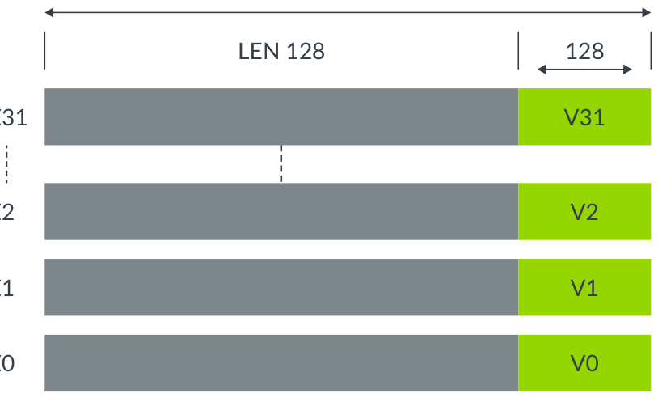
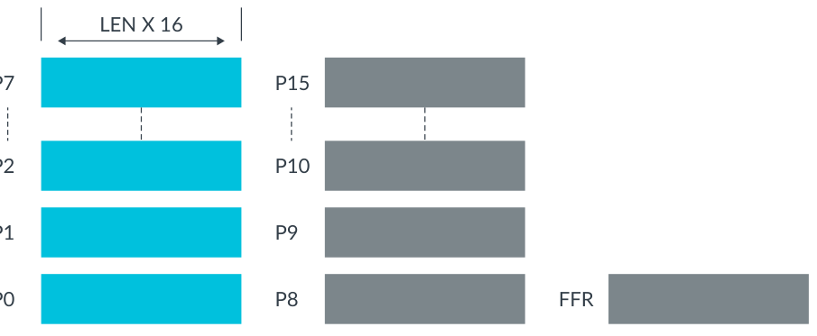
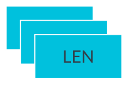
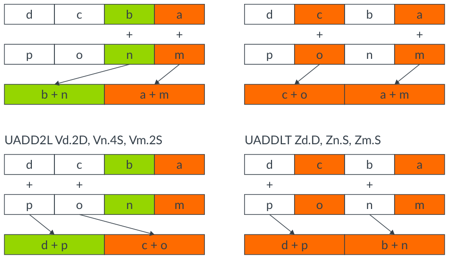

# Learn the architecture — SVE2 入门指南（中文翻译）

> 原文：*Learn the architecture - Introducing SVE2 guide*
>
> 版本：Version 1.0　|　文档 ID：102340_0100_08_en　|　Issue 08（2024-09-04）
>
> 版权 © 2020–2021, 2023–2024 Arm Limited（或其关联公司）。保留所有权利。非保密。

---

## 1. 概述

本指南是 Armv9-A 架构可扩展向量扩展第二版（Scalable Vector Extension version 2，SVE2）的简短入门。在本指南中，你可以了解 SVE2 的概念和主要特性、SVE2 的应用领域，以及 SVE2 与 SVE、Neon 的对比。我们还描述如何为支持 SVE2 的目标开发程序。

**开始之前**

本文假设你已经熟悉以下概念：

- 单指令多数据（SIMD）
- Neon
- 可扩展向量扩展（SVE）

如果你不熟悉这些概念，请阅读：

- Introducing Neon for Armv8-A
- Introduction to SVE
- SVE and Neon coding compared

## 2. SVE2 简介

本节介绍 Arm AArch64 架构的可扩展向量扩展第二版（SVE2）。

在 Neon 架构扩展（其指令集固定为 128 位向量长度）之后，Arm 设计了可扩展向量扩展（SVE）。SVE 是一种新的单指令多数据（SIMD）指令集，作为 AArch64 的扩展使用，以支持灵活的向量长度实现。SVE 提高了架构对高性能计算（HPC）应用的适用性——这些应用需要处理非常大量的数据。

SVE2 是 SVE 和 Neon 的超集。SVE2 在数据级并行中支持更多的功能领域。SVE2 继承了 SVE 的概念、向量寄存器和操作原理。SVE 和 SVE2 定义了 32 个可扩展向量寄存器。芯片合作伙伴可以为硬件选择合适的向量长度设计实现，在 128 位到 2048 位之间变化，以 128 位为增量。SVE 和 SVE2 的优势在于，只有一套向量指令集使用这些可扩展变量。

SVE 的设计理念使开发者能够编写和构建一次软件，然后在具有各种 SVE 向量长度实现的不同 AArch64 硬件上运行相同的二进制文件。二进制的可移植性意味着开发者无需了解其系统的向量长度实现。无需重新构建二进制文件，软件就能更容易地移植。除了可扩展向量之外，SVE 和 SVE2 还包括：

- 逐通道谓词（Per-lane predication）
- 收集加载和分散存储（Gather-load and scatter-store）
- 推测向量化（Speculative vectorization）

这些特性有助于在处理大型数据集时向量化和优化循环。

SVE2 与 SVE 的主要区别在于指令集的功能覆盖范围。SVE 是为 HPC 和 ML 应用设计的。SVE2 扩展了 SVE 指令集，以支持 HPC 和 ML 之外的数据处理领域。SVE2 指令集还可以加速以下应用中使用的常见算法：

- 计算机视觉
- 多媒体
- 长期演进（LTE）基带处理
- 基因组学
- 内存数据库
- Web 服务
- 通用软件

为了帮助编译器在这些领域更有效地向量化，SVE2 在大多数整数数字信号处理（DSP）和媒体处理功能中，添加了与向量宽度无关（vector-width-agnostic）的 Neon 指令版本。

SVE 和 SVE2 都能收集和处理大量数据。

> SVE 和 SVE2 不是 Neon 指令集的扩展。相反，SVE 和 SVE2 是为比 Neon 更好的数据并行性而重新设计的。然而，SVE 和 SVE2 的硬件逻辑覆盖在 Neon 硬件实现之上。当一个微架构支持 SVE 或 SVE2 时，它也支持 Neon。

## 3. SVE2 架构基础

本节介绍 SVE 和 SVE2 共有的基本架构特性。

与 SVE 一样，SVE2 基于可扩展向量。除了 Neon 提供的现有寄存器组之外，SVE 和 SVE2 还添加了以下寄存器：

- 32 个可扩展向量寄存器，Z0-Z31
- 16 个可扩展谓词寄存器，P0-P15
  - 一个首故障谓词寄存器（First Fault predicate Register，FFR）
- 可扩展向量系统控制寄存器 ZCR_Elx

让我们依次看一下每一个。

**可扩展向量寄存器 Z0-Z31**

每个可扩展向量寄存器 Z0-Z31 可以是 128 到 2048 位，以 128 位为增量。低 128 位与 Neon 的固定 128 位 V0-V31 向量共享。

下图展示了可扩展向量寄存器 Z0-Z31：



*图 3-1：可扩展向量寄存器 Z0-Z31*

可扩展向量可以：

- 保存 64、32、16 和 8 位元素
- 支持整数、双精度、单精度和半精度浮点元素
- 在每个异常级别（EL）中配置向量长度

**可扩展谓词寄存器 P0-P15**

下图展示了可扩展谓词寄存器 P0-P15：



*图 3-2：可扩展谓词寄存器 P0-P15*

谓词寄存器通常用作数据操作的位掩码，其中：

- 每个谓词寄存器是 Zx 长度的 1/8。
- P0-P7 是加载、存储和算术的治理谓词（governing predicate）。
- P8-P15 是用于循环管理的额外谓词。
- 首故障寄存器（FFR）用于推测性内存访问。

如果谓词寄存器不用作位掩码，则用作操作数。

**可扩展向量系统控制寄存器 ZCR_Elx**

下图展示了可扩展向量系统控制寄存器 ZCR_Elx：



*图 3-3：可扩展向量系统控制寄存器 ZCR_Elx*

可扩展向量系统控制寄存器指示 SVE 实现特性：

- ZCR_Elx.LEN 字段用于当前和较低异常级别的向量长度。
- 大多数位目前保留供将来使用。

**SVE2 汇编语法**

SVE2 遵循与 SVE 相同的汇编语法格式。以下指令示例展示了这种格式。

示例 1：

```asm
LDFF1D {<Zt>.D}, <Pg>/Z, [<Xn|SP>, <Zm>.D, LSL #3]
```

其中：

- Zt 是向量，Z0-Z31
- D 表示向量和谓词寄存器有已知的元素类型但未知的元素数量
- Pg 是谓词，P0-P15
- Z 是清零谓词（zeroing predication）
- Zm 是收集-分散或向量寻址

示例 2：

```asm
ADD <Zdn>.<T>, <Pg>/M, <Zdn>.<T>, <Zm>.<T>
```

其中：

- M 是合并谓词（merging predication）

示例 3：

```asm
ORRS <Pd>.B, <Pg>.Z, <Pn>.B, <Pm>.B
```

其中：

- S 是谓词条件标志 NZCV 的新解释
- Pg，一个谓词，是一个"位掩码"

**SVE2 继承的关键 SVE 架构特性**

SVE2 继承以下重要的 SVE 架构特性：

- **收集加载和分散存储**

  SVE 中的灵活地址模式支持向量基地址或向量偏移，从而可以从非连续内存位置加载到单个向量寄存器。例如：

```asm
LD1SB  Z0.S, P0/Z, [Z1.S, #4]   // 把有符号字节收集加载到 Z0 的活动 32 位元素，
                                // 地址由 32 位向量基址 Z1 加立即数索引 #4 生成。
LD1SB  Z0.D, P0/Z, [X0, Z1.D]  // 把有符号字节收集加载到 Z0 的活动元素，
                               // 地址由 64 位标量基址 X0 加 Z1.D 中的向量索引生成。
```

- **逐通道谓词（Per-lane predication）**

  为支持对选定元素进行灵活操作，SVE 和 SVE2 引入 16 个治理谓词寄存器 P0-P15，指示向量活动通道上的有效操作。例如：

```asm
ADD Z0.D, P0/M, Z1.D, Z2.D  // 把活动元素 Z1 和 Z2 相加，结果放入 Z0。
                            // P0 指示哪些操作数元素是活动的、哪些是不活动的。
                            // P0 后面的 'M' 表示不活动元素将被合并，即 Z0 的
                            // 不活动元素在 ADD 操作前保持原值。如果 P0 后面
                            // 是 'Z'，则表示不活动元素将在目标向量寄存器中清零。
```

- **谓词驱动的循环控制与管理**

  谓词驱动的循环控制与管理是一种高效的循环控制特性。这个特性通过把活动和不活动元素的索引登记在谓词寄存器中，消除了处理部分向量带来的循环头和循环尾开销。这意味着在下一轮循环中，只有活动元素执行期望的操作。例如：

```asm
WHILEL0 P0.S, x8, x9  // 在 P0 中生成一个谓词：从最低编号元素开始，
                      // 当第一个无符号标量操作数 X8 的递增小于第二个标量
                      // 操作数 X9 时为真，此后为假，直到最高编号元素。
```

- **用于软件管理推测的向量分区**

  SVE 改进了 Neon 对推测加载的向量化限制。SVE 引入首故障向量加载指令（如 LDRFF）和首故障谓词寄存器（FFR），允许向量访问跨越到无效页。例如：

```asm
LDFF1D Z0.D, P0/Z, [Z1.D, #0]  // 以首故障行为把双字收集加载到 Z0 的活动元素，
                               // 地址由向量基址 Z1 加 0 生成。不活动元素不会
                               // 读设备内存或报故障，并在目标向量中清零。
                               // 对有效内存的成功加载会把首故障寄存器（FFR）
                               // 置真，首故障加载会把 FFR 中相应元素及后续
                               // 元素置假。
RDFFR P0.B  // 读首故障寄存器（FFR），并把结果无谓词地放入目标谓词。
```

- **扩展的浮点和按位水平归约**

  SVE 增强了浮点和按位水平归约操作。这些操作的例子包括按序或树状的浮点求和。这些操作在可重复性和性能之间进行权衡。下面是一些示例代码：

```asm
FADDP  Z0.S, P0/M, Z1.S, Z2.S  // 在每个源向量 Z1 和 Z2 内，把相邻浮点元素
                               // 成对相加，并把相应通道的结果交错。交错后的
                               // 结果值被破坏性地放入第一个源向量 Z0。
```

## 4. SVE2 的新特性

本节介绍 SVE2 为 Arm AArch64 架构添加的新特性。

为实现可扩展性能，SVE2 建立在 SVE 的基础上，允许向量实现达到 2048 位。

在 SVE2 中，添加了许多复制 Neon 中现有指令的指令，包括：

- 变换后的 Neon 整数操作，例如有符号绝对差累加（SAB）和有符号减半加法（SHADD）。
- 变换后的 Neon 加宽、收窄和成对操作，例如无符号加长——底部（UADDLB）和无符号加长——顶部（UADDLT）。

元素处理顺序有变化。SVE2 在交错奇偶元素上处理，而 Neon 在低半和高半元素上处理收窄或加宽操作。

下图说明了 Neon 和 SVE2 处理方式之间的区别：



*图 4-1：Neon 与 SVE2 处理方式的区别*

- 复数算术，例如带旋转的复数整数乘加（CMLA）。
- 用于大整数算术和密码学的多精度算术，例如带进位加长——底部（ADCLB）、带进位加长——顶部（ADCLT），以及 SM4 加解密（SM4E）。

为了向后兼容，最新的架构要求 Neon 和 VFP。尽管 SVE2 包含了 SVE 和 Neon 的一些功能，但 SVE2 并不排除芯片上存在 Neon。

SVE2 为 HPC 市场之外的新兴应用提供优化，例如机器学习（ML，UDOT 指令）、计算机视觉（TBL 和 TBX 指令）、基带网络（CADD 和 CMLA 指令）、基因组学（BDEP 和 BEXT 指令）以及服务器（MATCH 和 NMATCH 指令）。

SVE2 增强了通用处理器大量数据操作的整体性能，而无需其他片外加速器。

## 5. 用 SVE2 编程

本节介绍支持 SVE2 应用开发的软件工具和库。本节还描述如何为支持 SVE2 的目标开发应用、在支持 SVE2 的硬件上运行它，以及在任意 Armv8-A 硬件上仿真你的应用。

**软件和库支持**

要构建 SVE 或 SVE2 应用，你必须选择支持 SVE 和 SVE2 特性的编译器。GNU 工具版本 8.0+ 支持 SVE。Arm Compiler for Linux 版本 18.0+ 支持 SVE，版本 20.0+ 同时支持 SVE 和 SVE2。GNU 工具和 Arm Compiler for Linux 都支持优化 C/C++/Fortran 代码。LLVM（开源 Clang）版本 5 及以上包含对 SVE 的支持，版本 9 及以上包含对 SVE2 的支持。要了解每个版本的 LLVM 工具支持哪些 SVE 或 SVE2 特性，请参见 LLVM toolchain SVE support 页面。

Arm Performance Libraries 对数学例程做了高度优化，可以链接到你的应用。Arm Performance Libraries 版本 19.3+ 支持 SVE 的数学库。

Arm Compiler for Linux 是 Arm Allinea Studio 的一部分，包含 Arm C/C++ Compiler、Arm Fortran Compiler 和 Arm Performance Libraries。

**如何为 SVE2 编程**

有几种方式可以编写或生成 SVE 和 SVE2 代码。在本节中，我们探讨其中一些。

要编写或生成 SVE 和 SVE2 代码，你可以用 SVE 和 SVE2 指令编写汇编，或在 C/C++/Fortran 应用中使用内建函数。你可以让编译器自动向量化你的代码，并使用 SVE 优化库。让我们看看每个选项。

- **编写汇编代码**：你可以使用 SVE 指令编写汇编文件，或使用 GNU 风格的内联汇编。例如：

```asm
        .globl  subtract_arrays         // -- Begin function
            .p2align        2
            .type   subtract_arrays,@function
    subtract_arrays:               // @subtract_arrays
            .cfi_startproc
    // %bb.0:
            orr     w9, wzr, #0x400
            mov     x8, xzr
            whilelo p0.s, xzr, x9
    .LBB0_1:                       // =>This Inner Loop Header: Depth=1
            ld1w    { z0.s }, p0/z, [x1, x8, lsl #2]
            ld1w    { z1.s }, p0/z, [x2, x8, lsl #2]
            sub     z0.s, z0.s, z1.s
            st1w    { z0.s }, p0, [x0, x8, lsl #2]
            incw    x8
            whilelo p0.s, x8, x9
            b.mi    .LBB0_1
    // %bb.2:
            ret
```

要用汇编编程，你必须了解 SVE 和 SVE2 的应用二进制接口（ABI）标准更新。Arm 架构的过程调用标准（AAPCS）规定了数据类型和寄存器分配，与汇编编程最相关。AAPCS 要求：

- Z0-Z7、P0-P3 用于参数和结果传递。
- Z8-Z15、P4-P15 是被调用方保存（callee-saved）的寄存器。
- Z16-Z31 是可破坏（corruptible）的寄存器。

- **使用指令函数**：你可以在高级语言（如 C、C++ 或 Fortran）中直接调用与相应 SVE 指令匹配的指令函数。这些指令函数有时被称为内建函数（intrinsic），在 ACLE（SVE 的 Arm C Language Extension）中有详细说明。内建函数是与相应指令匹配的函数，程序员可以在高级语言（如 C、C++ 或 Fortran）中直接调用它们。编译后，指令函数被替换为特定指令。SVE 的 ACLE 文档还包含程序员可以使用的 SVE2 指令函数的完整列表。例如，使用以下代码：

```c
//intrinsic_example.c
    #include <arm_sve.h>
    svuint64_t uaddlb_array(svuint32_t Zs1, svuint32_t Zs2)
    {
             // 偶元素的加宽加法
        svuint64_t result = svaddlb(Zs1, Zs2);
        return result;
    }
```

使用 Arm C/C++ Compiler 编译代码，如下所示：

```shell
armclang -O3 -S -march=armv8-a+sve2 -o intrinsic_example.s intrinsic_example.c
```

这生成汇编代码，如下所示：

```asm
//instrinsic_example.s
    uaddlb_array:                           // @uaddlb_array
            .cfi_startproc
    // %bb.0:
            uaddlb  z0.d, z0.s, z1.s
            ret
```

这个例子使用 Arm Compiler for Linux 20.0。

- **自动向量化**：C/C++/Fortran 编译器，例如 Arm Compiler for Linux 和 GNU 编译器（用于 Arm 平台），从 C/C++/Fortran 循环生成 SVE 和 SVE2 代码。要生成 SVE 或 SVE2 代码，为 SVE 或 SVE2 特性选择合适的编译器选项。例如，使用 armclang，一个启用 SVE2 优化的选项是 -march=armv8-a+sve2。如果你想使用 SVE 版本的库，把 -march=armv8-a+sve2 与 -armpl=sve 结合使用。

- **使用为 SVE 和 SVE2 优化的库**：已经有一些高度优化的 SVE 库可用，例如 Arm Performance Libraries 和 Arm Compute Libraries。Arm Performance Libraries 包含 BLAS、LAPACK、FFT、稀疏线性代数和 libamath 优化数学函数的高度优化实现。你必须安装 Arm Allinea Studio 并在代码中包含 armpl.h，才能链接任何 ArmPL 函数。要用 Arm Compiler for Linux 使用 ArmPL 构建应用，你必须在命令行指定 -armpl=<arg>。如果你使用 GNU 工具，你必须在命令行包含 ArmPL 安装路径，并指定与 Arm Compiler for Linux 的 -armpl=<arg> 选项等价的 GNU 选项。

**如何运行 SVE 和 SVE2 应用：硬件和模型**

如果你没有 SVE 硬件，可以使用模型和仿真器来开发代码。有几种模型和仿真器可供选择：

- QEMU：交叉和本机模型，支持在带 SVE 的 Arm AArch64 平台上建模。
- Fast Models：跨平台模型，支持在带 SVE 的 Arm AArch64 平台上建模。带 SVE2 支持的架构包络模型（AEM）可供领先合作伙伴使用。
- Arm 指令仿真器（ArmIE）：直接在 Arm 平台上运行。支持 SVE，从版本 19.2+ 起支持 SVE2。

## 6. 知识自测

通过以下问题，你可以检验所学知识：

**SVE2 从 SVE 继承了哪些东西？**

SVE2 继承了 SVE 的基础架构特性，包括向量、系统控制寄存器和指令。

**SVE2 的向量是什么？**

SVE2 使用与 SVE 相同的 Z0-Z31 向量、P0-P15 谓词寄存器和 FFR 谓词寄存器。

**SVE2 向量可以有多少位？**

Z0-Z31 可以实现从 128 位到 2048 位（以 128 为增量）。

**除了 SVE 添加的特性之外，SVE2 还支持哪些特性？**

SVE 是为 HPC 设计的，而 SVE2 扩展了 SVE 指令集，以满足通用软件、Web 服务服务器、计算机视觉、多媒体、LTE 基带处理、基因组学和内存数据库等应用领域的需求。

**与传统 SIMD 指令集（例如 Neon）相比，SVE2 有哪些优势？**

与 Neon 相比，SVE2 的优势包括：

- SVE2 程序可以构建一次，然后在各种向量长度的硬件上运行。
- SVE2 有更多的向量化灵活性。
- SVE2 扩展了指令集，支持更多应用领域。

## 7. 相关信息

以下是与本指南内容相关的一些资源：

- Arm 架构探索工具（Arm architecture exploration tools）
- Arm Architecture Reference Manual Supplement – The Scalable Vector Extension (SVE) for Armv8-A
- Arm Community —— 提出开发问题，查找 Arm 专家关于特定主题的文章和博客。
- Arm 指令仿真器（ArmIE）
- Arm SVE intrinsics
- ACLE（SVE（及 SVE2）的 Arm C Language Extensions）
- Fast Models
- Introduction to Scalable Vector Extension (SVE)
- Neon
- QEMU
- Server and HPC software tooling documentation
- SVE 和 SVE2 指令信息：Arm A64 Instruction Set Architecture: Future Architecture Technologies in the A architecture profile
- SVE Supplement to Armv8-A ARM：ARM Architecture Reference Manual Supplement – The Scalable Vector Extension (SVE) for Armv8-A
- The Procedure Call Standard for Arm Architecture (AAPCS)
- 在 HPC 应用移植指南中了解更多关于把代码移植到 Arm 或 Arm SVE 硬件的信息：
  - Porting and Optimizing HPC Applications for Arm SVE
  - Porting and Optimizing HPC Applications for Arm
