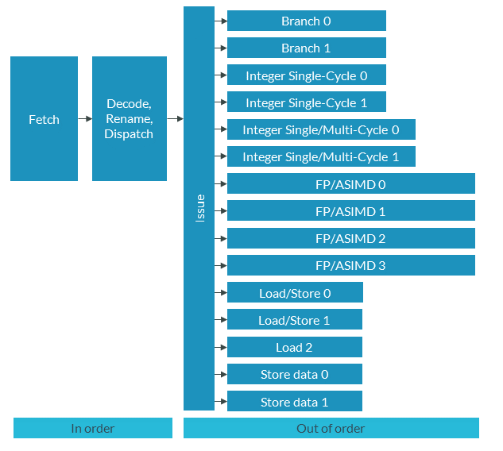

# SVE 优化指南（中文翻译）

> 原文：*SVE Optimization Guide*（文档 ID：102699，Issue 01，2021-10-14）
>
> 版权 © 2021 Arm Limited（或其关联公司）。保留所有权利。非保密。

---

## 1. 概述

可扩展向量扩展（SVE）是 Armv8-A 架构的一个扩展，从 Armv8.2-A 起可用。

SVE 旨在通过相比 Neon（Arm 现有的 Advanced SIMD 指令集）更强的向量化，提升 Arm 处理器的整数和浮点性能。

SVE 的应用包括机器学习（ML）、高性能计算（HPC）、数据分析，以及任何可能受计算限制的软件。更完整的介绍请参见《Introduction to SVE》指南。

SVE2 是 SVE 之后下一阶段的架构扩展。SVE2 的主要新特性如下：

- 扩展的指令集，旨在复刻 Neon 的完整功能
- 扩展指令以覆盖更广泛的应用领域

本指南中的示例同时适用于 SVE 和 SVE2。本指南不区分 SVE 和 SVE2，因为 SVE 指令集架构（ISA）是 SVE2 ISA 的子集。为 SVE 编写的代码无需修改即可在 SVE2 机器上运行。

本指南展示如何在 C 和 C++ 代码中使用 SVE，以及如何执行一些基本优化。我们对比一个数值例程在纯 C、ACLE SVE 内建函数和 SVE 汇编三种实现下的表现。对比这几种不同 SVE 用法的性能，将展示一些用 SVE 优化代码的技巧。

任何 C 或 C++ 程序员都应该能使用本指南，但有一些使用内建函数或编写 Arm 汇编代码的经验会有所帮助。本指南面向：

- SVE 初学者
- 想使用 SVE 的库编写者
- 其他测试和试验 SVE 的人

在本指南末尾，"知识自测"会检验你是否理解了以下概念：

- 在 C 语言中使用 SVE 内建函数的基础
- 在哪里找到 SVE 内建函数参考和 SVE 指令集
- 如何结合 C 和汇编代码

## 2. 用于优化的高级 SVE 特性

SVE 的决定性特征是**可变向量宽度的向量寄存器组**。SVE 的设计使向量寄存器的大小**无需在编译时已知**。单个二进制镜像可以运行在任何实现 SVE 的微架构上，无论该实现使用的向量宽度是多少。

SVE 为 Arm 架构增加了以下功能：

- 可配置的向量长度，从 128 位到 2048 位，以 128 位为倍数。
- 谓词（Predication），一种控制向量中哪些元素活动的手段。
- 支持谓词和不同向量长度的专用 SIMD 指令集。
- 收集加载和分散存储指令。
- 对软件管理推测向量化的支持。

这些功能定义在《Arm Architecture Reference Manual Supplement, The Scalable Vector Extension》中。

有四种主要方式可以编写使用 SVE 的代码：

- 支持 SVE 的库（如 Arm Performance Libraries）是利用 SVE 最简单的方式之一。
- 各种编译器特性（如自动向量化）可以使用 SVE。
- SVE 内建函数是编译器会用相应 SVE 指令替换的函数调用。SVE 内建函数让你直接从 C 和 C++ 代码访问大部分 SVE 指令集。
- SVE 汇编在某些应用中性能极佳，但难以编写和维护。

SVE 的完整介绍请参考 SVE 程序员指南。

## 3. 用自动向量化优化

Arm Compiler for Linux 基于 LLVM Clang，它有两个自动向量化特性：循环向量化，以及超字级并行（SLP）向量化。

循环向量化器为特定循环计算最优的循环展开量和向量化程度。循环展开是有益的，因为它增加了每次循环迭代执行的操作数量。循环展开还能启用 SIMD 指令集（如 NEON 或 SVE）。

SLP 向量化使编译器能把多个邻近的独立操作组合成一条向量指令。

自动向量化提供以下好处：

- 易用。只用编译器标志和 #pragma 指令就能控制自动向量化。
- 可移植。用 -mcpu 编译器选项，同样的源代码可以轻松地为不同目标 CPU 重新编译。

然而，自动向量化有以下缺点：

- 缺乏控制。你依赖编译器的代码生成选择，它可能不产生你想要的指令。
- 性能。如果自动向量化器未能识别某个优化机会，某些循环就必须用手动方式（内建函数或汇编）向量化。

### 3.1 自动向量化的提示与技巧

使用以下编译器标志控制源代码中所有循环的自动向量化：

| 编译器选项 | 描述 | 备注 |
| --- | --- | --- |
| -fvectorize | 启用循环向量化器 | 在 -O2 及以上默认开启 |
| -no-fvectorize | 禁用循环向量化器 | 在 -O1 和 -O0 默认关闭 |
| -mllvm -force-vector-width=<value> | 设置 SIMD 向量宽度 | 循环向量化器会把操作向量化成这个宽度的 SIMD 操作 |
| -mllvm -force-vector-interleave=<value> | 设置循环展开因子 | 循环向量化器会按 <value> 展开循环 |
| -fno-slp-vectorize | 禁用 SLP 向量化器 | SLP 向量化默认开启 |
| -Rpass=loop-vectorize | 对成功向量化的循环给出提示 | — |
| -Rpass-missed=loop-vectorize | 对未向量化的循环给出提示 | — |
| -Rpass-analysis=loop-vectorize | 对导致向量化失败的代码语句给出提示 | — |

表 1：自动向量化的编译器选项

要控制单个循环的向量化，使用以下 pragma：

| Pragma | 描述 |
| --- | --- |
| #pragma clang loop vectorize(enable) | 启用向量化。 |
| #pragma clang loop vectorize(disable) | 禁用向量化。 |
| #pragma clang loop interleave(enable) | 启用循环展开。 |
| #pragma clang loop interleave(disable) | 禁用循环展开。 |
| #pragma clang loop vectorize_width(2) | 启用向量化并设置 SIMD 向量宽度。 |
| #pragma clang loop interleave_count(2) | 启用循环展开并设置展开计数。 |
| #pragma clang loop vectorize(assume_safety) | 指示编译器假设循环的连续迭代是独立的。 |

表 2：循环向量化的 pragma

pragma 必须放在循环之前，并且只作用于该循环。对于每个循环，LLVM 使用代价模型来权衡展开和向量化的预期性能收益，与代码大小、循环尾和额外指令的增加。pragma 作为忽略这个代价模型的提示，但不保证被遵守。

要提高循环被向量化的机会，考虑以下几点：

- 避免循环迭代之间的依赖
- 避免 switch 语句
- 使用 -Rpass-analysis=loop-vectorize 来理解代码为什么没有向量化
- 在优化级别 -O2 或更高编译来启用优化
- 在特定循环上使用 pragma 控制向量化

### 3.2 自动向量化示例：SAXPY

单精度按比例缩放 x 加 y（SAXPY，Single-precision scaled x plus y）是一个定义向量加法的 L1 BLAS 例程。SAXPY 常用于数值软件。由于该例程定义了一个基本数学运算，优化 SAXPY 可以为信号处理、HPC、ML 或游戏引擎设计等领域的应用提供性能提升。

考虑以下操作：y[i] ← a*x[i] + y[i]。这个操作取一个数据数组 x[i]，乘以标量 a，然后加上 y[i]，再赋回给 y。一个简单的 C 实现如下：

```c
#include <arm_sve.h>

void saxpy_c(float32_t *x, float32_t *y, float32_t a, uint32_t n) {
        // 按比例缩放向量加：y = a*x + y
        int i;
        for (i=0; i<n; i++) {
                y[i] = a*x[i] + y[i];
        }
}
```

由于循环的所有迭代都相互独立，这个例子可以通过向量化加法和赋值来优化：y[i] = a*x[i] + y[i]。然后我们可以对比有无向量化的反汇编。

下面是用 `armclang -march=armv8.2-a+sve -O1` 编译产生的代码（不做向量化）：

```asm
0000000000000000 <saxpy_c>:
       0: cbz     w2, 0x24 <saxpy_c+0x24>
       4: mov     w8, w2
       8: ldr     s1, [x0], #4
       c: ldr     s2, [x1]
      10: subs    x8, x8, #1
      14: fmul    s1, s1, s0
      18: fadd    s1, s1, s2
      1c: str     s1, [x1], #4
      20: b.ne    0x8 <saxpy_c+0x8>
      24: ret
```

FMUL 和 FADD 指令执行 a*x[i] + y[i] 操作，操作的是标量浮点寄存器 s1 和 s0，而不是向量寄存器。尽管 Armv8.2-A 架构包含 NEON FMUL 和 FADD 操作，但在优化级别 -O1 下没有使用任何向量操作。

作为对比，下面是用优化级别 -O2（启用自动向量化）编译产生的代码：

```asm
0000000000000000 <saxpy_c>:
       0: cbz     w2, 0x70 <saxpy_c+0x70>
       4: mov     w8, w2
       8: lsl     x9, x8, #2
       c: add     x10, x0, x9
      10: cmp     x10, x1
      14: b.ls    0x44 <saxpy_c+0x44>
      18: add     x9, x1, x9
      1c: cmp     x9, x0
      20: b.ls    0x44 <saxpy_c+0x44>
      24: ldr     s1, [x0], #4
      28: ldr     s2, [x1]
      2c: subs    x8, x8, #1
      30: fmul    s1, s1, s0
      34: fadd    s1, s1, s2
      38: str     s1, [x1], #4
      3c: b.ne    0x24 <saxpy_c+0x24>
      40: b       0x70 <saxpy_c+0x70>
      44: mov     x9, xzr
      48: whilelo p0.s, xzr, x8
      4c: mov     z0.s, s0
      50: ld1w    { z1.s }, p0/z, [x0, x9, lsl #2]
      54: ld1w    { z2.s }, p0/z, [x1, x9, lsl #2]
      58: fmul    z1.s, z1.s, z0.s
      5c: fadd    z1.s, z1.s, z2.s
      60: st1w    { z1.s }, p0, [x1, x9, lsl #2]
      64: incw    x9
      68: whilelo p0.s, x9, x8
      6c: b.mi    0x50 <saxpy_c+0x50>
      70: ret
```

现在让我们对比快速优化 -Ofast：

```asm
0000000000000000 <saxpy_c>:
       0: cbz     w2, 0x6c <saxpy_c+0x6c>
       4: mov     w8, w2
       8: lsl     x9, x8, #2
       c: add     x10, x0, x9
      10: cmp     x10, x1
      14: b.ls    0x40 <saxpy_c+0x40>
      18: add     x9, x1, x9
      1c: cmp     x9, x0
      20: b.ls    0x40 <saxpy_c+0x40>
      24: ldr     s1, [x0], #4
      28: ldr     s2, [x1]
      2c: subs    x8, x8, #1
      30: fmadd   s1, s1, s0, s2
      34: str     s1, [x1], #4
      38: b.ne    0x24 <saxpy_c+0x24>
      3c: b       0x6c <saxpy_c+0x6c>
      40: mov     x9, xzr
      44: whilelo p1.s, xzr, x8
      48: mov     z0.s, s0
      4c: ptrue   p0.s
      50: ld1w    { z1.s }, p1/z, [x0, x9, lsl #2]
      54: ld1w    { z2.s }, p1/z, [x1, x9, lsl #2]
      58: fmad    z1.s, p0/m, z0.s, z2.s
      5c: st1w    { z1.s }, p1, [x1, x9, lsl #2]
      60: incw    x9
      64: whilelo p1.s, x9, x8
      68: b.mi    0x50 <saxpy_c+0x50>
      6c: ret
```

对比 -O2 编译时的第 58 和 5C 行，与 -Ofast 的第 58 行。我们可以看到 -Ofast 与 -O2 的主要区别是出现了 FMAD——一条融合乘加指令，而不是 FMUL 和 FADD。由于这个计算现在只需要一条指令，循环中可能有小的性能提升。

## 4. 用内建函数优化

SVE 内建函数是定义在 arm_sve.h 头文件中的一组函数和宏。这些函数的定义对编译器是已知的，指令集架构（ISA）与内建函数之间有密切的对应关系。例如，svld1 内建函数对应 LD1 指令的各种形式。使用内建函数让你控制 SVE 代码生成，而不需要汇编编程。

内建函数的规范请参见《ARM C Language Extensions for SVE》。

内建函数提供以下好处：

- 强大。内建函数允许程序员内联汇编代码，而无需显式地用汇编编程。
- 可移植。包含内建函数的代码可以通过设置 -mcpu 选项为不同的 SVE 平台编译。不过，这可能不会产生相同的性能。
- 灵活。程序员可以在同一个程序中使用内建函数或 C/C++ 代码。

然而，内建函数有以下缺点：

- 易用性。内建函数的学习曲线可能使其不适合某些项目。需要对目标硬件有一些了解。
- 性能。用户优化的汇编可能仍然提供最大的性能提升空间。
- 对许多项目，编译器自动向量化可能已经足够。
- 性能可移植性。为一个平台编写的内建函数代码可能在另一个平台上表现不佳。

Arm 推荐使用内建函数而不是汇编，因为内建函数代码更容易移植和维护。

应用 SVE 内建函数的关键是阅读《ARM C Language Extensions for SVE》规范。本指南的以下章节概述了该规范的一些重要部分。

### 4.1 宏

以下宏指示编译器启用了哪些特性。

| 宏 | 描述 |
| --- | --- |
| __ARM_FEATURE_SVE==1 | 编译器启用 SVE，内建函数可用 |
| __ARM_FEATURE_SVE_BF16==1 | 启用 BFloat16 扩展 |
| __ARM_FEATURE_SVE_MATMUL_INT8==1 | 启用 INT8 矩阵乘法扩展 |
| __ARM_FEATURE_SVE_MATMUL_FP32==1 | 启用 FP32 矩阵乘法扩展 |
| __ARM_FEATURE_SVE_MATMUL_FP64==1 | 启用 FP64 矩阵乘法扩展 |
| __ARM_FEATURE_SVE2==1 | 编译器启用 SVE2，SVE2 内建函数可用 |
| __ARM_FEATURE_SVE2_BITPERM==1 | SVE2 位置换指令可用 |
| __ARM_FEATURE_SVE2_AES==1 | 启用 SVE2 AES-128 函数 |
| __ARM_FEATURE_SVE2_SHA3==1 | 启用 SVE2 SHA-3 函数 |
| __ARM_FEATURE_SVE2_SM4==1 | SM4 函数可用 |
| __ARM_FEATURE_SVE_BITS==N | 编译器为已知 SVE 向量长度的目标生成代码 |
| __ARM_FEATURE_SVE_VECTOR_OPERATORS==1 | 若 __ARM_FEATURE_SVE_BITS 非零，SVE 向量类型支持 GNU 向量扩展 |
| __ARM_FEATURE_SVE_PREDICATE_OPERATORS==1 | 若 __ARM_FEATURE_SVE_BITS 非零，svbool_t 支持向量操作 |
| __ARM_FEATURE_SVE_NONMEMBER_OPERATORS==1 | C++ 代码可以为 SVE 类型定义非成员运算符函数 |

表 3：宏

### 4.2 类型

ACLE 规范定义了几种无大小（sizeless）类型。无大小类型是必要的，因为 SVE 向量寄存器的长度对编译器是未知的。算术类型遵循以下模式：

```
sv<type>_t
```

例如，16 位有符号整数的可扩展向量类型是：svint16_t。

还有一个类型 svbool_t 用于表示谓词。

### 4.3 函数

SVE 内建函数使用以下通用命名约定：

```
svbase[_disambiguator][_type0][_type1]…[_predication]
```

其中：

- base 是指令的名称。例如，svmla_n_f32_m() 对应 MLA 指令。
- _disambiguator 指示函数的任何特殊行为。例如，svld1_gather_s32_offset_u32() 指示收集加载 LD1。
- _type0、_type1 等指示所操作向量的类型。例如，svld1_f32() 加载 32 位浮点。
- _predication 指示清零（z）或合并（m）操作。谓词控制向量中哪些通道活动、哪些不活动。清零操作把不活动元素置零，合并操作保持现有不活动元素不变。

### 4.4 内建函数的提示与技巧

用内建函数编写代码与编写标准 C 代码非常相似。编译器自动化了许多优化，包括：

- 变量到寄存器的优化分配。
- 过程调用标准规则的应用。
- 循环中任何剩余无内建函数部分的自动向量化。
- 指令选择——没有内建函数的地方，编译器会选择最优指令。

然而，程序员负责以下内容：

- 内建函数选择。程序员必须为程序选择正确的内建函数。程序员必须了解指令时序以手动优化程序。
- 循环展开。程序员必须展开包含内建函数的循环。循环尾必须手动编写。
- 向量化。必须选择正确的向量加载、存储和算术操作。

### 4.5 内建函数示例：SAXPY

本节解释如何把 SAXPY 分解成部分并用内建函数实现。SAXPY 有两个部分：

- 算术操作 y[i] ← a*x[i] + y[i]
- 遍历所有值的循环

使用 SVE 内建函数，我们必须通过考虑需要哪些指令来重新思考循环和操作。

我们需要以下内容：

- 向量长度的一个度量，用于递增循环
- 一个遍历向量的循环
- 一个治理谓词，确保没有越界内存访问
- 加载操作以获取值 x[i] 和 y[i]
- 执行乘法（a*x[i]）和加法（+y[i]）的浮点操作
- 对乘加结果进行存储的操作

一旦我们知道要寻找什么、使用什么类型，就可以用 SVE 内建函数规范来识别我们需要的内建函数。

下面的代码展示了使用 SVE 内建函数的 SAXPY C 实现：

```c
#include <arm_sve.h>

void saxpy_sve(float32_t *x, float32_t *y, float32_t a, uint32_t n) {
        uint32_t i;

        // 定义谓词和 x/y 的"活动"段
        svbool_t predicate;
        svfloat32_t xseg;
        svfloat32_t yseg;

        // 获取正在使用的向量长度，以便知道如何递增循环 (1)
        uint64_t numVals = svlen_f32(xseg);

        for (i=0; i<n; i+=numVals) { // (2)
                // 根据循环计数器设置谓词 (3)
                predicate = svwhilelt_b32_s32(i, n);

                // 加载一个向量宽度的 x 和 y 值 (4)
                xseg = svld1_f32(predicate, x+i); // 对 x 的 ld1w
                yseg = svld1_f32(predicate, y+i); // 对 y 的 ld1w

                // 用 MLA 一次完成 a*x[i] + y[i] 操作 (5)
                yseg = svmla_n_f32_m(predicate, yseg, xseg, a);  // y+a*x

                // 存储 y 值 (6)
                svst1_f32(predicate, y+i, yseg); // 对 y 的 st1w，y <- y+a*x
        }
}
```

这段代码使用以下内建函数：

| 代码元素 | 描述 | 为什么使用它？ |
| --- | --- | --- |
| svbool_t | SVE bool 类型声明 | 我们需要一个特殊类型让编译器表示谓词寄存器 |
| svfloat32_t | SVE float32_t 类型声明 | 由于编译器必须生成向量长度无关的代码，我们需要一个特殊的无大小类型来表示可扩展向量寄存器 |
| svlen_f32() | 对应 CNTB、CNTD、CNTH、CNTW 指令（这里是 CNTW） | 我们需要知道 SVE 向量有多长来递增循环。svlen_f32() 让我们在运行时确定这一点 |
| svwhilelt_b32_s32() | 对应 WHILELO/WHILELE 指令 | svwhilelt_b32_s32() 根据循环计数器和循环长度设置谓词。当计数器接近长度时，svwhilelt_b32_s32() 把零写入谓词，从而防止越界加载和存储 |
| svld1_f32() | 对应 LD1 指令 | SVE 内建函数向程序员暴露显式的加载/存储操作，用于从内存获取数据 |
| svmla_n_f32_m() | 对应 MLA 指令 | 由于 MLA 指令执行 a*b + c，它非常适合我们执行的操作 |
| svst1_f32() | 对应 ST1 指令 | SVE 内建函数向程序员暴露显式的加载/存储操作，用于把数据存回内存 |

表 4：代码内建函数

我们可以检查反汇编来查看生成的指令：

```asm
saxpy_sve(float*, float*, float, unsigned int):   // @saxpy_sve(...)
        cbz     w2, .LBB0_3
        rdvl    x9, #1
        lsr     x9, x9, #4
        mov     w8, wzr
        lsl     w9, w9, #2
        mov     z0.s, s0
.LBB0_2:                                // =>This Inner Loop Header: Depth=1
        whilelt p0.s, w8, w2
        mov     w10, w8
        ld1w    { z1.s }, p0/z, [x0, x10, lsl #2]
        ld1w    { z2.s }, p0/z, [x1, x10, lsl #2]
        add     w8, w8, w9
        cmp     w8, w2
        fmla    z2.s, p0/m, z1.s, z0.s
        st1w    { z2.s }, p0, [x1, x10, lsl #2]
        b.lo    .LBB0_2
.LBB0_3:
        ret
```

## 5. 用汇编优化

除了使用 C/C++ 等高级语言，我们可以用汇编代码编写程序，显式指定指令。这些指令随后由汇编器汇编成处理器可执行的机器码。

armclang 等编译器有内置的汇编器。

编写汇编代码有以下优点：

- 控制。程序完全按程序员的指定。
- 性能。直接用汇编编码可能实现极佳性能，但程序员必须胜过编译器。现代编译器在许多情况下很难被击败。

然而，编写汇编代码也有以下缺点：

- 缺乏可移植性。为一个处理器编写的代码，如果 ISA 不同，可能无法在另一个处理器上运行。例如，SVE 汇编代码能在 Cortex-X2 上运行，但不能在 Cortex-A72 上运行。程序员必须重写代码。
- 缺乏性能可移植性。程序必须为你想要运行代码的特定处理器调优。在不同处理器上运行代码可能会有性能损失。
- 困难。汇编编程的学习曲线陡峭。
- 难维护。理解现有的汇编程序可能很困难，使其在长期项目中难以维护。
- 硬件没有被抽象，程序员必须了解缓存、流水线和内存系统等实现细节，才能编写最优程序。

### 5.1 汇编提示与技巧

用汇编编程是困难的，因为程序必须手工编写。从程序正确性到优化的一切都是程序员的责任。

**5.1.1 指令选择**

以下提示与指令选择相关：

- 指令在不同的微架构实现上可能有不同的执行时间。程序员必须选择使用哪些指令来手动优化程序。
- 注意某些指令在性能和便利性之间的权衡，例如收集加载和分散存储。
- 某些逻辑操作（如 CSEL）在非常不可预测的分支中可能比分支指令表现更好。然而，正常的可预测分支比 CSEL 这样的指令表现更好。
- 如果你能把查找表放进一个向量，TBL 这样的指令可以获得性能提升。

**5.1.2 寄存器使用**

以下提示与寄存器使用相关：

- 始终遵守过程调用标准。
- 在值被使用之前，尽早加载寄存器，以避免流水线停顿。
- 移动、加载和存储都有代价。尽可能长时间地把单个值保留在寄存器中。
- 在可能的情况下，把目标寄存器立即用作下一条指令的源寄存器。这最小化了寄存器使用。
- 通过把寄存器溢出到栈来备份寄存器，以确保值不会丢失或损坏。

**5.1.3 循环**

循环展开可以通过提高流水线效率来提升性能。考虑以下 Cortex-X2 的流水线图：



*图 1：Cortex-X2 流水线图*

如果每个循环迭代都与前后迭代独立，循环展开带来的额外算术指令可以发射到不同的流水线。由于我们有四条整数和四条浮点流水线，我们至少可以把循环展开四次来充分利用它们。Cortex-X2 软件优化指南包含对程序员有用的 Cortex-X2 具体信息，包括：

- 指令时序
- 流水线图
- 关于内存系统和缓存利用的信息

**5.1.4 缓存**

以下提示与缓存相关：

- 加载和存储指令的顺序影响数据被加载进缓存和从缓存驱逐的情况。
- 提前把数据预加载进缓存可能有助于提升性能。然而，误用这些指令可能导致缓存中丢失有用数据，从而降低性能。

### 5.2 汇编示例：SAXPY

让我们看看 SAXPY 的汇编内核是如何构建的。首先，我们必须定义 C 代码和汇编内核之间的接口。在 C 代码中我们添加以下声明：

```c
extern void saxpy_asm(float32_t *x, float32_t *y, float32_t a, uint32_t n);
```

这创建了函数符号，签名定义了输入参数。输入参数的顺序很重要，因为它决定了这些值将在哪些寄存器中。完整的规则集定义在过程调用标准中，我们在下表中应用它们：

| 输入参数 | 对应寄存器 | 备注 |
| --- | --- | --- |
| float32_t *x | x0 | AArch64 中的 64 位指针 |
| float32_t *y | x1 | AArch64 中的 64 位指针 |
| float32_t a | s0 | v0 的低 32 位 |
| uint32_t n | w2 | x2 的低 32 位 |

表 5：输入参数

现在我们在 C 中定义了接口，就可以在单独的文件中编写汇编内核，将其编译并链接到我们的 C 代码。汇编如下：

```asm
/* SAXPY, scaled X plus Y
 * extern void saxpy_asm(float32_t *x, float32_t *y, float32_t a, uint32_t n)
 * Y <- Y + a*X
 */

# 输入参数别名
x_base_addr .req    x0
y_base_addr .req    x1
a   .req    s0
n   .req    x2

# 局部变量别名
p_op    .req    p0
i_idx   .req    x5

a_vals  .req    z0
x_vals  .req    z1
y_vals  .req    z2

#define RZERO(register) eor register, register, register

    .global saxpy_asm
    .type   saxpy_asm, %function
saxpy_asm:
    // 保存状态，过程调用标准中的规则
    stp x29, x30, [sp, #-320]!
    mov x29, sp
    stp x19, x20, [sp, #224]
    stp x21, x22, [sp, #208]
    stp x23, x24, [sp, #192]
    stp x25, x26, [sp, #176]
    stp x27, x28, [sp, #160]
    stp d8, d9,   [sp, #80]
    stp d10, d11, [sp, #64]
    stp d12, d13, [sp, #48]
    stp d14, d15, [sp, #32]

    RZERO(i_idx)
    dup a_vals.s, a_vals.s[0]

.L_loop:
    // 根据索引和值总数设置谓词
    whilelo p_op.s, i_idx, n

    // 加载 x 和 y 值
    ld1w x_vals.s, p_op/z, [x_base_addr, i_idx, lsl 2]
    ld1w y_vals.s, p_op/z, [y_base_addr, i_idx, lsl 2]

    // 执行 y <- a*x + y 操作
    fmla y_vals.s, p_op/m, a_vals.s, x_vals.s

    // 把新的 y 值存回覆盖旧值
    st1w y_vals.s, p_op, [y_base_addr, i_idx, lsl 2]

.L_cond:
    // 索引按 Z 寄存器中 32 位值的数量递增
    incw i_idx
    b.first .L_loop

.L_saxpy_asm_end:
    // 恢复状态
    ldp x19, x20, [sp, #224]
    ldp x21, x22, [sp, #208]
    ldp x23, x24, [sp, #192]
    ldp x25, x26, [sp, #176]
    ldp x27, x28, [sp, #160]
    ldp d8, d9,   [sp, #80]
    ldp d10, d11, [sp, #64]
    ldp d12, d13, [sp, #48]
    ldp d14, d15, [sp, #32]
    ldp x29, x30, [sp], #320
    ret
```

## 6. 完整代码清单

本指南的这一节包含 C 代码清单，包括辅助函数。这段代码也可以作为归档文件从 Arm Developer 站点下载。

使用 Arm Compiler for Linux，我们可以如下编译代码：

```shell
armclang -march=armv8.2a+sve -g -O3 -c saxpy_example.c -o saxpy_example.o
armclang -march=armv8.2a+sve -g -O3 -c saxpy_asm.S -o saxpy_asm.o
```

然后链接目标文件：

```shell
armclang -march=armv8.2a+sve -g -O3 saxpy_example.o saxpy_asm.o -o saxpy.out
```

这些步骤以及代码都包含在提供的归档文件的 Makefile 中。

如果你有一个没有 SVE 的 Arm 系统，可以用 Arm 指令仿真器运行 SVE 代码：

```shell
armie -msve-vector-bits=128 ./saxpy.out
```

### 6.1 saxpy_example.c

saxpy_example.c 源文件的代码清单如下（含 saxpy_c、saxpy_sve、saxpy_asm 声明、vecprint、vecset 和 main，详见原文及配套代码）：

```c
#include <arm_sve.h>
#include <stdio.h>

void saxpy_c(float32_t *x, float32_t *y, float32_t a, uint32_t n) {
        int i;
        for (i=0; i<n; i++) {
                y[i] = a*x[i] + y[i];
        }
}

void saxpy_sve(float32_t *x, float32_t *y, float32_t a, uint32_t n) {
        uint32_t i;
        svbool_t predicate;
        svfloat32_t xseg;
        svfloat32_t yseg;
        uint64_t numVals = svlen_f32(xseg);
        for (i=0; i<n; i+=numVals) {
                predicate = svwhilelt_b32_s32(i, n);
                xseg = svld1_f32(predicate, x+i);
                yseg = svld1_f32(predicate, y+i);
                yseg = svmla_n_f32_m(predicate, yseg, xseg, a);
                svst1_f32(predicate, y+i, yseg);
        }
}

extern void saxpy_asm(float32_t *x, float32_t *y, float32_t a, uint32_t n);

void vecprint(float32_t *vec, uint32_t n) {
        int i;
        for (i=0; i<n; i++) {
                printf("[%f]", vec[i]);
        }
        printf("\n");
}

void vecset(float32_t *vec, float32_t val, uint32_t n) {
        int i;
        for (i=0; i<n; i++) {
                vec[i] = val;
        }
}

int main() {
        uint32_t N = 10;
        float32_t x[N];
        float32_t y[N];

        vecset(x, 1.5, N);
        vecset(y, 2.0, N);

        vecprint(x, N);
        vecprint(y, N);

        // 选择实现
        saxpy_c(x, y, 2.0, N);
        //saxpy_sve(x, y, 2.0, N);
        //saxpy_asm(x, y, 2.0, N);

        vecprint(y, N);
}
```

### 6.2 saxpy_asm.S

saxpy_asm.S 源文件的代码清单见上文「5.2 汇编示例：SAXPY」中的汇编代码。

## 7. 结论

为了测试优化性能，我们在启用 SVE 的机器上运行代码，并用 Linux perf 工具测量执行时间。

结果如下：

| 方法 | 速度提升 | 备注 |
| --- | --- | --- |
| C，无向量化 | 基准 | 用 -O1 编译 |
| C，带向量化 | 27.5% | 用 -O3 编译 |
| SVE 内建函数 | 33.2% | — |
| SVE 汇编 | 34.7% | — |

表 6：结果

自动向量化提供了显著的加速，而且使用起来非常简单。SVE 内建函数提供了明显的速度提升，但更难使用。最后，SVE 汇编提供了极大的性能空间，但编写和维护困难得多。

## 8. 知识自测

**使用 SVE 指令的四种方式是什么？**

- SVE 汇编
- SVE 内建函数
- 支持 SVE 的编译器
- 使用 SVE 的库

**要使用内建函数，必须包含哪个 C 头文件？**

- arm_sve.h（#include <arm_sve.h>）

**svst1_f32(p, y, z) 内建函数做什么？**

从名称可以看出，这个内建函数对应 32 位形式的 ST1 指令。这条指令会把 z 中的值存储到 y 给出的地址，操作会用谓词 p 掩码。

**float32_t 和 svfloat32_t 类型有什么区别？**

- float32_t 是固定宽度的 32 位浮点。
- svfloat32_t 是 32 位浮点的无大小类型。
- 无大小类型是编译器表示可扩展向量寄存器所必需的。

**SVE 编程可以使用哪些工程资源？**

- SVE ACLE 规范
- 架构规范
- Arm 开发者指南
- 过程调用标准

## 9. 相关信息

以下是与本指南内容相关的一些资源：

- 指令集架构扩展可以在《Arm Architecture Reference Manual Supplement, The Scalable Vector Extension》中找到。
- SVE 内建函数的工程规范可以在《Arm C Language Extensions for SVE》中找到。
- 架构探索工具让你研究 Arm 指令集。
- 《Arm 架构参考手册》提供 Arm 指令集的完整规范。
- Arm 培训：Introduction to Armv8-A、Overview ISA、Arm's other architectures。

## 10. 后续步骤

作为下一步，继续用《SVE and SVE2 Programmer's Guide》学习 SVE 和 SVE2 编程。

从基础到更高级的概念，这些指南介绍 SVE 和 SVE2 对 Arm Armv8-A 架构的扩展。
