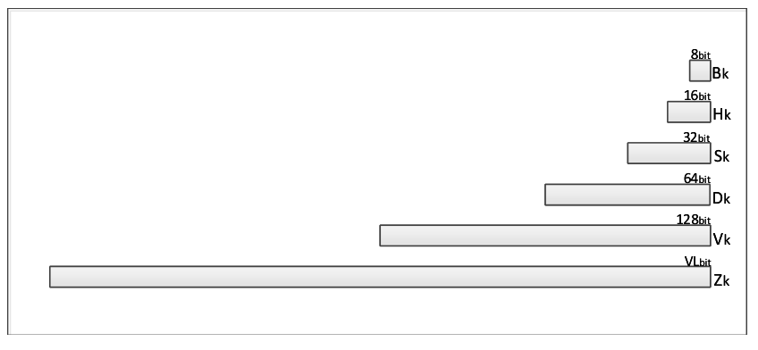
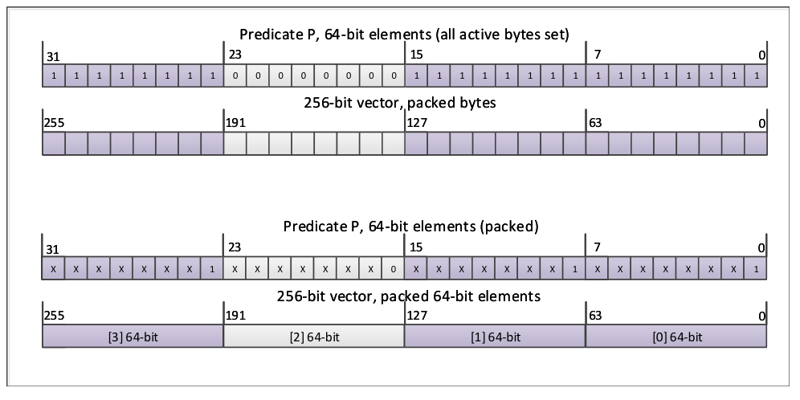
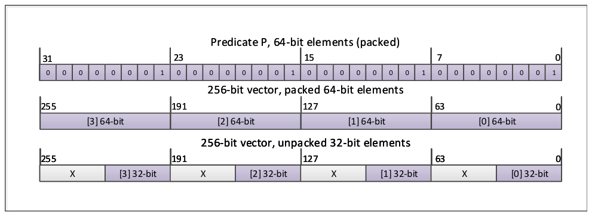
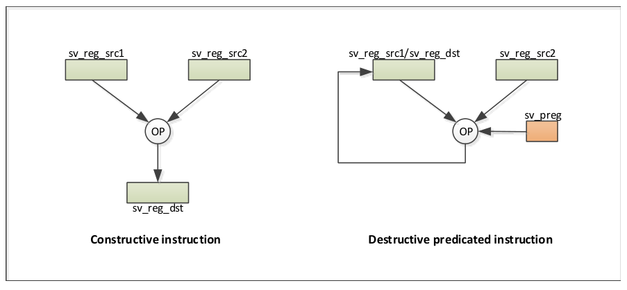
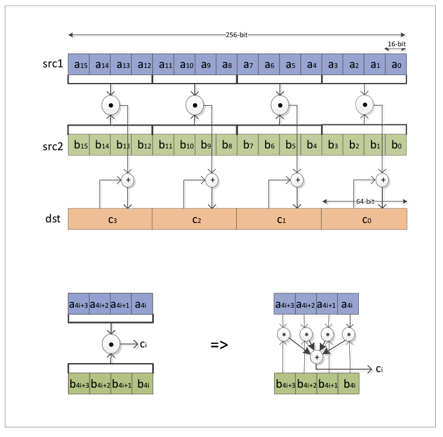
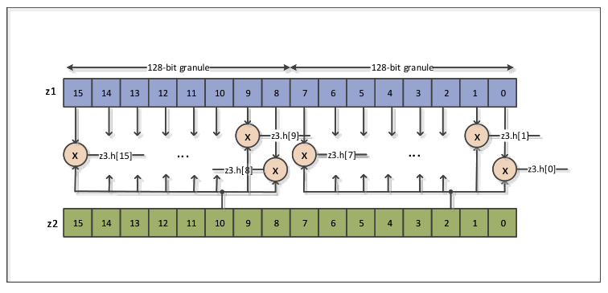
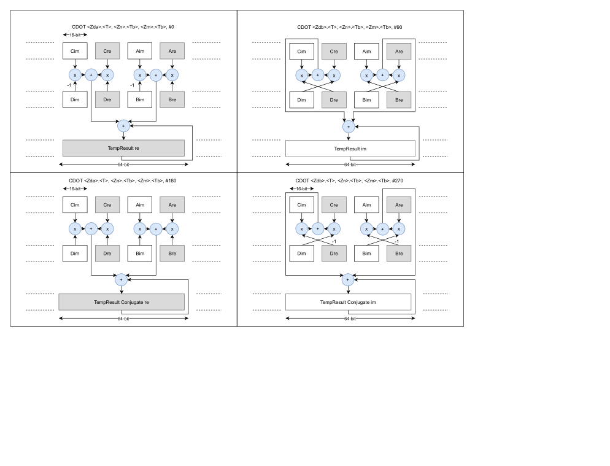
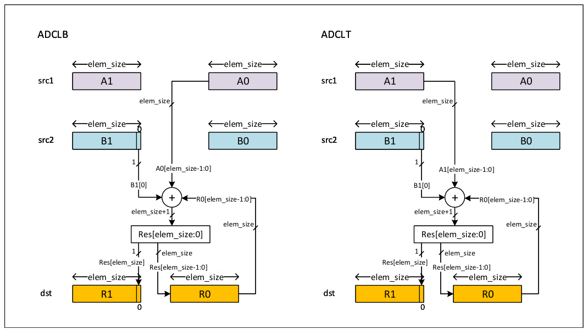

# SVE 编程示例（中文翻译）

> 原文：*SVE Programming Examples*（ARM-DAI-0548 REL-01.2）
>
> 版权 © 2019-2024 Arm Limited（或其关联公司）。保留所有权利。非保密。

---

## 关于本书

本文档阐述 Arm 可扩展向量扩展，并提供编程指导以及代码示例选编。

本文档包含以下部分：

**A 部分**：SVE 架构[1]（Armv8-A 的可扩展向量扩展[2]）、SVE2 架构（可扩展向量扩展第二版）简介，以及有效的编程建议。

**B 部分**：提供通用向量与矩阵运算的代码示例选编。

**C 部分**：提供计算机视觉运算的代码示例选编。

**D 部分**：提供字符串处理运算的代码示例选编。

## 本书用法

## 约定

### 排印约定

本文采用的排印约定如下：

*斜体*：用于引入特殊术语，并标示引用。

**粗体**：用于标示信号名，并在合适的情况下用于描述性列表中的术语。

`等宽字体`：用于汇编语法描述、伪代码和源代码示例。正文中亦用于指令助记符，以及引用汇编语法描述、伪代码和源代码示例中出现的其他条目。

小型大写字母：用于某些常见术语，如 IMPLEMENTATION DEFINED。也用于少数具有特定技术含义、收录在术语表中的术语。

红色文本：表示未解决的问题。

蓝色文本：表示链接。可以是：

* 指向本文档中其他位置的交叉引用
* 一个 URL，例如 http://developer.arm.com

### 数字

数字通常以十进制书写。二进制数以 `0b` 开头，十六进制数以 `0x` 开头。这两种情况下，前缀及其对应的值都以等宽字体书写，例如 `0xFFFF0000`。为提升可读性，较长的数字可以在每四个字符之间使用下划线分隔符书写，例如 `0xFFFF_0000_0000_0000`。在解读数值时应忽略任何下划线。

### 伪代码描述

本书采用一种伪代码形式，以精确描述所规定的功能。这些伪代码以等宽字体书写。伪代码语言在《Arm 架构参考手册》中有描述。

### 汇编语法描述

本书包含大量汇编指令及其组成部分的语法描述。这些描述以等宽字体显示。

## 基于规则的编写

本规范由一组独立的规则组成。每条规则均以字母 R 明确标识。

规则不应孤立地阅读；当存在多条与某一特性相关的规则时，这些独立规则会被归入各节和各子节中，以提供适当的上下文。在合适的情况下，这些章节会包含简短的引言以帮助读者理解。符合该架构的实现必须遵守本规范中的所有规则。

某些架构规则附有原理说明，用于解释架构为何如此规定。原理说明以字母 X 标识。

某些章节包含不属于规则的补充信息和指导。这些信息和指导纯粹用于帮助理解架构。信息说明以字母 I 明确标识。

实现说明以字母 U 标识。

软件使用说明以字母 S 标识。

Arm 强烈建议实现者阅读本文档的所有章和节，以确保实现合规。

规则、原理说明、信息说明、实现说明和软件使用说明统称为内容条目。

### 标识符

每个内容条目可以有一个关联的标识符，该标识符在本规范的上下文中是唯一的。

当文档处于 beta 状态之前：

* 内容条目按文档中的升序分配数字标识符（0001、0002、……）。
* 标识符是易变的：给定内容条目的标识符可能在文档版本之间发生变化。

当文档达到 beta 状态之后：

* 内容条目被分配随机的字母标识符（HJQS、PZWL、……）。
* 标识符被保留：给定内容条目在不同版本的文档中具有相同的标识符。

### 示例

以下是展示每种内容条目外观的示例。

**R**：这是一条规则说明。

**RX001**：这是一条规则说明。

**I**：这是一条信息说明。

**X**：这是一条原理说明。

**U**：这是一条实现说明。

**S**：这是一条软件使用说明。

## 补充阅读

本节列出了 Arm 及第三方出版物。

请访问 Arm Developer（http://developer.arm.com）获取 Arm 文档。

[1] The Scalable Vector Extension (SVE), Arm Architecture Reference Manual Supplement for Armv8-A. Arm.

[2] Arm Architecture Reference Manual Armv8-A edition. Arm.

[3] Arm HPC tools and libraries (https://developer.arm.com/products/software-development-tools/hpc). Arm.

[4] Procedure Call Standard for the Arm 64-bit Architecture (AArch64) with SVE support. Arm.

[5] Arm C Language Extensions for SVE. Arm.

## 反馈

Arm 欢迎对其文档提供反馈。

### 关于本书的反馈

如果您对本书内容有意见，请发送电子邮件至 errata@arm.com。请提供：

* 书名（SVE Programming Examples）。
* 编号（ARM-DAI-0548 REL-01.2）。
* 您的意见所适用的页码。
* 如适用，您的意见所适用的规则标识符。
* 对您的意见的简明说明。

Arm 也欢迎提出关于增补和改进的一般性建议。

### 注意

Arm 仅在 Adobe Acrobat 和 Acrobat Reader 中测试 PDF，无法保证文档在其他 PDF 阅读器中查看时的外观或行为。

## A 部分：Arm 可扩展向量扩展（SVE）概述

## A1. 简介

本章介绍 Armv8-A 架构的可扩展向量扩展（SVE）。

### A1.1 概述

Armv8-A 的 Advanced SIMD 指令集对 64 位或 128 位的定长向量进行操作。对于需要处理大量数据的行业应用（例如计算机视觉、机器学习、服务器、数据分析），人们已经认识到，在更长的向量长度上运行的处理器可能更为合适。然而，并不存在一种适合所有应用的特定向量长度。

由于每当出现对新向量长度的需求时，规定一套新指令集的编码成本相对较高，Arm 采用了一种新颖的方法，创建了一套可在不同向量长度上伸缩的独特指令集。

这一代 Arm SIMD 指令集被称为可扩展向量扩展（SVE）。它允许采用向量长度无关的编码风格，代码无需重写或重新编译，因为它会动态适应所实现的向量长度。SVE 架构允许向量长度最高达 2048 位，且向量长度必须是 128 位的倍数。SVE 也支持为定长向量编写的代码。

Armv8-A Advanced SIMD 指令集所支持的向量化方法，对循环次数不是向量长度倍数的情况很敏感。为应对这一情况，Armv8-A Advanced SIMD 向量化循环之后会跟随一个处理剩余数据的标量循环。SVE 支持的向量分区机制可以控制对向量的哪些元素进行操作，从而更容易处理循环终止条件。这套精心挑选的指令将条件语句或控制流转换为带谓词的向量运算，实现了无缝的循环控制。因此，大多数复杂的嵌套循环都可以向量化。

SVE 为多种算术运算提供了归约指令。这些指令实现了在各向量通道中计算部分结果的向量化方式。向量化循环完成后，借助归约指令从这些部分结果得到最终结果。

SVE 指令集提供了丰富的加载/存储指令支持、谓词与循环控制支持，以及逻辑和按位指令支持。SVE 指令集还提供了完善的浮点算术支持和基本整数算术支持。

SVE2（可扩展向量扩展第二版）是 Armv8-A SVE 的超集，功能有所扩展。SVE2 指令集增加了完善的整数算术支持。

### A1.2 寄存器组

SVE 寄存器组由向量寄存器和谓词寄存器组成。

#### A1.2.1 向量寄存器组

共有 32 个向量寄存器 Z0-Z31。向量寄存器的大小 VL 是 128 位的实现定义（IMPLEMENTATION DEFINED）倍数，即 n*128 位。SVE 向量寄存器的低 128 位与 SIMD 和浮点寄存器重叠，如图 A1.1 所示。这使得 SVE 指令与 Advanced SIMD 指令可以互换使用，某个寄存器可以由 SVE 指令写入，然后再由 Advanced SIMD 指令读取，反之亦然。当 Advanced SIMD 或浮点指令写入 SIMD 和浮点寄存器时，对应 SVE 向量寄存器的 bits[VL-1:128] 会被清零。



*图 A1.1：SIMD/浮点寄存器与 SVE 寄存器*

##### A1.2.1.1 向量寄存器元素

向量寄存器包含被视为元素的数据，向量元素可以是 8、16、32 或 64 位长。

#### A1.2.2 谓词寄存器组

SVE 引入了谓词，用于确定与其一起使用的向量寄存器中相应的向量元素（SIMD）通道是否活动。

共有 16 个谓词寄存器：P0-P15。谓词寄存器的大小是向量寄存器大小的 1/8，即 n*16 位。谓词寄存器的每一位对应向量寄存器的一个字节。

##### A1.2.2.1 谓词寄存器元素

谓词元素可以是 1、2、4 或 8 位长。

尽管谓词元素最长可达 8 位，但只有谓词元素的最低有效位决定对应元素是活动（bit[0]=1）还是不活动（bit[0]=0）。谓词元素的更高位被忽略。

经过精心初始化的谓词可以在对不同元素大小进行操作的指令之间共享。例如，如果将谓词寄存器初始化为其活动元素的所有位均置位、其不活动元素的所有位均清零，那么同一个谓词既可以用于对活动元素中各个字节进行操作的指令，也可以用于直接对活动元素进行操作的指令。如图 A1.2 所示。



*图 A1.2：打包元素的谓词复用示例*

或者，为打包在向量寄存器中的元素而初始化的谓词，也适用于对以非打包方式组织在向量寄存器中的较小元素进行操作的指令，如图 A1.3 所示。



*图 A1.3：非打包元素的谓词复用示例*

#### A1.2.3 首故障寄存器

首故障寄存器（FFR）是一个专用的、类似谓词的寄存器。它记录 A3.3.6「首故障加载」所述的一系列首故障向量加载指令、以及 A3.3.7「无故障加载」所述的无故障向量加载指令的累积故障状态。这些加载指令完成后，FFR 中的活动元素表示一组包含有效内存数据的连续向量元素。

### A1.3 谓词条件标志

#### A1.3.1 概述

谓词的状态用于管理向量化循环的控制流。

SVE 架构没有规定新的条件分支指令。相反，现有的 AArch64 条件标志和条件分支指令被赋予了捕获谓词状态的额外功能。

#### A1.3.2 AArch64 条件码与标志

条件分支的行为由条件码和 AArch64 标志的状态决定。四个 AArch64 标志 N、Z、C、V 由比较指令或设置标志的算术指令设置。下表描述了 AArch64 条件码与标志之间的关系。

表 A1.1：AArch64 条件码与标志

| AArch64 条件码 | 描述 | 测试的标志 |
| --- | --- | --- |
| EQ | 相等 | Z == 1 |
| NE | 不相等 | Z == 0 |
| HS / CS | 无符号大于或等于 | C == 1 |
| LO / CC | 无符号小于 | C == 0 |
| MI | 负数 | N == 1 |
| PL | 正数或零 | N == 0 |
| VS | 溢出 | V == 1 |
| VC | 无溢出 | V == 0 |
| HI | 无符号大于 | C == 1 & Z == 0 |
| LS | 无符号小于或等于 | C == 0 \| Z == 1 |
| GE | 大于或等于 | N == V |
| LT | 小于 | N != V |

比较指令常用于设置 AArch64 标志。

请注意，`CMP Xn, #imm` 是 `SUBS XZR, Xn, #imm` 的别名，标志按照 `SUBS` 指令的行为设置。

#### A1.3.3 SVE 条件码与标志

基于谓词的状态，SVE 架构重载了现有的 AArch64 标志 N、Z、C、V，为这些标志和条件码赋予了新的含义，如下面两张表所述。

表 A1.2：SVE 对 AArch64 条件标志的解释

| AArch64 标志 | SVE 解释 | 条件 |
| --- | --- | --- |
| N | First | 如果第一个活动元素为真，则值为 1，否则值为 0。 |
| Z | None | 如果没有活动元素为真，则值为 1，否则值为 0。 |
| C | !Last | 如果最后一个活动元素为真，则值为 0，否则值为 1。 |
| V | - | 仅用于串行化向量循环中的终止条件检测。除 CTERMEQ 和 CTERMNE 外，SVE 设置标志的指令将其清零为 0。 |

表 A1.3：SVE 对 AArch64 条件码的解释

| AArch64 条件码 | SVE 名称 | 测试的标志 | SVE 解释 |
| --- | --- | --- | --- |
| EQ | NONE | Z == 1 | 没有活动元素为真。 |
| NE | ANY | Z == 0 | 有活动元素为真。 |
| HS / CS | NLAST | C == 1 | 最后一个活动元素不为真。 |
| LO / CC | LAST | C == 0 | 最后一个活动元素为真。 |
| MI | FIRST | N == 1 | 第一个活动元素为真。 |
| PL | NFRST | N == 0 | 第一个活动元素不为真。 |
| HI | PMORE | C == 1 & Z == 0 | 有活动元素为真，但不是最后一个活动元素。 |
| LS | PLAST | C == 0 \| Z == 1 | 最后一个活动元素为真，或没有元素为真。 |
| VS | | V == 1 | CTERM* 比较失败，但已到达分区末尾。 |
| VC | | V == 0 | CTERM* 比较成功，或未到达分区末尾。 |
| GE | TCONT | N == V | 未检测到 CTERM* 终止条件。 |
| LT | TSTOP | N != V | 检测到 CTERM* 终止条件。 |

条件标志要么通过对谓词的显式测试（PTEST）设置，要么由某些生成谓词结果的指令（CMP*、WHILE*、MOVS、NOTS 等）设置。

## A2. 编译器支持

LLVM 和 GCC 编译器已加入 SVE 支持。本节适用于 SVE LLVM 编译器。

### A2.1 自动向量化

#### A2.1.1 编译器选项与 pragma

在 LLVM 编译器中，如果启用的优化级别至少为 O2，则默认启用循环向量化器。可以通过 clang 使用命令行标志 `-fno-vectorize` 禁用循环向量化器。这对于测量标量代码的性能很有用。

向量化方式可以通过以下命令行标志和 pragma 进行调整。具体的循环展开因子通过命令行标志 `-force-vector-unroll=<desiredFactor>` 设置。以下 pragma 只影响紧随其后的循环语句：

* `#pragma clang loop vectorize(assume_safety)` 向编译器表示该循环的各次迭代之间不存在会阻止向量化的数据依赖。
* `#pragma clang loop vectorize(disable)` 向编译器表示抑制该循环的自动向量化。
* `#pragma clang loop vectorize(enable)vectorize_style(fixed_width)` 向编译器表示向量化时优先使用 Advanced SIMD 指令。
* `#pragma clang loop vectorize(enable)vectorize_style(scaled_width)` 向编译器表示向量化时优先使用 SVE 指令。

有关使用 pragma 控制自动向量化的更多信息，请参阅[3]。

#### A2.1.2 生成自动向量化诊断信息

编译器循环向量化器可以生成优化诊断信息，可使用命令行选项查询这些信息，以识别和分析被向量化器跳过的循环。

优化备注可以通过以下方式启用：

* `-Rpass=loop-vectorize`，用于识别成功向量化的循环。
* `-Rpass-missed=loop-vectorize`，用于识别向量化失败的循环。
* `-Rpass-analysis=loop-vectorize`，用于识别导致向量化失败的语句。

有关在编译器中使用优化备注的更多信息，请参阅[3]。

### A2.2 调用约定

AArch64 过程调用标准[4]规定：

* 通用寄存器 X0-X7 用于向子程序传入参数值，并用于从函数返回结果值。
* 如果将浮点或向量类型传入子程序或从子程序返回，则使用 SIMD 和浮点寄存器 V0-V7 向子程序传入参数值，并从函数返回结果值。
* 通用寄存器 X0-X7 和 X9-X15 可被子程序破坏（即由调用者保存），而 X19-X28 若被修改，则必须由被调用者保存。
* 寄存器 V0-V7 和 V16-V31 可被子程序破坏（即由调用者保存），而 V8-V15 的低 64 位若被修改，则必须由被调用者保存。

SVE 过程调用标准[4]规定：

* 如果将可扩展向量或谓词类型传入子程序或从子程序返回，则使用向量寄存器 Z0-Z7 向子程序传入可扩展向量参数，并从函数返回可扩展向量结果；使用谓词寄存器 P0-P3 向子程序传入可扩展谓词参数，并从函数返回可扩展谓词结果。
* SVE 向量寄存器 Z0-Z7 可被子程序破坏（即由调用者保存）。如果子程序在 SVE 或谓词寄存器中接收参数或返回结果，则 SVE 向量寄存器 Z8-Z31 的全部内容若被修改，必须由被调用者保存。在其他情况下，被调用者只需在调用期间保存 Z8-Z15 的低 64 位。
* 谓词寄存器 P0-P3 可被子程序破坏（即由调用者保存）。如果子程序在 SVE 或谓词寄存器中接收参数或返回结果，则谓词寄存器 P4-P15 若被修改，必须由被调用者保存。在其他情况下，被调用者无需在调用期间保存任何谓词寄存器。

## A3. SVE 指令集

本章概述 SVE 指令集。

### A3.1 概述

SVE 指令集包括：

- 加载和存储指令。
- 浮点算术指令。
- 整数算术指令。
- 归约指令。
- 类型转换和元素大小转换指令。
- 按位和逻辑运算指令。
- 置换指令。
- 作用于谓词和/或产生谓词的指令。
- 循环控制指令。

#### A3.1.1 构造式与破坏式指令

SVE 指令分为构造式或破坏式两种。在构造式指令中，目标寄存器与任一源寄存器都不同。因此，构造式指令会保留所有源寄存器的内容。在破坏式指令中，其中一个源寄存器同时也是目标寄存器。因此，破坏式指令会破坏该源寄存器的内容。如图 A3.1 所示。



*图 A3.1：构造式与破坏式指令*

为了提高破坏式指令的编程灵活性，某些非交换运算的破坏式指令存在两种形式：一种破坏第一个源寄存器的内容，另一种“反向”指令破坏第二个源寄存器的内容。“反向”指令的助记符名称以字母“R”结尾。

#### A3.1.2 构造式与破坏式指令的谓词

SVE 指令可以是带谓词的或无谓词的，大多数运算要么以带谓词形式表示，要么以无谓词形式表示。不过，SVE 指令集中有一小部分运算同时以带谓词和无谓词两种形式表示，其中带谓词指令是破坏式的，无谓词指令是构造式的。

#### A3.1.3 移动前缀

MOVPRFX 指令是一条特殊指令，它向硬件提供一个提示：可以将其与程序顺序中紧随其后的破坏式指令合并，从而产生单个构造式运算。此外，借助前置的 MOVPRFX 指令，带合并谓词的破坏式指令可以转换为使用清零谓词。

MOVPRFX 指令与被前缀的破坏式指令可以合并，如果满足：

- 它们使用相同的目标寄存器，
- 如果 MOVPRFX 带谓词，则必须与由同一谓词寄存器控制、且带谓词的被前缀指令一起使用。此外，MOVPRFX 的元素大小必须与被前缀指令的最大元素大小相同。
- 如果 MOVPRFX 无谓词，则被前缀指令可以使用任何谓词寄存器和任何元素大小，或者也可以是无谓词的。

### A3.2 元素大小与类型转换指令

#### A3.2.1 元素大小

这些指令在一个向量寄存器中支持四种不同的元素大小：8 位、16 位、32 位和 64 位。

#### A3.2.2 元素大小转换

元素大小转换指令对向量元素和谓词元素执行各种打包与解包运算：

- 带截断的打包同时适用于向量元素和谓词元素：TRN1 和 TRN2、UZP1 和 UZP2、ZIP1 和 ZIP2。
- 向量元素的有符号和无符号无饱和打包：SUNPKHI、SUNPKLO、UUNPKHI、UUNPKLO。
- 向量元素的有符号和无符号解包：UXTB、UXTH、UXTW、SXTB、SXTH、SXTW。
- 谓词元素的解包：PUNPKHI、PUNPKLO。

#### A3.2.3 类型转换

以下类型转换指令可用：

- 将一种浮点类型转换为另一种：FCVT。
- 将浮点类型转换为整数类型：FCVTZS、FCVTZU。
- 将整数类型转换为浮点类型：SCVTF、UCVTF。

### A3.3 加载与存储

SVE 指令集提供了一套带谓词的加载和存储指令以及无谓词的加载和存储指令。

在带谓词的加载和存储指令中，内存数据大小可以与向量元素大小相同（打包数据访问），也可以更小（解包数据访问）。对于解包数据访问，内存内容以零扩展或符号扩展方式加载到向量寄存器中，并且只有向量寄存器元素被截断后的低位被存储到内存中。

#### A3.3.1 连续加载和存储

带谓词的加载指令 LD1B、LD1H、LD1W 和 LD1D 将连续的内存位置读取到单个向量寄存器元素中。带谓词的结构加载指令 LD[N]B、LD[N]H、LD[N]W 和 LD[N]D 将 N 个连续的内存位置读取到 N 个向量寄存器中各自相同编号的元素中，其中 N = 2、3 或 4。

带谓词的存储指令 ST1B、ST1H、ST1W 和 ST1D 将单个向量寄存器元素写入连续的内存位置。带谓词的结构存储指令 ST[N]B、ST[N]H、ST[N]W 和 ST[N]D 将 N 个连续向量寄存器中各自相同编号的元素写入 N 个连续的内存位置，其中 N = 2、3 或 4。

#### A3.3.2 带广播的加载

此外还支持带单个元素广播的带谓词加载指令：LD1RB、LD1RH、LD1RW 和 LD1RD，以及带 128 位长元素组广播的加载指令：LD1RQB、LD1RQH、LD1RQW 和 LD1RQD。

#### A3.3.3 收集加载与分散存储

SVE 架构通过带谓词的收集加载和分散存储指令支持复杂的内存数据访问模式。

支持的向量寄存器元素大小仅为 32 位和 64 位。内存数据大小可以是 8 位、16 位、32 位或 64 位中的任意一种。这意味着任何小于 32 位的非连续内存元素访问都是解包的。

复杂的收集加载和分散存储元素访问由以下方式指定的非连续内存位置：

- 一个标量基址寄存器加上一个偏移量向量。向量寄存器中的偏移量可以是 32 位或 64 位长。使用 32 位向量寄存器偏移量时，数据向量寄存器元素可以是 32 位或 64 位长。使用 64 位向量寄存器偏移量时，数据向量寄存器元素只能是 64 位长。
- 一个基址向量加上一个立即数偏移量。向量寄存器基址可以是 32 位或 64 位长。使用 32 位向量寄存器基址时，数据向量寄存器元素只能是 32 位长。使用 64 位向量寄存器基址时，数据向量寄存器元素只能是 64 位长。

注意，取决于具体实现，收集加载和分散存储在执行延迟方面可能代价高昂。

#### A3.3.4 无谓词加载和存储

SVE 指令集包含无谓词的向量加载和存储指令 LDR 和 STR。无谓词加载指令 LDR 用数据内存中的连续字节完整更新一个向量寄存器。无谓词存储指令 STR 将整个向量寄存器的内容写入连续的数据内存位置。无谓词加载和存储不考虑端序。

#### A3.3.5 非临时连续加载和存储

非临时连续加载 LDNT1B、LDNT1H、LDNT1W 和 LDNT1D，以及非临时连续存储 STNT1B、STNT1H、STNT1W 和 STNT1D，是普通的连续加载和存储，它们包含一个给内存系统的提示：所访问的内存位置预计不会很快再次被访问，不需要保留在本地缓存中。

#### A3.3.6 首故障加载

首故障加载仅对由于第一个活动元素的内存访问而产生的故障确认内存故障并引发异常，而其他活动元素的内存故障会被忽略。被忽略的故障记录在 FFR 寄存器中。首故障加载 LDFF1B、LDFF1H、LDFF1W、LDFF1D、LDFF1SB、LDFF1SH 和 LDFF1SW 可以是连续加载或收集加载。

首故障加载的故障确认通过指令 SETFFR 初始化 FFR 寄存器来启用。在一次或多次首故障加载之后，FFR 寄存器的状态可以通过 RDFFR 指令读取。

#### A3.3.7 无故障加载

无故障加载忽略所有活动元素的内存故障。被忽略的故障记录在 FFR 寄存器中。

#### A3.3.8 预取

指令集使程序员能够向内存系统发送提示：来自指定地址的内存访问可能在不久的将来发生。然后，内存系统可以通过将指定地址预加载到一个或多个缓存中来作出响应，从而加快即将到来的内存访问执行。预取指令仅仅是提示。因此，它们对实际执行的影响最小，但如果在恰当时机发出，可以显著提高性能。

指令 PRFB、PRFH、PRFW 和 PRFD 允许对字节、半字、字或双字进行连续或收集预取。预取可以用于加载或存储，目标可以是 L1、L2、L3 缓存中的某一个。

使用预取指令的编码示例见 A4.1.3 带预取的 For/While 循环 SVE 向量化。

#### A3.3.9 内存排序

内存读取会乱序发生：

- 由不同加载指令对同一位置进行的两次读取以任意顺序发生。
- 同一条向量加载指令对多个元素的读取以任意顺序发生。

内存写入大多会乱序发生：

- 同一条向量存储指令对多个元素的写入以任意顺序发生，除非写入针对同一位置，此时它们按元素索引顺序发生。

### A3.4 控制流

#### A3.4.1 谓词初始化

谓词寄存器可以通过指令 PTRUE 和 PFALSE 初始化为固定模式，或者作为向量比较指令（CMPEQ、CMPGT 等）或循环划分指令（WHILELT、WHILELS 等）的结果来设置。此外，谓词寄存器可以是对谓词寄存器进行逻辑运算的结果，或者从内存加载。

#### A3.4.2 索引初始化

使用 INDEX 指令，可以以向量长度无关的方式将向量寄存器通道初始化为均匀递减或递增的索引。

#### A3.4.3 谓词计数

存在一些对循环计数器更新有用的指令。

指令 CNTB、CNTH、CNTW 和 CNTD 按指定元素大小产生谓词寄存器中活动元素的数量。类似地，指令 INCB、INCH、INCW 和 INCD 递增，指令 DECB、DECH、DECW 和 DECD 递减标量寄存器或向量寄存器元素，递增/递减量为谓词寄存器中活动谓词元素的数量。

#### A3.4.4 条件循环退出

存在一些指令，可以由于数据相关条件而退出或跳出向量化循环：BRKA、BRKB、BRKN、BRKPA 和 BRKPB，以及它们设置标志的替代版本：BRKAS、BRKBS、BRKNS、BRKPAS 和 BRKPBS。借助这些指令，向量比较的结果被转换为循环划分谓词，该谓词在条件首次满足的位置截断当前向量迭代。

### A3.5 点积

SVE 中有两条点积指令，SDOT 和 UDOT。SDOT 指令作用于有符号整数元素，并产生加宽的有符号整数部分点积结果。UDOT 指令作用于无符号整数元素，并产生加宽的无符号整数部分点积结果。两个源向量寄存器的元素被划分为每 4 个连续元素一组。在每组内，第一个源向量寄存器中的元素与第二个源向量寄存器中对应的元素相乘。所得加宽的乘积被求和，并加到与第一个源向量寄存器中四个元素组对齐的目标向量寄存器元素上，如下所示：

```
ci += a4i ∗ b4i + a4i+1 ∗ b4i+1 + a4i+2 ∗ b4i+2 + a4i+3 ∗ b4i+3
```

结果元素大小可以是 32 位或 64 位整数，而输入元素大小是结果元素大小的 1/4，以尽量减少溢出风险。对于 32 位结果元素，从每个输入操作数的相应 32 位通道中取出四个 8 位输入元素。对于 64 位结果元素，从每个输入操作数的相应 64 位通道中取出四个 16 位输入元素。

图 A3.2 以 256 位向量长度说明了具有 64 位结果元素的点积指令。



*图 A3.2：实数点积指令*

### A3.6 复数浮点运算

执行复数加法和乘累加运算的 SVE 指令假定复数的实部和虚部以交错顺序组织在向量寄存器中。因此，一个复数存放在向量寄存器中，其实部位于偶数元素，虚部位于随后的奇数元素。

#### A3.6.1 复数加法

SVE 指令集使用指令 FCADD 实现浮点数据的复数加法。该指令接受一个附加参数，即旋转参数，取值可以是 #90 或 #270：

FCADD

| src1 | src2 | result |  |
| --- | --- | --- | --- |
| a + i∗b | x + i∗y | src1 + i∗src2 = (a −y) + i∗(b + x) | #90 |
| a + i∗b | x + i∗y | src1 −i∗src2 = (a + y) + i∗(b −x) | #270 |

#### A3.6.2 复数乘累加

SVE 指令集并没有在单条指令中实现完整的复数乘累加，但所提供的指令产生部分乘积和累加，可用于构造完整的复数乘累加。因此，需要两条复数乘累加指令 FCMLA 才能计算出完整的复数乘累加。该指令接受一个附加参数，即旋转参数，取值为 #0、#90、#180 或 #270。

以下是一些省略累加部分的复数乘法计算示例：

FCMLA

| src1 | src2 | result |  |
| --- | --- | --- | --- |
| a + i∗b | x + i∗y | src1 ∗ src2 = (a ∗x −b ∗y) + i ∗(a ∗y + b ∗x) | #0, #90 |
| a + i∗b | x + i∗y | src1 ∗ src2̄ = (a ∗x + b ∗y) + i ∗(a ∗y −b ∗x) | #0, #270 |
| a + i∗b | x + i∗y | −src1 ∗ src2 = (−a ∗x + b ∗y) + i ∗(−a ∗y −b ∗x) | #270, #180 |

### A3.7 按索引元素的向量指令

一些 SVE 指令存在按索引元素的形式。运算在一个向量寄存器的每个元素与另一个向量寄存器的一个特定（被索引的）元素之间执行。在 Advanced SIMD 按索引元素的向量指令中，运算在一个操作数的所有元素与另一个操作数的一个被索引元素之间执行。然而，在 SVE 按索引元素的向量指令中，运算按每个 128 位粒度执行，在第一个操作数粒度的所有元素与第二个操作数粒度的一个被索引元素之间执行。

浮点实数和复数乘法指令 FCMLA、FMLA、FMLS 和 FMUL 支持此特性，整数点积指令 SDOT 和 UDOT 也支持。

图 A3.3 以 256 位向量长度说明了指令 FMUL z3.h, z1.h, z2.h[2] 的示例：



*图 A3.3：按索引元素的向量指令*

### A3.8 其他指令

#### A3.8.1 归约指令

归约指令对单个输入向量寄存器的活动元素执行算术运算，并产生标量结果。这些指令使得如下向量化方法成为可能：逐通道计算部分结果，最终标量结果由归约指令计算得出。

存在一些对向量寄存器元素执行基本整数和浮点算术及逻辑运算的归约指令：ANDV、ORV、EORV、FADDV、SADDV、UADDV、FMAXV、SMAXV、UMAXV、FMINV、SMINV 和 UMINV。

注意，归约指令在执行延迟方面代价高昂，尤其是对于较高向量长度。

#### A3.8.2 置换指令

带谓词指令 COMPACT 和 SPLICE，以及无谓词指令 EXT、TRN1、TRN2、ZIP1、ZIP2、UZP1 和 UZP2，将两个源向量寄存器的元素组合到结果向量寄存器中。

带谓词指令 REVB、REVH 和 REVW，以及无谓词指令 TBL 和 REV，将一个源向量寄存器的元素置换到结果向量寄存器中。

#### A3.8.3 元素跨越 128 位向量粒度的指令

在大多数 SVE 指令中，源向量的元素对目标向量结果元素的贡献位于同一 128 位向量粒度内，从而允许最短的指令执行时间。不过，存在少量 SVE 指令不满足这种不跨越 128 位粒度边界的性质。在这些 SVE 指令中，部分或全部源向量元素对目标向量结果元素的贡献来自不同的 128 位向量粒度，因此跨越了 128 位粒度边界。元素跨越 128 位粒度边界的指令在执行时间方面可能比元素不跨越该边界的指令代价更高。

以下是一些跨越 128 位粒度边界的指令：EXT、所有归约指令、TBL、SUNPKHI、SUNPKLO、ZIP1、ZIP2、UZP1、UZP2 等。

#### A3.8.4 在通用寄存器组与可扩展向量寄存器组之间搬移数据的指令

指令 LASTA 和 LASTB，以及它们的条件替代版本 CLASTA 和 CLASTB，允许根据谓词状态将向量寄存器的特定元素提取到通用寄存器中。

将数据从通用寄存器组搬移到可扩展向量寄存器组以及反向搬移的 SVE 指令，在执行时间方面比仅作用于可扩展向量寄存器的指令代价更高。

以下是其他在通用寄存器组与可扩展向量寄存器组之间搬移数据的指令：INSR、INDEX、MOV 和 DUP。
## A4. SVE 向量长度无关编程方法

本章提供 SVE 编程技巧。

### A4.1 For/While 循环向量化

下面是 For 与 While 循环简单向量化的示例，展示了具有固定向量长度的 Advanced SIMD 指令集与向量长度无关的 SVE 指令集之间向量化方法的差异。

一个计算两个整数数组元素之和的简单 For 循环示例：

```c
void example_for( int *out, int *a, int *b, int N) {
    for (int i=0; i<N; i++) {
        out[i] = a[i] + b[i];
    }
}
```

一个计算两个整数数组元素之和的简单 While 循环示例：

```c
void example_while( int *out, int *a, int *b, int N) {
    while (N > 0) {
        *out = *a + *b;
        a++;
        b++;
        out++;
        N = N - 1;
    }
}
```

#### A4.1.1 For/While 循环 Advanced SIMD 向量化

```asm
 1  AND    w6, w3, 0xfffffffc
 2  CBZ    w6, .L_tail
 3
 4  .L_vector_loop:
 5  LD1    {v0.4s}, [x1], #16
 6  LD1    {v1.4s}, [x2], #16
 7  ADD    v5.4s, v0.4s, v1.4s
 8  ST1    {v5.4s}, [x0], #16
 9  SUB    w6, w6, #4
10  CBNZ   w6, .L_vector_loop
11
12  .L_tail:
13  AND    w3, w3, #3
14  CBZ    w3, .L_end
15
16  .L_scalar_loop:
17  LDRSW  w9, [x1], #4
18  LDRSW  w10, [x2], #4
19  ADD    w11, w9, w10
20  STR    w11, [x0], #4
21  SUB    w3, w3, #1
22  CBNZ   w3, .L_scalar_loop
23
24  .L_end:
25  RET
```

在本示例中，工作元素大小为 32 位，因此在 Advanced SIMD 向量化循环迭代的向量通道中计算出 4 个输出结果（第 4-10 行的循环），填满 128 位向量长度。为处理长度不是 4 的倍数的数组，有必要实现标量循环来计算剩余的结果（如第 16-22 行的循环）。

#### A4.1.2 For/While 循环 SVE 向量化

SVE 向量长度无关的向量化方法包括：借助特定的循环控制指令，仔细设置谓词以在循环迭代过程中管理寄存器划分、谓词处理、循环计数器以及指针偏移的更新。SVE 向量化代码比 Advanced SIMD 向量化代码更短、更紧凑。向量化循环无缝终止，无需标量循环。

```asm
 1  MOV      w3, w3
 2  MOV      x9, #0
 3
 4  WHILELT  p1.s, x9, x3
 5  B.NONE   .L_return
 6
 7  .L_loopStart:
 8  LD1W     z1.s, p1/Z, [x1, x9, LSL #2]
 9  LD1W     z2.s, p1/Z, [x2, x9, LSL #2]
10  ADD      z1.s, p1/M, z1.s, z2.s
11  ST1W     z1.s, p1, [x0, x9, LSL #2]
12  INCW     x9
13  WHILELT  p1.s, x9, x3
14  B.FIRST  .L_loopStart
15
16  .L_return:
17  RET
```

处理通道宽度与 Advanced SIMD 向量化一样为 32 位。在第 4 行，治理谓词 p1 通过指令 WHILELT 针对 32 位元素进行初始化，该指令基于循环计数器当前状态（寄存器 x9）与数组长度（寄存器 x3）的比较来设置其活动通道。

在第 7-14 行的向量化循环中，治理谓词控制加载、加法和存储指令的活动通道。只有有效数据会从内存访问并加载到向量寄存器（第 8-9 行），随后被处理（第 10 行）并存储到内存（第 11 行）。向量寄存器的不活动通道由加载指令清零（第 8-9 行）。

寄存器 x9 中的值既用作循环计数器，也用作加载与存储的指针偏移，并在每次向量化循环迭代中以向量长度无关的方式递增。通过指令 INCW，该值按所实现向量长度中 32 位元素的数量递增（第 12 行）。注意，一次向量化循环迭代中计算出的输出结果数量取决于所实现的向量长度。

基于更新后的循环计数器，用 WHILELT 指令进行新的向量划分（第 13 行）。如果至少还有一个输入数组元素需要处理，则进行下一次循环迭代；否则循环退出。这由条件分支 B.FIRST 管理（第 14 行）。

上述 SVE 向量长度无关的向量化代码可用面向 SVE 的 Arm C 语言扩展（ACLE）[5] 重新改写为 C 代码：

```c
 1 void example_for( int *out, int *a, int *b, int N) {
 2     uint64_t i = 0;
 3     uint64_t vl = svcntw();
 4     svbool_t pred;
 5     svint32_t sva, svb, svres;
 6
 7     pred = svwhilelt_b32( i, (uint64_t)N);
 8
 9     while(svptest_first(svptrue_b32(), pred)) {
10         sva = svld1( pred, &a[i]);
11         svb = svld1( pred, &b[i]);
12         svres = svadd_m( pred, sva, svb);
13         svst1( pred, &out[i], svres);
14         i += vl;
15         pred = svwhilelt_b32( i, (uint64_t)N);
16     }
17 }
```

#### A4.1.3 带预取的 For/While 循环 SVE 向量化

通过使用预取指令，可以提升前一小节优化循环的执行速度。预取指令向内存系统发出信号，使其提前预加载后续代码将使用的内存地址。

```asm
 1  PTRUE    p0.s
 2  PRFW     PLDL1STRM, p0, [x1]
 3  PRFW     PLDL1STRM, p0, [x1, #1, MUL VL]
 4  PRFW     PLDL1STRM, p0, [x1, #2, MUL VL]
 5  PRFW     PLDL1STRM, p0, [x2]
 6  PRFW     PLDL1STRM, p0, [x2, #1, MUL VL]
 7  PRFW     PLDL1STRM, p0, [x2, #2, MUL VL]
 8
 9  MOV      w3, w3
10  MOV      x9, #0
11  ADDVL    x10, x1, #3
12  ADDVL    x12, x2, #3
13
14  WHILELT  p1.s, x9, x3
15  B.NONE   .L_return
16
17  .L_loopStart:
18  LD1W     z1.s, p1/Z, [x1, x9, LSL #2]
19  LD1W     z2.s, p1/Z, [x2, x9, LSL #2]
20  PRFW     PLDL1STRM, p0, [x10, x9, LSL #2]
21  PRFW     PLDL1STRM, p0, [x12, x9, LSL #2]
22  ADD      z1.s, p1/M, z1.s, z2.s
23  ST1W     z1.s, p1, [x0, x9, LSL #2]
24  INCW     x9
25  WHILELT  p1.s, x9, x3
26  B.FIRST  .L_loopStart
27
28  .L_return:
29  RET
```

在上面的示例中，带有 PLDL1STRM 说明符的预取指令（第 2-7 行、第 20-21 行）向内存系统给出提示：第 18-19 行的加载指令将访问指定的内存地址。内存系统会采取相应措施，将指定的内存地址预加载到 L1 缓存。

通过预取指令还向内存系统表明，这些内存地址只会被使用一次，无需在本地缓存中保留它们。

在本示例中，预取指令使用全真谓词 p0。因此，紧接在两个输入数组之后，额外的 3 个向量长度的数据会被预取，但不会被加载。在某些应用中，这些冗余预取可能带来问题，此时更可取的做法是：在内层循环中用相应的 WHILELT 指令，针对每个向量长度的预取分别设置谓词 p0。

### A4.2 Do-while 循环 SVE 向量化

下面是用 SVE 指令集以向量长度无关方式对 Do-while 循环进行简单向量化的示例。

下面是计算前 N 个数字平方和的 Do-while 循环：

```c
void example_sum_squares( int N, int * sum) {
    int res = 0;
    if (N > 0) {
        do {
            res += N*N;
            N--;
        } while (N > 0);
    }
    *sum = res;
}
```

向量化方法是在每个 32 位向量通道中计算一个部分和，然后在循环外通过对部分和进行归约加法来计算最终的和。

```asm
 1  PTRUE    p1.s
 2  MOV      z5.s, #0
 3  MOVI     d6, #0
 4
 5  INDEX    z0.s, x0, #-1
 6  CMPGT    p0.s, p1/Z, z0.s, #0
 7  B.NONE   .L_result
 8
 9  .L_loopStart:
10  MLA      z5.s, p0/M, z0.s, z0.s
11  DECW     z0.s
12  CMPGT    p0.s, p1/Z, z0.s, #0
13  B.FIRST  .L_loopStart
14
15  UADDV    d6, p1, z5.s
16
17  .L_result:
18  STR      s6, [x1]
19  RET
```

向量化循环中计算出的部分和数量等于所实现向量长度中 32 位通道的数量。部分和保存在向量寄存器 z5 中。

首先，用指令 INDEX 以向量长度无关方式为每个向量通道设置起始输入元素（第 5 行）。

向量的划分以及循环处理治理谓词 p0 的设置通过指令 CMPGT 完成（第 6 行）。保存正元素的通道被设置为活动，其余通道被停用。

在向量化循环（第 9-13 行）中，治理谓词控制对指令 MLA 计算的部分和做出贡献的活动通道（第 10 行）。

寄存器 z0 中的输入元素还充当循环计数器（以向量形式）。下一组输入元素通过指令 DECW 以向量长度无关方式计算（第 11 行）。每个向量通道中的当前输入元素减去所实现向量长度中 32 位元素的数量，从而得到该通道下一次循环迭代的输入元素。然后，基于新计算出的输入元素，用指令 CMPGT 进行新的向量划分（第 12 行）。如果至少存在一个正输入元素需要处理，则进行下一次循环迭代；否则循环退出。这由条件分支 B.FIRST 检查（第 13 行）。

最后，通过归约指令 UADDV 在循环外计算最终的和（第 15 行）。向量寄存器 z5 所有通道的部分和被求和，这由所有元素均设置为活动的谓词 p1 控制。

上述 SVE 向量长度无关的向量化代码可用面向 SVE 的 Arm C 语言扩展（ACLE）[5] 重新改写为 C 代码：

```c
 1 void example_sum_squares( int N, int * sum) {
 2     svbool_t pred_N;
 3     svint32_t svN_tmp;
 4     svbool_t p_all = svptrue_b32();
 5     svint32_t acc = svdup_s32(0);
 6
 7     if (N > 0) {
 8         svN_tmp = svindex_s32( N, -1);
 9         pred_N = svcmpgt( p_all, svN_tmp, 0);
10
11         do {
12             acc = svmla_m( pred_N, acc, svN_tmp, svN_tmp);
13             svN_tmp = svsub_x( p_all, svN_tmp, svcntw());
14             pred_N = svcmpgt( p_all, svN_tmp, 0);
15         } while ( svptest_first( p_all, pred_N));
16     }
17
18     *sum = (int) svaddv( p_all, acc);
19 }
```

### A4.3 有效向量长度带宽利用技巧

有效的向量化意味着充分利用可用的加载/存储与处理带宽。目标是以向量长度无关的方式加载并处理足够多的元素，以最大限度地填满可用的向量长度。为了实现这一点，通常需要以特定方式在向量寄存器内安排数据。有时甚至需要展开循环才能实现。在后续章节中，将展示更复杂的数据重排和循环展开的示例与技巧。

在下面的 FIR 滤波示例中，在循环中对 32 位宽的元素执行乘加运算。以下数据安排步骤用于为乘加运算准备两个向量操作数：

- 第一个向量操作数由 16 位宽的输入数据数组填充，并符号扩展到 32 位；
- 第二个向量操作数由一个 16 位宽的滤波系数填充，符号扩展到 32 位，并在整个向量长度上广播。

C 参考代码：

```c
void fir( int N, int T, short * in, short * coeff, short * out) {
    int i, j;
    int acc;
    for (i=0; i<N; i++) {
        acc = 0;
        for (j=0; j<T; j++) {
            acc += in[i+j] * coeff[j];
        }
        out[i] = (acc >> 16);
    }
}
```

注意：滤波系数以逆序存储在内存中。

SVE 向量化实现：

```asm
 1  MOV      x5, #0
 2  SXTW     x0, w0
 3  WHILELT  p4.s, x5, x0
 4  B.NONE   .L_return
 5
 6  SXTW     x1, w1
 7  ADD      x1, x3, x1, LSL #1
 8  PTRUE    p5.s
 9
10  .L_OuterLoop:
11  MOV      x6, #0
12  MOV      x7, x3
13  LD1SH    z10.s, p4/Z, [x2, x6, LSL #1]
14  LD1RSH   z1.s, p5/Z, [x7]
15  ADD      x6, x6, #1
16  ADD      x7, x7, #2
17  MUL      z10.s, p4/M, z10.s, z1.s
18  CMP      x7, x1
19  B.EQ     .L_InnerLoopEnd
20
21  .L_InnerLoop:
22  LD1SH    z2.s, p4/Z, [x2, x6, LSL #1]
23  LD1RSH   z1.s, p5/Z, [x7]
24  ADD      x6, x6, #1
25  ADD      x7, x7, #2
26  MLA      z10.s, p4/M, z2.s, z1.s
27  CMP      x7, x1
28  B.MI     .L_InnerLoop
29
30  .L_InnerLoopEnd:
31  ASR      z10.s, p4/M, z10.s, #16
32  ST1H     z10.s, p4, [x4]
33  INCH     x4
34  INCH     x2
35  INCW     x5
36  WHILELT  p4.s, x5, x0
37  B.FIRST  .L_OuterLoop
38
39  .L_return:
40  RET
```

## A5. SVE2 指令集创新

SVE2 架构引入了：

- 整数算术支持，包括有符号/无符号、饱和、实数值与复数值算术支持。其中许多指令还提供了按索引元素寻址的向量形式。
- 顶部-底部处理方法，其中操作数元素与结果元素大小不同。
- 元素成对处理指令。
- 按位置换指令。
- 直方图加速指令。
- 字符串处理加速指令。
- 多精度算术支持指令。
- 密码学支持指令。

### A5.1 加宽与收窄指令

#### A5.1.1 顶部-底部处理方法

SVE2 架构为加宽指令和部分收窄指令引入了顶部-底部处理方法。采用顶部-底部处理的指令，其助记符名称以字母「B」（Bottom 指令）或字母「T」（Top 指令）结尾。顶部-底部命名约定有少数例外：这些例外是浮点转换精度指令，原因为与旧的 Advanced SIMD 指令助记符保持一致。

在收窄型顶部-底部 SVE2 指令中，操作数的元素大小大于结果的元素大小。

- 在底部收窄指令中，处理所有输入操作数的元素，但只计算结果寄存器的偶数元素，而结果寄存器的奇数元素被清零。
- 在顶部收窄指令中，处理所有输入操作数的元素，但只产生结果寄存器的奇数元素，并与结果寄存器已有的偶数元素合并。

在加宽型顶部-底部 SVE2 指令中，一个或两个操作数的元素大小小于结果的元素大小。

- 在底部加宽指令中，仅处理带窄元素的输入操作数的偶数元素，而结果寄存器的所有元素都被产生。
- 在顶部加宽指令中，仅处理带窄元素的输入操作数的奇数元素，而结果寄存器的所有元素都被产生。
- 对于底部和顶部加宽指令，如果存在一个输入操作数，其元素大小与结果元素大小相同，则处理该输入操作数的所有元素。

#### A5.1.2 顶部-底部加宽指令

SVE2 指令集提供加宽指令，对输入向量寄存器中较短的元素进行操作，产生元素更大的结果向量寄存器。

单操作数加宽指令产生元素大于操作数元素的结果。这些加宽指令有：SSHLLB 和 SSHLLT、USHLLB 和 USHLLT、FCVT 和 FCVTLT。

双操作数整数算术加宽指令，其操作数包含不同大小的元素，结果元素大小与较宽操作数的元素大小相同。这些整数加宽指令有：SADDWB 和 SADDWT、UADDWB 和 UADDWT、SSUBWB 和 SSUBWT、USUBWB 和 USUBWT。

双操作数整数算术加宽指令，其操作数包含相同大小的元素，产生元素大于操作数元素的结果。其中一些整数加宽指令有：SADDLB 和 SADDLT、USUBLB 和 USUBLT、SABALB 和 SABALT、UABDLB 和 UABDLT。

三操作数加宽指令有两个元素较短的操作数，而第三个操作数和结果的元素较大。其中一些整数与浮点乘累加以及乘减加宽指令有：SMULLB 和 SMULLT、UMLSLB 和 UMLSLT、SQDMLALB 和 SQDMLALT、FMLALB 和 FMLALT、FMLSLB 和 FMLSLT。

#### A5.1.3 顶部-底部收窄指令

SVE2 指令集包括处理更大元素的操作数、并产生元素较短的结果向量寄存器的指令。

其中一些收窄指令有：ADDHNB 和 ADDHNT、RSUBHNB 和 RSUBHNT、RSHRNB 和 RSHRNT、UQSHRNB 和 UQSHRNT、SQXTUNB 和 SQXTUNT、FCVT 和 FCVTNT、FCVTX 和 FCVTXNT。

### A5.2 复数整数运算

执行复数加法和乘累加运算的 SVE2 指令假定，复数数据的实部与虚部以交错顺序组织在向量寄存器中。因此，一个复数数据保存在向量寄存器中，其实部位于偶数元素，虚部位于紧随其后的奇数元素。

#### A5.2.1 复数加法

SVE2 指令集通过指令 CADD 和 SQCADD 实现整数数据的复数加法。这些指令带有一个额外的参数——旋转参数，它可以取 #90 或 #270 值：

| 指令 | src1 | src2 | result | 旋转参数 |
| --- | --- | --- | --- | --- |
| CADD | a + i*b | x + i*y | src1 + i*src2 = (a − y) + i*(b + x) | #90 |
| CADD | a + i*b | x + i*y | src1 − i*src2 = (a + y) + i*(b − x) | #270 |

#### A5.2.2 复数乘累加

SVE2 指令集并不在单条指令中实现完整的复数乘累加，但所提供的指令会产生部分乘积与累加，这些部分结果可用于构建完整的复数乘累加。因此，需要两条复数乘累加指令 CMLA 或 SQRDCMLAH 来计算完整的复数乘累加。这些指令带有一个额外的参数——旋转参数，其值为 #0、#90、#180 或 #270。

下面是一些省略累加部分的复数乘法计算示例：

| 指令 | src1 | src2 | result | 旋转参数 |
| --- | --- | --- | --- | --- |
| CMLA | a + i*b | x + i*y | src1 * src2 = (a*x − b*y) + i*(a*y + b*x) | #0、#90 |
| CMLA | a + i*b | x + i*y | conj(src1) * src2 = (a*x + b*y) + i*(a*y − b*x) | #0、#270 |
| CMLA | a + i*b | x + i*y | −src1 * src2 = (−a*x + b*y) + i*(−a*y − b*x) | #270、#180 |

#### A5.2.3 复数整数点积

SVE2 指令集通过指令 CDOT 实现有符号复数整数点积累加，如下：

```text
ci += a2i * b2i + a2i+1 * b2i+1
```

结果元素大小可以是复数 32 位或 64 位，而输入元素大小为结果元素大小的 1/4，以最大程度降低溢出风险。对于 32 位结果元素的情形，从每个输入操作数的对应 32 位通道中取出两个有符号复数 8 位输入元素。对于 64 位结果元素的情形，从每个输入操作数的对应 64 位通道中取出两个有符号复数 16 位输入元素。

复数整数点积指令接收两个源向量，其元素的实部与虚部以交错顺序组织。与之相反，这些指令产生的结果是去交错格式，因此需要两条 CDOT 指令：一条用于产生结果的实部，另一条用于产生结果的虚部。这些指令带有一个额外的参数——旋转参数，其值为 #0、#90、#180 或 #270。图 A5.1 说明了取决于旋转参数值的结果计算。



*图 A5.1：复数点积与旋转参数*

下面是一些省略累加部分的复数整数点积计算示例：

| 指令 | src1 | src2 | result | 旋转参数 |
| --- | --- | --- | --- | --- |
| CDOT | a0, a1 | b0, b1 | c0 = a0*b0 + a1*b1 | #0（Re(c0)）、#90（Im(c0)） |
| CDOT | a0, a1 | b0, b1 | c0 = conj(a0)*b0 + conj(a1)*b1 | #180（Re(c0)）、#270（Im(c0)） |

### A5.3 其他指令

#### A5.3.1 元素大小转换

SVE2 指令集为向量寄存器元素增加了带饱和的有符号与无符号打包指令：SQXTN、SQXTUN 和 UQXTN。

#### A5.3.2 元素成对指令

SVE2 指令集引入了整数与浮点算术指令，这些指令通过处理两个相邻的源操作数元素来产生结果向量寄存器元素。

其中一些成对指令计算加法、绝对差与累加、查找最大值和最小值：ADDP、FADDP、SADALP、UADALP、FMAXP、FMINNMP、SMAXP、UMINP。

#### A5.3.3 按位置换指令

SVE2 指令集实现了新的按位置换指令：BDEP、BEXT、BGRP。这些指令基于另一个源向量寄存器的位掩码，对其中一个源向量寄存器的位进行重新排列。

#### A5.3.4 直方图加速指令

SVE2 指令集引入了用于加快直方图计算的新指令。指令 HISTCNT 给出两个向量寄存器特定元素匹配的计数。指令 HISTSEG 给出两个向量寄存器 128 位段中匹配元素的计数。

#### A5.3.5 字符串处理加速指令

SVE2 指令集引入了用于加快字符串处理的新指令。指令 MATCH 检测任何匹配的元素，而指令 NMATCH 检测两个字符串中的任何不匹配元素。

#### A5.3.6 多精度算术支持指令

SVE2 指令集引入了新指令 ADCLB 和 ADCLT，用于加速宽整数乘法。这些指令可操作 32 位或 64 位元素。指令 ADCLB 和 ADCLT 将第一个源向量的元素（底部指令对应偶数元素，顶部指令对应奇数元素）与来自第二个源向量奇数元素（bit-0）的 1 位进位相加，并累加到目标向量的偶数元素。结果的 1 位进位被放置到目标向量的奇数元素（bit-0）。

图 A5.2 说明了在一个元素对通道内的结果计算。



*图 A5.2：多精度算术指令 ADCLB 与 ADCLT*

#### A5.3.7 密码学支持指令

SVE2 指令集实现了用于支持 AES、SM4 和 SHA3 标准的新指令：

- AES 标准支持指令：AESE、AESD、AESIMC、AESMC。
- SM4 标准支持指令：SM4E、SM4EKEY。
- SHA3 标准支持指令：EOR3、RAX1、XAR、BCAX。
## A6. SVE2 向量化示例

本章提供 SVE2 编程技巧。

### A6.1 有效向量长度带宽利用技巧

在 A4.3 有效向量长度带宽利用技巧 一节中，以 FIR 滤波器为例展示了若干实现有效加载/存储与处理带宽利用的数据重排技巧。此处，利用新的 SVE2 顶部-底部（Top-Bottom）加宽乘与乘加指令，改进了 FIR 滤波器的向量化。

在内层循环处理中，乘加指令 MLA 被新的 SVE2 指令集加宽乘加顶部-底部指令 SMLALB 与 SMLALT 所取代（第 27-28 行）。加宽乘加指令的使用无缝地取代了 SVE 实现中由加载指令执行的数据扩展步骤。因此，在 SVE2 中，一条连续向量长度加载指令所加载的数据量是原来的两倍。加载的数据由两条加宽乘加指令处理——一条底部指令和一条顶部指令——在消耗与 SVE 实现相同加载带宽的同时，产生两倍的结果。

SVE2 向量化实现：

```
1   SXTW    x0, w0
2   SXTW    x1, w1
3   ADD     x5, x3, x1, LSL #1
4   ADD     x9, x4, x0, LSL #1

6   WHILELT p4.b, x4, x9
7   B.NONE  .L_return
8   PTRUE   p5.h

10  .L_OuterLoop:
11  MOV     x6, #0
12  MOV     x7, x3
13  LD1H    z2.h, p4/Z, [x2, x6, LSL #1]
14  LD1RH   z1.h, p5/Z, [x7]
15  ADD     x6, x6, #1
16  ADD     x7, x7, #2
17  SMULLB  z10.s, z2.h, z1.h
18  SMULLT  z11.s, z2.h, z1.h
19  CMP     x7, x5
20  B.EQ    .L_InnerLoopEnd

22  .L_InnerLoop:
23  LD1H    z2.h, p4/Z, [x2, x6, LSL #1]
24  LD1RH   z1.h, p5/Z, [x7]
25  ADD     x6, x6, #1
26  ADD     x7, x7, #2
27  SMLALB  z10.s, z2.h, z1.h
28  SMLALT  z11.s, z2.h, z1.h
29  CMP     x7, x5
30  B.MI    .L_InnerLoop

32  .L_InnerLoopEnd:
33  SHRNB   z10.h, z10.s, #16
34  SHRNT   z10.h, z11.s, #16
35  ST1H    z10.h, p4, [x4]
36  INCB    x4
37  INCB    x2
38  WHILELT p4.b, x4, x9
39  B.FIRST .L_OuterLoop

41  .L_return:
42  RET
```

### A6.2 按归约终止的向量化

下面以点积计算为例，展示了归约指令与循环向量化的结合使用：

```
void example_dotp( short *out, short *a, short *b, int N)
{
    int acc = 0;
    for (int i=0; i<N; i++) {
        acc += a[i] * b[i];
    }
    *out = acc >> 16;
}
```

在 SVE2 向量长度无关的向量化中，通过将 16 位输入数据加载到 16 位向量元素通道中，使加载带宽最大化（第 12-13 行）。部分和使用新的加宽乘加指令在 32 位向量通道中累加：底部指令 SMLALB（第 14 行）与顶部指令 SMLALT（第 15 行）。这样，加载带宽与乘法带宽得到完美平衡。

```
1   SXTW    x7, w3
2   MOV     x9, #0
3   PTRUE   p0.s

5   DUP     z3.s, #0
6   DUP     z4.s, #0

8   WHILELT p1.h, x9, x7
9   B.NONE  .L_return

11  .L_loopStart:
12  LD1H    z1.h, p1/Z, [x1, x9, LSL #2]
13  LD1H    z2.h, p1/Z, [x2, x9, LSL #2]
14  SMLALB  z3.s, z1.h, z2.h
15  SMLALT  z4.s, z1.h, z2.h

17  INCH    x9
18  WHILELT p1.h, x9, x7
19  B.FIRST .loopStart

21  ADD     z4.s, z3.s, z4.s
22  SADDV   d6, p0, z4.s
23  SQSHRNB z6.h, z6.s, #16
24  STR     h6, [x0]

26  .L_return:
27  RET
```

偶数与奇数部分点积累加分别在寄存器 z3 与 z4 的向量通道中计算。在循环之外的第 21 行，偶数部分累加（寄存器 z3）与奇数部分累加（寄存器 z4）逐通道相加。随后第 22 行执行归约加法指令 SADDV，从而在寄存器 d6 中计算出最终的点积和。最后，第 23 行是一条收窄右移指令 SQSHRNB，将 32 位结果的高 16 位提取到寄存器 h6。

### A6.3 循环展开示例

以点积计算为例，说明带循环展开的 SVE2 向量长度无关向量化：

```
void example_dotp( short *out, short *a, short *b, int N) {
    int acc = 0;
    for (int i=0; i<N; i++)
    {
        acc += a[i] * b[i];
    }
    *out = acc >> 16;
}
```

在下面的 SVE2 实现中，向量化循环展开了一次。只有展开循环的第 2 个数据处理部分真正进行谓词处理，而用于第 1 个数据处理部分的谓词 p2 被设置为所有元素始终活动。这种方法的思路是：当有足够数据完全填满第 1 个数据处理部分的向量通道、并至少部分填满第 2 个数据处理部分的向量通道时，在循环内进行处理。如果不满足该条件，循环退出，剩余数据（若有）从第 30 行开始在循环外处理。

```
1   MOV     z4.d, #0
2   MOV     z5.d, #0
3   MOV     z6.d, #0
4   MOV     z7.d, #0

6   PTRUE   p2.h
7   ADD     x3, x1, x3, LSL #1

9   INCB    x1, ALL, MUL #1
10  WHILELT p4.b, x1, x3
11  B.NFRST .L_loop_tail

13  .L_unrolled_loop:
14  LD1H    z0.h, p2/z, [x1, #-1, MUL VL]
15  LD1H    z2.h, p4/z, [x1, #0, MUL VL]
16  LD1H    z1.h, p2/z, [x2, #0, MUL VL]
17  LD1H    z3.h, p4/z, [x2, #1, MUL VL]

19  SMLALB  z4.s, z0.h, z1.h
20  SMLALT  z5.s, z0.h, z1.h
21  SMLALB  z6.s, z2.h, z3.h
22  SMLALT  z7.s, z2.h, z3.h

24  INCH    x1, ALL, MUL #4
25  INCH    x2, ALL, MUL #4

27  WHILELT p4.b, x1, x3
28  B.FIRST .L_unrolled_loop

30  .L_loop_tail:
31  DECH    x1, ALL, MUL #2
32  WHILELT p4.b, x1, x3
33  B.NFRST .L_return

35  LD1H    z0.h, p4/z, [x1, #0, mul vl]
36  LD1H    z1.h, p4/z, [x2, #0, mul vl]
37  SMLALB  z4.s, z0.h, z1.h
38  SMLALT  z5.s, z0.h, z1.h

40  .L_return:
41  ADD     z4.s, z4.s, z5.s
42  ADD     z6.s, z6.s, z7.s
43  ADD     z6.s, z6.s, z4.s
44  SADDV   d6, p2, z6.s
45  SQSHRNB z6.h, z6.s, #16
46  STR     h6, [x0]
47  RET
```

第 1 个数据处理部分的谓词 p2 的所有元素都被设为活动。第 2 个数据处理部分的谓词 p4 由第 27 行的 WHILELT 指令仔细设置，该指令将当前加载指针与数组末尾的内存字节地址进行比较。注意，尽管从内存加载的元素是 16 位的，但谓词是为 8 位元素启用的，因为 WHILELT 指令使用字节地址来设置谓词值。循环退出条件由第 28 行的条件分支指令检查。

每个数组使用一个指针来加载数据。注意加载第一个数组第 1 部分时所使用的负立即数偏移（第 14 行）。这得益于连续加载与存储指令提供的特定寻址模式 [Xn, #imm, MUL VL]。在该寻址模式中，偏移量是一个立即数常量乘以向量在内存中的大小。该立即数常量既可为正也可为负，范围为 -8 到 7。在需要使用广播加载指令及其 [Xn, #imm] 寻址模式的内核中，立即数常量是字节偏移，且只能取预定义范围内的正值。因此，指针与偏移量的安排方式必须与本示例不同。

通过第 24-25 行的 INCH 指令，加载指针以向量长度无关的方式更新：按向量长度中 16 位元素的个数乘以 2（因为展开循环中处理两个向量长度的数据），再乘以 2（因为每个 16 位元素占两个字节）。注意，数组指针 x1 既用作加载指针，也用作循环计数器。

由于第 1 个数据处理部分可能仍有剩余数据需要处理，此实现需要一个特定的循环终止步骤（从第 30 行开始）。

最后，在第 41-44 行执行归约，由部分和计算出最终结果。

### A6.4 二层嵌套循环与循环交换向量化

以自相关计算为例，说明通过循环交换对二层嵌套循环进行向量长度无关向量化的方法：

```
example_autocorr( short * in, short * out,
int N, int nb_delays, int scaling_factor) {
    int
    i, l;
    int
    product, acc;
    if (nb_delays>N) {
        nb_delays = N;
    }
    for (l=0; l<nb_delays; l++) {
        acc = 0;
        for (i=l; i<N; i++) {
            product =
            in[i] * in[i-l];
            acc
            += (product >> scaling_factor);
        }
        acc = (acc >> 16);
        out[j] = (short) acc;
    }
}
```

对上述二层嵌套循环进行向量化的自然方法是对内层循环进行向量化：即计算一个输出结果。在向量化的内层循环中，偶数与奇数部分和在每个向量通道中计算，最后在内层循环之外通过归约加法得到输出结果并存储到内存中。

```
1   CMP     w2, #1      // N
2   B.MI    .L_return

4   CMP     w3, #1      // nb_delays
5   B.MI    .L_return

7   CMP     w3, w2
8   B.MI    .L_init
9   MOV     w3, w2

11  .L_init:
12  MOV     w2, w2
13  MOV     w3, w3
14  MOV     z4.s, w4    // scaling_factor

16  MOV     x9, #0
17  MOV     x10, x0
18  PTRUE   p0.s

20  .L_outer_loop_start:
21  MOV     x5, #0
22  MOV     z0.s, #0
23  MOV     z1.s, #0

25  WHILELT p4.h, x5, x2

27  .L_inner_loop_start:
28  LD1H    z2.h, p4/Z, [x0, x5, LSL #1]
29  LD1H    z3.h, p4/Z, [x10, x5, LSL #1]
30  INCH    x5
31  SMULLB  z6.s, z2.h, z3.h
32  SMULLT  z7.s, z2.h, z3.h

34  ASR     z6.s, p0/M, z6.s, z4.s
35  ASR     z7.s, p0/M, z7.s, z4.s
36  ADD     z0.s, p0/M, z0.s, z6.s
37  ADD     z1.s, p0/M, z1.s, z7.s

39  WHILELT p4.h, x5, x2
40  B.FIRST .L_inner_loop_start

42  ADD     z0.s, p0/M, z0.s, z1.s
43  SADDV   d0, p0, z0.s
44  SSHR    d0, d0, #16
45  STR     h0, [x1, x9, LSL #1]

47  ADD     x9, x9, #1
48  SUB     x2, x2, #1
49  CMP     x9, x3
50  ADD     x10, x10, #2
51  B.MI    .L_outer_loop_start

53  .L_return:
54  RET
```

另一种方法是采用循环交换的方式，对外层循环进行向量化，在各自不同的向量通道中同时计算多个输出结果。这种方法允许用一条向量长度连续存储指令一次性将多个结果写入内存。

```
1   CMP     w3, #1      // nb_delays
2   B.MI    .L_return

4   MOV     w3, w3
5   MOV     z4.s, w4    // scaling_factor

7   CMP     w2, #1      // N
8   B.MI    .L_return

10  MOV     w2, w2
11  MOV     x9, #0
12  PTRUE   p0.s
13  WHILELT p1.h, x9, x3

15  .L_outer_loop_start:
16  MOV     x12, x0
17  MOV     x14, x9
18  MOV     z0.s, #0
19  MOV     z1.s, #0
20  WHILELT p2.h, x14, x2

22  .L_inner_loop_start:
23  LD1RH   z2.h, p2/Z, [x12]
24  LD1H    z3.h, p2/Z, [x0, x14, LSL #1]
25  ADD     x14, x14, #1
26  ADD     x12, x12, #2

28  SMULLB  z6.s, z2.h, z3.h
29  SMULLT  z7.s, z2.h, z3.h
30  ASR     z6.s, p0/M, z6.s, z4.s
31  ASR     z7.s, p0/M, z7.s, z4.s
32  ADD     z0.s, p0/M, z0.s, z6.s
33  ADD     z1.s, p0/M, z1.s, z7.s

35  WHILELT p2.h, x14, x2
36  B.FIRST .L_inner_loop_start

38  TRN2    z0.h, z0.h, z1.h
39  ST1H    z0.h, p1, [x1, x9, LSL #1]
40  INCH    x9
41  WHILELT p1.h, x9, x3
42  B.FIRST .L_outer_loop_start

44  .L_return:
45  RET
```

在内层循环中，一次同时计算多个输出结果，每个 32 位向量通道一个（第 22-36 行）。

二层嵌套循环通过二维循环控制进行优化：

- 位于 x14 中的内层循环计数器随外层循环计数器 x9 的值而变化（第 17 行）。这些循环计数器同时被复用为加载与存储指针的偏移量（第 24、39 行）。
- 内层循环加载谓词 p2 根据内层循环计数器的状态确定（第 20、35 行）。外层循环存储谓词 p1 根据外层循环计数器的状态确定（第 41 行）。

在内层循环之外，偶数与奇数结果由第 38 行的 TRN2 指令合并，同时从 32 位累加结果中提取高 16 位。最后，在外层循环的每次迭代中，通过一条连续向量长度存储指令一次性将多个输出结果写入内存（第 39 行）。

### A6.5 内存排序示例

以下面这个直方图函数为例说明内存排序：

```
void example_histogram(uint32_t* histogram, uint32_t* records,
uint32_t num_records) {
    for (uint32_t i = 0; i < num_records; i++)
    {
        histogram[records[i]] += 1;
    }
}
```

在向量化实现中，通过一条收集加载指令从内存加载多个 histogram[entry] 元素（第 8 行），然后更新它们（第 10 行），最后通过一条分散存储指令将多个更新后的 histogram[entry] 元素写回内存（第 11 行）。

```
1   MOV     w2, w2      // num_records
2   MOV     x4, #0
3   WHILELT p1.s, x4, x2
4   B.NONE  .L_end

6   .Loop_start:
7   LD1W    z1.s, p1/Z, [x1, x4, LSL #2]
8   LD1W    z2.s, p1/Z, [x0, z1.s, UXTW #2]
9   HISTCNT z0.s, p1/Z, z1.s, z1.s
10  ADD     z2.s, p1/M, z2.s, z0.s
11  ST1W    z2.s, p1, [x0, z1.s, UXTW #2]

13  INCW    x4
14  WHILELT p1.s, x4, x2
15  B.FIRST .Loop_start

17  .L_end:
18  RET
```

注意，该函数中 records 数组的元素不一定是各不相同的。因此，在一次向量化循环迭代及其分散存储中，可能会发生对同一 histogram 条目的多次更新。上面所示的向量化方法利用了分散向量存储的一种内存排序特性：其中对同一位置的元素写入按元素索引顺序发生。

第 9 行的 HISTCNT 指令返回到每个元素为止的匹配个数。在第 10 行，当前 histogram 条目的值按匹配个数递增，并在第 11 行通过向量分散存储指令写入内存。

为说明在一个向量长度内对同一 histogram 条目进行多次更新时的行为，假设元素 k 与 k+step 更新了同一个 histogram 条目。HISTCNT 指令对所有活动元素位置返回 1，但对元素 k+step 返回 2。正确行为得以保证，因为在向量分散存储中，先写入位置 k 的元素，再写入位置 k+step 的元素。

## B1. 向量最大值

本章给出查找向量最大值元素的代码示例。

### B1.1 代码示例：实数 16 位整数元素向量的最大值

下面给出查找实数 16 位整数元素向量中最大值元素及其首次出现位置的 C 代码：

```c
void vecmax_first( int16_t * src, uint16_t length, int16_t * ptrMaxElem,
uint16_t * ptrMaxIndex) {
int16_t MaxVal = src[0];
uint16_t MaxIndex = 0;
for (uint16_t i=1; i<length; i++)
{
if (src[i] > MaxVal)
{
MaxVal = src[i];
MaxIndex = i;
}
}
*ptrMaxElem = MaxVal;
*ptrMaxIndex = MaxIndex;
}
```

以下是优化后的 SVE 实现：

```asm
 1  UXTH      w1, w1
 2  MOV       x8, #0
 3  DUP       z14.h, #-1
 4  WHILELT   p5.h, x8, x1
 5  LD1H      z5.h, p5/Z, [x0]
 6  INDEX     z10.h, #0, #1
 7  INCH      x8
 8  WHILELT   p4.h, x8, x1
 9  B.NONE    .LoopEnd
10  MOV       z11.d, z10.d
11
12  .LoopStart:
13  LD1H      z6.h, p4/Z, [x0, x8, lsl #1]
14  INCH      z11.h
15  INCH      x8
16  CMPGT     p6.h, p4/Z, z6.h, z5.h
17  SMAX      z5.h, p4/M, z5.h, z6.h
18  SEL       z10.h, p6, z11.h, z10.h
19  WHILELT   p4.h, x8, x1
20  B.FIRST   .LoopStart
21
22  .LoopEnd:
23  SMAXV     h15, p5, z5.h
24  MOV       z6.h, h15
25  CMPEQ     p2.h, p5/Z, z5.h, z6.h
26  PTRUE     p0.h
27  SEL       z10.h, p2, z10.h, z14.h
28  UMINV     h12, p0, z10.h
29  STR       h15, [x2]
30  STR       h12, [x3]
31
32  RET
```

在从第 12 行开始的循环中，比较是在每个 16 位向量寄存器通道中独立进行的。循环退出时，逐通道识别出的最大向量元素位于向量寄存器 z5 的各 16 位通道中，而其索引（即输入向量中的位置）位于向量寄存器 z10 的各 16 位通道中。

然后，通过对所有 16 位向量寄存器通道执行有符号最大值归约（第 23 行的指令 SMAXV）来识别最大向量元素。本示例的另一个目标是确定最大向量元素的位置。最大向量元素在输入向量中可能出现一次，也可能出现多次。在本示例中，如果最大元素出现多次，则确定最大向量元素的首次出现位置。借助第 27 行的指令 SEL，最大向量元素的所有索引都保留在向量寄存器 z10 中，而对应于其他非最大向量元素的索引则被值 0xFFFF 覆盖。最后，对向量寄存器 z10 各 16 位通道中保留的索引执行无符号最小值归约（第 28 行的指令 UMINV），即可得到最大向量元素的首次出现位置。

通过按需替换指令 CMPGT（第 16 行）、SMAX（第 17 行）和 SMAXV（第 23 行），等效的 SVE 优化步骤同样适用于向量最小值元素示例。

## B2. 向量乘法

本章给出两个向量逐元素乘法的代码示例。

### B2.1 代码示例：复数 16 位整数元素向量的乘法

下面给出两个向量逐元素乘法的 C 代码，其输入向量元素为复数 16 位整数，结果向量元素也为复数 16 位整数：

```c
struct cplx_int16_t {
int16_t re;
int16_t im;
};
int16_t Sat(int32_t a) {
int16_t b = (int16_t) a ;
if (a > MAX_INT16)
b = 0x7FFF;
// MAX_INT16 = 0x00007FFF
if (a < MIN_INT16)
b = 0x8000;
// MIN_INT16 = 0xFFFF8000
return b ;
}
void vecmul(int64_t n, cplx_int16_t * a, cplx_int16_t * b, cplx_int16_t * c) {
for (int64_t i=0; i<n; i++) {
c[i].re = Sat((((int32_t)(a[i].re * b[i].re) +
(int32_t)0x4000)>>15) -
(((int32_t)(a[i].im * b[i].im) +
(int32_t)0x4000)>>15));
c[i].im = Sat((((int32_t)(a[i].re * b[i].im) +
(int32_t)0x4000)>>15) +
(((int32_t)(a[i].im * b[i].re) +
(int32_t)0x4000)>>15));
}
}
```

优化后的 SVE2 实现利用了新的强大的复数整数运算指令 SQRDCMLAH。

向量化循环被展开，每个循环迭代处理两个向量长度的输入元素。对于每个输入数组 a 和 b，为其在一次循环迭代中处理的两个向量各定义一个单独的指针。所有输入和输出指针共享相同的偏移计数 count。例如，带偏移计数 count 的指针 aPtr_1st 用于加载输入向量 a 的第一组向量长度元素，而带偏移计数 count 的指针 aPtr 用于加载输入向量 a 的第二组向量长度元素。对向量 b 的加载和结果的存储也类似处理。

count 被复用为循环计数器，并在第 43 行更新。这样，每个循环迭代中需要更新的寄存器数量得以最小化。只有第二组向量长度元素的加载在真正意义上由 p4 谓词化。这一做法是正确的，因为通过第 17 行的指令 B.NFRST 和第 46 行的指令 B.FIRST，会检查剩余的输入元素是否多于一个向量长度，只有在满足该条件时才进入从第 23 行开始的向量化循环。否则，执行处理第一组向量长度剩余输入元素的终止代码（第 48-59 行）。

```asm
 1  size         .req  x0    // int64_t n
 2  aPtr         .req  x1    // cplx_int16_t * a
 3  bPtr         .req  x2    // cplx_int16_t * b
 4  outPtr       .req  x3    // cplx_int16_t * c
 5
 6  aPtr_1st     .req  x4
 7  bPtr_1st     .req  x5
 8  outPtr_1st   .req  x6
 9  count        .req  x7
10
11  PTRUE        p2.h
12  LSL          size, size, #1
13  DUP          z31.s, #0
14
15  CNTH         count
16  WHILELT      p4.h, count, size
17  B.NFRST      .L_tail_vecmul
18
19  ADDVL        aPtr_1st, aPtr, #-1
20  ADDVL        bPtr_1st, bPtr, #-1
21  ADDVL        outPtr_1st, outPtr, #-1
22
23  .L_unrolled_loop_vecmul:
24  LD1H         z0.h, p2/z, [aPtr_1st, count, LSL #1]
25  LD1H         z2.h, p4/z, [aPtr, count, LSL #1]
26  LD1H         z1.h, p2/z, [bPtr_1st, count, LSL #1]
27  LD1H         z3.h, p4/z, [bPtr, count, LSL #1]
28
29  MOVPRFX      z4, z31
30  SQRDCMLAH    z4.h, z0.h, z1.h, #0
31  // c0.re += a0.re*b0.re | c0.im += a0.re*b0.im
32  SQRDCMLAH    z4.h, z0.h, z1.h, #90
33  // c0.re += -a0.im*b0.im | c0.im += a0.im*b0.re
34
35  MOVPRFX      z5, z31
36  SQRDCMLAH    z5.h, z2.h, z3.h, #0
37  // c1.re += a1.re*b1.re | c1.im += a1.re*b1.im
38  SQRDCMLAH    z5.h, z2.h, z3.h, #90
39  // c1.re += -a1.im*b1.im | c1.im += a1.im*b1.re
40
41  ST1H         z4.h, p2, [outPtr_1st, count, LSL #1]
42  ST1H         z5.h, p4, [outPtr, count, LSL #1]
43  INCH         count, ALL, MUL #2
44
45  WHILELT      p4.h, count, size
46  B.FIRST      .L_unrolled_loop_vecmul
47
48  .L_tail_vecmul:
49  DECH         count
50  WHILELT      p2.h, count, size
51  B.NFRST      .L_return_vecmul
52
53  LD1H         z0.h, p2/z, [aPtr, count, LSL #1]
54  LD1H         z1.h, p2/z, [bPtr, count, LSL #1]
55
56  MOVPRFX      z4, z31
57  SQRDCMLAH    z4.h, z0.h, z1.h, #0
58  SQRDCMLAH    z4.h, z0.h, z1.h, #90
59  ST1H         z4.h, p2, [outPtr, count, LSL #1]
60
61  .L_return_vecmul:
62  RET
```

复数数据在向量寄存器中的组织方式是：实部位于偶数元素，虚部位于紧随其后的奇数元素。在第 12 行将输入向量 a 和 b 中的复数 16 位元素数量加倍，以对应 16 位实部和虚部子元素的数量。

在第 29 行，使用指令 MOVPRFX 将累加寄存器置为 0。该指令是给机器的一个提示，表示它可以与随后的破坏式指令（第 30 行）合并，从而构成如 A3.1.3 移动前缀中所述的单个构造式操作。一条 SQRDCMLAH 指令只计算两个复整数数据的部分乘法，如 A5.2.2 复数乘累加中所述，因此需要两条 SQRDCMLAH 指令才能完成一次完整的复数乘法（第 30-33 行）的计算。

在第 30 行，是第一条旋转参数为 #0 的 SQRDCMLAH 指令。对于两个复数输入 a = ar + i * ai、b = br + i * bi，第 30 行的指令 SQRDCMLAH 产生如下结果：

```
cr+ = ar * br,
ci+ = ar * bi
```

在第 32 行，是第二条旋转参数为 #90 的 SQRDCMLAH 指令，它产生与完整复数乘法对应的累加结果：

```
cr+ = -ai * bi,
ci+ = ai * br
c+ = (ar * br - ai * bi) + i * (ar * bi + ai * br)
```

对于第二组向量长度的元素（第 35-39 行），执行相同的操作。

两组向量长度的结果在第 41-42 行存储，类似地，只有第二组向量长度结果的存储在真正意义上由 p4 谓词化。

## B3. 向量点积

本章给出两个向量元素点积计算的代码示例。

### B3.1 向量点积的计算

向量点积的计算方式如下：

```
c = Σ_{i=0}^{N−1} a[i] * b[i]
```

在随后的实现中，假定复数数据在向量寄存器中的组织方式是：实部位于偶数向量元素，虚部位于紧随其后的奇数向量元素。

### B3.2 代码示例：复数单精度浮点元素向量的点积及结果

下面给出使用复数单精度浮点输入数据及结果计算两个向量元素点积的 C 代码：

```c
struct cplx_f32_t {
float re;
float im;
};
void vecdot(int64_t n, cplx_f32_t* a, cplx_f32_t* b, cplx_f32_t* c) {
cplx_f32_t acc;
acc.re = 0;
acc.im = 0;
for (int64_t i = 0; i < n; ++i) {
acc.re += a[i].re * b[i].re - a[i].im * b[i].im;
acc.im += a[i].re * b[i].im + a[i].im * b[i].re;
}
c->re = acc.re;
c->im = acc.im;
}
```

以下是使用复数单精度浮点输入数据及结果计算两个向量元素点积的优化 SVE 实现。

向量化循环被展开，每个循环迭代处理两个向量长度的输入元素。只有第二组向量长度元素的加载在真正意义上被谓词化（p4）。这一做法是正确的，因为通过第 13 行的指令 B.NFRST 和第 29 行的指令 B.FIRST，会检查剩余的输入元素是否多于一个向量长度，只有在满足该条件时才进入从第 15 行开始的向量化循环。否则，执行处理第一组向量长度剩余输入元素的终止代码（第 31-40 行）。

```asm
 1  size         .req  x0    // N
 2  aPtr         .req  x1    // complex float32_t * a
 3  bPtr         .req  x2    // complex float32_t * b
 4  outPtr       .req  x3    // complex float32_t * c
 5
 6  DUP          z8.d, #0
 7  DUP          z9.d, #0
 8  PTRUE        p2.s
 9
10  ADD          size, aPtr, size, LSL #3
11  INCB         aPtr
12  WHILELT      p4.b, aPtr, size
13  B.NFRST      .L_tail_vecdot
14
15  .L_unrolled_loop_vecdot:
16  LD1W         z0.s, p2/z, [aPtr, #-1, MUL VL]
17  LD1W         z1.s, p4/z, [aPtr]
18  LD1W         z4.s, p2/z, [bPtr]
19  LD1W         z5.s, p4/z, [bPtr, #1, MUL VL]
20
21  FCMLA        z8.s, p2/m, z0.s, z4.s, #0   // c0 += a0*b0
22  FCMLA        z8.s, p2/m, z0.s, z4.s, #90
23  FCMLA        z9.s, p2/m, z1.s, z5.s, #0   // c1 += a1*b1
24  FCMLA        z9.s, p2/m, z1.s, z5.s, #90
25
26  INCB         aPtr, ALL, MUL #2
27  INCB         bPtr, ALL, MUL #2
28  WHILELT      p4.b, aPtr, size
29  B.FIRST      .L_unrolled_loop_vecdot
30
31  .L_tail_vecdot:
32  DECB         aPtr
33  WHILELT      p4.b, aPtr, size
34  B.NFRST      .L_return_vecdot
35
36  LD1W         z3.s, p4/z, [aPtr]
37  LD1W         z7.s, p4/z, [bPtr]
38
39  FCMLA        z8.s, p4/m, z3.s, z7.s, #0
40  FCMLA        z8.s, p4/m, z3.s, z7.s, #90
41
42  .L_return_vecdot:
43  UZP1         z10.s, z8.s, z9.s
44  UZP2         z11.s, z8.s, z9.s
45  FADDV        s10, p2, z10.s
46  FADDV        s11, p2, z11.s
47  STP          s10, s11, [outPtr]
48
49  RET
```

如 A3.6.2 复数乘累加中所述，一条 FCMLA 指令只计算两个复数浮点数据的部分乘法，因此需要两条 FCMLA 指令才能完成一次完整的复数乘法。在第 6-7 行，累加寄存器 z8 和 z9 被初始化为 0。在第 21、23 行，是第一条旋转参数为 #0 的 FCMLA 指令。对于两个复数输入 a = ar + i * ai、b = br + i * bi，第一条 FCMLA 指令产生如下结果：

```
cr+ = ar * br,
ci+ = ar * bi
```

在第 22、24 行，是第二条旋转参数为 #90 的 FCMLA 指令，它产生与完整复数乘法对应的累加结果：

```
cr+ = -ai * bi,
ci+ = ai * br
```

因此，

```
c+ = (ar * br - ai * bi) + i * (ar * bi + ai * br)
```

完成向量化循环和终止代码的处理后，部分向量点积的复数单精度浮点结果位于向量寄存器 z8 和 z9 的每个 64 位通道中，其中结果的实部和虚部相互交错。为了计算最终的两个向量元素点积结果，需要执行归约加法。更确切地说，为了计算最终结果的实部，只需要对部分实部结果执行归约加法；类似地，为了计算最终结果的虚部，只需要对部分虚部结果执行归约加法。

正因如此，借助第 43-44 行的指令 UZP1 和 UZP2，将部分和的实部和虚部去交错，其中部分实部和被移到寄存器 z10，部分虚部和被移到寄存器 z11。归约加法由指令 FADDV 计算，实部在第 45 行，虚部在第 46 行。一个实部-虚部对，即一个复数单精度浮点结果，由第 47 行的指令 STP 存储到内存。

### B3.3 代码示例：实数半精度浮点输入元素、实数单精度浮点结果的向量点积

下面给出使用实数半精度浮点输入数据和实数单精度浮点结果计算两个向量元素点积的 C 代码：

```c
void vecdot(int64_t n, float16_t* a, float16_t* b, float32_t* c) {
float32_t acc = 0;
for(int64_t i = 0; i < n; ++i) {
acc += (float32_t)a[i] * (float32_t)b[i];
}
*c = acc;
}
```

以下是使用实数半精度浮点输入数据和实数单精度浮点结果计算两个向量元素点积的优化 SVE2 实现。

向量化循环被展开，每个循环迭代处理两个向量长度的输入元素。只有第二组向量长度元素的加载在真正意义上被谓词化（p4）。这一做法是正确的，因为通过第 15 行的指令 B.NFRST 和第 31 行的指令 B.FIRST，会检查剩余的输入元素是否多于一个向量长度，只有在满足该条件时才进入从第 17 行开始的向量化循环。否则，执行处理第一组向量长度剩余输入元素的终止代码（第 33-42 行）。

```asm
 1  size         .req  x0    // N
 2  aPtr         .req  x1    // float16_t * a
 3  bPtr         .req  x2    // float16_t * b
 4  outPtr       .req  x3    // float32_t * c
 5
 6  DUP          z4.d, #0
 7  DUP          z5.d, #0
 8  DUP          z6.d, #0
 9  DUP          z7.d, #0
10
11  PTRUE        p2.h
12  ADD          size, aPtr, size, LSL #1
13  INCB         aPtr
14  WHILELT      p4.b, aPtr, size
15  B.NFRST      .L_tail_vecdot
16
17  .L_unrolled_loop_vecdot:
18  LD1H         z0.h, p2/z, [aPtr, #-1, MUL VL]
19  LD1H         z2.h, p4/z, [aPtr]
20  LD1H         z1.h, p2/z, [bPtr]
21  LD1H         z3.h, p4/z, [bPtr, #1, MUL VL]
22
23  FMLALB       z4.s, z0.h, z1.h
24  FMLALT       z5.s, z0.h, z1.h
25  FMLALB       z6.s, z2.h, z3.h
26  FMLALT       z7.s, z2.h, z3.h
27
28  INCB         aPtr, ALL, MUL #2
29  INCB         bPtr, ALL, MUL #2
30  WHILELT      p4.b, aPtr, size
31  B.FIRST      .L_unrolled_loop_vecdot
32
33  .L_tail_vecdot:
34  DECB         aPtr
35  WHILELT      p4.b, aPtr, size
36  B.NFRST      .L_return_vecdot
37
38  LD1H         z0.h, p4/z, [aPtr]
39  LD1H         z1.h, p4/z, [bPtr]
40
41  FMLALB       z4.s, z0.h, z1.h
42  FMLALT       z5.s, z0.h, z1.h
43
44  .L_return_vecdot:
45  FADD         z4.s, z4.s, z5.s
46  FADD         z6.s, z6.s, z7.s
47  FADD         z6.s, z6.s, z4.s
48  FADDV        s6, p2, z6.s
49  STR          s6, [outPtr]
50
51  RET
```

为了在计算具有半精度浮点元素的长向量点积时最小化精度损失，在本实现中，累加是在单精度浮点累加器中进行的。这通过新的 SVE2 指令——底部和顶部浮点乘累加长指令 FMLALB 和 FMLALT（第 23-26 行）来实现。

完成归约（第 45-47 行）后，最终的点积结果由浮点归约加法指令 FADDV（第 48 行）得到。最终的点积单精度浮点结果在第 49 行存储到内存。

### B3.4 代码示例：复数 16 位整数元素向量的点积及结果

下面给出使用复数 16 位整数输入数据及结果计算两个向量元素点积的 C 代码：

```c
struct cplx_int16_t {
int16_t re;
int16_t im;
};
struct cplx_int32_t {
int32_t re;
int32_t im;
};
void vecdot(int64_t n, cplx_int16_t* a, cplx_int16_t* b, cplx_int16_t* c) {
cplx_int32_t acc;
acc.re = 0;
acc.im = 0;
for (int64_t i = 0; i < n; ++i) {
acc.re += (int32_t)((int64_t)a[i].re * (int64_t)b[i].re -
(int64_t)a[i].im * (int64_t)b[i].im);
acc.im += (int32_t)((int64_t)a[i].re * (int64_t)b[i].im +
(int64_t)a[i].im * (int64_t)b[i].re);
}
c->re = (int16_t)(acc.re >> 15);
c->im = (int16_t)(acc.im >> 15);
}
```

以下是使用复数 16 位整数输入数据及结果计算两个向量元素点积的优化 SVE2 实现。

向量化循环被展开，每个循环迭代处理两个向量长度的输入元素。只有第二组向量长度元素的加载在真正意义上被谓词化（p4）。这一做法是正确的，因为通过第 17 行的指令 B.NFRST 和第 33 行的指令 B.FIRST，会检查剩余的输入元素是否多于一个向量长度，只有在满足该条件时才进入从第 19 行开始的向量化循环。否则，执行处理第一组向量长度剩余输入元素的终止代码（第 35-44 行）。

```asm
 1  size         .req  x0    // N
 2  aPtr         .req  x1    // complex int16_t * a
 3  bPtr         .req  x2    // complex int16_t * b
 4  outPtr       .req  x3    // complex int16_t * c
 5
 6  DUP          z4.d, #0
 7  DUP          z5.d, #0
 8  DUP          z6.d, #0
 9  DUP          z7.d, #0
10
11  PTRUE        p2.h
12  PTRUE        p1.h, VL1
13  ADD          size, aPtr, size, LSL #2
14
15  INCB         aPtr
16  WHILELT      p4.b, aPtr, size
17  B.NFRST      .L_tail_vecdot
18
19  .L_unrolled_loop_vecdot:
20  LD1H         z0.h, p2/z, [aPtr, #-1, MUL VL]
21  LD1H         z2.h, p4/z, [aPtr]
22  LD1H         z1.h, p2/z, [bPtr]
23  LD1H         z3.h, p4/z, [bPtr, #1, MUL VL]
24
25  CDOT         z4.d, z0.h, z1.h, #0
26  CDOT         z5.d, z0.h, z1.h, #90
27  CDOT         z6.d, z2.h, z3.h, #0
28  CDOT         z7.d, z2.h, z3.h, #90
29
30  INCB         aPtr, ALL, MUL #2
31  INCB         bPtr, ALL, MUL #2
32  WHILELT      p4.b, aPtr, size
33  B.FIRST      .L_unrolled_loop_vecdot
34
35  .L_tail_vecdot:
36  DECB         aPtr
37  WHILELT      p4.b, aPtr, size
38  B.NFRST      .L_return_vecdot
39
40  LD1H         z0.h, p4/z, [aPtr]
41  LD1H         z1.h, p4/z, [bPtr]
42
43  CDOT         z4.d, z0.h, z1.h, #0
44  CDOT         z5.d, z0.h, z1.h, #90
45
46  .L_return_vecdot:
47  ADD          z4.d, z4.d, z6.d
48  ADD          z5.d, z5.d, z7.d
49  UADDV        d4, p2, z4.d
50  UADDV        d5, p2, z5.d
51  ASR          z4.d, z4.d, #15
52  ASR          z5.d, z5.d, #15
53  ST2H         {z4.h, z5.h}, p1, [outPtr]
54
55  RET
```

如 A5.2.3 复数整数点积中所述，需要两条 CDOT 指令来计算复数点积，其结果的实部和虚部分别在两个不同的向量寄存器中得到。在第 6-9 行，累加寄存器 z4、z5、z6、z7 被初始化为 0。对于第一个源向量寄存器的复数输入 a0 和 a1，以及第二个源向量寄存器的 b0 和 b1，旋转参数设为 #0 的 CDOT 指令（第 25、27 行）累加结果的实部：

```
cr+ = a0r * b0r - a0i * b0i + a1r * b1r - a1i * b1i
```

旋转参数设为 #90 的 CDOT 指令（第 26、28 行）累加结果的虚部：

```
ci+ = a0r * b0i + a0i * b0r + a1r * b1i + a1i * b1r
```

在 CDOT 指令（第 25-28 行）中，输入元素是复数 16 位整数数据，计算得到的部分结果是 64 位整数形式的结果实部或虚部。

完成向量化循环和终止代码的处理后，并经过归约（第 47-48 行），64 位部分实部结果位于向量寄存器 z4 的通道中，64 位部分虚部结果位于向量寄存器 z5 的通道中。最终实部结果由第 49 行的归约加法指令 UADDV 得到。最终虚部结果由第 50 行的归约加法指令 UADDV 得到。

最后，在第 51-52 行进行适当的右移之后，最终结果的 16 位实部和虚部在第 53 行使用指令 ST2H 存储到内存之前被交错。只有一个复数 16 位整数结果被存储到内存，这一点由在第 12 行设置的谓词寄存器 p1 控制。

## B4. FIR 滤波器

本章提供 FIR 滤波计算的代码示例。

### B4.1 FIR 滤波理论与 C 实现

可实现的 FIR 滤波由下式给出：

y[n] = Σ_{t=0}^{T−1} h[t] × x[n + T − 1 − t]

以下 C 代码实现的 FIR 滤波为：

y[n] = Σ_{t′=0}^{T−1} h′[t′] × x[n + t′]

前提是滤波器系数在内存中以倒序排列：

h′[0] = h[T − 1], ..., h′[T − 1] = h[0]。

```c
#ifdef FLOAT
  float32_t acc;
#else
  int32_t acc;
#endif
  for( int64_t i=0 ; i<n ; i++)
  {
    acc = 0;
    for( int64_t j=0 ; j<t ; j++) {
      acc += x[i+j] * h[j];
    }
#ifdef FLOAT
    y[i] = acc;
#else
    y[i] = acc >> 16;
#endif
  }
```

### B4.2 代码示例：实数单精度浮点元素的 FIR 滤波

下面是 FIR 滤波的优化 SVE 实现，输入为实数单精度浮点输入数据、结果和 FIR 滤波器系数。

从第 13 行开始的外层循环遍历输入数据数组的长度。从第 22 行开始的内层循环遍历滤波器抽头，每次产生一个向量长度的结果（机器向量长度 / 单精度浮点大小）。FIR 滤波计算由单精度浮点乘法 FMUL 指令（第 20 行）和单精度浮点乘累加 FMLA 指令（第 29 行）实现。

```asm
 1   size    .req    x0                       // int32_t n
 2   taps    .req    x1                       // int32_t t
 3   xPtr    .req    x2                       // float32_t * x
 4   hPtr    .req    x3                       // float32_t * h
 5   yPtr    .req    x4                       // float32_t * y
 6
 7   ADD     size, yPtr, size, LSL #2
 8   WHILELT p4.b, yPtr, size
 9   ADD     taps, hPtr, taps, LSL #2
10   PTRUE   p5.s
11   B.NONE  .L_return
12
13   .L_FIR_outer_loop:
14       MOV     x6, #0
15       MOV     x8, hPtr
16       LD1W    z2.s, p4/z, [xPtr, x6, LSL #2]
17       LD1RW   z1.s, p5/z, [x8]
18       ADD     x6, x6, #1
19       ADD     x8, x8, #4
20       FMUL    z10.s, z2.s, z1.s
21
22   .L_FIR_inner_loop:
23       LD1W    z2.s, p4/z, [xPtr, x6, LSL #2]
24       // 连续加载输入数据
25       LD1RW   z1.s, p5/z, [x8]
26       // 以广播方式加载一个 FIR 滤波器系数
27       ADD     x6, x6, #1
28       ADD     x8, x8, #4
29       FMLA    z10.s, p5/m, z2.s, z1.s
30       CMP     x8, taps
31       B.MI    .L_FIR_inner_loop
32
33   ST1W    z10.s, p4, [yPtr]
34   INCB    yPtr
35   ADDVL   xPtr, xPtr, #1
36   WHILELT p4.b, yPtr, size
37   B.FIRST .L_FIR_outer_loop
38
39   .L_return:
40   RET
```

### B4.3 代码示例：实数 16 位整数元素的 FIR 滤波

下面是 FIR 滤波的优化 SVE2 实现，输入为实数整型输入数据、结果和 FIR 滤波器系数。

从第 13 行开始的外层循环遍历输入数据数组的长度。从第 23 行开始的内层循环遍历滤波器抽头，每次产生一个向量长度的结果（机器向量长度 / int16_t 大小）。FIR 滤波计算由顶部-底部加宽整数乘法 SMULLB 和 SMULLT 指令（第 20-21 行）以及顶部-底部加宽整数乘累加 SMLALB 和 SMLALT 指令（第 30-31 行）实现，这些指令在 A5.1.1 顶部-底部处理方法以及 A5.1.2 顶部-底部加宽指令中有所描述。第 20-21 行和第 30-31 行的指令以 16 位整数数据作为源元素，产生 32 位整数结果，因而保持了全精度。由于结果元素是源元素的两倍大，为了处理之前已加载的所有输入数据，需要两条指令：一条底部（第 20、30 行）和一条顶部（第 21、31 行）指令。

最终的 FIR 滤波 16 位整数结果通过底部 SQSHRNB（第 35 行）和顶部 SQSHRNT（第 36 行）指令从 FIR 滤波的 32 位整数结果中提取高 16 位获得。借助 SQSHRNB 与 SQSHRNT 这两条指令（第 35-36 行）还实现了偶数和奇数结果的交织，在第 37 行存储到内存之前恢复原始输入数据的顺序。

```asm
 1   size    .req    x0                       // int64_t n
 2   taps    .req    x1                       // int64_t t
 3   xPtr    .req    x2                       // int16_t * x
 4   hPtr    .req    x3                       // int16_t * h
 5   yPtr    .req    x4                       // int16_t * y
 6
 7   ADD     size, yPtr, size, LSL #1
 8   WHILELT p4.b, yPtr, size
 9   ADD     taps, hPtr, taps, LSL #1
10   PTRUE   p5.h
11   B.NONE  .L_return
12
13   .L_FIR_outer_loop:
14       MOV     x6, #0
15       MOV     x8, hPtr
16       LD1H    z2.h, p4/z, [xPtr, x6, LSL #1]
17       LD1RH   z1.h, p5/z, [x8]
18       ADD     x6, x6, #1
19       ADD     x8, x8, #2
20       SMULLB  z10.s, z2.h, z1.h
21       SMULLT  z11.s, z2.h, z1.h
22
23   .L_FIR_inner_loop:
24       LD1H    z2.h, p4/z, [xPtr, x6, LSL #1]
25       // 连续加载输入数据
26       LD1RH   z1.h, p5/z, [x8]
27       // 以广播方式加载一个 FIR 滤波器系数
28       ADD     x6, x6, #1
29       ADD     x8, x8, #2
30       SMLALB  z10.s, z2.h, z1.h
31       SMLALT  z11.s, z2.h, z1.h
32       CMP     x8, taps
33       B.MI    .L_FIR_inner_loop
34
35   SQSHRNB z10.h, z10.s, #16
36   SQSHRNT z10.h, z11.s, #16
37   ST1H    z10.h, p4, [yPtr]
38   INCB    yPtr
39   ADDVL   xPtr, xPtr, #1
40   WHILELT p4.b, yPtr, size
41   B.FIRST .L_FIR_outer_loop
42
43   .L_return:
44   RET
```

## B5. 矩阵乘法

本章提供矩阵乘法的代码示例。

### B5.1 实数双精度浮点元素的矩阵乘法

双精度浮点矩阵乘法 out[M, N] = inLeft[M, K] × inRight[K, N] 无需对输入矩阵做预先重排即可实现，如下 C 代码所示：

```c
void matmul_f64_C( uint64_t M, uint64_t K, uint64_t N,
    float64_t * inLeft, float64_t * inRight, float64_t * out) {
    uint64_t x, y, z;
    float64_t acc;
    for (x=0; x<M; x++) {
        for (y=0; y<N; y++) {
            acc = 0.0;
            for (z=0; z<K; z++) {
                acc += inLeft[x*K + z] * inRight[z*N + y];
            }
            out[x*N + y] = acc;
        }
    }
}
```

注意，这里假定输入和输出矩阵在内存中以行主序排列。

#### B5.1.1 代码示例

采用以下 SVE 向量化假设：

- 矩阵最小维数为 32。
- 矩阵维数是 16 的倍数。

实数双精度浮点矩阵乘法函数用 C 语言结合针对 SVE 的 Arm C 语言扩展（ACLE）[5] 编写。下面是向量长度无关实现，支持为 2 的幂且最高 1024 位的向量长度。

```c
 1   void matmul_f64( uint64_t M, uint64_t K, uint64_t N,
 2       float64_t * inLeft, float64_t * inRight, float64_t * out) {
 3       uint64_t x, y, z;
 4       svbool_t p64_all = svptrue_b64();
 5       uint64_t vl = svcntd();
 6       uint64_t offsetIN_1, offsetIN_2, offsetIN_3;
 7       uint64_t offsetOUT_1, offsetOUT_2, offsetOUT_3;
 8
 9       float64_t *ptrIN_left;
10       float64_t *ptrIN_right;
11       float64_t *ptrOUT;
12
13       svfloat64_t acc0, acc1, acc2, acc3;
14       svfloat64_t inR_0, inR_1;
15       svfloat64_t inL_0, inL_1, inL_2, inL_3;
16
17       offsetIN_1 = K;
18       offsetIN_2 = 2*K;
19       offsetIN_3 = 3*K;
20
21       offsetOUT_1 = N;
22       offsetOUT_2 = 2*N;
23       offsetOUT_3 = 3*N;
24
25       for (x=0; x<M; x+=4) {
26           ptrOUT = &out[x*N];
27
28           for (y=0; y<N; y+=vl) {
29               acc0 = svdup_f64(0.0);
30               acc1 = svdup_f64(0.0);
31               acc2 = svdup_f64(0.0);
32               acc3 = svdup_f64(0.0);
33
34               ptrIN_left = &inLeft[x*K];
35               ptrIN_right = &inRight[y];
36
37               for (z=0; z<K; z+=2) {
38                   inR_0 = svld1(p64_all, ptrIN_right);
39                   inR_1 = svld1(p64_all, &ptrIN_right[offsetOUT_1]);
40
41                   inL_0 = svld1rq(p64_all, ptrIN_left);
42                   inL_1 = svld1rq(p64_all, &ptrIN_left[offsetIN_1]);
43                   inL_2 = svld1rq(p64_all, &ptrIN_left[offsetIN_2]);
44                   inL_3 = svld1rq(p64_all, &ptrIN_left[offsetIN_3]);
45
46                   acc0 = svmla_lane(acc0, inR_0, inL_0, 0);
47                   acc0 = svmla_lane(acc0, inR_1, inL_0, 1);
48
49                   acc1 = svmla_lane(acc1, inR_0, inL_1, 0);
50                   acc1 = svmla_lane(acc1, inR_1, inL_1, 1);
51
52                   acc2 = svmla_lane(acc2, inR_0, inL_2, 0);
53                   acc2 = svmla_lane(acc2, inR_1, inL_2, 1);
54
55                   acc3 = svmla_lane(acc3, inR_0, inL_3, 0);
56                   acc3 = svmla_lane(acc3, inR_1, inL_3, 1);
57
58                   ptrIN_right += 2*N;
59                   ptrIN_left += 2;
60               }
61
62               svst1(p64_all, ptrOUT, acc0);
63               svst1(p64_all, &ptrOUT[offsetOUT_1], acc1);
64               svst1(p64_all, &ptrOUT[offsetOUT_2], acc2);
65               svst1(p64_all, &ptrOUT[offsetOUT_3], acc3);
66
67               ptrOUT += vl;
68           }
69       }
70   }
```

SVE 向量化通过展开实现：

- 外层循环展开因子为 4。
- 中间循环展开因子为 vl（一个机器向量长度中 64 位元素的数量）。
- 内层循环展开因子为 2。

位于第 37 行的最内层循环产生子块 out[4, vl] = inLeft[4, K] × inRight[K, vl] 的结果。该计算通过按索引元素的浮点乘加 FMLA 指令（第 46-56 行）实现。索引元素是左输入矩阵元素，它们被有效加载（每次向量加载两个元素）并由 LD1RQD 指令（第 41-44 行）复制。右输入矩阵元素通过连续向量长度加载 LD1D（第 38-39 行）加载。在最内层循环结束时，子块 out[4, vl] 的结果通过连续向量长度存储 ST1D（第 62-65 行）写入内存。

### B5.2 实数半精度浮点元素的矩阵乘法

半精度浮点矩阵乘法 out[M, N] = inLeft[M, K] × inRight[K, N] 分两步实现。第一步中，左矩阵以针对第二步数据处理定制的方式重排。第二步中，执行点积计算以产生最终的矩阵乘法结果。

第一步中，整个左矩阵被重排，使得每个由 8 个完整行组成的块被转置，如下 C 代码所示：

```c
void rearrangeLeft_fp16_C( uint64_t M, uint64_t K,
    float16_t * inLeft, float16_t * inLeft_MOD) {
    uint64_t x, y, z;
    float16_t *ptr_in;
    float16_t *ptr_out;
    for (x=0; x<M; x+=8) {
        ptr_in = &inLeft[x*K];
        ptr_out = &inLeft_MOD[x*K];
        for (y=0; y<K; y++) {
            for (z=0; z<8; z++) {
                *ptr_out = ptr_in[z*K+y];
                ptr_out++;
            }
        }
    }
}
```

第二步中，通过对以下对象执行点积计算获得矩阵乘法结果：

- 重排后的左输入矩阵的元素。
- 右输入矩阵的元素。

如下 C 代码所示：

```c
void matmul_dotp_fp16_C( uint64_t M, uint64_t K, uint64_t N,
    float16_t * inLeft_MOD, float16_t * inRight, float16_t * out) {
    uint64_t x, y, z;
    float16_t acc;
    float16_t *ptrIN_left;
    uint64_t vl = svcnth();
    for (x=0; x<M; x++) {
        ptrIN_left = &inLeft_MOD[((x/8)*8)*K + (x%8)];
        for(y=0; y<N; y++) {
            acc = 0.0;
            for (z=0; z<K; z++) {
                acc += ptrIN_left[8*z] * inRight[z*N + y];
            }
            out[x*N + y] = acc;
        }
    }
}
```

这里假定所有矩阵在内存中以行主序排列。

#### B5.2.1 代码示例

采用以下 SVE 向量化假设：

- 矩阵最小维数为 64。
- 矩阵维数是 16 的倍数。

实数半精度浮点矩阵乘法函数用 C 语言结合针对 SVE 的 Arm C 语言扩展（ACLE）[5] 编写。这些实现是向量长度无关的，支持为 2 的幂且最高 1024 位的向量长度。

下面是左矩阵重排的 SVE 实现：

```c
 1   void rearrangeLeft_fp16( uint64_t M, uint64_t K,
 2       float16_t * inLeft, float16_t * inLeft_MOD) {
 3       uint64_t x, y, nb_st_elems, init_nb_elems;
 4       svbool_t p_ld;
 5       svfloat16_t r0, r1, r2, r3, r4, r5, r6, r7;
 6       uint64_t offsetIN_1, offsetIN_2, offsetIN_3, offsetIN_4;
 7       uint64_t offsetIN_5, offsetIN_6, offsetIN_7;
 8
 9       float16_t *ptrIN;
10       float16_t *ptrOUT;
11
12       uint64_t vl = svcnth();
13       svbool_t p16_all = svptrue_b16();
14
15       offsetIN_1 = K;
16       offsetIN_2 = 2*K;
17       offsetIN_3 = 3*K;
18       offsetIN_4 = 4*K;
19       offsetIN_5 = 5*K;
20       offsetIN_6 = 6*K;
21       offsetIN_7 = 7*K;
22
23       init_nb_elems = 8*K/vl;
24
25       for (x=0; x<M; x+=8) {
26           ptrIN = &inLeft[x*K];
27           ptrOUT = &inLeft_MOD[x*K];
28
29           nb_st_elems = init_nb_elems;
30
31           for (y=0; svptest_first( p16_all, p_ld = svwhilelt_b16(y, K)); y+=vl) {
32
33               r0 = svld1(p_ld, ptrIN);
34               r1 = svld1(p_ld, &ptrIN[offsetIN_1]);
35               r2 = svld1(p_ld, &ptrIN[offsetIN_2]);
36               r3 = svld1(p_ld, &ptrIN[offsetIN_3]);
37               r4 = svld1(p_ld, &ptrIN[offsetIN_4]);
38               r5 = svld1(p_ld, &ptrIN[offsetIN_5]);
39               r6 = svld1(p_ld, &ptrIN[offsetIN_6]);
40               r7 = svld1(p_ld, &ptrIN[offsetIN_7]);
41
42               svfloat16_t t8 = svzip1(r0, r4);
43               svfloat16_t t9 = svzip1(r2, r6);
44               svfloat16_t t10 = svzip1(r1, r5);
45               svfloat16_t t11 = svzip1(r3, r7);
46               svfloat16_t t12 = svzip2(r0, r4);
47               svfloat16_t t13 = svzip2(r2, r6);
48               svfloat16_t t14 = svzip2(r1, r5);
49               svfloat16_t t15 = svzip2(r3, r7);
50
51               svfloat16_t t16 = svzip1(t8, t9);
52               svfloat16_t t17 = svzip1(t10, t11);
53               svfloat16_t t18 = svzip2(t8, t9);
54               svfloat16_t t19 = svzip2(t10, t11);
55               r0 = svzip1(t16, t17);
56               r1 = svzip2(t16, t17);
57               r2 = svzip1(t18, t19);
58               r3 = svzip2(t18, t19);
59
60               t16 = svzip1(t12, t13);
61               t17 = svzip1(t14, t15);
62               t18 = svzip2(t12, t13);
63               t19 = svzip2(t14, t15);
64               r4 = svzip1(t16, t17);
65               r5 = svzip2(t16, t17);
66               r6 = svzip1(t18, t19);
67               r7 = svzip2(t18, t19);
68
69               switch(nb_st_elems) {
70               default :
71                   svst1_vnum(p16_all, ptrOUT, 7, r7);
72                   svst1_vnum(p16_all, ptrOUT, 6, r6);
73                   svst1_vnum(p16_all, ptrOUT, 5, r5);
74                   svst1_vnum(p16_all, ptrOUT, 4, r4);
75               case 4 :
76                   svst1_vnum(p16_all, ptrOUT, 3, r3);
77                   svst1_vnum(p16_all, ptrOUT, 2, r2);
78               case 2 :
79                   svst1_vnum(p16_all, ptrOUT, 1, r1);
80                   svst1(p16_all, ptrOUT, r0);
81               }
82
83               ptrIN += vl;
84               ptrOUT += 8*vl;
85               nb_st_elems -= 8;
86           }
87       }
88   }
```

8 个矩阵行的转置通过 ZIP1 和 ZIP2 指令分 3 步实现（第 42-67 行）。由于矩阵维数是 16 的倍数且元素大小为 16 位，当向量长度高于 256 位时，内层循环最后一次迭代的向量加载可能存在不活动通道。因此，重排后矩阵元素向内存的存储由 switch 语句（第 69-81 行）管理。

下面是矩阵乘法结果计算的 SVE 实现：

```c
 1   void matmul_dotp_fp16( uint64_t M, uint64_t K, uint64_t N,
 2       float16_t * inLeft_MOD, float16_t * inRight, float16_t * out) {
 3       uint64_t x, y, z;
 4       svfloat16_t inR, inL;
 5       svfloat16_t acc0, acc1, acc2, acc3, acc4, acc5, acc6, acc7;
 6       svbool_t p_ld_st;
 7       uint64_t offsetOUT_1, offsetOUT_2, offsetOUT_3, offsetOUT_4;
 8       uint64_t offsetOUT_5, offsetOUT_6, offsetOUT_7;
 9
10       svbool_t p16_all = svptrue_b16();
11       uint64_t vl = svcnth();
12
13       float16_t *ptrIN_left;
14       float16_t *ptrIN_right;
15       float16_t *ptrOUT;
16
17       offsetOUT_1 = N;
18       offsetOUT_2 = 2*N;
19       offsetOUT_3 = 3*N;
20       offsetOUT_4 = 4*N;
21       offsetOUT_5 = 5*N;
22       offsetOUT_6 = 6*N;
23       offsetOUT_7 = 7*N;
24
25       for (x=0; x<M; x+=8) {
26           ptrOUT = &out[x*N];
27
28           for(y=0; svptest_first( p16_all, p_ld_st = svwhilelt_b16(y, N)); y+=vl)
29           {
30               ptrIN_left = &inLeft_MOD[x*K];
31               ptrIN_right = &inRight[y];
32
33               acc0 = svdup_f16(0.0);
34               acc1 = svdup_f16(0.0);
35               acc2 = svdup_f16(0.0);
36               acc3 = svdup_f16(0.0);
37               acc4 = svdup_f16(0.0);
38               acc5 = svdup_f16(0.0);
39               acc6 = svdup_f16(0.0);
40               acc7 = svdup_f16(0.0);
41
42               for (z=0; z<K; z++) {
43                   inR = svld1(p_ld_st, &ptrIN_right[z*N]);
44                   inL = svld1rq(p16_all, &ptrIN_left[8*z]);
45
46                   acc0 = svmla_lane(acc0, inR, inL, 0);
47                   acc1 = svmla_lane(acc1, inR, inL, 1);
48                   acc2 = svmla_lane(acc2, inR, inL, 2);
49                   acc3 = svmla_lane(acc3, inR, inL, 3);
50                   acc4 = svmla_lane(acc4, inR, inL, 4);
51                   acc5 = svmla_lane(acc5, inR, inL, 5);
52                   acc6 = svmla_lane(acc6, inR, inL, 6);
53                   acc7 = svmla_lane(acc7, inR, inL, 7);
54               }
55
56               svst1(p_ld_st, ptrOUT, acc0);
57               svst1(p_ld_st, &ptrOUT[offsetOUT_1], acc1);
58               svst1(p_ld_st, &ptrOUT[offsetOUT_2], acc2);
59               svst1(p_ld_st, &ptrOUT[offsetOUT_3], acc3);
60               svst1(p_ld_st, &ptrOUT[offsetOUT_4], acc4);
61               svst1(p_ld_st, &ptrOUT[offsetOUT_5], acc5);
62               svst1(p_ld_st, &ptrOUT[offsetOUT_6], acc6);
63               svst1(p_ld_st, &ptrOUT[offsetOUT_7], acc7);
64
65               ptrOUT += vl;
66           }
67       }
68   }
```

SVE 向量化通过展开实现：

- 外层循环展开因子为 8。
- 中间循环展开因子为 vl（一个机器向量长度中 16 位元素的数量）。

位于第 42 行的最内层循环产生子块 out[8, vl] = inLeft[8, K] × inRight[K, vl] 的结果。该计算通过按索引元素的浮点乘加 FMLA 指令（第 46-53 行）实现。索引元素是左输入矩阵元素，它们被有效加载（每次向量加载八个元素）并由 LD1RQH 指令（第 44 行）复制。右输入矩阵元素在第 43 行通过连续向量长度加载 LD1H 加载。在最内层循环结束时，子块 out[8, vl] 的结果通过连续向量长度存储 ST1H（第 56-63 行）写入内存。

由于矩阵维数是 16 的倍数且元素大小为 16 位，为容纳高于 256 位的向量长度，右矩阵元素的连续向量加载（第 43 行）和结果矩阵元素的连续向量存储（第 56-63 行）都通过第 28 行设置的谓词（p_ld_st）进行了精心的谓词化处理。

### B5.3 实数 8 位整数输入元素与实数 32 位整数输出元素的矩阵乘法

具有实数 8 位整数输入元素和实数 32 位整数输出元素的矩阵乘法 out[M, N] = inLeft[M, K] × inRight[K, N] 分两步实现。第一步中，左矩阵和右矩阵都以针对第二步数据处理定制的方式重排。第二步中，执行点积计算以产生最终的矩阵乘法结果。

第一步中，整个左矩阵被重排，使得：

- 所有矩阵元素按 4 个元素一组分组。
- 每组由 8 个完整行组成的块被转置。

如下 C 代码所示：

```c
void rearrangeLeft_fixp_C( uint64_t M, uint64_t K,
    uint8_t * inLeft, uint8_t * inLeft_MOD) {
    uint64_t x, y, z, w;
    uint8_t *ptr_in;
    uint8_t *ptr_out;
    for (x=0; x<M; x+=8) {
        ptr_out = &inLeft_MOD[x*K];
        for (y=0; y<K; y+=4) {
            ptr_in = &inLeft[x*K+y];
            for (z=0; z<8; z++) {
                for (w=0; w<4; w++) {
                    *ptr_out = ptr_in[z*K+w];
                    ptr_out++;
                }
            }
        }
    }
}
```

第一步中，整个右矩阵被重排：将其划分为大小为 [4, vl/4] 的子块，其中 vl 是一个机器向量长度中 8 位元素的数量。随后每个子块被转置并存储，如下 C 代码所示：

```c
void rearrangeRight_fixp_C( uint64_t K, uint64_t N,
    uint8_t * inRight, uint8_t * inRight_MOD) {
    uint64_t x, y, z, w;
    uint8_t *ptr_in;
    uint8_t *ptr_out;
    uint64_t vl_4 = svcntw();   // 即 svcntb()>>2
    for (y=0; y<N; y+=vl_4) {
        ptr_out = &inRight_MOD[y*K];
        for (x=0; x<K; x+=4) {
            ptr_in = &inRight[x*N+y];
            for (z=0; z<vl_4; z++) {
                for (w=0; w<4; w++) {
                    *ptr_out = ptr_in[w*N+z];
                    ptr_out++;
                }
            }
        }
    }
}
```

第二步中，通过对以下对象执行点积计算获得矩阵乘法结果：

- 重排后的左输入矩阵的元素。
- 重排后的右输入矩阵的元素。

如下 C 代码所示：

```c
void matmul_dotp_fixp_C( uint64_t M, uint64_t K, uint64_t N,
    uint8_t * inLeft_MOD, uint8_t * inRight_MOD, uint32_t * out) {
    uint64_t x, y, z;
    uint32_t acc;
    uint8_t *ptrIN_left;
    uint8_t *ptrIN_right;
    uint64_t vl_4 = svcntw();   // 即 svcntb()>>2
    for (x=0; x<M; x++) {
        ptrIN_left = &inLeft_MOD[(x/8)*8*K];
        for(y=0; y<N; y++) {
            ptrIN_right = &inRight_MOD[(y/vl_4)*vl_4*K];
            acc = 0;
            for (z=0; z<K; z++) {
                acc += ptrIN_left[(z/4)*4*8 + (x%8)*4 + (z%4)] *
                    ptrIN_right[(z/4)*4*vl_4 + (y%vl_4)*4 + (z%4)];
            }
            out[x*N + y] = acc;
        }
    }
}
```

这里假定所有矩阵在内存中以行主序排列。

#### B5.3.1 代码示例

采用以下 SVE 向量化假设：

- 矩阵最小维数为 128。
- 矩阵维数是 32 的倍数。

具有实数 8 位整数输入元素和实数 32 位输出元素的矩阵乘法函数用 C 语言结合针对 SVE 的 Arm C 语言扩展（ACLE）[5] 编写。这些实现是向量长度无关的，支持为 2 的幂且最高 1024 位的向量长度。

下面是左矩阵重排的 SVE 实现：

```c
 1   void rearrangeLeft_fixp( uint64_t M, uint64_t K,
 2       uint8_t * inLeft, uint8_t * inLeft_MOD) {
 3       uint64_t x, y, nb_st_elems, init_nb_elems;
 4       svbool_t p_ld;
 5       uint64_t offsetIN_1, offsetIN_2, offsetIN_3, offsetIN_4;
 6       uint64_t offsetIN_5, offsetIN_6, offsetIN_7;
 7
 8       svuint8_t r0, r1, r2, r3, r4, r5, r6, r7;
 9       svuint32_t r00, r11, r22, r33, r44, r55, r66, r77;
10       svuint32_t t8, t9, t10, t11, t12, t13, t14, t15, t16, t17, t18, t19;
11
12       uint8_t *ptrIN;
13       uint8_t *ptrOUT;
14
15       uint64_t vl = svcntb();
16       svbool_t p8_all = svptrue_b8();
17
18       offsetIN_1 = K;
19       offsetIN_2 = 2*K;
20       offsetIN_3 = 3*K;
21       offsetIN_4 = 4*K;
22       offsetIN_5 = 5*K;
23       offsetIN_6 = 6*K;
24       offsetIN_7 = 7*K;
25
26       init_nb_elems = 8*K/vl;
27
28       for (x=0; x<M; x+=8) {
29           ptrIN = &inLeft[x*K];
30           ptrOUT = &inLeft_MOD[x*K];
31
32           nb_st_elems = init_nb_elems;
33
34           for (y=0; svptest_first( p8_all, p_ld = svwhilelt_b8(y, K)); y+=vl) {
35               r0 = svld1(p_ld, ptrIN);
36               r1 = svld1(p_ld, &ptrIN[offsetIN_1]);
37               r2 = svld1(p_ld, &ptrIN[offsetIN_2]);
38               r3 = svld1(p_ld, &ptrIN[offsetIN_3]);
39               r4 = svld1(p_ld, &ptrIN[offsetIN_4]);
40               r5 = svld1(p_ld, &ptrIN[offsetIN_5]);
41               r6 = svld1(p_ld, &ptrIN[offsetIN_6]);
42               r7 = svld1(p_ld, &ptrIN[offsetIN_7]);
43
44               t8 = svzip1(svreinterpret_u32(r0), svreinterpret_u32(r4));
45               t9 = svzip1(svreinterpret_u32(r2), svreinterpret_u32(r6));
46               t10 = svzip1(svreinterpret_u32(r1), svreinterpret_u32(r5));
47               t11 = svzip1(svreinterpret_u32(r3), svreinterpret_u32(r7));
48               t12 = svzip2(svreinterpret_u32(r0), svreinterpret_u32(r4));
49               t13 = svzip2(svreinterpret_u32(r2), svreinterpret_u32(r6));
50               t14 = svzip2(svreinterpret_u32(r1), svreinterpret_u32(r5));
51               t15 = svzip2(svreinterpret_u32(r3), svreinterpret_u32(r7));
52
53               t16 = svzip1(t8, t9);
54               t17 = svzip1(t10, t11);
55               t18 = svzip2(t8, t9);
56               t19 = svzip2(t10, t11);
57               r00 = svzip1(t16, t17);
58               r11 = svzip2(t16, t17);
59               r22 = svzip1(t18, t19);
60               r33 = svzip2(t18, t19);
61
62               t16 = svzip1(t12, t13);
63               t17 = svzip1(t14, t15);
64               t18 = svzip2(t12, t13);
65               t19 = svzip2(t14, t15);
66               r44 = svzip1(t16, t17);
67               r55 = svzip2(t16, t17);
68               r66 = svzip1(t18, t19);
69               r77 = svzip2(t18, t19);
70
71               switch(nb_st_elems) {
72               default :
73                   svst1_vnum(p8_all, ptrOUT, 7, svreinterpret_u8(r77));
74                   svst1_vnum(p8_all, ptrOUT, 6, svreinterpret_u8(r66));
75                   svst1_vnum(p8_all, ptrOUT, 5, svreinterpret_u8(r55));
76                   svst1_vnum(p8_all, ptrOUT, 4, svreinterpret_u8(r44));
77               case 4 :
78                   svst1_vnum(p8_all, ptrOUT, 3, svreinterpret_u8(r33));
79                   svst1_vnum(p8_all, ptrOUT, 2, svreinterpret_u8(r22));
80               case 2 :
81                   svst1_vnum(p8_all, ptrOUT, 1, svreinterpret_u8(r11));
82                   svst1(p8_all, ptrOUT, svreinterpret_u8(r00));
83               }
84
85               ptrIN += vl;
86               ptrOUT += 8*vl;
87               nb_st_elems -= 8;
88           }
89       }
90   }
```

左矩阵的重排在于将矩阵元素按四个连续元素为一组进行分组，并转置多个由 8 行组成的组块。这一步通过 ZIP1 和 ZIP2 指令分 3 步实现（第 44-69 行）。

由于矩阵维数是 32 的倍数且元素大小为 8 位，当向量长度高于 256 位时，内层循环最后一次迭代的向量加载可能存在不活动通道。因此，重排后矩阵元素向内存的存储由 switch 语句（第 71-83 行）管理。

下面是右矩阵重排的 SVE 实现：

```c
 1   void rearrangeRight_fixp( uint64_t K, uint64_t N,
 2       uint8_t * inRight, uint8_t * inRight_MOD) {
 3       uint64_t x, y, nb_st_elems;
 4       svbool_t p_ld;
 5       svuint8_t r0, r1, r2, r3;
 6       uint64_t offsetIN_1, offsetIN_2, offsetIN_3;
 7       uint64_t offsetOUT_1, offsetOUT_2, offsetOUT_3;
 8
 9       uint8_t *ptrIN;
10       uint8_t *ptrOUT;
11
12       svbool_t p8_all = svptrue_b8();
13       uint64_t vl = svcntb();
14       uint64_t vl_4 = (vl >> 2);
15
16       offsetIN_1 = N;
17       offsetIN_2 = 2*N;
18       offsetIN_3 = 3*N;
19
20       offsetOUT_1 = K*vl_4;
21       offsetOUT_2 = K*vl_4*2;
22       offsetOUT_3 = K*vl_4*3;
23
24       nb_st_elems = 4*N/vl;
25
26       for (y=0; svptest_first( p8_all, p_ld = svwhilelt_b8(y, N)); y+=vl) {
27           ptrOUT = &inRight_MOD[y*K];
28
29           for (x=0; x<K; x+=4) {
30               ptrIN = &inRight[x*N+y];
31
32               r0 = svld1(p_ld, ptrIN);
33               r1 = svld1(p_ld, &ptrIN[offsetIN_1]);
34               r2 = svld1(p_ld, &ptrIN[offsetIN_2]);
35               r3 = svld1(p_ld, &ptrIN[offsetIN_3]);
36
37               svuint8_t t4 = svzip1(r0, r2);
38               svuint8_t t5 = svzip1(r1, r3);
39               svuint8_t t6 = svzip2(r0, r2);
40               svuint8_t t7 = svzip2(r1, r3);
41
42               r0 = svzip1(t4, t5);
43               r1 = svzip2(t4, t5);
44               r2 = svzip1(t6, t7);
45               r3 = svzip2(t6, t7);
46
47               switch(nb_st_elems) {
48               default :
49                   svst1(p8_all, &ptrOUT[offsetOUT_3], r3);
50                   svst1(p8_all, &ptrOUT[offsetOUT_2], r2);
51               case 2 :
52                   svst1(p8_all, &ptrOUT[offsetOUT_1], r1);
53               case 1 :
54                   svst1(p8_all, ptrOUT, r0);
55               }
56
57               ptrOUT += vl;
58           }
59
60           nb_st_elems -= 4;
61       }
62   }
```

右矩阵的重排在于转置多个大小为 [4, vl/4] 的子块（vl 是一个机器向量长度中 8 位元素的数量）。这一步通过 ZIP1 和 ZIP2 指令分 2 步实现（第 37-45 行）。

由于矩阵维数是 32 的倍数且元素大小为 8 位，当向量长度高于 256 位时，内层循环最后一次迭代的向量加载可能存在不活动通道。因此，重排后矩阵元素向内存的存储由 switch 语句（第 47-55 行）管理。

下面是矩阵乘法结果计算的 SVE 实现：

```c
 1   void matmul_dotp_fixp( uint64_t M, uint64_t K, uint64_t N,
 2       uint8_t * inLeft_MOD, uint8_t * inRight_MOD, uint32_t * out) {
 3       uint64_t x, y, z;
 4       svuint32_t acc0, acc1, acc2, acc3, acc4, acc5, acc6, acc7;
 5       uint64_t offsetOUT_1, offsetOUT_2, offsetOUT_3, offsetOUT_4;
 6       uint64_t offsetOUT_5, offsetOUT_6, offsetOUT_7;
 7
 8       uint8_t *ptrIN_left;
 9       uint8_t *ptrIN_right;
10       uint32_t *ptrOUT;
11
12       svbool_t p8_all = svptrue_b8();
13       uint64_t vl = svcntb();
14       uint64_t vl_4 = (vl >> 2);
15
16       offsetOUT_1 = N;
17       offsetOUT_2 = 2*N;
18       offsetOUT_3 = 3*N;
19       offsetOUT_4 = 4*N;
20       offsetOUT_5 = 5*N;
21       offsetOUT_6 = 6*N;
22       offsetOUT_7 = 7*N;
23
24       for (x=0; x<M; x+=8) {
25           ptrOUT = &out[x*N];
26           ptrIN_right = &inRight_MOD[0];
27
28           for (y=0; y<N; y+=vl_4) {
29               ptrIN_left = &inLeft_MOD[x*K];
30
31               acc0 = svdup_u32(0);
32               acc1 = svdup_u32(0);
33               acc2 = svdup_u32(0);
34               acc3 = svdup_u32(0);
35               acc4 = svdup_u32(0);
36               acc5 = svdup_u32(0);
37               acc6 = svdup_u32(0);
38               acc7 = svdup_u32(0);
39
40               for (z=0; z<K; z+=4) {
41                   svuint8_t a0123 = svld1rq(p8_all, ptrIN_left);
42                   svuint8_t a4567 = svld1rq(p8_all, &ptrIN_left[16]);
43                   svuint8_t b_vec = svld1(p8_all, ptrIN_right);
44
45                   acc0 = svdot_lane(acc0, b_vec, a0123, 0);
46                   acc1 = svdot_lane(acc1, b_vec, a0123, 1);
47                   acc2 = svdot_lane(acc2, b_vec, a0123, 2);
48                   acc3 = svdot_lane(acc3, b_vec, a0123, 3);
49                   acc4 = svdot_lane(acc4, b_vec, a4567, 0);
50                   acc5 = svdot_lane(acc5, b_vec, a4567, 1);
51                   acc6 = svdot_lane(acc6, b_vec, a4567, 2);
52                   acc7 = svdot_lane(acc7, b_vec, a4567, 3);
53
54                   ptrIN_left += 32;
55                   ptrIN_right += vl;
56               }
57
58               svst1(p8_all, ptrOUT, acc0);
59               svst1(p8_all, &ptrOUT[offsetOUT_1], acc1);
60               svst1(p8_all, &ptrOUT[offsetOUT_2], acc2);
61               svst1(p8_all, &ptrOUT[offsetOUT_3], acc3);
62               svst1(p8_all, &ptrOUT[offsetOUT_4], acc4);
63               svst1(p8_all, &ptrOUT[offsetOUT_5], acc5);
64               svst1(p8_all, &ptrOUT[offsetOUT_6], acc6);
65               svst1(p8_all, &ptrOUT[offsetOUT_7], acc7);
66
67               ptrOUT += vl_4;
68           }
69       }
70   }
```

SVE 向量化通过展开实现：

- 外层循环展开因子为 8。
- 中间循环展开因子为 vl/4（一个机器向量长度中 8 位元素数量的 1/4）。
- 内层循环展开因子为 4。

位于第 40 行的最内层循环产生子块 out[8, vl/4] = inLeft[8, K] × inRight[K, vl/4] 的结果。该计算通过第 45-52 行按索引元素的无符号整数点积 UDOT 指令实现，其说明见 A3.5 点积。索引元素是左输入矩阵元素，它们在第 41-42 行通过 LD1RQB 指令被有效加载和复制（每次向量加载 16 个元素）。右输入矩阵元素在第 43 行通过连续向量长度加载 LD1B 加载。在最内层循环结束时，子块 out[8, vl/4] 的结果通过连续向量长度存储 ST1W（第 58-65 行）写入内存。

由于矩阵维数是 32 的倍数的约束，在本函数的向量长度无关（最高 1024 位）实现中，向量寄存器的所有通道都是活动的。

## C1. Sobel 滤波器

本章提供 Sobel 滤波计算的代码示例。

### C1.1 Sobel 3x3 二维滤波 C 实现

Sobel 3x3 二维滤波分两步实现：先进行 1D 水平（行）3 抽头滤波，再进行 1D 垂直（列）3 抽头滤波。

以下 C 代码使用实数单精度（SP）浮点元素实现 Sobel 3x3 水平滤波步骤：

```c
void sobel_hor_c( float * input, float * out_hor,
                  const float * kx, int64_t height, int64_t width)
{
    for (int64_t j=0; j<height; j++) {
        for (int64_t i=0; i<width-2; i++) {
            float res = 0.0;
            for (int64_t k=0; k<3; k++) {
                res += kx[k]*input[j*width + i + k];
            }
            out_hor[j*(width-2) + i] = res;
        }
    }
}
```

以下 C 代码使用实数 SP 浮点元素实现 Sobel 3x3 垂直滤波步骤：

```c
void sobel_vert_c( float * out_hor, float * output,
                   const float * ky, int64_t height, int64_t width)
{
    for (int64_t j=0; j<height-2; j++) {
        for (int64_t i=0; i<width-2; i++) {
            float res = 0.0;
            for (int64_t k=0; k<3; k++) {
                res += ky[k]*out_hor[(j + k)*(width-2) + i];
            }
            output[j*(width-2) + i] = res;
        }
    }
}
```

### C1.2 代码示例：使用实数 SP 浮点元素的 Sobel 3x3 二维滤波

以下是使用实数 SP 浮点元素的 Sobel 3x3 水平滤波步骤的优化 SVE 实现：

```c
void sobel_hor_sve( float * input,      // 指向图像 [height, width] 的指针
                    float * out_hor,    // 指向水平滤波输出的指针
                    const float * kx,   // Sobel 水平滤波系数
                    int64_t height,     // 图像高度
                    int64_t width) {    // 图像宽度
    int64_t j, i;
    svbool_t p_row;
    svfloat32_t in1, in2, in3, res;
    uint64_t vl = svcntw();

    for (j=0; j<height; j++) {
        float32_t * in_ptr = &input[j*width];
        float32_t * out_ptr = &out_hor[j*(width-2)];

        for (i=0; i<width-2; i+=vl) {
            p_row = svwhilelt_b32(i, width-2);
            in1 = svld1(p_row, &in_ptr[i]);
            in2 = svld1(p_row, &in_ptr[i + 1]);
            in3 = svld1(p_row, &in_ptr[i + 2]);

            res = svmul_z(p_row, in1, kx[0]);
            res = svmla_m(p_row, res, in2, kx[1]);
            res = svmla_m(p_row, res, in3, kx[2]);

            svst1(p_row, &out_ptr[i], res);
        }
    }
}
```

以下是使用实数 SP 浮点元素的 Sobel 3x3 垂直滤波步骤的优化 SVE 实现：

```c
void sobel_vert_sve( float * out_hor,   // 指向水平滤波输出的指针
                     float * output,    // 指向 Sobel 二维滤波输出的指针
                     const float * ky,  // Sobel 垂直滤波系数
                     int64_t height,    // 图像高度
                     int64_t width) {   // 图像宽度
    int64_t j, i;
    svbool_t p_row;
    svfloat32_t in1, in2, in3, res;
    uint64_t vl = svcntw();

    for (j=0; j<height-2; j++) {
        float32_t * in_ptr = &out_hor[j*(width-2)];
        float32_t * out_ptr = &output[j*(width-2)];

        for (i=0; i<width-2; i+=vl) {
            p_row = svwhilelt_b32(i, width-2);
            in1 = svld1(p_row, &in_ptr[i]);
            in2 = svld1(p_row, &in_ptr[i + width-2]);
            in3 = svld1(p_row, &in_ptr[i + 2*(width-2)]);

            res = svmul_z(p_row, in1, ky[0]);
            res = svmla_m(p_row, res, in2, ky[1]);
            res = svmla_m(p_row, res, in3, ky[2]);

            svst1(p_row, &out_ptr[i], res);
        }
    }
}
```

在水平和垂直滤波函数的第 22-24 行，存在向量乘标量的 FMUL 和 FMLA 指令。在这些指令中，第一被乘数（向量）的每个活动 SP 元素与第二（标量）SP 被乘数相乘。

## C2. 积分图

本章提供积分图计算的代码示例。

### C2.1 积分图 C 实现

积分图算法计算图像中像素值之和。

对于输入缓冲区中一个 (height-1)×(width-1) 大小的、具有实数 SP 浮点像素的图像，以下 C 代码在输出缓冲区中、索引 [i, j]（其中 i = 1, …, height-1；j = 1, …, width-1）处生成积分图和。一个 height×width 大小的输出缓冲区需预先初始化为 0。

```c
void integral_image_c( float input[height-1][width-1],
                       float output[height][width],
                       int64_t height, int64_t width) {
    float v;
    for (int64_t x=1; x<height; x++) {
        for (int64_t y=1; x<width; y++) {
            v = input[x-1][y-1];
            v += output[x][y-1];
            v += output[x-1][y];
            v -= output[x-1][y-1];
            output[x][y] = v;
        }
    }
}
```

### C2.2 代码示例：使用实数 SP 浮点元素的积分图

以下是使用实数 SP 浮点像素计算积分图的向量长度无关 SVE 实现。图像取自一个 (height-1)×width 大小的输入缓冲区。积分图和被计算到输出缓冲区中索引 [i, j]（其中 i = 1, …, height-1；j = 0, …, width-1）处。一个 height×width 大小的输出缓冲区需预先初始化为 0。

```c
void integral_image_vla( float input[height-1][width],   // 指向图像缓冲区 [height-1, width] 的指针
                         float output[height][width],    // 指向积分图缓冲区 [height, width] 的指针
                         int64_t height,                 // 图像高度
                         int64_t width) {                // 图像宽度
    svbool_t p_gov, p_gov_update, p_single, p_x_0;
    int64_t x, y;
    float32_t * in_row;
    float32_t * out_row;
    svfloat32_t acc, carry_sum, acc_row_up, vec_zero;

    vec_zero = svdup_f32(0.0);
    p_x_0 = svpfalse();
    uint64_t vl = svcntw();

    for (x=1; x<height; x++) {
        carry_sum = vec_zero;
        out_row = &output[x][0];
        in_row = &input[x-1][0];

        for (y=0; y<width; y+=vl) {
            p_gov = svwhilelt_b32(y, width);
            p_gov_update = svmov_z(p_x_0, p_gov);
            p_single = svpfalse();
            acc = svld1(p_gov, &in_row[y]);
            p_single = svpnext_b32(p_gov, p_single);

            do {
                acc = svadd_m(p_single, acc, carry_sum);
                carry_sum = svclastb(p_single, vec_zero, acc);
                p_single = svpnext_b32(p_gov, p_single);
            } while (svptest_any(p_gov, p_single));

            acc_row_up = svld1(p_gov_update, &output[x-1][y]);
            acc = svadd_m(p_gov_update, acc, acc_row_up);

            svst1(p_gov, &out_row[y], acc);
        }
        p_x_0 = svptrue_b32();
    }
}
```

尽管此实现是向量长度无关的，但由于第 28 行的标量循环，向量长度带宽无法带来性能提升。第 28 行的 do 循环一次为一个输出实现部分水平求和计算。这由第 31 行的 PNEXT 指令管理，该指令确定 p_gov 中下一个活动的 32 位元素通道，并在输出谓词 p_single 中把相应谓词元素设置为活动。因此，下一个要处理的像素通过第 30 行的 CLASTB 指令、基于 p_single 谓词的状态被提取出来。

如果相比向量长度无关实现更关注高性能，可以选择以向量长度特定方式实现积分图算法。以下是该类实现之一，其中积分图算法分两步实现。第一步只计算垂直和，以下是其向量长度无关实现：

```c
void integral_image_vert_vla( float input[height][width],   // 图像
                              int64_t height,               // 图像高度
                              int64_t width) {              // 图像宽度
    int64_t x, y;
    svbool_t p_ld_st;
    svfloat32_t acc, acc_up;

    uint64_t vl = svcntw();

    for (x=1; x<height; x++) {
        float32_t * row = &input[x][0];
        float32_t * row_up = &input[x-1][0];

        for (y=0; y<width; y+=vl) {
            p_ld_st = svwhilelt_b32(y, width);
            acc = svld1(p_ld_st, &row[y]);
            acc_up = svld1(p_ld_st, &row_up[y]);
            acc = svadd_m(p_ld_st, acc, acc_up);
            svst1(p_ld_st, &row[y], acc);
        }
    }
}
```

第二步，通过计算第一步得到的垂直和的水平和来得到最终的积分图和。以下是其 128 位向量长度特定实现，前提是图像高度为 2 的倍数。

```c
void integral_image_hor_vls128( float input[height][width],   // 图像
                                float output[height][width],  // 积分图
                                int64_t height,  // 图像高度（2 的倍数）
                                int64_t width) { // 图像宽度
    uint64_t x, y;
    uint64_t vl = svcntw();
    svint32_t vec_offsets;
    svfloat32_t in0, in1, in2, in3;
    svfloat32_t tmp4, tmp5, tmp6, tmp7;
    svfloat32_t acc_sums;
    svbool_t p_ld_st, p_ld_st_34, p_gather;

    svbool_t p_true = svptrue_b32();
    svbool_t p_row34 = p_true;
    svbool_t p_vert = p_true;

    int32_t value_offset = 16;
    int32_t ptr_offset = (int32_t)(width << 2);

    svint32_t vec_offsets_init = svmul_z(p_true, svindex_s32(0,1), ptr_offset);
    vec_offsets_init = svsub_x(p_true, vec_offsets_init, 4);

    for (x=0; x<height; x+=4) {
        if (height<(x+3)) {
            p_row34 = svpfalse();
            p_vert = svptrue_pat_b32(SV_VL2);
        }

        float32_t * ptrOut_0 = &output[x][0];
        float32_t * ptrOut_1 = &output[x+1][0];
        float32_t * ptrOut_2 = &output[x+2][0];
        float32_t * ptrOut_3 = &output[x+3][0];

        vec_offsets = vec_offsets_init;

        for (y=0; y<width; y+=vl) {
            p_ld_st = svwhilelt_b32(y, width);
            p_ld_st_34 = svmov_z(p_row34, p_ld_st);

            in0 = svld1(p_ld_st, &input[x][y]);
            in1 = svld1(p_ld_st, &input[x+1][y]);
            in2 = svld1(p_ld_st_34, &input[x+2][y]);
            in3 = svld1(p_ld_st_34, &input[x+3][y]);

            tmp4 = svtrn1(in0, in1);
            tmp5 = svtrn2(in0, in1);
            tmp6 = svtrn1(in2, in3);
            tmp7 = svtrn2(in2, in3);

            in0 = svreinterpret_f32(svtrn1(svreinterpret_f64(tmp4),
                                          svreinterpret_f64(tmp6)));
            in1 = svreinterpret_f32(svtrn1(svreinterpret_f64(tmp5),
                                          svreinterpret_f64(tmp7)));
            in2 = svreinterpret_f32(svtrn2(svreinterpret_f64(tmp4),
                                          svreinterpret_f64(tmp6)));
            in3 = svreinterpret_f32(svtrn2(svreinterpret_f64(tmp5),
                                          svreinterpret_f64(tmp7)));

            p_gather = svwhilelt_b32((int64_t) 0, y);
            p_gather = svmov_z(p_vert, p_gather);
            acc_sums = svld1_gather_offset(p_gather, ptrOut_0, vec_offsets);
            vec_offsets = svadd_x(p_true, vec_offsets, value_offset);

            in0 = svadd_x(p_true, in0, acc_sums);
            in1 = svadd_x(p_true, in1, in0);
            in2 = svadd_x(p_true, in2, in1);
            in3 = svadd_x(p_true, in3, in2);

            tmp4 = svtrn1(in0, in1);
            tmp5 = svtrn2(in0, in1);
            tmp6 = svtrn1(in2, in3);
            tmp7 = svtrn2(in2, in3);

            in0 = svreinterpret_f32(svtrn1(svreinterpret_f64(tmp4),
                                          svreinterpret_f64(tmp6)));
            in1 = svreinterpret_f32(svtrn1(svreinterpret_f64(tmp5),
                                          svreinterpret_f64(tmp7)));
            in2 = svreinterpret_f32(svtrn2(svreinterpret_f64(tmp4),
                                          svreinterpret_f64(tmp6)));
            in3 = svreinterpret_f32(svtrn2(svreinterpret_f64(tmp5),
                                          svreinterpret_f64(tmp7)));

            svst1(p_ld_st, &ptrOut_0[y], in0);
            svst1(p_ld_st, &ptrOut_1[y], in1);
            svst1(p_ld_st_34, &ptrOut_2[y], in2);
            svst1(p_ld_st_34, &ptrOut_3[y], in3);
        }
    }
}
```

水平和的计算方式是：先将 (4 × vl) 垂直和块转置（第 45-57 行），然后在每个 32 位处理通道中垂直执行加法（第 64-67 行），再将处理后的块转置回来（第 69-81 行），最后存储到输出缓冲区（第 83-86 行）。

收集加载指令（第 61 行）加载先前计算的第 (y-1) 列（对应当前循环迭代中正在处理的 4 行）的积分和，将其与当前正在处理的垂直和累加。
## C3. 直方图

本章提供直方图计算的代码示例。

### C3.1 直方图 C 实现

以下是针对 records 缓冲区中具有 nb_records 个 8 位像素的图像进行直方图计算的 C 代码：

```c
void calc_histogram( unsigned int * histogram,
                     uint8_t * records,
                     unsigned int nb_records)
{
    for (unsigned int i = 0; i < nb_records; i++)
    {
        histogram[records[i]] += 1;
    }
}
```

### C3.2 代码示例：8 位像素图像直方图计算

以下是针对具有 8 位像素的图像进行直方图计算的向量长度无关 SVE2 实现：

```asm
MOV      w2, w2
MOV      x4, #0

WHILELO  p1.s, x4, x2
B.NFRST  .L_return

.L_loop:
LD1B     z1.s, p1/Z, [x1, x4]
LD1W     z2.s, p1/Z, [x0, z1.s, UXTW #2]
HISTCNT  z0.s, p1/Z, z1.s, z1.s
ADD      z2.s, p1/M, z2.s, z0.s
ST1W     z2.s, p1, [x0, z1.s, UXTW #2]
INCW     x4
WHILELO  p1.s, x4, x2
B.FIRST  .L_loop

.L_return:
RET
```

收集加载指令（第 9 行）从内存中取回与当前循环迭代所处理图像像素对应的直方图条目值。在第 10 行，HISTCNT 指令提供当前处理图像像素的重复信息，据此相关的直方图值通过分散存储指令（第 12 行）在内存中被更新。

就执行时间而言，收集加载（第 9 行）和分散存储（第 12 行）指令比连续向量加载和存储指令昂贵得多。因此，这些指令显著减慢了循环（第 7-15 行）的执行。

如果相比向量长度无关实现更关注高性能，可以选择以向量长度特定方式实现 8 位像素直方图计算，避免低效的收集加载和分散存储指令。后者就是这类实现之一，其中所有直方图条目的临时计数器都保存在寄存器中。对于 8 位图像像素，有 256 个直方图条目，因此需要维护 256 个临时计数器。这些临时计数器被监控。当至少一个计数器达到其上限时，直方图值由当前临时计数器更新并转储回内存。然后临时计数器被重置为零。重复此过程直到整个图像扫描完毕。

以下是 512 位向量长度特定的 SVE2 实现，其限制是 nb_records 必须是 64 的倍数。如果图像大小不是 64 的倍数，其余像素在 C 标量循环中处理。

```asm
MOV      w2, w2
PTRUE    p0.b
DUP      z29.b, #191          // 直方图溢出保护：255-4*16

CBZ      w2, .L_return

// 初始化直方图条目 0..255
INDEX    z10.b, #0, #1        // z10：0..63
MOVPRFX  z11, z10
ADD      z11.b, z11.b, #64
MOVPRFX  z12, z10
ADD      z12.b, z12.b, #128
MOVPRFX  z13, z10
ADD      z13.b, z13.b, #192   // z13：192..255

ADD      x6, x1, x2

.L_loop_outer:
MOV      z20.b, #0
MOV      z21.b, #0
MOV      z22.b, #0
MOV      z23.b, #0

.L_loop_inner:
LD1RQB   z0.b, p0/Z, [x1, #0]
LD1RQB   z1.b, p0/Z, [x1, #16]
LD1RQB   z2.b, p0/Z, [x1, #32]
LD1RQB   z3.b, p0/Z, [x1, #48]

HISTSEG  z14.b, z10.b, z0.b
HISTSEG  z15.b, z11.b, z0.b
HISTSEG  z16.b, z12.b, z0.b
HISTSEG  z17.b, z13.b, z0.b

HISTSEG  z18.b, z10.b, z1.b
HISTSEG  z19.b, z11.b, z1.b
HISTSEG  z4.b, z12.b, z1.b
HISTSEG  z5.b, z13.b, z1.b

ADD      x1, x1, #64
HISTSEG  z6.b, z10.b, z2.b
HISTSEG  z7.b, z11.b, z2.b
HISTSEG  z8.b, z12.b, z2.b
HISTSEG  z9.b, z13.b, z2.b

HISTSEG  z24.b, z10.b, z3.b
HISTSEG  z25.b, z11.b, z3.b
HISTSEG  z26.b, z12.b, z3.b
HISTSEG  z27.b, z13.b, z3.b

ADD      z20.b, z20.b, z14.b
ADD      z21.b, z21.b, z15.b
ADD      z22.b, z22.b, z16.b
ADD      z23.b, z23.b, z17.b

CMP      x1, x6
ADD      z20.b, z20.b, z18.b
ADD      z21.b, z21.b, z19.b
ADD      z22.b, z22.b, z4.b
ADD      z23.b, z23.b, z5.b

ADD      z20.b, z20.b, z6.b
ADD      z21.b, z21.b, z7.b
ADD      z22.b, z22.b, z8.b
ADD      z23.b, z23.b, z9.b

ADD      z20.b, z20.b, z24.b
ADD      z21.b, z21.b, z25.b
ADD      z22.b, z22.b, z26.b
ADD      z23.b, z23.b, z27.b

B.HS     .L_loop_inner_end

CMPHS    p1.b, p0/Z, z29.b, z20.b
CMPHS    p2.b, p0/Z, z29.b, z21.b
CMPHS    p3.b, p0/Z, z29.b, z22.b
CMPHS    p4.b, p0/Z, z29.b, z23.b
AND      p1.b, p1/Z, p2.b, p3.b   // p1 = p1 & p2 & p3
NANDS    p4.b, p0/Z, p1.b, p4.b   // p4 = ~(p0 & p1 & p4)
B.NONE   .L_loop_inner

.L_loop_inner_end:
LD4W     {z2.s, z3.s, z4.s, z5.s}, p0/Z, [x0, #0, MUL VL]
LD4W     {z6.s, z7.s, z8.s, z9.s}, p0/Z, [x0, #4, MUL VL]
UXTB     z14.h, p0/M, z20.h
LSR      z15.h, z20.h, #8
UXTB     z16.h, p0/M, z21.h
LSR      z17.h, z21.h, #8
UADDWB   z2.s, z2.s, z14.h
UADDWT   z4.s, z4.s, z14.h
UADDWB   z3.s, z3.s, z15.h
UADDWT   z5.s, z5.s, z15.h
UADDWB   z6.s, z6.s, z16.h
UADDWT   z8.s, z8.s, z16.h
UADDWB   z7.s, z7.s, z17.h
UADDWT   z9.s, z9.s, z17.h
ST4W     {z2.s, z3.s, z4.s, z5.s}, p0, [x0, #0, MUL VL]
LD4W     {z2.s, z3.s, z4.s, z5.s}, p0/Z, [x0, #8, MUL VL]
UXTB     z14.h, p0/M, z22.h
LSR      z15.h, z22.h, #8
UXTB     z16.h, p0/M, z23.h
LSR      z17.h, z23.h, #8
ST4W     {z6.s, z7.s, z8.s, z9.s}, p0, [x0, #4, MUL VL]
LD4W     {z6.s, z7.s, z8.s, z9.s}, p0/Z, [x0, #12, MUL VL]
UADDWB   z2.s, z2.s, z14.h
UADDWT   z4.s, z4.s, z14.h
UADDWB   z3.s, z3.s, z15.h
UADDWT   z5.s, z5.s, z15.h
UADDWB   z6.s, z6.s, z16.h
UADDWT   z8.s, z8.s, z16.h
UADDWB   z7.s, z7.s, z17.h
UADDWT   z9.s, z9.s, z17.h
ST4W     {z2.s, z3.s, z4.s, z5.s}, p0, [x0, #8, MUL VL]
ST4W     {z6.s, z7.s, z8.s, z9.s}, p0, [x0, #12, MUL VL]

CMP      x1, x6
B.LO     .L_loop_outer

.L_return:
RET
```

每个 512 位向量寄存器包含 64 个直方图条目，因此第 8-14 行用 256 个直方图条目初始化了四个向量寄存器。类似地，四个向量寄存器将包含 256 个 8 位临时计数器，这些计数器在第 19-22 行被初始化。

在内循环的每次迭代中处理四组各 16 个图像像素，即 64 个像素。每组 16 个像素从内存加载，并使用 LD1RQB 指令在整个向量长度上复制（第 25-28 行）。然后，每组 16 个像素通过 HISTSEG 指令与全部 256 个直方图条目比较。要产生与全部 256 个直方图条目的匹配计数，需要四条 HISTSEG 指令。例如，对于第一组 16 个像素，这些是第 30-33 行的 HISTSEG 指令。随后是第 51-70 行对 256 个临时计数器的更新。最后，第 74-77 行检查全部 256 个临时计数器的当前状态是否达到阈值，如果 256 个计数器中的至少一个达到阈值则退出内循环，否则内循环处理接下来的 64 个像素。

在外循环中，全部 256 个 32 位直方图值从内存加载，由 256 个 8 位临时计数器更新，并存储回内存。直方图值通过四条四结构连续加载指令 LD4W（第 83、84、98、104 行）从内存加载。8 位临时计数器通过 UXTB 和 LSR 指令补零并扩展为 16 位（第 85-88、99-102 行）。直方图值由扩展后的临时计数器使用无符号加宽加指令 UADDWB 和 UADDWT（第 89-96、105-112 行，见 A5.1.2 顶部-底部加宽指令）更新。最后，更新后的直方图值通过四条结构连续存储指令 ST4W（第 97、103、113、114 行）存储回内存。

## Part D 字符串处理示例

## D1. 跳过空白

本章提供跳过空白的字符串处理代码示例。

### D1.1 代码示例：跳过空白

以下所示的 C 代码是一个字符串处理函数，它会更新输入字符串指针以跳过空白：

```c
const char* SkipWhiteSpace(const char* p, const char* end) {
    while (p != end && (*p == ' ' || *p == '\n' || *p == '\r' || *p == '\t')) {
        p++;
    }
    return p;
}
```

优化的 SVE2 实现利用了新的字符串处理指令 NMATCH。

```asm
MOV      w3, #0xD090000
ADD      w3, w3, #0xA20
MOV      z1.s, w3          // 0x0D090A20，即 '\r\t\n ' 的 ASCII
WHILELT  p0.b, x0, x1

.L_start:
LD1B     z0.b, p0/Z, [x0]
NMATCH   p1.b, p0/z, z0.b, z1.b
B.ANY    .L_spacesEnd
INCB     x0
WHILELT  p0.b, x0, x1
B.FIRST  .L_start

MOV      x0, x1
B        .L_return

.L_spacesEnd:
BRKB     p2.b, p0/z, p1.b
INCP     x0, p2.b

.L_return:
MOV      x2, x0
RET
```

目标是识别连续的空白字符：单个空格（0x20）、换行符（0x0a）、回车符（0x0d）或水平制表符（0x09），并推进当前字符串指针以跳过这些连续空白。

空白字符组被复制到向量寄存器 z1 中（第 1 行）。通过第 6 行的 NMATCH 指令，将向量寄存器 z1 中的空白字符组与加载到向量寄存器 z0 中的输入字符串进行比较。向量寄存器 z0 的每个 8 位元素与对应 z1 向量寄存器 128 位颗粒的每个 8 位元素进行比较。如果匹配，即找到了空白，则谓词寄存器 p1 的相应谓词位被设置为假。否则，当检测到非空白字符时，谓词寄存器 p1 的相应谓词位被设置为真。

从第 4 行开始的循环可以通过两种方式退出：

1. 如果找到第一个非空白字符。此条件由第 7 行的 B.ANY 指令检查。如果找到第一个非空白字符，则在第 16-17 行更新字符串指针。第 16 行的 BRKB 指令将谓词寄存器 p2 中与第一个非空白字符出现之前由先前 NMATCH 指令检测到的空白字符对应的位设置为真。通过第 17 行的 INCP 指令，当前字符串指针向前推进所找到的这些最后空白字符的数量。
2. 如果到达输入字符串末尾。此条件由第 10 行的 B.FIRST 指令检查。如果到达输入字符串末尾，则在第 12 行将字符串指针更新到字符串末尾。

## D2. 跳过单词

本章提供跳过单词的字符串处理代码示例。

### D2.1 代码示例：跳过单词

以下所示的 C 代码是一个字符串处理函数，它会更新输入字符串指针以跳过单词：

```c
const char* SkipWord(const char* p, const char* end) {
    while (p != end && *p != ' ' && *p != '\n' && *p != '\r' && *p != '\t') {
        p++;
    }
    return p;
}
```

优化的 SVE2 实现利用了新的字符串处理指令 MATCH。

```asm
MOV      w3, #0xD090000
ADD      w3, w3, #0xA20
MOV      z1.s, w3          // 0x0D090A20，即 '\r\t\n ' 的 ASCII
WHILELT  p0.b, x0, x1

.L_start:
LD1B     z0.b, p0/Z, [x0]
MATCH    p1.b, p0/z, z0.b, z1.b
B.ANY    .L_wordEnd
INCB     x0
WHILELT  p0.b, x0, x1
B.FIRST  .L_start

MOV      x0, x1
B        .L_return

.L_wordEnd:
BRKB     p2.b, p0/z, p1.b
INCP     x0, p2.b

.L_return:
MOV      x2, x0
RET
```

目标是识别一个单词，即一组连续的非空白字符，并推进当前字符串指针以跳过一个单词。

空白字符组：单个空格的 0x20、换行符的 0x0a、回车符的 0x0d 和水平制表符的 0x09 被复制到向量寄存器 z1 中（第 1 行）。通过第 6 行的 MATCH 指令，将向量寄存器 z1 中的空白字符组与加载到向量寄存器 z0 中的输入字符串进行比较。向量寄存器 z0 的每个 8 位元素与对应 z1 向量寄存器 128 位颗粒的每个 8 位元素进行比较。如果匹配，即找到了空白，则谓词寄存器 p1 的相应谓词位被设置为真。否则，当检测到非空白字符时，谓词寄存器 p1 的相应谓词位被设置为假。

从第 4 行开始的循环可以通过两种方式退出：

1. 如果找到第一个空白字符。此条件由第 7 行的 B.ANY 指令检查。如果找到第一个空白字符，则在第 16-17 行更新字符串指针。第 16 行的 BRKB 指令将谓词寄存器 p2 中与第一个空白字符出现之前由先前 MATCH 指令检测到的非空白字符对应的位设置为真。通过第 17 行的 INCP 指令，当前字符串指针向前推进所找到的这些最后非空白字符的数量。
2. 如果到达输入字符串末尾。此条件由第 10 行的 B.FIRST 指令检查。如果到达输入字符串末尾，则在第 12 行将字符串指针更新到字符串末尾。

## D3. 字符串比较

本章提供两个字符串比较的代码示例。

### D3.1 代码示例：字符串比较

以下所示的 C 代码是一个字符串比较函数，返回两个字符串之间第一个不同字符的偏移量：

```c
int strcmp(const char* str1, const char* str2) {
    char c1, c2;
    do
    {
        c1 = *str1++;
        c2 = *str2++;
    } while (c1 != '\0' && c1 == c2)
    return c1 - c2;
}
```

优化的 SVE 实现利用了 A3.3.6 首故障加载中描述的首故障行为数据加载指令，以及 BRKB 指令来实现循环中断，从而完成数据相关的 do-while 循环的向量化。

```asm
PTRUE    p5.b
SETFFR
MOV      x5, #0

.L_loop:
LDFF1B   z0.b, p5/Z, [x0, x5]
LDFF1B   z1.b, p5/Z, [x1, x5]
RDFFRS   p7.b, p5/Z
B.NLAST  .L_fault

INCB     x5
CMPEQ    p0.b, p5/Z, z0.b, #0
CMPNE    p1.b, p5/Z, z0.b, z1.b

.L_test:
ORRS     p4.b, p5/Z, p0.b, p1.b
B.NONE   .L_loop

.L_return:
BRKB     p4.b, p5/Z, p4.b
LASTA    w0, p4, z0.b
LASTA    w1, p4, z1.b
SUB      w0, w0, w1
MOV      x2, x0
RET

.L_fault:
INCP     x5, p7.b
SETFFR
CMPEQ    p0.b, p7/Z, z0.b, #0
CMPNE    p1.b, p7/Z, z0.b, z1.b
B        .L_test
```

SETFFR 指令（第 2 行）将 FFR 寄存器的所有通道设置为活动来初始化该寄存器。向量寄存器 z0 和 z1 通过第 6-7 行的首故障行为加载指令 LDFF1B 填充两个字符串的字符。执行这些加载指令也会更新 FFR 寄存器。如果第一个活动通道引发故障，则进入数据中止异常。否则，如果一个或多个后续活动通道引发故障，这些故障被抑制，并且这些通道在 FFR 寄存器中被标记为不活动。FFR 寄存器的状态由第 8 行的 RDFFRS 指令读入谓词寄存器 p7。第 9 行的 B.NLAST 指令测试 p7 谓词寄存器的内容：

- 如果没有被抑制的故障，FFR 寄存器的所有通道保持活动，第 9 行的分支不会被采取。两个字符串向量长度数据的所需比较在第 12-13 行执行，循环中断条件由第 16 行的 B.NONE 指令检查。当检测到循环中断时，导致循环中断的确切通道由第 19 行的 BRKB 指令确定。对应该通道的字符通过 LASTA 指令（第 20-21 行）提取，提取字符的差值被返回（第 22-23 行）。
- 如果发生了被抑制的故障，FFR 寄存器中从故障通道开始的所有上部通道都已被清除，因此第 9 行的分支会被采取。地址偏移寄存器 x5 通过 INCP 指令（第 26 行）按成功加载的元素数量推进，因此在下一次迭代中故障将位于第一个活动通道。FFR 寄存器在第 27 行被重新初始化。两个字符串向量长度数据的所需比较在第 28-29 行执行，由 p7 谓词，这意味着只有直到引发被抑制故障的那个通道为止的通道是活动的。随后进行循环中断条件测试（第 14-16 行）。

## 术语表

