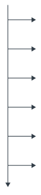
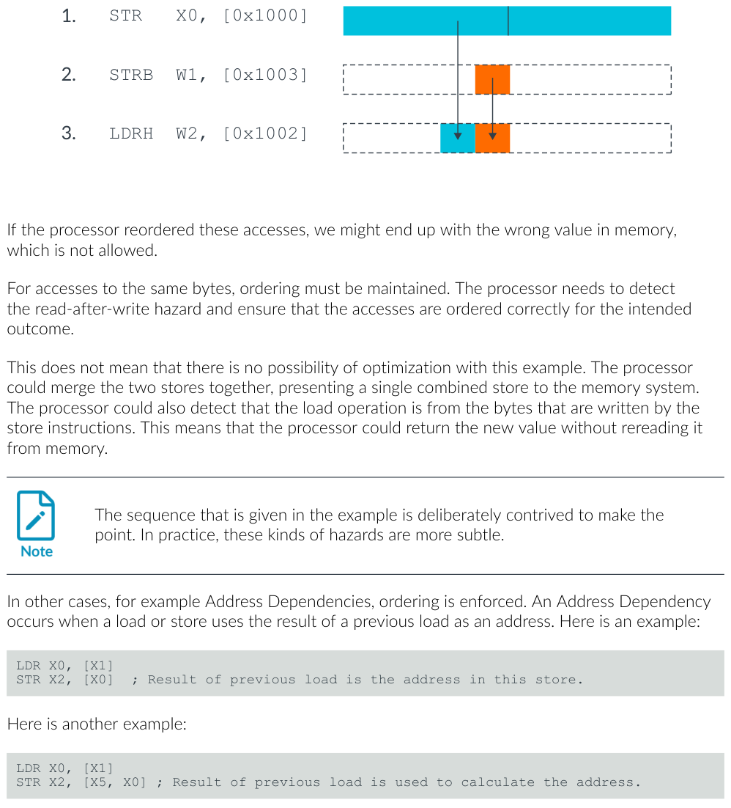
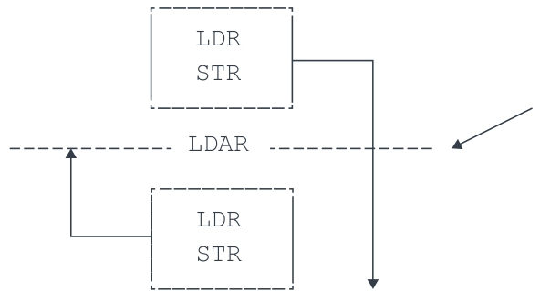
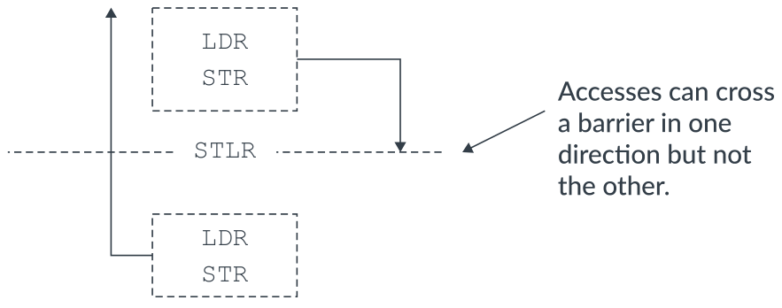
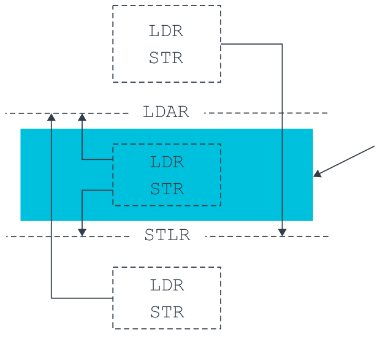
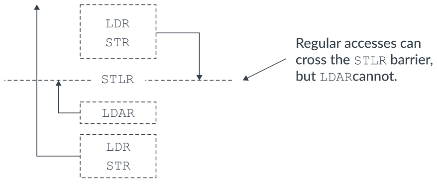
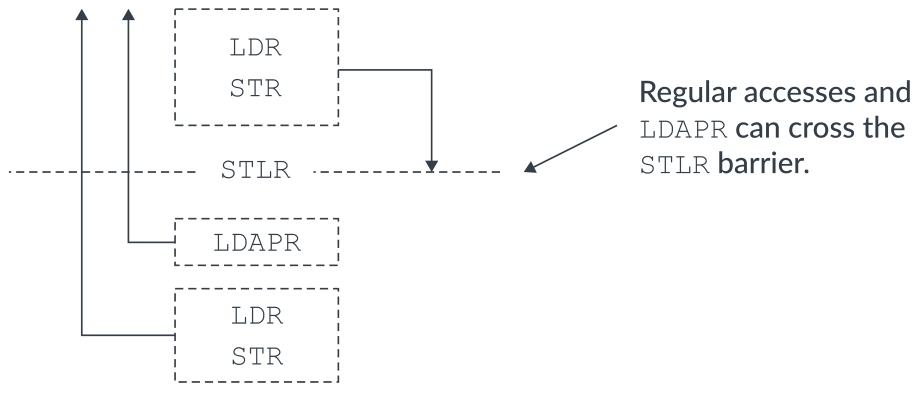
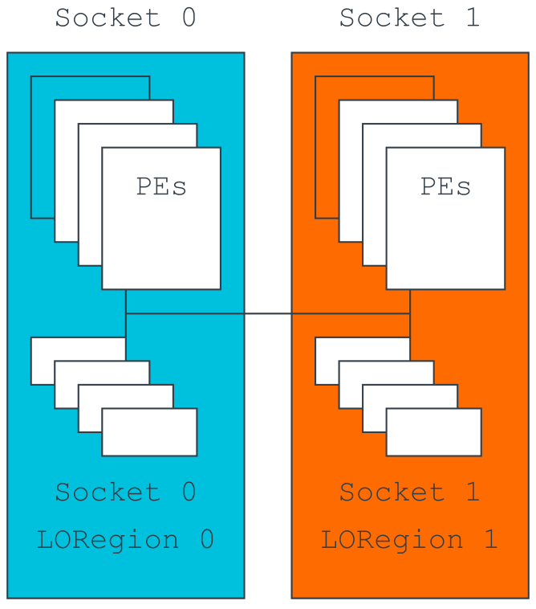
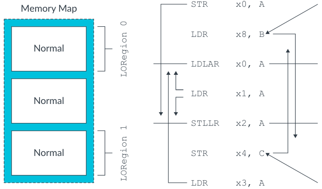

# Learn the architecture — 内存系统、排序与屏障指南（中文翻译）

> 原文：*Learn the architecture - Memory Systems, Ordering, and Barriers Guide*
>
> 版本：Version 1.1　|　文档 ID：102336_0101_01_en　|　Issue 01（2026-05-01）
>
> 版权 © 2022, 2026 Arm Limited（或其关联公司）。保留所有权利。非保密。

---

## 1. 概述

本指南介绍 Armv8-A 架构定义的内存排序（memory ordering）模型，并介绍所提供的各种内存屏障（memory barrier）。本指南还指出一些需要显式排序的常见场景，以及如何使用内存屏障来确保正确运行。

本指南适合底层代码（如启动代码或驱动程序）的开发者，尤其与编写多线程应用或共享内存系统代码的人员相关。

在本指南末尾，你可以进行“知识自测”。

**开始之前**

本指南假设你熟悉 Arm 内存类型。如果不熟悉，请阅读 Armv8-A 内存模型指南中关于设备内存和普通内存的内容。

## 2. 内存排序

在我们的《Armv8-A 指令集架构》指南中，我们介绍了简单顺序执行（Simple Sequential Execution，SSE）。SSE 是指令排序的概念模型。内存访问排序和指令排序是两个不同但相关的概念。理解它们之间的区别很重要。

SSE 描述处理器表面上执行指令的顺序。概括地说，现代处理器具有又长又复杂的流水线。这些流水线通常能够重排序指令或并行执行多条指令，以最大化性能。SSE 意味着处理器必须表现得像是一条一条地、按程序代码中给出的顺序执行指令。这意味着硬件对指令的任何重排序或多发射都必须对软件不可见。

内存排序是关于内存访问在内存系统中出现的顺序。由于写缓冲（write-buffer）和缓存等机制，即使指令按顺序执行，相关的内存访问也可能不按顺序执行。这就是为什么即使处理器对指令遵循 SSE 模型，内存排序仍然是一个需要重视的问题。

Armv8-A 实现了一种弱排序（weakly-ordered）的内存架构。这种架构允许没有依赖关系的内存访问以不同于程序指定顺序的顺序被发出、被观察到以及完成。

这些弱排序内存行为只有在以下情况下才被允许：

- 所定义的内存是普通、Device-nGRE 或 Device-GRE，或
- Device-nR 访问跨过一个外设，如 Armv8-A 内存模型指南中设备内存和普通内存主题所述。

内存重排序让先进处理器能够更高效地运行，如下图所示：



*图 2-1：内存重排序示例*

在该图中，三条指令按程序顺序列出：

1. 第一条指令，访问 1（Access 1），对外部内存执行一次写，进入写缓冲。这条指令在程序顺序上后跟两次读。
2. 第一次读，访问 2，缓存未命中。
3. 下一次读，访问 3，缓存命中。

两次读访问都可以在写缓冲完成与访问 1 相关的写之前完成。支持“未命中下的命中”（Hit-Under-Miss）的缓存意味着，缓存命中的加载（如访问 3）可以先于程序中更早、缓存未命中的加载（如访问 2）完成。

**对重排序的限制**

可以对标记为普通、Device-nGRE 或 Device-GRE 的位置的访问进行重排序。考虑下面的示例代码序列：



*图 2-2：展示内存重排序限制的示例代码序列*

如果处理器重排序了这些访问，内存中最终可能会出现错误的值，这是不允许的。

对相同字节的访问，必须保持顺序。处理器需要检测读后写（read-after-write）冲突，并确保访问按预期结果正确排序。

这并不意味着这个例子没有优化的可能。处理器可以把两次存储合并，向内存系统呈现一次合并后的存储。处理器也可以检测出加载操作读的是存储指令写入的字节，从而直接从新值返回，而无需重新从内存读取。

> 例子里的序列是刻意构造来说明问题的。实践中，这类冲突更微妙。

在其他情况下，例如地址依赖（Address Dependency），顺序是被强制保持的。当地址依赖发生时，一次加载或存储使用前一次加载的结果作为地址。下面是一个例子：

```asm
LDR X0, [X1]
STR X2, [X0]      ; 前一次加载的结果是这次存储的地址。
```

这是另一个例子：

```asm
LDR X0, [X1]
STR X2, [X5, X0]  ; 前一次加载的结果用于计算地址。
```

如果两次内存访问之间存在地址依赖，处理器必须保持顺序。

这条规则不适用于控制依赖（control dependency）。控制依赖发生在前一次加载的值被用来做决策时。例如：

```asm
LDR X0, [X1]
CBZ X0, somewhere_else
LDR X2, [X5]      ; 对 X0 的控制依赖不保证排序。
```

有时，需要在普通内存的访问之间，或普通与设备内存的访问之间强制排序。排序可以通过使用屏障指令来实现。

## 3. 内存屏障

内存屏障（memory barrier）是对显式强制对内存访问施加某种排序、同步或限制的指令的总称。

Armv8 架构定义了提供一系列功能的内存屏障，包括：

- 加载和存储指令的排序
- 加载和存储指令的完成
- 上下文同步
- 对推测的限制

在某些情况下，弱排序内存架构的效果是不希望出现的。这些情况的影响随后可能导致错误运行。本指南介绍架构描述的各种内存屏障，然后指出一些需要显式排序的常见情况。本指南还描述如何使用内存屏障来确保正确运行。

## 4. 谁是观察者？

Armv8-A 架构参考手册使用“观察者”（Observer）这个术语来描述内存屏障的效果。

观察者指的是处理单元（PE）或系统中的其他机制（如外设），它们可以对内存产生读或写。观察者能够观察内存访问。本指南中的内存屏障指定了这些内存访问何时被哪些观察者观察到。

当一次写到达内存系统中它变得可见的位置时，就说这次写被观察到了。当它可见时，它在屏障指令所指定的可共享性域（Shareability domain）内对所有观察者是一致的。如果一个 PE 写某个内存位置，那么当另一个 PE 读同一位置能看到更新后的值时，这次写就是可观察的。例如，如果内存是普通可缓存的，当写到达该可共享性域的一致数据缓存时，它就可观察了。

Armv8-A 内存模型被描述为“其他多副本原子”（Other-multi-copy atomic）。在一个其他多副本原子的系统中，一个观察者的写如果被一个不同的观察者观察到，就必须被所有一致访问该位置的其他观察者观察到。然而，观察者可以在把自己的写对系统中其他观察者可见之前，先观察到自己写的内容。

实际上，被描述为其他多副本原子的内存模型允许 PE 实现本地存储缓冲，这些存储缓冲与系统中的其他观察者不一致，但在本地对依赖做冲突检查。存储缓冲（Store Buffer，STB）是一种微架构机制，用于把 PE 的执行流水线与加载/存储单元（Load/Store Unit，LSU）解耦。

## 5. 数据内存屏障

数据内存屏障（Data Memory Barrier，DMB）阻止指定的显式数据访问跨越屏障指令进行重排序。PE 在程序顺序上先于 DMB 执行的所有显式数据加载或存储指令，都要在程序顺序上位于 DMB 之后的数据访问之前，被指定可共享性域内的所有观察者观察到。

DMB 指令带有一个参数，指明对哪些类型的显式访问进行排序，以及向指定可共享性域内的哪些观察者强制排序。这将在“限制内存屏障的作用范围”中进一步讨论。

下面的代码演示了弱排序内存模型允许的重排序可能。内存位置 X1 和 X3 初始化为 0x0：

```asm
STR #1, [X1]
STR #1, [X3]   ; 可能在前一条 STR 之前被观察到。
```

在这个例子中，允许内存位置 X3 在内存位置 X1 更新之前被更新和观察到。现在想象另一个观察者按相同顺序读同样的两个内存位置。下面的真值表展示了内存系统可能返回的允许观察值组合：

| X1 | X3 |
| --- | --- |
| 0x0 | 0x0 |
| 0x0 | 0x1 |
| 0x1 | 0x0 |
| 0x1 | 0x1 |

下面的例子展示了如何使用 DMB 指令来强制排序观察。内存位置 X1 和 X3 初始化为 0x0：

```asm
STR #1, [X1]
DMB
STR #1, [X3]   ; 不先观察到前一条 STR，就无法观察到这条 STR。
```

在这个例子中，如果观察到内存位置 X3 更新，那么 X1 也必须被观察到更新。现在想象另一个观察者按相同顺序读同样的两个内存位置。下面的真值表展示了内存系统可能返回的允许观察值组合：

| X1 | X3 |
| --- | --- |
| 0x0 | 0x0 |
| 0x1 | 0x0 |
| 0x1 | 0x1 |

以下是关于 DMB 的更多信息：

- DMB 的使用在访问之间建立了顺序。Armv8-A 架构参考手册把这种顺序描述为“屏障排序在前”（Barrier-ordered-before）。
- 对于 DMB，数据缓存维护操作被视为显式数据访问指令，受 DMB 施加的排序限制约束。意图强制缓存维护指令排序的 DMB 指令，必须指定一个同时包含加载和存储的参数。
- DMB 不保证访问何时发生。DMB 保证的是：当访问发生时，屏障及其参数所定义的排序限制生效。DMB 仍然允许 PE 在显式数据等待完成时继续执行。
- DMB 不阻止未来的显式数据读被推测执行。如果一次读被推测执行，内核必须从寄存器中丢弃推测数据。内核还必须在所有先前的显式数据访问被观察到之后重新执行该加载。

## 6. 数据同步屏障

DSB（数据同步屏障，Data Synchronization Barrier）是一种内存屏障，确保在 DSB 之前发生的内存访问在 DSB 指令完成之前已经完成。因此，它比 DMB 更强。DMB 用特定参数建立的所有排序，DSB 用相同参数也都能建立。

一个 PE 执行的 DSB 在以下情况完成：

- 程序顺序上位于 DSB 之前的所有所需访问类型的显式内存访问，对所需可共享性域内的观察者集合都已完成。
- 如果 DSB 中指定的参数是读和写，那么 PE 在 DSB 之前发出的所有缓存维护指令和所有 TLB 维护指令，对所需可共享性域都已完成。

此外，程序顺序上位于 DSB 指令之后的任何指令，在 DSB 完成之前都不能改变系统的任何状态，也不能执行其任何功能。DSB 不阻止取指和译码指令。

下面的例子演示了与 DSB 相关的规则：

```asm
STR X0, [X1]     ; 必须在 DSB 能退役之前完成。
DSB
ADD X1, X2, X3   ; 在前一条 STR 完成之前不得执行。
STR X4, [X5]     ; 在前一条 STR 完成之前不得执行。
```

在这个序列中，DSB 施加的排序限制保证第二条 STR 和 ADD 指令在前一条 STR 完成且 DSB 退役之前不会执行。

## 7. 一次访问何时被认为完成？

如前面的例子所述，DSB 强制完成 DSB 参数所指定的先前内存访问。那么一次内存访问何时被认为完成？

读的完成比写的完成更容易解释。这是因为读的完成点是读数据返回到 PE 的架构通用寄存器的那一刻。

写的完成更复杂。对于对设备内存的写，写完成的点取决于设备内存类型中指定的提前写确认（Early-write acknowledgment）属性，如 Armv8-A 内存模型指南中设备内存所述。如果内存系统支持提前写确认，那么 DSB 可以在写到达末端外设之前退役。对定义为 Device-nGnRnE 的内存的写，只有在写响应来自末端外设时才能完成。

在下面的例子中，DSB 暂停执行，直到对 Device-nGnRnE 内存的 STR 从相应内存位置的末端外设收到写响应：

```asm
STR X0, [Device-nGnRnE]  ; 必须从末端外设收到写响应
DSB SY
```

## 8. 限制内存屏障的作用范围

DMB 和 DSB 内存屏障指令都带有一个参数，定义内存屏障对哪种类型的内存访问进行排序，以及该指令必须在哪个可共享性域上运作。这个作用范围实际上定义了屏障施加的排序延伸到哪些观察者。

当试图优化内存屏障的效果时，限制内存屏障作用范围的能力很有用。在某些情况下，屏障施加的完全排序限制可能过于严格。把屏障的作用范围限制到内存访问和观察者的一个子集，可以允许微架构优化，从而减少内存屏障带来的一些性能影响。

> Armv8-A AArch64 架构要求在对 DSB 或 DMB 编程时显式定义参数。这一要求不同于以前的版本——以前版本在省略显式参数时默认使用 SY。

下表展示了有效的 DSB 和 DMB 参数：

| 参数 | 排序的访问（前-后） | 可共享性域 |
| --- | --- | --- |
| OSH | Any-Any | 外部可共享 |
| LD | Load-Load、Load-Store | 全系统 |
| ST | Store-Store | 全系统 |
| SY | Any-Any | 全系统 |

例如，DMB ST 只影响显式存储指令的排序。屏障周围加载的排序不受影响。

考虑下面的例子：

```asm
PE0
LDR x0, [X4]   ; 可以乱序观察到
STR #1, [X1]
DMB ST
STR #1, [X3]
```

由于 DMB 带有 ST 参数，屏障提供了存储到 [X3] 相对于存储到 [X1] 的排序。然而，从 [X4] 的加载不受 DMB 影响，因为屏障被限制为存储。

> 在架构的早期版本中，也可以向 DMB 和 DSB 屏障传递一个可共享性参数：
>
> - NS，不可共享
> - ISH，内部可共享
> - OSH，外部可共享
>
> 可共享性参数已被弃用，带有该参数的屏障行为与不给出可共享性选项时相同。

## 9. 不同的观察者

架构将以下视为独立的观察者：

- 内核的指令接口，通常称为指令取指单元（Instruction Fetch Unit，IFU）
- 数据接口，通常称为加载存储单元（Load Store Unit，LSU）
- MMU 表遍历单元

如“谁是观察者？”所述，观察者是能够进行内存访问的东西。例如，MMU 产生读来遍历转换表。

AArch64 不要求不同观察者所做的访问之间保持顺序，即使存在地址依赖。例如，下面的序列可以按任意顺序执行和完成，尽管存在依赖：

```asm
DC CVAU, X0  ; 尽管存在地址依赖，
IC IVAU, X0  ; 操作仍按任意顺序执行。
```

如果这些指令被重排序，指令缓存可能会用数据缓存中的陈旧数据重新填充。为解决这个问题，架构要求使用内存屏障。可以在下面的代码中看到例子：

```asm
DC CVAU, X0  ; 尽管存在地址依赖，
DSB
IC IVAU, X0  ; 操作仍按任意顺序执行。
```

在这个例子中，数据缓存清理（DC CVAU）需要先于指令缓存无效化（IC IVAU）执行完成。DC CVAU 确保在执行无效化之前，新数据始终对指令缓存可见。

> 需要 DSB 是因为 DMB 只影响数据访问。这包括数据缓存维护操作，但不包括缓存无效化指令。

## 10. Load-Acquire 与 Store-Release 指令

Armv8-A AArch64 提供了一组对加载具有获取（Acquire）语义、对存储具有释放（Release）语义的指令。这些指令支持释放一致性顺序一致（Release Consistency sequentially consistent，RCsc）模型。

这些新的加载和存储指令包含隐式屏障语义，类似于单向屏障。这是因为这些指令施加的排序要求比 DMB 或 DSB 更弱——它们只影响屏障指令两侧指定的显式内存访问的排序。Load-Acquire 和 Store-Release 指令施加的较弱排序要求允许微架构优化，从而减少原本由显式内存屏障带来的一些性能影响。如果排序要求可以使用 Load-Acquire 或 Store-Release 满足，那么优先使用这些指令而不是 DMB 会更合适。

可共享性域定义了这些指令施加的排序延伸到哪些观察者。Load-Acquire 和 Store-Release 的可共享性域由该指令所访问地址的可共享性域定义。例如，如果 PE0 和 PE1 不在同一内部可共享域中，那么如果 X3 被定义为内部可共享，架构上就允许 PE1 在内存位置 X1 更新之前观察到内存位置 X3 已更新。如下面的代码所示：

```asm
PE0
STR  #1, [X1]
STLR #1, [X3]
```

以下是关于 Load-Acquire 和 Store-Release 指令的更多信息：

- 对于 Load-Acquire、Load-AcquirePC 和 Store-Release 指令，所提供数据对象的地址必须对齐到被访问数据元素的大小。否则，访问会产生对齐故障。
- 对于 Load-Acquire 独占对（Load-Acquire Exclusive Pair）和 Store-Release 独占对（Store-Release Exclusive Pair），提供给指令的地址必须对齐到被加载元素大小的两倍。否则访问会产生对齐故障。如下面的代码所示：

```asm
LDAXP x0, x1, [0x08]  ; 对齐故障
LDAXP x0, x1, [0x10]
```

- 提供了 Load-Acquire 和 Store-Release 指令的独占变体。

**Load-Acquire**

Load-Acquire（LDAR）指令施加的排序要求如下：

- LDAR 之后的所有显式内存访问在 LDAR 之后被观察到。
- LDAR 之前的所有显式内存访问不受影响，并且可以相对 LDAR 重排序。

你可以在下面的图中看到这些排序要求：



*图 10-1：LDAR 排序要求*

访问可以朝一个方向跨越屏障，但不可以朝另一个方向。

**Store-Release**

Store-Release（STLR）指令施加的排序要求如下：

- STLR 之前的所有显式内存访问在 STLR 之前被观察到。
- STLR 之后的所有显式内存访问不受影响，并且可以相对 STLR 重排序。

你可以在下面的图中看到这些排序要求：



*图 10-2：STLR 排序要求*

下面的例子展示了如何使用 STLR 来强制排序观察。内存位置 X1 和 X3 初始化为 0x0：

```asm
STR  #1, [X1]
STLR #1, [X3]  ; 不观察到前一条 STR，就无法观察到这条 STLR。
```

在这个例子中，如果观察到内存位置 X3 更新，那么 X1 也必须被观察到更新。如果另一个观察者按相同顺序读同样的两个内存位置，下面的真值表展示了内存系统可能返回的值组合：

| X1 | X3 |
| --- | --- |
| 0x0 | 0x0 |
| 0x1 | 0x0 |
| 0x1 | 0x1 |

**Load-Acquire 与 Store-Release 对**

Load-Acquire 和 Store-Release 指令可以组合成一对来保护临界代码段。组合这些指令可以确保临界代码段内的访问不会被重排序到临界段之外。临界代码段内部的访问不受影响，可以重排序，如下图所示：



*图 10-3：用 LDAR-STLR 对保护临界代码段*

**顺序一致**

获取/释放操作使用顺序一致模型。这意味着，当 Load-Acquire 在程序顺序上位于 Store-Release 之后时，Store-Release 指令产生的内存访问先于 Load-Acquire 指令产生的内存访问被观察到。你可以在下面的图中看到这些排序要求：



*图 10-4：顺序一致的排序要求*

**Load-AcquirePC**

Armv8.3-A 还提供了 Load-AcquirePC 指令。Load-AcquirePC 与 Store-Release 的组合用于支持较弱的释放一致性处理器一致（Release Consistency processor consistent，RCpc）模型，如下图所示：



*图 10-5：Load-AcquirePC 指令*

对于这些新的 Load-AcquirePC 指令，Load-Acquire 必须与前面的 Store-Release 按顺序被观察到这一要求被取消了。

**有限排序区域**

Armv8.1-A 增加了对有限排序区域（Limited Ordering Regions，LORegion）的支持。LORegion 允许大型系统执行特殊的 Load-Acquire（LDLAR）和 Store-Release（STLLR）指令，这些指令只对物理地址（PA）映射中指定区域的内存访问提供排序。

LORegion 避免了在等待内存访问被发起 PE 同一可共享性域内所有观察者观察到时承受巨大的性能损失。这种情况在使用现有的 Load-Acquire 和 Store-Release 指令时也会发生。此功能仅由那些知道只有有限观察者集合想要共享某个内存位置的软件使用。这类软件通常是了解系统拓扑的软件。例如，下图展示了一个多插槽系统，其中跨越插槽的有序访问可能会造成很大的延迟：



*图 10-6：使用 LORegion 的多插槽系统*

设计一个系统，把排序限制到某个插槽使用的本地物理内存区域，可以获得整体性能提升。

LORegion 只适用于非安全物理内存访问。一个 LORegion 由一个 LORegion 描述符定义。LORegion 描述符的数量是实现定义的（IMPLEMENTATION DEFINED），可以通过读 LORID_EL1 寄存器发现。

每个 LORegion 描述符包含以下元素，它们通过系统寄存器访问来编程：

- 起始地址（LORSA_EL1）
- 结束地址（LOREA_EL1）
- LORegion 编号（LORN_EL1）
- 有效位，指示该 LORegion 描述符是否有效（LORC_EL1）

下面的代码演示了对 LORegion 2 的编程：

```asm
MOV  x0, #0x2            // LORegion 编号
MOV  x1, #0x80000000     // LORegion 起始地址
MOV  x2, #0xC0000000     // LORegion 结束地址
MOV  x3, #0x1            // LORegion 使能（有效位）
MSR  LORN_EL1, x0        // 选择 LORegion 编号描述符
ISB
MSR  LORSA_EL1, x1
MSR  LOREA_EL1, x2
MSR  LORC_EL1, x3
ISB
```

在下图中，只有对同一 LORegion 内地址的访问（由 LDLAR 或 STLLR 指令指定）受影响。LORegion 之外的内存访问不受影响。例如，对 C 的存储先于 LDLAR 被观察到。如果软件使用 LDAR，对 C 的存储会在 LDAR 之后被观察到，如下图所示：



*图 10-7：展示 LORegion 内存访问的示例*

## 11. 指令屏障

Arm 架构把 PE 的上下文定义为缓存、TLB 和系统寄存器的状态。执行缓存或 TLB 维护操作，或更新系统寄存器，被归类为上下文改变操作（context-changing operation）。

架构只保证上下文改变操作在上下文同步事件（Context synchronization event）之后才会被看到。

对显式同步的要求放宽了对处理器设计者每个周期传播所有上下文改变的需要。隐式同步是不必要的开销。上下文同步事件的要求意味着软件可以显式定义何时希望新上下文生效。

上下文同步事件做以下之一：

- 执行 ISB 操作
- 进入异常
- 从异常返回
- 退出调试状态

> 如果 PE 从不执行上下文同步事件，Arm 处理器实现被允许永不把上下文更新到后续执行。

上下文同步事件的执行确保：

- 在上下文同步事件时挂起的所有未屏蔽中断，都在上下文同步事件后的第一条指令之前被接收。
- 程序顺序上位于导致上下文同步事件的指令之后的任何指令，在上下文同步事件发生之前都不能执行其任何功能。
- 上下文同步事件之前所做的所有系统寄存器写，都影响程序顺序上位于导致上下文同步事件的指令之后的任何指令。
- 对于在改变之前不允许缓存在 TLB 中的条目的转换表，所有已完成的改变，影响程序顺序上位于导致上下文同步事件的指令之后的所有指令取指。
- 在上下文同步事件之前完成的所有 TLB、指令缓存（以及 AArch32 状态下的分支预测器）无效化，影响程序顺序上位于导致上下文同步事件的指令之后的所有指令。

**使用示例**

软件必须首先确保对 SVE、Advanced SIMD 和浮点寄存器的访问不被捕获（trap）。例如，在 EL1 执行时，可以通过把 CPACR_EL1.FPEN 编程为 0x3 来禁用对 SVE、Advanced SIMD 和浮点寄存器访问的捕获，如下面的代码所示：

```asm
MRS     X1, CPACR_EL1
ORR     X1, X1, #(0x3 << 20)  ; 写 CPACR_EL1.FPEN 位
MSR     CPACR_EL1, X1
ISB
FADD    S0, S1, S2
```

如果没有 ISB 指令，禁用捕获这一上下文改变操作就无法保证被 FADD 指令看到。缺少 ISB 最终会导致 FADD 指令进入同步异常。在这种情况下，ISB 就是所需的上下文同步事件，它确保新上下文（包括禁用对 SVE、Advanced SIMD 和浮点寄存器的捕获）被 FADD 指令看到。

在这个例子中，如果 EL1 在任何 SVE、Advanced SIMD 和浮点寄存器访问之前返回到 EL0，就不需要 ISB。这是因为执行从 EL1 到 EL0 的异常返回这一行为本身就是一个上下文同步事件。

## 12. 知识自测

**Q1. 什么是观察者？**

A1. 观察者是处理单元或系统中的机制（如外设），它能对内存产生读或写。

**Q2. 要确保被 DMB 分隔的两次存储在顺序上被观察到，应使用哪个 DMB 限定符？**

A2. DMB ST

**Q3. 要确保先前的内存访问在继续执行之前完成，需要哪种内存屏障？**

A3. DSB

**Q4. 架构定义的上下文同步事件有哪些？**

A4. 架构定义的上下文同步事件如下：

- 执行 ISB 操作
- 进入异常
- 从异常返回
- 退出调试状态

## 13. 相关信息

以下是与本指南内容相关的一些资源：

- **Armv8-A 架构参考手册**。特别是以下部分：
  - Barrier Litmus Tests（屏障 Litmus 测试）
  - The AArch64 Application Level Memory Model（AArch64 应用级内存模型）
- **Arm Community** —— 提出开发问题，查找 Arm 专家关于特定主题的文章和博客。
- **Learn the architecture - AArch64 memory model**（AArch64 内存模型）
- **Memory Consistency Models for Shared Memory-Multiprocessors**，Gharachorloo, Kourosh, 1995, Stanford University Technical Report CSL-TR-95-685 —— 这篇论文提供了更多关于 RCsc 和 RCpc 的信息。

## 14. 后续步骤

有关多个详细的内存和指令屏障示例，请参考最新 Armv8-A 架构参考手册中的 Barrier Litmus Tests。Armv8-A 架构参考手册的这一部分为许多需要屏障的常见软件场景提供了详细的逐步示例。

要继续学习 Armv8-A 架构，请参阅我们 Learn the architecture 系列中的更多指南。
