# Learn the architecture — 用 Neon 内建函数优化 C 代码（中文翻译）

> 原文：*Learn the architecture - Optimizing C code with Neon intrinsics*
>
> 版本：Version 2.1　|　文档 ID：102467_0201_03_en　|　Issue 03（2025-02-05）
>
> 版权 © 2022–2025 Arm Limited（或其关联公司）。保留所有权利。非保密。

---

## 1. 概述

本指南展示如何在 C 或 C++ 代码中使用 Neon 内建函数（intrinsic），以利用 Armv8 和 Armv9 架构中的 Advanced SIMD 技术。简单的示例展示了如何使用这些内建函数，并借此机会解释它们的用途。

**目标读者**：底层软件工程师、库编写者，以及其他想要使用 Advanced SIMD 技术的开发者会发现本指南很有用。

在本指南末尾有一个“知识自测”部分，用来检验你是否理解了以下关键概念：

- 知道 Neon 是什么，理解使用 Neon 的不同方式
- 知道在 C 语言中使用 Neon 内建函数的基础知识
- 知道在哪里可以找到 Neon 内建函数参考和 Neon 指令集

## 2. 什么是 Neon？

Neon 是 Arm Advanced SIMD 架构的实现。

Neon 的目的通过提供以下内容来加速数据操作：

- 32 个 128 位向量寄存器，每个都能包含多个数据通道（lane）。
- SIMD 指令，同时对这些多个数据通道进行操作。

能够从 Neon 技术中受益的应用包括多媒体和信号处理、3D 图形、语音、图像处理，以及其他对定点和浮点性能要求苛刻的应用。

作为程序员，你有多种方式可以利用 Neon 技术：

- 支持 Neon 的开源库（如 Arm Compute Library）是利用 Neon 最简单的方式之一。
- 编译器中的自动向量化特性可以自动优化代码以利用 Neon。
- Neon 内建函数是编译器会用相应 Neon 指令替换的函数调用。这让你可以直接、底层地访问你想要的精确 Neon 指令，而且全部通过 C 或 C++ 代码完成。
- 对于追求极高性能的场景，手写 Neon 汇编对有经验的程序员来说可能是最佳方法。

在本指南中，我们重点介绍 AArch64 的 Neon 内建函数，但它们也可以为 AArch32 编译。关于 AArch32 Neon 的更多信息，请参见《Introducing Neon for Armv8-A》。

## 3. 为什么使用 Neon 内建函数？

内建函数是编译器知道其精确实现的函数。Neon 内建函数是定义在 `arm_neon.h` 中的一组 C 和 C++ 函数，Arm 编译器和 GCC 都支持。这些函数让你无需直接编写汇编代码就能使用 Neon，因为这些函数本身包含简短的汇编内核（kernel），会被内联到调用代码中。此外，寄存器分配和流水线优化由编译器处理，因此避免了汇编程序员面临的许多困难。

有关所有 Neon 内建函数的列表，请参见《Neon Intrinsics Reference》。Neon 内建函数的工程规范包含在《Arm C Language Extensions（ACLE）》中。

使用 Neon 内建函数有许多好处：

- **强大**：内建函数让程序员直接访问 Neon 指令集，而无需手写汇编代码。
- **可移植**：手写的 Neon 汇编指令可能需要针对不同的目标处理器重写。包含 Neon 内建函数的 C 和 C++ 代码，只需极少甚至无需改动，就可以为新目标或新执行状态（例如从 AArch32 迁移到 AArch64）编译。
- **灵活**：程序员可以在需要时利用 Neon，在不需要时使用 C/C++，同时避免许多底层工程问题。

然而，内建函数并非在所有情况下都合适：

- 使用 Neon 内建函数的学习曲线，比导入库或依赖编译器更陡峭。
- 手写优化的汇编代码虽然更难写，但可能提供最大的性能提升空间。

我们来看一些用 Neon 内建函数重新实现某些 C 函数的示例。所选示例并不反映其应用的完整复杂性，但它们展示了内建函数的用法，并作为编写更复杂代码的起点。

## 4. 示例 —— RGB 去交错

考虑一个 24 位 RGB 图像，其中图像是一个像素数组，每个像素都有红、蓝、绿三个元素。在内存中，它可能如下面的图所示：

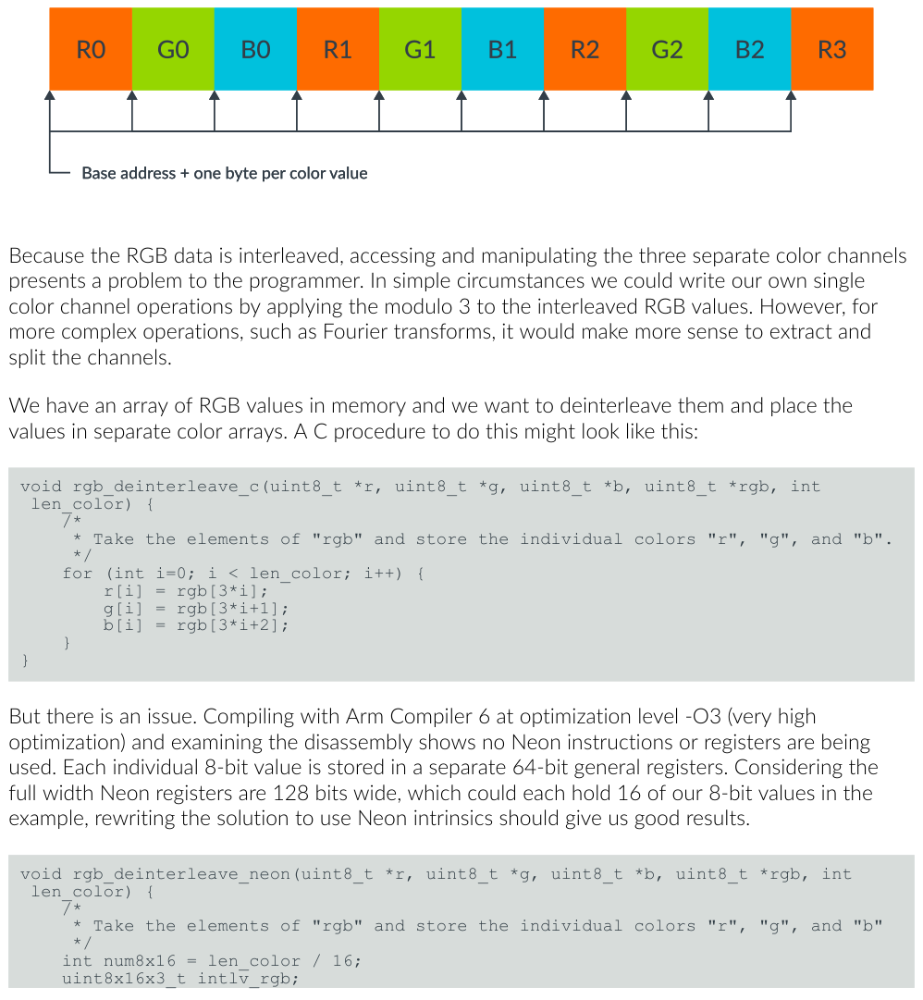

*图 4-1：RGB 图像像素数组*

由于 RGB 数据是交错的，访问和操作三个独立的颜色通道对程序员来说是个问题。在简单情况下，我们可以通过对交错的 RGB 值应用模 3 运算来编写我们自己的单颜色通道操作。然而，对于更复杂的操作（如傅里叶变换），提取并拆分通道会更有意义。

我们在内存中有一个 RGB 值数组，想把它们去交错，并把值放到独立的颜色数组中。做这件事的 C 过程可能如下：

```c
void rgb_deinterleave_c(uint8_t *r, uint8_t *g, uint8_t *b, uint8_t *rgb, int len_color) {
    /*
     * 取 "rgb" 的元素，并把各个颜色存储到 "r"、"g"、"b"。
     */
    for (int i=0; i < len_color; i++) {
        r[i] = rgb[3*i];
        g[i] = rgb[3*i+1];
        b[i] = rgb[3*i+2];
    }
}
```

但这里有个问题。用 Arm Compiler 6 在优化级别 -O3（极高优化）下编译，并检查反汇编，会发现没有使用任何 Neon 指令或寄存器。每个 8 位值都被存储在单独的 64 位通用寄存器中。考虑到完整宽度的 Neon 寄存器是 128 位宽，每个可以容纳示例中的 16 个 8 位值，把解决方案改写为使用 Neon 内建函数应该会得到好结果。

```c
void rgb_deinterleave_neon(uint8_t *r, uint8_t *g, uint8_t *b, uint8_t *rgb, int len_color) {
    /*
     * 取 "rgb" 的元素，并把各个颜色存储到 "r"、"g"、"b"。
     */
    int num8x16 = len_color / 16;
    uint8x16x3_t intlv_rgb;

    for (int i=0; i < num8x16; i++) {
        intlv_rgb = vld3q_u8(rgb+3*16*i);
        vst1q_u8(r+16*i, intlv_rgb.val[0]);
        vst1q_u8(g+16*i, intlv_rgb.val[1]);
        vst1q_u8(b+16*i, intlv_rgb.val[2]);
    }
}
```

在这个例子中，我们使用了以下类型和内建函数：

| 代码元素 | 它是什么？ | 我们为什么使用它？ |
| --- | --- | --- |
| uint8x16_t | 16 个 8 位无符号整数组成的数组。 | 一个 uint8x16_t 恰好装入一个 128 位寄存器。即使在 C 代码中，我们也能确保没有浪费的寄存器位。 |
| uint8x16x3_t | 一个包含三个 uint8x16_t 元素的结构体。 | 循环中当前颜色值的临时保存区。 |
| vld3q_u8(…) | 通过加载 3×16 字节的连续内存区域返回 uint8x16x3_t 的函数。加载的每个字节以交替模式放入三个 uint8x16_t 数组之一。 | 在最底层，这个内建函数保证生成 LD3 指令，该指令以交替模式把给定地址的值加载到三个 Neon 寄存器中。 |
| vst1q_u8(…) | 在给定地址存储 uint8x16_t 的函数。它存储满一个 128 位寄存器的字节值。 | 存储去交错后的颜色值。 |

上面的完整源代码可以在 Arm 机器上用以下命令编译和反汇编：

```shell
gcc -g -o3 rgb.c -o exe_rgb_o3
objdump -d exe_rgb_o3 > disasm_rgb_o3
```

如果你没有基于 Arm 的硬件，可以使用 Arm DS-5 Community Edition 和 Armv8-A Foundation Platform。

## 5. 示例 —— 矩阵乘法

矩阵乘法是许多数据密集型应用中执行的操作。它由一组以直接方式重复的算术运算组成，如下图所示：

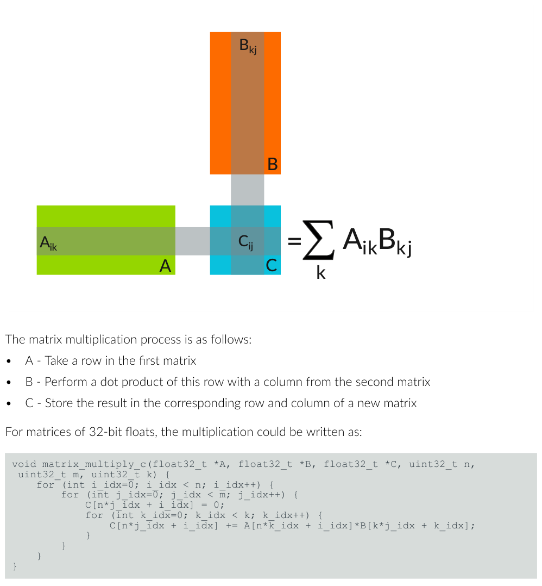

*图 5-1：矩阵乘法*

矩阵乘法的过程如下：

- A —— 取第一个矩阵中的一行
- B —— 用第二个矩阵中的一列对该行做点积
- C —— 把结果存储到新矩阵中相应的行和列

对于 32 位浮点数矩阵，乘法可以写成：

```c
void matrix_multiply_c(float32_t *A, float32_t *B, float32_t *C, uint32_t n, uint32_t m, uint32_t k) {
    for (int i_idx=0; i_idx < n; i_idx++) {
        for (int j_idx=0; j_idx < m; j_idx++) {
            C[n*j_idx + i_idx] = 0;
            for (int k_idx=0; k_idx < k; k_idx++) {
                C[n*j_idx + i_idx] += A[n*k_idx + i_idx]*B[k*j_idx + k_idx];
            }
        }
    }
}
```

我们假设矩阵在内存中按列主序（column-major）布局。也就是说，一个 n × m 矩阵 M 表示为一个数组 M_array，其中 Mij = M_array[n*j + i]。

这段代码是次优的，因为它没有充分利用 Neon。我们可以从使用内建函数开始改进它，但先解决一个更简单的问题——在进入更大矩阵之前，先看看小的、固定大小的矩阵。

下面的代码使用内建函数来乘两个 4×4 矩阵。由于我们要处理的值数量小且固定，它们都能一次装入处理器的 Neon 寄存器，因此我们可以完全展开循环。

```c
void matrix_multiply_4x4_neon(float32_t *A, float32_t *B, float32_t *C) {
        // 这些是 A 的列
        float32x4_t A0;
        float32x4_t A1;
        float32x4_t A2;
        float32x4_t A3;

        // 这些是 B 的列
        float32x4_t B0;
        float32x4_t B1;
        float32x4_t B2;
        float32x4_t B3;

        // 这些是 C 的列
        float32x4_t C0;
        float32x4_t C1;
        float32x4_t C2;
        float32x4_t C3;

        A0 = vld1q_f32(A);
        A1 = vld1q_f32(A+4);
        A2 = vld1q_f32(A+8);
        A3 = vld1q_f32(A+12);

        // 清零 C 值的累加器
        C0 = vmovq_n_f32(0);
        C1 = vmovq_n_f32(0);
        C2 = vmovq_n_f32(0);
        C3 = vmovq_n_f32(0);

        // 按 4x1 块做乘加，即 C 中的每一列
        B0 = vld1q_f32(B);
        C0 = vfmaq_laneq_f32(C0, A0, B0, 0);
        C0 = vfmaq_laneq_f32(C0, A1, B0, 1);
        C0 = vfmaq_laneq_f32(C0, A2, B0, 2);
        C0 = vfmaq_laneq_f32(C0, A3, B0, 3);
        vst1q_f32(C, C0);

        B1 = vld1q_f32(B+4);
        C1 = vfmaq_laneq_f32(C1, A0, B1, 0);
        C1 = vfmaq_laneq_f32(C1, A1, B1, 1);
        C1 = vfmaq_laneq_f32(C1, A2, B1, 2);
        C1 = vfmaq_laneq_f32(C1, A3, B1, 3);
        vst1q_f32(C+4, C1);

        B2 = vld1q_f32(B+8);
        C2 = vfmaq_laneq_f32(C2, A0, B2, 0);
        C2 = vfmaq_laneq_f32(C2, A1, B2, 1);
        C2 = vfmaq_laneq_f32(C2, A2, B2, 2);
        C2 = vfmaq_laneq_f32(C2, A3, B2, 3);
        vst1q_f32(C+8, C2);

        B3 = vld1q_f32(B+12);
        C3 = vfmaq_laneq_f32(C3, A0, B3, 0);
        C3 = vfmaq_laneq_f32(C3, A1, B3, 1);
        C3 = vfmaq_laneq_f32(C3, A2, B3, 2);
        C3 = vfmaq_laneq_f32(C3, A3, B3, 3);
        vst1q_f32(C+12, C3);
}
```

我们选择乘固定大小的 4×4 矩阵有几个原因：

- 某些应用特别需要 4×4 矩阵，例如图形或相对论物理。
- Neon 向量寄存器保存四个 32 位值，所以让程序匹配架构更容易优化。
- 我们可以把这个 4×4 内核用到一个更通用的内核中。

让我们总结一下这里用到的内建函数：

| 代码元素 | 它是什么？ | 我们为什么使用它？ |
| --- | --- | --- |
| float32x4_t | 四个 32 位浮点数组成的数组。 | 一个 float32x4_t 装入一个 128 位寄存器。即使在 C 代码中也能确保没有浪费的寄存器位。 |
| vld1q_f32(…) | 把四个 32 位浮点数加载到 float32x4_t 的函数。 | 从 A 和 B 获取我们需要的矩阵值。 |
| vfmaq_lane_f32(…) | 使用融合乘加指令的函数。把 float32x4_t 值乘以另一个 float32x4_t 的单个元素，然后把结果加到第三个 float32x4_t 上再返回。 | 由于矩阵的行乘列点积是一组乘法和加法，这个操作非常契合。 |
| vst1q_f32(…) | 在给定地址存储 float32x4_t 的函数。 | 计算结果后存储结果。 |

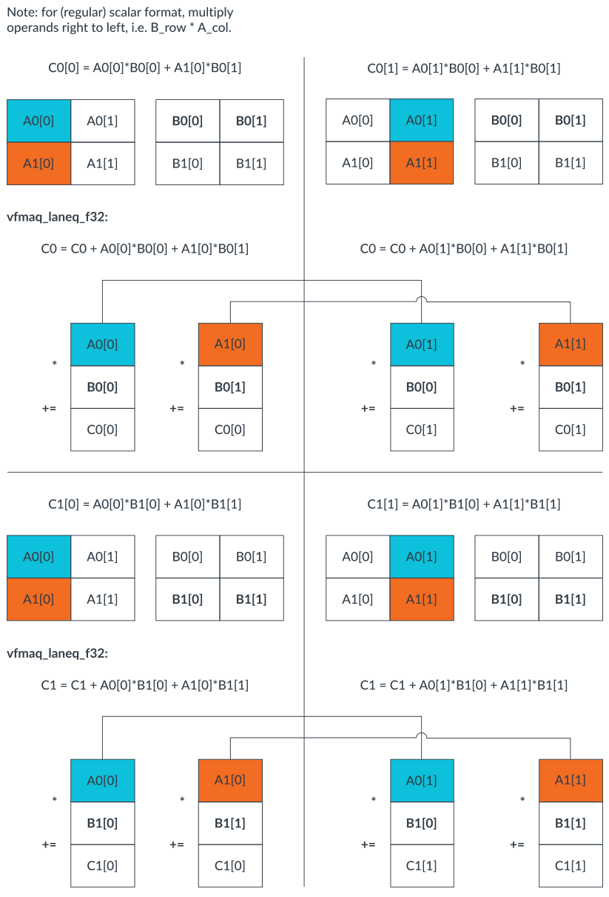

*图 5-2：使用 Neon 的矩阵 A 乘以矩阵 B*

现在我们能乘 4×4 矩阵了，就可以把更大的矩阵当作 4×4 矩阵的块来处理，从而乘以更大的矩阵。这种方法的一个缺点是，它只适用于两个维度上都是 4 的倍数的矩阵大小，但通过给任意矩阵补零，你可以在不改变方法的情况下使用它。

更通用的矩阵乘法代码如下所列。内核的结构变化很小，主要变化是增加了循环和地址计算。与 4×4 内核一样，我们为 B 的列使用了唯一的变量名，尽管本可以用一个变量并重新加载。这是给编译器的一个提示，让它为这些变量分配不同的寄存器，从而使处理器能够在一列等待另一列加载时完成算术指令。

```c
void matrix_multiply_neon(float32_t *A, float32_t *B, float32_t *C, uint32_t n, uint32_t m, uint32_t k) {
        /*
         * 把矩阵 A 和 B 相乘，把结果存储到 C。
         * 用户有责任确保矩阵兼容。
         */
        int A_idx;
        int B_idx;
        int C_idx;

        // 这些是 A 的 4x4 子矩阵的列
        float32x4_t A0;
        float32x4_t A1;
        float32x4_t A2;
        float32x4_t A3;

        // 这些是 B 的 4x4 子矩阵的列
        float32x4_t B0;
        float32x4_t B1;
        float32x4_t B2;
        float32x4_t B3;

        // 这些是 C 的 4x4 子矩阵的列
        float32x4_t C0;
        float32x4_t C1;
        float32x4_t C2;
        float32x4_t C3;

        for (int i_idx=0; i_idx<n; i_idx+=4) {
            for (int j_idx=0; j_idx<m; j_idx+=4) {
                 // 矩阵运算前清零累加器
                 C0=vmovq_n_f32(0);
                 C1=vmovq_n_f32(0);
                 C2=vmovq_n_f32(0);
                 C3=vmovq_n_f32(0);
                 for (int k_idx=0; k_idx<k; k_idx+=4){
                      // 计算 4x4 块的基索引
                      A_idx = i_idx + n*k_idx;
                      B_idx = k*j_idx + k_idx;
                      // 加载行中最新的 A 值
                      A0=vld1q_f32(A+A_idx);
                      A1=vld1q_f32(A+A_idx+n);
                      A2=vld1q_f32(A+A_idx+2*n);
                      A3=vld1q_f32(A+A_idx+3*n);
                      // 按 4x1 块做乘加，即 C 的每一列
                      B0=vld1q_f32(B+B_idx);
                      C0=vfmaq_laneq_f32(C0,A0,B0,0);
                      C0=vfmaq_laneq_f32(C0,A1,B0,1);
                      C0=vfmaq_laneq_f32(C0,A2,B0,2);
                      C0=vfmaq_laneq_f32(C0,A3,B0,3);
                      B1=vld1q_f32(B+B_idx+k);
                      C1=vfmaq_laneq_f32(C1,A0,B1,0);
                      C1=vfmaq_laneq_f32(C1,A1,B1,1);
                      C1=vfmaq_laneq_f32(C1,A2,B1,2);
                      C1=vfmaq_laneq_f32(C1,A3,B1,3);
                      B2=vld1q_f32(B+B_idx+2*k);
                      C2=vfmaq_laneq_f32(C2,A0,B2,0);
                      C2=vfmaq_laneq_f32(C2,A1,B2,1);
                      C2=vfmaq_laneq_f32(C2,A2,B2,2);
                      C2=vfmaq_laneq_f32(C2,A3,B2,3);
                      B3=vld1q_f32(B+B_idx+3*k);
                      C3=vfmaq_laneq_f32(C3,A0,B3,0);
                      C3=vfmaq_laneq_f32(C3,A1,B3,1);
                      C3=vfmaq_laneq_f32(C3,A2,B3,2);
                      C3=vfmaq_laneq_f32(C3,A3,B3,3);
                }
               // 计算存储的基索引
               C_idx = n*j_idx + i_idx;
               vst1q_f32(C+C_idx, C0);
               vst1q_f32(C+C_idx+n, C1);
               vst1q_f32(C+C_idx+2*n, C2);
               vst1q_f32(C+C_idx+3*n, C3);
           }
        }
}
```

编译并反汇编这个函数，与我们的 C 函数比较后可以看到：

- 对于给定的矩阵乘法，算术指令更少，因为我们利用 Advanced SIMD 技术做了完整的寄存器打包。纯 C 代码通常不会这样做。
- 使用 FMLA 而不是 FMUL 指令，正如内建函数所指定。
- 循环迭代次数更少。正确使用内建函数时，循环可以轻松展开。
- 然而，由于数据类型（例如 float32x4_t）的内存分配和初始化，存在不必要的加载和存储，而这些在纯 C 代码中是不使用的。

**完整源代码示例**

此示例的完整源代码（其中 `vfmaq_laneq_f32` 为原文所写，与前面用到的 `vfmaq_lane_f32` 等价）如下：

```c
/*
 * Copyright (C) Arm Limited, 2019 All rights reserved.
 *
 * 在与基于 Arm 的技术（包括但不限于编程教程）打交道时，
 * 该示例代码作为学习辅助提供给你。
 * 在遵守本许可条款的前提下，Arm 特此授予你一项非独占、不可转让、
 * 不可再许可、免费的许可，仅用于演示和评估目的来使用和复制本软件。
 *
 * 你接受本软件未经 Arm 测试，因此本软件按"原样"提供，不附带任何明示或
 * 暗示的保证。在任何情况下，作者或版权持有人均不对因本软件或软件的使用
 * 而产生或与之相关的任何索赔、损害或其他责任负责，无论是基于诉讼、合同、
 * 侵权还是其他原因。
 */
#include <stdio.h>
#include <stdint.h>
#include <stdlib.h>
#include <stdbool.h>
#include <math.h>
#include <arm_neon.h>
#define BLOCK_SIZE 4

void matrix_multiply_c(float32_t *A, float32_t *B, float32_t *C, uint32_t n, uint32_t m, uint32_t k) {
        for (int i_idx=0; i_idx<n; i_idx++) {
                for (int j_idx=0; j_idx<m; j_idx++) {
                        C[n*j_idx + i_idx] = 0;
                        for (int k_idx=0; k_idx<k; k_idx++) {
                                C[n*j_idx + i_idx] += A[n*k_idx + i_idx]*B[k*j_idx + k_idx];
                        }
                }
        }
}

void matrix_multiply_neon(float32_t *A, float32_t *B, float32_t *C, uint32_t n, uint32_t m, uint32_t k) {
        /*
         * 把矩阵 A 和 B 相乘，把结果存储到 C。
         * 用户有责任确保矩阵兼容。
         */
        int A_idx;
        int B_idx;
        int C_idx;

        // 这些是 A 的 4x4 子矩阵的列
        float32x4_t A0;
        float32x4_t A1;
        float32x4_t A2;
        float32x4_t A3;

        // 这些是 B 的 4x4 子矩阵的列
        float32x4_t B0;
        float32x4_t B1;
        float32x4_t B2;
        float32x4_t B3;

        // 这些是 C 的 4x4 子矩阵的列
        float32x4_t C0;
        float32x4_t C1;
        float32x4_t C2;
        float32x4_t C3;

        for (int i_idx=0; i_idx<n; i_idx+=4) {
                for (int j_idx=0; j_idx<m; j_idx+=4) {
                        // 矩阵运算前清零累加器
                        C0 = vmovq_n_f32(0);
                        C1 = vmovq_n_f32(0);
                        C2 = vmovq_n_f32(0);
                        C3 = vmovq_n_f32(0);
                        for (int k_idx=0; k_idx<k; k_idx+=4) {
                                // 计算 4x4 块的基索引
                                A_idx = i_idx + n*k_idx;
                                B_idx = k*j_idx + k_idx;

                                // 加载行中最新的 A 值
                                A0 = vld1q_f32(A+A_idx);
                                A1 = vld1q_f32(A+A_idx+n);
                                A2 = vld1q_f32(A+A_idx+2*n);
                                A3 = vld1q_f32(A+A_idx+3*n);

                                // 按 4x1 块做乘加，即 C 的每一列
                                B0 = vld1q_f32(B+B_idx);
                                C0 = vfmaq_laneq_f32(C0, A0, B0, 0);
                                C0 = vfmaq_laneq_f32(C0, A1, B0, 1);
                                C0 = vfmaq_laneq_f32(C0, A2, B0, 2);
                                C0 = vfmaq_laneq_f32(C0, A3, B0, 3);

                                B1 = vld1q_f32(B+B_idx+k);
                                C1 = vfmaq_laneq_f32(C1, A0, B1, 0);
                                C1 = vfmaq_laneq_f32(C1, A1, B1, 1);
                                C1 = vfmaq_laneq_f32(C1, A2, B1, 2);
                                C1 = vfmaq_laneq_f32(C1, A3, B1, 3);

                                B2 = vld1q_f32(B+B_idx+2*k);
                                C2 = vfmaq_laneq_f32(C2, A0, B2, 0);
                                C2 = vfmaq_laneq_f32(C2, A1, B2, 1);
                                C2 = vfmaq_laneq_f32(C2, A2, B2, 2);
                                C2 = vfmaq_laneq_f32(C2, A3, B2, 3);

                                B3 = vld1q_f32(B+B_idx+3*k);
                                C3 = vfmaq_laneq_f32(C3, A0, B3, 0);
                                C3 = vfmaq_laneq_f32(C3, A1, B3, 1);
                                C3 = vfmaq_laneq_f32(C3, A2, B3, 2);
                                C3 = vfmaq_laneq_f32(C3, A3, B3, 3);
                        }
                        // 计算存储的基索引
                        C_idx = n*j_idx + i_idx;
                        vst1q_f32(C+C_idx, C0);
                        vst1q_f32(C+C_idx+n, C1);
                        vst1q_f32(C+C_idx+2*n, C2);
                        vst1q_f32(C+C_idx+3*n, C3);
                }
        }
}

void matrix_multiply_4x4_neon(float32_t *A, float32_t *B, float32_t *C) {
        // 这些是 A 的列
        float32x4_t A0;
        float32x4_t A1;
        float32x4_t A2;
        float32x4_t A3;

        // 这些是 B 的列
        float32x4_t B0;
        float32x4_t B1;
        float32x4_t B2;
        float32x4_t B3;

        // 这些是 C 的列
        float32x4_t C0;
        float32x4_t C1;
        float32x4_t C2;
        float32x4_t C3;

        A0 = vld1q_f32(A);
        A1 = vld1q_f32(A+4);
        A2 = vld1q_f32(A+8);
        A3 = vld1q_f32(A+12);

        // 清零 C 值的累加器
        C0 = vmovq_n_f32(0);
        C1 = vmovq_n_f32(0);
        C2 = vmovq_n_f32(0);
        C3 = vmovq_n_f32(0);

        // 按 4x1 块做乘加，即 C 的每一列
        B0 = vld1q_f32(B);
        C0 = vfmaq_laneq_f32(C0, A0, B0, 0);
        C0 = vfmaq_laneq_f32(C0, A1, B0, 1);
        C0 = vfmaq_laneq_f32(C0, A2, B0, 2);
        C0 = vfmaq_laneq_f32(C0, A3, B0, 3);
        vst1q_f32(C, C0);

        B1 = vld1q_f32(B+4);
        C1 = vfmaq_laneq_f32(C1, A0, B1, 0);
        C1 = vfmaq_laneq_f32(C1, A1, B1, 1);
        C1 = vfmaq_laneq_f32(C1, A2, B1, 2);
        C1 = vfmaq_laneq_f32(C1, A3, B1, 3);
        vst1q_f32(C+4, C1);

        B2 = vld1q_f32(B+8);
        C2 = vfmaq_laneq_f32(C2, A0, B2, 0);
        C2 = vfmaq_laneq_f32(C2, A1, B2, 1);
        C2 = vfmaq_laneq_f32(C2, A2, B2, 2);
        C2 = vfmaq_laneq_f32(C2, A3, B2, 3);
        vst1q_f32(C+8, C2);

        B3 = vld1q_f32(B+12);
        C3 = vfmaq_laneq_f32(C3, A0, B3, 0);
        C3 = vfmaq_laneq_f32(C3, A1, B3, 1);
        C3 = vfmaq_laneq_f32(C3, A2, B3, 2);
        C3 = vfmaq_laneq_f32(C3, A3, B3, 3);
        vst1q_f32(C+12, C3);
}

void print_matrix(float32_t *M, uint32_t cols, uint32_t rows) {
        for (int i=0; i<rows; i++) {
                for (int j=0; j<cols; j++) {
                        printf("%f ", M[j*rows + i]);
                }
                printf("\n");
        }
        printf("\n");
}

void matrix_init_rand(float32_t *M, uint32_t numvals) {
        for (int i=0; i<numvals; i++) {
                M[i] = (float)rand()/(float)(RAND_MAX);
        }
}

void matrix_init(float32_t *M, uint32_t cols, uint32_t rows, float32_t val) {
        for (int i=0; i<rows; i++) {
                for (int j=0; j<cols; j++) {
                        M[j*rows + i] = val;
                }
        }
}

bool f32comp_noteq(float32_t a, float32_t b) {
        if (fabs(a-b) < 0.000001) {
                return false;
        }
        return true;
}

bool matrix_comp(float32_t *A, float32_t *B, uint32_t rows, uint32_t cols) {
        float32_t a;
        float32_t b;
        for (int i=0; i<rows; i++) {
                for (int j=0; j<cols; j++) {
                        a = A[rows*j + i];
                        b = B[rows*j + i];

                        if (f32comp_noteq(a, b)) {
                                printf("i=%d, j=%d, A=%f, B=%f\n", i, j, a, b);
                                return false;
                        }
                }
        }
        return true;
}

int main() {
        uint32_t n = 2*BLOCK_SIZE; // A 中的行数
        uint32_t m = 2*BLOCK_SIZE; // B 中的列数
        uint32_t k = 2*BLOCK_SIZE; // A 中的列数和 B 中的行数

        float32_t A[n*k];
        float32_t B[k*m];
        float32_t C[n*m];
        float32_t D[n*m];
        float32_t E[n*m];

        bool c_eq_asm;
        bool c_eq_neon;
        matrix_init_rand(A, n*k);
        matrix_init_rand(B, k*m);
        matrix_init(C, n, m, 0);
        print_matrix(A, k, n);
        print_matrix(B, m, k);
        //print_matrix(C, n, m);

        matrix_multiply_c(A, B, E, n, m, k);
        printf("C\n");
        print_matrix(E, n, m);
        printf("===============================\n");

        matrix_multiply_neon(A, B, D, n, m, k);
        printf("Neon\n");
        print_matrix(D, n, m);
        c_eq_neon = matrix_comp(E, D, n, m);
        printf("Neon equal to C? %d\n", c_eq_neon);
        printf("===============================\n");
}
```

上面完整的源代码可以在 Arm 机器上用以下命令编译和反汇编：

```shell
gcc -g -o3 matrix.c -o exe_matrix_o3
objdump -d exe_matrix_o3 > disasm_matrix_o3
```

## 6. 示例 —— 碰撞检测

这个示例展示如何使用 Neon 内建函数对一个简单的碰撞检测算法做向量化。

碰撞检测算法让游戏软件识别物体何时接触或碰撞。

**简单的碰撞检测算法**

要判断两个物体是否碰撞，我们可以把它们的形状简化为圆。

如果我们先考虑单轴上的碰撞检测，可以看到当这些圆重叠时就会发生碰撞。下图展示了这一点：

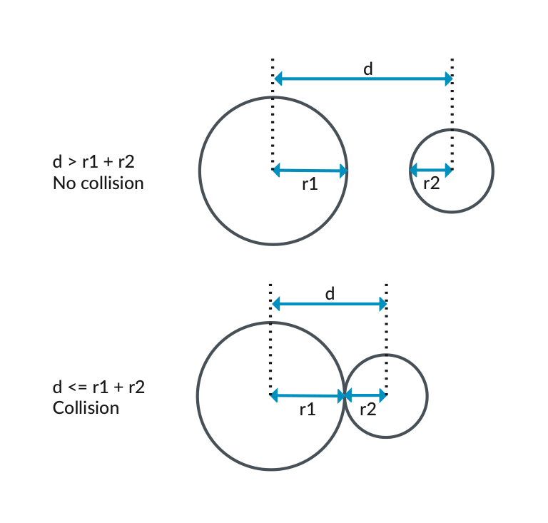

*图 6-1：单轴上的碰撞检测*

当一个圆的半径为 r1，另一个圆的半径为 r2 时：

- 当两圆圆心之间的距离 d 大于 r1 和 r2 之和时，圆不碰撞。
- 当两圆圆心之间的距离 d 小于或等于 r1 和 r2 之和时，圆碰撞。

在二维中，每个物体都有一对 (x, y) 坐标指定圆心。考虑同样的两个圆 c1 和 c2，分别位于 (c1x, c1y) 和 (c2x, c2y)，如下图所示：

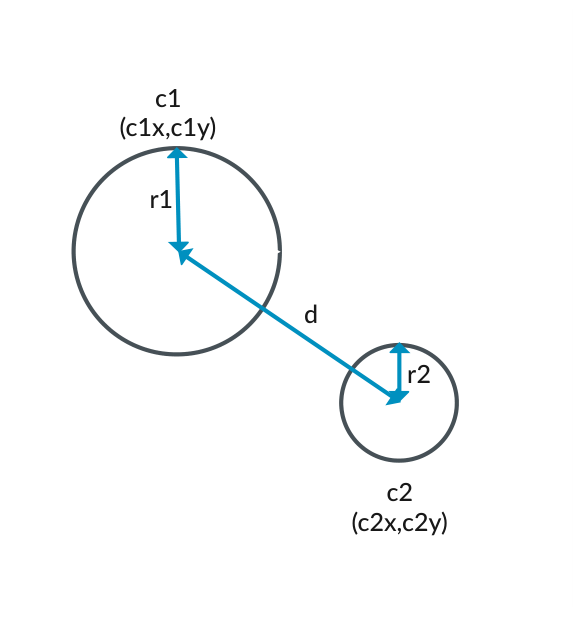

*图 6-2：二维中的碰撞检测*

二维中的碰撞检测与单轴上相同：

- 当两圆圆心之间的距离 d 大于 r1 和 r2 之和时，圆不碰撞。
- 当两圆圆心之间的距离 d 小于或等于 r1 和 r2 之和时，圆碰撞。

要计算两圆圆心之间的距离，想象一个叠加在圆位置上的直角三角形，如下图所示：

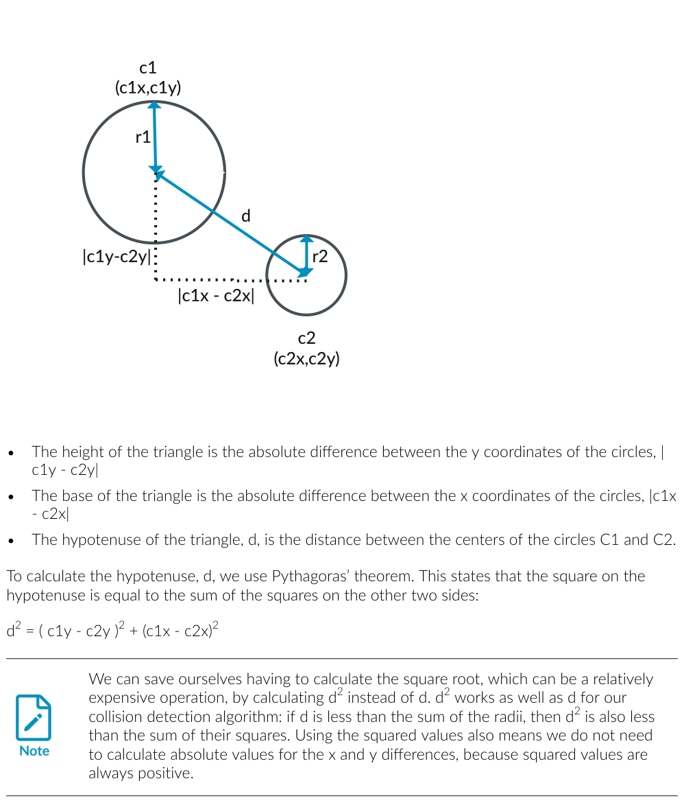

*图 6-3：用勾股定理计算圆之间的距离*

- 三角形的高是两个圆 y 坐标差的绝对值，|c1y - c2y|。
- 三角形的底是两个圆 x 坐标差的绝对值，|c1x - c2x|。
- 三角形的斜边 d 是圆 C1 和 C2 圆心之间的距离。

要计算斜边 d，我们使用勾股定理。它指出斜边上的平方等于另外两边上的平方之和：

d² = (c1y - c2y)² + (c1x - c2x)²

> 通过计算 d² 而不是 d，我们可以省去计算平方根（这可能是相对昂贵的操作）。对于我们的碰撞检测算法，d² 和 d 同样有效：如果 d 小于半径之和，那么 d² 也小于它们和的平方。使用平方值还意味着我们不需要计算 x 和 y 差的绝对值，因为平方值总是正的。

**不使用向量化的算法实现**

碰撞检测算法取两个圆的圆心点，并检查圆心点之间的距离。如果这个距离小于它们半径之和，圆就发生了碰撞。

下面的例子展示了不使用向量化的代码：

```c
#include <stdio.h>
struct circle
{
  float radius;
  float x;
  float y;
};
bool does_collide(circle& c1, circle& c2)
{
  // 如果 c1 到 c2 的距离小于它们半径之和，两个圆就碰撞；
  // 等价地，如果距离的平方小于半径之和的平方。
  float delta_x = c1.x - c2.x;
  float delta_y = c1.y - c2.y;
  float deltas_squared = (delta_x * delta_x) + (delta_y * delta_y);
  float radius_sum_squared = (c1.radius * c1.radius) + (c2.radius * c2.radius);
  return deltas_squared <= radius_sum_squared;
}
int main()
{
  circle c1;
  c1.radius = 2.0;
  c1.x = 2.0;
  c1.y = 4.0;
  circle c2;
  c2.radius = 1.0;
  c2.x = 6.0;
  c2.y = 1.0;
  if (does_collide(c1, c2)) {
    printf("Circles collide\n");
  } else {
    printf("Circles do not collide\n");
  }
  return (0);
}
```

这段代码创建了两个圆，如下所示：

- c1，半径 2，坐标 (2,4)
- c2，半径 1，坐标 (6,1)

x 坐标之差为 4（6-2），y 坐标之差为 3（4-1）。这意味着两圆圆心之间的距离是 5（3² + 4² = 5²）。下图展示了这个计算：

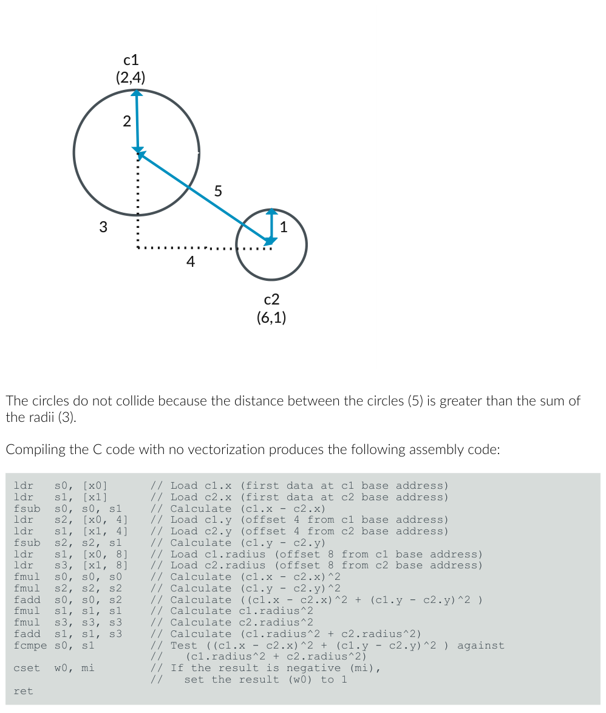

*图 6-4：碰撞检测示例*

圆不碰撞，因为两圆之间的距离（5）大于半径之和（3）。

编译不带向量化的 C 代码产生以下汇编代码：

```asm
ldr   s0, [x0]      // 加载 c1.x（c1 基地址处的第一个数据）
ldr   s1, [x1]      // 加载 c2.x（c2 基地址处的第一个数据）
fsub  s0, s0, s1    // 计算 (c1.x - c2.x)
ldr   s2, [x0, 4]   // 加载 c1.y（c1 基地址偏移 4）
ldr   s1, [x1, 4]   // 加载 c2.y（c2 基地址偏移 4）
fsub  s2, s2, s1    // 计算 (c1.y - c2.y)
ldr   s1, [x0, 8]   // 加载 c1.radius（c1 基地址偏移 8）
ldr   s3, [x1, 8]   // 加载 c2.radius（c2 基地址偏移 8）
fmul  s0, s0, s0    // 计算 (c1.x - c2.x)^2
fmul  s2, s2, s2    // 计算 (c1.y - c2.y)^2
fadd  s0, s0, s2    // 计算 ((c1.x - c2.x)^2 + (c1.y - c2.y)^2)
fmul  s1, s1, s1    // 计算 c1.radius^2
fmul  s3, s3, s3    // 计算 c2.radius^2
fadd  s1, s1, s3    // 计算 (c1.radius^2 + c2.radius^2)
fcmpe s0, s1        // 比较 ((c1.x-c2.x)^2 + (c1.y-c2.y)^2) 与 (c1.radius^2 + c2.radius^2)
cset  w0, mi        // 如果结果为负（mi），把结果（w0）置 1
ret
```

**使用 Neon 内建函数的基本向量化**

Neon 指令同时对多个数据值执行相同的计算。

我们的碰撞检测算法包含多处对不同的数据值执行相同数学运算的地方。这些运算是使用 Neon 内建函数优化的候选：

- 减法：
  - 我们从 c1.x 中减去 c2.x 来计算 x 坐标之差。
  - 我们从 c1.y 中减去 c2.y 来计算 y 坐标之差。
- 乘法：
  - 我们把 c1.radius 乘以它自己来计算平方。
  - 我们把 c2.radius 乘以它自己来计算平方。

下面的代码使用 Neon 内建函数来优化碰撞检测算法：

```c
#include <arm_neon.h>
#include <stdio.h>
struct circle
{
  float x;
  float y;
  float radius;
} __attribute__((aligned (64)));
bool does_collide_neon(circle const& c1, circle const& c2)
{
  float32x2_t c1_coords = vld1_f32(&c1.x);
  float32x2_t c2_coords = vld1_f32(&c2.x);
  float32x2_t deltas = vsub_f32(c1_coords, c2_coords);
  float32x2_t deltas_squared = vmul_f32(deltas, deltas);
  float sum_deltas_squared = vpadds_f32(deltas_squared);
  float radius_sum = c1.radius + c2.radius;
  float radius_sum_squared = radius_sum * radius_sum;
  return sum_deltas_squared <= radius_sum_squared;
}
int main()
{
  circle c1;
  c1.radius = 2.0;
  c1.x = 2.0;
  c1.y = 4.0;
  circle c2;
  c2.radius = 1.0;
  c2.x = 6.0;
  c2.y = 1.0;
  if (does_collide_neon(c1, c2)) {
    printf("Circles collide\n");
  } else {
    printf("Circles do not collide\n");
  }
  return (0);
}
```

这段代码使用 2 通道 64 位 Neon 寄存器（每个包含 32 位浮点值）的 Neon 内建函数来并行化算法的部分运算。使用 Neon 内建函数的代码部分如下：

1. 把每个圆的 x 和 y 坐标加载到两个独立 Neon 寄存器的不同通道中：

```c
float32x2_t c1_coords = vld1_f32(&c1.x);
float32x2_t c2_coords = vld1_f32(&c2.x);
```

vld1_f32 内建函数把两个 32 位浮点值加载到 Neon 寄存器中，如下图所示：

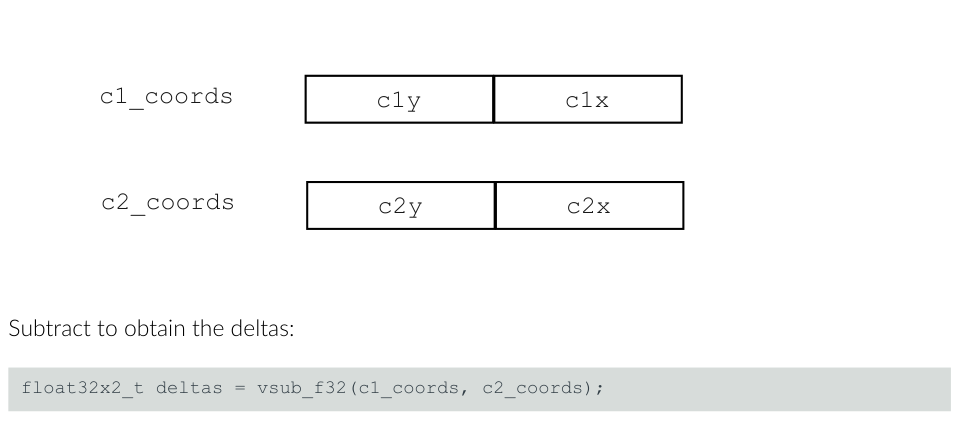

*图 6-5：vld1_f32*

2. 相减得到差值：

```c
float32x2_t deltas = vsub_f32(c1_coords, c2_coords);
```

vsub_f32 内建函数把第二个 Neon 寄存器中向量元素的对应元素从第一个寄存器中的向量元素中减去，然后把每个结果放入目标寄存器的元素中。下图展示了这一点：

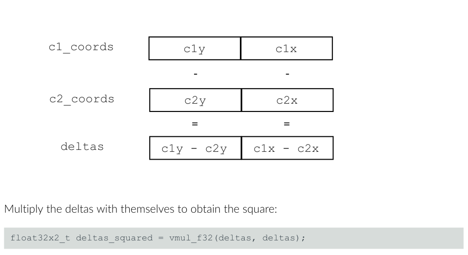

*图 6-6：vsub_f32*

3. 把差值乘以它们自己得到平方：

```c
float32x2_t deltas_squared = vmul_f32(deltas, deltas);
```

vmul_f32 把第一个 Neon 寄存器中的 32 位浮点向量元素乘以第二个源中的值，并把结果放入向量中。在我们的例子中，我们用相同的值来得到差值的平方，如下图所示：

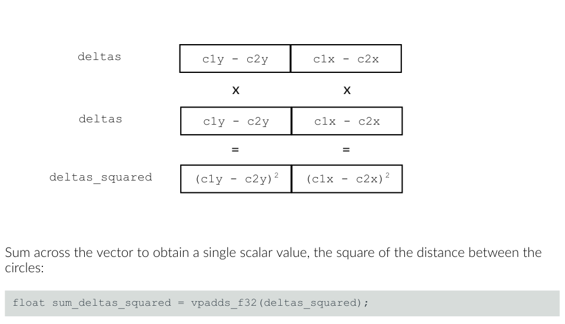

*图 6-7：vmul_f32*

4. 对向量求和得到一个标量值，即两圆之间距离的平方：

```c
float sum_deltas_squared = vpadds_f32(deltas_squared);
```

vpadds_f32 把 Neon 寄存器中的两个浮点向量元素相加，得到一个标量结果。

编译 C 代码产生以下汇编代码：

```asm
ldr   d0, [x0]            // 把 c1.x 和 c1.y 加载到向量 d0 的两个通道中
                          //   （c1 基地址处的前两个数据值）
ldr   d1, [x1]            // 把 c2.x 和 c2.y 加载到向量 d1 的两个通道中
                          //   （c2 基地址处的前两个数据值）
fsub  v0.2s, v0.2s, v1.2s // 向量相减得到 x 和 y 的差值
fmul  v0.2s, v0.2s, v0.2s // 同时把两个差值平方
faddp s0, v0.2s           // 对向量求和得到平方和
ldr   s1, [x0, 8]         // 从这里开始是标量，同前...
ldr   s2, [x1, 8]
fadd  s1, s1, s2
fmul  s1, s1, s1
fcmpe s0, s1
cset  w0, mi
ret
```

这段代码通过并行化计算距离平方时的减法和乘法运算，实现了算法的向量化。

**使用 Neon 内建函数的高级向量化**

"使用 Neon 内建函数的基本向量化"中给出的解决方案可能并不比原始的非向量化实现更快。

并行化减法和乘法运算所带来的性能提升，受到我们输入的内存布局的限制。从这个内存布局加载向量寄存器需要若干指令。而且，我们只并行化了两个运算（一个减法和一个乘法），之后就需要执行跨通道加法运算。

circle 结构的声明意味着数据是交错的，这抑制了向量化。

另一种方法是改变我们的数据布局，提供去交错的数据。

下面的例子展示了这种方法。它创建一个新的结构体 circles 来保存指向数组的指针，这些数组包含去交错的 x、y 和 radius 数据。这种方法让我们可以检查单个碰撞圆（collider）与多个输入圆之间的碰撞。

```c
#include <arm_neon.h>
#include <stdio.h>
// 包含单个碰撞圆数据的结构体
struct circle
{
  float x;
  float y;
  float radius;
};
// 包含指向多个圆数据数组的指针的结构体
struct circles
{
  size_t size;
  float* xs;
  float* ys;
  float* radii;
};
void does_collide_neon_deinterleaved(circles const& input, circle& collider, bool* out)
{
  // 把碰撞圆的属性复制到 3 个独立的 4 通道向量寄存器中
  float32x4_t c1_x = vdupq_n_f32(collider.x);
  float32x4_t c1_y = vdupq_n_f32(collider.y);
  float32x4_t c1_r = vdupq_n_f32(collider.radius);
  for (size_t offset = 0; offset != input.size; offset += 4)
  {
    // 一次执行 4 个碰撞测试
    float32x4_t x = vld1q_f32(input.xs + offset);
    float32x4_t y = vld1q_f32(input.ys + offset);
    float32x4_t delta_x = vsubq_f32(c1_x, x);
    float32x4_t delta_y = vsubq_f32(c1_y, y);
    float32x4_t delta_x_squared = vmulq_f32(delta_x, delta_x);
    float32x4_t delta_y_squared = vmulq_f32(delta_y, delta_y);
    float32x4_t sum_deltas_squared = vaddq_f32(delta_x_squared, delta_y_squared);
    float32x4_t r = vld1q_f32(input.radii + offset);
    float32x4_t radius_sum = vaddq_f32(c1_r, r);
    float32x4_t radius_sum_squared = vmulq_f32(radius_sum, radius_sum);
    uint32x4_t mask = vcltq_f32(sum_deltas_squared, radius_sum_squared);
    // 把每个通道的结果解包出来
    out[offset] = 1 & vgetq_lane_u32(mask, 0);
    out[offset + 1] = 1 & vgetq_lane_u32(mask, 1);
    out[offset + 2] = 1 & vgetq_lane_u32(mask, 2);
    out[offset + 3] = 1 & vgetq_lane_u32(mask, 3);
  }
}
int main()
{
  int num_input = 4;
  float input_x[num_input] __attribute__((aligned (64)));
  float input_y[num_input] __attribute__((aligned (64)));
  float input_r[num_input] __attribute__((aligned (64)));
  bool output[num_input]   __attribute__((aligned (64)));
  // 为多个圆设置数据
  for (int i = 0; i < num_input; i++) {
    input_x[i] = i*2;
    input_y[i] = i*3;
    input_r[i] = i;
    output[i] = 0;
  }
  // 创建包含指向多个圆数组数据指针的输入对象
  circles c1;
  c1.size = num_input;
  c1.radii = input_r;
  c1.xs = input_x;
  c1.ys = input_y;
  // 创建包含单个圆数据的碰撞圆对象
  circle c2;
  c2.radius = 5.0;
  c2.x = 10.0;
  c2.y = 10.0;
  // 测试碰撞圆是否与任何输入圆碰撞，把结果返回到 output
  does_collide_neon_deinterleaved(c1, c2, output);
  // 遍历返回的输出数据并显示结果
  for (int i = 0; i < num_input; i++) {
    if (output[i]) {
      printf("Circle %d at (%.1f, %.1f) with radius %.1f collides\n", i, input_x[i], input_y[i], input_r[i]);
    } else {
      printf("Circle %d at (%.1f, %.1f) with radius %.1f does not collide\n", i, input_x[i], input_y[i], input_r[i]);
    }
  }
  return (0);
}
```

使用 Neon 内建函数的代码部分如下：

1. 把碰撞圆的 x、y 和 radius 属性复制到三个独立的 Neon 寄存器中：

```c
float32x4_t c1_x = vdupq_n_f32(collider.x);
float32x4_t c1_y = vdupq_n_f32(collider.y);
float32x4_t c1_r = vdupq_n_f32(collider.radius);
```

vdupq_n_f32 内建函数把单个标量值复制到 Neon 寄存器的所有通道中，如下图所示：

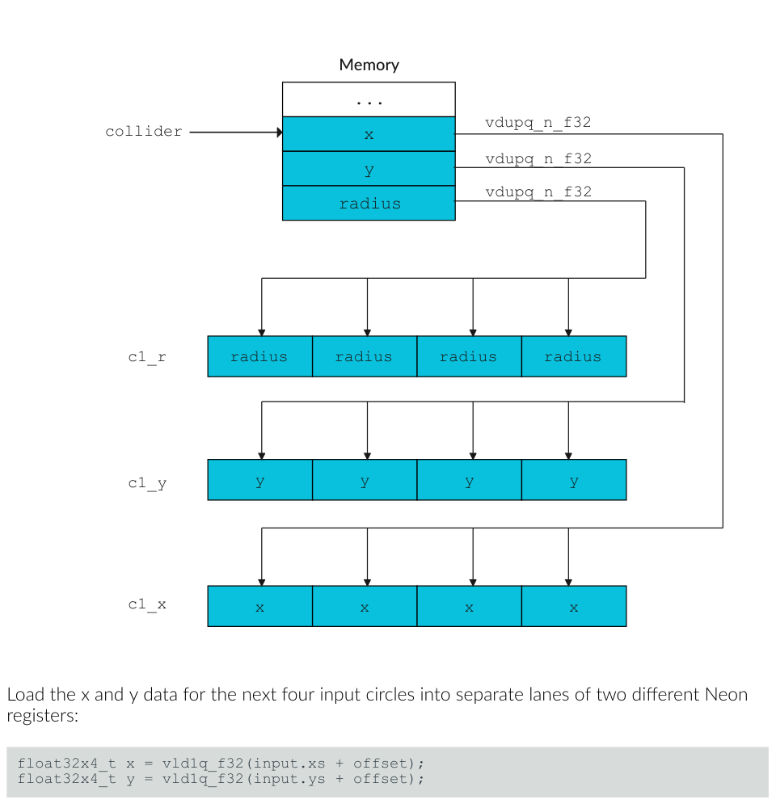

*图 6-8：vdupq_n_f32*

2. 把接下来四个输入圆的 x 和 y 数据加载到两个不同 Neon 寄存器的独立通道中：

```c
float32x4_t x = vld1q_f32(input.xs + offset);
float32x4_t y = vld1q_f32(input.ys + offset);
```

vld1q_f32 内建函数把四个 32 位值从连续内存地址加载到 Neon 寄存器的四个 32 位通道中。地址是通过给 x 和 y 数据的基地址指针加一个偏移量来计算的。偏移量在每次循环迭代时增加 4，因为每次循环处理四个圆。

下图展示了循环的第二次迭代，使用偏移量 4：

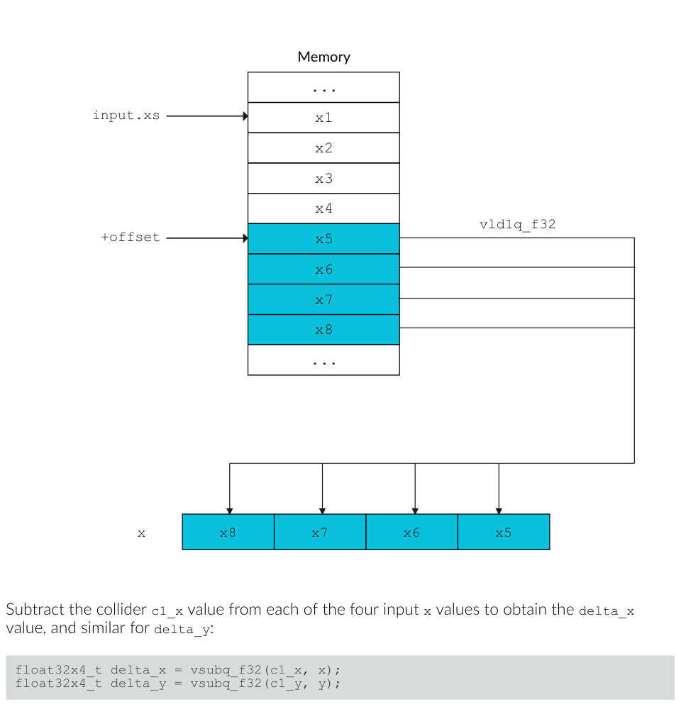

*图 6-9：vld1q_f32*

3. 从每个输入 x 值中减去碰撞圆的 c1_x 值得到 delta_x，delta_y 类似：

```c
float32x4_t delta_x = vsubq_f32(c1_x, x);
float32x4_t delta_y = vsubq_f32(c1_y, y);
```

下图展示了这一点：

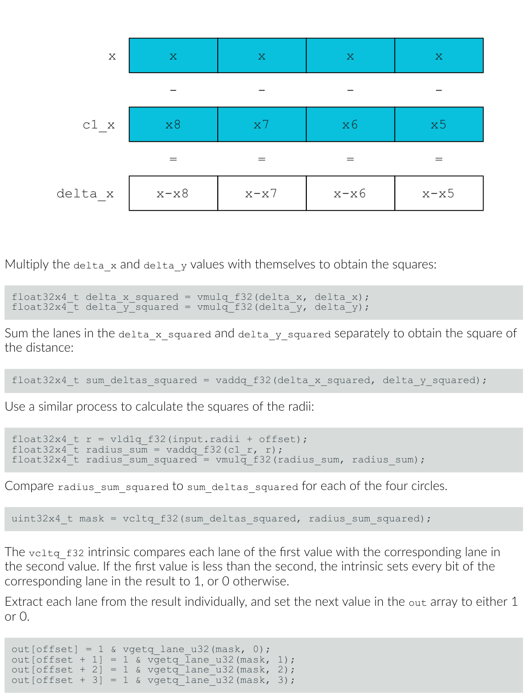

*图 6-10：vsubq_f32*

4. 把 delta_x 和 delta_y 值乘以它们自己得到平方：

```c
float32x4_t delta_x_squared = vmulq_f32(delta_x, delta_x);
float32x4_t delta_y_squared = vmulq_f32(delta_y, delta_y);
```

5. 分别对 delta_x_squared 和 delta_y_squared 的通道求和，得到距离的平方：

```c
float32x4_t sum_deltas_squared = vaddq_f32(delta_x_squared, delta_y_squared);
```

6. 用类似的过程计算半径的平方：

```c
float32x4_t r = vld1q_f32(input.radii + offset);
float32x4_t radius_sum = vaddq_f32(c1_r, r);
float32x4_t radius_sum_squared = vmulq_f32(radius_sum, radius_sum);
```

7. 对四个圆中的每一个比较 radius_sum_squared 与 sum_deltas_squared：

```c
uint32x4_t mask = vcltq_f32(sum_deltas_squared, radius_sum_squared);
```

vcltq_f32 内建函数把第一个值的每个通道与第二个值中相应的通道比较。如果第一个值小于第二个值，内建函数把结果中相应通道的每一位设为 1，否则设为 0。

8. 从结果中逐个提取每个通道，并把 out 数组中的下一个值设为 1 或 0：

```c
out[offset] = 1 & vgetq_lane_u32(mask, 0);
out[offset + 1] = 1 & vgetq_lane_u32(mask, 1);
out[offset + 2] = 1 & vgetq_lane_u32(mask, 2);
out[offset + 3] = 1 & vgetq_lane_u32(mask, 3);
```

**性能结果**

本节描述本指南中所述三种不同实现的性能结果。

在分析性能时，所有函数都加了 GCC 的 noinline 属性，以防止编译器自动向量化。这样我们就能比较仅由使用 Neon 内建函数带来的性能提升。

下表总结了性能结果：

| 函数 | 每次调用耗时 | 加速比 |
| --- | --- | --- |
| does_collide | 2.724 ns | 1x |
| does_collide_neon | 2.717 ns | 1.003x |
| does_collide_neon_deinterleaved | 0.925 ns | 2.945x |

对于上面每个测试，左列的函数在 100,000 次试验中执行了 16,384 次碰撞测试，以计算中间列的每次调用耗时。在所有情况下，代码都用 -O3 编译并在 Samsung S20 上运行。

> does_collide_neon 的加速比微乎其微。然而，在 does_collide_neon_deinterleaved 中重构数据，带来了近 3 倍的惊人性能提升。

## 7. 编程约定

编程约定（program convention）是针对特定编程语言的一组指南。

**宏**

要使用内建函数，必须支持 Advanced SIMD 架构，而某些特定指令在任何情况下可能启用也可能不启用。当以下宏被定义且等于 1 时，相应的特性可用：

| 宏 | 含义 |
| --- | --- |
| __ARM_NEON | 编译器支持 Advanced SIMD。AArch64 下始终为 1。 |
| __ARM_NEON_FP | 支持 Neon 浮点运算。AArch64 下始终为 1。 |
| __ARM_FEATURE_CRYPTO | 加密指令可用。因此加密 Neon 内建函数可用。 |
| __ARM_FEATURE_FMA | 融合乘加指令可用。因此使用这些指令的 Neon 内建函数可用。 |

此列表并不详尽，更多宏在《Arm C Language Extensions》文档中有详细说明。

**类型**

arm_neon.h 中有三大类数据类型，遵循以下模式：

- baseW_t 标量数据类型
- baseWxL_t 向量数据类型
- baseWxLxN_t 向量数组数据类型

其中：

- base 指基础数据类型。
- W 是基础类型的宽度。
- L 是向量数据类型中标量数据类型实例的数量，例如标量数组。
- N 是向量数组类型中向量数据类型实例的数量，例如标量数组的结构体。

通常 W 和 L 使得向量数据类型为 64 或 128 位长，因此完全装入 Neon 寄存器。N 对应那些一次操作多个寄存器的指令。

在我们之前的代码中，我们遇到了这三种类型的例子：

- uint8_t
- uint8x16_t
- uint8x16x3_t

**函数**

根据《Arm C Language Extensions》，arm_neon.h 中的函数原型遵循一种通用模式。在最一般的层次上是：

```
ret v[p][q][r]name[u][n][q][x][_high][_lane | laneq][_n][_result]_type(args)
```

注意某些字母和名称被重载了，但按上面的顺序：

- **ret**：函数的返回类型。
- **v**：vector 的缩写，出现在所有内建函数上。
- **p**：表示成对（pairwise）操作。（[value] 表示 value 可能出现）。
- **q**：表示饱和（saturating）操作（AArch64 操作中 vqtb[l][x] 除外，其中 q 表示 128 位索引和结果操作数）。
- **r**：表示舍入（rounding）操作。
- **name**：基本操作的描述性名称。通常是 Advanced SIMD 指令，但不一定。
- **u**：表示有符号到无符号的饱和。
- **n**：表示收窄（narrowing）操作。
- **q**（后缀）：后缀在名称后表示对 128 位向量的操作。
- **x**：在 AArch64 中表示 Advanced SIMD 标量操作。可以是 b、h、s 或 d 之一（即 8、16、32 或 64 位）。
- **_high**：在 AArch64 中，用于涉及 128 位操作数的加宽和收窄操作。对加宽 128 位操作数，high 指源操作数的高 64 位。对收窄，它指目标操作数的高 64 位。
- **_n**：表示作为参数提供的标量操作数。
- **_lane**：表示从向量通道中取的标量操作数。_laneq 表示从 128 位宽度的输入向量通道中取的标量操作数。（left | right 表示只出现 left 或 right 之一）。
- **type**：主操作数类型的缩写形式。
- **args**：函数的参数。

## 8. 知识自测

阅读以下问题来检验你的知识。

**什么是 Neon？**

Neon 是 Arm 架构 Advanced SIMD 扩展的实现。所有符合 Armv8-A 或 Armv9-A 架构的处理器（例如 Cortex-A76 或 Cortex-A57）都包含 Neon。在程序员看来，Neon 提供额外的 32 个 128 位寄存器，以及对这些寄存器内 8、16、32 或 64 位通道进行操作的指令。

**要在 C 文件中使用 Neon 内建函数，必须包含哪个头文件？**

arm_neon.h。`#include <arm_neon.h>` 必须出现在任何 Neon 内建函数使用之前。

**这个函数做什么？int8x16_t vmulq_s8 (int8x16_t a, int8x16_t b)**

函数名中的 mul 提示这个内建函数使用 MUL 指令。根据参数和返回值的类型——十六个字节的有符号整数——我们可以猜这个内建函数映射到指令 `MUL Vd.16B, Vn.16B, Vm.16B`。所以这个函数把 a 和 b 的对应元素相乘并返回结果。检查定义可以证实这一点。

**本教程中定义的去交错函数只能操作 16 个 8 位无符号整数组成的块。如果你有一个长度不是 16 的倍数的 uint8_t 值数组，如何在"改数组但不改函数"或"改函数但不改数组"之间权衡？**

要改数组但不改函数，就给数组补零。这是最简单的选择，但这种填充可能需要在其他函数中处理。要改函数但不改数组，就对每个完整的 16 倍数使用 Neon 去交错，对余下部分使用 C 去交错。

**数据类型 float64_t、poly64x2_t 和 int8x8x3_t 分别代表什么？**

float64_t 是标量类型，即 64 位浮点类型。poly64x2_t 是两个 64 位多项式标量的向量类型。int8x8x3_t 是三个 8 位有符号整数向量的向量数组类型。

## 9. 相关信息

以下是与本指南内容相关的一些资源：

- Neon 内建函数的工程规范可以在《Arm C Language Extensions（ACLE）》中找到。
- 《Neon Intrinsics Reference》提供了对 ACLE 所指定函数的可搜索参考。
- 架构探索工具（Architecture Exploration Tools）让你研究 Advanced SIMD 指令集。
- 《Arm 架构参考手册》提供了 Advanced SIMD 指令集的完整规范。
- Arm Cortex-A Software Development 软件培训课程旨在帮助从事新的或现有 Cortex-A 系统设计的工程师。
